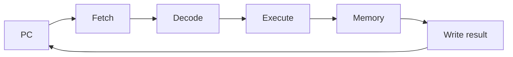
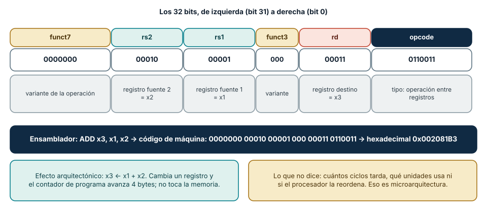
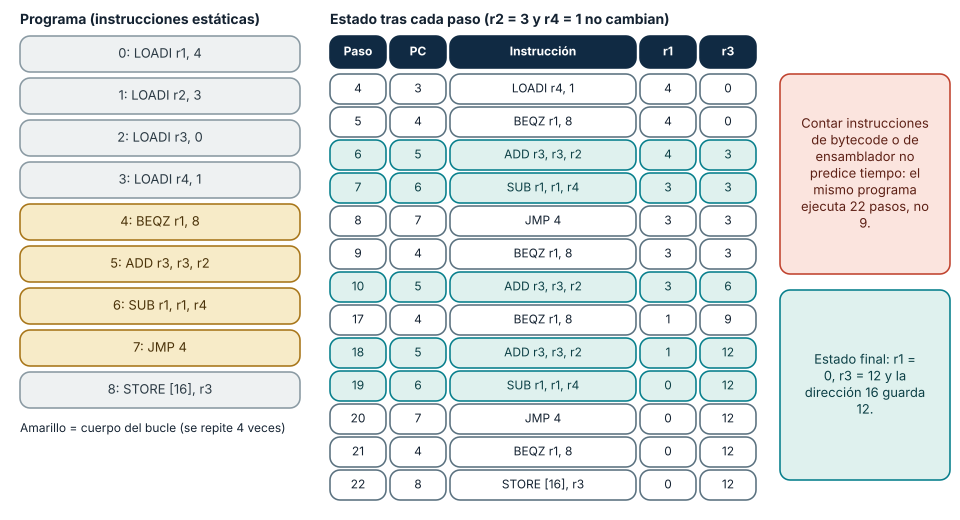
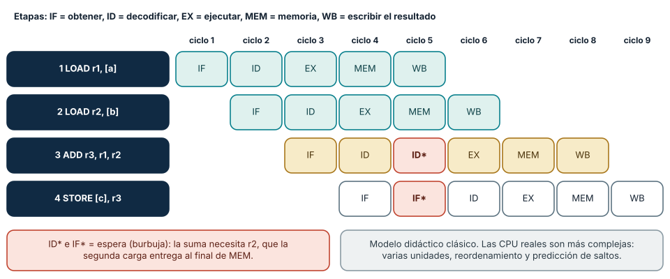

# SE-017 — CPU, instrucciones, registros y ciclos de ejecución

[← SE-016](../../classes/part-01-computadores-y-representacion-de-informacion/se-016-enteros-coma-flotante-precision-y-errores-numericos/README.md) · [↑ Parte 01](../../classes/part-01-computadores-y-representacion-de-informacion/README.md) · [📚 Índice completo](../../classes/README.md) · [SE-018 →](../../classes/part-01-computadores-y-representacion-de-informacion/se-018-memoria-caches-almacenamiento-y-jerarquias/README.md)


## Punto profesional y fundamento pedagógico

**Punto profesional.** La clase existe para explicar instrucciones como transiciones de estado sin confundir bytecode con ISA.

**Por qué aparece aquí.** Se sitúa después de **Enteros, coma flotante, precisión y errores numéricos** y antes de **Memoria, cachés, almacenamiento y jerarquías**: convierte el conocimiento anterior en una decisión observable que la clase siguiente podrá reutilizar. La continuidad se comprueba en el artefacto, no por compartir vocabulario.

**Error conceptual que debe corregir.** Leer la salida de dis como ensamblador o convertir bytecodes en ciclos de CPU.

**Secuencia de aprendizaje.** Traza primero una secuencia ISA didáctica a mano, con preestado y postestado. Después compárala con el bytecode de CPython y marca toda correspondencia que no puedas demostrar. Invierte un salto, localiza la primera divergencia y reconstruye la explicación sin convertir instrucciones virtuales en ciclos físicos.

**Evidencia de aprendizaje.** Execution-trace.md con estados antes/después y la frontera VM↔ISA. Debe contener predicción previa, observación, explicación causal, contraejemplo, criterio de aceptación y una nota de qué dato haría cambiar la conclusión.

**Límite de la conclusión.** Sin código nativo y contadores no se afirman instrucciones físicas ni ciclos.

### Trazabilidad fuente → afirmación

| Fuente primaria u oficial | Afirmación que respalda | Lo que no prueba |
|---|---|---|
| [RISC-V Unprivileged ISA](https://docs.riscv.org/reference/isa/unpriv/) |  define instrucciones y estado arquitectónico | No demuestra por sí sola que el artefacto del estudiante sea correcto. |
| [Python `dis`](https://docs.python.org/3/library/dis.html) |  documenta bytecode específico de CPython y su carácter cambiante | No demuestra por sí sola que el artefacto del estudiante sea correcto. |

## Antes de empezar

`SE-016` explicó qué representan los operandos. Ahora seguirás cómo una CPU cambia
estado al cargar, operar, comparar y saltar. El analizador local de eventos aporta una suma sencilla; la clase la
convierte en una traza arquitectónica. `SE-018` añadirá el costo de obtener los datos.

## Prerrequisitos

Bits, hexadecimal, enteros y mapa de capas de `SE-013`–`SE-016`.

## Problema auténtico

Un equipo atribuye un retraso al “número de instrucciones” observado en bytecode. Pero
bytecode, instrucciones de ISA y operaciones internas no son la misma unidad. Optimiza
una métrica que no corresponde al procesador.

## Objetivos observables

Distinguirás ISA de microarquitectura; explicarás registros, contador de programa,
load/store, ALU y saltos; trazarás estado arquitectónico; y limitarás inferencias sobre
pipeline o ciclos.

## Temas y por qué importan

| Tema | Mecanismo | Por qué importa |
| --- | --- | --- |
| ISA | define operaciones y estado visibles | sostiene compatibilidad binaria |
| Registros y PC | conservan operandos y próxima instrucción | permiten seguir ejecución |
| Ciclo de instrucción | obtiene, decodifica y aplica efectos | conecta programa con transiciones |
| Microarquitectura | solapa y reordena trabajo internamente | explica rendimiento sin cambiar semántica |
## Mapa conceptual



Es un modelo lógico. Una implementación puede solapar etapas, ejecutar fuera de orden
y retirar resultados en orden; no debe leerse como un ciclo físico universal.

## Conceptos y decisiones

### 1. La ISA es el contrato, no el diagrama interno

Una ISA define instrucciones, registros, formatos y efectos observables. La misma ISA
puede tener implementaciones simples, segmentadas o fuera de orden. El software confía
en el resultado arquitectónico, no en cada señal interna.



**Cómo leer la figura.** Una instrucción es *datos*: treinta y dos bits repartidos en campos. El
`opcode` (`0110011`) dice que es una operación entre registros; `funct7` y `funct3` precisan cuál (aquí,
una suma); `rs1` y `rs2` nombran los registros fuente (`x1` y `x2`) y `rd`, el destino (`x3`). El hexadecimal
`0x002081B3` es esa misma secuencia agrupada de a cuatro bits. **Dónde deja de valer:** es el formato
de una familia de instrucciones de RISC-V. Otras ISA usan longitudes distintas (x86 tiene
instrucciones de 1 a 15 bytes) y RISC-V incluye una extensión comprimida de 16 bits; la idea común es
que la ISA define cómo se interpretan los bits, no que todas las instrucciones midan igual.

### 6. Decodificar: de bits a efecto arquitectónico

Decodificar es leer los campos y decidir qué cambiar. En el ejemplo, el decodificador extrae `rs1 = 1`
y `rs2 = 2`, lee esos dos registros, la unidad aritmética suma y el resultado se escribe en el registro
`rd = 3`; el contador de programa avanza cuatro bytes porque la instrucción ocupa cuatro. Una instrucción
de *salto* en cambio sustituye el contador de programa por un valor calculado, y una de *carga* calcula una
dirección y trae un dato desde memoria. Ese contrato es lo que el software observa: *qué registros y
qué memoria cambian y cuál es la siguiente instrucción*. No incluye cuántos ciclos tarda ni qué
circuitos se activan.

Esta separación explica por qué un mismo binario funciona en procesadores de generaciones y fabricantes
distintos, y por qué la compatibilidad binaria es una propiedad de la ISA y de la ABI (la convención de
llamadas y de representación de datos), no de la frecuencia ni del número de núcleos. También explica
que la ISA sea un compromiso de largo plazo: cada instrucción añadida debe mantenerse en las
generaciones futuras.

### 7. Ejecutar un programa a mano: estado, traza e instrucciones dinámicas

Para razonar sobre un programa en este nivel hace falta una *traza*: para cada instrucción, el
contador de programa, la operación y el estado de registros y memoria después de ejecutarla. La Figura 2
muestra la de un programa didáctico de nueve instrucciones que multiplica 4 por 3 con sumas repetidas.
El programa se puede ejecutar con un simulador mínimo de unas veinte líneas:

```python
prog = [("LOADI", "r1", 4), ("LOADI", "r2", 3), ("LOADI", "r3", 0), ("LOADI", "r4", 1),
        ("BEQZ", "r1", 8), ("ADD", "r3", "r3", "r2"), ("SUB", "r1", "r1", "r4"),
        ("JMP", 4), ("STORE", 16, "r3")]
regs, mem, pc, ejecutadas = {"r1": 0, "r2": 0, "r3": 0, "r4": 0}, {}, 0, 0
while pc < len(prog):
    op, *a = prog[pc]
    pc += 1
    ejecutadas += 1
    if op == "LOADI": regs[a[0]] = a[1]
    elif op == "ADD": regs[a[0]] = regs[a[1]] + regs[a[2]]
    elif op == "SUB": regs[a[0]] = regs[a[1]] - regs[a[2]]
    elif op == "STORE": mem[a[0]] = regs[a[1]]
    elif op == "BEQZ" and regs[a[0]] == 0: pc = a[1]
    elif op == "JMP": pc = a[0]
print(ejecutadas, mem)  # 22 {16: 12}
```

El resultado es una distinción que se pierde si solo se mira el código: el programa tiene **nueve
instrucciones estáticas** (las escritas) pero ejecuta **veintidós instrucciones dinámicas** (cuatro
de preparación, cuatro vueltas de cuatro instrucciones, la comprobación final y el almacenamiento).
Contar líneas, o bytecode, no dice cuántas instrucciones se ejecutan: depende de los datos. Lo mismo
ocurre con una línea de Python como `sum(x)`, que ejecuta un número de instrucciones nativas
proporcional al tamaño de `x`.



**Cómo leer la figura.** A la izquierda están las nueve instrucciones, con el cuerpo del bucle en
amarillo. A la derecha, el estado tras cada paso: `r1` baja de 4 a 0 mientras `r3` sube de 3 en 3
hasta 12. En el paso 21 `BEQZ` ve `r1 = 0` y salta a la dirección 8, y el paso 22 almacena el resultado.
**Dónde deja de valer:** el simulador ejecuta una instrucción a la vez y sin errores. Una CPU real
puede solapar varias, adelantar otras y especular sobre el resultado del salto, pero tiene que
*parecer* que ejecutó en ese orden, lo que se llama mantener el estado arquitectónico.

### 8. Dependencias, burbujas y por qué contar instrucciones no predice el tiempo

Una forma sencilla de acelerar un procesador es la *segmentación* (pipeline): dividir cada instrucción
en etapas (obtener, decodificar, ejecutar, acceder a memoria, escribir) y solapar instrucciones
distintas en etapas distintas. En condiciones ideales se completa una instrucción por ciclo aunque
cada una tarde cinco. Las *dependencias de datos* impiden que sea siempre así: en la Figura 3, la suma
necesita `r2`, que la segunda carga solo tiene disponible al final de su etapa de memoria. Con reenvío de
resultados la espera se reduce a un ciclo (una *burbuja*), y las cuatro instrucciones terminan en nueve
ciclos en lugar de ocho.



**Cómo leer la figura.** Cada fila es una instrucción y cada columna un ciclo. Las filas están
desplazadas un ciclo porque cada instrucción entra detrás de la anterior. Las casillas rojas con
asterisco son esperas: la suma queda detenida en la decodificación y arrastra a la instrucción
siguiente. **Dónde deja de valer:** es el pipeline clásico de cinco etapas de los libros de texto.
Los procesadores modernos tienen decenas de etapas, varias unidades de ejecución, ejecución fuera de
orden y predicción de saltos; el modelo explica *por qué* existen las dependencias, no cuántos ciclos
tarda un procesador concreto.

El rendimiento se resume en la ecuación clásica: *tiempo de CPU = instrucciones × ciclos por
instrucción (CPI) × periodo del reloj*. Reducir instrucciones ayuda solo si el CPI no empeora; subir la
frecuencia ayuda solo si no aumentan las esperas de memoria. Los saltos añaden otra dependencia: la CPU
predice el resultado para no detenerse, y si se equivoca descarta el trabajo especulativo. La semántica
se conserva, pero el estado interno (por ejemplo, qué hay en las cachés) no vuelve exactamente al
anterior, y esa diferencia puede observarse como tiempo. Los ataques de ejecución especulativa
conocidos como Spectre explotaron precisamente esa brecha entre lo que garantiza la ISA y lo que
revela la microarquitectura; es un recordatorio de que «no cambia el resultado» no equivale a «no deja
rastro».


### 2. Los registros sostienen el estado inmediato

Registros generales guardan operandos y resultados de acceso rápido. El contador de
programa localiza la siguiente instrucción; otros registros representan estado de
control. Su cantidad y reglas pertenecen a la ISA. “Variable” no significa “registro”:
compilador y runtime deciden ubicación y pueden moverla.

### 3. Load/store separa cálculo y acceso a memoria

En una ISA RISC típica, instrucciones load traen datos, la ALU opera registros y store
escribe. Direcciones, alineación y permisos pueden producir excepciones. Una suma de
alto nivel implica además comprobaciones, representación de objetos y llamadas según
lenguaje y runtime.

### 4. Saltos convierten condiciones en control

Comparaciones y branches cambian el PC. Bucles y decisiones surgen de esas transiciones.
Una predicción de salto intenta mantener ocupada la máquina; si falla, descarta trabajo
especulativo. La semántica correcta permanece, pero tiempo y efectos laterales
microarquitectónicos requieren análisis aparte.

### 5. Pipeline, ejecución fuera de orden y retiro

Solapar instrucciones mejora throughput cuando no existen dependencias. La CPU puede
ejecutar operaciones listas antes que otras y retirar resultados de manera que el
estado visible respete el contrato. Contar instrucciones no basta para predecir ciclos:
dependencias, memoria, unidades y predicción influyen.

## Caso conductor: sumar dos contadores del analizador local de eventos

La traza didáctica usa `LOAD r1,[a]`, `LOAD r2,[b]`, `ADD r3,r1,r2`, `STORE [c],r3`.
Para cada paso registra PC, registros y memoria afectada. Después marca qué aspectos no
conoce: caché, latencia, instrucciones generadas realmente y optimizaciones.

## Definiciones de trabajo

- **instrucción:** operación definida por una ISA;
- **registro:** almacenamiento nombrado visible para la ISA;
- **PC:** estado que identifica la próxima instrucción;
- **pipeline:** solapamiento de etapas;
- **retiro:** compromiso de resultados al estado arquitectónico.

## Glosario

**Opcode** identifica operación. **Operando** aporta datos. **Hazard** es una condición
que impide avanzar sin control. **Excepción** transfiere control por un evento síncrono.

## Ejemplo mínimo

`ADD r3,r1,r2` cambia `r3`, no memoria. Si `r1=2` y `r2=3`, el nuevo estado visible es
`r3=5`; la cantidad de transistores activados no forma parte del contrato.

## Ejemplo profesional

Dos procesadores ejecutan el mismo binario con tiempos distintos. La corrección se
evalúa por ISA/ABI; el rendimiento se mide por entorno. No se cambia algoritmo basándose
solo en frecuencia anunciada.

## Práctica guiada

Usa como base el [laboratorio ejecutable de la Parte 01](https://github.com/vladimiracunadev-create/modern-software-engineering-program/tree/main/labs/part-01-machine-observer); trabaja sobre una copia o conserva tus salidas en el directorio `work/SE-017/`.

1. Crea `trace.md` con ocho posiciones de memoria, cuatro registros y PC.
2. Ejecuta manualmente la secuencia del analizador local de eventos y anota pre/postestado.
3. Añade comparación y salto para manejar contador cero.
4. Introduce dirección inválida y describe excepción sin inventar manejo del SO.
5. Compara la traza con `dis.dis` de una función Python y explica por qué no son equivalentes.
6. Entrega `isa-model.md`, `trace.md`, `limits.md`.

## Ejercicios

1. Identifica dependencias de datos en cinco instrucciones.
2. Explica por qué más instrucciones pueden tardar menos en otra CPU.
3. Diseña un contraejemplo a “cada línea ejecuta una instrucción”.

## Reto verificable

Otra persona reproduce la traza y obtiene el mismo estado final. Debe distinguir tres
hechos de la ISA y tres incógnitas de microarquitectura.

## Preguntas frecuentes

### ¿Fetch–decode–execute describe cualquier CPU?
Es un modelo útil; no prescribe organización física ni número de ciclos.

### ¿Bytecode es ensamblador?
Es un conjunto de instrucciones para una máquina virtual, no necesariamente la ISA física.

### ¿Por qué RISC-V y x86 hacen lo mismo con instrucciones distintas?

Porque la ISA es un contrato con otro diseño. RISC-V es una arquitectura de carga y almacenamiento
con instrucciones de longitud regular; x86 tiene instrucciones de longitud variable, y muchas pueden
operar directamente con la memoria. Los procesadores x86 actuales traducen internamente sus
instrucciones a operaciones más simples. Dos ISA pueden calcular lo mismo con tiempos y costos de
implementación distintos.

### ¿Qué es el CPI y por qué importa?

Son los *ciclos por instrucción* promedio de un programa en un procesador. Un CPI cercano a 1 indica que
el procesador completa casi una instrucción por ciclo; un CPI alto señala esperas (memoria, saltos mal
predichos, dependencias). Se obtiene con contadores de hardware, que Python no expone, de modo que en
esta clase se razona sobre él sin medirlo.

### ¿Las instrucciones privilegiadas y las excepciones forman parte de la ISA?

Sí. La ISA define también los modos de ejecución, las excepciones (una dirección inválida o una
instrucción ilegal transfieren el control al sistema operativo) y las instrucciones que solo el
núcleo puede ejecutar. Es lo que permite que el sistema operativo aísle procesos, tema de `SE-019`.

## Fallo controlado y diagnóstico

Cambia un salto para usar la condición opuesta. Registra PC y primer estado divergente;
corrige la condición, no el resultado final a mano.

Un segundo fallo controlado usa el simulador de la sección 7. Cambia `BEQZ` por una instrucción
que salte cuando el registro *no* sea cero (`BNEZ`) sin ajustar la dirección de destino. **Síntoma:**
el programa termina de inmediato con `r3 = 0` y la dirección 16 guarda 0 en lugar de 12. **Traza:** busca el primer
paso en que el contador de programa difiere del original (el paso 5, donde ya salta al final con
`r1 = 4`). **Causa:** la condición opuesta invierte el control del bucle. **Corrección:** invierte la
condición *y* verifica el destino, y escribe una prueba con `r1 = 0` al inicio (cero vueltas) y con
`r1 = 1`. Añade un límite de pasos al simulador para que un bucle infinito falle con un mensaje y no se
cuelgue; esa protección es el equivalente de un tiempo de espera en producción.

## Errores comunes y cómo corregirlos

| Síntoma | Causa | Corrección |
| --- | --- | --- |
| variable = registro | abstracciones mezcladas | documenta decisiones de compilador/runtime |
| una instrucción = un ciclo | modelo simplificado literal | separa ISA y microarquitectura |
| `dis` se presenta como código nativo | VM confundida con CPU | etiqueta el nivel de instrucción |
| traza solo muestra resultados | transiciones invisibles | registra preestado, operación y postestado |

## Entorno y archivos clave

Markdown y Python `dis`; `isa-model.md`, `trace.md`, `limits.md`. Sin ensamblador ejecutable.

## Seguridad, ética y accesibilidad

No ejecutes binarios ni uses contadores privilegiados. Describe el diagrama en texto y
no uses rendimiento supuesto para excluir hardware accesible.

## Puente hacia el trabajo con agentes

Un asistente que optimiza código a menudo razona con la ecuación de las «instrucciones»: elimina
una llamada o reescribe un bucle porque *parece* más corto. La traza de esta clase enseña a pedir
evidencia del nivel correcto: un perfil de tiempo, el recuento de instrucciones dinámicas con
herramientas del sistema o una medición repetida, y no la afirmación de que el cambio «ejecuta
menos». Cuando un agente propone un cambio de rendimiento, exige el criterio de aceptación antes de
aplicarlo (qué métrica, en qué entorno, cuántas repeticiones) y desconfía de optimizaciones que
dependen de supuestos sobre la CPU. Tampoco permitas que un agente ejecute binarios desconocidos para
«comprobar» una hipótesis: la clase ya fija como regla no ejecutar código no confiable.

## Transferencia

Compara una instrucción RISC-V documentada con bytecode de JVM o Python y delimita contratos.

## Evaluación y evidencia

Se exigen traza reproducible, dependencias, excepción y límites de microarquitectura.

## Fuentes


- [RISC-V Unprivileged ISA](https://docs.riscv.org/reference/isa/unpriv/) define instrucciones y estado arquitectónico.
- [Python `dis`](https://docs.python.org/3/library/dis.html) documenta bytecode específico de CPython y su carácter cambiante.
- David Patterson y John Hennessy, *Computer Organization and Design: RISC-V Edition* (Morgan Kaufmann, ISBN 978-0-12-812275-4): formatos de instrucción, pipeline de cinco etapas, dependencias y la ecuación del tiempo de CPU; respalda las secciones 6 a 8.
- Paul Kocher et al., «Spectre Attacks: Exploiting Speculative Execution», IEEE Symposium on Security and Privacy 2019, DOI [10.1109/SP.2019.00002](https://doi.org/10.1109/SP.2019.00002), y el [sitio de divulgación](https://spectreattack.com/): muestran que el estado microarquitectónico puede filtrar información aunque el estado arquitectónico se conserve.

## Límites y siguiente paso

No mide ciclos físicos ni cubre ensamblador completo. `SE-018` añade jerarquías y localidad.

---
[← SE-016](../../classes/part-01-computadores-y-representacion-de-informacion/se-016-enteros-coma-flotante-precision-y-errores-numericos/README.md) · [↑ Parte 01](../../classes/part-01-computadores-y-representacion-de-informacion/README.md) · [SE-018 →](../../classes/part-01-computadores-y-representacion-de-informacion/se-018-memoria-caches-almacenamiento-y-jerarquias/README.md)
