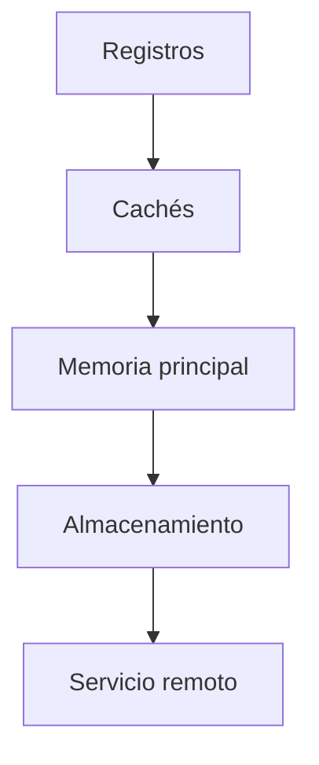
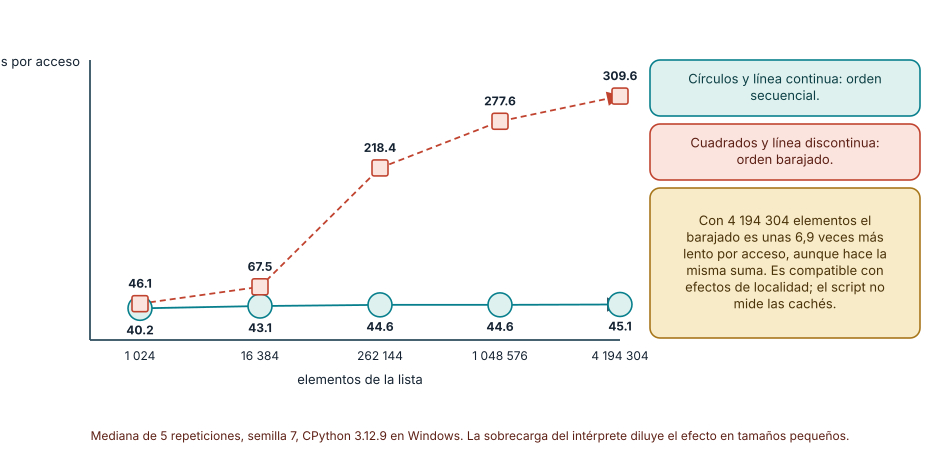
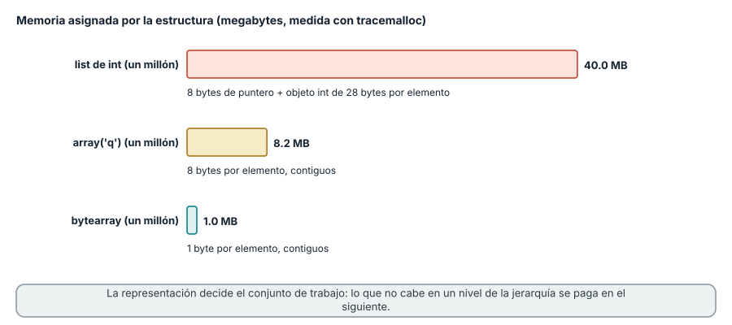
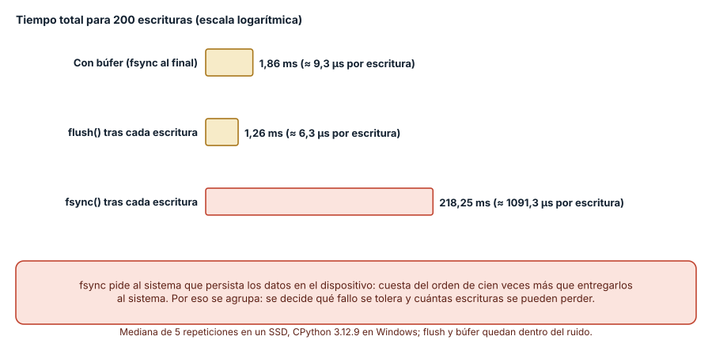

# SE-018 — Memoria, cachés, almacenamiento y jerarquías

[← SE-017](../../classes/part-01-computadores-y-representacion-de-informacion/se-017-cpu-instrucciones-registros-y-ciclos-de-ejecucion/README.md) · [↑ Parte 01](../../classes/part-01-computadores-y-representacion-de-informacion/README.md) · [📚 Índice completo](../../classes/README.md) · [SE-019 →](../../classes/part-01-computadores-y-representacion-de-informacion/se-019-procesos-hilos-interrupciones-y-entrada-salida/README.md)


## Punto profesional y fundamento pedagógico

**Punto profesional.** La clase existe para elegir almacenamiento y acceso por localidad, latencia, capacidad y durabilidad.

**Por qué aparece aquí.** Se sitúa después de **CPU, instrucciones, registros y ciclos de ejecución** y antes de **Procesos, hilos, interrupciones y entrada/salida**: convierte el conocimiento anterior en una decisión observable que la clase siguiente podrá reutilizar. La continuidad se comprueba en el artefacto, no por compartir vocabulario.

**Error conceptual que debe corregir.** Atribuir una segunda ejecución rápida a una caché concreta o equiparar write con persistencia.

**Secuencia de aprendizaje.** Predice cómo cambiará un recorrido al crecer el conjunto de trabajo, pero registra al menos dos causas rivales. Ejecuta tamaños y órdenes alternados, conserva muestras crudas y pide a otra persona que cuestione cualquier atribución a una caché específica. La transferencia cambia la disposición de datos sin cambiar el resultado funcional.

**Evidencia de aprendizaje.** Hierarchy.md con protocolo frío/caliente, muestras y dos hipótesis rivales. Debe contener predicción previa, observación, explicación causal, contraejemplo, criterio de aceptación y una nota de qué dato haría cambiar la conclusión.

**Límite de la conclusión.** Sin contadores de hardware se observan efectos agregados, no una caché específica.

### Trazabilidad fuente → afirmación

| Fuente primaria u oficial | Afirmación que respalda | Lo que no prueba |
|---|---|---|
| [Python `tracemalloc`](https://docs.python.org/3/library/tracemalloc.html) |  define la memoria Python observable | No demuestra por sí sola que el artefacto del estudiante sea correcto. |
| [RISC-V memory model](https://docs.riscv.org/reference/isa/unpriv/rvwmo.html) |  muestra que orden de memoria también es contrato arquitectónico | No demuestra por sí sola que el artefacto del estudiante sea correcto. |
| [Python `os`](https://docs.python.org/3/library/os.html) |  documenta interfaces de archivo y `fsync` | No demuestra por sí sola que el artefacto del estudiante sea correcto. |

## Antes de empezar

La traza de `SE-017` trató los accesos como pasos simples. En una máquina real, traer un
dato puede costar mucho más que operar con él. El analizador local de eventos procesará colecciones con distinto
orden para estudiar localidad y conjunto de trabajo sin atribuir causas que la
biblioteca estándar no mide.

## Prerrequisitos

Instrucciones load/store, medición crítica de `SE-006` y Python 3.11+.

## Problema auténtico

Un cambio reduce operaciones aritméticas y empeora tiempo porque dispersa accesos y
aumenta asignaciones. El equipo cuenta instrucciones conceptuales, pero omite la ruta
de los datos.

## Objetivos observables

Explicarás jerarquía, latencia, capacidad y persistencia; relacionarás localidad con
caché; distinguirás memoria virtual y física; medirás un patrón sin sobreatribuir causa.

## Temas y por qué importan

| Tema | Mecanismo | Por qué importa |
| --- | --- | --- |
| Jerarquía | combina niveles rápidos/pequeños y lentos/grandes | acerca datos con costo razonable |
| Localidad | reutiliza datos cercanos en tiempo o espacio | hace eficaces cachés y páginas |
| Memoria virtual | mapea direcciones del proceso | aporta aislamiento y flexibilidad |
| Persistencia | conserva datos más allá del proceso | cambia garantías de escritura y recuperación |
## Mapa conceptual



Al descender suele crecer capacidad y latencia. Es una tendencia, no una tabla de
tiempos universal; hardware, sistema y carga cambian los valores.

## Conceptos y decisiones

### 1. La jerarquía explota diferencias de costo

No existe un único “lugar de memoria”. Registros, cachés, RAM y almacenamiento ofrecen
combinaciones distintas de latencia, ancho de banda, capacidad, costo y persistencia.
El sistema mueve copias y mantiene coherencia según contratos. Un acceso lógico puede
resolverse en varios niveles.

### 2. Localidad predice reutilización, no garantiza un hit

Localidad temporal significa volver a datos recientes; espacial, acceder a direcciones
cercanas. Cachés transfieren líneas, por lo que recorrer datos contiguos suele aprovechar
espacio. El resultado depende de representación, tamaño, asociatividad, otros procesos
y prefetch. Medir un patrón no prueba cuál mecanismo dominó.



**Cómo leer la figura.** La misma lista, la misma suma y la misma cantidad de accesos; solo cambia
el *orden*. En orden secuencial el costo por acceso casi no varía (de 40 a 45 ns). En orden barajado
crece con el tamaño: unos 46 ns con mil elementos, donde todo cabe en una caché pequeña, y unos 310 ns con
cuatro millones, donde cada acceso salta a una zona distinta de memoria. La razón entre ambos llega a
6,9. Es un patrón *compatible* con efectos de localidad, pero el script solo cronometra: no cuenta
aciertos de caché. **Dónde deja de valer:** son medianas de cinco repeticiones en un equipo y una
versión de Python. El intérprete añade unos 40 ns por iteración que *diluyen* el efecto en tamaños pequeños,
y en otro procesador la curva cambiará de pendiente. La conclusión transferible es el método, no los
valores.

### 6. Diseñar un experimento de localidad sin engañarse

Un cronómetro por sí solo produce números, no evidencia. Un diseño mínimo fija todo salvo una
variable: mismos datos y misma operación, solo cambia el orden de recorrido (secuencial frente a una
permutación con semilla fija). Se prueban *tamaños progresivos* (de 2¹⁰ a 2²² elementos) para ver dónde
cambia la tendencia, se repite cada medición varias veces, se conserva la distribución y se resume con la
mediana en vez del promedio. Se alterna el orden de los experimentos para que el calentamiento y los
procesos de fondo no favorezcan siempre al mismo.

```python
import random, statistics, time

def mediana_ns(f, repeticiones=5):
    tiempos = []
    for _ in range(repeticiones):
        t0 = time.perf_counter_ns()
        f()
        tiempos.append(time.perf_counter_ns() - t0)
    return statistics.median(tiempos)

random.seed(7)
n = 2**20
datos = list(range(n))
secuencial = list(range(n))
barajado = secuencial[:]
random.shuffle(barajado)

def recorrer(orden):
    total = 0
    for i in orden:
        total += datos[i]
    return total
```

Con ese diseño, los resultados de la Figura 1 son un punto de partida, y la afirmación defendible es
«en este equipo, el recorrido barajado es 6,9 veces más lento por acceso con cuatro millones de
elementos». Quedan causas alternativas que el diseño no descarta: la asignación de los objetos `int` y su
orden en memoria, el recolector de basura, la frecuencia dinámica del procesador y el sistema operativo.
Declararlas es parte del resultado.

### 7. La representación decide el conjunto de trabajo

El *conjunto de trabajo* es lo que el programa usa activamente en un intervalo. Cuando deja de caber en un
nivel de la jerarquía, cada acceso paga el costo del siguiente. En Python, la representación importa mucho:
una lista de un millón de enteros usa unos **40 MB** según `tracemalloc` (8 bytes de puntero por elemento
más un objeto `int` de 28 bytes cada uno), mientras que un `array('q')` con los mismos valores como enteros de
64 bits usa unos **8,2 MB** y un `bytearray` de un millón de bytes usa **1 MB**. Cinco veces menos memoria significa
menos líneas de caché que recorrer y menos presión sobre el recolector.



**Cómo leer la figura.** Las tres barras guardan el mismo número de elementos con formatos distintos.
La lista almacena punteros a objetos separados en memoria; el `array` guarda los valores contiguos y
sin objetos intermedios. **Dónde deja de valer:** la ventaja del `array` aplica a datos homogéneos y
numéricos; si necesitas objetos arbitrarios, la lista es la herramienta correcta. Y `tracemalloc` mide
solo la memoria que gestiona Python, no la que reserva una biblioteca en C ni el espacio de direcciones
virtual del proceso; no la confundas con el consumo total que reporta el sistema.

### 8. Memoria virtual: páginas, traducción y fallos de página

Las direcciones que ve un proceso son virtuales. El hardware y el sistema operativo las traducen a
direcciones físicas por *páginas*, bloques de tamaño fijo (en este equipo `mmap.PAGESIZE` es 4096 bytes).
Una tabla de páginas asocia cada página virtual con un marco físico, y una pequeña caché de traducciones,
el TLB, evita consultar la tabla en cada acceso. Esta indirección da aislamiento (un proceso no puede
nombrar la memoria de otro), permite compartir páginas de forma controlada y hace posible reservar más
memoria virtual que RAM física.

Si una página no está presente, el acceso provoca un *fallo de página*: el sistema operativo la carga
(desde disco, desde un archivo mapeado o rellenándola con ceros) y reanuda la instrucción. Un fallo
«menor» solo ajusta tablas; uno «mayor» exige I/O y es del orden de las latencias de almacenamiento.
Consecuencias prácticas: una dirección impresa no identifica una posición física estable, la primera
vez que se toca una región grande puede ser más lenta que las siguientes, y un programa cuyo conjunto de
trabajo supera la RAM disponible entra en *thrashing*, dedicando el tiempo a mover páginas. En Windows,
además, `mmap.ALLOCATIONGRANULARITY` es de 65 536 bytes: la granularidad de reserva difiere de la página.

### 9. Durabilidad: de `write()` al dispositivo

Cuando un programa «guarda» datos, estos atraviesan varias capas, y cada una tiene su propio búfer.
`write` copia a un búfer de Python; `flush` lo entrega al sistema operativo; el sistema operativo lo
conserva en su caché de páginas y lo escribe al dispositivo después; `os.fsync` pide al sistema que lo
persista en el dispositivo, y el firmware del dispositivo puede mantener todavía su propia caché. Cada garantía
más fuerte cuesta tiempo. En una medición de 200 escrituras de 100 bytes (mediana de cinco repeticiones, SSD,
Windows), entregar los datos al sistema costó unos 1,3 a 1,9 ms en total, mientras que llamar a `fsync` tras
cada escritura costó **218 ms**, unos 1 090 µs por escritura: cerca de cien veces más.



**Cómo leer la figura.** Cada barra es el tiempo total para las mismas 200 escrituras, en escala
logarítmica. Las dos primeras están dentro del ruido: ambas se limitan a entregar datos al sistema.
La tercera paga la durabilidad en cada escritura. **Dónde deja de valer:** el costo de `fsync` depende
del dispositivo (un disco giratorio o una red lo encarecen mucho), del sistema de archivos y de la carga, y algunos
dispositivos confirman antes de persistir realmente. La decisión de ingeniería no es «usar siempre
`fsync`» ni «nunca», sino definir qué fallo se tolera y cuántas escrituras se pueden perder: agrupar varias
escrituras por sincronización, o usar un registro de operaciones con confirmaciones por lotes.

Para reemplazar un archivo sin dejar una versión a medias existe un patrón estándar: escribir en un
archivo temporal del mismo directorio, llamar a `flush` y `fsync`, y renombrarlo sobre el original con `os.replace`,
que es atómico dentro del mismo sistema de archivos. Quien lea el archivo ve la versión anterior o la
nueva, nunca una mezcla. En sistemas POSIX se sincroniza además el directorio para persistir el renombrado.


### 3. Conjunto de trabajo conecta algoritmo y capacidad

El conjunto de trabajo es la información activamente reutilizada durante un intervalo.
Cuando deja de caber en un nivel, aumentan reemplazos y accesos al siguiente. Reducirlo
puede mejorar rendimiento más que reducir una operación aislada. Debe medirse con
tamaños progresivos y múltiples repeticiones.

### 4. Memoria virtual crea un espacio por proceso

Las direcciones que ve el analizador local de eventos son virtuales. El sistema y hardware traducen páginas a
memoria física o manejan ausencia. Esto permite aislamiento, compartición controlada y
espacios mayores que RAM, pero un acceso puede provocar page fault. Una dirección
impresa no revela ubicación física estable.

### 5. Guardar no siempre significa persistir físicamente

Bibliotecas y sistema almacenan buffers; el dispositivo puede tener caché. Cerrar,
vaciar y sincronizar poseen garantías diferentes. Una aplicación debe definir si basta
entregar datos al sistema o si requiere durabilidad ante fallo, y aceptar el costo.

## Caso conductor: recorrer eventos del analizador local de eventos

El analizador local de eventos compara una lista recorrida secuencialmente con índices barajados. El experimento
mantiene datos y operación, varía orden, prueba varios tamaños y registra distribución.
La conclusión correcta es “patrón compatible con efectos de localidad bajo este
entorno”; no “medimos la caché L2”.

## Definiciones de trabajo

- **latencia:** tiempo hasta completar una operación;
- **ancho de banda:** cantidad transferida por unidad de tiempo;
- **localidad:** tendencia de reutilización temporal o espacial;
- **página:** unidad de mapeo de memoria virtual;
- **persistencia:** conservación más allá del proceso o fallo definido.

## Glosario

**Cache hit/miss** indica si un nivel satisface acceso. **Working set** es conjunto
activo. **Page fault** requiere intervención para resolver una página.

## Ejemplo mínimo

Acceder diez veces al mismo elemento tiene localidad temporal. Recorrer una lista
contigua tiene espacial; saltar aleatoriamente reduce predictibilidad aunque haga la
misma suma.

## Ejemplo profesional

Un índice acelera búsqueda y aumenta memoria y escrituras. La decisión compara carga
real y conjunto de trabajo, no asume que “más caché siempre mejora”.

## Práctica guiada

Usa como base el [laboratorio ejecutable de la Parte 01](https://github.com/vladimiracunadev-create/modern-software-engineering-program/tree/main/labs/part-01-machine-observer); trabaja sobre una copia o conserva tus salidas en el directorio `work/SE-018/`.

1. Crea `memory_probe.py` con recorridos secuencial y barajado.
2. Usa tamaños progresivos, semilla fija y `time.perf_counter_ns()`.
3. Ejecuta varias rondas y conserva todas las muestras.
4. Usa `tracemalloc` para pico de asignación Python, etiquetándolo como tal.
5. Registra procesos de fondo y orden; alterna experimentos para reducir sesgo.
6. Entrega `hierarchy.md`, `samples.csv`, `analysis.md`.

## Ejercicios

1. Compara latencia y throughput con un ejemplo.
2. Diseña un algoritmo con mejor localidad sin cambiar resultado.
3. Explica cuándo `flush` no equivale a durabilidad total.

## Reto verificable

Otra persona repite el experimento y obtiene la misma tendencia o explica diferencias
con evidencia. Debe señalar al menos dos causas alternativas.

## Preguntas frecuentes

### ¿Más RAM hace más rápida cualquier aplicación?
No; ayuda si evita presión relevante, pero no corrige CPU, I/O o algoritmos dominantes.

### ¿Puedo medir caché con este script?
Observas tiempo compatible con varios mecanismos; medir eventos requiere herramientas específicas.

### ¿Por qué mi medición da casi igual para listas pequeñas y muy distinta para listas grandes?

Porque con pocos elementos todo cabe en las cachés más cercanas y el costo lo domina el propio intérprete.
La diferencia aparece cuando el conjunto de trabajo supera la capacidad de un nivel y los accesos dispersos
pagan el costo del siguiente. El tamaño exacto donde ocurre depende del procesador, y por eso se prueban
tamaños progresivos en vez de uno solo.

### ¿`array` o `numpy` para datos numéricos?

`array` está en la biblioteca estándar y sirve para almacenamiento compacto y homogéneo. Bibliotecas
especializadas añaden operaciones vectorizadas que evitan el bucle del intérprete y cambian el orden de
magnitud del rendimiento, pero introducen una dependencia. Decide por la carga real y mide antes de adoptarlas.

### ¿Es seguro desactivar la memoria virtual para ir más rápido?

No es una buena idea general. La memoria virtual sostiene el aislamiento y la compartición entre procesos;
desactivarla o limitar el intercambio cambia el comportamiento ante falta de memoria (el sistema
puede terminar procesos en lugar de ralentizarse). Cualquier ajuste debe probarse bajo carga y con un plan de recuperación.

## Fallo controlado y diagnóstico

Ejecuta una sola vez el caso secuencial primero. Luego alterna orden y repite. Documenta
cómo calentamiento y orden cambiaron la inferencia.

Un segundo fallo controlado ataca la persistencia. Escribe 200 registros pequeños en un archivo temporal
con tres políticas (sin sincronizar, `flush` en cada uno y `fsync` en cada uno) y cronometra cada una
con cinco repeticiones. **Síntoma esperado:** la tercera es órdenes de magnitud más lenta. **Causa:**
cada `fsync` espera la confirmación del dispositivo. **Corrección de diseño:** no elimines `fsync` sin
más; define la pérdida tolerable (por ejemplo, «a lo sumo el último segundo de eventos») y agrupa las
escrituras en lotes. Prueba también el reemplazo atómico: simula una interrupción lanzando una
excepción entre la escritura del temporal y el `os.replace`, y comprueba que el original permanece
íntegro. Borra los archivos temporales al terminar.

## Errores comunes y cómo corregirlos

| Síntoma | Causa | Corrección |
| --- | --- | --- |
| “RAM” para toda jerarquía | niveles confundidos | declara nivel y garantía |
| tiempo atribuido a caché concreta | instrumento insuficiente | expresa hipótesis y alternativas |
| promedio único | variación oculta | conserva distribución y contexto |
| `write()` se presenta como duradero | buffers omitidos | define flush, sync y fallo considerado |

## Entorno y archivos clave

Python 3.11+, `random`, `time`, `tracemalloc`; sin paquetes ni archivos grandes. Elimina muestras al terminar si no se conservan como evidencia.

## Seguridad, ética y accesibilidad

Limita tamaños para no presionar el equipo. Informa unidades y ofrece tabla además de
gráfico. No conviertas hardware modesto en culpa del usuario sin medir requisitos.

## Puente hacia el trabajo con agentes

Los datos que se envían a un modelo de lenguaje también tienen jerarquía y conjunto de trabajo: la
*ventana de contexto* es una memoria pequeña y costosa, y todo lo que no cabe se pierde o se resume. La
lección de la localidad se traduce en dar al agente solo lo relevante y cercano a la tarea, en lugar de
volcar el repositorio entero. Del mismo modo, el estado que un agente guarda entre sesiones (notas,
memoria, archivos de trabajo) necesita una política de durabilidad: qué se escribe, cuándo se sincroniza,
cómo se evita dejar un archivo a medias si el proceso se interrumpe y cómo se recupera tras un fallo. Cuando un
agente edita archivos de configuración o datos, exige escritura atómica (temporal más `os.replace`) y una
forma de revertir. Las partes de contexto y harness retoman estas prácticas con herramientas concretas.

## Transferencia

Repite con lectura de archivo y separa caché de aplicación, sistema y dispositivo como hipótesis.

## Evaluación y evidencia

Se exigen diseño controlado, muestras, causas alternativas y límite instrumental.

## Fuentes


- [Python `tracemalloc`](https://docs.python.org/3/library/tracemalloc.html) define la memoria Python observable.
- [RISC-V memory model](https://docs.riscv.org/reference/isa/unpriv/rvwmo.html) muestra que orden de memoria también es contrato arquitectónico.
- [Python `os`](https://docs.python.org/3/library/os.html) documenta interfaces de archivo y `fsync`.
- [Python `array`](https://docs.python.org/3/library/array.html) y [`mmap`](https://docs.python.org/3/library/mmap.html): arreglos homogéneos compactos y mapeo de archivos, con `PAGESIZE` y `ALLOCATIONGRANULARITY` usados en la sección 8.
- Ulrich Drepper, [What Every Programmer Should Know About Memory](https://people.freebsd.org/~lstewart/articles/cpumemory.pdf) (2007): explicación detallada de cachés, TLB y patrones de acceso; es anterior a los procesadores actuales y debe leerse por sus principios, no por sus cifras.
- Randal E. Bryant y David R. O'Hallaron, *Computer Systems: A Programmer's Perspective*, 3.ª edición (Pearson, ISBN 978-0-13-409266-9), capítulos 6 y 9: jerarquía de memoria y memoria virtual.

## Límites y siguiente paso

No perfila cachés físicas ni NUMA. `SE-019` explica procesos, hilos e I/O que compiten por recursos.

---
[← SE-017](../../classes/part-01-computadores-y-representacion-de-informacion/se-017-cpu-instrucciones-registros-y-ciclos-de-ejecucion/README.md) · [↑ Parte 01](../../classes/part-01-computadores-y-representacion-de-informacion/README.md) · [SE-019 →](../../classes/part-01-computadores-y-representacion-de-informacion/se-019-procesos-hilos-interrupciones-y-entrada-salida/README.md)
