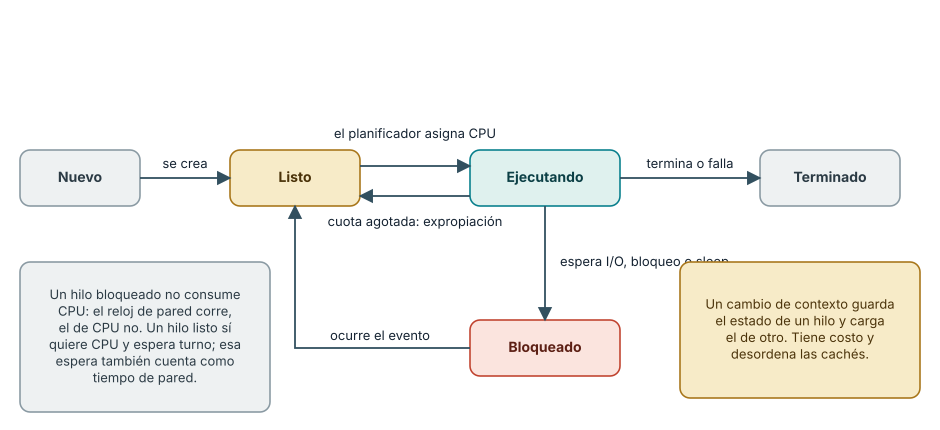
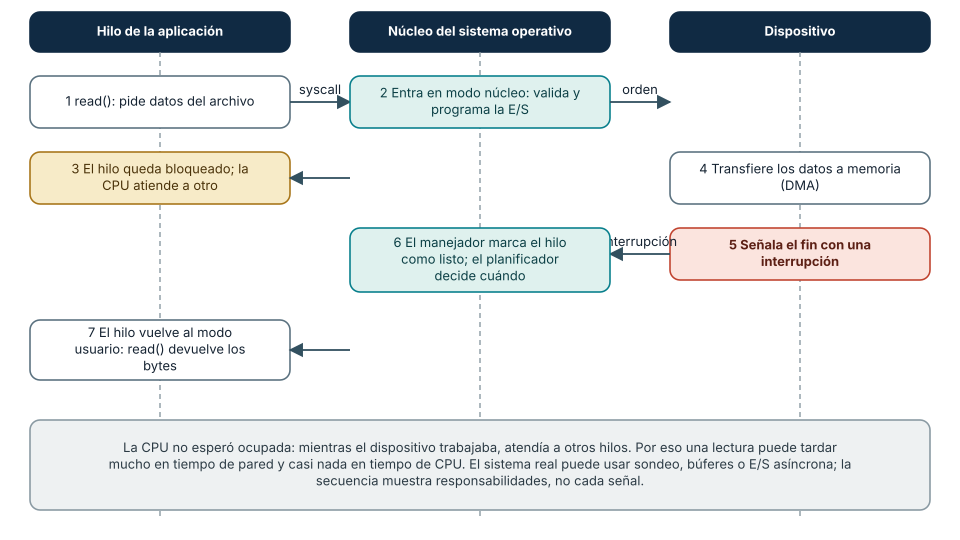
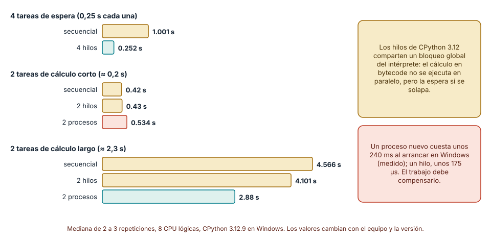

# SE-019 — Procesos, hilos, interrupciones y entrada/salida

[← SE-018](../../classes/part-01-computadores-y-representacion-de-informacion/se-018-memoria-caches-almacenamiento-y-jerarquias/README.md) · [↑ Parte 01](../../classes/part-01-computadores-y-representacion-de-informacion/README.md) · [📚 Índice completo](../../classes/README.md) · [SE-020 →](../../classes/part-01-computadores-y-representacion-de-informacion/se-020-compilacion-interpretacion-bytecode-y-jit/README.md)


## Punto profesional y fundamento pedagógico

**Punto profesional.** La clase existe para atribuir concurrencia y espera a procesos, hilos, interrupciones e I/O según su mecanismo.

**Por qué aparece aquí.** Se sitúa después de **Memoria, cachés, almacenamiento y jerarquías** y antes de **Compilación, interpretación, bytecode y JIT**: convierte el conocimiento anterior en una decisión observable que la clase siguiente podrá reutilizar. La continuidad se comprueba en el artefacto, no por compartir vocabulario.

**Error conceptual que debe corregir.** Inferir paralelismo de CPU porque dos hilos se solapan.

**Secuencia de aprendizaje.** Dibuja la línea temporal esperada y separa tiempo de pared, CPU, espera y estado compartido antes de lanzar hilos. Compara la predicción con las muestras, introduce una actualización concurrente insegura y evita concluir que es segura si el fallo no aparece. Revisa el diseño eliminando o sincronizando la propiedad compartida.

**Evidencia de aprendizaje.** Concurrency-observation.md con cronología, tiempos de pared/CPU e hipótesis descartadas. Debe contener predicción previa, observación, explicación causal, contraejemplo, criterio de aceptación y una nota de qué dato haría cambiar la conclusión.

**Límite de la conclusión.** Scheduler, GIL y primitivas dependen de plataforma e implementación.

### Trazabilidad fuente → afirmación

| Fuente primaria u oficial | Afirmación que respalda | Lo que no prueba |
|---|---|---|
| [Python `threading`](https://docs.python.org/3/library/threading.html) |  define hilos y restricciones de CPython | No demuestra por sí sola que el artefacto del estudiante sea correcto. |
| [Python `time`](https://docs.python.org/3/library/time.html) |  define relojes de pared y proceso | No demuestra por sí sola que el artefacto del estudiante sea correcto. |
| [RISC-V Privileged Architecture](https://docs.riscv.org/reference/isa/priv/) |  contextualiza interrupciones y niveles privilegiados | No demuestra por sí sola que el artefacto del estudiante sea correcto. |

## Antes de empezar

`SE-018` mostró que acceder a datos tiene jerarquías. Ahora el analizador local de eventos lee, calcula y escribe
mientras el sistema comparte CPU y dispositivos con otros programas. Modelarás proceso,
hilo, llamada al sistema e interrupción sin tratarlos como sinónimos de programa o CPU.

## Prerrequisitos

Estado e instrucciones de `SE-017`, jerarquía de `SE-018`, Python 3.11+.

## Problema auténtico

Una aplicación “usa varios hilos” y se espera que tarde la mitad. La carga es CPU-bound,
comparte estado y corre en un runtime con restricciones. Concurrencia fue confundida con paralelismo y rendimiento.

## Objetivos observables

Distinguirás programa, proceso e hilo; explicarás planificación y cambio de contexto;
seguirás una llamada de I/O; relacionarás interrupciones con eventos; compararás bloqueo y concurrencia.

## Temas y por qué importan

| Tema | Mecanismo | Por qué importa |
| --- | --- | --- |
| Proceso | aísla espacio y recursos | contiene fallos y propiedad |
| Hilo | comparte proceso y mantiene ejecución | habilita concurrencia con riesgos |
| Planificación | asigna CPU a unidades listas | explica pausas y competencia |
| I/O e interrupción | coordinan dispositivos y software | separan espera de cálculo |
## Mapa conceptual


El sistema real puede usar polling, DMA, buffers y completado asíncrono. La secuencia
muestra responsabilidades, no cada transición de hardware.

## Conceptos y decisiones

### 1. Programa es descripción; proceso es ejecución aislada

Un archivo de programa puede originar múltiples procesos. Cada proceso posee espacio de
direcciones virtual, identificador, recursos y estado administrado por el sistema. El
aislamiento limita acceso accidental, pero no es una frontera de seguridad absoluta sin permisos y controles.

### 2. Los hilos comparten y por eso coordinan

Hilos de un proceso comparten memoria y recursos, pero mantienen pila y estado de
ejecución propios. Compartir reduce copia y permite trabajo concurrente; introduce
carreras, orden y necesidad de sincronización. Más hilos agregan overhead y no crean núcleos.

### 3. Concurrencia y paralelismo responden preguntas distintas

Concurrencia organiza tareas que progresan en intervalos superpuestos. Paralelismo
ejecuta simultáneamente. I/O concurrente puede aprovechar esperas en un núcleo; cálculo
paralelo requiere capacidad y runtime apropiados. La métrica debe distinguir latencia de una tarea y throughput total.

### 4. Planificación produce pausas legítimas

El sistema decide qué hilo listo usa CPU. Un cambio de contexto conserva estado y carga
otro; tiene costo y efectos de caché. Tiempo de pared incluye ejecución, espera y
desplanificación. Tiempo de CPU aproxima trabajo ejecutado por el proceso, no espera externa.



**Cómo leer la figura.** Un hilo vive en uno de cinco estados. Solo los hilos *listos* compiten por
CPU, y el planificador elige cuál pasa a *ejecutando*. Si el hilo agota su cuota de tiempo es
*expropiado* y vuelve a listo; si pide algo que no está disponible (datos de un archivo, un bloqueo, un
temporizador) pasa a *bloqueado* y no consume CPU hasta que el evento ocurre. **Dónde deja de valer:**
los sistemas reales distinguen más estados (suspendido, en espera ininterrumpible, zombi) y usan
políticas distintas de planificación, con prioridades y afinidad a núcleos. La figura sirve para razonar
sobre *por qué* una espera no es cálculo, no para predecir el orden exacto de ejecución.

### 5. I/O cruza una frontera protegida

El programa solicita operaciones mediante APIs que llegan a llamadas del sistema. El
kernel valida y coordina controladores. Dispositivos pueden avisar completado mediante
interrupciones; DMA puede mover datos sin que la CPU copie cada byte. Una llamada
bloqueante suspende al hilo hasta una condición, no necesariamente ocupa CPU todo el tiempo.



**Cómo leer la figura.** El tiempo corre hacia abajo. La aplicación solo puede pedir un servicio
cruzando la frontera protegida con una *llamada al sistema* (paso 1); el núcleo valida y programa la
operación (2) y bloquea al hilo (3) para que la CPU atienda a otro. El dispositivo transfiere los datos
a memoria (4) y avisa con una *interrupción* (5); el manejador del núcleo marca el hilo como listo (6) y,
cuando el planificador lo decide, la llamada devuelve los bytes (7). **Dónde deja de valer:** hay
variantes. Un dispositivo muy rápido puede atenderse por sondeo en lugar de por interrupción; la E/S
asíncrona (por ejemplo `io_uring` en Linux o los puertos de finalización de Windows) separa la petición de
la espera; y la caché del sistema puede resolver la lectura sin tocar el dispositivo.

### 6. Hilos en CPython: el bloqueo global del intérprete y las esperas

En la implementación habitual de CPython hay un *bloqueo global del intérprete* (GIL): en un instante dado,
un solo hilo ejecuta bytecode de Python. Las consecuencias medibles son distintas según la carga. En una
medición (CPython 3.12.9, Windows, 8 CPU lógicas), cuatro tareas que solo esperan (`time.sleep(0.25)`) tardaron
1,00 s en secuencia y 0,25 s con cuatro hilos: las esperas *se solapan* porque un hilo bloqueado libera el GIL. Dos
tareas de cálculo largo (cada una de unos 2,3 s) tardaron 4,57 s en secuencia, 4,10 s con dos hilos y 2,88 s
con dos procesos: los hilos casi no ayudaron, y los procesos sí, porque cada uno tiene su propio intérprete y su
propio GIL.

El resultado depende también del tamaño del trabajo. Con tareas de cálculo corto (unos 0,2 s) los procesos
resultaron *peores* que la secuencia: 0,53 s frente a 0,42 s, porque arrancar un proceso en Windows costó en promedio
unos 237 ms, frente a unos 175 µs de un hilo. Dos reglas de decisión se derivan: los hilos sirven para solapar esperas
(I/O) y los procesos para repartir cálculo cuando el trabajo supera con holgura el costo de arrancar y comunicarse. Ambas
reglas se verifican midiendo, nunca asumiendo.



**Cómo leer la figura.** Cada grupo mantiene la carga y cambia la estrategia. El grupo superior muestra el
beneficio de los hilos cuando todo es espera; el inferior, el beneficio de los procesos cuando todo es cálculo
largo; el del medio, el punto donde el costo de arranque supera la ganancia. **Dónde deja de valer:** son
medianas de pocas repeticiones en un equipo, y el GIL es un detalle de implementación. Python 3.13 añadió una
compilación *experimental* sin GIL (PEP 703) cuyo comportamiento y estado de soporte conviene verificar en la
versión que uses; con ella los hilos pueden ejecutar bytecode en paralelo.

### 7. Estado compartido y carreras: por qué un fallo ausente no prueba corrección

Los hilos de un proceso comparten memoria, y esa ventaja es también su riesgo. Una *condición de carrera*
ocurre cuando el resultado depende del orden en que se intercalan los hilos. Incrementar un contador compartido
parece una operación, pero es una secuencia de leer, sumar y escribir; si dos hilos leen el mismo valor antes de que
cualquiera escriba, un incremento se pierde. El siguiente código fuerza el intercalado cediendo el control entre la
lectura y la escritura:

```python
import threading, time

contador = 0

def trabajador():
    global contador
    for _ in range(1000):
        tmp = contador          # leer
        time.sleep(0)           # ceder la CPU: otro hilo puede intercalarse
        contador = tmp + 1      # escribir

hilos = [threading.Thread(target=trabajador) for _ in range(4)]
for h in hilos: h.start()
for h in hilos: h.join()
print(contador)  # se esperaba 4000
```

En tres ejecuciones de ejemplo el resultado fue 1239, 1079 y 1080: más de dos tercios de los incrementos se
perdieron, y el valor *cambia en cada ejecución*. Al envolver la lectura y la escritura en un `threading.Lock`
el resultado fue 4000 en todas las ejecuciones. La lección no es que el fallo sea frecuente en el código real (aquí
se provocó), sino que su ausencia no demuestra corrección: una carrera depende de un intercalado raro que puede no
aparecer en tus pruebas y sí en producción, bajo otra carga.

Hay cuatro formas de evitarlas, de menor a mayor coordinación. *No compartir*: cada hilo produce su propio
resultado y se combinan al final. *Compartir solo datos inmutables.* *Comunicar por mensajes* con una cola
(`queue.Queue`), que ya incorpora la sincronización. Y, solo cuando las anteriores no bastan, *proteger con bloqueos*,
con cuidado de no crear interbloqueos (dos hilos que esperan cada uno el recurso del otro). Un diseño que elimina el
estado compartido es más fácil de razonar y de probar que uno que lo protege.

### 8. Costos de crear y coordinar: hilo, proceso y cambio de contexto

Toda unidad de ejecución cuesta. Crear y unir un hilo tomó en promedio unos 175 µs; crear un proceso nuevo con
`multiprocessing` en Windows, unos 237 ms, porque debe iniciar un intérprete y cargar el código. Cada cambio de contexto
guarda y restaura el estado y desordena las cachés, de modo que tener muchísimos más hilos que núcleos añade costo sin
más trabajo útil. Entre procesos, además, los datos no se comparten: se serializan para enviarlos (con `pickle`), lo que
cuesta tiempo y limita lo que se puede transmitir.

La elección práctica es sencilla de enunciar y requiere medir para aplicarla: *hilos o E/S asíncrona* cuando el
trabajo es esperar (muchas conexiones, archivos, red), *procesos* cuando el trabajo es calcular y puede dividirse,
y *ninguno* cuando la tarea es corta y la coordinación costaría más que la ganancia. En todos los casos conviene
usar abstracciones de la biblioteca estándar como `concurrent.futures`, que gestionan el ciclo de vida, los
errores y la cancelación, en lugar de coordinar hilos a mano.


## Caso conductor: leer y resumir eventos

El analizador local de eventos lee un archivo pequeño, calcula y escribe. Se registran tiempo de pared y CPU. Una
versión con dos hilos procesa dos archivos sintéticos; el objetivo no es ganar, sino
explicar qué trabajo se solapa, qué estado se comparte y qué medición refutaría la ventaja.

## Definiciones de trabajo

- **proceso:** instancia de ejecución con recursos aislados;
- **hilo:** secuencia planificable dentro de un proceso;
- **concurrencia:** composición de progresos superpuestos;
- **interrupción:** señal que desvía control para atender un evento;
- **I/O bloqueante:** operación que suspende la unidad llamante hasta progreso.

## Glosario

**Context switch** cambia unidad ejecutada. **Syscall** solicita servicio al kernel.
**DMA** permite transferencias de dispositivo a memoria con intervención acotada de CPU.

## Ejemplo mínimo

`time.sleep()` aumenta tiempo de pared casi sin aumentar CPU: el hilo espera. Un bucle
numérico aumenta ambos y añadir hilos de CPython no garantiza paralelismo de bytecode.

## Ejemplo profesional

Un servidor atiende muchas conexiones con I/O asíncrono para evitar un hilo bloqueado
por conexión. Si el cuello es cálculo, se consideran procesos o trabajo vectorizado, siempre midiendo costos de coordinación.

## Práctica guiada

Usa como base el [laboratorio ejecutable de la Parte 01](https://github.com/vladimiracunadev-create/modern-software-engineering-program/tree/main/labs/part-01-machine-observer); trabaja sobre una copia o conserva tus salidas en el directorio `work/SE-019/`.

1. Crea dos archivos sintéticos y una versión secuencial del analizador local de eventos.
2. Mide `perf_counter` y `process_time` en lectura y cálculo por separado.
3. Implementa dos hilos solo para las lecturas y registra timeline.
4. Protege un contador compartido o evita compartir mediante resultados separados.
5. Repite, cambia tamaño y registra causas alternativas.
6. Entrega `io_probe.py`, `timeline.md`, `samples.csv`.

## Ejercicios

1. Clasifica cuatro estados: ejecutando, listo, bloqueado y terminado.
2. Da un caso concurrente no paralelo.
3. Explica por qué una interrupción no es un hilo de aplicación.

## Reto verificable

Otra persona reconstruye cuándo el analizador local de eventos calcula, espera y es planificable. Aprueba si la
línea temporal no atribuye tiempo de pared completo a CPU.

## Preguntas frecuentes

### ¿Un proceso tiene un solo hilo?
Puede comenzar con uno y crear más; el modelo depende del sistema y runtime.

### ¿Asíncrono siempre es más rápido?
No. Mejora composición de esperas en ciertos contextos y añade complejidad.

### ¿Qué diferencia hay entre un hilo y un proceso a la hora de fallar?

Un hilo que falla con una excepción no tratada normalmente termina solo ese hilo, pero un error grave de
memoria en código nativo puede derribar todo el proceso. Un proceso aislado cae sin afectar a los demás. Por
eso el aislamiento de procesos se usa para contener fallos y para ejecutar código poco confiable, aunque no es,
por sí solo, una frontera de seguridad absoluta.

### ¿Cuántos hilos debo crear?

Para trabajo de espera, tantos como conexiones o tareas pendientes toleres (con un límite y una cola);
para cálculo, aproximadamente el número de núcleos disponibles. Más hilos de cálculo que núcleos añade
cambios de contexto sin más rendimiento. Empieza con un grupo acotado y ajústalo con mediciones.

### ¿Un bloqueo (`Lock`) hace que mi código sea seguro con hilos?

Solo protege las secciones que lo usan de manera consistente. Si una parte del código accede al
estado compartido sin tomar el bloqueo, la carrera persiste. Además, bloqueos mal ordenados causan
interbloqueos. Por eso la primera opción es no compartir estado.

## Fallo controlado y diagnóstico

Actualiza un contador compartido desde hilos sin contrato. Si el fallo no aparece, no
concluyas seguridad; explica por qué una carrera depende de intercalado y diseña sincronización o eliminación del estado compartido.

Un segundo fallo controlado mide el solapamiento. Escribe una función que espere (`time.sleep(0.25)`) y ejecútala
cuatro veces en secuencia y con un `ThreadPoolExecutor` de cuatro hilos; registra el tiempo de pared y el de CPU
con cinco repeticiones. **Síntoma esperado:** la versión con hilos tarda un cuarto, con CPU casi nula en ambas.
**Causa:** las esperas se solapan, no se «aceleran». Repite con una tarea de cálculo y comprueba que los hilos ya
no ayudan. **Corrección conceptual:** la afirmación «los hilos aceleran» se sustituye por «los hilos solapan
esperas». Añade un tiempo máximo de espera al trabajo (`future.result(timeout=...)`) y comprueba qué ocurre
cuando una tarea tarda más de lo previsto: una concurrencia sin tiempos límite es una vía de bloqueo.

## Errores comunes y cómo corregirlos

| Síntoma | Causa | Corrección |
| --- | --- | --- |
| programa = proceso | archivo confundido con ejecución | distingue descripción e instancia |
| hilos duplican velocidad | concurrencia = paralelismo | identifica carga, núcleos y runtime |
| tiempo de pared = CPU | esperas ignoradas | mide pared y CPU por separado |
| interrupción = excepción de lenguaje | niveles mezclados | ubica señal de hardware/kernel y manejo de runtime |

## Entorno y archivos clave

Python 3.11+, `threading`, `time`, `pathlib`; archivos sintéticos menores de 10 MB. Limpieza explícita del directorio.

## Seguridad, ética y accesibilidad

Limita carga y tamaño. No inspecciones procesos ajenos. Presenta timeline textual además del diagrama.

## Puente hacia el trabajo con agentes

Los sistemas con agentes son sistemas concurrentes. Varios agentes (o un agente y una persona) que editan los mismos
archivos reproducen la carrera del contador: cada uno lee un estado, razona y escribe, y el último en escribir
pisa el trabajo del otro sin que nadie lo note. Las mismas defensas aplican: no compartir (cada agente trabaja en
una copia o rama propia), comunicar por mensajes con una cola y unir los resultados con revisión, y reservar con
bloqueos explícitos lo que no pueda dividirse. Las llamadas a herramientas y a modelos son esperas de red: se
solapan con concurrencia controlada, con límites de paralelismo, tiempos máximos y cancelación. Y un agente que lanza
procesos (comandos del sistema) debe hacerlo con tiempo límite, para que un proceso bloqueado no detenga todo el flujo.
Las partes de harness, multiagente y seguridad agentic retoman estos patrones con ejemplos operables.

## Transferencia

Compara threads, procesos y async para un servidor de archivos; identifica propiedad de memoria.

## Evaluación y evidencia

Se exigen timeline, dos relojes, estado compartido explícito y conclusión condicionada.

## Fuentes


- [Python `threading`](https://docs.python.org/3/library/threading.html) define hilos y restricciones de CPython.
- [Python `time`](https://docs.python.org/3/library/time.html) define relojes de pared y proceso.
- [RISC-V Privileged Architecture](https://docs.riscv.org/reference/isa/priv/) contextualiza interrupciones y niveles privilegiados.
- [Python `concurrent.futures`](https://docs.python.org/3/library/concurrent.futures.html) y [`multiprocessing`](https://docs.python.org/3/library/multiprocessing.html): abstracciones de hilos y procesos usadas en las mediciones y en el fallo controlado.
- [PEP 703, Making the Global Interpreter Lock Optional in CPython](https://peps.python.org/pep-0703/): describe la compilación sin GIL; verifica su estado de soporte en la versión que uses.
- Remzi Arpaci-Dusseau y Andrea Arpaci-Dusseau, [*Operating Systems: Three Easy Pieces*](https://pages.cs.wisc.edu/~remzi/OSTEP/) (gratuito en línea): procesos, planificación, concurrencia y E/S; respalda las secciones 6 a 8.

## Límites y siguiente paso

No administra servicios ni señales del SO; eso corresponde a la Parte 02. `SE-020` abre la traducción del programa.

---
[← SE-018](../../classes/part-01-computadores-y-representacion-de-informacion/se-018-memoria-caches-almacenamiento-y-jerarquias/README.md) · [↑ Parte 01](../../classes/part-01-computadores-y-representacion-de-informacion/README.md) · [SE-020 →](../../classes/part-01-computadores-y-representacion-de-informacion/se-020-compilacion-interpretacion-bytecode-y-jit/README.md)
