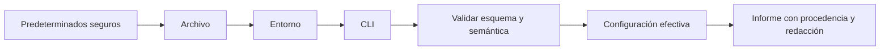
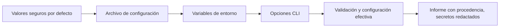
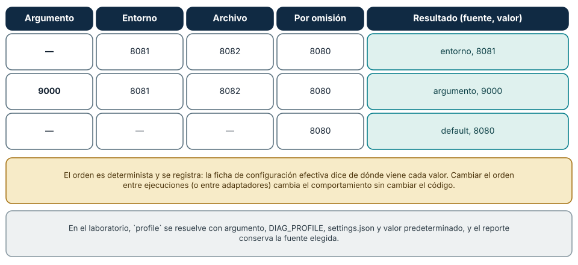
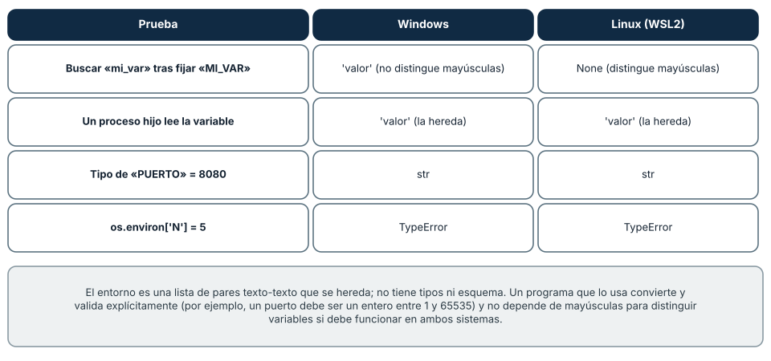
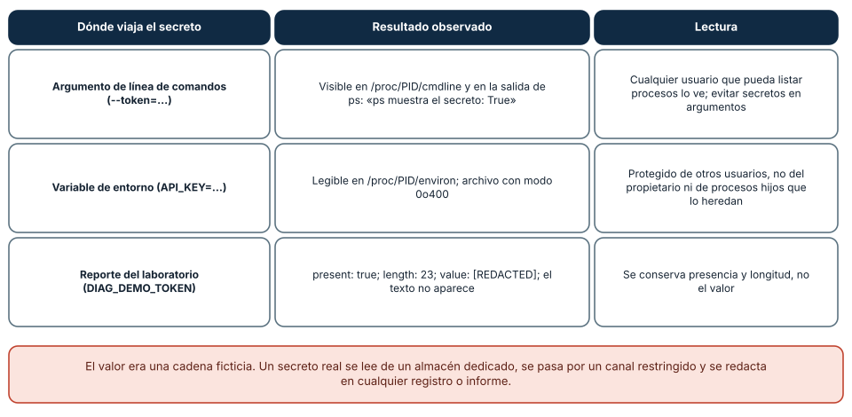

# SE-031 — Variables de entorno, configuración y secretos

[← SE-030](../../classes/part-02-sistemas-operativos-terminal-y-automatizacion-base/se-030-powershell-bash-y-portabilidad-de-scripts/README.md) · [↑ Parte 02](../../classes/part-02-sistemas-operativos-terminal-y-automatizacion-base/README.md) · [📚 Índice completo](../../classes/README.md) · [SE-032 →](../../classes/part-02-sistemas-operativos-terminal-y-automatizacion-base/se-032-instalacion-de-software-y-gestores-de-paquetes-del-sistema/README.md)


## Punto profesional y fundamento pedagógico

**Punto profesional.** La clase existe para diseñar precedencia de configuración y tratamiento de secretos con frontera explícita.

**Por qué aparece aquí.** Se sitúa después de **PowerShell, Bash y portabilidad de scripts** y antes de **Instalación de software y gestores de paquetes del sistema**: convierte el conocimiento anterior en una decisión observable que la clase siguiente podrá reutilizar. La continuidad se comprueba en el artefacto, no por compartir vocabulario.

**Error conceptual que debe corregir.** Guardar secretos en variables o archivos sin considerar herencia, logs y repositorio.

**Secuencia de aprendizaje.** Antes de leer la solución, el estudiante predice el resultado del caso normal y del error conceptual anterior. Luego explica un caso resuelto paso a paso, construye un contraejemplo que cambie la decisión y, sin consultar el texto, reconstruye el mecanismo y lo aplica a una entrada nueva. La secuencia usa predicción, explicación propia, contraste y recuperación. [ICAP](https://icap.education.asu.edu/research) distingue participación de construcción de conocimiento; [How People Learn II](https://nap.nationalacademies.org/catalog/24783/how-people-learn-ii-learners-contexts-and-cultures) exige conectar conocimiento previo, contexto y transferencia; la [práctica de recuperación](https://pubmed.ncbi.nlm.nih.gov/16507066/) respalda producir de nuevo la explicación tras una demora; y [Education for Life and Work](https://nap.nationalacademies.org/resource/13398/dbasse_084153.pdf) exige devolución que explique la causa del error.

**Evidencia de aprendizaje.** Configuration-map.md con fuentes, precedencia, redacción y rotación simulada. Debe contener predicción previa, observación, explicación causal, contraejemplo, criterio de aceptación y una nota de qué dato haría cambiar la conclusión.

**Límite de la conclusión.** No se usan secretos reales ni se certifica un gestor externo.

### Trazabilidad fuente → afirmación

| Fuente primaria u oficial | Afirmación que respalda | Lo que no prueba |
|---|---|---|
| [Microsoft Learn — about_Environment_Variables](https://learn.microsoft.com/powershell/module/microsoft.powershell.core/about/about_environment_variables) | documenta el comportamiento de Windows o PowerShell que se compara con el contrato POSIX | No demuestra por sí sola que el artefacto del estudiante sea correcto. |
| [The Open Group — Environment Variables](https://pubs.opengroup.org/onlinepubs/9799919799/basedefs/V1_chap08.html) | define el contrato portable de procesos, rutas, entorno o shell que se contrasta entre sistemas | No demuestra por sí sola que el artefacto del estudiante sea correcto. |
| [OWASP — Secrets Management Cheat Sheet](https://cheatsheetseries.owasp.org/cheatsheets/Secrets_Management_Cheat_Sheet.html) | delimita el contrato técnico que debe cumplirse al diseñar precedencia de configuración y tratamiento de secretos con frontera explícita | No demuestra por sí sola que el artefacto del estudiante sea correcto. |

## Antes de empezar

Los adaptadores del kit de diagnóstico multiplataforma ya comparten un contrato, pero necesitan saber qué inspeccionar y cómo comportarse. Introducir valores directamente en el código impide reutilizarlo; cargar todo desde variables de entorno vuelve invisible la procedencia; guardar credenciales junto con configuración las expone. Configurar es diseñar una interfaz operativa.

### Resultado de aprendizaje

Al terminar podrás definir una precedencia de configuración, validar valores antes de usarlos y mantener secretos fuera de código, argumentos, informes y registros.

## Prerrequisitos

`SE-030`, contrato CLI del kit de diagnóstico multiplataforma y uso de datos ficticios. Crea un secreto centinela que no tenga valor real y pueda buscarse de extremo a extremo.

## Problema auténtico

El archivo de configuración parece correcto, pero el kit de diagnóstico multiplataforma usa otra ruta. Una variable heredada tiene mayor precedencia y nadie puede ver la configuración efectiva. Al activar depuración, el equipo imprime todo el entorno y expone un token.

## Objetivos observables

Podrás diseñar esquema y precedencia; distinguir ausente, vacío y valor inválido; explicar herencia del entorno; redactar secretos antes de serializar; y demostrar qué configuración efectiva gobernó una ejecución.

## Temas y por qué importan

| Tema | Mecanismo | Decisión habilitada |
| --- | --- | --- |
| Precedencia | combina fuentes en orden determinista | reconstruir por qué ganó un valor |
| Validación | aplica tipo, rango y relaciones | fallar antes de producir efectos |
| Herencia | propaga entorno a procesos hijos | limitar exposición y sorpresas |
| Secreto | exige ciclo de vida y redacción | diagnosticar sin divulgar autoridad |
## Mapa conceptual



La precedencia explica el origen; la validación decide si el resultado es admisible. La redacción ocurre antes de cualquier salida, no como limpieza posterior.

## Conceptos y decisiones

### Configuración separa decisiones de despliegue del programa

Una opción configurable representa una decisión que puede variar sin recompilar: ruta de trabajo, nivel de detalle o plazo de espera. No toda constante debe volverse configurable; demasiadas opciones amplían estados, pruebas y combinaciones inválidas.

Cada opción necesita nombre, tipo, valor predeterminado, rango, sensibilidad, fuente permitida y momento de aplicación. “Lee un `.env`” es una técnica, no un modelo completo.

### La precedencia debe ser determinista y observable

El kit de diagnóstico multiplataforma adopta una cadena explícita:



La fuente de mayor precedencia reemplaza solo campos definidos. El programa informa de dónde provino cada valor no sensible. Una cadena silenciosa genera incidentes donde una variable olvidada domina al archivo esperado.

### El entorno es heredado por procesos y carece de tipado

Las variables de entorno son pares de nombres y valores que normalmente se heredan al crear procesos. Pueden distinguir mayúsculas según plataforma y toda entrada llega como texto. Ausente, vacío, `false` y `0` requieren reglas explícitas.

Un proceso hijo puede recibir más variables de las necesarias. El kit de diagnóstico multiplataforma construye un entorno mínimo al invocar herramientas y nunca vuelca el entorno completo en diagnóstico. Las variables son útiles para configuración efímera, pero no constituyen por sí solas un almacén seguro.

### Validar configuración es comprobar semántica, no solo sintaxis

Un JSON bien formado puede contener una ruta inexistente, un plazo negativo o combinaciones incompatibles. La validación ocurre antes de iniciar efectos y produce mensajes que señalan campo, regla y procedencia. Los valores desconocidos pueden tratarse como error para detectar errores tipográficos, salvo que el esquema diseñe extensiones.

El kit de diagnóstico multiplataforma distingue error de uso, configuración inválida y recurso inaccesible porque requieren respuestas diferentes.

### Un secreto es información cuyo uso debe controlarse

Tokens, claves y contraseñas no se protegen solo renombrándolos. Deben obtenerse de un almacén apropiado cuando exista, limitarse en alcance y duración, rotarse y no registrarse. Pasarlos como argumento puede hacerlos visibles en historial o inspección de procesos; guardarlos en un repositorio conserva copias incluso después de borrar la línea actual.

La aplicación debe manejar el secreto como valor sensible desde su ingreso hasta su descarte. Una máscara parcial puede seguir revelando longitud o fragmentos; un hash permite correlación y también puede ser sensible. La política de redacción responde al propósito del informe.

### Plantillas y archivos de ejemplo enseñan sin publicar valores reales

Un archivo `config.example.json` documenta nombres y valores ficticios. El archivo real se excluye del control de versiones, pero ignorarlo no revoca un secreto ya comprometido. Si se detecta exposición, se rota la credencial y se investiga el alcance; reescribir historial es una decisión adicional, no la única corrección.

### La configuración efectiva debe poder explicarse

El kit de diagnóstico multiplataforma ofrece `config explain`: muestra valor no sensible o `<redactado>`, procedencia, regla aplicada y advertencias. Así una persona puede descubrir que `DIAGNOSTIC_KIT_TIMEOUT` reemplazó el archivo sin imprimir ninguna credencial.

La documentación [about_Environment_Variables](https://learn.microsoft.com/powershell/module/microsoft.powershell.core/about/about_environment_variables) y el estándar [`environ`](https://pubs.opengroup.org/onlinepubs/9799919799/basedefs/stdlib.h.html) describen mecanismos; la política de secretos debe adaptarse al riesgo y plataforma.

### Resolver la configuración: una función que se puede probar

La precedencia deja de ser una convención cuando se escribe como una función pura. La siguiente recorre las fuentes en orden y devuelve *de dónde* viene el valor, no solo el valor:

```python
def resolver(argumento, entorno, archivo, por_omision):
    for fuente, valor in (("argumento", argumento), ("entorno", entorno),
                          ("archivo", archivo), ("default", por_omision)):
        if valor is not None:
            return fuente, valor
```

Con `resolver(None, "8081", "8082", "8080")` el resultado es `("entorno", "8081")`; con `resolver("9000", "8081", "8082", "8080")`, `("argumento", "9000")`; y con tres `None`, `("default", "8080")`. El valor
de que devuelva la *fuente* es doble: permite explicar la configuración efectiva («el puerto viene del entorno») y probar el orden con casos sencillos. El laboratorio aplica exactamente este orden a `profile` y su reporte
conserva la fuente elegida.



**Cómo leer la figura.** Cada fila es una combinación de fuentes presentes; la última columna es el resultado de la función. Obsérvese que `None` (ausencia) no es lo mismo que una cadena vacía: una variable definida pero vacía es
una decisión, y mezclar ambas es una causa frecuente de configuraciones que «no se aplican». **Dónde deja de valer:** hay fuentes que la función no modela (variables de un archivo `.env`, servicios de configuración remotos, valores por
usuario o por máquina) y cada una necesita su lugar en el orden y su propia validación.

### El entorno: heredado, sin tipos y distinto entre sistemas

Las variables de entorno son pares texto-texto que cada proceso hereda de su padre. Dos pruebas con el mismo programa en Windows y en Linux (WSL2) lo muestran. Buscar `mi_var` tras fijar `MI_VAR` devolvió `'valor'` en Windows
(no distingue mayúsculas) y `None` en Linux (sí las distingue); un script de configuración que funcione en ambos no puede depender de esa diferencia. Un proceso hijo vio la variable en ambos sistemas (herencia), y asignar el entero `5`
a `os.environ["N"]` lanzó `TypeError` en ambos: *todo valor es texto*, y la conversión y la validación («el puerto es un entero entre 1 y 65535») son responsabilidad del programa, no del entorno.



**Cómo leer la figura.** La primera fila es la única que difiere entre sistemas; las otras tres muestran contratos comunes. **Dónde deja de valer:** el comportamiento de mayúsculas es del sistema operativo, no de Python, y herramientas como
los shells o los gestores de servicios pueden filtrar o transformar el entorno antes de entregarlo; el entorno que ve un servicio no es el de tu terminal.

### Un secreto ficticio: dónde puede verse

Pasar un secreto por la línea de comandos es una práctica insegura, y se puede demostrar sin usar ninguno real. Con un valor ficticio (`token-ficticio-12345`), un proceso lanzado con `--token=...` mostró el secreto en `/proc/PID/cmdline` y en la salida de
`ps`, visibles para cualquier usuario que pueda listar procesos; el mismo valor en una variable de entorno (`API_KEY`) fue legible en `/proc/PID/environ`, un archivo con modo `0o400` que solo el propietario puede leer. Es mejor que el argumento, pero no protege del propietario,
ni de los procesos hijos que heredan el entorno, ni de los volcados de memoria o los registros que lo copien. El laboratorio muestra un tercer nivel de cuidado: para `DIAG_DEMO_TOKEN` solo informa *presencia*, *longitud* (23 en la prueba) y el texto
`[REDACTED]`, y el valor no aparece en ningún lugar de la salida.



**Cómo leer la figura.** Las filas van de menos a más protección: argumento, entorno y reporte redactado. **Dónde deja de valer:** el valor era una cadena ficticia y las pruebas son de Linux; en Windows, las variables de entorno de otro proceso
y su línea de comandos son accesibles por mecanismos distintos y según los privilegios. La redacción protege *esa* variable conocida del laboratorio, no cualquier secreto en cualquier salida.

## Definiciones de trabajo

- **esquema:** contrato de nombres, tipos, restricciones y sensibilidad;
- **precedencia:** orden que determina qué fuente gana por campo;
- **configuración efectiva:** valores resultantes junto con su procedencia;
- **secreto centinela:** valor ficticio reconocible usado para comprobar filtraciones;
- **redacción:** transformación previa a salida que oculta información sensible.

## Caso conductor: el kit de diagnóstico multiplataforma carga sin filtrar

El kit define un esquema con `target_path`, `timeout_seconds`, `output_format` y un token opcional para una integración futura. El token nunca aparece en el informe. El kit de diagnóstico multiplataforma carga las capas, valida tipos y rangos, y genera una vista efectiva:

```text
target_path = C:\laboratorio\event_analyzer   (cli)
timeout_seconds = 10                 (archivo)
output_format = json                 (predeterminado)
integration_token = <redactado>      (almacén/entorno)
```

Una prueba inyecta deliberadamente el texto del token y busca que no aparezca en stdout, stderr, archivo ni excepción. No se declara “seguro” solo por pasar esta prueba; se declara la propiedad concreta verificada.

## Práctica guiada

1. Especifica esquema y precedencia de cuatro opciones.
2. Implementa carga separada de resolución para poder probar ambas.
3. Cubre ausente, vacío, tipo inválido, valor fuera de rango y opción desconocida.
4. Añade un valor centinela secreto y verifica redacción en todas las salidas.
5. Documenta cómo rotar el secreto si se expone.

Trabaja con valores ficticios; no uses credenciales personales.

## Ejemplo mínimo

El archivo declara `timeout=10`, el entorno `DIAGNOSTIC_KIT_TIMEOUT=0` y la CLI no lo cambia. La procedencia muestra entorno, pero la validación rechaza cero. La ejecución no sustituye silenciosamente otro valor ni inicia trabajo parcial.

## Ejemplo profesional

Un servicio rota un token en un almacén, pero un volcado de entorno conserva el anterior. La corrección elimina volcados generales, construye un entorno mínimo para hijos y prueba el centinela en excepciones y paquetes diagnósticos.

## Ejercicios

1. Define tipo, fuente y regla para cuatro opciones del kit de diagnóstico multiplataforma.
2. Diseña casos para ausente, vacío, booleano ambiguo y campo desconocido.
3. Traza un secreto desde ingreso hasta descarte e identifica cuatro fugas posibles.

## Reto verificable

Ejecuta doce combinaciones de fuentes y produce una tabla de valor efectivo/procedencia. El secreto centinela no debe aparecer en stdout, stderr, logs ni archivo final.

## Preguntas frecuentes

### ¿Una variable de entorno es un almacén seguro?

No por sí sola. Puede heredarse, inspeccionarse o registrarse; su riesgo depende de plataforma y proceso.

### ¿Ignorar `.env` en Git resuelve una exposición anterior?

No. Debe rotarse la credencial y evaluarse historial y copias.

### ¿Una variable de entorno es un buen lugar para un secreto?

Es mejor que un argumento o un archivo del repositorio, pero no es un almacén seguro: se hereda, aparece en volcados y herramientas de depuración, y suele copiarse en registros de errores. Para secretos reales se usa un
gestor dedicado con control de acceso y rotación, y el proceso lo recibe por el canal más restringido posible.

### ¿Añadir `.env` al `.gitignore` resuelve una exposición anterior?

No. Evita *futuros* commits, pero un secreto ya publicado permanece en el historial de Git y en cualquier clon. Se revoca y rota el secreto, y recién entonces se limpia el historial; la rotación es la medida decisiva.

### ¿Cómo muestro la configuración efectiva sin exponer secretos?

Con una ficha que lista cada clave, su fuente y, para las sensibles, solo presencia y longitud. Una lista de fragmentos sensibles (`TOKEN`, `PASSWORD`, `SECRET`) ayuda a redactar, pero no es exhaustiva: lo seguro es una lista
*permitida* de claves visibles, como hace el laboratorio.
## Fallo controlado y diagnóstico

Introduce un token centinela y fuerza una excepción de validación. Busca el valor en todas las salidas. Si aparece, centraliza representación segura y repite hasta demostrar la propiedad acotada.


Una segunda práctica ejercita el orden de precedencia. Escribe `resolver` y una prueba con cuatro casos (solo default, entorno, archivo y entorno, argumento y entorno). **Síntoma de un defecto típico:** una cadena vacía en
el entorno (`PUERTO=`) se trata como «no definida» y gana el archivo. **Causa:** se compara con la falsedad (`if valor:`) en lugar de con `None`. **Corrección:** decidir explícitamente qué significa una cadena vacía (ausencia o
error de configuración) y probarlo. Añade validación de tipo (puerto entero y en rango) con un mensaje que nombre la clave y la fuente, sin imprimir su valor si es sensible.
## Errores comunes y cómo corregirlos

| Síntoma | Causa conceptual | Corrección |
|---|---|---|
| Cambiar el archivo no cambia la ejecución | Una variable de mayor precedencia quedó activa | Mostrar configuración efectiva y procedencia |
| `false` se interpreta como verdadero | Se convirtió texto por presencia | Definir y validar un vocabulario booleano |
| El token aparece en una excepción | La redacción se aplicó solo al log normal | Centralizar serialización segura y probar fallos |
| Se borró un secreto del último commit y se da por resuelto | Se ignoraron copias e historial | Revocar/rotar primero y evaluar exposición |
| Cada opción puede venir de cualquier fuente | No se controló la superficie operativa | Limitar fuentes y documentar precedencia por campo |

## Entorno y archivos clave

Las pruebas de precedencia y centinela del [laboratorio compartido](https://github.com/vladimiracunadev-create/modern-software-engineering-program/tree/main/labs/part-02-cross-platform-diagnostic-kit) verifican argumento > entorno > archivo > default y exigen que `DIAG_DEMO_TOKEN` nunca aparezca en claro.

`work/SE-031/config.example.json`, `config.local.json` ignorado, `config-report.json` y pruebas. Solo valores ficticios y carpeta desechable.

## Seguridad, ética y accesibilidad

No uses credenciales reales. Mensajes de validación deben nombrar el campo y regla sin repetir el valor sensible; ofrece ejemplos copiables y legibles por tecnología asistiva.

## Puente hacia el trabajo con agentes

La configuración de un agente (credenciales de herramientas, claves de modelos, rutas permitidas) es un caso directo de esta clase. Los riesgos se repiten: un secreto pasado como argumento de una herramienta aparece en el registro de comandos, el
entorno heredado por un proceso lanzado por el agente expone todo lo que el agente podía ver, y un archivo `.env` leído por el agente entra en su contexto. El diseño correcto aplica las reglas de la figura 3: secretos fuera del
contexto del modelo, entorno mínimo y explícito para cada herramienta, redacción en los registros y una ficha de configuración efectiva que un humano pueda auditar. Un agente nunca debería poder leer más variables de las que su tarea necesita. Las
partes de seguridad agentic y de gestión de secretos desarrollan esos controles.

## Transferencia

Aplica precedencia y redacción a una aplicación web con configuración por despliegue. Identifica qué valores requieren reinicio y cuáles pueden cambiar dinámicamente.

## Evaluación y evidencia

Se exige esquema, matriz de precedencia, pruebas negativas, secreto centinela ausente y límites. Ocultar solo el campo llamado `password` no demuestra protección.

## Criterio de cierre

Puedes reconstruir la configuración efectiva, demostrar validación temprana y comprobar que un secreto centinela no aparece en las salidas previstas, declarando todavía los límites de esa comprobación.

## Límites y siguiente paso

No diseñamos una infraestructura empresarial de secretos ni garantizamos borrado físico de memoria. El kit de diagnóstico multiplataforma también depende de herramientas instaladas; la siguiente clase analiza gestores de paquetes, procedencia y reversibilidad.

## Fuentes


- [Microsoft Learn — about_Environment_Variables](https://learn.microsoft.com/powershell/module/microsoft.powershell.core/about/about_environment_variables) — documenta el comportamiento de Windows o PowerShell que se compara con el contrato POSIX.
- [The Open Group — Environment Variables](https://pubs.opengroup.org/onlinepubs/9799919799/basedefs/V1_chap08.html) — define el contrato portable de procesos, rutas, entorno o shell que se contrasta entre sistemas.
- [OWASP — Secrets Management Cheat Sheet](https://cheatsheetseries.owasp.org/cheatsheets/Secrets_Management_Cheat_Sheet.html) — delimita el contrato técnico que debe cumplirse al diseñar precedencia de configuración y tratamiento de secretos con frontera explícita.
- [Python documentation — configparser](https://docs.python.org/3/library/configparser.html) — define la semántica y los límites de la API de Python utilizada en el experimento.

- [proc_pid_environ(5)](https://man7.org/linux/man-pages/man5/proc_pid_environ.5.html) y [credentials(7)](https://man7.org/linux/man-pages/man7/credentials.7.html): qué expone `/proc/PID/environ` y quién puede leerlo; respalda la figura 3.
- [Python `os.environ`](https://docs.python.org/3/library/os.html#os.environ): mapeo de texto a texto y su comportamiento según el sistema.
## Glosario

- **Configuración efectiva:** resultado final tras aplicar fuentes, precedencia y validación.
- **Precedencia:** orden determinista para resolver valores de múltiples fuentes.
- **Redacción:** sustitución deliberada de datos sensibles en una representación.
- **Rotación:** reemplazo de una credencial y retiro de la anterior.
- **Secreto:** dato cuya divulgación permite o facilita una acción no autorizada.

---
[← SE-030](../../classes/part-02-sistemas-operativos-terminal-y-automatizacion-base/se-030-powershell-bash-y-portabilidad-de-scripts/README.md) · [↑ Parte 02](../../classes/part-02-sistemas-operativos-terminal-y-automatizacion-base/README.md) · [📚 Índice completo](../../classes/README.md) · [SE-032 →](../../classes/part-02-sistemas-operativos-terminal-y-automatizacion-base/se-032-instalacion-de-software-y-gestores-de-paquetes-del-sistema/README.md)
