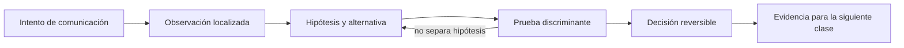
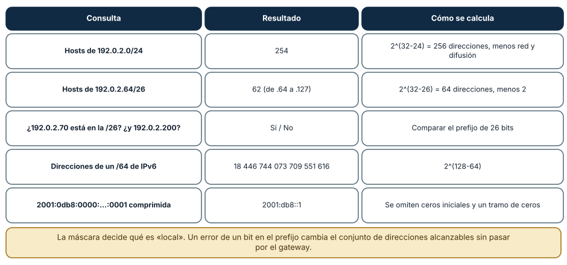
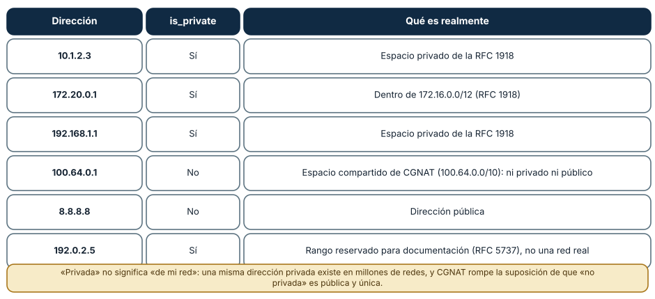
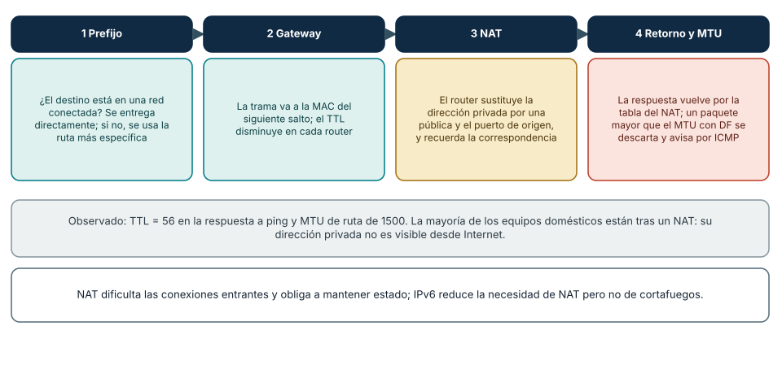

# SE-039 — IPv4, IPv6, subredes, rutas y NAT

[← SE-038 — Ethernet, Wi-Fi, direccionamiento y redes locales](../../classes/part-03-redes-internet-y-protocolos/se-038-ethernet-wi-fi-direccionamiento-y-redes-locales/README.md) · [↑ Parte 03](../../classes/part-03-redes-internet-y-protocolos/README.md) · [📚 Índice completo](../../classes/README.md) · [🌐 Portal](../../site/classes/SE-039.html) · [SE-040 — TCP, UDP, QUIC y decisiones de transporte →](../../classes/part-03-redes-internet-y-protocolos/se-040-tcp-udp-quic-y-decisiones-de-transporte/README.md)


## Punto profesional y fundamento pedagógico

**Punto profesional.** La clase existe para decidir entrega directa o por gateway usando prefijos, rutas y traducción de direcciones.

**Por qué aparece aquí.** Se sitúa después de **Ethernet, Wi-Fi, direccionamiento y redes locales** y antes de **TCP, UDP, QUIC y decisiones de transporte**: convierte el conocimiento anterior en una decisión observable que la clase siguiente podrá reutilizar. La continuidad se comprueba en el artefacto, no por compartir vocabulario.

**Error conceptual que debe corregir.** Creer que NAT es firewall o que una IP privada nunca aparece fuera de una LAN.

**Secuencia de aprendizaje.** Antes de leer la solución, el estudiante predice el resultado del caso normal y del error conceptual anterior. Luego explica un caso resuelto paso a paso, construye un contraejemplo que cambie la decisión y, sin consultar el texto, reconstruye el mecanismo y lo aplica a una entrada nueva. La secuencia usa predicción, explicación propia, contraste y recuperación. [ICAP](https://icap.education.asu.edu/research) distingue participación de construcción de conocimiento; [How People Learn II](https://nap.nationalacademies.org/catalog/24783/how-people-learn-ii-learners-contexts-and-cultures) exige conectar conocimiento previo, contexto y transferencia; la [práctica de recuperación](https://pubmed.ncbi.nlm.nih.gov/16507066/) respalda producir de nuevo la explicación tras una demora; y [Education for Life and Work](https://nap.nationalacademies.org/resource/13398/dbasse_084153.pdf) exige devolución que explique la causa del error.

**Evidencia de aprendizaje.** Routing-lab.md con longest-prefix match y transformaciones antes/después de NAT. Debe contener predicción previa, observación, explicación causal, contraejemplo, criterio de aceptación y una nota de qué dato haría cambiar la conclusión.

**Límite de la conclusión.** La topología simulada no demuestra políticas del proveedor.

### Trazabilidad fuente → afirmación

| Fuente primaria u oficial | Afirmación que respalda | Lo que no prueba |
|---|---|---|
| [RFC 8200 — Internet Protocol, Version 6](https://www.rfc-editor.org/rfc/rfc8200) | define la semántica normativa del protocolo nombrado en el título y sus límites interoperables | No demuestra por sí sola que el artefacto del estudiante sea correcto. |
| [RFC 1918 — Address Allocation for Private Internets](https://www.rfc-editor.org/rfc/rfc1918) | define la semántica normativa del protocolo nombrado en el título y sus límites interoperables | No demuestra por sí sola que el artefacto del estudiante sea correcto. |
| [RFC 3022 — Traditional IP Network Address Translator](https://www.rfc-editor.org/rfc/rfc3022) | define la semántica normativa del protocolo nombrado en el título y sus límites interoperables | No demuestra por sí sola que el artefacto del estudiante sea correcto. |

## Antes de empezar

Esta clase continúa la **petición observable de extremo a extremo de la Parte 3**. No estudia redes como una lista de siglas: añade una decisión concreta al mismo recorrido y obliga a explicar dónde nace cada señal. Conserva una bitácora con cuatro columnas —hecho, interpretación, hipótesis rival y próxima prueba—; si una conclusión no apunta a evidencia, todavía no es diagnóstico.

## Prerrequisitos

- Haber completado `SE-038` o poder explicar su evidencia principal.
- Trabajar solo contra `localhost`, una red propia o un destino con autorización expresa.
- Disponer de navegador, `curl` y herramientas equivalentes del sistema; registra versiones y plataforma.

## Problema auténtico

Una instancia de la petición observable de extremo a extremo responde desde una subred y desaparece desde otra. Hay direcciones privadas, doble NAT y rutas que se solapan con una VPN. El equipo necesita leer prefijos y tablas de ruta antes de abrir puertos al azar.

## Objetivos observables

Al terminar podrás:

1. calcular red, rango y pertenencia a partir de CIDR;
2. explicar selección de ruta por prefijo más específico;
3. contrastar alcance y autoconfiguración de IPv4 e IPv6;
4. explicar qué traduce NAT y qué problemas no resuelve;
5. comunicar límites y una siguiente prueba sin presentar inferencias como hechos.

## Mapa conceptual



El ciclo evita el diagnóstico por intuición. La observación se ubica antes de interpretarse; la prueba debe producir resultados diferentes bajo hipótesis rivales; la decisión conserva una salida de recuperación. En esta clase la pregunta rectora es: **¿Cómo decide un host si entrega localmente o envía a un router?**

## Temas y por qué importan

| Núcleo | Pregunta de trabajo | Evidencia esperada |
|---|---|---|
| alcance | ¿dónde es válido este identificador o estado? | mapa de fronteras |
| mecanismo | ¿qué entrada produce qué transición? | secuencia comentada |
| garantía | ¿qué promete el protocolo y qué no? | ejemplo y contraejemplo |
| diagnóstico | ¿qué prueba separa causas plausibles? | comparación reproducible |
| operación | ¿cómo falla, se limita y se recupera? | caso sano, degradado y restaurado |
## Conceptos y decisiones

### 1. Dirección y prefijo

Una dirección identifica una interfaz dentro de un alcance; el prefijo describe qué bits designan la red. En `192.0.2.18/28`, los primeros 28 bits determinan la red y quedan 16 valores en el bloque. Memorizar máscaras sin traducirlas a pertenencia conduce a rutas y reglas erróneas.

### 2. Tabla de rutas

Cada entrada combina destino, longitud de prefijo, siguiente salto, interfaz y a veces métrica. Se elige la coincidencia de prefijo más larga antes de considerar una ruta por defecto. `traceroute` muestra respuestas de algunos saltos, no la tabla completa ni necesariamente el camino inverso.

### 3. IPv4, espacio privado y NAT

RFC 1918 reserva bloques sin significado global. NAT modifica direcciones y, en NAPT, puertos, manteniendo estado temporal. Conserva escaso espacio público y permite topologías privadas, pero no es una política de autorización ni cifrado; rompe parte de la transparencia extremo a extremo.

### 4. IPv6 y múltiples alcances

IPv6 amplía direcciones a 128 bits, simplifica el encabezado base y usa Neighbor Discovery en lugar de ARP. Una interfaz puede tener link-local y direcciones de mayor alcance simultáneamente. La ausencia de NAT no implica exposición automática: el filtrado y las rutas siguen gobernando alcanzabilidad.

### 5. MTU, fragmentación y retorno

Una ruta puede transportar paquetes pequeños y fallar con tamaños mayores. IPv6 exige que el origen gestione Path MTU; filtrar indiscriminadamente ICMPv6 rompe funciones esenciales. Además, que el trayecto de ida exista no garantiza una ruta de retorno ni políticas simétricas.

### Aritmética de subredes, calculada y no memorizada

Las subredes se razonan con el prefijo, y el módulo `ipaddress` de Python permite comprobar cada cálculo. Para `192.0.2.0/24` (rango de documentación) hay 2^(32−24) = 256 direcciones y 254 utilizables para equipos (se excluyen la de red y la de difusión); para `192.0.2.64/26` hay 64 direcciones y 62 utilizables, que van de `.64` a `.127`;
`192.0.2.70` pertenece a esa /26 y `192.0.2.200` no. En IPv6 un `/64` contiene 2^64 = 18 446 744 073 709 551 616 direcciones y `2001:0db8:0000:0000:0000:0000:0000:0001` se escribe comprimida como `2001:db8::1`. Todos estos valores se verificaron ejecutando el módulo en Windows y en Linux con el mismo resultado.



**Cómo leer la figura.** La tercera columna es la regla; la segunda, el resultado calculado. Un error de un bit en el prefijo duplica o reduce a la mitad el conjunto «local»: un equipo con máscara `/25` en lugar de `/24` creerá que la mitad de sus vecinos están tras el gateway. **Dónde deja de valer:** en redes /31 y /32 las reglas de dirección de red y difusión cambian
(RFC 3021), y en IPv6 no existe difusión sino multidifusión. La aritmética se verifica con la herramienta antes de aplicarla a un cambio.

### Clasificar direcciones: privadas, compartidas y de documentación

`ipaddress` clasifica las direcciones y el resultado enseña matices. `10.1.2.3`, `172.20.0.1` y `192.168.1.1` son privadas (RFC 1918); `8.8.8.8` es pública. Dos casos sorprenden: `100.64.0.1`, del espacio compartido de CGNAT (`100.64.0.0/10`), se informó como *no privada* aunque tampoco es pública y única; y `192.0.2.5`, del rango de documentación, se informó como *privada*. Una misma dirección privada
existe en millones de redes, de modo que no identifica un equipo fuera de la suya, y las direcciones de CGNAT implican que el proveedor aplica su propio NAT: abrir puertos hacia ese equipo desde Internet puede ser imposible.



**Cómo leer la figura.** La columna central es lo que informa el módulo y la última, lo que la dirección es realmente. **Dónde deja de valer:** `is_private` es una definición del módulo de Python (basada en los registros de IANA) y cambia con la versión; otras bibliotecas pueden clasificar distinto. Para decisiones de seguridad (por ejemplo, bloquear destinos internos) se declara la lista de rangos explícita y no una propiedad de una biblioteca.

### Decisión de entrega, NAT y retorno

La decisión de entrega sigue cuatro preguntas: ¿el destino está en una red conectada?, ¿cuál es la ruta más específica?, ¿qué traducción aplica el NAT? y ¿cabe el paquete en el MTU de la ruta? El NAT sustituye la dirección privada de origen por una pública y asigna un puerto, y mantiene una tabla para devolver las respuestas; por eso dificulta las conexiones entrantes y obliga a mantener estado. En la ruta probada, la respuesta llegó con `TTL = 56` y el MTU de ruta fue de 1500
bytes. En una comparación entre dos entornos, el mismo nombre (`example.com`) devolvió solo direcciones IPv4 en Windows y direcciones IPv4 e IPv6 en Linux (WSL2): la *selección de dirección* depende de la conectividad y de la configuración de cada entorno, y los clientes modernos prueban varias en paralelo (*Happy Eyeballs*, RFC 8305).



**Cómo leer la figura.** Cada columna es una decisión y la inferior, lo que se observó. **Dónde deja de valer:** el NAT real es más variado (NAT de cono completo o simétrico, CGNAT, NAT64) y las políticas de cortafuegos añaden decisiones. IPv6 reduce la necesidad de NAT, pero no la de filtrado: «sin NAT» no es «sin protección».

## Definiciones de trabajo

- **prefijo:** cantidad de bits iniciales que identifican una red.
- **ruta:** regla para elegir interfaz y siguiente salto.
- **CIDR:** notación y asignación basada en prefijos de longitud variable.
- **NAT:** traducción de direcciones entre dominios.
- **MTU:** máximo tamaño de unidad que un enlace puede transportar sin tratamiento adicional.

Estas definiciones son operativas: precisan el uso dentro de la petición observable de extremo a extremo y deben leerse junto a las fuentes. No convierten un término histórico o dependiente de implementación en una garantía universal.

## Ejemplo mínimo

Para `192.0.2.18/28`, calcula dirección de red, último valor del bloque y si `192.0.2.31` pertenece. Luego predice qué entrada gana entre `0.0.0.0/0`, `192.0.2.0/24` y `192.0.2.16/28`.

El ejemplo se acepta cuando incluye predicción previa, salida relevante y explicación de qué hipótesis descarta. Copiar una salida sin interpretación no demuestra comprensión.

## Ejemplo profesional

La petición observable de extremo a extremo conserva un inventario redactado de dirección, prefijo, gateway y ruta elegida. Cuando la VPN anuncia `10.0.0.0/8` y la red local usa `10.20.30.0/24`, verifica la coincidencia más específica y documenta el conflicto. La solución puede ser renumerar, dividir rutas o cambiar política; desactivar todo el túnel solo oculta el diseño.

La diferencia profesional es la trazabilidad: la decisión conecta requisito, mecanismo, señal, riesgo y recuperación. El equipo puede cambiar de herramienta sin perder el razonamiento.

## Práctica guiada

1. calcula dos subredes a mano y confirma con una herramienta local.
2. lee la tabla de rutas en Windows o Unix.
3. predice la interfaz usada para tres destinos antes de probar.
4. observa IPv4 e IPv6 hacia un destino de documentación.
5. dibuja dónde cambia una tupla bajo NAT y dónde permanece igual.
6. entrega `trace.md` con comandos redactados, marcas de tiempo y condiciones de repetición.

## Ejercicios

1. **Subredes:** divide `192.0.2.0/24` en cuatro subredes iguales, da el rango y la cantidad de equipos de cada una y verifica con `ipaddress`.
2. **Clasificación:** clasifica `169.254.1.1`, `fe80::1`, `fd00::1` y `2001:db8::1`, y explica qué alcance tiene cada una.
3. **NAT:** dibuja la tabla de traducción para dos equipos que acceden al mismo servidor con el mismo puerto de origen y explica cómo se distinguen las respuestas.
4. **Selección de dirección:** explica por qué dos entornos pueden resolver el mismo nombre a conjuntos distintos y qué prueba lo comprueba.

## Reto verificable

Entrega una traza comentada que permita a otra persona responder: qué se intentó, qué frontera se observó, qué garantía aplicaba, qué falló, qué alternativa fue descartada y cómo se restauró el estado. La persona revisora debe poder repetir al menos una prueba sin instrucciones orales.

## Demostración guiada

1. Predice el primer evento observable y el resultado sano.
2. Ejecuta una sola petición de la petición observable de extremo a extremo y asigna cada marca a una frontera.
3. Introduce el fallo controlado descrito abajo.
4. Compara por **primera divergencia**, no por cantidad de errores posteriores.
5. Restaura, repite y conserva evidencia de recuperación.

Una demostración que no incluye restauración solo prueba cómo romper el laboratorio.

## Preguntas frecuentes

### ¿Por qué un /24 tiene 254 equipos y no 256?

Porque la primera dirección identifica la red y la última es la de difusión; ninguna se asigna a un equipo. En un /31 (enlaces punto a punto) y en IPv6 las reglas son otras.

### ¿Una dirección privada es lo mismo que una dirección segura?

No. Es una dirección no enrutable en Internet, pero dentro de la red privada es alcanzable por cualquier equipo, y el NAT no es un cortafuegos. La seguridad se obtiene con filtrado y autenticación, no por el rango de la dirección.

### ¿Por qué `100.64.0.1` no es ni privada ni pública?

Porque `100.64.0.0/10` es un espacio reservado para NAT de nivel de operador (CGNAT, RFC 6598): se usa entre el equipo del cliente y el NAT del proveedor. Un equipo con una dirección de ese rango no es alcanzable desde Internet sin ayuda del proveedor.

### ¿IPv6 elimina el NAT?

En gran medida, porque ofrece suficientes direcciones públicas, pero se siguen usando traducciones en casos concretos (NAT64 para alcanzar redes solo IPv4). La ausencia de NAT no sustituye al cortafuegos con estado.
## Fallo controlado y diagnóstico

Añade, solo en un laboratorio y con recuperación preparada, una ruta más específica hacia un siguiente salto inexistente. Observa que vence a la ruta por defecto; elimina esa entrada y confirma recuperación. No modifiques equipos compartidos.

Registra estado previo, acción, síntoma, primera divergencia, causa, corrección y estado posterior. Si la acción afecta red compartida, requiere privilegios amplios o no tiene rollback probado, reemplázala por una simulación local.


Una práctica reproduce un error de prefijo. Calcula con `ipaddress` si `192.0.2.130` pertenece a `192.0.2.0/25` y a `192.0.2.0/24`, y razona qué haría un equipo configurado con la máscara equivocada. **Síntoma:** un equipo no alcanza a su vecino y sí a Internet.
**Hipótesis:** el prefijo configurado lo ubica en otra red y envía el tráfico al gateway, que no tiene ruta de regreso. **Prueba:** comparar prefijo y dirección con el módulo, y revisar la tabla de rutas. **Corrección:** ajustar la máscara. Registra los cálculos y el resultado; la comprobación no toca ninguna red.

## Errores comunes y cómo corregirlos

| Síntoma | Causa | Corrección |
|---|---|---|
| Un equipo alcanza Internet pero no a un vecino | Máscara mal configurada: el vecino parece estar en otra red | Comparar prefijo y dirección con `ipaddress` y corregir la máscara |
| Suponer que `is_private` equivale a «de mi red» | La misma dirección privada existe en muchas redes | Identificar equipos con nombres y credenciales, no con la dirección |
| Tratar `100.64.0.0/10` como pública | Es espacio de CGNAT | Considerar que no hay conectividad entrante directa |
| Configurar un servicio solo con IPv4 y declararlo «accesible» | Clientes con IPv6 prefieren esa familia | Probar ambas familias y publicar los registros A y AAAA coherentes |
| Filtrar por una lista de «direcciones privadas» de una biblioteca | La clasificación puede incluir rangos no deseados o cambiar con la versión | Declarar los rangos explícitos que se bloquean |

## Entorno y archivos clave

```text
work/SE-039/
├── README.md          # alcance, autorización y reproducción
├── request.txt        # petición sin credenciales
├── trace.md           # línea temporal y evidencias
├── failure-report.md  # hipótesis, prueba y recuperación
└── diagram.mmd        # mapa accesible acompañado de texto
```

Los archivos son contenedores, no evidencia automática. `README.md` declara sistema operativo, versiones, red utilizada y limpieza. Nunca confirmes cambios de red destructivos sin una ruta de recuperación.

### Laboratorio integrado de la Parte 03

En la [petición observable](https://github.com/vladimiracunadev-create/modern-software-engineering-program/tree/main/labs/part-03-observable-request), explica por qué `127.0.0.1` se entrega localmente y por qué el puerto cerrado diverge después de seleccionar dirección y ruta. Completa `routing-lab.md` con longest-prefix match calculado sobre una tabla ficticia y con una transformación NAT diseñada, no observada. No cambies rutas del host para aprobar esta clase.

## Seguridad, ética y accesibilidad

- captura únicamente tráfico propio o autorizado y durante la ventana mínima;
- redacta cookies, tokens, query strings, IP privadas y nombres de personas;
- no desactives TLS, firewall o aislamiento como solución permanente;
- acompaña color y diagramas con orden, etiquetas y una explicación textual;
- ofrece comandos equivalentes o resultados esperados para quien no pueda modificar una red;
- considera que telemetría e IP pueden identificar o perfilar personas.

## Puente hacia el trabajo con agentes

Un agente que hace peticiones por URL puede ser dirigido hacia direcciones internas: esa es la base de los ataques de *falsificación de peticiones del lado del servidor* (SSRF), en los que un texto malicioso induce al sistema a consultar `http://169.254.169.254/` o un servicio de la red privada. La clasificación de direcciones de esta clase se convierte en una defensa del harness: resolver el nombre, comprobar que la dirección *resuelta* no pertenece a rangos privados, de enlace local, de loopback o de metadatos (con una lista explícita), y volver
a comprobarla en cada redirección. Las listas de rangos se prueban con casos como `100.64.0.1` y direcciones IPv6 mapeadas. Las partes de seguridad agentic y de herramientas retoman estas defensas con ejemplos operables.

## Transferencia

Traslada el mecanismo a una segunda red o protocolo sin repetir comandos mecánicamente. Conserva la pregunta y el criterio de evidencia; cambia los supuestos de dirección, intermediación y política. Escribe qué observación seguiría siendo válida y cuál depende de la topología original.

## Evaluación y evidencia

| Criterio | Evidencia mínima | Señal de dominio |
|---|---|---|
| modelo causal | mapa con fronteras y unidades correctas | explica interacción y fugas del modelo |
| protocolo | garantía y límite apoyados en fuente | distingue semántica de implementación |
| diagnóstico | hipótesis rival y prueba discriminante | encuentra primera divergencia |
| reproducibilidad | contexto, comandos y salida redactada | otra persona repite el resultado |
| responsabilidad | autorización, minimización y rollback | reduce riesgo sin borrar evidencia |

La clase no se aprueba por ejecutar comandos. Se aprueba cuando la evidencia sostiene las conclusiones y declara lo que todavía no puede saberse.

## Fuentes


- [RFC 8200 — Internet Protocol, Version 6](https://www.rfc-editor.org/rfc/rfc8200) — define la semántica normativa del protocolo nombrado en el título y sus límites interoperables.
- [RFC 1918 — Address Allocation for Private Internets](https://www.rfc-editor.org/rfc/rfc1918) — define la semántica normativa del protocolo nombrado en el título y sus límites interoperables.
- [RFC 3022 — Traditional IP Network Address Translator](https://www.rfc-editor.org/rfc/rfc3022) — define la semántica normativa del protocolo nombrado en el título y sus límites interoperables.
- [RFC 1122 — Requirements for Internet Hosts: Communication Layers](https://www.rfc-editor.org/rfc/rfc1122) — define la semántica normativa del protocolo nombrado en el título y sus límites interoperables.

Las RFC describen contratos de protocolo, no certifican una red, proveedor o herramienta. Cada afirmación de comportamiento local debe contrastarse con evidencia de ese entorno.

- [RFC 1918](https://www.rfc-editor.org/rfc/rfc1918), [RFC 6598](https://www.rfc-editor.org/rfc/rfc6598) y [RFC 8305 (Happy Eyeballs)](https://www.rfc-editor.org/rfc/rfc8305): direcciones privadas, espacio compartido de CGNAT y selección de direcciones; respaldan las figuras 2 y 3.
- [Python `ipaddress`](https://docs.python.org/3/library/ipaddress.html): cálculo de redes y clasificación de direcciones usados en las figuras 1 y 2; la definición de `is_private` sigue los registros de IANA y cambia con la versión.
- [RFC 4291, IPv6 Addressing Architecture](https://www.rfc-editor.org/rfc/rfc4291) y [RFC 3021, prefijos /31](https://www.rfc-editor.org/rfc/rfc3021): estructura de direcciones IPv6 y excepciones de dirección de red y difusión.

## Límites y siguiente paso

No cubre protocolos de enrutamiento entre organizaciones ni diseño avanzado de direcciones. NAT puede variar por implementación. La siguiente clase estudia el contrato de transporte sobre IP.

## Glosario

- **prefijo:** cantidad de bits iniciales que identifican una red.
- **ruta:** regla para elegir interfaz y siguiente salto.
- **CIDR:** notación y asignación basada en prefijos de longitud variable.
- **NAT:** traducción de direcciones entre dominios.
- **MTU:** máximo tamaño de unidad que un enlace puede transportar sin tratamiento adicional.

---

[← SE-038 — Ethernet, Wi-Fi, direccionamiento y redes locales](../../classes/part-03-redes-internet-y-protocolos/se-038-ethernet-wi-fi-direccionamiento-y-redes-locales/README.md) · [↑ Parte 03](../../classes/part-03-redes-internet-y-protocolos/README.md) · [📚 Índice completo](../../classes/README.md) · [🌐 Portal](../../site/classes/SE-039.html) · [SE-040 — TCP, UDP, QUIC y decisiones de transporte →](../../classes/part-03-redes-internet-y-protocolos/se-040-tcp-udp-quic-y-decisiones-de-transporte/README.md)
