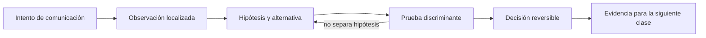
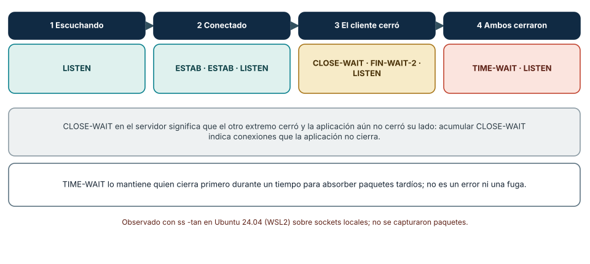
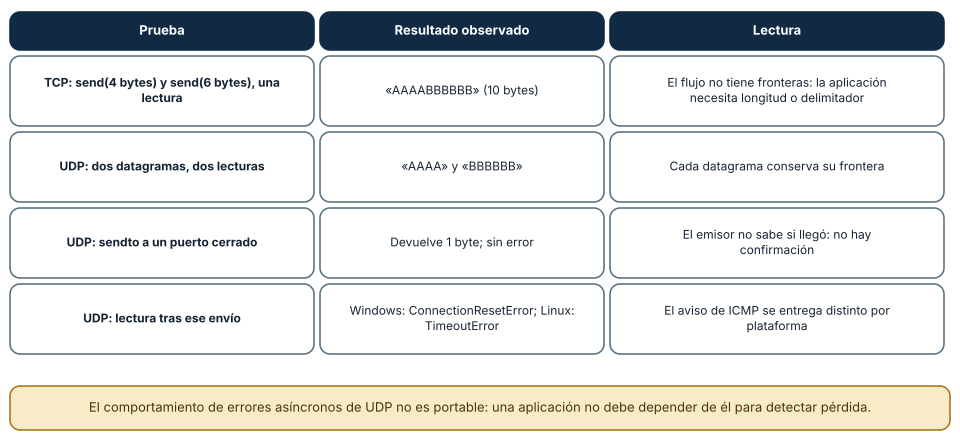
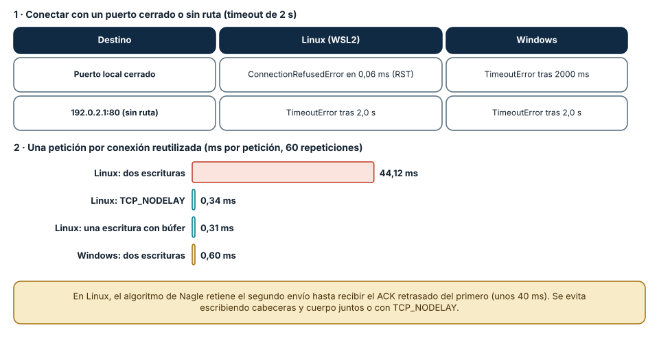

# SE-040 — TCP, UDP, QUIC y decisiones de transporte

[← SE-039 — IPv4, IPv6, subredes, rutas y NAT](../../classes/part-03-redes-internet-y-protocolos/se-039-ipv4-ipv6-subredes-rutas-y-nat/README.md) · [↑ Parte 03](../../classes/part-03-redes-internet-y-protocolos/README.md) · [📚 Índice completo](../../classes/README.md) · [🌐 Portal](../../site/classes/SE-040.html) · [SE-041 — DNS, nombres, resolución y fallos →](../../classes/part-03-redes-internet-y-protocolos/se-041-dns-nombres-resolucion-y-fallos/README.md)


## Punto profesional y fundamento pedagógico

**Punto profesional.** La clase existe para seleccionar TCP, UDP o QUIC por fiabilidad, orden, latencia y control de congestión.

**Por qué aparece aquí.** Se sitúa después de **IPv4, IPv6, subredes, rutas y NAT** y antes de **DNS, nombres, resolución y fallos**: convierte el conocimiento anterior en una decisión observable que la clase siguiente podrá reutilizar. La continuidad se comprueba en el artefacto, no por compartir vocabulario.

**Error conceptual que debe corregir.** Reducir la decisión a ‘TCP seguro, UDP rápido’.

**Secuencia de aprendizaje.** Antes de leer la solución, el estudiante predice el resultado del caso normal y del error conceptual anterior. Luego explica un caso resuelto paso a paso, construye un contraejemplo que cambie la decisión y, sin consultar el texto, reconstruye el mecanismo y lo aplica a una entrada nueva. La secuencia usa predicción, explicación propia, contraste y recuperación. [ICAP](https://icap.education.asu.edu/research) distingue participación de construcción de conocimiento; [How People Learn II](https://nap.nationalacademies.org/catalog/24783/how-people-learn-ii-learners-contexts-and-cultures) exige conectar conocimiento previo, contexto y transferencia; la [práctica de recuperación](https://pubmed.ncbi.nlm.nih.gov/16507066/) respalda producir de nuevo la explicación tras una demora; y [Education for Life and Work](https://nap.nationalacademies.org/resource/13398/dbasse_084153.pdf) exige devolución que explique la causa del error.

**Evidencia de aprendizaje.** Transport-decision.md con pérdidas, reordenamiento, handshake y requisito del producto. Debe contener predicción previa, observación, explicación causal, contraejemplo, criterio de aceptación y una nota de qué dato haría cambiar la conclusión.

**Límite de la conclusión.** La especificación no predice rendimiento en toda red.

### Trazabilidad fuente → afirmación

| Fuente primaria u oficial | Afirmación que respalda | Lo que no prueba |
|---|---|---|
| [RFC 9293 — Transmission Control Protocol](https://www.rfc-editor.org/rfc/rfc9293) | define la semántica normativa del protocolo nombrado en el título y sus límites interoperables | No demuestra por sí sola que el artefacto del estudiante sea correcto. |
| [RFC 768 — User Datagram Protocol](https://www.rfc-editor.org/rfc/rfc768) | define la semántica normativa del protocolo nombrado en el título y sus límites interoperables | No demuestra por sí sola que el artefacto del estudiante sea correcto. |
| [RFC 9000 — QUIC](https://www.rfc-editor.org/rfc/rfc9000) | define la semántica normativa del protocolo nombrado en el título y sus límites interoperables | No demuestra por sí sola que el artefacto del estudiante sea correcto. |

## Antes de empezar

Esta clase continúa la **petición observable de extremo a extremo de la Parte 3**. No estudia redes como una lista de siglas: añade una decisión concreta al mismo recorrido y obliga a explicar dónde nace cada señal. Conserva una bitácora con cuatro columnas —hecho, interpretación, hipótesis rival y próxima prueba—; si una conclusión no apunta a evidencia, todavía no es diagnóstico.

## Prerrequisitos

- Haber completado `SE-039` o poder explicar su evidencia principal.
- Trabajar solo contra `localhost`, una red propia o un destino con autorización expresa.
- Disponer de navegador, `curl` y herramientas equivalentes del sistema; registra versiones y plataforma.

## Problema auténtico

La petición observable de extremo a extremo debe enviar eventos pequeños, respuestas de API y actualizaciones interactivas. Elegir TCP, UDP o QUIC por moda puede introducir bloqueo, pérdida silenciosa o complejidad innecesaria. La decisión debe partir de orden, fiabilidad, latencia y despliegue.

## Objetivos observables

Al terminar podrás:

1. explicar conexión, flujo de bytes, datagrama y stream;
2. relacionar pérdida con retransmisión, orden y control de congestión;
3. comparar TCP, UDP y QUIC por garantía observable;
4. diseñar timeouts, reintentos e idempotencia en la aplicación;
5. comunicar límites y una siguiente prueba sin presentar inferencias como hechos.

## Mapa conceptual



El ciclo evita el diagnóstico por intuición. La observación se ubica antes de interpretarse; la prueba debe producir resultados diferentes bajo hipótesis rivales; la decisión conserva una salida de recuperación. En esta clase la pregunta rectora es: **¿Qué garantías necesita la aplicación y qué costo acepta para obtenerlas?**

## Temas y por qué importan

| Núcleo | Pregunta de trabajo | Evidencia esperada |
|---|---|---|
| alcance | ¿dónde es válido este identificador o estado? | mapa de fronteras |
| mecanismo | ¿qué entrada produce qué transición? | secuencia comentada |
| garantía | ¿qué promete el protocolo y qué no? | ejemplo y contraejemplo |
| diagnóstico | ¿qué prueba separa causas plausibles? | comparación reproducible |
| operación | ¿cómo falla, se limita y se recupera? | caso sano, degradado y restaurado |
## Conceptos y decisiones

### 1. Puertos y demultiplexación

IP lleva datos entre interfaces; transporte los entrega a endpoints lógicos identificados por puertos. Una conexión TCP se distingue por protocolo y tuplas de direcciones y puertos. Un puerto en escucha no es una identidad de negocio ni prueba que la aplicación esté sana.

### 2. TCP como flujo confiable

TCP ofrece un flujo ordenado de octetos, detecta pérdida, retransmite y regula envío. No conserva fronteras entre escrituras: dos `send` pueden leerse juntos o fragmentados. La aplicación necesita su propio framing y límites para no esperar indefinidamente.

### 3. UDP como datagramas

UDP preserva fronteras de datagrama y aporta comprobación mínima, pero no promete entrega, orden, unicidad ni control de congestión para la aplicación. Esa falta de garantías puede ser adecuada cuando importa la actualidad y perder una muestra es mejor que acumular retraso.

### 4. QUIC y streams sobre UDP

QUIC integra seguridad, recuperación y control de congestión, y multiplexa streams para que una pérdida no bloquee datos independientes como ocurre al ordenar todo en un único flujo TCP. UDP es el sustrato, no la semántica final. El beneficio depende del soporte en extremos y red.

### 5. Timeout, reintento e idempotencia

Un timeout expresa cuánto está dispuesto a esperar el consumidor; no demuestra que el servidor no ejecutó la operación. Reintentar puede duplicar efectos. La aplicación debe distinguir conexión, respuesta y deadline total, usar operaciones idempotentes o claves de deduplicación y limitar backoff.

### Los estados de una conexión TCP, observados

Una conexión TCP tiene un ciclo de vida con estados que el sistema operativo expone. En Linux, `ss -tan` los lista. Con un servidor y un cliente locales se observaron cuatro momentos: con solo el servidor, un socket en `LISTEN`; con la conexión abierta, dos `ESTAB` (uno por extremo) y el `LISTEN`; cuando el *cliente cerró primero* y el servidor todavía no, el servidor quedó en `CLOSE-WAIT` y el cliente en `FIN-WAIT-2`; y cuando el servidor también cerró, apareció un `TIME-WAIT`. `CLOSE-WAIT` significa que el otro extremo cerró y *la aplicación local aún no
cerró su lado*: una acumulación de esos sockets señala conexiones que la aplicación no cierra. `TIME-WAIT` lo conserva quien cierra primero durante un tiempo para absorber paquetes tardíos y evitar confusiones con una conexión nueva; no es un error.



**Cómo leer la figura.** Cada columna es un momento y la caja inferior, los estados de todos los sockets vinculados al puerto. **Dónde deja de valer:** son sockets en loopback en un Linux concreto; en Windows `netstat -ano` muestra nombres parecidos, y la duración de `TIME-WAIT` y otros temporizadores depende del sistema. No se capturaron paquetes: los estados son lo que el kernel *informa*, no lo que se vio en el cable.

### Flujo de bytes frente a datagramas

TCP entrega un *flujo ordenado de bytes* y no conserva las fronteras de las escrituras. En una prueba, un cliente envió `AAAA` y luego `BBBBBB` con dos llamadas `send`; el receptor, con una sola lectura, recibió `AAAABBBBBB`. UDP, en cambio, conserva cada datagrama: dos `sendto` produjeron dos `recvfrom`
(`AAAA` y `BBBBBB`). Eso obliga a las aplicaciones sobre TCP a definir su propio *framing* (una longitud por delante, un delimitador). Con UDP aparece otra diferencia: enviar un datagrama a un puerto cerrado *no da error al emisor* (`sendto` devolvió 1 byte), y la lectura posterior produjo `ConnectionResetError` en Windows y un `TimeoutError` en Linux. El mecanismo
subyacente (un aviso ICMP de «puerto inalcanzable») se entrega de forma distinta en cada plataforma, de modo que una aplicación UDP no puede apoyarse en él para saber si su mensaje llegó.



**Cómo leer la figura.** Las dos primeras filas contrastan los modelos de datos; las dos últimas, la falta de confirmación de UDP. **Dónde deja de valer:** que los dos envíos TCP se leyeran juntos depende del tamaño y del momento (podrían leerse por separado); la lección es que la aplicación *no puede asumir* ninguno de los dos comportamientos. QUIC (no ejecutado aquí) construye streams con fronteras propias sobre UDP, con
recuperación de pérdida y cifrado integrados.

### Rechazo, silencio y la espera de Nagle

Dos diagnósticos de transporte se confunden con frecuencia. Un puerto *cerrado* en un equipo responde con un RST y la conexión falla de inmediato: en Linux, `ConnectionRefusedError` en 0,06 ms; en Windows, la misma prueba con un timeout de 2 s terminó con `TimeoutError` (Windows reintenta las conexiones a un puerto de loopback cerrado antes de rendirse). Un destino *sin ruta* (192.0.2.1) no responde: el cliente espera todo el timeout, 2,0 s, en ambos. La diferencia es el diagnóstico: rechazo inmediato indica que el equipo
respondió y no hay servicio; silencio indica que no hay respuesta (filtrado, ruta rota, equipo apagado).

Una segunda medición muestra que reutilizar una conexión no siempre ayuda. En Linux, un servidor HTTP que escribe las cabeceras y el cuerpo en *dos* llamadas tardó 44,12 ms por petición con la conexión reutilizada; con `TCP_NODELAY` o con una sola escritura tardó 0,34 y 0,31 ms. La causa es la interacción entre el algoritmo de Nagle (que retiene un segmento pequeño hasta recibir el ACK del anterior) y el ACK retrasado del receptor (hasta unos 40 ms). En Windows, la misma prueba
no mostró esa espera (0,60 ms).



**Cómo leer la figura.** El primer panel contrasta el rechazo inmediato con el silencio; el segundo, el costo de dos escrituras pequeñas sobre una conexión reutilizada. **Dónde deja de valer:** los tiempos son de loopback; con un RTT real de decenas de milisegundos, la espera de 40 ms seguiría presente pero se sumaría a la latencia de red. La solución general es escribir mensajes completos de una sola vez y fijar `TCP_NODELAY` cuando se envían mensajes pequeños y la latencia importa.

## Definiciones de trabajo

- **flujo:** secuencia ordenada de octetos sin fronteras de mensaje.
- **datagrama:** mensaje independiente transportado como unidad.
- **stream:** canal lógico ordenado dentro de una conexión QUIC.
- **RTT:** tiempo de ida y vuelta observado.
- **idempotencia:** propiedad por la cual repetir una operación conserva el efecto esperado.

Estas definiciones son operativas: precisan el uso dentro de la petición observable de extremo a extremo y deben leerse junto a las fuentes. No convierten un término histórico o dependiente de implementación en una garantía universal.

## Ejemplo mínimo

Envía dos mensajes por un socket TCP local y demuestra que el receptor necesita longitud o delimitador. Repite conceptualmente con UDP y explica qué cambia si el segundo datagrama se pierde.

El ejemplo se acepta cuando incluye predicción previa, salida relevante y explicación de qué hipótesis descarta. Copiar una salida sin interpretación no demuestra comprensión.

## Ejemplo profesional

La petición observable de extremo a extremo usa HTTP sobre transporte confiable para informes y un canal de eventos donde las muestras antiguas pueden descartarse. La ficha de decisión compara orden, pérdida tolerable, movilidad, soporte de proxy, costo operativo y telemetría. QUIC se habilita solo si la ruta y la biblioteca lo soportan; existe fallback medido.

La diferencia profesional es la trazabilidad: la decisión conecta requisito, mecanismo, señal, riesgo y recuperación. El equipo puede cambiar de herramienta sin perder el razonamiento.

## Práctica guiada

1. lista garantías requeridas antes de nombrar protocolos.
2. observa un handshake TCP local y el cierre ordenado.
3. provoca lectura parcial con un mensaje mayor que el buffer.
4. simula pérdida o demora en un entorno local.
5. define deadline, máximo de reintentos y condición de no reintentar.
6. entrega `trace.md` con comandos redactados, marcas de tiempo y condiciones de repetición.

## Ejercicios

1. **Estados:** dibuja la secuencia de estados de cliente y servidor cuando el servidor cierra primero y compárala con la observada con el cliente primero.
2. **Framing:** diseña un protocolo con prefijo de longitud de 4 bytes y describe cómo maneja un mensaje partido en dos lecturas.
3. **Elección:** elige TCP, UDP o QUIC para una actualización de ubicación cada 100 ms y para una transferencia de un informe, justificando garantía, latencia y costo.
4. **Reintento:** define para un pago un deadline, un máximo de reintentos y la clave que evita cobrar dos veces.

## Reto verificable

Entrega una traza comentada que permita a otra persona responder: qué se intentó, qué frontera se observó, qué garantía aplicaba, qué falló, qué alternativa fue descartada y cómo se restauró el estado. La persona revisora debe poder repetir al menos una prueba sin instrucciones orales.

## Demostración guiada

1. Predice el primer evento observable y el resultado sano.
2. Ejecuta una sola petición de la petición observable de extremo a extremo y asigna cada marca a una frontera.
3. Introduce el fallo controlado descrito abajo.
4. Compara por **primera divergencia**, no por cantidad de errores posteriores.
5. Restaura, repite y conserva evidencia de recuperación.

Una demostración que no incluye restauración solo prueba cómo romper el laboratorio.

## Preguntas frecuentes

### ¿Cuándo conviene UDP en lugar de TCP?

Cuando la actualidad importa más que la entrega completa (voz, vídeo, telemetría de alta frecuencia) o cuando la aplicación necesita sus propias reglas de fiabilidad. Se asume entonces la responsabilidad de orden, duplicados, pérdida y control de congestión; en muchos casos QUIC ofrece esas garantías sobre UDP.

### ¿Por qué mi conexión queda en `TIME-WAIT` y es un problema?

Normalmente no lo es: es el estado normal de quien cierra primero. Se vuelve un problema si hay una enorme cantidad de conexiones de corta vida hacia el mismo destino y se agotan los puertos de origen; la solución es reutilizar conexiones, no «desactivar» `TIME-WAIT`.

### ¿Un timeout significa que el servidor no ejecutó la operación?

No. Significa que el cliente dejó de esperar. El servidor puede haberla ejecutado y la respuesta perderse o tardar. Por eso los reintentos exigen operaciones idempotentes o claves de deduplicación.

### ¿Puedo detectar si el otro extremo se cayó sin enviar datos?

No con certeza: una conexión TCP inactiva no detecta que el otro lado desapareció (sin FIN ni RST). Hacen falta *keepalives* o *heartbeats* de aplicación y un plazo (tema de `SE-045`).
## Fallo controlado y diagnóstico

Haz que el servidor local acepte la conexión pero no responda. Comprueba la diferencia entre timeout de conexión y timeout de lectura. Añade un deadline finito y una salida diagnóstica que indique fase, sin repetir automáticamente una operación no idempotente.

Registra estado previo, acción, síntoma, primera divergencia, causa, corrección y estado posterior. Si la acción afecta red compartida, requiere privilegios amplios o no tiene rollback probado, reemplázala por una simulación local.


Una práctica compara rechazo y silencio. En tu entorno de práctica, intenta conectar con un timeout de 2 s a un puerto local sin servicio y a una dirección del rango de documentación (por ejemplo, `192.0.2.1`), midiendo el tiempo y el tipo de excepción. **Síntoma esperado:** el primero falla pronto (o por timeout en Windows) y el segundo agota el tiempo. **Hipótesis:** «el servicio está caído» frente a «no hay camino». **Prueba:**
si el error es inmediato y de rechazo, el equipo está vivo; si es silencio, se investiga la ruta y el filtrado. Añade un deadline global y un tope de reintentos, y comprueba que una escritura no idempotente *no* se reintenta ante un timeout. Registra plataforma y versión, porque el comportamiento difiere.

## Errores comunes y cómo corregirlos

| Síntoma | Causa | Corrección |
|---|---|---|
| Dos escrituras TCP llegan juntas y el receptor falla | Se asumió que TCP conserva fronteras de mensaje | Definir framing con longitud o delimitador |
| «El servidor ignoró mi mensaje UDP» sin evidencia | UDP no confirma entrega | Añadir confirmación y reintento a nivel de aplicación o usar otro transporte |
| Peticiones lentas con conexión reutilizada (≈40 ms) | Nagle y ACK retrasado con dos escrituras pequeñas | Escribir el mensaje completo de una vez o fijar `TCP_NODELAY` |
| Reintentar tras un timeout una operación que cobra | El timeout no prueba que no se ejecutó | Exigir idempotencia o clave de deduplicación |
| Concluir «servicio caído» ante cualquier fallo de conexión | Rechazo y silencio tienen causas distintas | Distinguir RST inmediato de timeout y mirar la fase |

## Entorno y archivos clave

```text
work/SE-040/
├── README.md          # alcance, autorización y reproducción
├── request.txt        # petición sin credenciales
├── trace.md           # línea temporal y evidencias
├── failure-report.md  # hipótesis, prueba y recuperación
└── diagram.mmd        # mapa accesible acompañado de texto
```

Los archivos son contenedores, no evidencia automática. `README.md` declara sistema operativo, versiones, red utilizada y limpieza. Nunca confirmes cambios de red destructivos sin una ruta de recuperación.

### Laboratorio integrado de la Parte 03

Compara `healthy`, `connection_refused`, `latency_timeout` y `transient_loss` en la [petición observable](https://github.com/vladimiracunadev-create/modern-software-engineering-program/tree/main/labs/part-03-observable-request). `transport-decision.md` debe separar conexión, espera de respuesta y deadline total; justificar por qué el GET admite un segundo intento acotado; y construir el contraejemplo de una escritura no idempotente cuyo resultado quedó desconocido.

## Seguridad, ética y accesibilidad

- captura únicamente tráfico propio o autorizado y durante la ventana mínima;
- redacta cookies, tokens, query strings, IP privadas y nombres de personas;
- no desactives TLS, firewall o aislamiento como solución permanente;
- acompaña color y diagramas con orden, etiquetas y una explicación textual;
- ofrece comandos equivalentes o resultados esperados para quien no pueda modificar una red;
- considera que telemetría e IP pueden identificar o perfilar personas.

## Puente hacia el trabajo con agentes

Un agente que invoca herramientas por red enfrenta el problema del timeout ambiguo: si la llamada a una herramienta con efectos (crear un recurso, enviar un correo) expira, no sabe si se ejecutó. La regla de esta clase se vuelve un requisito de diseño de herramientas: las operaciones con efecto aceptan una clave de idempotencia, y el harness solo reintenta las que son seguras; el resto se reporta como «resultado desconocido» y se verifica leyendo el estado antes de repetir. Además, los plazos deben ser explícitos para
cada fase (conexión, lectura, total), y los flujos de eventos hacia el agente (SSE, WebSocket) necesitan framing y límites de tamaño. Las partes de herramientas, MCP y evaluación de agentes desarrollan estos contratos.

## Transferencia

Traslada el mecanismo a una segunda red o protocolo sin repetir comandos mecánicamente. Conserva la pregunta y el criterio de evidencia; cambia los supuestos de dirección, intermediación y política. Escribe qué observación seguiría siendo válida y cuál depende de la topología original.

## Evaluación y evidencia

| Criterio | Evidencia mínima | Señal de dominio |
|---|---|---|
| modelo causal | mapa con fronteras y unidades correctas | explica interacción y fugas del modelo |
| protocolo | garantía y límite apoyados en fuente | distingue semántica de implementación |
| diagnóstico | hipótesis rival y prueba discriminante | encuentra primera divergencia |
| reproducibilidad | contexto, comandos y salida redactada | otra persona repite el resultado |
| responsabilidad | autorización, minimización y rollback | reduce riesgo sin borrar evidencia |

La clase no se aprueba por ejecutar comandos. Se aprueba cuando la evidencia sostiene las conclusiones y declara lo que todavía no puede saberse.

## Fuentes


- [RFC 9293 — Transmission Control Protocol](https://www.rfc-editor.org/rfc/rfc9293) — define la semántica normativa del protocolo nombrado en el título y sus límites interoperables.
- [RFC 768 — User Datagram Protocol](https://www.rfc-editor.org/rfc/rfc768) — define la semántica normativa del protocolo nombrado en el título y sus límites interoperables.
- [RFC 9000 — QUIC](https://www.rfc-editor.org/rfc/rfc9000) — define la semántica normativa del protocolo nombrado en el título y sus límites interoperables.

Las RFC describen contratos de protocolo, no certifican una red, proveedor o herramienta. Cada afirmación de comportamiento local debe contrastarse con evidencia de ese entorno.

- [RFC 9293, Transmission Control Protocol](https://www.rfc-editor.org/rfc/rfc9293), [RFC 768, UDP](https://www.rfc-editor.org/rfc/rfc768) y [RFC 9000, QUIC](https://www.rfc-editor.org/rfc/rfc9000): especificaciones de los tres transportes; respaldan las figuras 1 y 2.
- [RFC 896, algoritmo de Nagle](https://www.rfc-editor.org/rfc/rfc896) y [RFC 1122 §4.2.3.2, ACK retrasado](https://www.rfc-editor.org/rfc/rfc1122): origen de la espera observada en la figura 3.
- [ss(8)](https://man7.org/linux/man-pages/man8/ss.8.html) y [tcp(7)](https://man7.org/linux/man-pages/man7/tcp.7.html): estados de socket y opciones como `TCP_NODELAY` en Linux.

## Límites y siguiente paso

No implementa algoritmos de congestión ni criptografía de QUIC. Las condiciones de red reales varían y un benchmark local no decide producción. La siguiente clase resuelve nombres antes de iniciar estos transportes.

## Glosario

- **flujo:** secuencia ordenada de octetos sin fronteras de mensaje.
- **datagrama:** mensaje independiente transportado como unidad.
- **stream:** canal lógico ordenado dentro de una conexión QUIC.
- **RTT:** tiempo de ida y vuelta observado.
- **idempotencia:** propiedad por la cual repetir una operación conserva el efecto esperado.

---

[← SE-039 — IPv4, IPv6, subredes, rutas y NAT](../../classes/part-03-redes-internet-y-protocolos/se-039-ipv4-ipv6-subredes-rutas-y-nat/README.md) · [↑ Parte 03](../../classes/part-03-redes-internet-y-protocolos/README.md) · [📚 Índice completo](../../classes/README.md) · [🌐 Portal](../../site/classes/SE-040.html) · [SE-041 — DNS, nombres, resolución y fallos →](../../classes/part-03-redes-internet-y-protocolos/se-041-dns-nombres-resolucion-y-fallos/README.md)
