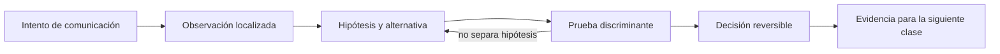
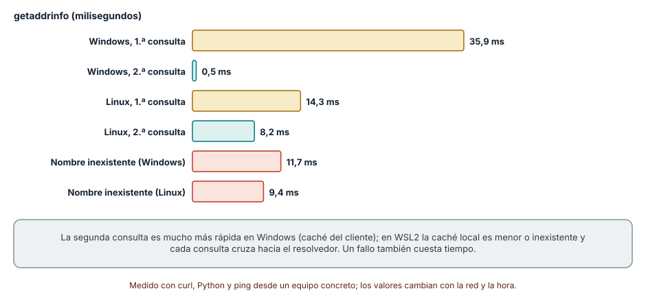
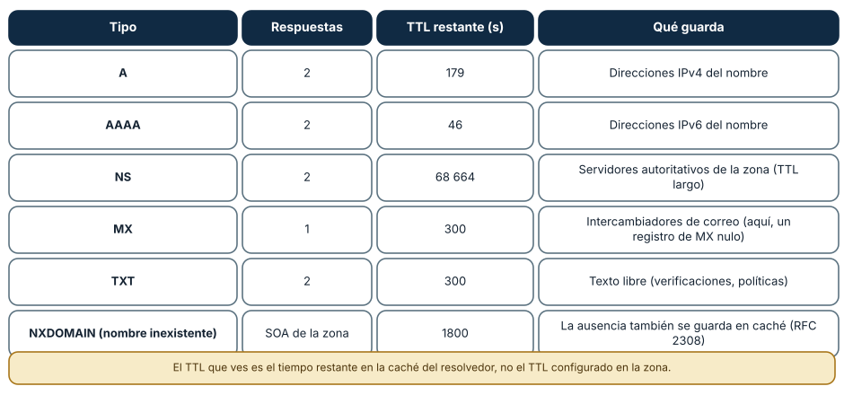
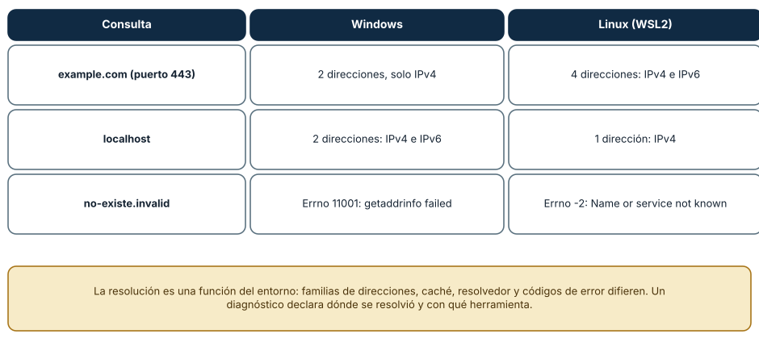

# SE-041 — DNS, nombres, resolución y fallos

[← SE-040 — TCP, UDP, QUIC y decisiones de transporte](../../classes/part-03-redes-internet-y-protocolos/se-040-tcp-udp-quic-y-decisiones-de-transporte/README.md) · [↑ Parte 03](../../classes/part-03-redes-internet-y-protocolos/README.md) · [📚 Índice completo](../../classes/README.md) · [🌐 Portal](../../site/classes/SE-041.html) · [SE-042 — HTTP, semántica, caché y negociación →](../../classes/part-03-redes-internet-y-protocolos/se-042-http-semantica-cache-y-negociacion/README.md)


## Punto profesional y fundamento pedagógico

**Punto profesional.** La clase existe para seguir resolución DNS, delegación, caché y TTL para distinguir ausencia, demora y respuesta obsoleta.

**Por qué aparece aquí.** Se sitúa después de **TCP, UDP, QUIC y decisiones de transporte** y antes de **HTTP, semántica, caché y negociación**: convierte el conocimiento anterior en una decisión observable que la clase siguiente podrá reutilizar. La continuidad se comprueba en el artefacto, no por compartir vocabulario.

**Error conceptual que debe corregir.** Tratar DNS como una sola base o asumir que limpiar una caché limpia todas.

**Secuencia de aprendizaje.** Antes de leer la solución, el estudiante predice el resultado del caso normal y del error conceptual anterior. Luego explica un caso resuelto paso a paso, construye un contraejemplo que cambie la decisión y, sin consultar el texto, reconstruye el mecanismo y lo aplica a una entrada nueva. La secuencia usa predicción, explicación propia, contraste y recuperación. [ICAP](https://icap.education.asu.edu/research) distingue participación de construcción de conocimiento; [How People Learn II](https://nap.nationalacademies.org/catalog/24783/how-people-learn-ii-learners-contexts-and-cultures) exige conectar conocimiento previo, contexto y transferencia; la [práctica de recuperación](https://pubmed.ncbi.nlm.nih.gov/16507066/) respalda producir de nuevo la explicación tras una demora; y [Education for Life and Work](https://nap.nationalacademies.org/resource/13398/dbasse_084153.pdf) exige devolución que explique la causa del error.

**Evidencia de aprendizaje.** Dns-trace.md con consultas, autoridad, TTL, cachés y fallo inducido. Debe contener predicción previa, observación, explicación causal, contraejemplo, criterio de aceptación y una nota de qué dato haría cambiar la conclusión.

**Límite de la conclusión.** Una consulta desde un resolver no describe todas las vistas.

### Trazabilidad fuente → afirmación

| Fuente primaria u oficial | Afirmación que respalda | Lo que no prueba |
|---|---|---|
| [RFC 1034 — Domain Names: Concepts and Facilities](https://www.rfc-editor.org/rfc/rfc1034) | define la semántica normativa del protocolo nombrado en el título y sus límites interoperables | No demuestra por sí sola que el artefacto del estudiante sea correcto. |
| [RFC 1035 — Domain Names: Implementation and Specification](https://www.rfc-editor.org/rfc/rfc1035) | define la semántica normativa del protocolo nombrado en el título y sus límites interoperables | No demuestra por sí sola que el artefacto del estudiante sea correcto. |
| [RFC 8499 — DNS Terminology](https://www.rfc-editor.org/rfc/rfc8499) | define la semántica normativa del protocolo nombrado en el título y sus límites interoperables | No demuestra por sí sola que el artefacto del estudiante sea correcto. |

## Antes de empezar

Esta clase continúa la **petición observable de extremo a extremo de la Parte 3**. No estudia redes como una lista de siglas: añade una decisión concreta al mismo recorrido y obliga a explicar dónde nace cada señal. Conserva una bitácora con cuatro columnas —hecho, interpretación, hipótesis rival y próxima prueba—; si una conclusión no apunta a evidencia, todavía no es diagnóstico.

## Prerrequisitos

- Haber completado `SE-040` o poder explicar su evidencia principal.
- Trabajar solo contra `localhost`, una red propia o un destino con autorización expresa.
- Disponer de navegador, `curl` y herramientas equivalentes del sistema; registra versiones y plataforma.

## Problema auténtico

La petición observable de extremo a extremo funciona por IP pero falla por nombre después de una migración. Algunas personas ven la dirección nueva y otras conservan respuestas anteriores. «Vaciar la caché» no basta: hay que reconstruir resolver, autoridad, tipo de registro, TTL y respuesta negativa.

## Objetivos observables

Al terminar podrás:

1. distinguir stub, resolver recursivo y servidor autoritativo;
2. leer registros A, AAAA, CNAME, NS y SOA en contexto;
3. explicar caché y TTL sin prometer propagación instantánea;
4. diagnosticar NXDOMAIN, NODATA, timeout y respuesta obsoleta;
5. comunicar límites y una siguiente prueba sin presentar inferencias como hechos.

## Mapa conceptual



El ciclo evita el diagnóstico por intuición. La observación se ubica antes de interpretarse; la prueba debe producir resultados diferentes bajo hipótesis rivales; la decisión conserva una salida de recuperación. En esta clase la pregunta rectora es: **¿Qué nombre se preguntó, a quién, qué respuesta obtuvo y cuánto puede reutilizarse?**

## Temas y por qué importan

| Núcleo | Pregunta de trabajo | Evidencia esperada |
|---|---|---|
| alcance | ¿dónde es válido este identificador o estado? | mapa de fronteras |
| mecanismo | ¿qué entrada produce qué transición? | secuencia comentada |
| garantía | ¿qué promete el protocolo y qué no? | ejemplo y contraejemplo |
| diagnóstico | ¿qué prueba separa causas plausibles? | comparación reproducible |
| operación | ¿cómo falla, se limita y se recupera? | caso sano, degradado y restaurado |
## Conceptos y decisiones

### 1. Espacio de nombres y delegación

DNS es una base distribuida y jerárquica. La raíz delega zonas; una zona no equivale necesariamente a un dominio visual. Los servidores autoritativos responden por datos de una zona, mientras un resolver recursivo persigue delegaciones y conserva resultados.

### 2. Pregunta y resource record

Una consulta contiene nombre, clase y tipo. A y AAAA asocian direcciones; CNAME redirige un nombre a otro; NS declara servidores de una zona; SOA contiene parámetros de autoridad. Pedir A y recibir solo AAAA no es lo mismo que NXDOMAIN.

### 3. Resolución recursiva

La aplicación suele hablar con un stub del sistema, que consulta un resolver configurado. Ese resolver puede responder desde caché o iterar por delegaciones. `/etc/hosts`, DNS corporativo, VPN y navegador con resolver propio pueden producir caminos diferentes en el mismo equipo.

### 4. TTL y caché negativa

TTL limita cuánto tiempo puede reutilizarse un registro, no fija una hora universal de propagación. Respuestas negativas también pueden almacenarse. Reducir TTL antes de una migración reduce cierta persistencia futura, pero no invalida copias ya almacenadas ni clientes que incumplen la política.

### 5. Selección de direcciones

Resolver un nombre puede devolver múltiples A y AAAA. El cliente decide orden e intenta conexiones; Happy Eyeballs evita esperar demasiado por una familia rota. Ver una dirección en `dig` no demuestra cuál eligió la aplicación ni que TLS acepte ese nombre.

### 6. DNSSEC y los límites de la autenticación

DNSSEC permite validar autenticidad e integridad de datos mediante una cadena de confianza y autenticar respuestas de inexistencia. No cifra la consulta, no oculta el nombre, no garantiza disponibilidad ni prueba que el servicio sea legítimo. Un estado `bogus` indica validación fallida y no debe convertirse silenciosamente en una respuesta insegura; distinguir `secure`, `insecure` y `bogus` requiere un validador y una ancla configurada, no solo observar registros DNSSEC.

### Medir la resolución: primera consulta, caché y fallo

Resolver un nombre cuesta, y el costo cambia con la caché. Con `socket.getaddrinfo("example.com", 443)` se midió en Windows 35,9 ms la primera vez y 0,5 ms la segunda (la caché del cliente respondió), y en Linux (WSL2) 14,3 ms y 8,2 ms: la caché local de ese entorno no evita la consulta de la misma manera. Un nombre inexistente (`no-existe.invalid`, un dominio reservado por la RFC 6761
que nunca resuelve) tardó 11,7 ms en Windows y 9,4 ms en Linux en fallar. Un fallo también cuesta tiempo, y a diferencia de una respuesta positiva puede reintentarse contra varios resolvedores o dominios de búsqueda antes de rendirse.



**Cómo leer la figura.** Los pares de barras comparan la primera y la segunda consulta. **Dónde deja de valer:** es un solo valor por celda, y la primera consulta depende de si el resolvedor ya tenía el dato. Para caracterizar un resolvedor se repite con muchos nombres y se separan caché local, resolvedor recursivo y servidores autoritativos. La medición no distingue
cuál de esas capas respondió.

### Registros, TTL y caché negativa

DNS guarda *registros* de varios tipos. Consultando `example.com` a un resolvedor público (1.1.1.1) desde PowerShell con `Resolve-DnsName` se obtuvieron: dos registros `A` con un TTL restante de 179 s, dos `AAAA` con 46 s, dos `NS` con 68 664 s, un `MX` con 300 s (un registro de MX nulo que declara que no recibe correo) y dos `TXT` con 300 s. El TTL que se observa es el tiempo
*restante* en la caché del resolvedor, no el configurado en la zona. Los `NS` tienen un TTL de casi un día; los `A` y `AAAA`, mucho menor, porque cambian más. La ausencia también se guarda: al consultar un nombre inexistente de la zona, la respuesta incluyó un registro `SOA` de la zona con TTL 1800 s, que el resolvedor usa para la *caché negativa* (RFC 2308): durante ese tiempo no vuelve a
preguntar por ese nombre.



**Cómo leer la figura.** Cada fila es un tipo de registro con el número de respuestas y su TTL restante; la última muestra la caché negativa. **Dónde deja de valer:** los valores cambian con cada consulta (el TTL restante decrece) y entre resolvedores. Un TTL largo reduce la carga y aumenta el tiempo que tarda un cambio en propagarse: antes de una migración se baja el TTL con anticipación, y se espera a que la caché antigua expire.

### El mismo nombre en dos entornos

Dos entornos del mismo equipo dieron respuestas distintas al mismo nombre. `example.com` devolvió *2 direcciones, solo IPv4* en Windows y *4 direcciones, IPv4 e IPv6* en Linux; `localhost` devolvió 2 direcciones (IPv4 e IPv6) en Windows y 1 (IPv4) en Linux; y un nombre inexistente produjo el código `11001` (`getaddrinfo failed`) en Windows y `-2` (`Name or service not known`) en Linux. La resolución es una función del entorno: de qué familias de direcciones se pide, del resolvedor
configurado, de la caché y del orden de preferencia. Por eso un diagnóstico declara *dónde* se resolvió y con qué herramienta, y comparar resultados de entornos distintos sin esa información conduce a falsas contradicciones.



**Cómo leer la figura.** Cada fila es una consulta idéntica con respuestas distintas. **Dónde deja de valer:** que Windows devolviera solo IPv4 depende de la conectividad IPv6 y de la configuración de ese equipo; con otra red el resultado cambiaría. Y DNSSEC, que firma las respuestas para detectar manipulación, *no* cifra la consulta ni garantiza que el servidor al que se llega sea el correcto: solo autentica el dato DNS.

## Definiciones de trabajo

- **resolver:** componente que obtiene respuestas DNS para un cliente.
- **autoritativo:** servidor que publica datos de una zona.
- **zona:** porción administrada del espacio DNS.
- **TTL:** tiempo máximo indicado para reutilizar un dato en caché.
- **NXDOMAIN:** respuesta que afirma que el nombre consultado no existe.

Estas definiciones son operativas: precisan el uso dentro de la petición observable de extremo a extremo y deben leerse junto a las fuentes. No convierten un término histórico o dependiente de implementación en una garantía universal.

## Ejemplo mínimo

Consulta A, AAAA y un nombre inexistente bajo un dominio que controles o de documentación. Registra código de respuesta, sección de respuesta, autoridad y TTL. Distingue `NOERROR` sin datos de `NXDOMAIN`.

El ejemplo se acepta cuando incluye predicción previa, salida relevante y explicación de qué hipótesis descarta. Copiar una salida sin interpretación no demuestra comprensión.

## Ejemplo profesional

Durante la migración de la petición observable de extremo a extremo, el equipo reduce TTL con antelación, verifica ambos autoritativos y consulta desde resolvers independientes. Conserva tiempo, servidor consultado y respuesta. Un override local se usa solo para aislar DNS; no se publica como solución definitiva.

La diferencia profesional es la trazabilidad: la decisión conecta requisito, mecanismo, señal, riesgo y recuperación. El equipo puede cambiar de herramienta sin perder el razonamiento.

## Práctica guiada

1. identifica qué resolver usa el sistema.
2. consulta el mismo nombre al resolver local y a un autoritativo.
3. sigue una delegación sin copiar información privada.
4. compara A y AAAA y la dirección elegida por curl.
5. documenta una política de migración y rollback.
6. entrega `trace.md` con comandos redactados, marcas de tiempo y condiciones de repetición.

## Ejercicios

1. **Medición:** resuelve un nombre diez veces en tu entorno y separa la primera consulta de las siguientes; explica la diferencia con la caché.
2. **TTL:** planifica la migración de un servicio con un TTL de 3600 s sin interrumpir a nadie, indicando cuándo bajar el TTL y cuándo cambiar el registro.
3. **Familias:** explica por qué un servicio puede ser alcanzable por IPv4 y no por IPv6 y qué prueba lo comprueba.
4. **Caché negativa:** describe cómo un nombre recién creado puede seguir sin resolverse durante minutos y qué TTL lo explica.

## Reto verificable

Entrega una traza comentada que permita a otra persona responder: qué se intentó, qué frontera se observó, qué garantía aplicaba, qué falló, qué alternativa fue descartada y cómo se restauró el estado. La persona revisora debe poder repetir al menos una prueba sin instrucciones orales.

## Demostración guiada

1. Predice el primer evento observable y el resultado sano.
2. Ejecuta una sola petición de la petición observable de extremo a extremo y asigna cada marca a una frontera.
3. Introduce el fallo controlado descrito abajo.
4. Compara por **primera divergencia**, no por cantidad de errores posteriores.
5. Restaura, repite y conserva evidencia de recuperación.

Una demostración que no incluye restauración solo prueba cómo romper el laboratorio.

## Preguntas frecuentes

### ¿Por qué mi cambio de DNS «no se ve» durante horas?

Porque los resolvedores guardan la respuesta antigua hasta que expira su TTL, y los navegadores y sistemas operativos añaden cachés propias. El tiempo máximo es del orden del TTL anterior; por eso se reduce antes de un cambio planificado.

### ¿Qué significa que un nombre devuelva A y AAAA?

Que existe una dirección IPv4 y otra IPv6. El cliente decide cuál usar (en general intenta ambas en paralelo con *Happy Eyeballs*), y si un registro apunta a una dirección que no funciona, algunos clientes fallan con retraso antes de pasar a la otra familia.

### ¿Un `NXDOMAIN` siempre significa que el nombre no existe?

Significa que el resolvedor consultado afirma que no existe. Puede deberse a un error de escritura, a una zona incompleta o a un resolvedor que filtra nombres. Se contrasta preguntando a otro resolvedor y al servidor autoritativo.

### ¿DNSSEC protege mi consulta?

Protege la *integridad* de la respuesta si el resolvedor valida (detecta manipulaciones), pero no la confidencialidad: la consulta sigue viajando en claro salvo que se use DNS cifrado (DoT o DoH). Tampoco protege el tráfico posterior hacia la dirección obtenida.
## Fallo controlado y diagnóstico

Añade en un dominio de laboratorio un registro con destino incorrecto y TTL corto, o usa un nombre reservado. Registra respuesta positiva equivocada versus NXDOMAIN. Corrige y espera/explica la expiración sin afirmar que todos los caches ya cambiaron.

Registra estado previo, acción, síntoma, primera divergencia, causa, corrección y estado posterior. Si la acción afecta red compartida, requiere privilegios amplios o no tiene rollback probado, reemplázala por una simulación local.


Una práctica contrasta una resolución sana y una negativa. Resuelve `example.com` y `no-existe.invalid` con `getaddrinfo` en tu entorno, registra el tiempo, las familias devueltas y el código de error de cada caso. **Síntoma:** el segundo falla con un código propio de la plataforma. **Hipótesis:** el nombre no existe frente a un fallo del resolvedor. **Prueba:** el sufijo `.invalid` está reservado
y *no debe* resolver; si falla con «timeout» en lugar de «nombre inexistente», el resolvedor no responde. **Corrección de diseño:** la aplicación distingue «nombre inexistente» (no reintentar) de «resolvedor sin respuesta» (reintentar con límite) y no confunde ambos en un solo mensaje. Registra el entorno y evita resolver nombres sensibles de tu organización.

## Errores comunes y cómo corregirlos

| Síntoma | Causa | Corrección |
|---|---|---|
| «DNS falla» ante cualquier error de red | No se distinguió NXDOMAIN de un resolvedor sin respuesta | Clasificar el código de error y probar con otro resolvedor |
| Comparar resultados de dos entornos sin declararlos | La resolución depende de caché, familia y resolvedor | Registrar dónde y con qué herramienta se resolvió |
| Cambiar un registro y esperar efecto inmediato | El TTL anterior y las cachés demoran la propagación | Bajar el TTL antes del cambio y esperar su expiración |
| Fijar direcciones IP en lugar de nombres «para evitar DNS» | Se pierde balanceo, conmutación y renovación de certificados | Resolver y cachear con control; usar nombres estables |
| Creer que DNSSEC cifra o autentica el destino final | Solo firma los datos DNS | Usar TLS para autenticar el servidor y DNS cifrado para privacidad |

## Entorno y archivos clave

```text
work/SE-041/
├── README.md          # alcance, autorización y reproducción
├── request.txt        # petición sin credenciales
├── trace.md           # línea temporal y evidencias
├── failure-report.md  # hipótesis, prueba y recuperación
└── diagram.mmd        # mapa accesible acompañado de texto
```

Los archivos son contenedores, no evidencia automática. `README.md` declara sistema operativo, versiones, red utilizada y limpieza. Nunca confirmes cambios de red destructivos sin una ruta de recuperación.

### Laboratorio integrado de la Parte 03

Contrasta `healthy` y `dns_failure` en la [petición observable](https://github.com/vladimiracunadev-create/modern-software-engineering-program/tree/main/labs/part-03-observable-request). El resolver es un mapa en memoria: úsalo para demostrar que el fallo detiene la petición antes de conexión, no para afirmar que reproduce recursión, caché negativa o DNSSEC. `dns-trace.md` debe añadir un diseño de NXDOMAIN con SOA/TTL y distinguir `secure`, `insecure` y `bogus` sin inventar validación ejecutada.

## Seguridad, ética y accesibilidad

- captura únicamente tráfico propio o autorizado y durante la ventana mínima;
- redacta cookies, tokens, query strings, IP privadas y nombres de personas;
- no desactives TLS, firewall o aislamiento como solución permanente;
- acompaña color y diagramas con orden, etiquetas y una explicación textual;
- ofrece comandos equivalentes o resultados esperados para quien no pueda modificar una red;
- considera que telemetría e IP pueden identificar o perfilar personas.

## Puente hacia el trabajo con agentes

Un agente que navega o llama a APIs depende de DNS en cada petición, y le atañen dos problemas. El primero es de *fiabilidad*: ante un fallo de nombre debe distinguir «no existe» de «no hay respuesta», y no reintentar ciegamente. El segundo es de *seguridad*: un atacante puede hacer que un nombre que parecía público resuelva a una dirección interna (rebinding de DNS) entre la comprobación y la conexión. Por eso las listas de destinos permitidos del
harness comprueban la dirección *resuelta* en el momento de conectar y no solo el nombre. Además, los nombres que aparecen en datos no confiables son entrada hostil: no se deben consultar sin una política. Las partes de herramientas y de seguridad agentic retoman estos controles.

## Transferencia

Traslada el mecanismo a una segunda red o protocolo sin repetir comandos mecánicamente. Conserva la pregunta y el criterio de evidencia; cambia los supuestos de dirección, intermediación y política. Escribe qué observación seguiría siendo válida y cuál depende de la topología original.

## Evaluación y evidencia

| Criterio | Evidencia mínima | Señal de dominio |
|---|---|---|
| modelo causal | mapa con fronteras y unidades correctas | explica interacción y fugas del modelo |
| protocolo | garantía y límite apoyados en fuente | distingue semántica de implementación |
| diagnóstico | hipótesis rival y prueba discriminante | encuentra primera divergencia |
| reproducibilidad | contexto, comandos y salida redactada | otra persona repite el resultado |
| responsabilidad | autorización, minimización y rollback | reduce riesgo sin borrar evidencia |

La clase no se aprueba por ejecutar comandos. Se aprueba cuando la evidencia sostiene las conclusiones y declara lo que todavía no puede saberse.

## Fuentes


- [RFC 1034 — Domain Names: Concepts and Facilities](https://www.rfc-editor.org/rfc/rfc1034) — define la semántica normativa del protocolo nombrado en el título y sus límites interoperables.
- [RFC 1035 — Domain Names: Implementation and Specification](https://www.rfc-editor.org/rfc/rfc1035) — define la semántica normativa del protocolo nombrado en el título y sus límites interoperables.
- [RFC 8499 — DNS Terminology](https://www.rfc-editor.org/rfc/rfc8499) — define la semántica normativa del protocolo nombrado en el título y sus límites interoperables.
- [RFC 2308 — Negative Caching of DNS Queries](https://www.rfc-editor.org/rfc/rfc2308) — explica cómo se hacen cacheables las respuestas negativas y cómo expira esa evidencia.
- [RFC 4033 — DNS Security Introduction and Requirements](https://www.rfc-editor.org/rfc/rfc4033) — define objetivos, cadena de confianza y límites de DNSSEC.
- [RFC 8305 — Happy Eyeballs Version 2](https://www.rfc-editor.org/rfc/rfc8305) — define la semántica normativa del protocolo nombrado en el título y sus límites interoperables.

Las RFC describen contratos de protocolo, no certifican una red, proveedor o herramienta. Cada afirmación de comportamiento local debe contrastarse con evidencia de ese entorno.

- [RFC 1034 y RFC 1035, DNS](https://www.rfc-editor.org/rfc/rfc1034) y [RFC 2308, caché negativa](https://www.rfc-editor.org/rfc/rfc2308): modelo de nombres, registros, TTL y respuestas negativas; respaldan las figuras 1 y 2.
- [RFC 6761, nombres de uso especial](https://www.rfc-editor.org/rfc/rfc6761): reserva de `.invalid` y `localhost`, usados en las pruebas.
- [Resolve-DnsName (PowerShell)](https://learn.microsoft.com/powershell/module/dnsclient/resolve-dnsname) y [Python `socket.getaddrinfo`](https://docs.python.org/3/library/socket.html#socket.getaddrinfo): herramientas de consulta empleadas.

## Límites y siguiente paso

No cubre operación completa de DNSSEC ni registradores. Las herramientas pueden omitir el camino usado por una aplicación. La siguiente clase interpreta la petición HTTP una vez resuelto y conectado el origen.

## Glosario

- **resolver:** componente que obtiene respuestas DNS para un cliente.
- **autoritativo:** servidor que publica datos de una zona.
- **zona:** porción administrada del espacio DNS.
- **TTL:** tiempo máximo indicado para reutilizar un dato en caché.
- **NXDOMAIN:** respuesta que afirma que el nombre consultado no existe.

---

[← SE-040 — TCP, UDP, QUIC y decisiones de transporte](../../classes/part-03-redes-internet-y-protocolos/se-040-tcp-udp-quic-y-decisiones-de-transporte/README.md) · [↑ Parte 03](../../classes/part-03-redes-internet-y-protocolos/README.md) · [📚 Índice completo](../../classes/README.md) · [🌐 Portal](../../site/classes/SE-041.html) · [SE-042 — HTTP, semántica, caché y negociación →](../../classes/part-03-redes-internet-y-protocolos/se-042-http-semantica-cache-y-negociacion/README.md)
