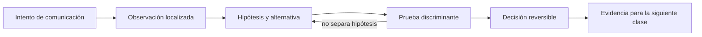
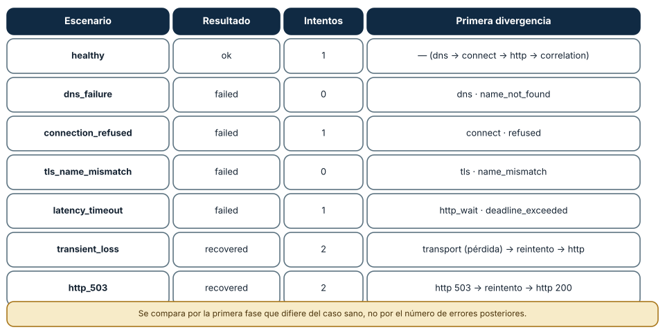
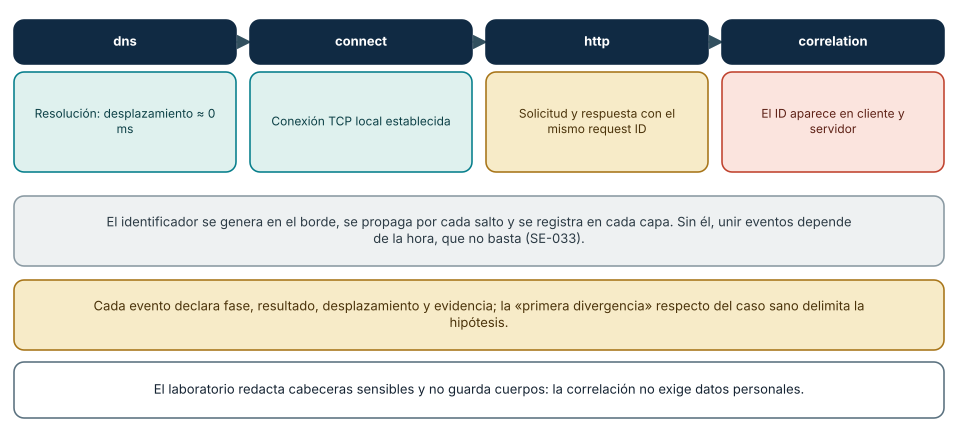
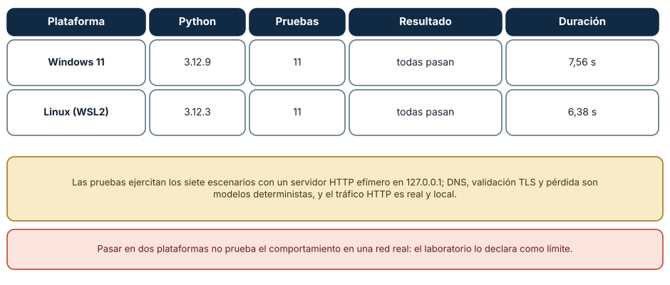

# SE-047 — Taller: seguir una petición de extremo a extremo

[← SE-046 — Captura, medición y diagnóstico de tráfico](../../classes/part-03-redes-internet-y-protocolos/se-046-captura-medicion-y-diagnostico-de-trafico/README.md) · [↑ Parte 03](../../classes/part-03-redes-internet-y-protocolos/README.md) · [📚 Índice completo](../../classes/README.md) · [🌐 Portal](../../site/classes/SE-047.html) · [SE-048 — Proyecto: servicio observable y tolerante a fallos de red →](../../classes/part-03-redes-internet-y-protocolos/se-048-proyecto-servicio-observable-y-tolerante-a-fallos-de-red/README.md)


## Punto profesional y fundamento pedagógico

**Punto profesional.** La clase existe para reconstruir una petición extremo a extremo correlacionando DNS, transporte, TLS y HTTP.

**Por qué aparece aquí.** Se sitúa después de **Captura, medición y diagnóstico de tráfico** y antes de **Proyecto: servicio observable y tolerante a fallos de red**: convierte el conocimiento anterior en una decisión observable que la clase siguiente podrá reutilizar. La continuidad se comprueba en el artefacto, no por compartir vocabulario.

**Error conceptual que debe corregir.** Narrar capas por separado sin una identidad temporal común.

**Secuencia de aprendizaje.** Antes de leer la solución, el estudiante predice el resultado del caso normal y del error conceptual anterior. Luego explica un caso resuelto paso a paso, construye un contraejemplo que cambie la decisión y, sin consultar el texto, reconstruye el mecanismo y lo aplica a una entrada nueva. La secuencia usa predicción, explicación propia, contraste y recuperación. [ICAP](https://icap.education.asu.edu/research) distingue participación de construcción de conocimiento; [How People Learn II](https://nap.nationalacademies.org/catalog/24783/how-people-learn-ii-learners-contexts-and-cultures) exige conectar conocimiento previo, contexto y transferencia; la [práctica de recuperación](https://pubmed.ncbi.nlm.nih.gov/16507066/) respalda producir de nuevo la explicación tras una demora; y [Education for Life and Work](https://nap.nationalacademies.org/resource/13398/dbasse_084153.pdf) exige devolución que explique la causa del error.

**Evidencia de aprendizaje.** Request-timeline.md con timestamps, IDs, saltos y dos hipótesis descartadas. Debe contener predicción previa, observación, explicación causal, contraejemplo, criterio de aceptación y una nota de qué dato haría cambiar la conclusión.

**Límite de la conclusión.** La correlación temporal no prueba causalidad sin experimento discriminante.

### Trazabilidad fuente → afirmación

| Fuente primaria u oficial | Afirmación que respalda | Lo que no prueba |
|---|---|---|
| [RFC 1122 — Requirements for Internet Hosts: Communication Layers](https://www.rfc-editor.org/rfc/rfc1122) | define la semántica normativa del protocolo nombrado en el título y sus límites interoperables | No demuestra por sí sola que el artefacto del estudiante sea correcto. |
| [RFC 1034 — Domain Names: Concepts and Facilities](https://www.rfc-editor.org/rfc/rfc1034) | define la semántica normativa del protocolo nombrado en el título y sus límites interoperables | No demuestra por sí sola que el artefacto del estudiante sea correcto. |
| [RFC 9293 — Transmission Control Protocol](https://www.rfc-editor.org/rfc/rfc9293) | define la semántica normativa del protocolo nombrado en el título y sus límites interoperables | No demuestra por sí sola que el artefacto del estudiante sea correcto. |

## Antes de empezar

Esta clase continúa la **petición observable de extremo a extremo de la Parte 3**. No estudia redes como una lista de siglas: añade una decisión concreta al mismo recorrido y obliga a explicar dónde nace cada señal. Conserva una bitácora con cuatro columnas —hecho, interpretación, hipótesis rival y próxima prueba—; si una conclusión no apunta a evidencia, todavía no es diagnóstico.

## Prerrequisitos

- Haber completado `SE-046` o poder explicar su evidencia principal.
- Trabajar solo contra `localhost`, una red propia o un destino con autorización expresa.
- Disponer de navegador, `curl` y herramientas equivalentes del sistema; registra versiones y plataforma.

## Problema auténtico

El equipo recibe un incidente intermitente y cada especialista entrega una captura aislada. El taller obliga a unir configuración local, DNS, ruta, transporte, TLS, intermediarios y HTTP en una sola línea temporal sin rellenar huecos con suposiciones.

## Objetivos observables

Al terminar podrás:

1. planificar una traza con hipótesis y presupuesto;
2. seguir una petición de extremo a extremo;
3. marcar identidades y transformaciones por salto;
4. producir un relato causal reproducible con incertidumbres;
5. comunicar límites y una siguiente prueba sin presentar inferencias como hechos.

## Mapa conceptual



El ciclo evita el diagnóstico por intuición. La observación se ubica antes de interpretarse; la prueba debe producir resultados diferentes bajo hipótesis rivales; la decisión conserva una salida de recuperación. En esta clase la pregunta rectora es: **¿Puede otra persona reconstruir una petición completa únicamente con la evidencia?**

## Temas y por qué importan

| Núcleo | Pregunta de trabajo | Evidencia esperada |
|---|---|---|
| alcance | ¿dónde es válido este identificador o estado? | mapa de fronteras |
| mecanismo | ¿qué entrada produce qué transición? | secuencia comentada |
| garantía | ¿qué promete el protocolo y qué no? | ejemplo y contraejemplo |
| diagnóstico | ¿qué prueba separa causas plausibles? | comparación reproducible |
| operación | ¿cómo falla, se limita y se recupera? | caso sano, degradado y restaurado |
## Conceptos y decisiones

### 1. Contrato de observación

Antes de ejecutar se fija target autorizado, instante, cliente, red, límites de datos, resultado esperado y condición de parada. Sin ese contrato, una segunda traza puede cambiar demasiadas variables y resultar incomparable.

### 2. Línea temporal multicapa

La secuencia mínima registra consulta DNS, dirección seleccionada, ruta, apertura de transporte, TLS, envío HTTP, intermediario, origen y respuesta. Cada evento indica reloj, host observador y fuente. Los huecos se rotulan desconocidos.

### 3. Identidad por frontera

Nombre DNS, IP, MAC, socket, certificado, Host, request ID y usuario nombran entidades diferentes. El taller conecta cada identificador solo donde es válido. Una IP compartida por CDN no identifica un backend ni una persona.

### 4. Prueba discriminante

Después de la traza normal se introduce un único fallo. La prueba debe producir un cambio predicho: override DNS, puerto cerrado o caché controlada. Si cambian varias señales, se vuelve a reducir antes de concluir.

### 5. Narrativa causal y revisión

El informe no es una descarga de comandos. Ordena contexto, expectativa, observación, hipótesis, prueba, resultado, causa y prevención. Una persona revisora debe poder señalar evidencia faltante o repetir el recorrido sin explicación oral.

### La suite del laboratorio y su primera divergencia

El laboratorio de la Parte 03 ejecuta siete escenarios sobre un servidor HTTP efímero en `127.0.0.1`. Cada resultado declara `scenario`, `outcome`, `attempts`, `request_id`, `failure`, `events` y `limits`, y cada evento tiene `phase`, `outcome`, `offset_ms` y `evidence`. La ejecución real de `python labs/part-03-observable-request/observable_request.py suite` produjo: `healthy` → `ok` en un intento, con las fases `dns → connect → http → correlation`; `dns_failure` → `failed` en la fase `dns` con
código `name_not_found`; `connection_refused` → `failed` en `connect` con `refused`; `tls_name_mismatch` → `failed` en `tls` con `name_mismatch`; `latency_timeout` → `failed` en `http_wait` con `deadline_exceeded`; y `transient_loss` y `http_503` → `recovered` tras dos intentos. El método de la clase es comparar cada caso con el sano y *ubicar la primera fase que difiere*: una lista de errores posteriores no la sustituye.



**Cómo leer la figura.** Cada fila es un escenario con su resultado y la fase de la primera divergencia. Los dos escenarios recuperados muestran que un reintento acotado cambia el resultado final pero deja huella en los eventos. **Dónde deja de valer:** en el laboratorio, DNS, validación del nombre TLS y pérdida son *modelos deterministas*; solo el tráfico HTTP es real y local. La suite demuestra el método de diagnóstico, no el comportamiento de una red real.

### Correlación: un identificador que cruza las fronteras

Para unir eventos de componentes distintos hace falta un identificador común. El laboratorio genera un `request_id`, lo propaga en una cabecera y lo registra en cada evento; la fase `correlation` del caso sano comprueba que el mismo valor aparece en cliente y servidor. Sin él, unir eventos depende de la hora, que no basta: los relojes difieren y varias peticiones coinciden en el tiempo (SE-033). Una línea temporal multicapa resulta de ordenar los eventos por
`offset_ms` desde el inicio y agruparlos por `request_id`. El laboratorio además redacta las cabeceras sensibles y no guarda cuerpos: la correlación no requiere datos personales.



**Cómo leer la figura.** Las cuatro cajas son las fases del caso sano; las inferiores explican por qué se necesita un identificador, qué contiene cada evento y qué no se registra. **Dónde deja de valer:** un identificador solo une lo que lo propaga; los componentes que no lo reenvían (un proveedor externo, un balanceador mal configurado) rompen la cadena y deben detectarse como una brecha, no ignorarse.

### Verificar el laboratorio en dos plataformas

Las once pruebas del laboratorio pasaron en Windows 11 con Python 3.12.9 (7,56 s) y en Ubuntu 24.04 bajo WSL2 con Python 3.12.3 (6,38 s). Eso es evidencia de que el *contrato del laboratorio* se cumple en dos sistemas, incluidos los comportamientos de loopback que difieren entre ellos (por ejemplo, el rechazo de una conexión, que en Windows tarda hasta un timeout, se modela de forma determinista). No prueba el comportamiento en una red real,
algo que el laboratorio declara como límite. La matriz de integración continua ejecuta además otras versiones de Python y macOS.



**Cómo leer la figura.** Cada fila es una plataforma con su versión de Python, el número de pruebas y la duración. **Dónde deja de valer:** una ejecución local no sustituye a la matriz remota; solo esta, en verde, sustenta una afirmación de compatibilidad. Y las pruebas verifican lo que el laboratorio promete, no que un servicio real se comporte igual.

## Definiciones de trabajo

- **traza:** secuencia de observaciones relacionadas y contextualizadas.
- **primera divergencia:** primer evento donde caso sano y fallido dejan de coincidir.
- **request ID:** identificador de correlación de una operación.
- **prueba discriminante:** experimento cuyo resultado separa hipótesis.
- **incertidumbre:** parte relevante que la evidencia disponible no permite determinar.

Estas definiciones son operativas: precisan el uso dentro de la petición observable de extremo a extremo y deben leerse junto a las fuentes. No convierten un término histórico o dependiente de implementación en una garantía universal.

## Ejemplo mínimo

Construye una línea de tiempo de una petición pública autorizada con al menos seis eventos y cuatro identificadores distintos. Marca explícitamente dos hechos que no puedes observar.

El ejemplo se acepta cuando incluye predicción previa, salida relevante y explicación de qué hipótesis descarta. Copiar una salida sin interpretación no demuestra comprensión.

## Ejemplo profesional

La petición observable de extremo a extremo ejecuta una traza sintética cada cinco minutos desde dos redes. Ante fallo, guarda solo metadatos y los vincula a logs por request ID. El taller compara caso sano y degradado, calcula la primera divergencia y evita concluir desde diferencias posteriores que son consecuencias.

La diferencia profesional es la trazabilidad: la decisión conecta requisito, mecanismo, señal, riesgo y recuperación. El equipo puede cambiar de herramienta sin perder el razonamiento.

## Práctica guiada

1. declara alcance, datos y criterio de éxito.
2. predice el recorrido antes de medir.
3. recolecta configuración, DNS y ruta.
4. ejecuta la petición con tiempos y cabeceras mínimas.
5. incorpora certificado e intermediarios.
6. introduce un fallo único y solicita revisión cruzada.
7. entrega `trace.md` con comandos redactados, marcas de tiempo y condiciones de repetición.

## Ejercicios

1. **Primera divergencia:** dado un caso con eventos `dns ok, connect ok, tls fallo`, compara con `healthy` y escribe la hipótesis.
2. **Correlación:** diseña el flujo del identificador desde el cliente a un servicio y a una base de datos, y qué hacer si un componente no lo propaga.
3. **Rivales:** para `latency_timeout`, escribe dos hipótesis rivales y la observación mínima que las separa.
4. **Informe:** redacta el informe de diagnóstico de `tls_name_mismatch` con evidencia, causa, corrección y verificación.

## Reto verificable

Entrega una traza comentada que permita a otra persona responder: qué se intentó, qué frontera se observó, qué garantía aplicaba, qué falló, qué alternativa fue descartada y cómo se restauró el estado. La persona revisora debe poder repetir al menos una prueba sin instrucciones orales.

## Demostración guiada

1. Predice el primer evento observable y el resultado sano.
2. Ejecuta una sola petición de la petición observable de extremo a extremo y asigna cada marca a una frontera.
3. Introduce el fallo controlado descrito abajo.
4. Compara por **primera divergencia**, no por cantidad de errores posteriores.
5. Restaura, repite y conserva evidencia de recuperación.

Una demostración que no incluye restauración solo prueba cómo romper el laboratorio.

## Preguntas frecuentes

### ¿Por qué comparar por la primera divergencia y no por el número de errores?

Porque los errores posteriores suelen ser consecuencia del primero. Una resolución fallida produce, aguas abajo, ausencia de conexión, de TLS y de HTTP; contarlos como cuatro problemas oculta que hay uno solo. La primera fase que difiere del caso sano delimita la hipótesis.

### ¿Qué hago si un componente no propaga el identificador de correlación?

Se registra como una brecha de observabilidad: ese componente es una caja opaca en la línea temporal. Se trata como una frontera donde se pierde la correlación, se corrige (propagar la cabecera) o se compensa con otras señales (marcas de tiempo y atributos de la petición), y se declara el límite.

### ¿Un laboratorio con modelos deterministas es «de verdad»?

Es de verdad para lo que modela: el orden de fases, la política de reintentos y el diagnóstico. No lo es para el comportamiento de una red real. Declarar qué es real (HTTP local) y qué es modelo (DNS, TLS, pérdida) es parte de la honestidad del ejercicio.

### ¿Qué debe contener un informe de diagnóstico?

El síntoma, el estado previo, la primera divergencia, las hipótesis rivales con la prueba que las separó, la causa, la corrección, el estado posterior y el riesgo residual, con el identificador de petición y los comandos redactados.
## Fallo controlado y diagnóstico

Fuerza el nombre de laboratorio a una dirección con puerto cerrado. La traza debe mostrar DNS sustituido, ruta disponible y rechazo/timeout antes de TLS. Restaura el mapeo y verifica el caso sano.

Registra estado previo, acción, síntoma, primera divergencia, causa, corrección y estado posterior. Si la acción afecta red compartida, requiere privilegios amplios o no tiene rollback probado, reemplázala por una simulación local.


Una práctica ejecuta la suite y construye el informe de dos escenarios. Ejecuta `suite`, escoge `dns_failure` y `http_503`, y para cada uno escribe: la primera fase que difiere del caso `healthy`, los eventos con su `offset_ms`, el código de fallo y la evidencia. **Síntoma:** ambos dejan una huella distinta (uno falla en `dns`, el otro se recupera tras un 503). **Hipótesis rivales:** para `http_503`, «el servidor está caído» frente a «hubo una sobrecarga transitoria». **Prueba:** el segundo intento
tuvo éxito, lo que descarta la caída permanente. **Corrección de diseño:** el cliente reintenta con límite solo operaciones idempotentes. Conserva el `request_id` de cada ejecución y no incluyas cuerpos ni cabeceras sensibles.

## Errores comunes y cómo corregirlos

| Síntoma | Causa | Corrección |
|---|---|---|
| Informe con una lista de errores sin ordenar | No se identificó la primera divergencia | Comparar con el caso sano y señalar la primera fase que difiere |
| Eventos de componentes que no se pueden unir | Falta un identificador propagado | Generar el ID en el borde, propagarlo y registrarlo en cada capa |
| Declarar «compatible» tras una ejecución local | Se confunde una prueba local con la matriz de integración | Esperar la matriz remota en verde y declarar los límites |
| Guardar cuerpos y cabeceras completos «para depurar» | Exposición innecesaria de datos | Redactar cabeceras sensibles y no guardar cuerpos |
| Dar por cerrado un incidente sin verificar | Solo se probó el caso original | Verificar el caso original, uno vecino y registrar el riesgo residual |

## Entorno y archivos clave

```text
work/SE-047/
├── README.md          # alcance, autorización y reproducción
├── request.txt        # petición sin credenciales
├── trace.md           # línea temporal y evidencias
├── failure-report.md  # hipótesis, prueba y recuperación
└── diagram.mmd        # mapa accesible acompañado de texto
```

Los archivos son contenedores, no evidencia automática. `README.md` declara sistema operativo, versiones, red utilizada y limpieza. Nunca confirmes cambios de red destructivos sin una ruta de recuperación.

### Laboratorio integrado de la Parte 03

Construye `request-timeline.md` desde los eventos de la [petición observable](https://github.com/vladimiracunadev-create/modern-software-engineering-program/tree/main/labs/part-03-observable-request). Conserva el `request_id`, identifica la primera divergencia y escribe dos hipótesis rivales que una observación posterior pueda separar. Si propones `traceparent`, respeta su formato y reinicia o valida contexto al cruzar una frontera de confianza; nunca introduzcas datos personales en `tracestate`.

## Seguridad, ética y accesibilidad

- captura únicamente tráfico propio o autorizado y durante la ventana mínima;
- redacta cookies, tokens, query strings, IP privadas y nombres de personas;
- no desactives TLS, firewall o aislamiento como solución permanente;
- acompaña color y diagramas con orden, etiquetas y una explicación textual;
- ofrece comandos equivalentes o resultados esperados para quien no pueda modificar una red;
- considera que telemetría e IP pueden identificar o perfilar personas.

## Puente hacia el trabajo con agentes

El taller es una plantilla para auditar una tarea de un agente: un identificador por tarea, eventos con fase, resultado y evidencia, y una comparación con un caso sano. Cuando un agente falla, la pregunta es «¿cuál fue la primera fase que difiere?» (la recuperación de contexto, la llamada a la herramienta, la validación del resultado), no cuántos errores aparecieron después. Un harness que registra esa línea temporal permite reproducir y evaluar al agente con la misma disciplina. Y, como en el laboratorio, la
traza debe redactar secretos y datos personales y declarar qué partes son reales y cuáles modeladas. Las partes de evaluación, observabilidad y auditoría de agentes desarrollan este formato con herramientas concretas.

## Transferencia

Traslada el mecanismo a una segunda red o protocolo sin repetir comandos mecánicamente. Conserva la pregunta y el criterio de evidencia; cambia los supuestos de dirección, intermediación y política. Escribe qué observación seguiría siendo válida y cuál depende de la topología original.

## Evaluación y evidencia

| Criterio | Evidencia mínima | Señal de dominio |
|---|---|---|
| modelo causal | mapa con fronteras y unidades correctas | explica interacción y fugas del modelo |
| protocolo | garantía y límite apoyados en fuente | distingue semántica de implementación |
| diagnóstico | hipótesis rival y prueba discriminante | encuentra primera divergencia |
| reproducibilidad | contexto, comandos y salida redactada | otra persona repite el resultado |
| responsabilidad | autorización, minimización y rollback | reduce riesgo sin borrar evidencia |

La clase no se aprueba por ejecutar comandos. Se aprueba cuando la evidencia sostiene las conclusiones y declara lo que todavía no puede saberse.

## Fuentes


- [RFC 1122 — Requirements for Internet Hosts: Communication Layers](https://www.rfc-editor.org/rfc/rfc1122) — define la semántica normativa del protocolo nombrado en el título y sus límites interoperables.
- [RFC 1034 — Domain Names: Concepts and Facilities](https://www.rfc-editor.org/rfc/rfc1034) — define la semántica normativa del protocolo nombrado en el título y sus límites interoperables.
- [RFC 9293 — Transmission Control Protocol](https://www.rfc-editor.org/rfc/rfc9293) — define la semántica normativa del protocolo nombrado en el título y sus límites interoperables.
- [RFC 8446 — TLS 1.3](https://www.rfc-editor.org/rfc/rfc8446) — define la semántica normativa del protocolo nombrado en el título y sus límites interoperables.
- [RFC 9110 — HTTP Semantics](https://www.rfc-editor.org/rfc/rfc9110) — define la semántica normativa del protocolo nombrado en el título y sus límites interoperables.
- [W3C Trace Context](https://www.w3.org/TR/trace-context/) — define propagación interoperable de `traceparent` y `tracestate`, incluidos límites de privacidad y confianza.

Las RFC describen contratos de protocolo, no certifican una red, proveedor o herramienta. Cada afirmación de comportamiento local debe contrastarse con evidencia de ese entorno.

- [Laboratorio de la Parte 03](https://github.com/vladimiracunadev-create/modern-software-engineering-program/tree/main/labs/part-03-observable-request): escenarios, contrato de eventos y pruebas ejecutadas en esta clase; sus once pruebas pasaron en Windows y en Linux (WSL2).
- [W3C Trace Context](https://www.w3.org/TR/trace-context/): propagación estándar de identificadores de traza entre servicios, que generaliza el `request_id` del laboratorio.
- [Python `unittest`](https://docs.python.org/3/library/unittest.html): marco de las pruebas del laboratorio.

## Límites y siguiente paso

El taller no garantiza visibilidad dentro de redes de terceros. No deben recolectarse tokens ni cuerpos personales. La clase final convierte el método en un servicio observable y recuperable.

## Glosario

- **traza:** secuencia de observaciones relacionadas y contextualizadas.
- **primera divergencia:** primer evento donde caso sano y fallido dejan de coincidir.
- **request ID:** identificador de correlación de una operación.
- **prueba discriminante:** experimento cuyo resultado separa hipótesis.
- **incertidumbre:** parte relevante que la evidencia disponible no permite determinar.

---

[← SE-046 — Captura, medición y diagnóstico de tráfico](../../classes/part-03-redes-internet-y-protocolos/se-046-captura-medicion-y-diagnostico-de-trafico/README.md) · [↑ Parte 03](../../classes/part-03-redes-internet-y-protocolos/README.md) · [📚 Índice completo](../../classes/README.md) · [🌐 Portal](../../site/classes/SE-047.html) · [SE-048 — Proyecto: servicio observable y tolerante a fallos de red →](../../classes/part-03-redes-internet-y-protocolos/se-048-proyecto-servicio-observable-y-tolerante-a-fallos-de-red/README.md)
