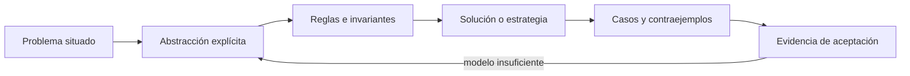
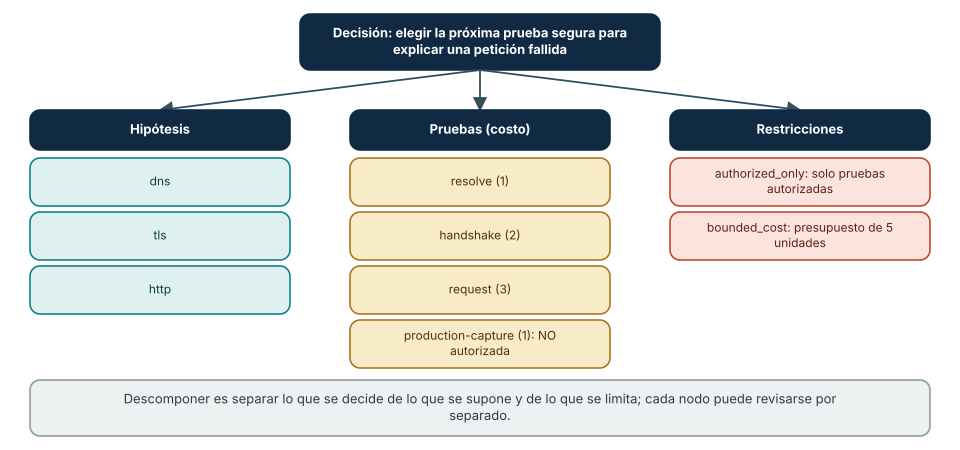
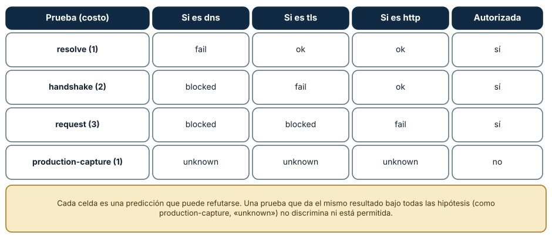
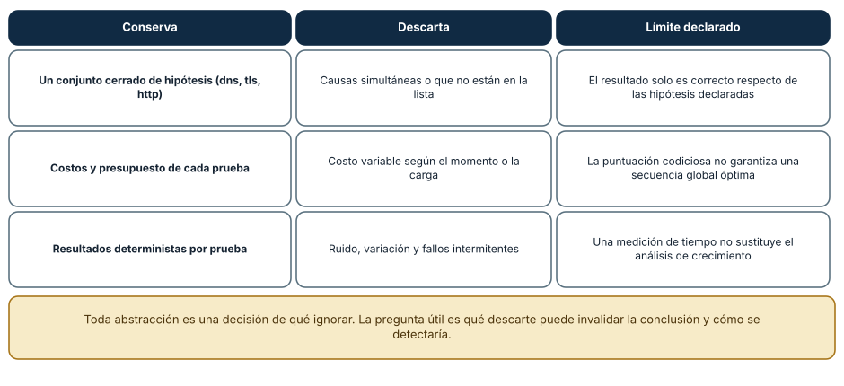

# SE-049 — Descomposición, abstracción y reconocimiento de patrones

[← SE-048 — Proyecto: servicio observable y tolerante a fallos de red](../../classes/part-03-redes-internet-y-protocolos/se-048-proyecto-servicio-observable-y-tolerante-a-fallos-de-red/README.md) · [↑ Parte 04](../../classes/part-04-pensamiento-computacional-y-resolucion-de-problemas/README.md) · [📚 Índice completo](../../classes/README.md) · [🌐 Portal](../../site/classes/SE-049.html) · [SE-050 — Lógica proposicional, predicados e inferencia →](../../classes/part-04-pensamiento-computacional-y-resolucion-de-problemas/se-050-logica-proposicional-predicados-e-inferencia/README.md)


## Punto profesional y fundamento pedagógico

**Punto profesional.** La clase existe para descomponer un problema por responsabilidades y contratos sin perder restricciones transversales.

**Por qué aparece aquí.** Se sitúa después de **Proyecto: servicio observable y tolerante a fallos de red** y antes de **Lógica proposicional, predicados e inferencia**: convierte el conocimiento anterior en una decisión observable que la clase siguiente podrá reutilizar. La continuidad se comprueba en el artefacto, no por compartir vocabulario.

**Error conceptual que debe corregir.** Convertir descomposición en una lista arbitraria de tareas.

**Secuencia de aprendizaje.** Antes de leer la solución, el estudiante predice el resultado del caso normal y del error conceptual anterior. Luego explica un caso resuelto paso a paso, construye un contraejemplo que cambie la decisión y, sin consultar el texto, reconstruye el mecanismo y lo aplica a una entrada nueva. La secuencia usa predicción, explicación propia, contraste y recuperación. [ICAP](https://icap.education.asu.edu/research) distingue participación de construcción de conocimiento; [How People Learn II](https://nap.nationalacademies.org/catalog/24783/how-people-learn-ii-learners-contexts-and-cultures) exige conectar conocimiento previo, contexto y transferencia; la [práctica de recuperación](https://pubmed.ncbi.nlm.nih.gov/16507066/) respalda producir de nuevo la explicación tras una demora; y [Education for Life and Work](https://nap.nationalacademies.org/resource/13398/dbasse_084153.pdf) exige devolución que explique la causa del error.

**Evidencia de aprendizaje.** Problem-tree.md con fronteras, dependencias, invariantes y una descomposición alternativa. Debe contener predicción previa, observación, explicación causal, contraejemplo, criterio de aceptación y una nota de qué dato haría cambiar la conclusión.

**Límite de la conclusión.** Ninguna partición elimina coordinación; solo cambia dónde ocurre.

### Trazabilidad fuente → afirmación

| Fuente primaria u oficial | Afirmación que respalda | Lo que no prueba |
|---|---|---|
| [SWEBOK Guide v4.0a](https://www.computer.org/education/bodies-of-knowledge/software-engineering) | sitúa la decisión dentro de construcción, diseño, pruebas y práctica profesional de ingeniería de software | No demuestra por sí sola que el artefacto del estudiante sea correcto. |
| [MIT 6.042J — Mathematics for Computer Science](https://ocw.mit.edu/courses/6-042j-mathematics-for-computer-science-spring-2015/) | aporta lógica, inducción, relaciones, grafos y técnicas de demostración aplicadas | No demuestra por sí sola que el artefacto del estudiante sea correcto. |

## Antes de empezar

Esta clase continúa el **modelo de decisión diagnóstica**, que convierte la evidencia de la petición observable de extremo a extremo en una siguiente decisión explicable. Recupera `SE-048`: escribe qué artefacto dejó, qué supuesto permanece abierto y qué propiedad debe sobrevivir al nuevo modelo. La matemática se usa para restringir interpretaciones y encontrar errores; no como ornamentación.

## Prerrequisitos

- Poder separar hecho, interpretación, hipótesis y decisión.
- Manejar tablas, diagramas y pseudocódigo legible; Python es opcional.
- Trabajar con datos sintéticos del caso del modelo de decisión diagnóstica y conservar cada versión en Git.

## Problema auténtico

La petición observable de extremo a extremo entrega cientos de señales de un incidente. El modelo de decisión diagnóstica debe convertir «la conexión falla a veces» en subproblemas comprobables sin asumir de antemano que DNS, red o servidor son culpables. Una descomposición mala divide por equipos o herramientas, pero no por decisiones ni dependencias.

## Objetivos observables

Al finalizar podrás explicar el mecanismo con ejemplo y contraejemplo; construir un modelo con dominio y límites; derivar una prueba que pueda refutarlo; comparar al menos dos representaciones; y entregar una decisión cuya evidencia pueda revisar otra persona.

## Mapa conceptual



El mapa separa el problema de su representación. Los casos no reemplazan reglas; las reglas no prueban que el problema esté bien encuadrado. La pregunta de esta clase es: **¿Qué se conserva al reducir un problema y qué detalle sería peligroso eliminar?**

## Temas y por qué importan

| Lente | Pregunta | Evidencia |
|---|---|---|
| dominio | ¿qué entradas y estados existen? | vocabulario y particiones |
| estructura | ¿qué relaciones se conservan? | modelo interpretado |
| regla | ¿qué debe ser cierto? | contrato o invariante |
| estrategia | ¿qué pasos producen el resultado? | pseudocódigo y traza |
| límite | ¿dónde falla el argumento? | contraejemplo y caso límite |
## Conceptos y decisiones

### 1. Descomponer por resultados

Un subproblema debe producir un resultado que pueda combinarse: clasificar la primera divergencia, reunir evidencia autorizada o elegir la siguiente prueba. Dividir «frontend/backend/red» replica el organigrama y puede dejar huecos entre responsabilidades. La frontera útil minimiza coordinación y expone entradas y salidas.

### 2. Abstraer con propósito

Abstraer es conservar propiedades relevantes para una pregunta y omitir las demás. Para ordenar diagnósticos basta una categoría de costo y poder discriminante; la marca del comando puede omitirse. Si el modelo decide permisos, omitir quién ejecuta sería una pérdida crítica. Toda abstracción declara propósito y exclusiones.

### 3. Reconocer patrones sin forzar analogías

Un patrón conecta estructura y consecuencia repetidas: resolver–conectar–negociar aparece en muchos protocolos. Que dos incidentes compartan timeout no los hace equivalentes. Se valida el patrón buscando correspondencia entre estados, transiciones y fallos, y se registra el contraejemplo que rompería la analogía.

### 4. Interfaces entre subproblemas

Cada bloque especifica precondición, entrada, salida, error y owner. Si una etapa produce «red OK» sin definición, la siguiente recibe una opinión. El modelo de decisión diagnóstica usa resultados tipados como `DNS_TIMEOUT` o `TLS_NAME_MISMATCH`, acompañados de evidencia y confianza.

### 5. Recomposición y criterio de completitud

Resolver partes no garantiza resolver el todo. La recomposición revisa dependencias, conflictos y propiedades globales: privacidad, deadline y capacidad. Un árbol es completo para el alcance cuando cada resultado final puede rastrearse a una entrada y cada riesgo relevante tiene tratamiento o exclusión explícita.

### Un árbol de decisión que se puede ejecutar

Descomponer significa nombrar *qué se decide*, *qué se supone*, *qué se puede hacer* y *qué se prohíbe*. En el laboratorio de la Parte 04 el incidente «una petición falla» se reduce a una decisión (elegir la próxima prueba segura), tres hipótesis (`dns`, `tls`, `http`), cuatro pruebas con costo (`resolve` 1, `handshake` 2, `request` 3 y `production-capture` 1) y dos restricciones transversales: solo pruebas autorizadas y un presupuesto de 5 unidades. La Figura 1 muestra la estructura. La prueba `production-capture` existe en el catálogo pero *no está autorizada*: el modelo la conoce y la excluye, y esa exclusión es una regla visible, no un olvido.



**Cómo leer la figura.** Cada columna agrupa un tipo de nodo; cada nodo puede revisarse sin tocar los demás. Las restricciones cuelgan de la decisión, no de una prueba concreta: valen para todas. **Dónde deja de valer:** el árbol es una descomposición *por responsabilidad*; si dos hipótesis interactúan (un problema de DNS que además provoca un certificado inesperado), el árbol las separa y esa interacción queda fuera del modelo, de modo que debe declararse como límite.

### La matriz de resultados como contrato con el mundo

El modelo solo es útil si cada prueba tiene un resultado esperado bajo cada hipótesis. La Figura 2 lo escribe como tabla: `resolve` da `fail` si el problema es DNS y `ok` en los otros dos casos; `handshake` da `blocked` bajo DNS (no puede ni empezar), `fail` bajo TLS y `ok` bajo HTTP; `request` da `blocked` bajo DNS y TLS y `fail` bajo HTTP. Una prueba cuyo resultado es el mismo bajo todas las hipótesis —como `production-capture`, con `unknown` en las tres— no discrimina, y el modelo la puntúa en cero. De ahí sale la regla práctica: una prueba vale por *cuánto separa* las hipótesis, no por lo informativa que parezca.



**Cómo leer la figura.** Cada celda es una predicción que puede refutarse; si en el mundo real `resolve` falla pero `handshake` funciona, la tabla no describe ese mundo. **Dónde deja de valer:** los valores son deterministas por construcción. Un servicio real tiene fallos parciales e intermitentes, y una celda `ok` puede ser un acierto de suerte; la tabla no tiene vocabulario para eso.

### Qué conserva y qué descarta la abstracción

Abstraer es decidir qué ignorar. El modelo conserva el conjunto cerrado de hipótesis, los costos, la autorización y el presupuesto, y descarta la distribución de latencias, los fallos parciales y las causas simultáneas. La Figura 3 pone el descarte junto al riesgo que introduce. La pregunta de control es: *¿qué descarte podría invalidar la conclusión y cómo me daría cuenta?* Si ninguna observación podría delatar el descarte, la abstracción no es una simplificación sino una apuesta.



**Cómo leer la figura.** La tercera columna es la que se pierde con más facilidad: cada simplificación debe llevar su frase de límite. **Dónde deja de valer:** el conjunto de hipótesis es cerrado por decisión. Si la causa real es otra (una cuota agotada, una fecha del sistema incorrecta), el modelo no la encontrará y *terminará con una respuesta falsa pero ordenada*; por eso el resultado se declara siempre «respecto de las hipótesis dadas».

## Definiciones de trabajo

- **descomposición:** separación de un problema en resultados coordinables.
- **abstracción:** modelo que conserva solo propiedades relevantes.
- **patrón:** estructura repetida con consecuencias conocidas.
- **interfaz:** contrato entre subproblemas.
- **recomposición:** integración y revisión de propiedades del conjunto.

Las definiciones fijan el uso en el modelo de decisión diagnóstica. Si una fuente usa otra convención, documenta la traducción. Una palabra definida no equivale a una propiedad demostrada.

## Ejemplo mínimo

Descompón «la petición tarda demasiado» en resultado esperado, entradas, cuatro fronteras y criterio de salida. Para cada frontera escribe qué dato consume y qué evidencia produce.

Antes de resolver, predice el resultado y la propiedad que debería conservarse. Después marca qué parte del resultado procede de la regla y cuál depende del ejemplo.

## Ejemplo profesional

El modelo de decisión diagnóstica representa el diagnóstico como un grafo: nodos de observación, hipótesis y prueba; aristas de dependencia. Una política impide ejecutar una prueba si falta autorización o si otra prueba barata ya descarta su rama. El grafo puede cambiar sin alterar el contrato del informe.

La entrega profesional hace visible el costo de simplificar. Incluye al menos una alternativa descartada y la condición que obligaría a revisar la decisión.

## Práctica guiada

1. reescribe el problema con actor, contexto y consecuencia.
2. crea una descomposición funcional y otra por datos.
3. marca dependencias y puntos de integración.
4. elimina un detalle y explica por qué sigue siendo seguro.
5. busca un contraejemplo que obligue a recuperar ese detalle.
6. solicita una revisión adversarial y corrige el modelo sin borrar la versión que falló.

## Ejercicios

1. **Descomposición:** reescribe el árbol de la Figura 1 para un incidente de «el correo no llega» con tres hipótesis y tres pruebas, y marca una prueba no autorizada.
2. **Matriz:** completa la matriz de resultados de tu árbol e identifica una prueba que no discrimina; justifica si se conserva o se elimina.
3. **Abstracción:** nombra dos cosas que tu modelo descarta y, para cada una, una observación que delataría que el descarte fue un error.
4. **Contraejemplo:** diseña una entrada que haga que tu modelo concluya con seguridad algo falso, y di qué restricción nueva evitaría esa conclusión.

## Reto verificable

Entrega `problem.md`, `model.md` y `checks.md`. Una persona revisora debe poder reconstruir dominio, supuestos, regla, resultado y límite; además debe encontrar qué caso refutaría la solución sin preguntarte oralmente.

## Demostración guiada

1. Declara el dominio y selecciona un caso pequeño calculable a mano.
2. Ejecuta la estrategia paso a paso y conserva estados intermedios.
3. Comprueba el resultado contra la definición, no contra intuición.
4. Introduce el fallo controlado y localiza la primera regla violada.
5. Repara el modelo y repite el caso original y el contraejemplo.

## Preguntas frecuentes

### ¿Cuántas hipótesis debe tener un modelo de diagnóstico?

Las suficientes para cubrir las causas que se saben probar, y siempre una explícita de «ninguna de las anteriores». Un conjunto cerrado sin esa salida fuerza una respuesta incorrecta; con ella, el modelo puede admitir que sus hipótesis no explican las observaciones.

### ¿Por qué incluir una prueba que no está autorizada?

Porque el catálogo debe describir lo que existe, y las restricciones deben ser visibles y auditables. Si la prueba desapareciera del catálogo, nadie sabría que se consideró y se descartó; con la regla `authorized_only` la exclusión queda registrada y puede revisarse.

### ¿Cuándo una descomposición es mala?

Cuando corta la relación que explica el fallo. Dividir por herramienta (`dig`, `curl`, un capturador) en lugar de por pregunta deja huecos de responsabilidad: ninguna parte responde «¿por qué falla la petición?». Se detecta intentando recomponer una conclusión desde los pedazos.

### ¿Hace falta código para descomponer?

No. El árbol de la Figura 1 puede dibujarse a mano. El código llega después, cuando se quiere ejecutar el modelo y comprobar sus reglas; si la descomposición está mal, el programa solo automatiza el error.
## Fallo controlado y diagnóstico

Divide el incidente únicamente por herramientas —`dig`, `curl`, capturador— y trata de recomponer una conclusión. Registra los huecos de responsabilidad; reorganiza por preguntas y resultados.

Conserva el modelo fallido, la entrada que lo expone, la regla violada y la corrección. No ajustes solo el resultado esperado para hacer pasar el caso.


Prueba el límite del modelo con una causa que no está en la lista. Añade a las observaciones del laboratorio un resultado imposible bajo las tres hipótesis (por ejemplo, `resolve: ok`, `handshake: ok`, `request: fail` con un texto de error propio de otra capa) y ejecuta el selector. **Síntoma:** el estado cambia a `http` aunque la causa real sea otra, porque es la única hipótesis compatible. **Hipótesis:** el conjunto de hipótesis es incompleto. **Prueba:** añade una cuarta hipótesis (`quota`) y comprueba que el modelo original no tiene forma de proponerla. **Conclusión:** el modelo converge a la mejor explicación *dentro de su alcance*, y la ausencia de contradicciones no prueba que el alcance sea correcto. Anota en `review.md` qué observación te habría hecho sospechar que faltaba una hipótesis.

## Errores comunes y cómo corregirlos

| Síntoma | Causa | Corrección |
|---|---|---|
| El árbol enumera funciones del programa | Se describe la implementación, no el problema | Reescribir con decisión, hipótesis, pruebas y restricciones |
| Una prueba aparece sin resultado bajo alguna hipótesis | La matriz está incompleta | Completar cada celda o declarar `unknown` y puntuar en cero |
| Autorización y presupuesto viven en una sola rama | Se tratan como detalle de una prueba | Colgarlos de la decisión como restricciones transversales |
| El modelo siempre «resuelve» | Conjunto de hipótesis cerrado sin salida | Añadir «ninguna de las anteriores» o un estado `unresolved` |
| Dos personas dibujan árboles distintos y ambos parecen válidos | Falta un criterio de descomposición | Declarar el criterio (por pregunta, no por herramienta) y revisar contra él |

## Entorno y archivos clave

```text
work/SE-049/
├── problem.md     # contexto, dominio, supuestos y exclusiones
├── model.md       # definiciones, reglas, diagrama y estrategia
├── checks.md      # ejemplos, contraejemplos y aceptación
└── review.md      # objeciones y revisión del modelo
```

El pseudocódigo debe ser independiente de lenguaje y cada diagrama necesita explicación textual. Si usas código para explorar, registra versión, entrada y salida; no lo presentes automáticamente como producto de la clase.

### Laboratorio integrado de la Parte 04

Descompón la [especificación contrastable](https://github.com/vladimiracunadev-create/modern-software-engineering-program/tree/main/labs/part-04-contrastable-spec) en decisión, hipótesis, pruebas, restricciones y resultados. `problem-tree.md` debe conservar autorización y presupuesto como restricciones transversales y proponer una segunda descomposición; una lista de funciones del programa no equivale a descomponer el problema.

## Seguridad, ética y accesibilidad

- usa incidentes sintéticos y evita convertir direcciones o usuarios en datos de práctica;
- trata autorización y privacidad como invariantes, no como pasos opcionales;
- registra a quién perjudica un falso positivo, falso negativo o prioridad automática;
- ofrece tablas y texto alternativo para diagramas y símbolos;
- define mecanismo de revisión humana y apelación para recomendaciones;
- no uses un modelo parcial para justificar una decisión irreversible.

## Puente hacia el trabajo con agentes

Un agente al que se le pide «investiga por qué falla este servicio» recibe exactamente el problema ambiguo de esta clase. Sin una descomposición, elige herramientas por costumbre y mezcla observaciones con suposiciones. El árbol de decisión es la forma de darle estructura: la *decisión* es la tarea, las *hipótesis* son lo que puede afirmar, las *pruebas* son las herramientas que se le conceden y las *restricciones* (autorización y presupuesto) son los límites del harness. Una prueba no autorizada no debe estar disponible para el agente, no simplemente desaconsejada en el texto del prompt. Las partes de agentes desarrollan cómo se declara ese catálogo de herramientas y cómo se audita lo que el agente eligió.

## Transferencia

Aplica el mecanismo a otro dominio y conserva la estructura del argumento, no los nombres del modelo de decisión diagnóstica. Explica qué dominio, invariante o medida cambia. Si el razonamiento deja de funcionar, identifica el supuesto que pertenecía al caso original.

## Evaluación y evidencia

| Criterio | Para aprobar |
|---|---|
| precisión | dominio, términos y cuantificadores explícitos |
| mecanismo | pasos y relaciones explican el resultado |
| corrección | invariantes, casos o argumento adecuados a la afirmación |
| límites | contraejemplo, costo y supuestos visibles |
| revisión | trazabilidad y objeciones preservadas |

Completar archivos no concede aprobación. La evidencia debe sostener la afirmación exacta, y la revisión de otra persona debe poder contradecirla.

## Fuentes


- [SWEBOK Guide v4.0a](https://www.computer.org/education/bodies-of-knowledge/software-engineering) — sitúa la decisión dentro de construcción, diseño, pruebas y práctica profesional de ingeniería de software.
- [MIT 6.042J — Mathematics for Computer Science](https://ocw.mit.edu/courses/6-042j-mathematics-for-computer-science-spring-2015/) — aporta lógica, inducción, relaciones, grafos y técnicas de demostración aplicadas.

Los cursos y SWEBOK aportan definiciones y métodos; no validan automáticamente el modelo del modelo de decisión diagnóstica. Cada aplicación se sostiene con el artefacto y sus casos.

- [Jeannette M. Wing, «Computational Thinking», *Communications of the ACM* 49(3), 2006](https://doi.org/10.1145/1118178.1118215): define el pensamiento computacional como abstracción y descomposición, con sus límites.
- [Python: `graphlib` y estructuras de datos](https://docs.python.org/3/library/graphlib.html): referencia de la biblioteca estándar usada para representar relaciones entre componentes en las clases siguientes.
- George Pólya, *How to Solve It* (Princeton University Press, 1945): método clásico para entender el problema, trazar un plan y revisar la solución.

## Límites y siguiente paso

La descomposición no demuestra corrección ni prioriza por sí sola. La próxima clase formaliza afirmaciones y condiciones con lógica.

## Glosario

- **descomposición:** separación de un problema en resultados coordinables.
- **abstracción:** modelo que conserva solo propiedades relevantes.
- **patrón:** estructura repetida con consecuencias conocidas.
- **interfaz:** contrato entre subproblemas.
- **recomposición:** integración y revisión de propiedades del conjunto.

---

[← SE-048 — Proyecto: servicio observable y tolerante a fallos de red](../../classes/part-03-redes-internet-y-protocolos/se-048-proyecto-servicio-observable-y-tolerante-a-fallos-de-red/README.md) · [↑ Parte 04](../../classes/part-04-pensamiento-computacional-y-resolucion-de-problemas/README.md) · [📚 Índice completo](../../classes/README.md) · [🌐 Portal](../../site/classes/SE-049.html) · [SE-050 — Lógica proposicional, predicados e inferencia →](../../classes/part-04-pensamiento-computacional-y-resolucion-de-problemas/se-050-logica-proposicional-predicados-e-inferencia/README.md)
