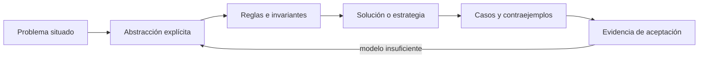
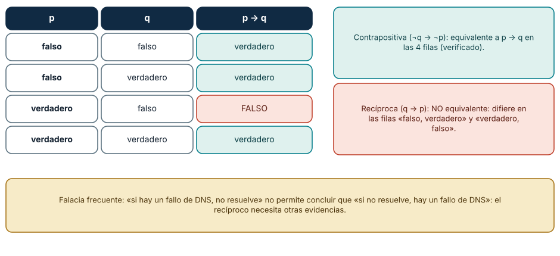
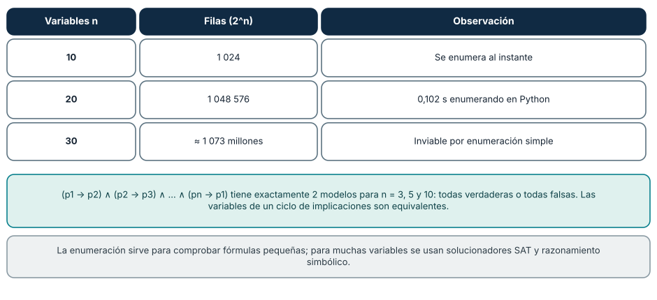
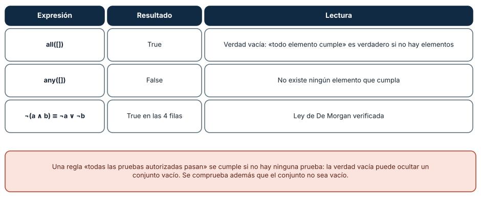

# SE-050 — Lógica proposicional, predicados e inferencia

[← SE-049 — Descomposición, abstracción y reconocimiento de patrones](../../classes/part-04-pensamiento-computacional-y-resolucion-de-problemas/se-049-descomposicion-abstraccion-y-reconocimiento-de-patrones/README.md) · [↑ Parte 04](../../classes/part-04-pensamiento-computacional-y-resolucion-de-problemas/README.md) · [📚 Índice completo](../../classes/README.md) · [🌐 Portal](../../site/classes/SE-050.html) · [SE-051 — Conjuntos, relaciones, funciones y grafos →](../../classes/part-04-pensamiento-computacional-y-resolucion-de-problemas/se-051-conjuntos-relaciones-funciones-y-grafos/README.md)


## Punto profesional y fundamento pedagógico

**Punto profesional.** La clase existe para usar lógica para comprobar validez de inferencias y hacer visibles supuestos.

**Por qué aparece aquí.** Se sitúa después de **Descomposición, abstracción y reconocimiento de patrones** y antes de **Conjuntos, relaciones, funciones y grafos**: convierte el conocimiento anterior en una decisión observable que la clase siguiente podrá reutilizar. La continuidad se comprueba en el artefacto, no por compartir vocabulario.

**Error conceptual que debe corregir.** Confundir una conclusión plausible con una consecuencia lógica.

**Secuencia de aprendizaje.** Antes de leer la solución, el estudiante predice el resultado del caso normal y del error conceptual anterior. Luego explica un caso resuelto paso a paso, construye un contraejemplo que cambie la decisión y, sin consultar el texto, reconstruye el mecanismo y lo aplica a una entrada nueva. La secuencia usa predicción, explicación propia, contraste y recuperación. [ICAP](https://icap.education.asu.edu/research) distingue participación de construcción de conocimiento; [How People Learn II](https://nap.nationalacademies.org/catalog/24783/how-people-learn-ii-learners-contexts-and-cultures) exige conectar conocimiento previo, contexto y transferencia; la [práctica de recuperación](https://pubmed.ncbi.nlm.nih.gov/16507066/) respalda producir de nuevo la explicación tras una demora; y [Education for Life and Work](https://nap.nationalacademies.org/resource/13398/dbasse_084153.pdf) exige devolución que explique la causa del error.

**Evidencia de aprendizaje.** Logic-check.md con formalización, tabla o derivación y contraejemplo. Debe contener predicción previa, observación, explicación causal, contraejemplo, criterio de aceptación y una nota de qué dato haría cambiar la conclusión.

**Límite de la conclusión.** La validez no garantiza que las premisas describan el mundo.

### Trazabilidad fuente → afirmación

| Fuente primaria u oficial | Afirmación que respalda | Lo que no prueba |
|---|---|---|
| [MIT 6.042J — Mathematics for Computer Science](https://ocw.mit.edu/courses/6-042j-mathematics-for-computer-science-spring-2015/) | aporta lógica, inducción, relaciones, grafos y técnicas de demostración aplicadas | No demuestra por sí sola que el artefacto del estudiante sea correcto. |
| [SWEBOK Guide v4.0a](https://www.computer.org/education/bodies-of-knowledge/software-engineering) | sitúa la decisión dentro de construcción, diseño, pruebas y práctica profesional de ingeniería de software | No demuestra por sí sola que el artefacto del estudiante sea correcto. |

## Antes de empezar

Esta clase continúa el **modelo de decisión diagnóstica**, que convierte la evidencia de la petición observable de extremo a extremo en una siguiente decisión explicable. Recupera `SE-049`: escribe qué artefacto dejó, qué supuesto permanece abierto y qué propiedad debe sobrevivir al nuevo modelo. La matemática se usa para restringir interpretaciones y encontrar errores; no como ornamentación.

## Prerrequisitos

- Poder separar hecho, interpretación, hipótesis y decisión.
- Manejar tablas, diagramas y pseudocódigo legible; Python es opcional.
- Trabajar con datos sintéticos del caso del modelo de decisión diagnóstica y conservar cada versión en Git.

## Problema auténtico

El modelo de decisión diagnóstica recibe reglas como «si DNS falla, la petición no llega al servidor» y «si la petición no llegó, DNS falló». La segunda frase invierte una implicación y produce un diagnóstico falso. El sistema necesita lógica suficiente para detectar inferencias inválidas y condiciones incompletas.

## Objetivos observables

Al finalizar podrás explicar el mecanismo con ejemplo y contraejemplo; construir un modelo con dominio y límites; derivar una prueba que pueda refutarlo; comparar al menos dos representaciones; y entregar una decisión cuya evidencia pueda revisar otra persona.

## Mapa conceptual



El mapa separa el problema de su representación. Los casos no reemplazan reglas; las reglas no prueban que el problema esté bien encuadrado. La pregunta de esta clase es: **¿La conclusión se sigue de las premisas o solo parece razonable?**

## Temas y por qué importan

| Lente | Pregunta | Evidencia |
|---|---|---|
| dominio | ¿qué entradas y estados existen? | vocabulario y particiones |
| estructura | ¿qué relaciones se conservan? | modelo interpretado |
| regla | ¿qué debe ser cierto? | contrato o invariante |
| estrategia | ¿qué pasos producen el resultado? | pseudocódigo y traza |
| límite | ¿dónde falla el argumento? | contraejemplo y caso límite |
## Conceptos y decisiones

### 1. Proposición y valor de verdad

Una proposición es una afirmación evaluable como verdadera o falsa bajo una interpretación. «La red es mala» no tiene criterio; `dns_outcome = timeout` sí. La negación debe abarcar una afirmación definida: no observar respuesta no equivale automáticamente a observar ausencia.

### 2. Conectivos e implicación

Conjunción exige ambas condiciones; disyunción inclusiva acepta una o ambas; implicación `P → Q` solo excluye P verdadera con Q falsa. La implicación no afirma causalidad. Su contraposición es equivalente; su conversa no lo es.

### 3. Predicados y cuantificadores

Un predicado depende de variables: `responde(host, prueba)`. `para todo` exige cubrir el dominio declarado; `existe` se demuestra con un testigo. Pasar de «falló en un cliente» a «falla para todos» cambia el cuantificador sin evidencia.

### 4. Reglas de inferencia

Modus ponens aplica P y P→Q para obtener Q; modus tollens usa P→Q y no Q para obtener no P. Afirmar el consecuente y negar el antecedente son errores frecuentes. El modelo de decisión diagnóstica almacena premisas junto a fuente y momento, porque una regla válida con una premisa obsoleta produce una conclusión inútil.

### 5. Lógica de tres estados operativos

En diagnóstico a menudo existe desconocido además de verdadero/falso. Desconocido no debe colapsar a falso. El modelo de decisión diagnóstica distingue `sí`, `no` y `sin evidencia`, y define cómo cada operador propaga incertidumbre para no cerrar una rama prematuramente.

### La implicación solo falla en una fila

La proposición «si p entonces q» es falsa únicamente cuando p es verdadera y q es falsa. La Figura 1 la enumera y lo comprueba por código: la **contrapositiva** (si no q, entonces no p) coincide con la implicación en las cuatro filas, y la **recíproca** (si q, entonces p) *no* coincide, porque difiere en las filas «falso, verdadero» y «verdadero, falso». Es la falacia más frecuente en un diagnóstico: de «si DNS falla, el nombre no resuelve» no se sigue «si el nombre no resuelve, DNS falla»; el resolvedor local, una regla de red o un archivo `hosts` producen el mismo síntoma. Distinguir *condición suficiente* (p basta para q) de *condición necesaria* (q es obligatoria si p) evita ese salto.



**Cómo leer la figura.** La fila marcada es la única en que la implicación se rompe; los dos cuadros de la derecha resumen cuáles reformulaciones son seguras. **Dónde deja de valer:** la lógica proposicional trata cada proposición como verdadera o falsa. Un servicio con respuesta lenta, un fallo intermitente o una medición con ruido no son booleanos: hay que convertirlos en proposiciones precisas («la latencia p95 supera 500 ms en esta ventana») antes de razonar con ellas.

### Cuántas filas, cuántos modelos

Una tabla de verdad con n variables tiene 2ⁿ filas. Enumerar las 1 048 576 filas de 20 variables tomó 0,102 s en CPython 3.12.9, pero con 30 variables serían más de mil millones. Eso explica por qué los verificadores usan solucionadores SAT y no la enumeración, y también por qué importa la *estructura* de la fórmula: un ciclo de implicaciones p1 → p2 → … → pn → p1 tiene exactamente dos modelos (todas verdaderas o todas falsas) para n = 3, 5 y 10, aunque el espacio sea de 8, 32 o 1024 combinaciones. Las variables de un ciclo son equivalentes, y detectarlo ahorra enumerar.



**Cómo leer la figura.** La primera tabla es el costo de enumerar; el cuadro inferior, lo que se gana al reconocer una estructura. **Dónde deja de valer:** el tiempo de 0,102 s corresponde a un equipo y a una implementación en Python; la proporción (cada variable duplica el trabajo) es lo que se conserva, no el valor absoluto.

### Predicados, cuantificadores y la verdad vacía

Cuando el dominio es finito, «todos» se comprueba con `all` y «existe» con `any`. En Python `all([])` es `True` y `any([])` es `False`: una afirmación universal sobre un conjunto vacío es verdadera. Esa *verdad vacía* produce defectos reales: una regla «todas las pruebas autorizadas pasan» se cumple si se filtró cada prueba por error. Las leyes de De Morgan (la negación de «a y b» es «no a o no b») se verificaron en las cuatro filas, y son la herramienta para negar correctamente un requisito antes de buscar su contraejemplo.



**Cómo leer la figura.** Cada fila muestra una expresión, su valor y cómo se lee. **Dónde deja de valer:** solo cubre dominios finitos y enumerables. Con dominios infinitos o desconocidos no se puede comprobar «todos» ejecutando: se necesita una demostración.

## Definiciones de trabajo

- **proposición:** afirmación con valor de verdad bajo una interpretación.
- **predicado:** afirmación parametrizada.
- **implicación:** relación lógica que excluye antecedente verdadero y consecuente falso.
- **cuantificador:** operador sobre elementos de un dominio.
- **inferencia:** derivación de una conclusión desde premisas.

Las definiciones fijan el uso en el modelo de decisión diagnóstica. Si una fuente usa otra convención, documenta la traducción. Una palabra definida no equivale a una propiedad demostrada.

## Ejemplo mínimo

Formaliza: «si DNS resolvió y el puerto aceptó, entonces puede iniciarse TLS». Construye una tabla con cuatro combinaciones y explica por qué TLS ausente no identifica cuál antecedente falló.

Antes de resolver, predice el resultado y la propiedad que debería conservarse. Después marca qué parte del resultado procede de la regla y cuál depende del ejemplo.

## Ejemplo profesional

Las reglas del modelo de decisión diagnóstica no disparan acciones destructivas. Una conclusión incluye las premisas usadas, su vigencia y nivel de evidencia. Si falta una premisa, propone una prueba; si dos reglas concluyen estados incompatibles, eleva el conflicto en lugar de escoger silenciosamente.

La entrega profesional hace visible el costo de simplificar. Incluye al menos una alternativa descartada y la condición que obligaría a revisar la decisión.

## Práctica guiada

1. convierte cinco frases ambiguas en proposiciones.
2. identifica antecedente y consecuente.
3. construye tabla de verdad de una regla compuesta.
4. encuentra una conversa inválida en un diagnóstico.
5. añade desconocido y define el comportamiento de la regla.
6. solicita una revisión adversarial y corrige el modelo sin borrar la versión que falló.

## Ejercicios

1. **Implicación:** completa la tabla de `p → q` y de su recíproca y señala las dos filas en que difieren.
2. **Negación:** niega con De Morgan «el certificado es válido y el nombre coincide» y escribe un caso que lo refute.
3. **Verdad vacía:** da un ejemplo de una regla de tu proyecto que se cumpla por un conjunto vacío y cómo lo detectarías.
4. **Estructura:** construye un ciclo de implicaciones de cuatro variables y determina cuántos modelos tiene sin enumerar las 16 filas.

## Reto verificable

Entrega `problem.md`, `model.md` y `checks.md`. Una persona revisora debe poder reconstruir dominio, supuestos, regla, resultado y límite; además debe encontrar qué caso refutaría la solución sin preguntarte oralmente.

## Demostración guiada

1. Declara el dominio y selecciona un caso pequeño calculable a mano.
2. Ejecuta la estrategia paso a paso y conserva estados intermedios.
3. Comprueba el resultado contra la definición, no contra intuición.
4. Introduce el fallo controlado y localiza la primera regla violada.
5. Repara el modelo y repite el caso original y el contraejemplo.

## Preguntas frecuentes

### ¿Cuál es la diferencia entre condición necesaria y suficiente?

Si p basta para q, p es suficiente; si q es obligatoria para que p ocurra, q es necesaria. «Tener un certificado válido» es necesario para una conexión TLS correcta, pero no suficiente: también hacen falta la cadena, el nombre y la fecha. Confundirlas produce diagnósticos que declaran resuelto un problema porque se cumplió una condición necesaria.

### ¿Por qué `all([])` es verdadero?

Porque «todo elemento cumple la condición» solo se falsa con un contraejemplo, y en un conjunto vacío no hay ninguno. Conviene comprobar además que el conjunto no sea vacío cuando la regla pretende afirmar algo sobre elementos existentes.

### ¿Un fallo de las pruebas refuta una implicación?

Refuta la implicación solo si la prueba cumple la premisa p y no se cumple q. Si la premisa no se cumple, la implicación sigue siendo verdadera; la prueba no dice nada sobre ella.

### ¿Cuándo basta una tabla de verdad?

Para pocas variables y reglas pequeñas. Con muchas variables se pasa a un solucionador SAT o a una especificación con reglas por separado, y la tabla queda como documentación del caso mínimo.
## Fallo controlado y diagnóstico

Implementa deliberadamente `si no hay HTTP, entonces DNS falló`. Contradícela con un puerto cerrado y muestra que la conclusión no se sigue. Reemplázala por reglas que preserven alternativas.

Conserva el modelo fallido, la entrada que lo expone, la regla violada y la corrección. No ajustes solo el resultado esperado para hacer pasar el caso.


Reproduce la falacia de la recíproca con una tabla pequeña. Define p como «el resolvedor falla» y q como «el nombre no resuelve», declara la regla `p → q` y construye observaciones donde q es verdadera y p es falsa (el nombre no resuelve porque el archivo `hosts` apunta a una dirección inválida). **Síntoma:** un clasificador que aplica la recíproca atribuye el fallo al resolvedor. **Hipótesis:** se usó `q → p` como si fuera la regla. **Prueba:** enumera las cuatro filas y compara con la contrapositiva. **Conclusión:** la observación es compatible con p y con otras causas; para atribuir hace falta una prueba que *separe* (consultar el resolvedor directamente). Guarda en `checks.md` la fila que refuta la recíproca, no solo la que la confirma.

## Errores comunes y cómo corregirlos

| Síntoma | Causa | Corrección |
|---|---|---|
| Se concluye «si no resuelve, falla DNS» | Se invirtió la implicación (recíproca) | Usar la contrapositiva y buscar una prueba que separe causas |
| Una regla «todas pasan» se cumple sin ejecutar nada | Verdad vacía sobre un conjunto vacío | Comprobar que el conjunto no es vacío antes de afirmar |
| La negación de un requisito se escribe a ojo | No se aplicó De Morgan | Negar con la ley y verificar en la tabla |
| La tabla de verdad se genera para 40 variables | Se confunde comprobar con enumerar | Reducir la fórmula o usar un solucionador |
| Una medición ruidosa se trata como booleano | No se definió la proposición | Escribir el umbral, la ventana y el estadístico |

## Entorno y archivos clave

```text
work/SE-050/
├── problem.md     # contexto, dominio, supuestos y exclusiones
├── model.md       # definiciones, reglas, diagrama y estrategia
├── checks.md      # ejemplos, contraejemplos y aceptación
└── review.md      # objeciones y revisión del modelo
```

El pseudocódigo debe ser independiente de lenguaje y cada diagrama necesita explicación textual. Si usas código para explorar, registra versión, entrada y salida; no lo presentes automáticamente como producto de la clase.

### Laboratorio integrado de la Parte 04

Ejecuta `implication_counterexamples()` en la [especificación contrastable](https://github.com/vladimiracunadev-create/modern-software-engineering-program/tree/main/labs/part-04-contrastable-spec) y reconstruye las cuatro filas sin mirar el código. `logic-check.md` formaliza «si una prueba falla, entonces la hipótesis es cierta» y aporta un contraejemplo; además distingue validez de la regla y verdad empírica de sus premisas.

## Seguridad, ética y accesibilidad

- usa incidentes sintéticos y evita convertir direcciones o usuarios en datos de práctica;
- trata autorización y privacidad como invariantes, no como pasos opcionales;
- registra a quién perjudica un falso positivo, falso negativo o prioridad automática;
- ofrece tablas y texto alternativo para diagramas y símbolos;
- define mecanismo de revisión humana y apelación para recomendaciones;
- no uses un modelo parcial para justificar una decisión irreversible.

## Puente hacia el trabajo con agentes

Las reglas que se le dan a un agente —«si falla la autenticación, no reintentes», «solo continúa si todas las comprobaciones pasaron»— son implicaciones y cuantificadores. Un harness que las evalúa debe tratar la verdad vacía con cuidado: «todas las comprobaciones pasaron» no puede ser verdadera si no se ejecutó ninguna. Y cuando un agente explica «el fallo ocurre porque falló X», conviene pedirle que indique si afirma una causa suficiente, necesaria o solo compatible. Los criterios de aceptación de las partes de evaluación de agentes se escriben con estas distinciones.

## Transferencia

Aplica el mecanismo a otro dominio y conserva la estructura del argumento, no los nombres del modelo de decisión diagnóstica. Explica qué dominio, invariante o medida cambia. Si el razonamiento deja de funcionar, identifica el supuesto que pertenecía al caso original.

## Evaluación y evidencia

| Criterio | Para aprobar |
|---|---|
| precisión | dominio, términos y cuantificadores explícitos |
| mecanismo | pasos y relaciones explican el resultado |
| corrección | invariantes, casos o argumento adecuados a la afirmación |
| límites | contraejemplo, costo y supuestos visibles |
| revisión | trazabilidad y objeciones preservadas |

Completar archivos no concede aprobación. La evidencia debe sostener la afirmación exacta, y la revisión de otra persona debe poder contradecirla.

## Fuentes


- [MIT 6.042J — Mathematics for Computer Science](https://ocw.mit.edu/courses/6-042j-mathematics-for-computer-science-spring-2015/) — aporta lógica, inducción, relaciones, grafos y técnicas de demostración aplicadas.
- [SWEBOK Guide v4.0a](https://www.computer.org/education/bodies-of-knowledge/software-engineering) — sitúa la decisión dentro de construcción, diseño, pruebas y práctica profesional de ingeniería de software.

Los cursos y SWEBOK aportan definiciones y métodos; no validan automáticamente el modelo del modelo de decisión diagnóstica. Cada aplicación se sostiene con el artefacto y sus casos.

- [Python: operaciones booleanas y `all`/`any`](https://docs.python.org/3/library/functions.html#all): comportamiento de `all` y `any` sobre iterables vacíos usado en la Figura 3.
- [MIT 6.042J, Mathematics for Computer Science: lógica y proposiciones](https://ocw.mit.edu/courses/6-042j-mathematics-for-computer-science-spring-2015/): implicación, equivalencia, cuantificadores y técnicas de demostración.
- Kenneth Rosen, *Discrete Mathematics and Its Applications* (McGraw-Hill): lógica proposicional, predicados y leyes de De Morgan.

## Límites y siguiente paso

La lógica valida forma, no verdad de premisas ni causalidad. La siguiente clase modela dominios, asociaciones y rutas mediante conjuntos, relaciones, funciones y grafos.

## Glosario

- **proposición:** afirmación con valor de verdad bajo una interpretación.
- **predicado:** afirmación parametrizada.
- **implicación:** relación lógica que excluye antecedente verdadero y consecuente falso.
- **cuantificador:** operador sobre elementos de un dominio.
- **inferencia:** derivación de una conclusión desde premisas.

---

[← SE-049 — Descomposición, abstracción y reconocimiento de patrones](../../classes/part-04-pensamiento-computacional-y-resolucion-de-problemas/se-049-descomposicion-abstraccion-y-reconocimiento-de-patrones/README.md) · [↑ Parte 04](../../classes/part-04-pensamiento-computacional-y-resolucion-de-problemas/README.md) · [📚 Índice completo](../../classes/README.md) · [🌐 Portal](../../site/classes/SE-050.html) · [SE-051 — Conjuntos, relaciones, funciones y grafos →](../../classes/part-04-pensamiento-computacional-y-resolucion-de-problemas/se-051-conjuntos-relaciones-funciones-y-grafos/README.md)
