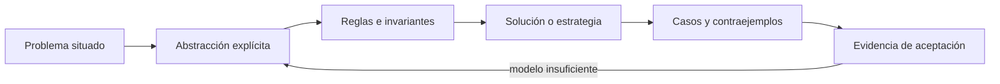
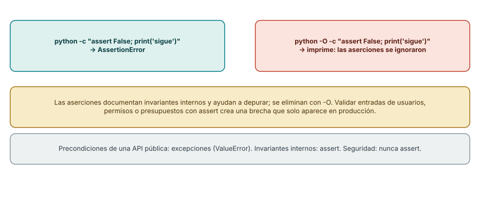
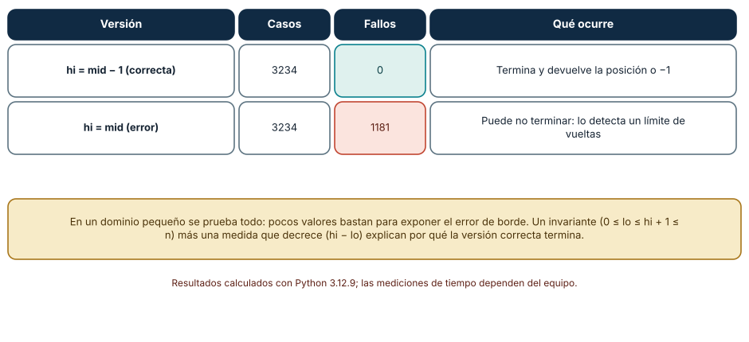
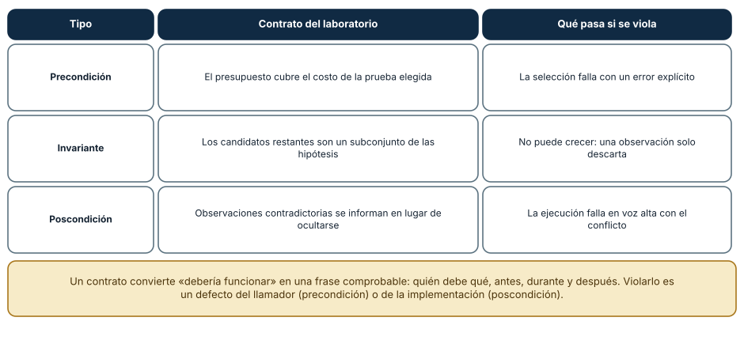

# SE-052 — Invariantes, precondiciones y poscondiciones

[← SE-051 — Conjuntos, relaciones, funciones y grafos](../../classes/part-04-pensamiento-computacional-y-resolucion-de-problemas/se-051-conjuntos-relaciones-funciones-y-grafos/README.md) · [↑ Parte 04](../../classes/part-04-pensamiento-computacional-y-resolucion-de-problemas/README.md) · [📚 Índice completo](../../classes/README.md) · [🌐 Portal](../../site/classes/SE-052.html) · [SE-053 — Recursión, inducción y razonamiento estructural →](../../classes/part-04-pensamiento-computacional-y-resolucion-de-problemas/se-053-recursion-induccion-y-razonamiento-estructural/README.md)


## Punto profesional y fundamento pedagógico

**Punto profesional.** La clase existe para formular precondiciones, poscondiciones e invariantes que hagan verificable una transición.

**Por qué aparece aquí.** Se sitúa después de **Conjuntos, relaciones, funciones y grafos** y antes de **Recursión, inducción y razonamiento estructural**: convierte el conocimiento anterior en una decisión observable que la clase siguiente podrá reutilizar. La continuidad se comprueba en el artefacto, no por compartir vocabulario.

**Error conceptual que debe corregir.** Escribir validaciones aisladas sin una propiedad que deba preservarse.

**Secuencia de aprendizaje.** Antes de leer la solución, el estudiante predice el resultado del caso normal y del error conceptual anterior. Luego explica un caso resuelto paso a paso, construye un contraejemplo que cambie la decisión y, sin consultar el texto, reconstruye el mecanismo y lo aplica a una entrada nueva. La secuencia usa predicción, explicación propia, contraste y recuperación. [ICAP](https://icap.education.asu.edu/research) distingue participación de construcción de conocimiento; [How People Learn II](https://nap.nationalacademies.org/catalog/24783/how-people-learn-ii-learners-contexts-and-cultures) exige conectar conocimiento previo, contexto y transferencia; la [práctica de recuperación](https://pubmed.ncbi.nlm.nih.gov/16507066/) respalda producir de nuevo la explicación tras una demora; y [Education for Life and Work](https://nap.nationalacademies.org/resource/13398/dbasse_084153.pdf) exige devolución que explique la causa del error.

**Evidencia de aprendizaje.** Contract-proof.md con estados válidos, transición, invariante y contraejemplo mínimo. Debe contener predicción previa, observación, explicación causal, contraejemplo, criterio de aceptación y una nota de qué dato haría cambiar la conclusión.

**Límite de la conclusión.** Probar casos no constituye demostración exhaustiva.

### Trazabilidad fuente → afirmación

| Fuente primaria u oficial | Afirmación que respalda | Lo que no prueba |
|---|---|---|
| [MIT 6.042J — Mathematics for Computer Science](https://ocw.mit.edu/courses/6-042j-mathematics-for-computer-science-spring-2015/) | aporta lógica, inducción, relaciones, grafos y técnicas de demostración aplicadas | No demuestra por sí sola que el artefacto del estudiante sea correcto. |
| [MIT 6.006 — Introduction to Algorithms](https://ocw.mit.edu/courses/6-006-introduction-to-algorithms-spring-2020/) | aporta definiciones, invariantes y análisis de estructuras y algoritmos usados en la clase | No demuestra por sí sola que el artefacto del estudiante sea correcto. |
| [SWEBOK Guide v4.0a](https://www.computer.org/education/bodies-of-knowledge/software-engineering) | sitúa la decisión dentro de construcción, diseño, pruebas y práctica profesional de ingeniería de software | No demuestra por sí sola que el artefacto del estudiante sea correcto. |

## Antes de empezar

Esta clase continúa el **modelo de decisión diagnóstica**, que convierte la evidencia de la petición observable de extremo a extremo en una siguiente decisión explicable. Recupera `SE-051`: escribe qué artefacto dejó, qué supuesto permanece abierto y qué propiedad debe sobrevivir al nuevo modelo. La matemática se usa para restringir interpretaciones y encontrar errores; no como ornamentación.

## Prerrequisitos

- Poder separar hecho, interpretación, hipótesis y decisión.
- Manejar tablas, diagramas y pseudocódigo legible; Python es opcional.
- Trabajar con datos sintéticos del caso del modelo de decisión diagnóstica y conservar cada versión en Git.

## Problema auténtico

El modelo de decisión diagnóstica reordena pruebas para ahorrar tiempo, pero a veces recomienda una prueba no autorizada o pierde una hipótesis todavía viable. Los ejemplos felices no detectan la violación. Se necesitan contratos e invariantes que restrinjan todas las transiciones.

## Objetivos observables

Al finalizar podrás explicar el mecanismo con ejemplo y contraejemplo; construir un modelo con dominio y límites; derivar una prueba que pueda refutarlo; comparar al menos dos representaciones; y entregar una decisión cuya evidencia pueda revisar otra persona.

## Mapa conceptual



El mapa separa el problema de su representación. Los casos no reemplazan reglas; las reglas no prueban que el problema esté bien encuadrado. La pregunta de esta clase es: **¿Qué debe ser cierto antes, después y durante cada paso?**

## Temas y por qué importan

| Lente | Pregunta | Evidencia |
|---|---|---|
| dominio | ¿qué entradas y estados existen? | vocabulario y particiones |
| estructura | ¿qué relaciones se conservan? | modelo interpretado |
| regla | ¿qué debe ser cierto? | contrato o invariante |
| estrategia | ¿qué pasos producen el resultado? | pseudocódigo y traza |
| límite | ¿dónde falla el argumento? | contraejemplo y caso límite |
## Conceptos y decisiones

### 1. Precondición

La precondición describe estados de entrada que una operación acepta. No es una esperanza escondida. `destino autorizado` y `presupuesto > costo_estimado` permiten decidir antes de ejecutar. Si el consumidor puede violarla, la interfaz debe validar y producir un error observable.

### 2. Poscondición

La poscondición relaciona estado previo, entrada y salida. «devuelve una lista» es débil; «devuelve solo pruebas autorizadas y toda hipótesis descartada cita evidencia» es contrastable. Una operación puede garantizar distintas poscondiciones para éxito y error.

### 3. Invariante

Un invariante permanece verdadero en puntos definidos de un proceso. En el modelo de decisión diagnóstica: ninguna acción ejecutada queda sin autorización y cada hipótesis activa conserva una prueba posible. Para sostenerlo se demuestra inicialización, preservación por paso y utilidad al terminar.

### 4. Fortaleza y composición

Una precondición más fuerte acepta menos entradas; una poscondición más fuerte promete más. Al componer A→B, la salida de A debe satisfacer la entrada de B. Reforzar precondiciones o debilitar poscondiciones puede romper consumidores aunque la implementación local parezca correcta.

### 5. Invariantes como diseño

El invariante guía la representación y el algoritmo. Si se necesita unicidad de IDs, un mapa y una validación de inserción hacen visible la regla. Comprobar solo al final detecta tarde el daño y dificulta localizar la transición responsable.

### Una aserción no es un control de entrada

`assert` documenta un invariante interno y detiene la ejecución si es falso, pero el intérprete lo elimina con la opción `-O`. Se comprobó: `python -c "assert False; print('sigue')"` lanza `AssertionError`, y la misma sentencia con `python -O` continúa y muestra el mensaje posterior. Validar permisos, presupuestos o datos de usuario con `assert` crea una brecha que solo aparece cuando alguien ejecuta el programa optimizado. La regla práctica: **las precondiciones de una interfaz pública se validan con excepciones** (`ValueError`, `PermissionError`) y los `assert` quedan para invariantes que, de violarse, indican un defecto del propio código.



**Cómo leer la figura.** El cuadro izquierdo es la ejecución normal y el derecho, la optimizada. **Dónde deja de valer:** el comportamiento es el de CPython; otros lenguajes ofrecen aserciones con semánticas distintas (en Java se activan con una bandera y por defecto están desactivadas). La regla que se conserva es no depender de un mecanismo que pueda desactivarse para una garantía de seguridad.

### Probar todo en un dominio pequeño

Una búsqueda binaria correcta mantiene el invariante `0 ≤ lo ≤ hi + 1 ≤ n` y una medida que decrece (`hi − lo`). La versión incorrecta, que escribe `hi = mid` en lugar de `hi = mid − 1`, parece funcionar con arreglos grandes. Se probaron *todos* los arreglos ordenados de longitud hasta 6 con valores de 0 a 4 y valores de búsqueda de −1 a 5: 3234 casos. La versión correcta cometió 0 fallos; la errónea, 1181, incluyendo casos donde no termina (se detectaron con un límite de vueltas). La lección es práctica: un dominio pequeño probado de forma exhaustiva expone errores de borde que las pruebas de ejemplo no ven, y la exhaustividad es posible porque se acotó el dominio.



**Cómo leer la figura.** Cada fila es una versión del algoritmo con sus fallos; el cuadro inferior enuncia el invariante y la medida. **Dónde deja de valer:** la exhaustividad cubre solo el dominio elegido (valores de 0 a 4, longitud hasta 6). No demuestra el algoritmo para enteros de 64 bits, donde aparece un error clásico de desbordamiento en `(lo + hi) / 2` en lenguajes sin enteros ilimitados.

### Contratos: quién debe qué

Un contrato separa tres obligaciones. La **precondición** es lo que el llamador debe garantizar (el presupuesto cubre la prueba elegida). El **invariante** es lo que debe valer en todo momento (los candidatos restantes son un subconjunto de las hipótesis y no pueden crecer, porque una observación solo descarta). La **poscondición** es lo que la implementación garantiza (las observaciones contradictorias se informan, no se ocultan). La Figura 3 enlaza cada tipo con una regla del laboratorio y con lo que ocurre si se viola. Quién incumplió cada una decide a quién corresponde corregir: una precondición violada es un defecto del llamador; una poscondición violada, de la implementación.



**Cómo leer la figura.** Cada fila ata un tipo de contrato a una regla verificable. **Dónde deja de valer:** los contratos del laboratorio son comprobaciones en tiempo de ejecución; no sustituyen una demostración, que cubriría todas las entradas, ni cubren propiedades de concurrencia.

## Definiciones de trabajo

- **precondición:** propiedad requerida al iniciar una operación.
- **poscondición:** propiedad garantizada al terminar bajo el contrato.
- **invariante:** propiedad preservada en puntos definidos.
- **estado válido:** estado que satisface restricciones del modelo.
- **composición:** encadenamiento donde garantías alimentan requisitos.

Las definiciones fijan el uso en el modelo de decisión diagnóstica. Si una fuente usa otra convención, documenta la traducción. Una palabra definida no equivale a una propiedad demostrada.

## Ejemplo mínimo

Especifica `seleccionar_prueba(hipótesis, pruebas, presupuesto)` con tres precondiciones, cuatro poscondiciones y dos errores. Define un invariante que impida ejecutar una prueba no autorizada.

Antes de resolver, predice el resultado y la propiedad que debería conservarse. Después marca qué parte del resultado procede de la regla y cuál depende del ejemplo.

## Ejemplo profesional

Cada transición del modelo de decisión diagnóstica valida autorización, consume presupuesto y conserva trazabilidad. Las comprobaciones se ejecutan en bordes y en pruebas; una violación interna se trata como defecto, no como entrada inválida del usuario.

La entrega profesional hace visible el costo de simplificar. Incluye al menos una alternativa descartada y la condición que obligaría a revisar la decisión.

## Práctica guiada

1. escribe estado válido inicial.
2. declara pre y poscondiciones.
3. elige un invariante útil para el resultado.
4. simula dos transiciones y prueba preservación.
5. crea un caso que viole el contrato y diseña el error.
6. solicita una revisión adversarial y corrige el modelo sin borrar la versión que falló.

## Ejercicios

1. **Aserción:** ejecuta `assert False` con y sin `-O` y explica la diferencia para una validación de permisos.
2. **Exhaustividad:** enumera todos los arreglos ordenados de longitud hasta 4 con valores 0 a 2 y comprueba tu búsqueda binaria; indica cuántos casos son.
3. **Contrato:** escribe precondición, invariante y poscondición de una función que elige la próxima prueba dado un presupuesto.
4. **Variante:** identifica la medida que decrece en tu bucle y explica qué pasaría si dejara de decrecer.

## Reto verificable

Entrega `problem.md`, `model.md` y `checks.md`. Una persona revisora debe poder reconstruir dominio, supuestos, regla, resultado y límite; además debe encontrar qué caso refutaría la solución sin preguntarte oralmente.

## Demostración guiada

1. Declara el dominio y selecciona un caso pequeño calculable a mano.
2. Ejecuta la estrategia paso a paso y conserva estados intermedios.
3. Comprueba el resultado contra la definición, no contra intuición.
4. Introduce el fallo controlado y localiza la primera regla violada.
5. Repara el modelo y repite el caso original y el contraejemplo.

## Preguntas frecuentes

### ¿Cuándo uso `assert` y cuándo una excepción?

`assert` para invariantes internos cuya violación indica un defecto del código; excepciones para entradas externas, permisos y presupuestos. Si el control debe ejecutarse en producción, nunca depende de `assert`.

### ¿Probar todos los casos pequeños es una demostración?

No. Es una comprobación exhaustiva de un dominio acotado: conclusiva para ese dominio y evidencia para el resto. La hipótesis de «lo pequeño representa lo grande» se declara y se revisa.

### ¿Qué diferencia hay entre invariante y variante?

El invariante es una propiedad que se mantiene en cada vuelta; la variante (o medida) es una cantidad que decrece y garantiza terminación. Se necesitan ambos para demostrar que un ciclo es correcto y termina.

### ¿Un contrato reemplaza las pruebas?

No. El contrato dice qué debe cumplirse; las pruebas lo ejercitan con casos concretos. Un contrato sin pruebas es una intención, y unas pruebas sin contrato dejan sin decir qué se está protegiendo.
## Fallo controlado y diagnóstico

Ordena una lista de pruebas y borra duplicados por nombre, aunque dos tengan distinto alcance. La invariancia de trazabilidad se rompe. Introduce identidad estable y separa presentación de igualdad.

Conserva el modelo fallido, la entrada que lo expone, la regla violada y la corrección. No ajustes solo el resultado esperado para hacer pasar el caso.


Reproduce el error de borde de la búsqueda binaria y atrapa el bucle infinito. Cambia `hi = mid - 1` por `hi = mid`, ejecuta la comprobación exhaustiva con un límite de 50 vueltas y observa dos tipos de fallo: respuestas incorrectas y `RuntimeError: no termina`. **Síntoma:** algunas entradas cuelgan el programa. **Hipótesis:** la variante `hi − lo` no decrece cuando `mid == hi`. **Prueba:** imprime `lo`, `hi` y `mid` en el primer caso que no termina. **Conclusión:** el invariante se mantiene pero la medida no decrece; corregir el borde restaura la terminación. Guarda el caso mínimo como prueba de regresión en `checks.md`.

## Errores comunes y cómo corregirlos

| Síntoma | Causa | Corrección |
|---|---|---|
| Un control de seguridad desaparece en producción | Se implementó con `assert` | Usar una excepción explícita |
| El bucle de búsqueda no termina en un borde | La variante no decrece | Ajustar la actualización y probar el dominio pequeño |
| La prueba pasa con ejemplos y falla con otros | Muestra no representativa | Enumerar un dominio pequeño completo |
| La función falla sin decir quién se equivocó | Contrato implícito | Escribir precondición, invariante y poscondición |
| Se cambia el resultado esperado para que la prueba pase | Se trata la prueba como obstáculo | Revisar la regla o el modelo, no el resultado |

## Entorno y archivos clave

```text
work/SE-052/
├── problem.md     # contexto, dominio, supuestos y exclusiones
├── model.md       # definiciones, reglas, diagrama y estrategia
├── checks.md      # ejemplos, contraejemplos y aceptación
└── review.md      # objeciones y revisión del modelo
```

El pseudocódigo debe ser independiente de lenguaje y cada diagrama necesita explicación textual. Si usas código para explorar, registra versión, entrada y salida; no lo presentes automáticamente como producto de la clase.

### Laboratorio integrado de la Parte 04

Extrae de la [especificación contrastable](https://github.com/vladimiracunadev-create/modern-software-engineering-program/tree/main/labs/part-04-contrastable-spec) precondiciones de esquema, autorización y presupuesto; el invariante de que los candidatos nunca crecen; y la poscondición limitada de `resolved`. Fuerza outcome faltante, prueba no autorizada y presupuesto excedido. Una excepción esperada es evidencia del contrato negativo, no un fallo que deba ocultarse.

## Seguridad, ética y accesibilidad

- usa incidentes sintéticos y evita convertir direcciones o usuarios en datos de práctica;
- trata autorización y privacidad como invariantes, no como pasos opcionales;
- registra a quién perjudica un falso positivo, falso negativo o prioridad automática;
- ofrece tablas y texto alternativo para diagramas y símbolos;
- define mecanismo de revisión humana y apelación para recomendaciones;
- no uses un modelo parcial para justificar una decisión irreversible.

## Puente hacia el trabajo con agentes

Un agente produce código con `assert` como si fuera validación porque abunda en ejemplos. Revisar esa confusión es una tarea concreta del harness: una regla de revisión que rechaza `assert` en rutas de seguridad y una prueba ejecutada también con la optimización activada. Los contratos sirven además para especificar la salida de una herramienta que el agente llama: precondición (qué debe enviarse), poscondición (qué se devuelve) e invariante (qué no debe cambiar). Si el agente viola el contrato, el fallo debe ser visible en el registro, no corregido en silencio.

## Transferencia

Aplica el mecanismo a otro dominio y conserva la estructura del argumento, no los nombres del modelo de decisión diagnóstica. Explica qué dominio, invariante o medida cambia. Si el razonamiento deja de funcionar, identifica el supuesto que pertenecía al caso original.

## Evaluación y evidencia

| Criterio | Para aprobar |
|---|---|
| precisión | dominio, términos y cuantificadores explícitos |
| mecanismo | pasos y relaciones explican el resultado |
| corrección | invariantes, casos o argumento adecuados a la afirmación |
| límites | contraejemplo, costo y supuestos visibles |
| revisión | trazabilidad y objeciones preservadas |

Completar archivos no concede aprobación. La evidencia debe sostener la afirmación exacta, y la revisión de otra persona debe poder contradecirla.

## Fuentes


- [MIT 6.042J — Mathematics for Computer Science](https://ocw.mit.edu/courses/6-042j-mathematics-for-computer-science-spring-2015/) — aporta lógica, inducción, relaciones, grafos y técnicas de demostración aplicadas.
- [MIT 6.006 — Introduction to Algorithms](https://ocw.mit.edu/courses/6-006-introduction-to-algorithms-spring-2020/) — aporta definiciones, invariantes y análisis de estructuras y algoritmos usados en la clase.
- [SWEBOK Guide v4.0a](https://www.computer.org/education/bodies-of-knowledge/software-engineering) — sitúa la decisión dentro de construcción, diseño, pruebas y práctica profesional de ingeniería de software.

Los cursos y SWEBOK aportan definiciones y métodos; no validan automáticamente el modelo del modelo de decisión diagnóstica. Cada aplicación se sostiene con el artefacto y sus casos.

- [Python: la sentencia `assert`](https://docs.python.org/3/reference/simple_stmts.html#the-assert-statement) y [la opción `-O`](https://docs.python.org/3/using/cmdline.html#cmdoption-O): semántica y desactivación de las aserciones, comprobadas en la Figura 1.
- [C. A. R. Hoare, «An axiomatic basis for computer programming», *Communications of the ACM* 12(10), 1969](https://doi.org/10.1145/363235.363259): origen de la lógica de precondición y poscondición.
- Bertrand Meyer, *Object-Oriented Software Construction*, 2.ª edición (Prentice Hall): diseño por contrato.

## Límites y siguiente paso

Los contratos no cubren por sí solos propiedades temporales, concurrencia o intención humana. La siguiente clase conecta repetición estructural con recursión e inducción.

## Glosario

- **precondición:** propiedad requerida al iniciar una operación.
- **poscondición:** propiedad garantizada al terminar bajo el contrato.
- **invariante:** propiedad preservada en puntos definidos.
- **estado válido:** estado que satisface restricciones del modelo.
- **composición:** encadenamiento donde garantías alimentan requisitos.

---

[← SE-051 — Conjuntos, relaciones, funciones y grafos](../../classes/part-04-pensamiento-computacional-y-resolucion-de-problemas/se-051-conjuntos-relaciones-funciones-y-grafos/README.md) · [↑ Parte 04](../../classes/part-04-pensamiento-computacional-y-resolucion-de-problemas/README.md) · [📚 Índice completo](../../classes/README.md) · [🌐 Portal](../../site/classes/SE-052.html) · [SE-053 — Recursión, inducción y razonamiento estructural →](../../classes/part-04-pensamiento-computacional-y-resolucion-de-problemas/se-053-recursion-induccion-y-razonamiento-estructural/README.md)
