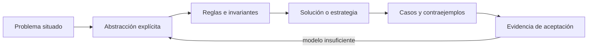
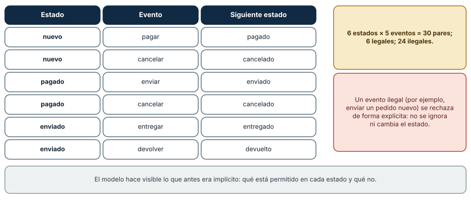
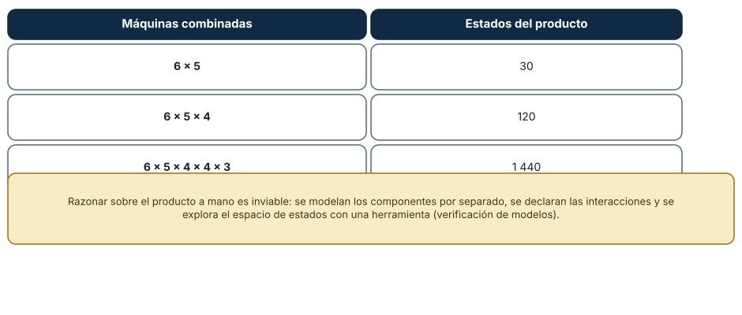
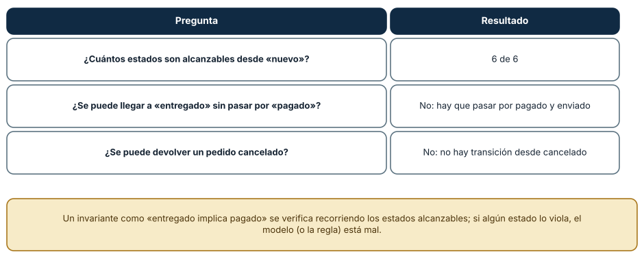

# SE-057 — Modelado de estado, transiciones y eventos

[← SE-056 — Heurísticas, aproximación y límites computacionales](../../classes/part-04-pensamiento-computacional-y-resolucion-de-problemas/se-056-heuristicas-aproximacion-y-limites-computacionales/README.md) · [↑ Parte 04](../../classes/part-04-pensamiento-computacional-y-resolucion-de-problemas/README.md) · [📚 Índice completo](../../classes/README.md) · [🌐 Portal](../../site/classes/SE-057.html) · [SE-058 — Resolución sistemática y registro de hipótesis →](../../classes/part-04-pensamiento-computacional-y-resolucion-de-problemas/se-058-resolucion-sistematica-y-registro-de-hipotesis/README.md)


## Punto profesional y fundamento pedagógico

**Punto profesional.** La clase existe para modelar estado, transiciones y eventos para detectar secuencias imposibles o ambiguas.

**Por qué aparece aquí.** Se sitúa después de **Heurísticas, aproximación y límites computacionales** y antes de **Resolución sistemática y registro de hipótesis**: convierte el conocimiento anterior en una decisión observable que la clase siguiente podrá reutilizar. La continuidad se comprueba en el artefacto, no por compartir vocabulario.

**Error conceptual que debe corregir.** Describir estados como pantallas sin condiciones de entrada y salida.

**Secuencia de aprendizaje.** Antes de leer la solución, el estudiante predice el resultado del caso normal y del error conceptual anterior. Luego explica un caso resuelto paso a paso, construye un contraejemplo que cambie la decisión y, sin consultar el texto, reconstruye el mecanismo y lo aplica a una entrada nueva. La secuencia usa predicción, explicación propia, contraste y recuperación. [ICAP](https://icap.education.asu.edu/research) distingue participación de construcción de conocimiento; [How People Learn II](https://nap.nationalacademies.org/catalog/24783/how-people-learn-ii-learners-contexts-and-cultures) exige conectar conocimiento previo, contexto y transferencia; la [práctica de recuperación](https://pubmed.ncbi.nlm.nih.gov/16507066/) respalda producir de nuevo la explicación tras una demora; y [Education for Life and Work](https://nap.nationalacademies.org/resource/13398/dbasse_084153.pdf) exige devolución que explique la causa del error.

**Evidencia de aprendizaje.** State-model.md con tabla, diagrama, guardas y secuencia inválida. Debe contener predicción previa, observación, explicación causal, contraejemplo, criterio de aceptación y una nota de qué dato haría cambiar la conclusión.

**Límite de la conclusión.** El modelo omite detalles deliberadamente y debe declarar cuáles.

### Trazabilidad fuente → afirmación

| Fuente primaria u oficial | Afirmación que respalda | Lo que no prueba |
|---|---|---|
| [MIT 6.042J — Mathematics for Computer Science](https://ocw.mit.edu/courses/6-042j-mathematics-for-computer-science-spring-2015/) | aporta lógica, inducción, relaciones, grafos y técnicas de demostración aplicadas | No demuestra por sí sola que el artefacto del estudiante sea correcto. |
| [SWEBOK Guide v4.0a](https://www.computer.org/education/bodies-of-knowledge/software-engineering) | sitúa la decisión dentro de construcción, diseño, pruebas y práctica profesional de ingeniería de software | No demuestra por sí sola que el artefacto del estudiante sea correcto. |

## Antes de empezar

Esta clase continúa el **modelo de decisión diagnóstica**, que convierte la evidencia de la petición observable de extremo a extremo en una siguiente decisión explicable. Recupera `SE-056`: escribe qué artefacto dejó, qué supuesto permanece abierto y qué propiedad debe sobrevivir al nuevo modelo. La matemática se usa para restringir interpretaciones y encontrar errores; no como ornamentación.

## Prerrequisitos

- Poder separar hecho, interpretación, hipótesis y decisión.
- Manejar tablas, diagramas y pseudocódigo legible; Python es opcional.
- Trabajar con datos sintéticos del caso del modelo de decisión diagnóstica y conservar cada versión en Git.

## Problema auténtico

El modelo de decisión diagnóstica recibe respuestas tardías, cancelaciones y reintentos. Sin un modelo de estado, un resultado de una ejecución anterior puede cerrar la actual o una cancelación puede dejar pruebas activas. Se necesita describir estado, evento, guardas, acciones y propiedades temporales.

## Objetivos observables

Al finalizar podrás explicar el mecanismo con ejemplo y contraejemplo; construir un modelo con dominio y límites; derivar una prueba que pueda refutarlo; comparar al menos dos representaciones; y entregar una decisión cuya evidencia pueda revisar otra persona.

## Mapa conceptual



El mapa separa el problema de su representación. Los casos no reemplazan reglas; las reglas no prueban que el problema esté bien encuadrado. La pregunta de esta clase es: **¿Qué eventos son válidos en cada estado y qué transición producen?**

## Temas y por qué importan

| Lente | Pregunta | Evidencia |
|---|---|---|
| dominio | ¿qué entradas y estados existen? | vocabulario y particiones |
| estructura | ¿qué relaciones se conservan? | modelo interpretado |
| regla | ¿qué debe ser cierto? | contrato o invariante |
| estrategia | ¿qué pasos producen el resultado? | pseudocódigo y traza |
| límite | ¿dónde falla el argumento? | contraejemplo y caso límite |
## Conceptos y decisiones

### 1. Estado observable y estado derivado

El estado resume la historia relevante para decisiones futuras. No todo campo debe almacenarse: `agotado` puede derivarse de presupuesto. Duplicar estado crea combinaciones imposibles. Se conservan hechos mínimos y se calculan vistas.

### 2. Evento y transición

Un evento representa algo ocurrido; una transición válida relaciona estado origen, evento, guarda, acción y destino. El mismo evento puede ser válido en un estado e ignorado o rechazado en otro. El modelo debe especificar eventos inesperados, no dejarlos a comportamiento accidental.

### 3. Guardas e invariantes

Una guarda habilita una transición; un invariante restringe todos los estados alcanzables. `attempt_id actual` impide aceptar resultados viejos. La acción modifica estado y emite efectos, pero el modelo separa la intención de E/S concreta.

### 4. Máquinas deterministas y jerarquía

Una máquina determinista tiene a lo sumo una transición por estado y evento bajo guardas excluyentes. Estados jerárquicos comparten comportamiento —todos los activos aceptan cancelar— y reducen duplicación, pero pueden ocultar precedencia si no se documenta.

### 5. Safety y liveness

Safety afirma que algo malo nunca ocurre: no ejecutar sin autorización. Liveness afirma que algo bueno eventualmente ocurre bajo supuestos: toda ejecución termina o se cancela. Probar safety no garantiza progreso; reintentar eternamente puede mantener invariantes y violar liveness.

### Estados, eventos y transiciones legales

Una máquina de estados describe qué puede ocurrir en cada situación. Un pedido tiene seis estados (nuevo, pagado, enviado, entregado, cancelado, devuelto) y cinco eventos (pagar, cancelar, enviar, entregar, devolver). Eso da 6 × 5 = 30 pares estado-evento, de los cuales solo 6 son transiciones legales (nuevo/pagar, nuevo/cancelar, pagado/enviar, pagado/cancelar, enviado/entregar, enviado/devolver) y 24 son ilegales. La decisión importante es qué se hace con una ilegal: **se rechaza de forma explícita**, no se ignora ni cambia el estado en silencio. Enviar un pedido nuevo no puede ser un «éxito» silencioso.



**Cómo leer la figura.** La tabla enumera las transiciones permitidas; los cuadros resumen la proporción y la política de rechazo. **Dónde deja de valer:** el modelo ignora el tiempo (un pago puede expirar) y la concurrencia (dos eventos simultáneos); esas propiedades requieren estados y reglas adicionales.

### La explosión de estados

Componer máquinas independientes multiplica sus estados: 6 × 5 son 30; 6 × 5 × 4 son 120; 6 × 5 × 4 × 4 × 3 son 1440. Un sistema de cinco componentes pequeños ya tiene más de mil estados combinados. Razonar sobre el producto a mano es inviable. La respuesta de ingeniería es modelar cada componente por separado, declarar sus interacciones y explorar el espacio con una herramienta (verificación de modelos), o simplificar los modelos para que el producto no se necesite. La explosión explica por qué los errores de combinaciones raras aparecen en producción.



**Cómo leer la figura.** Cada fila multiplica los estados de más componentes. **Dónde deja de valer:** el producto es el límite superior; muchas combinaciones no son alcanzables, y en la práctica se exploran solo las alcanzables.

### Alcanzables e invariantes

Explorando desde el estado nuevo se alcanzan los seis estados del pedido. Los invariantes se comprueban sobre los **estados alcanzables**, no sobre todas las combinaciones de variables. «Entregado implica pagado» se verifica recorriendo los estados alcanzables: no se puede llegar a entregado sin pasar por pagado y enviado, y no existe transición desde cancelado, por lo que un pedido cancelado no puede devolverse. Si algún estado alcanzable violara el invariante, el modelo o la regla estarían mal.



**Cómo leer la figura.** Cada fila es una pregunta con la respuesta que da el modelo. **Dónde deja de valer:** el modelo responde sobre sí mismo; si el sistema real tiene una transición que no está modelada (por ejemplo, un soporte que cambia un estado a mano), el modelo no la ve.

## Definiciones de trabajo

- **estado:** resumen de historia relevante para comportamiento futuro.
- **evento:** hecho que puede activar una transición.
- **guarda:** condición para habilitar una transición.
- **safety:** propiedad que excluye estados malos.
- **liveness:** propiedad de progreso eventual bajo supuestos.

Las definiciones fijan el uso en el modelo de decisión diagnóstica. Si una fuente usa otra convención, documenta la traducción. Una palabra definida no equivale a una propiedad demostrada.

## Ejemplo mínimo

Modela `idle → running → completed|failed|cancelled`. Añade `result_received` con `attempt_id`; define qué ocurre si llega después de cancelar.

Antes de resolver, predice el resultado y la propiedad que debería conservarse. Después marca qué parte del resultado procede de la regla y cuál depende del ejemplo.

## Ejemplo profesional

El modelo de decisión diagnóstica persiste transición y versión antes de emitir efectos. Cada ejecución tiene ID; eventos duplicados son idempotentes y tardíos se archivan sin mutar el estado actual. Un diagrama se acompaña con tabla completa de eventos.

La entrega profesional hace visible el costo de simplificar. Incluye al menos una alternativa descartada y la condición que obligaría a revisar la decisión.

## Práctica guiada

1. enumera estados mutuamente excluyentes.
2. define eventos y cargas.
3. crea tabla estado-evento.
4. añade guardas e invariantes.
5. prueba duplicado, tardío y cancelación.
6. solicita una revisión adversarial y corrige el modelo sin borrar la versión que falló.

## Ejercicios

1. **Enumeración:** lista las transiciones legales de una máquina de tres estados y cuenta cuántos pares son ilegales.
2. **Producto:** calcula los estados al combinar dos máquinas de 4 y 5 estados y explica por qué no todos son alcanzables.
3. **Invariante:** enuncia un invariante del pedido y comprueba si se cumple en todos los estados alcanzables.
4. **Ilegal:** diseña la respuesta de la API ante un evento ilegal y qué se registra.

## Reto verificable

Entrega `problem.md`, `model.md` y `checks.md`. Una persona revisora debe poder reconstruir dominio, supuestos, regla, resultado y límite; además debe encontrar qué caso refutaría la solución sin preguntarte oralmente.

## Demostración guiada

1. Declara el dominio y selecciona un caso pequeño calculable a mano.
2. Ejecuta la estrategia paso a paso y conserva estados intermedios.
3. Comprueba el resultado contra la definición, no contra intuición.
4. Introduce el fallo controlado y localiza la primera regla violada.
5. Repara el modelo y repite el caso original y el contraejemplo.

## Preguntas frecuentes

### ¿Cuál es la diferencia entre estado y evento?

El estado es la situación en que está el sistema; el evento es lo que ocurre y puede cambiarla. El mismo evento produce resultados distintos en estados distintos.

### ¿Qué hago con un evento ilegal?

Se rechaza y se registra. Ignorarlo oculta errores; cambiar el estado lo corrompe. La política debe estar en el modelo.

### ¿Cuándo uso una máquina de estados?

Cuando el comportamiento depende de la historia y hay reglas sobre qué puede venir después. Si todo evento vale en cualquier momento, una máquina sobra.

### ¿Cómo controlo la explosión de estados?

Separa componentes, reduce los estados con propiedades equivalentes y explora solo los alcanzables con una herramienta.
## Fallo controlado y diagnóstico

Procesa un `completed` tardío después de iniciar un nuevo intento y observa que sobrescribe el resultado. Añade correlación y una transición explícita `late_result` sin efecto de negocio.

Conserva el modelo fallido, la entrada que lo expone, la regla violada y la corrección. No ajustes solo el resultado esperado para hacer pasar el caso.


Prueba que un evento ilegal no corrompe el estado. Con tu implementación de la máquina de pedido, envía `enviar` a un pedido en `nuevo`. **Síntoma:** si el pedido cambia a `enviado` sin haber pasado por `pagado`, el modelo permite una transición inválida. **Hipótesis:** la tabla de transiciones tiene una entrada de más o no se valida. **Prueba:** enumera los 30 pares y compara con la lista de 6 legales. **Conclusión:** los 24 restantes deben producir un error explícito y dejar el estado intacto. Guarda la enumeración como prueba en `checks.md`.

## Errores comunes y cómo corregirlos

| Síntoma | Causa | Corrección |
|---|---|---|
| Un pedido sin pagar aparece enviado | Transición ilegal aceptada | Validar contra la tabla y rechazar |
| El estado cambia al recibir un evento inválido | Error silencioso | Mantener el estado y registrar el rechazo |
| Se razona sobre todas las combinaciones | Producto sin explorar alcanzables | Recorrer solo estados alcanzables |
| El modelo no refleja un cambio manual | Hay transiciones fuera del modelo | Auditar y modelar o prohibir el camino |
| Faltan los estados de error | Solo se modeló la ruta feliz | Añadir estados de fallo y tiempo de espera |

## Entorno y archivos clave

```text
work/SE-057/
├── problem.md     # contexto, dominio, supuestos y exclusiones
├── model.md       # definiciones, reglas, diagrama y estrategia
├── checks.md      # ejemplos, contraejemplos y aceptación
└── review.md      # objeciones y revisión del modelo
```

El pseudocódigo debe ser independiente de lenguaje y cada diagrama necesita explicación textual. Si usas código para explorar, registra versión, entrada y salida; no lo presentes automáticamente como producto de la clase.

### Laboratorio integrado de la Parte 04

Ejecuta las transiciones de hipótesis de la [especificación contrastable](https://github.com/vladimiracunadev-create/modern-software-engineering-program/tree/main/labs/part-04-contrastable-spec). Distingue estado, evento y guarda; prueba `confirmed → reopen` como secuencia ilegal y diseña el tratamiento de un resultado tardío duplicado. La tabla ejecutable demuestra las transiciones declaradas, no cobertura de concurrencia distribuida.

## Seguridad, ética y accesibilidad

- usa incidentes sintéticos y evita convertir direcciones o usuarios en datos de práctica;
- trata autorización y privacidad como invariantes, no como pasos opcionales;
- registra a quién perjudica un falso positivo, falso negativo o prioridad automática;
- ofrece tablas y texto alternativo para diagramas y símbolos;
- define mecanismo de revisión humana y apelación para recomendaciones;
- no uses un modelo parcial para justificar una decisión irreversible.

## Puente hacia el trabajo con agentes

Una conversación con un agente y su flujo de herramientas es una máquina de estados: esperando entrada, planificando, ejecutando una herramienta, esperando aprobación, terminado, abortado. Hacerla explícita impide transiciones peligrosas (ejecutar una herramienta sin aprobación) y permite probar los eventos ilegales. Un agente que continúa tras una cancelación o ejecuta una acción en el estado equivocado revela una máquina implícita y sin validar.

## Transferencia

Aplica el mecanismo a otro dominio y conserva la estructura del argumento, no los nombres del modelo de decisión diagnóstica. Explica qué dominio, invariante o medida cambia. Si el razonamiento deja de funcionar, identifica el supuesto que pertenecía al caso original.

## Evaluación y evidencia

| Criterio | Para aprobar |
|---|---|
| precisión | dominio, términos y cuantificadores explícitos |
| mecanismo | pasos y relaciones explican el resultado |
| corrección | invariantes, casos o argumento adecuados a la afirmación |
| límites | contraejemplo, costo y supuestos visibles |
| revisión | trazabilidad y objeciones preservadas |

Completar archivos no concede aprobación. La evidencia debe sostener la afirmación exacta, y la revisión de otra persona debe poder contradecirla.

## Fuentes


- [MIT 6.042J — Mathematics for Computer Science](https://ocw.mit.edu/courses/6-042j-mathematics-for-computer-science-spring-2015/) — aporta lógica, inducción, relaciones, grafos y técnicas de demostración aplicadas.
- [SWEBOK Guide v4.0a](https://www.computer.org/education/bodies-of-knowledge/software-engineering) — sitúa la decisión dentro de construcción, diseño, pruebas y práctica profesional de ingeniería de software.

Los cursos y SWEBOK aportan definiciones y métodos; no validan automáticamente el modelo del modelo de decisión diagnóstica. Cada aplicación se sostiene con el artefacto y sus casos.

- [David Harel, «Statecharts: a visual formalism for complex systems», *Science of Computer Programming* 8(3), 1987](https://doi.org/10.1016/0167-6423%2887%2990035-9): estados jerárquicos y concurrentes, y la explosión de estados.
- [Leslie Lamport, *Specifying Systems*](https://lamport.azurewebsites.net/tla/book.html): especificación de sistemas con estados y exploración de espacios de estados.
- [UML 2.5.1, máquinas de estados](https://www.omg.org/spec/UML/2.5.1): notación estándar de estados y transiciones.

## Límites y siguiente paso

El modelo secuencial no resuelve concurrencia distribuida ni orden global. La próxima clase organiza la resolución como ciclo de hipótesis y evidencia.

## Glosario

- **estado:** resumen de historia relevante para comportamiento futuro.
- **evento:** hecho que puede activar una transición.
- **guarda:** condición para habilitar una transición.
- **safety:** propiedad que excluye estados malos.
- **liveness:** propiedad de progreso eventual bajo supuestos.

---

[← SE-056 — Heurísticas, aproximación y límites computacionales](../../classes/part-04-pensamiento-computacional-y-resolucion-de-problemas/se-056-heuristicas-aproximacion-y-limites-computacionales/README.md) · [↑ Parte 04](../../classes/part-04-pensamiento-computacional-y-resolucion-de-problemas/README.md) · [📚 Índice completo](../../classes/README.md) · [🌐 Portal](../../site/classes/SE-057.html) · [SE-058 — Resolución sistemática y registro de hipótesis →](../../classes/part-04-pensamiento-computacional-y-resolucion-de-problemas/se-058-resolucion-sistematica-y-registro-de-hipotesis/README.md)
