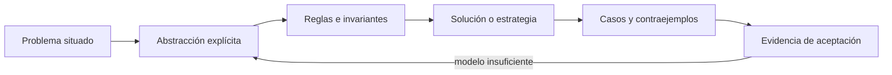
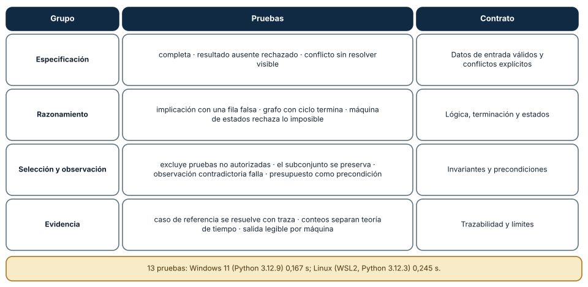
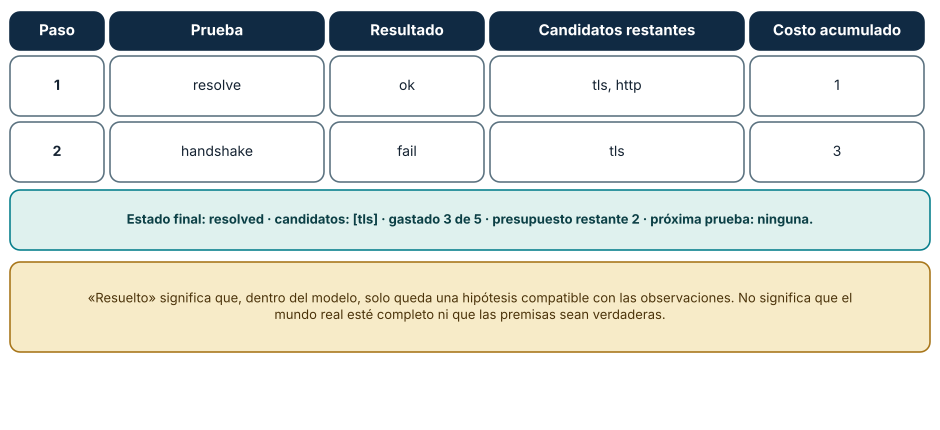
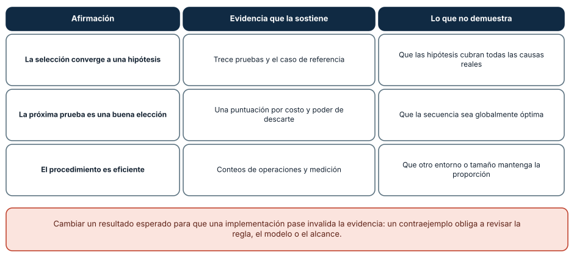

# SE-060 — Proyecto: especificación y solución contrastable

[← SE-059 — Taller: descomponer un problema ambiguo](../../classes/part-04-pensamiento-computacional-y-resolucion-de-problemas/se-059-taller-descomponer-un-problema-ambiguo/README.md) · [↑ Parte 04](../../classes/part-04-pensamiento-computacional-y-resolucion-de-problemas/README.md) · [📚 Índice completo](../../classes/README.md) · [🌐 Portal](../../site/classes/SE-060.html) · [SE-061 — Valores, expresiones, tipos y variables →](../../classes/part-05-fundamentos-de-programacion/se-061-valores-expresiones-tipos-y-variables/README.md)


## Punto profesional y fundamento pedagógico

**Punto profesional.** La clase existe para entregar una especificación y solución contrastable mediante propiedades y evidencia.

**Por qué aparece aquí.** Se sitúa después de **Taller: descomponer un problema ambiguo** y antes de **Valores, expresiones, tipos y variables**: convierte el conocimiento anterior en una decisión observable que la clase siguiente podrá reutilizar. La continuidad se comprueba en el artefacto, no por compartir vocabulario.

**Error conceptual que debe corregir.** Hacer que la prueba copie la implementación en vez de verificar el contrato.

**Secuencia de aprendizaje.** Antes de leer la solución, el estudiante predice el resultado del caso normal y del error conceptual anterior. Luego explica un caso resuelto paso a paso, construye un contraejemplo que cambie la decisión y, sin consultar el texto, reconstruye el mecanismo y lo aplica a una entrada nueva. La secuencia usa predicción, explicación propia, contraste y recuperación. [ICAP](https://icap.education.asu.edu/research) distingue participación de construcción de conocimiento; [How People Learn II](https://nap.nationalacademies.org/catalog/24783/how-people-learn-ii-learners-contexts-and-cultures) exige conectar conocimiento previo, contexto y transferencia; la [práctica de recuperación](https://pubmed.ncbi.nlm.nih.gov/16507066/) respalda producir de nuevo la explicación tras una demora; y [Education for Life and Work](https://nap.nationalacademies.org/resource/13398/dbasse_084153.pdf) exige devolución que explique la causa del error.

**Evidencia de aprendizaje.** Specification.md, solución, oráculo independiente, casos y límites. Debe contener predicción previa, observación, explicación causal, contraejemplo, criterio de aceptación y una nota de qué dato haría cambiar la conclusión.

**Límite de la conclusión.** Pasar el conjunto acordado no demuestra corrección universal.

### Trazabilidad fuente → afirmación

| Fuente primaria u oficial | Afirmación que respalda | Lo que no prueba |
|---|---|---|
| [SWEBOK Guide v4.0a](https://www.computer.org/education/bodies-of-knowledge/software-engineering) | sitúa la decisión dentro de construcción, diseño, pruebas y práctica profesional de ingeniería de software | No demuestra por sí sola que el artefacto del estudiante sea correcto. |
| [MIT 6.042J — Mathematics for Computer Science](https://ocw.mit.edu/courses/6-042j-mathematics-for-computer-science-spring-2015/) | aporta lógica, inducción, relaciones, grafos y técnicas de demostración aplicadas | No demuestra por sí sola que el artefacto del estudiante sea correcto. |
| [MIT 6.006 — Introduction to Algorithms](https://ocw.mit.edu/courses/6-006-introduction-to-algorithms-spring-2020/) | aporta definiciones, invariantes y análisis de estructuras y algoritmos usados en la clase | No demuestra por sí sola que el artefacto del estudiante sea correcto. |

## Antes de empezar

Esta clase continúa el **modelo de decisión diagnóstica**, que convierte la evidencia de la petición observable de extremo a extremo en una siguiente decisión explicable. Recupera `SE-059`: escribe qué artefacto dejó, qué supuesto permanece abierto y qué propiedad debe sobrevivir al nuevo modelo. La matemática se usa para restringir interpretaciones y encontrar errores; no como ornamentación.

## Prerrequisitos

- Poder separar hecho, interpretación, hipótesis y decisión.
- Manejar tablas, diagramas y pseudocódigo legible; Python es opcional.
- Trabajar con datos sintéticos del caso del modelo de decisión diagnóstica y conservar cada versión en Git.

## Problema auténtico

El proyecto entrega la especificación del modelo de decisión diagnóstica, no solo una idea. Debe tomar señales de la petición observable de extremo a extremo, mantener hipótesis y recomendar pruebas bajo presupuesto y autorización. Una solución contrastable conecta problema, modelo, algoritmo, corrección, costo, fallos y criterios de aceptación.

## Objetivos observables

Al finalizar podrás explicar el mecanismo con ejemplo y contraejemplo; construir un modelo con dominio y límites; derivar una prueba que pueda refutarlo; comparar al menos dos representaciones; y entregar una decisión cuya evidencia pueda revisar otra persona.

## Mapa conceptual



El mapa separa el problema de su representación. Los casos no reemplazan reglas; las reglas no prueban que el problema esté bien encuadrado. La pregunta de esta clase es: **¿Puede una persona independiente decidir si la solución satisface el problema?**

## Temas y por qué importan

| Lente | Pregunta | Evidencia |
|---|---|---|
| dominio | ¿qué entradas y estados existen? | vocabulario y particiones |
| estructura | ¿qué relaciones se conservan? | modelo interpretado |
| regla | ¿qué debe ser cierto? | contrato o invariante |
| estrategia | ¿qué pasos producen el resultado? | pseudocódigo y traza |
| límite | ¿dónde falla el argumento? | contraejemplo y caso límite |
## Conceptos y decisiones

### 1. Contrato del problema

Se declaran actores, decisión, entradas válidas, salida, errores, restricciones y exclusiones. Términos como evidencia, autorizado y costo viven en un glosario. Los ejemplos ilustran, pero el contrato cubre el dominio más allá de ellos.

### 2. Modelo formal mínimo

Conjuntos tipan hipótesis y pruebas; relaciones expresan cobertura; un grafo ordena dependencias; una máquina de estados gobierna ejecución. Cada formalismo responde una pregunta. No se añade notación que no cambie una decisión o una comprobación.

### 3. Solución y argumento

El algoritmo define selección y actualización. Precondiciones e invariantes protegen autorización y trazabilidad; una variante demuestra fin del ciclo. El análisis de complejidad usa H, P y E, y la heurística declara si la salida es óptima o mejor encontrada.

### 4. Oráculo y casos

Un oráculo decide el resultado esperado. Casos cubren normal, límite, inválido, empate, ciclo, presupuesto agotado, evento tardío y recuperación. Propiedades como «nunca recomienda fuera de autorizadas» complementan ejemplos concretos.

### 5. Paquete de revisión

`problem.md` explica intención; `model.md` define entidades, reglas y diagramas; `checks.md` enlaza criterios con casos y argumentos. Una matriz de trazabilidad permite localizar evidencia. Las preguntas abiertas no se ocultan detrás de estado aprobado.

### Trece pruebas, trece contratos

El laboratorio de la Parte 04 tiene 13 pruebas y cada una protege un contrato. La Figura 1 las agrupa: **especificación** (completa, resultado ausente rechazado, conflicto sin resolver visible), **razonamiento** (implicación con una fila falsa, grafo con ciclo que termina, máquina de estados que rechaza lo imposible), **selección y observación** (excluye pruebas no autorizadas, preserva el subconjunto de candidatos, falla ante observaciones contradictorias, trata el presupuesto como precondición) y **evidencia** (el caso de referencia se resuelve con traza, los conteos separan teoría de tiempo, la salida es legible por máquina). Pasaron en Windows 11 con CPython 3.12.9 en 0,167 s y en Ubuntu bajo WSL2 con CPython 3.12.3 en 0,245 s.



**Cómo leer la figura.** Cada fila agrupa pruebas que protegen una misma clase de contrato. **Dónde deja de valer:** pasar las 13 pruebas demuestra que esos 13 contratos se cumplen en ese entorno, no que el modelo sea correcto en general; el conjunto no incluye datos hostiles ni cargas grandes.

### Resolver el caso de referencia, paso a paso

Con la especificación y las observaciones de referencia, el modelo elige `resolve` (costo 1): el resultado `ok` descarta `dns` y deja `tls` y `http`. Luego elige `handshake` (costo 2): el resultado `fail` descarta `http` y deja solo `tls`. El estado final es `resolved`, candidato `tls`, gasto 3 de 5 y presupuesto restante 2. Cada paso queda en una traza: prueba elegida, resultado, candidatos restantes y costo acumulado. «Resuelto» significa que, dentro del modelo, solo queda una hipótesis compatible con las observaciones; no que el mundo real esté completo ni que las premisas sean verdaderas.



**Cómo leer la figura.** Cada fila es un paso con el candidato que queda. **Dónde deja de valer:** la traza depende de que los resultados sean los declarados; con un resultado `unknown` el modelo no avanza, y con uno contradictorio falla.

### Lo que la evidencia sostiene y lo que no

Una evaluación honesta separa tres afirmaciones. La selección converge a una hipótesis: lo sostienen las trece pruebas y el caso de referencia, pero no que las hipótesis cubran las causas reales. La próxima prueba es una buena elección: lo sostiene una puntuación por costo y poder de descarte, pero no que la secuencia sea globalmente óptima. El procedimiento es eficiente: lo sostienen conteos de operaciones y mediciones, pero no que otro tamaño o entorno mantenga la proporción. Cambiar un resultado esperado para que una implementación pase invalida la evidencia: un contraejemplo obliga a revisar la regla, el modelo o el alcance.



**Cómo leer la figura.** La tercera columna es el límite que debe aparecer en la entrega. **Dónde deja de valer:** la tabla es una guía para redactar límites; cada proyecto añade los suyos.

## Definiciones de trabajo

- **especificación:** descripción verificable de comportamiento y restricciones.
- **oráculo:** mecanismo para determinar el resultado esperado.
- **trazabilidad:** vínculo entre necesidad, regla, solución y evidencia.
- **partición:** subdominio tratado de forma equivalente.
- **solución contrastable:** propuesta cuya adecuación puede decidirse con criterios explícitos.

Las definiciones fijan el uso en el modelo de decisión diagnóstica. Si una fuente usa otra convención, documenta la traducción. Una palabra definida no equivale a una propiedad demostrada.

## Ejemplo mínimo

Escribe una especificación de `next_test(active_hypotheses, evidence, authorized, budget)` con salida tipada. Incluye vacío, empate, presupuesto insuficiente y contradicción.

Antes de resolver, predice el resultado y la propiedad que debería conservarse. Después marca qué parte del resultado procede de la regla y cuál depende del ejemplo.

## Ejemplo profesional

El modelo de decisión diagnóstica ofrece un plan reproducible y una explicación: alternativas consideradas, prueba elegida, costo, hipótesis que separa y restricción aplicada. El proyecto incluye un simulador de papel o pseudocódigo, no requiere producto ejecutable; la Parte 5 implementará el contrato.

La entrega profesional hace visible el costo de simplificar. Incluye al menos una alternativa descartada y la condición que obligaría a revisar la decisión.

## Práctica guiada

1. congela pregunta y alcance.
2. define vocabulario y modelo.
3. especifica algoritmo y propiedades.
4. deriva casos desde particiones y límites.
5. traza requisito→regla→caso.
6. entrega a revisión sin explicación oral.
7. solicita una revisión adversarial y corrige el modelo sin borrar la versión que falló.

## Ejercicios

1. **Cobertura:** asocia cada una de las 13 pruebas con el contrato que protege y señala cuál falta.
2. **Traza:** reproduce la resolución del caso de referencia y explica cada candidato descartado.
3. **Ruptura:** rompe un contrato y comprueba cuál prueba falla; documenta el resultado.
4. **Límites:** redacta tres frases de límite para tu entrega que no repitan las de la clase.

## Reto verificable

Entrega `problem.md`, `model.md` y `checks.md`. Una persona revisora debe poder reconstruir dominio, supuestos, regla, resultado y límite; además debe encontrar qué caso refutaría la solución sin preguntarte oralmente.

## Demostración guiada

1. Declara el dominio y selecciona un caso pequeño calculable a mano.
2. Ejecuta la estrategia paso a paso y conserva estados intermedios.
3. Comprueba el resultado contra la definición, no contra intuición.
4. Introduce el fallo controlado y localiza la primera regla violada.
5. Repara el modelo y repite el caso original y el contraejemplo.

## Preguntas frecuentes

### ¿Por qué el caso de referencia no basta como evaluación?

Porque es un solo escenario. Sirve como regresión (si cambia, algo cambió), no como prueba de que el modelo funcione en otros casos.

### ¿Qué significa que el resultado sea «legible por máquina»?

Que la salida es estructurada (JSON con estado, candidatos y traza) para que otra herramienta o persona la verifique sin interpretar texto libre.

### ¿Cómo separo teoría de tiempo en los conteos?

Registrando el número de operaciones (reproducible) aparte del tiempo de reloj (dependiente del equipo). Una regresión de conteo es un defecto; una de tiempo puede ser ruido.

### ¿Qué hago si dos personas implementan el contrato y obtienen resultados distintos?

Es una ambigüedad en la especificación. Se documenta el caso, se decide la regla y se añade una prueba que lo fije.
## Fallo controlado y diagnóstico

Añade una hipótesis sin prueba autorizada y un ciclo de dependencias. La validación debe rechazar el modelo con errores localizables, no construir un plan parcial presentado como completo.

Conserva el modelo fallido, la entrada que lo expone, la regla violada y la corrección. No ajustes solo el resultado esperado para hacer pasar el caso.


Rompe a propósito un contrato para ver cuál prueba lo detecta. Cambia la autorización de `production-capture` a verdadera y ejecuta las 13 pruebas. **Síntoma:** falla la prueba que excluye pruebas no autorizadas. **Hipótesis:** la prueba protege la restricción `authorized_only`. **Prueba:** revierte el cambio y confirma que vuelven a pasar. Repite con el presupuesto (cámbialo a 0) y con una observación contradictoria. **Conclusión:** cada contrato tiene una prueba que lo vigila; si un cambio no hace fallar ninguna, falta una prueba. Anota en `review.md` qué contratos no tienen prueba y qué caso añadirías.

## Errores comunes y cómo corregirlos

| Síntoma | Causa | Corrección |
|---|---|---|
| «Pasan todas» se presenta como correcto | Evidencia confundida con garantía | Declarar qué cubren y qué no cubren las pruebas |
| Una prueba se debilita para que pase | Se trata como obstáculo | Revisar la regla o el modelo |
| La traza no explica la decisión | Falta registrar candidatos y costo | Guardar prueba, resultado, restantes y gasto |
| El resultado cambia entre Windows y Linux | Dependencia del entorno | Aislar la dependencia y probar ambos |
| Un contrato no tiene prueba | Cobertura implícita | Añadir una prueba que lo viole a propósito |

## Entorno y archivos clave

```text
work/SE-060/
├── problem.md     # contexto, dominio, supuestos y exclusiones
├── model.md       # definiciones, reglas, diagrama y estrategia
├── checks.md      # ejemplos, contraejemplos y aceptación
└── review.md      # objeciones y revisión del modelo
```

El pseudocódigo debe ser independiente de lenguaje y cada diagrama necesita explicación textual. Si usas código para explorar, registra versión, entrada y salida; no lo presentes automáticamente como producto de la clase.

### Laboratorio integrado de la Parte 04

Entrega la [especificación y solución contrastable](https://github.com/vladimiracunadev-create/modern-software-engineering-program/tree/main/labs/part-04-contrastable-spec) con sus fixtures y trece pruebas. Añade un oráculo independiente para casos pequeños, contraejemplos de lógica y heurística, y una matriz requisito → regla → caso → evidencia. El paquete separa qué se demostró, qué se ejecutó y qué sigue siendo supuesto del dominio.

## Seguridad, ética y accesibilidad

- usa incidentes sintéticos y evita convertir direcciones o usuarios en datos de práctica;
- trata autorización y privacidad como invariantes, no como pasos opcionales;
- registra a quién perjudica un falso positivo, falso negativo o prioridad automática;
- ofrece tablas y texto alternativo para diagramas y símbolos;
- define mecanismo de revisión humana y apelación para recomendaciones;
- no uses un modelo parcial para justificar una decisión irreversible.

## Puente hacia el trabajo con agentes

El laboratorio es, en miniatura, un harness de evaluación: una especificación declarada, un selector con presupuesto, una traza auditable y un conjunto de pruebas de contrato. Un agente de diagnóstico debería producir el mismo tipo de artefacto: pruebas elegidas, resultados, hipótesis restantes y gasto, de modo que una persona pueda revisar el razonamiento y no solo la conclusión. Las partes de evaluación de agentes generalizan estas ideas: casos de referencia, repetición para variabilidad, contraejemplos y límites declarados.

## Transferencia

Aplica el mecanismo a otro dominio y conserva la estructura del argumento, no los nombres del modelo de decisión diagnóstica. Explica qué dominio, invariante o medida cambia. Si el razonamiento deja de funcionar, identifica el supuesto que pertenecía al caso original.

## Evaluación y evidencia

| Criterio | Para aprobar |
|---|---|
| precisión | dominio, términos y cuantificadores explícitos |
| mecanismo | pasos y relaciones explican el resultado |
| corrección | invariantes, casos o argumento adecuados a la afirmación |
| límites | contraejemplo, costo y supuestos visibles |
| revisión | trazabilidad y objeciones preservadas |

Completar archivos no concede aprobación. La evidencia debe sostener la afirmación exacta, y la revisión de otra persona debe poder contradecirla.

## Fuentes


- [SWEBOK Guide v4.0a](https://www.computer.org/education/bodies-of-knowledge/software-engineering) — sitúa la decisión dentro de construcción, diseño, pruebas y práctica profesional de ingeniería de software.
- [MIT 6.042J — Mathematics for Computer Science](https://ocw.mit.edu/courses/6-042j-mathematics-for-computer-science-spring-2015/) — aporta lógica, inducción, relaciones, grafos y técnicas de demostración aplicadas.
- [MIT 6.006 — Introduction to Algorithms](https://ocw.mit.edu/courses/6-006-introduction-to-algorithms-spring-2020/) — aporta definiciones, invariantes y análisis de estructuras y algoritmos usados en la clase.
- [MIT 18.404J — Theory of Computation](https://ocw.mit.edu/courses/18-404j-theory-of-computation-fall-2020/) — delimita computabilidad, complejidad y los límites de las soluciones algorítmicas.

Los cursos y SWEBOK aportan definiciones y métodos; no validan automáticamente el modelo del modelo de decisión diagnóstica. Cada aplicación se sostiene con el artefacto y sus casos.

- [Python: `unittest`](https://docs.python.org/3/library/unittest.html): marco de pruebas usado por el laboratorio para las trece pruebas.
- [SWEBOK Guide v4.0a: pruebas de software](https://www.computer.org/education/bodies-of-knowledge/software-engineering): objetivos y límites de las pruebas.
- [Edsger W. Dijkstra, «Notes on Structured Programming»](https://www.cs.utexas.edu/~EWD/ewd02xx/EWD249.PDF): pruebas muestran la presencia de defectos, no su ausencia.

## Límites y siguiente paso

La especificación reduce interpretaciones, pero no prueba que las necesidades sean correctas ni que una implementación concreta cumpla. La Parte 5 convierte el modelo de decisión diagnóstica en una herramienta CLI probada llamada la CLI diagnóstica.

## Glosario

- **especificación:** descripción verificable de comportamiento y restricciones.
- **oráculo:** mecanismo para determinar el resultado esperado.
- **trazabilidad:** vínculo entre necesidad, regla, solución y evidencia.
- **partición:** subdominio tratado de forma equivalente.
- **solución contrastable:** propuesta cuya adecuación puede decidirse con criterios explícitos.

---

[← SE-059 — Taller: descomponer un problema ambiguo](../../classes/part-04-pensamiento-computacional-y-resolucion-de-problemas/se-059-taller-descomponer-un-problema-ambiguo/README.md) · [↑ Parte 04](../../classes/part-04-pensamiento-computacional-y-resolucion-de-problemas/README.md) · [📚 Índice completo](../../classes/README.md) · [🌐 Portal](../../site/classes/SE-060.html) · [SE-061 — Valores, expresiones, tipos y variables →](../../classes/part-05-fundamentos-de-programacion/se-061-valores-expresiones-tipos-y-variables/README.md)
