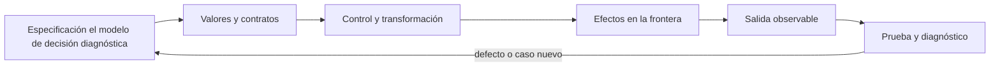
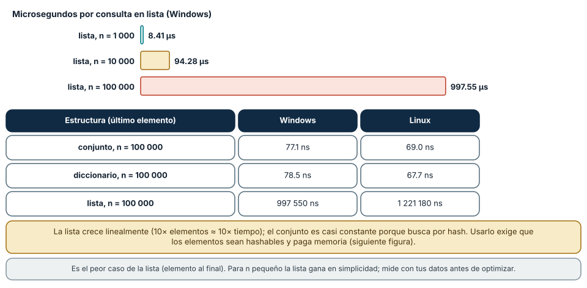
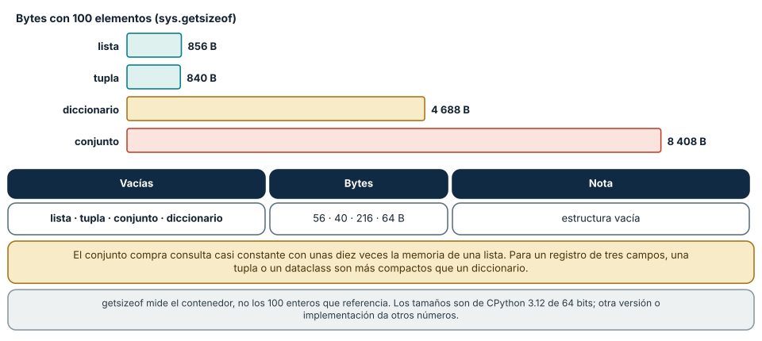
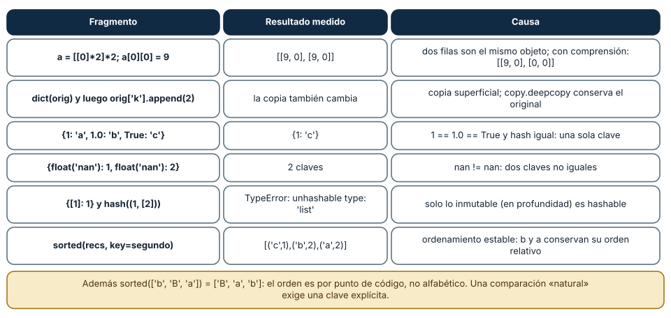

# SE-066 — Colecciones y transformación de datos

[← SE-065 — Errores, excepciones y resultados explícitos](../../classes/part-05-fundamentos-de-programacion/se-065-errores-excepciones-y-resultados-explicitos/README.md) · [↑ Parte 05](../../classes/part-05-fundamentos-de-programacion/README.md) · [📚 Índice completo](../../classes/README.md) · [🌐 Portal](../../site/classes/SE-066.html) · [SE-067 — Entrada, salida y serialización →](../../classes/part-05-fundamentos-de-programacion/se-067-entrada-salida-y-serializacion/README.md)


## Punto profesional y fundamento pedagógico

**Punto profesional.** La clase existe para seleccionar colecciones y transformaciones según orden, unicidad, acceso, memoria y mutabilidad.

**Por qué aparece aquí.** Se sitúa después de **Errores, excepciones y resultados explícitos** y antes de **Entrada, salida y serialización**: convierte el conocimiento anterior en una decisión observable que la clase siguiente podrá reutilizar. La continuidad se comprueba en el artefacto, no por compartir vocabulario.

**Error conceptual que debe corregir.** Encadenar transformaciones sin observar pérdidas de información o aliasing.

**Secuencia de aprendizaje.** Antes de leer la solución, el estudiante predice el resultado del caso normal y del error conceptual anterior. Luego explica un caso resuelto paso a paso, construye un contraejemplo que cambie la decisión y, sin consultar el texto, reconstruye el mecanismo y lo aplica a una entrada nueva. La secuencia usa predicción, explicación propia, contraste y recuperación. [ICAP](https://icap.education.asu.edu/research) distingue participación de construcción de conocimiento; [How People Learn II](https://nap.nationalacademies.org/catalog/24783/how-people-learn-ii-learners-contexts-and-cultures) exige conectar conocimiento previo, contexto y transferencia; la [práctica de recuperación](https://pubmed.ncbi.nlm.nih.gov/16507066/) respalda producir de nuevo la explicación tras una demora; y [Education for Life and Work](https://nap.nationalacademies.org/resource/13398/dbasse_084153.pdf) exige devolución que explique la causa del error.

**Evidencia de aprendizaje.** Collection-pipeline.md con entradas, invariantes, complejidad y contraejemplo. Debe contener predicción previa, observación, explicación causal, contraejemplo, criterio de aceptación y una nota de qué dato haría cambiar la conclusión.

**Límite de la conclusión.** La biblioteca puede cambiar constantes y detalles internos.

### Trazabilidad fuente → afirmación

| Fuente primaria u oficial | Afirmación que respalda | Lo que no prueba |
|---|---|---|
| [Python Tutorial — Data Structures](https://docs.python.org/3/tutorial/datastructures.html) | define la semántica y los límites de la API de Python utilizada en el experimento | No demuestra por sí sola que el artefacto del estudiante sea correcto. |
| [Python Language Reference](https://docs.python.org/3/reference/) | define la semántica y los límites de la API de Python utilizada en el experimento | No demuestra por sí sola que el artefacto del estudiante sea correcto. |

## Antes de empezar

Esta clase construye la **CLI diagnóstica**, implementación incremental de la especificación del modelo de decisión diagnóstica. Recupera `SE-065` y convierte una regla ya modelada en comportamiento ejecutable o comprobable. Trabaja en cambios pequeños: predicción, código, ejecución, evidencia y explicación. Ejecutar sin poder explicar el resultado no completa la práctica.

## Prerrequisitos

- Python 3.11 o posterior disponible como `python` o `python3`; registra la versión real.
- Terminal, editor de texto y Git; no se requieren paquetes externos.
- Comprender el contrato del modelo de decisión diagnóstica: entradas, resultados, errores e invariantes.

## Problema auténtico

La CLI diagnóstica almacena todo en listas de diccionarios y busca por ID repetidamente. Aparecen duplicados, orden accidental y código de transformación difícil de leer. La elección entre lista, tupla, conjunto y diccionario debe seguir operaciones e invariantes.

## Objetivos observables

Al terminar podrás explicar el mecanismo del lenguaje, predecir una ejecución, implementar un caso normal y sus fronteras, diagnosticar un fallo controlado, proteger el comportamiento con evidencia y separar lo transferible de lo específico de Python.

## Mapa conceptual



El código no reemplaza la especificación: la materializa bajo reglas concretas del lenguaje y del entorno. La pregunta de esta clase es: **¿Qué operaciones dominan y qué estructura conserva la semántica necesaria?**

## Temas y por qué importan

| Lente | Pregunta | Evidencia |
|---|---|---|
| valor | ¿qué representa y qué tipo tiene? | ejemplo inspeccionable |
| control | ¿qué camino o repetición ocurre? | traza de estados |
| contrato | ¿qué acepta, retorna y rechaza? | casos frontera |
| efecto | ¿qué cambia fuera del cálculo? | archivo o stream controlado |
| mantenimiento | ¿cómo se detecta una regresión? | prueba y diff enfocado |

## Conceptos y decisiones

### 1. Lista y secuencia

Una lista es mutable, ordenada y admite duplicados; resulta adecuada para secuencia de eventos. Acceder por índice es directo, buscar por valor es lineal. El orden debe ser parte del contrato o tratarse como incidental, no depender de él por accidente.

### 2. Tupla y registro ligero

Una tupla es una secuencia inmutable; puede expresar pares o retorno múltiple. Su posición pierde significado si crece. Para registros con muchos campos se prefieren diccionarios, dataclasses o tipos nombrados en etapas posteriores.

### 3. Conjunto

Un set representa pertenencia única y ofrece unión, intersección y diferencia. No promete un orden estable para presentación. Es ideal para IDs visitados o tags; convertir una lista a set elimina duplicados sin explicar cuál registro conservar.

### 4. Diccionario

Un dict asocia claves hashables con valores y conserva orden de inserción como propiedad del lenguaje moderno, pero su razón principal es acceso por clave. Una asignación repetida reemplaza el valor; para detectar duplicado se valida antes de insertar.

### 5. Transformaciones

Comprensiones expresan map/filter sencillos; un bucle explícito sirve cuando hay validación, varias salidas o diagnóstico. Encadenar transformaciones crea colecciones intermedias. La CLI diagnóstica separa normalizar, validar, indexar y resumir para localizar fallos.

### Operación dominante y costo de la pertenencia

Elegir una colección es elegir qué operación se hace rápida. Se midió la consulta «¿está el último elemento?»: en una lista cuesta 8.41 µs con 1 000 elementos, 94.28 µs con 10 000 y 997.55 µs con 100 000 en Windows (1 221 µs en Linux con 100 000): crece de forma lineal, diez veces más elementos, diez veces más tiempo. En un conjunto o un diccionario de 100 000 elementos la misma consulta costó 77.1 y 78.5 ns (69.0 y 67.7 en Linux): casi constante, porque busca por hash en lugar de recorrer.

Otras operaciones muestran la misma lógica. `lista.pop(0)` con 100 000 elementos costó 25.5 µs (desplaza todos los elementos), mientras que `deque.popleft()` costó 60.2 ns. Una lista es buena para recorrer en orden y añadir al final; un `deque` para colas; un `set` para pertenencia y operaciones de conjuntos (`{1,2,3} & {2,3,4}` da `{2, 3}`); un `dict` para asociar claves con valores. La decisión se justifica con la operación dominante del problema: en el laboratorio las pruebas usadas se consultan por identificador en cada observación, y por eso `State.used` es un `frozenset` y no una lista.

El costo no es solo tiempo. El conjunto compra la búsqueda rápida con memoria (siguiente figura) y exige que los elementos sean hashables. Para tamaños pequeños la lista gana en simplicidad y a veces en velocidad; la regla es medir con datos del tamaño real antes de cambiar una estructura por razones de rendimiento.



**Cómo leer la figura.** Las tres barras superiores muestran cómo crece el tiempo de la lista con el tamaño; la tabla inferior compara las tres estructuras con 100 000 elementos. **Dónde deja de valer:** la medición es el peor caso de la lista (elemento al final) y en CPython; con claves de hash costosas o con muchas colisiones el conjunto se degrada. La complejidad asintótica (O(n) frente a O(1) promedio) es la regla, y los números son un ejemplo.

### Memoria: qué se paga por la velocidad

Con 100 enteros, `sys.getsizeof` informó 856 bytes para una lista, 840 para una tupla, 4 688 para un diccionario y 8 408 para un conjunto; vacías ocupan 56, 40, 64 y 216. El conjunto ocupa unas diez veces lo que una lista para el mismo contenido, porque mantiene una tabla hash con espacio libre para evitar colisiones. La tupla es la más compacta porque su tamaño es fijo y no se reserva margen para crecer.

Por eso la elección depende del papel del dato. Para un registro de unos pocos campos (un `Probe` con identificador, costo, autorización y resultados), una tupla o un `dataclass` pesan menos que un diccionario y además tienen nombres de campos comprobables. Un `dict` es el tipo correcto cuando las claves son un conjunto abierto (resultados por hipótesis) y cuando la búsqueda por clave es la operación principal. Un `frozenset` expresa «solo pertenencia, no cambia» y es hashable, de modo que puede ser clave de un diccionario o miembro de otro conjunto.

`getsizeof` mide el contenedor, no los objetos a los que apunta: los 100 enteros referenciados no están incluidos. Para una estimación total hay que sumar los contenidos o usar un perfilador de memoria. Y los números son de CPython 3.12 de 64 bits: otra versión, otra plataforma u otra implementación cambia las cifras, aunque la relación «el conjunto cuesta mucho más que la lista» se mantiene.



**Cómo leer la figura.** Cada barra es el tamaño en bytes con 100 elementos. Las estructuras con tabla hash (diccionario y conjunto) son las más grandes. **Dónde deja de valer:** `sys.getsizeof` excluye los elementos contenidos y el recolector de basura; no es un presupuesto de memoria del proceso. En colecciones muy pequeñas el margen de reserva domina la comparación.

### Seis trampas de colecciones, ejecutadas

Las colecciones comparten objetos con más facilidad de la que parece. `a = [[0]*2]*2` crea dos filas que son el mismo objeto: tras `a[0][0] = 9`, `a` valió `[[9, 0], [9, 0]]`, mientras que la comprensión `[[0]*2 for _ in range(2)]` dio `[[9, 0], [0, 0]]`. Una copia superficial (`dict(orig)`) comparte los valores internos: al añadir a la lista interna del original, la copia también cambió; `copy.deepcopy` conservó el estado anterior. Estas dos trampas son el mismo error: confundir «copiar el contenedor» con «copiar su contenido».

La igualdad de claves tiene sus propias sorpresas: `{1: 'a', 1.0: 'b', True: 'c'}` es `{1: 'c'}`, porque `1 == 1.0 == True` y sus hashes coinciden; y `{float('nan'): 1, float('nan'): 2}` tiene dos claves, porque `nan != nan`. Solo es hashable lo inmutable en profundidad: `{[1]: 1}` lanzó `TypeError: unhashable type: 'list'` y `hash((1, [2]))` también, porque una tupla con una lista dentro no es inmutable de verdad.

Por último, el orden. `sorted` es estable: con `[('b', 2), ('a', 2), ('c', 1)]` ordenado por el segundo campo, `b` y `a` conservaron su orden relativo. Y `sorted(['b', 'B', 'a'])` dio `['B', 'a', 'b']`: se ordena por punto de código, no alfabéticamente; para comparar «de forma natural» hace falta una clave explícita. Los diccionarios conservan el orden de inserción (`{'b': 1, 'a': 2}` itera `b` y luego `a`); los conjuntos no prometen ninguno.



**Cómo leer la figura.** Cada fila es una trampa con el resultado que Python dio. La causa explica el mecanismo; ninguna es un defecto del intérprete. **Dónde deja de valer:** el orden de inserción de `dict` es garantía del lenguaje desde Python 3.7; el de `set` no lo es. La trampa de `nan` depende de IEEE 754; otros lenguajes tratan `NaN` como clave de otra manera.

## Definiciones de trabajo

- **secuencia:** colección ordenada accesible por posición.
- **mapping:** asociación entre claves y valores.
- **hashable:** valor con hash estable utilizable como clave.
- **comprensión:** sintaxis para construir colección desde iterable.
- **normalización:** transformación hacia una forma canónica.

Estas definiciones describen el uso concreto en la CLI diagnóstica. Cuando Python permita varias conductas, el contrato del programa elige una y la hace visible con validación y pruebas.

## Ejemplo mínimo

```python
authorized_ids = {"dns-check", "tcp-check"}
by_id = {}
for test in tests:
    test_id = test["id"]
    if test_id in by_id:
        raise ValueError(f"duplicate test id: {test_id}")
    by_id[test_id] = test

eligible = [by_id[i] for i in authorized_ids if i in by_id]
```

Dado un conjunto de pruebas con IDs repetidos y tags, crea: secuencia original, índice único, conjunto de tags y lista elegible ordenada por costo. Declara qué ocurre con duplicados.

Ejecuta el fragmento en un archivo, no solo en una conversación interactiva. Conserva comando, versión, salida y explicación de cada línea relevante.

## Ejemplo profesional

La CLI diagnóstica conserva eventos como lista inmutable por convención, usa dict para hipótesis por ID y set para autorizaciones. La salida se ordena explícitamente por `(cost, id)` para reproducibilidad; no depende del orden de un set.

El criterio profesional es que el comportamiento pueda ser consumido, diagnosticado y cambiado sin depender de conocimiento oral ni de estado oculto.

## Práctica guiada

1. lista las operaciones requeridas.
2. elige estructura por operación.
3. valida identidad antes de indexar.
4. separa transformación en etapas.
5. prueba vacío, duplicado y orden de empate.
6. ejecuta `python -m unittest -v` cuando existan pruebas y registra el resultado exacto.

## Ejercicios

1. **Estructura:** elige la colección para (a) pruebas usadas, (b) resultados por hipótesis, (c) cola de observaciones, (d) historial de pasos, y justifica con la operación dominante.
2. **Medición:** mide tu propio cruce: ¿a partir de qué tamaño un `set` supera a una `list` para consultar el último elemento en tu equipo?
3. **Aliasing:** muestra con `id` dos referencias al mismo objeto dentro de una lista de listas y corrige el código.
4. **Orden:** ordena nombres con acentos y mayúsculas de forma «natural» con una clave explícita y explica por qué `sorted` solo no basta.

## Reto verificable

Entrega un cambio que incluya comportamiento, caso normal, caso límite, fallo controlado y explicación. Otra persona debe poder ejecutar los comandos desde un checkout limpio y relacionar cada salida con una regla del modelo de decisión diagnóstica.

## Demostración guiada

1. Escribe la entrada y la salida esperada antes del código.
2. Ejecuta el caso mínimo y observa valores intermedios sin dejar prints permanentes en el núcleo.
3. Añade el caso frontera que obligue a decidir, no solo a teclear.
4. Introduce el fallo descrito abajo y confirma que la evidencia lo detecta.
5. Corrige, ejecuta toda la suite y revisa el diff por efectos no deseados.

## Preguntas frecuentes

### ¿Lista o tupla?

Lista para una secuencia que crece o se modifica; tupla para una secuencia fija o un registro ligero. La tupla comunica que no se va a modificar y es hashable si sus elementos lo son.

### ¿Cuándo un `set` es peor que una `list`?

Con pocos elementos, cuando se recorre mucho más de lo que se busca, o cuando los elementos no son hashables. Medir con el tamaño real decide.

### ¿Por qué no usar un diccionario para todo?

Porque pierde nombres comprobables de campos y consume más memoria que una tupla o un `dataclass` para registros de forma fija.

### ¿Una comprensión siempre es mejor que un bucle?

No siempre. En 10 000 elementos midió 639 µs frente a 724 µs para el bucle con `append` (Windows), una diferencia pequeña; se elige por claridad, y se evita una comprensión con efectos o con demasiadas condiciones.

## Fallo controlado y diagnóstico

Construye una matriz de 3×3 con `[[0] * 3] * 3`, asigna `m[1][1] = 7` y observa que las tres filas cambian. Predice antes de ejecutar y explica con `id(m[0]) == id(m[1])`. Corrige con una comprensión y escribe la prueba que cambia una celda y verifica que las demás filas quedaron intactas. Luego prueba la copia superficial de un diccionario con una lista dentro y su efecto al mutar el original. Para cada caso registra el objeto compartido (cuántos objetos hay realmente) y qué estructura inmutable (tupla, `frozenset`) lo habría impedido.

## Errores comunes y cómo corregirlos

| Síntoma | Causa | Corrección |
|---|---|---|
| cambiar una fila cambia todas | multiplicar una lista de listas comparte el objeto interno | construir con una comprensión |
| la copia «cambia sola» | copia superficial de una estructura anidada | `copy.deepcopy` o evitar la mutación |
| `TypeError: unhashable type` al usar una clave | clave mutable o tupla que contiene una lista | usar una tupla de inmutables o `frozenset` |
| claves que «desaparecen» al unir `1`, `1.0` y `True` | igualdad y hash coinciden | normalizar los tipos antes de usarlos como claves |
| la búsqueda es lenta con muchos datos | pertenencia sobre una lista de decenas de miles de elementos | convertir a `set`/`dict` si la consulta domina y el costo de memoria es aceptable |

## Entorno y archivos clave

```text
work/SE-066/
├── diagnostic_cli/
│   ├── __init__.py
│   ├── domain.py
│   ├── cli.py
│   └── __main__.py
├── tests/
│   └── test_diagnostic_cli.py
└── README.md
```

No instales dependencias para resolver lo que cubre la biblioteca estándar. `README.md` conserva versión, comandos, entradas, salida, limpieza y límites. Los fragmentos son pedagógicos; intégralos solo después de entender su contrato.

### Laboratorio integrado de la Parte 05

Justifica cada colección de [`labs/part-05-diagnostic-cli`](https://github.com/vladimiracunadev-create/modern-software-engineering-program/tree/main/labs/part-05-diagnostic-cli): tupla para orden estable, `frozenset` para pruebas usadas, diccionario para búsqueda de outcomes y lista solo durante construcción. Ejecuta la prueba que conserva el estado anterior tras `apply_observation` y crea un contraejemplo con una lista compartida mutable. La entrega debe relacionar operación dominante, invariante, coste y riesgo de aliasing; «es más cómodo» no es un criterio suficiente.

## Seguridad, ética y accesibilidad

- usa fixtures sintéticos y no incluyas tokens, rutas personales ni incidentes reales;
- limita tamaño, profundidad y tiempo de entradas no confiables;
- separa stdout parseable de stderr y redacta datos sensibles;
- ofrece mensajes accionables y no dependas solo de color;
- preserva autorización como regla del núcleo, no como checkbox de UI;
- no uses `eval`, `exec` ni construcción de shell con entrada externa.

## Puente hacia el trabajo con agentes

El contexto que se le da a un agente es una colección: mensajes, resultados de herramientas, memoria. Las mismas decisiones aparecen: una lista que crece sin límite agota la ventana de contexto, una caché sin tamaño máximo consume memoria, y una estructura compartida mutable entre dos agentes (o entre dos turnos) produce el aliasing de esta clase con consecuencias más serias que un valor repetido. Dos controles: toda colección que acumula resultados de un agente tiene un tamaño máximo y una política de descarte, y el estado compartido entre agentes o turnos se pasa como valores inmutables o copias, no como referencias. Las partes de memoria y contexto del programa retoman estas decisiones.

## Transferencia

Reimplementa el contrato, no la sintaxis. Identifica cómo el segundo lenguaje representa ausencia, error, mutabilidad y módulos. Conserva fixtures y resultados públicos para detectar una diferencia semántica.

## Evaluación y evidencia

| Criterio | Evidencia para aprobar |
|---|---|
| comprensión | predicción y explicación de ejecución |
| comportamiento | normal, límite e inválido según contrato |
| diseño | cálculo separado de efectos y dependencias visibles |
| diagnóstico | fallo mínimo, causa y regresión |
| reproducibilidad | versión, comandos y salidas desde checkout limpio |


## Fuentes


- [Python Tutorial — Data Structures](https://docs.python.org/3/tutorial/datastructures.html) — define la semántica y los límites de la API de Python utilizada en el experimento.
- [Python Language Reference](https://docs.python.org/3/reference/) — define la semántica y los límites de la API de Python utilizada en el experimento.
- [Python Wiki — TimeComplexity](https://wiki.python.org/moin/TimeComplexity): complejidad de las operaciones de las colecciones de CPython.
- [collections](https://docs.python.org/3/library/collections.html): `deque`, `Counter`, `defaultdict`.
- [copy — Shallow and deep copy operations](https://docs.python.org/3/library/copy.html): diferencia entre copia superficial y profunda.
- [Python Data Model — hashable](https://docs.python.org/3/reference/datamodel.html): `__hash__`, `__eq__` y objetos hashables.

La documentación oficial define el lenguaje y la biblioteca; no demuestra que la CLI diagnóstica cumpla su dominio. Esa evidencia vive en contratos, pruebas y ejecución reproducible.

## Límites y siguiente paso

Las colecciones en memoria no resuelven persistencia, volumen ilimitado ni concurrencia. La próxima clase define entradas, salidas y serialización reproducible.

**Lo que no se midió.** Los costos de pertenencia son del peor caso de la lista y de enteros como elementos; no se midieron colisiones de hash adversas ni estructuras de terceros (por ejemplo, NumPy o `sortedcontainers`).

## Glosario

- **secuencia:** colección ordenada accesible por posición.
- **mapping:** asociación entre claves y valores.
- **hashable:** valor con hash estable utilizable como clave.
- **comprensión:** sintaxis para construir colección desde iterable.
- **normalización:** transformación hacia una forma canónica.

---

[← SE-065 — Errores, excepciones y resultados explícitos](../../classes/part-05-fundamentos-de-programacion/se-065-errores-excepciones-y-resultados-explicitos/README.md) · [↑ Parte 05](../../classes/part-05-fundamentos-de-programacion/README.md) · [📚 Índice completo](../../classes/README.md) · [🌐 Portal](../../site/classes/SE-066.html) · [SE-067 — Entrada, salida y serialización →](../../classes/part-05-fundamentos-de-programacion/se-067-entrada-salida-y-serializacion/README.md)
