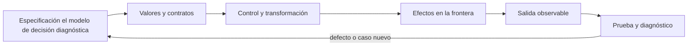
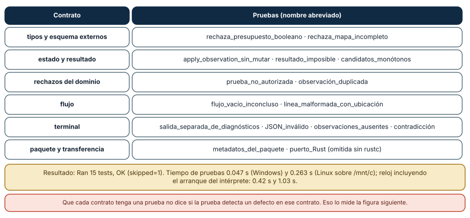
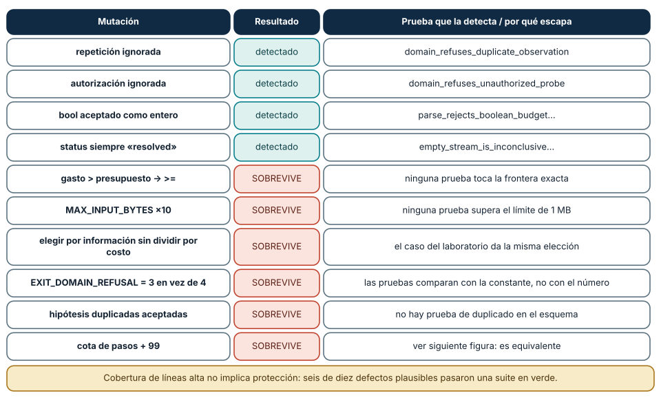
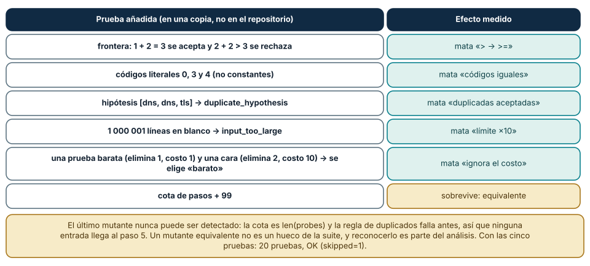

# SE-069 — Pruebas tempranas y diseño por ejemplos

[← SE-068 — Módulos, interfaces y separación de responsabilidades](../../classes/part-05-fundamentos-de-programacion/se-068-modulos-interfaces-y-separacion-de-responsabilidades/README.md) · [↑ Parte 05](../../classes/part-05-fundamentos-de-programacion/README.md) · [📚 Índice completo](../../classes/README.md) · [🌐 Portal](../../site/classes/SE-069.html) · [SE-070 — Legibilidad, nombres y mantenimiento básico →](../../classes/part-05-fundamentos-de-programacion/se-070-legibilidad-nombres-y-mantenimiento-basico/README.md)


## Punto profesional y fundamento pedagógico

**Punto profesional.** La clase existe para usar ejemplos para descubrir particiones y propiedades antes de fijar implementación.

**Por qué aparece aquí.** Se sitúa después de **Módulos, interfaces y separación de responsabilidades** y antes de **Legibilidad, nombres y mantenimiento básico**: convierte el conocimiento anterior en una decisión observable que la clase siguiente podrá reutilizar. La continuidad se comprueba en el artefacto, no por compartir vocabulario.

**Error conceptual que debe corregir.** Escribir pruebas que solo confirman casos felices ya conocidos.

**Secuencia de aprendizaje.** Antes de leer la solución, el estudiante predice el resultado del caso normal y del error conceptual anterior. Luego explica un caso resuelto paso a paso, construye un contraejemplo que cambie la decisión y, sin consultar el texto, reconstruye el mecanismo y lo aplica a una entrada nueva. La secuencia usa predicción, explicación propia, contraste y recuperación. [ICAP](https://icap.education.asu.edu/research) distingue participación de construcción de conocimiento; [How People Learn II](https://nap.nationalacademies.org/catalog/24783/how-people-learn-ii-learners-contexts-and-cultures) exige conectar conocimiento previo, contexto y transferencia; la [práctica de recuperación](https://pubmed.ncbi.nlm.nih.gov/16507066/) respalda producir de nuevo la explicación tras una demora; y [Education for Life and Work](https://nap.nationalacademies.org/resource/13398/dbasse_084153.pdf) exige devolución que explique la causa del error.

**Evidencia de aprendizaje.** Test-design.md con particiones, límites, propiedad y mutación que la suite detecta. Debe contener predicción previa, observación, explicación causal, contraejemplo, criterio de aceptación y una nota de qué dato haría cambiar la conclusión.

**Límite de la conclusión.** Una suite finita reduce riesgo; no prueba ausencia de defectos.

### Trazabilidad fuente → afirmación

| Fuente primaria u oficial | Afirmación que respalda | Lo que no prueba |
|---|---|---|
| [Python `unittest` documentation](https://docs.python.org/3/library/unittest.html) | define la semántica y los límites de la API de Python utilizada en el experimento | No demuestra por sí sola que el artefacto del estudiante sea correcto. |
| [SWEBOK Guide v4.0a](https://www.computer.org/education/bodies-of-knowledge/software-engineering) | sitúa la decisión dentro de construcción, diseño, pruebas y práctica profesional de ingeniería de software | No demuestra por sí sola que el artefacto del estudiante sea correcto. |
| [Python Tutorial](https://docs.python.org/3/tutorial/) | define la semántica y los límites de la API de Python utilizada en el experimento | No demuestra por sí sola que el artefacto del estudiante sea correcto. |

## Antes de empezar

Esta clase construye la **CLI diagnóstica**, implementación incremental de la especificación del modelo de decisión diagnóstica. Recupera `SE-068` y convierte una regla ya modelada en comportamiento ejecutable o comprobable. Trabaja en cambios pequeños: predicción, código, ejecución, evidencia y explicación. Ejecutar sin poder explicar el resultado no completa la práctica.

## Prerrequisitos

- Python 3.11 o posterior disponible como `python` o `python3`; registra la versión real.
- Terminal, editor de texto y Git; no se requieren paquetes externos.
- Comprender el contrato del modelo de decisión diagnóstica: entradas, resultados, errores e invariantes.

## Problema auténtico

La CLI diagnóstica se prueba al final con una entrada feliz. Duplicados, empate, vacío y errores de archivo reaparecen después de refactorizar. Las pruebas tempranas deben derivarse del contrato y dar retroalimentación sobre la interfaz, no congelar detalles internos.

## Objetivos observables

Al terminar podrás explicar el mecanismo del lenguaje, predecir una ejecución, implementar un caso normal y sus fronteras, diagnosticar un fallo controlado, proteger el comportamiento con evidencia y separar lo transferible de lo específico de Python.

## Mapa conceptual



El código no reemplaza la especificación: la materializa bajo reglas concretas del lenguaje y del entorno. La pregunta de esta clase es: **¿Qué ejemplo cambia una decisión de diseño y qué defecto evitará que regrese?**

## Temas y por qué importan

| Lente | Pregunta | Evidencia |
|---|---|---|
| valor | ¿qué representa y qué tipo tiene? | ejemplo inspeccionable |
| control | ¿qué camino o repetición ocurre? | traza de estados |
| contrato | ¿qué acepta, retorna y rechaza? | casos frontera |
| efecto | ¿qué cambia fuera del cálculo? | archivo o stream controlado |
| mantenimiento | ¿cómo se detecta una regresión? | prueba y diff enfocado |

## Conceptos y decisiones

### 1. Ejemplo como especificación

Un ejemplo nombra entrada, acción y resultado observable. Primero se seleccionan particiones y fronteras; después se codifica. Un ejemplo aislado no define todo el dominio, pero varios ejemplos pueden revelar vocabulario y una interfaz incómoda.

### 2. Arrange–Act–Assert

Arrange prepara el estado mínimo; Act ejecuta una sola conducta; Assert comprueba resultado relevante. Mezclar varias acciones y docenas de asserts dificulta localizar intención. Los nombres de prueba expresan condición y consecuencia.

### 3. Pruebas de valor, error y efecto

El núcleo se prueba por retorno y excepciones de contrato. Adaptadores verifican archivos temporales, stdout/stderr y códigos de salida. Simular todo produce confianza ficticia; tocar red real vuelve la prueba frágil. Se elige la frontera adecuada.

### 4. Dobles y determinismo

Un fake en memoria o función inyectada controla reloj e I/O. El doble debe respetar el contrato relevante, no duplicar implementación. Semillas, tiempo y orden se fijan cuando afectan el resultado. Una prueba flaky es una señal a diagnosticar, no a reintentar indefinidamente.

### 5. Prueba de regresión

Al corregir un defecto se añade primero el caso que falla, se verifica rojo por la razón correcta, se corrige y se conserva. Cobertura indica ejecución, no calidad de oráculos. Se priorizan decisiones y riesgos.

### Qué protege cada prueba: el mapa de contratos

La suite del laboratorio tiene 15 pruebas que, ejecutadas con `python -m unittest discover`, dieron `Ran 15 tests … OK (skipped=1)`: catorce aprobadas y la del puerto Rust omitida porque `rustc` no estaba instalado en ninguno de los dos sistemas. Las pruebas ejecutaron en 0.047 s (Windows) y 0.263 s (Linux sobre un disco montado); incluido el arranque del intérprete, 0.42 s y 1.03 s. Una suite que se ejecuta en una fracción de segundo se ejecuta antes de cada cambio, que es la propiedad que la hace útil.

Cada prueba protege un contrato concreto. `test_parse_rejects_boolean_budget…` fija la regla de tipos externos; `test_parse_rejects_incomplete_outcome_map`, el esquema; `test_apply_observation_returns_new_state_without_mutating_input`, la inmutabilidad; `test_domain_refuses_unauthorized_probe` y `…duplicate_observation`, los rechazos del dominio; `test_stream_reports_malformed_line_with_location`, el JSONL; cuatro pruebas de CLI, el contrato de salida; `test_package_metadata…`, el paquete. El nombre de cada prueba es una frase del contrato, y por eso un fallo se lee como un diagnóstico: «el dominio dejó de rechazar pruebas no autorizadas».

La estructura de cada prueba es Arrange–Act–Assert: preparar los datos (una especificación y un estado), ejecutar una sola acción (`apply_observation`) y verificar el resultado. Las pruebas del laboratorio son deterministas: no usan reloj, azar, red ni archivos compartidos (las de CLI usan archivos temporales propios), y por eso se ejecutan igual en cualquier plataforma. Un doble de prueba se justifica cuando una dependencia rompería ese determinismo; aquí `main` recibe `stdout` y `stderr` como parámetros y la prueba pasa `io.StringIO`.



**Cómo leer la figura.** Cada fila es un contrato y la columna derecha lista las pruebas que lo cubren. Las dos notas inferiores dan el resultado medido y la limitación de este mapa. **Dónde deja de valer:** el mapa dice qué prueba apunta a qué contrato, no cuán bien lo protege. Un contrato con una prueba puede seguir sin protección real, como muestra la siguiente sección.

### Mutaciones: ¿detecta la suite un defecto?

Una prueba que nunca falla no demuestra nada. Una forma de medir si detecta defectos es introducir uno a propósito (una mutación) y comprobar si la suite lo nota. Se aplicó una mutación a la vez sobre una copia del laboratorio y se ejecutó la suite completa: de diez cambios plausibles, cuatro fueron detectados y seis sobrevivieron con la suite en verde. Detectados: ignorar la repetición de pruebas, ignorar la autorización, aceptar `bool` como entero y devolver siempre `status="resolved"`. Sobrevivieron: cambiar `>` por `>=` en el chequeo del presupuesto, multiplicar por diez el límite de 1 MB, ignorar el costo al elegir la próxima prueba, hacer iguales los códigos de salida 3 y 4, aceptar hipótesis duplicadas y relajar la cota de pasos.

Los sobrevivientes son informativos. El cambio de `>` a `>=` desplaza la frontera del presupuesto: un gasto exactamente igual al presupuesto pasaría a rechazarse, y ninguna prueba toca esa frontera. El de códigos de salida sobrevive porque las pruebas comparan con la constante simbólica (`EXIT_DOMAIN_REFUSAL`) y no con el número documentado en el README: si cambia el valor, el código y la prueba cambian juntos. El límite de 1 MB nunca se supera en las pruebas. Todos son defectos que un desarrollador podría introducir sin que nadie lo vea, y el informe de cobertura de líneas no los habría señalado: las líneas se ejecutan, pero no se verifican sus bordes.

La conclusión no es que la suite esté mal, sino que «15 pruebas en verde» y «protección de los contratos» son afirmaciones distintas. Medir con mutaciones es una forma barata de poner a prueba la segunda.



**Cómo leer la figura.** Las filas verdes son mutaciones que la suite detectó; las rojas, las que pasaron sin que ninguna prueba fallara. La tercera columna dice qué prueba atrapó el cambio o por qué se escapó. **Dónde deja de valer:** son diez mutaciones elegidas a mano, no una herramienta de mutación exhaustiva (como mutmut). El resultado cuenta mutaciones concretas, no un «porcentaje de calidad» de la suite.

### Cerrar los huecos: pruebas nuevas y mutantes equivalentes

Para cada sobreviviente se escribió una prueba que lo atrapa y se comprobó que lo hacía, en una copia del laboratorio (no se modificó el repositorio). La frontera del presupuesto se cubre con dos casos: con `budget=3` y 1 gastado, la prueba `handshake` (costo 2) se acepta (1 + 2 = 3), y con 2 gastados se rechaza (2 + 2 > 3) con `budget_exceeded`. Los códigos de salida se fijan con números literales 0, 3 y 4 en tres escenarios. Las hipótesis duplicadas se prueban con `["dns", "dns", "tls"]`. El límite de tamaño se prueba con 1 000 001 líneas en blanco, que produce `input_too_large`. Y la elección por costo se prueba con dos pruebas (una elimina 1 hipótesis con costo 1 y otra elimina 2 con costo 10) y se verifica que se elige la barata: 1.0 por unidad de costo frente a 0.2. Con las cinco pruebas, la suite pasó a 20 pruebas, OK (skipped=1), y cinco de los seis sobrevivientes fueron detectados.

El sexto, la cota de pasos, no se detecta con ninguna prueba y no es un hueco: es un mutante equivalente. La cota vale `len(probes)` y la regla de repetición falla en cuanto se repite una prueba, de modo que ninguna entrada válida llega al paso `len(probes) + 1`; relajar la cota no cambia el comportamiento observable. Reconocer un mutante equivalente es parte del análisis, y la acción correcta es no escribir una prueba artificial. La cota queda como defensa en profundidad, no como regla observable.

Una prueba de regresión nace de un defecto observado: se escribe primero la entrada que lo reproduce y se confirma que falla, después se corrige. La prueba que falla antes de la corrección es la que garantiza que no se vuelve a introducir.



**Cómo leer la figura.** La columna izquierda describe la prueba añadida; la derecha, qué mutante mata. La última fila (en dorado) es el mutante que no se puede detectar y por qué. **Dónde deja de valer:** las cinco pruebas se verificaron en una copia temporal y no forman parte del laboratorio publicado (que conserva quince pruebas); son un ejercicio resuelto, no un cambio al repositorio. Detectar un mutante no prueba la ausencia de otros defectos.

## Definiciones de trabajo

- **oráculo:** criterio que decide el resultado esperado.
- **fixture:** estado preparado para una prueba.
- **doble:** sustituto controlado de un colaborador.
- **regresión:** defecto corregido que reaparece.
- **flaky:** prueba con resultado no determinista sin cambio relevante.

Estas definiciones describen el uso concreto en la CLI diagnóstica. Cuando Python permita varias conductas, el contrato del programa elige una y la hace visible con validación y pruebas.

## Ejemplo mínimo

```python
import unittest
from diagnostic_cli.domain import choose_next

class ChooseNextTests(unittest.TestCase):
    def test_returns_none_when_no_test_is_authorized(self):
        tests = [{"id": "dns", "cost": 1}]
        self.assertIsNone(choose_next([], tests, set()))

if __name__ == "__main__":
    unittest.main()
```

Escribe casos para lista vacía, una prueba autorizada, dos con distinto costo y empate por ID. Ejecuta primero contra una implementación incompleta y confirma que al menos uno falla por la regla esperada.

Ejecuta el fragmento en un archivo, no solo en una conversación interactiva. Conserva comando, versión, salida y explicación de cada línea relevante.

## Ejemplo profesional

La suite de la CLI diagnóstica separa pruebas de dominio y CLI. Usa `TemporaryDirectory`, captura stdout/stderr y ejecuta la CLI como consumidor. Cada bug recibe una regresión; las pruebas no afirman conectividad real no simulada.

El criterio profesional es que el comportamiento pueda ser consumido, diagnosticado y cambiado sin depender de conocimiento oral ni de estado oculto.

## Práctica guiada

1. deriva particiones del contrato.
2. nombra comportamiento.
3. escribe Arrange–Act–Assert.
4. observa rojo antes de corregir.
5. refactoriza conservando verde.
6. ejecuta `python -m unittest -v` cuando existan pruebas y registra el resultado exacto.

## Ejercicios

1. **Contratos:** escribe en una frase cada contrato de tu función y una prueba con nombre que la repita; verifica que el nombre se lea como un diagnóstico.
2. **Mutación manual:** aplica tres mutaciones a tu código y registra cuáles detecta tu suite; para cada sobreviviente, escribe la prueba.
3. **Equivalente:** encuentra una mutación que ningún dato puede distinguir y explica por qué no se prueba.
4. **Regresión:** reproduce un defecto con una entrada, escribe la prueba que falla y corrige; conserva la prueba.

## Reto verificable

Entrega un cambio que incluya comportamiento, caso normal, caso límite, fallo controlado y explicación. Otra persona debe poder ejecutar los comandos desde un checkout limpio y relacionar cada salida con una regla del modelo de decisión diagnóstica.

## Demostración guiada

1. Escribe la entrada y la salida esperada antes del código.
2. Ejecuta el caso mínimo y observa valores intermedios sin dejar prints permanentes en el núcleo.
3. Añade el caso frontera que obligue a decidir, no solo a teclear.
4. Introduce el fallo descrito abajo y confirma que la evidencia lo detecta.
5. Corrige, ejecuta toda la suite y revisa el diff por efectos no deseados.

## Preguntas frecuentes

### ¿Cuántas pruebas son suficientes?

No hay una cifra; importa si cada contrato y su frontera tienen una prueba que fallaría ante un defecto plausible. La mutación es una forma de comprobarlo.

### ¿Cobertura de líneas del 100% significa suite buena?

No. Mide qué líneas se ejecutaron, no qué se verificó. Los seis mutantes que sobrevivieron estaban todos en líneas ejecutadas.

### ¿Pruebas con `unittest` o `pytest`?

El laboratorio usa `unittest` de la biblioteca estándar para no instalar nada; `pytest` ofrece una sintaxis más corta. Lo que cuenta es el contrato que se verifica.

### ¿Cuándo usar un doble (mock)?

Cuando una dependencia rompe el determinismo (reloj, red, azar). Si basta pasar un `StringIO` o un valor, el doble sobra y acopla la prueba a la implementación.

## Fallo controlado y diagnóstico

Aplica en una copia del laboratorio la mutación `state.spent + probe.cost > spec.budget` → `>=`. Ejecuta la suite: todo pasa. Escribe la prueba de frontera (gasto + costo exactamente igual al presupuesto debe aceptarse) y comprueba que falla con la mutación y pasa con el código original. Repite con `EXIT_DOMAIN_REFUSAL = 4` → `3`: la suite sigue verde porque compara constantes; escribe la prueba con el número literal. Registra para cada mutante la causa del escape, la prueba que lo cierra y si es equivalente. No cambies la expectativa de una prueba existente para «hacerla pasar».

## Errores comunes y cómo corregirlos

| Síntoma | Causa | Corrección |
|---|---|---|
| la suite pasa pero un defecto llegó a producción | las pruebas no verifican las fronteras | pruebas en ambos lados de cada límite y revisión con mutaciones |
| la prueba falla al refactorizar sin cambio de comportamiento | prueba acoplada a detalles internos | probar la interfaz pública y los resultados observables |
| la prueba pasa a veces | depende de reloj, orden de ejecución o estado compartido | preparar el estado en cada prueba y eliminar la fuente de no determinismo |
| se «arregla» una prueba que falla cambiando la expectativa | se acepta el defecto en lugar de corregirlo | decidir primero si cambió la regla o el código |
| solo se prueba el caso feliz | el ejemplo se usa como especificación | casos de error, vacío y frontera derivados del contrato |

## Entorno y archivos clave

```text
work/SE-069/
├── diagnostic_cli/
│   ├── __init__.py
│   ├── domain.py
│   ├── cli.py
│   └── __main__.py
├── tests/
│   └── test_diagnostic_cli.py
└── README.md
```

No instales dependencias para resolver lo que cubre la biblioteca estándar. `README.md` conserva versión, comandos, entradas, salida, limpieza y límites. Los fragmentos son pedagógicos; intégralos solo después de entender su contrato.

### Laboratorio integrado de la Parte 05

Audita las quince pruebas de [`labs/part-05-diagnostic-cli`](https://github.com/vladimiracunadev-create/modern-software-engineering-program/tree/main/labs/part-05-diagnostic-cli) y clasifícalas como ejemplo, frontera, error, propiedad, integración o consumidor. Antes de corregir nada, agrega una regresión que falle por la razón prevista. Explica también qué no probarías: atributos privados o el orden interno de guard clauses no merecen fijarse si el contrato observable se conserva. La cobertura se argumenta por riesgos y particiones, no solo por líneas ejecutadas.

## Seguridad, ética y accesibilidad

- usa fixtures sintéticos y no incluyas tokens, rutas personales ni incidentes reales;
- limita tamaño, profundidad y tiempo de entradas no confiables;
- separa stdout parseable de stderr y redacta datos sensibles;
- ofrece mensajes accionables y no dependas solo de color;
- preserva autorización como regla del núcleo, no como checkbox de UI;
- no uses `eval`, `exec` ni construcción de shell con entrada externa.

## Puente hacia el trabajo con agentes

Las pruebas son la evidencia con la que se confía en el código que generó un agente. La lección es la de la figura: una suite en verde puede no detectar seis de diez defectos plausibles, y el código generado tiende a satisfacer las pruebas existentes más que los contratos que no están escritos. Tres controles se derivan: ante un cambio de un agente, la revisión pide pruebas en las fronteras (no solo el caso feliz); se mutan algunos cambios a mano o con herramienta para comprobar que la suite los detecta; y las pruebas de contrato (códigos de salida literales, esquemas) viven fuera del código que el agente puede reescribir libremente. Un agente que modifica el código y la prueba en el mismo cambio no ofrece evidencia independiente.

## Transferencia

Reimplementa el contrato, no la sintaxis. Identifica cómo el segundo lenguaje representa ausencia, error, mutabilidad y módulos. Conserva fixtures y resultados públicos para detectar una diferencia semántica.

## Evaluación y evidencia

| Criterio | Evidencia para aprobar |
|---|---|
| comprensión | predicción y explicación de ejecución |
| comportamiento | normal, límite e inválido según contrato |
| diseño | cálculo separado de efectos y dependencias visibles |
| diagnóstico | fallo mínimo, causa y regresión |
| reproducibilidad | versión, comandos y salidas desde checkout limpio |


## Fuentes


- [Python `unittest` documentation](https://docs.python.org/3/library/unittest.html) — define la semántica y los límites de la API de Python utilizada en el experimento.
- [SWEBOK Guide v4.0a](https://www.computer.org/education/bodies-of-knowledge/software-engineering) — sitúa la decisión dentro de construcción, diseño, pruebas y práctica profesional de ingeniería de software.
- [Python Tutorial](https://docs.python.org/3/tutorial/) — define la semántica y los límites de la API de Python utilizada en el experimento.
- [unittest.mock](https://docs.python.org/3/library/unittest.mock.html): dobles de prueba y cuándo introducen acoplamiento.
- [doctest — Test interactive Python examples](https://docs.python.org/3/library/doctest.html): ejemplos ejecutables como documentación y prueba.
- [tempfile](https://docs.python.org/3/library/tempfile.html): archivos y directorios temporales para pruebas aisladas.
- [timeit — Measure execution time of small code snippets](https://docs.python.org/3/library/timeit.html): medición reproducible de fragmentos pequeños.

La documentación oficial define el lenguaje y la biblioteca; no demuestra que la CLI diagnóstica cumpla su dominio. Esa evidencia vive en contratos, pruebas y ejecución reproducible.

## Límites y siguiente paso

Pruebas no demuestran ausencia de defectos ni sustituyen revisión y análisis. La próxima clase mejora legibilidad sin cambiar comportamiento protegido.

**Lo que no se midió.** Las diez mutaciones se eligieron a mano y no se usó una herramienta de mutación; las cinco pruebas añadidas se verificaron en una copia temporal y no se publicaron en el laboratorio. La prueba de Rust quedó omitida.

## Glosario

- **oráculo:** criterio que decide el resultado esperado.
- **fixture:** estado preparado para una prueba.
- **doble:** sustituto controlado de un colaborador.
- **regresión:** defecto corregido que reaparece.
- **flaky:** prueba con resultado no determinista sin cambio relevante.

---

[← SE-068 — Módulos, interfaces y separación de responsabilidades](../../classes/part-05-fundamentos-de-programacion/se-068-modulos-interfaces-y-separacion-de-responsabilidades/README.md) · [↑ Parte 05](../../classes/part-05-fundamentos-de-programacion/README.md) · [📚 Índice completo](../../classes/README.md) · [🌐 Portal](../../site/classes/SE-069.html) · [SE-070 — Legibilidad, nombres y mantenimiento básico →](../../classes/part-05-fundamentos-de-programacion/se-070-legibilidad-nombres-y-mantenimiento-basico/README.md)
