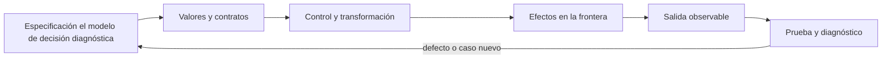
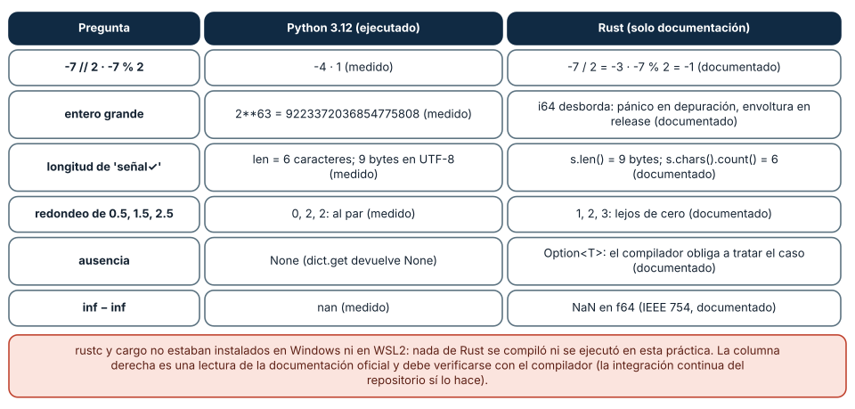
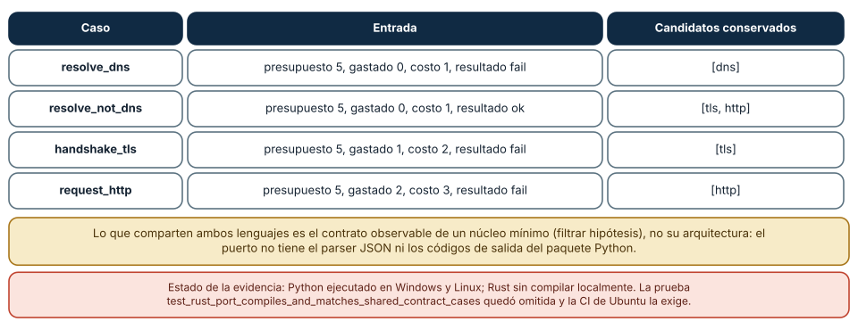
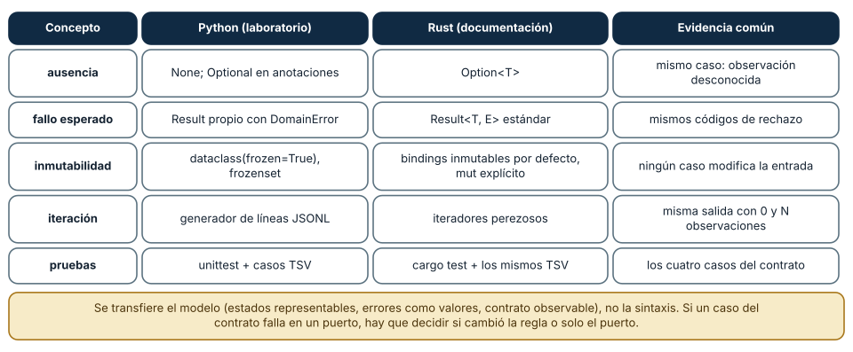

# SE-071 — Taller: transferir una solución entre lenguajes

[← SE-070 — Legibilidad, nombres y mantenimiento básico](../../classes/part-05-fundamentos-de-programacion/se-070-legibilidad-nombres-y-mantenimiento-basico/README.md) · [↑ Parte 05](../../classes/part-05-fundamentos-de-programacion/README.md) · [📚 Índice completo](../../classes/README.md) · [🌐 Portal](../../site/classes/SE-071.html) · [SE-072 — Proyecto: herramienta de línea de comandos probada →](../../classes/part-05-fundamentos-de-programacion/se-072-proyecto-herramienta-de-linea-de-comandos-probada/README.md)


## Punto profesional y fundamento pedagógico

**Punto profesional.** La clase existe para transferir una solución entre lenguajes preservando contrato y haciendo visibles diferencias semánticas.

**Por qué aparece aquí.** Se sitúa después de **Legibilidad, nombres y mantenimiento básico** y antes de **Proyecto: herramienta de línea de comandos probada**: convierte el conocimiento anterior en una decisión observable que la clase siguiente podrá reutilizar. La continuidad se comprueba en el artefacto, no por compartir vocabulario.

**Error conceptual que debe corregir.** Traducir sintaxis y declarar equivalencia.

**Secuencia de aprendizaje.** Antes de leer la solución, el estudiante predice el resultado del caso normal y del error conceptual anterior. Luego explica un caso resuelto paso a paso, construye un contraejemplo que cambie la decisión y, sin consultar el texto, reconstruye el mecanismo y lo aplica a una entrada nueva. La secuencia usa predicción, explicación propia, contraste y recuperación. [ICAP](https://icap.education.asu.edu/research) distingue participación de construcción de conocimiento; [How People Learn II](https://nap.nationalacademies.org/catalog/24783/how-people-learn-ii-learners-contexts-and-cultures) exige conectar conocimiento previo, contexto y transferencia; la [práctica de recuperación](https://pubmed.ncbi.nlm.nih.gov/16507066/) respalda producir de nuevo la explicación tras una demora; y [Education for Life and Work](https://nap.nationalacademies.org/resource/13398/dbasse_084153.pdf) exige devolución que explique la causa del error.

**Evidencia de aprendizaje.** Semantic-contrast.md con ausencia, error, mutabilidad, orden y pruebas comunes. Debe contener predicción previa, observación, explicación causal, contraejemplo, criterio de aceptación y una nota de qué dato haría cambiar la conclusión.

**Límite de la conclusión.** Una comparación de dos lenguajes no establece superioridad general.

### Trazabilidad fuente → afirmación

| Fuente primaria u oficial | Afirmación que respalda | Lo que no prueba |
|---|---|---|
| [The Rust Programming Language](https://doc.rust-lang.org/stable/book/) | documenta ownership, tipos de error, traits y concurrencia usados como contraste semántico | No demuestra por sí sola que el artefacto del estudiante sea correcto. |
| [Python Tutorial](https://docs.python.org/3/tutorial/) | define la semántica y los límites de la API de Python utilizada en el experimento | No demuestra por sí sola que el artefacto del estudiante sea correcto. |
| [Python `unittest` documentation](https://docs.python.org/3/library/unittest.html) | define la semántica y los límites de la API de Python utilizada en el experimento | No demuestra por sí sola que el artefacto del estudiante sea correcto. |

## Antes de empezar

Esta clase construye la **CLI diagnóstica**, implementación incremental de la especificación del modelo de decisión diagnóstica. Recupera `SE-070` y convierte una regla ya modelada en comportamiento ejecutable o comprobable. Trabaja en cambios pequeños: predicción, código, ejecución, evidencia y explicación. Ejecutar sin poder explicar el resultado no completa la práctica.

## Prerrequisitos

- Python 3.11 o posterior disponible como `python` o `python3`; registra la versión real.
- Terminal, editor de texto y Git; no se requieren paquetes externos.
- Comprender el contrato del modelo de decisión diagnóstica: entradas, resultados, errores e invariantes.

## Problema auténtico

El taller traslada `choose_next` de Python a Rust. Una traducción línea por línea ignora ownership, `Option`, `Result`, iteradores y tipos; una reescritura libre puede cambiar empate y errores. La transferencia debe preservar contrato y pruebas mientras adopta mecanismos idiomáticos.

## Objetivos observables

Al terminar podrás explicar el mecanismo del lenguaje, predecir una ejecución, implementar un caso normal y sus fronteras, diagnosticar un fallo controlado, proteger el comportamiento con evidencia y separar lo transferible de lo específico de Python.

## Mapa conceptual



El código no reemplaza la especificación: la materializa bajo reglas concretas del lenguaje y del entorno. La pregunta de esta clase es: **¿Qué pertenece al problema y qué pertenecía accidentalmente al lenguaje?**

## Temas y por qué importan

| Lente | Pregunta | Evidencia |
|---|---|---|
| valor | ¿qué representa y qué tipo tiene? | ejemplo inspeccionable |
| control | ¿qué camino o repetición ocurre? | traza de estados |
| contrato | ¿qué acepta, retorna y rechaza? | casos frontera |
| efecto | ¿qué cambia fuera del cálculo? | archivo o stream controlado |
| mantenimiento | ¿cómo se detecta una regresión? | prueba y diff enfocado |

## Conceptos y decisiones

### 1. Semántica antes que sintaxis

Primero se congela entrada, salida, orden de empate, errores y casos. Luego se busca una representación equivalente. `None` puede mapear a `Option`; excepción recuperable a `Result`; dict heterogéneo a struct. La equivalencia se juzga por comportamiento, no por parecido textual.

### 2. Tipos y estados representables

Python permite estructuras incompletas hasta validarlas en ejecución. Rust puede usar enum para resultados y struct para registros, haciendo imposibles combinaciones. Ese beneficio exige decidir ownership y conversiones en fronteras.

### 3. Mutabilidad y ownership

En Python varios nombres pueden referir al mismo objeto mutable. Rust controla préstamos y movimiento en compilación. Copiar listas para silenciar el compilador puede ser costoso; se elige préstamo cuando la función solo lee y ownership cuando debe conservar o transformar.

### 4. Iteradores y control

Una comprensión Python y una cadena de iteradores Rust pueden expresar filtrar y mínimo. La versión idiomática sigue siendo legible si cada etapa representa una regla. No se comprime el código hasta perder el lugar de validación o el criterio de desempate.

### 5. Pruebas comunes

Un fixture JSON válido para ambos lenguajes y una tabla de resultados forman el oráculo compartido. Se comparan salida normalizada y errores de contrato. Diferencias de formato de traceback o mensaje interno no deben congelarse como equivalencia.

### La semántica cambia aunque la sintaxis se parezca

Transferir una solución a otro lenguaje no es traducir sintaxis. Seis diferencias concretas separan Python de Rust. Con enteros negativos, Python midió `-7 // 2 = -4` y `-7 % 2 = 1` (cociente hacia menos infinito, resto con el signo del divisor); según la documentación de Rust, `-7 / 2` es `-3` y `-7 % 2` es `-1` (cociente truncado hacia cero). Con enteros grandes, Python permite `2**63 = 9223372036854775808` porque su `int` crece; en Rust, `i64` tiene rango fijo y el desbordamiento provoca un pánico en compilaciones de depuración y una envoltura en las de release.

Con texto, `len('señal✓')` fue 6 (caracteres) y los bytes UTF-8 fueron 9; en Rust, `str::len()` devuelve bytes (9) y `chars().count()` caracteres (6), de modo que el mismo nombre de método cuenta cosas distintas. El redondeo de 0.5, 1.5 y 2.5 dio 0, 2 y 2 en Python (al par); `f64::round` de Rust redondea lejos de cero y daría 1, 2 y 3. Para la ausencia, `dict.get` devuelve `None` y el programa solo falla si alguien lo usa; `Option<T>` obliga al compilador a exigir el tratamiento del caso. Y `inf - inf` es `nan` en ambos por IEEE 754.

Un contrato compartido protege contra estas diferencias porque fija el comportamiento observable en lugar de la sintaxis. El laboratorio usa cuatro casos TSV con presupuesto, gasto, costo, resultados y el conjunto esperado de candidatos: ambos lenguajes deben producir los mismos candidatos para cada fila. Una discrepancia obliga a decidir si cambió la regla o solo el puerto.

**Alcance de la evidencia.** `rustc` y `cargo` no estaban instalados en Windows ni en WSL2: nada de Rust se compiló ni se ejecutó en esta práctica. Las afirmaciones sobre Rust son lecturas de su documentación oficial, señaladas como tales; la integración continua del repositorio compila el puerto en Ubuntu y es la evidencia que lo respalda.



**Cómo leer la figura.** La columna central es lo ejecutado en Python 3.12; la derecha, lo que la documentación de Rust establece, sin haberse ejecutado. Donde difieren, un puerto necesita una prueba que lo fije. **Dónde deja de valer:** la columna de Rust no se ejecutó en esta práctica (sin compilador disponible). Rust y Python también difieren en modelo de memoria, concurrencia y tiempo de compilación, que esta tabla no cubre.

### El contrato común: cuatro casos y un puerto mínimo

El archivo `cases/contract-cases.tsv` tiene cuatro casos con las columnas `case_id|budget|candidates|spent|test_cost|outcomes|result`. Una referencia en Python escrita para esta práctica (filtrar los candidatos cuyo resultado coincide con el observado y comprobar `gastado + costo ≤ presupuesto`) los reprodujo: `resolve_dns` deja `[dns]`, `resolve_not_dns` deja `[tls, http]`, `handshake_tls` deja `[tls]` y `request_http` deja `[http]`, y en los cuatro el costo cabía en el presupuesto. Es el mismo contrato que el puerto Rust debe cumplir.

El puerto (`ports/diagnostic_core.rs`) tiene 42 líneas, usa `enum`, no usa `Option` ni `Result`, no declara `mut` ni `unsafe`. Es un núcleo mínimo de filtrado sobre fixtures TSV, y no incluye el parser JSON ni los códigos de salida del paquete Python. Esta diferencia es deliberada y honesta: lo que se transfiere es el contrato observable de una pieza, no el paquete entero ni su arquitectura. Un puerto fiel de todo el paquete exigiría decisiones propias (por ejemplo, `Result<T, E>` en lugar de la clase `Result`, y un tipo de error con variantes).

La prueba `test_rust_port_compiles_and_matches_shared_contract_cases` compila el puerto con `rustc` y compara su salida con el TSV; en esta práctica quedó omitida (`skipped`) por la ausencia del compilador, y la CI en Ubuntu la exige. Una prueba omitida no es una prueba aprobada: el informe debe decir «Python ejecutado en dos plataformas, Rust no compilado localmente».



**Cómo leer la figura.** Cada fila es un caso del archivo TSV; la columna derecha es el resultado de la referencia en Python. El puerto Rust debe devolver los mismos conjuntos. **Dónde deja de valer:** la referencia en Python se escribió para esta práctica y es equivalente a la regla de filtrado, no al motor completo. Cuatro casos cubren las ramas principales pero no todas las fronteras (presupuesto exacto, conjunto vacío).

### Qué se transfiere y qué se reescribe

Del laboratorio salen cinco ideas que sobreviven al cambio de lenguaje, cada una con una construcción distinta. La *ausencia* es `None` en Python y `Option<T>` en Rust. El *fallo esperado* es un `Result` propio con `DomainError` en Python y el `Result<T, E>` estándar en Rust. La *inmutabilidad* es `dataclass(frozen=True)` y `frozenset` en Python y bindings inmutables por defecto, con `mut` explícito, en Rust. La *iteración* es un generador de líneas JSONL en Python y un iterador perezoso en Rust. Las *pruebas* son `unittest` más TSV en Python y `cargo test` más los mismos TSV en Rust.

Lo que cambia más es la propiedad de los datos. En Python, el aliasing se evita por convención e inmutabilidad (se midió que `b = a` enlaza el mismo objeto); en Rust, el compilador impone que un valor tenga un dueño y que haya o bien un préstamo mutable o varios inmutables, de modo que una clase de defectos de SE-061 y SE-066 no compila. Los errores muestran lo mismo: lo que Python deja para la ejecución (un `KeyError`, una lista compartida), Rust lo mueve a la compilación. A cambio, el compilador exige representar los estados con más precisión.

La transferencia se verifica con evidencia común: mismos casos TSV, mismos códigos de rechazo, mismas fronteras. Si el segundo lenguaje necesita un caso extra (el desbordamiento de enteros no existe en Python), ese caso se agrega a la tabla compartida. El orden de trabajo es: contrato, casos, puerto mínimo, comparación, y solo después ampliar.



**Cómo leer la figura.** Cada fila es un concepto del laboratorio. Las tres columnas de la derecha responden: cómo lo hace Python aquí, cómo lo haría Rust según su documentación y qué evidencia debe ser la misma. **Dónde deja de valer:** la columna de Rust describe construcciones documentadas, no una implementación ejecutada. Un puerto a otro lenguaje (Go, TypeScript) tendría su propia fila para cada concepto.

## Definiciones de trabajo

- **semántica:** comportamiento y significado observable.
- **idiomático:** alineado con convenciones y mecanismos del lenguaje.
- **ownership:** reglas sobre posesión y vida de valores en Rust.
- **Option:** tipo Rust para presencia o ausencia.
- **equivalencia funcional:** mismo resultado contractual para casos compartidos.

Estas definiciones describen el uso concreto en la CLI diagnóstica. Cuando Python permita varias conductas, el contrato del programa elige una y la hace visible con validación y pruebas.

## Ejemplo mínimo

```python
# Python
def choose_next(tests, authorized):
    eligible = (t for t in tests if t["id"] in authorized)
    return min(eligible, key=lambda t: (t["cost"], t["id"]), default=None)

// Rust: la firma hace explícita la ausencia
fn choose_next<'a>(tests: &'a [Test], authorized: &HashSet<String>) -> Option<&'a Test>
```

Define tres fixtures compartidos: sin elegibles, un elegible y empate. Escribe la firma Python y Rust y explica cómo se representa ausencia, lectura y error inválido.

Ejecuta el fragmento en un archivo, no solo en una conversación interactiva. Conserva comando, versión, salida y explicación de cada línea relevante.

## Ejemplo profesional

El taller ejecuta el mismo archivo de casos en ambas implementaciones y compara JSON canónico. Un documento separa equivalencia funcional, diferencias de tipos, costo y experiencia de mantenimiento. No declara un lenguaje ganador universal.

El criterio profesional es que el comportamiento pueda ser consumido, diagnosticado y cambiado sin depender de conocimiento oral ni de estado oculto.

## Práctica guiada

1. congela contrato y fixtures.
2. identifica rasgos Python accidentales.
3. diseña tipos Rust.
4. implementa o bosqueja versión idiomática.
5. compara resultados y límites.
6. ejecuta `python -m unittest -v` cuando existan pruebas y registra el resultado exacto.

## Ejercicios

1. **Tabla de diferencias:** completa para otro lenguaje que conozcas las seis filas de la figura 1 y marca cuáles verificaste ejecutando.
2. **Caso compartido:** añade un caso al TSV con un presupuesto exacto igual al gasto más el costo; decide el resultado esperado y justifícalo con el contrato.
3. **Mínimo:** implementa el filtrado de los cuatro casos en un tercer lenguaje o en pseudocódigo y compara con la columna de la referencia.
4. **Informe:** redacta cuatro líneas que distingan plataforma verificada, prueba omitida y capacidad no implementada.

## Reto verificable

Entrega un cambio que incluya comportamiento, caso normal, caso límite, fallo controlado y explicación. Otra persona debe poder ejecutar los comandos desde un checkout limpio y relacionar cada salida con una regla del modelo de decisión diagnóstica.

## Demostración guiada

1. Escribe la entrada y la salida esperada antes del código.
2. Ejecuta el caso mínimo y observa valores intermedios sin dejar prints permanentes en el núcleo.
3. Añade el caso frontera que obligue a decidir, no solo a teclear.
4. Introduce el fallo descrito abajo y confirma que la evidencia lo detecta.
5. Corrige, ejecuta toda la suite y revisa el diff por efectos no deseados.

## Preguntas frecuentes

### ¿Por qué reescribir en otro lenguaje si funciona en Python?

Por restricciones del entorno (rendimiento, despliegue, plataforma), no por moda. El ejercicio de transferir enseña qué parte del diseño era del lenguaje y cuál del problema.

### ¿Se traduce línea por línea?

No. Se transfiere el contrato y los casos, y cada lenguaje lo expresa con sus propios mecanismos de errores, ausencia y propiedad.

### ¿Qué pasa si solo tengo Python instalado?

Ejecutas lo que puedes y declaras lo que no. En esta práctica se ejecutó Python en dos plataformas y se declaró que Rust no se compiló.

### ¿Basta con que los casos TSV pasen?

Prueban el contrato que contienen: cuatro casos no cubren todas las fronteras. Añadir casos es la forma de ampliar lo que se garantiza.

## Fallo controlado y diagnóstico

Elige una diferencia semántica y haz que falle una transferencia ingenua. Por ejemplo, calcula `-7 % 2` en Python (1) y escribe la expectativa «resto 1» como contrato. Un puerto a un lenguaje con resto truncado devolverá -1 y la prueba compartida lo detecta. Añade el caso a una tabla común con el valor esperado y una nota («división entera hacia menos infinito»). Después altera un caso TSV del laboratorio (cambia un candidato esperado) y comprueba que la referencia en Python y, donde haya compilador, el puerto Rust dejan de coincidir; decide si cambió la regla o solo el puerto. Si no tienes `rustc`, registra «no compilado» en lugar de afirmar el resultado.

## Errores comunes y cómo corregirlos

| Síntoma | Causa | Corrección |
|---|---|---|
| el puerto da un resultado distinto con números negativos | división y resto con semántica distinta | casos compartidos con negativos y su valor esperado |
| la longitud de un texto no coincide | caracteres frente a bytes | decidir qué se cuenta y fijar un caso con acentos |
| «funciona» en el segundo lenguaje pero falla un caso del contrato | se tradujo la sintaxis sin el contrato | ejecutar los mismos casos en ambos |
| se afirma que el puerto es correcto sin compilarlo | una prueba omitida se cuenta como aprobada | declarar «omitida» y quién la ejecuta |
| se copia la arquitectura de Python en otro lenguaje | se ignoran las herramientas del lenguaje (errores como valores, propiedad) | reexpresar el modelo con las construcciones del lenguaje destino |

## Entorno y archivos clave

```text
work/SE-071/
├── diagnostic_cli/
│   ├── __init__.py
│   ├── domain.py
│   ├── cli.py
│   └── __main__.py
├── tests/
│   └── test_diagnostic_cli.py
└── README.md
```

No instales dependencias para resolver lo que cubre la biblioteca estándar. `README.md` conserva versión, comandos, entradas, salida, limpieza y límites. Los fragmentos son pedagógicos; intégralos solo después de entender su contrato.

### Laboratorio integrado de la Parte 05

Compila `ports/diagnostic_core.rs` de [`labs/part-05-diagnostic-cli`](https://github.com/vladimiracunadev-create/modern-software-engineering-program/tree/main/labs/part-05-diagnostic-cli) y ejecútalo contra `contract-cases.tsv`. Compara con Python tipos numéricos, ownership del texto, `HashMap`, errores y código de salida. Las cuatro fixtures deben producir el mismo contrato observable, pero no copies clases ni arquitectura línea por línea. Declara qué quedó fuera del puerto —parser JSON, streaming y empaquetado— para no confundir equivalencia parcial con portabilidad total.

## Seguridad, ética y accesibilidad

- usa fixtures sintéticos y no incluyas tokens, rutas personales ni incidentes reales;
- limita tamaño, profundidad y tiempo de entradas no confiables;
- separa stdout parseable de stderr y redacta datos sensibles;
- ofrece mensajes accionables y no dependas solo de color;
- preserva autorización como regla del núcleo, no como checkbox de UI;
- no uses `eval`, `exec` ni construcción de shell con entrada externa.

## Puente hacia el trabajo con agentes

Los agentes traducen código entre lenguajes constantemente, y lo hacen con fluidez: el resultado suele compilar y parecer correcto. Esta clase explica por qué eso no basta. Un agente que porta `-7 % 2` a otro lenguaje puede conservar la sintaxis y cambiar la semántica sin que nada falle. Dos controles se derivan: el contrato compartido (casos con entradas negativas, vacías y de frontera, y salidas esperadas) debe existir antes de la traducción y debe ejecutarse en ambos lenguajes como criterio de aceptación; y el informe del agente tiene que separar lo ejecutado de lo supuesto, como hace esta práctica con Rust. Aceptar «traducido» sin evidencia equivalente es aceptar una afirmación sin prueba.

## Transferencia

Reimplementa el contrato, no la sintaxis. Identifica cómo el segundo lenguaje representa ausencia, error, mutabilidad y módulos. Conserva fixtures y resultados públicos para detectar una diferencia semántica.

## Evaluación y evidencia

| Criterio | Evidencia para aprobar |
|---|---|
| comprensión | predicción y explicación de ejecución |
| comportamiento | normal, límite e inválido según contrato |
| diseño | cálculo separado de efectos y dependencias visibles |
| diagnóstico | fallo mínimo, causa y regresión |
| reproducibilidad | versión, comandos y salidas desde checkout limpio |


## Fuentes


- [The Rust Programming Language](https://doc.rust-lang.org/stable/book/) — documenta ownership, tipos de error, traits y concurrencia usados como contraste semántico.
- [Python Tutorial](https://docs.python.org/3/tutorial/) — define la semántica y los límites de la API de Python utilizada en el experimento.
- [Python `unittest` documentation](https://docs.python.org/3/library/unittest.html) — define la semántica y los límites de la API de Python utilizada en el experimento.
- [The Rust Programming Language — Ownership](https://doc.rust-lang.org/stable/book/ch04-00-understanding-ownership.html): propiedad, préstamos y por qué el aliasing mutable no compila.
- [The Rust Programming Language — Error Handling](https://doc.rust-lang.org/stable/book/ch09-00-error-handling.html): `Result` y `Option` frente a excepciones.
- [The Rust Programming Language — Data Types](https://doc.rust-lang.org/stable/book/ch03-02-data-types.html): enteros con tamaño fijo y desbordamiento.
- [Rust std — primitive i32](https://doc.rust-lang.org/std/primitive.i32.html): división y resto con signo en enteros de Rust.
- [The Rust Programming Language — Iterators](https://doc.rust-lang.org/stable/book/ch13-02-iterators.html): iteradores perezosos.
- [The Rust Programming Language — Testing](https://doc.rust-lang.org/stable/book/ch11-00-testing.html): pruebas con `cargo test`.

La documentación oficial define el lenguaje y la biblioteca; no demuestra que la CLI diagnóstica cumpla su dominio. Esa evidencia vive en contratos, pruebas y ejecución reproducible.

## Límites y siguiente paso

El taller no enseña Rust completo ni compara rendimiento con un microbenchmark. El proyecto final integra el recorrido en una CLI Python probada.

**Lo que no se midió.** `rustc` y `cargo` no estaban disponibles: el puerto Rust no se compiló ni se ejecutó, y todas las afirmaciones sobre Rust son lecturas de su documentación oficial. No se probaron otros lenguajes destino.

## Glosario

- **semántica:** comportamiento y significado observable.
- **idiomático:** alineado con convenciones y mecanismos del lenguaje.
- **ownership:** reglas sobre posesión y vida de valores en Rust.
- **Option:** tipo Rust para presencia o ausencia.
- **equivalencia funcional:** mismo resultado contractual para casos compartidos.

---

[← SE-070 — Legibilidad, nombres y mantenimiento básico](../../classes/part-05-fundamentos-de-programacion/se-070-legibilidad-nombres-y-mantenimiento-basico/README.md) · [↑ Parte 05](../../classes/part-05-fundamentos-de-programacion/README.md) · [📚 Índice completo](../../classes/README.md) · [🌐 Portal](../../site/classes/SE-071.html) · [SE-072 — Proyecto: herramienta de línea de comandos probada →](../../classes/part-05-fundamentos-de-programacion/se-072-proyecto-herramienta-de-linea-de-comandos-probada/README.md)
