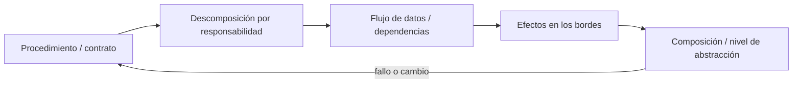
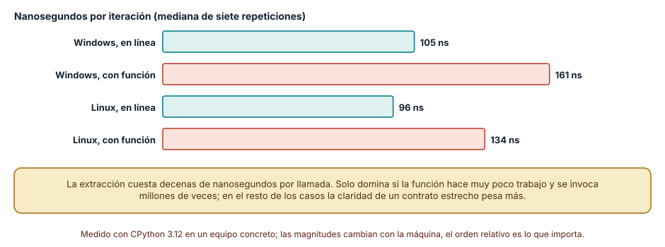
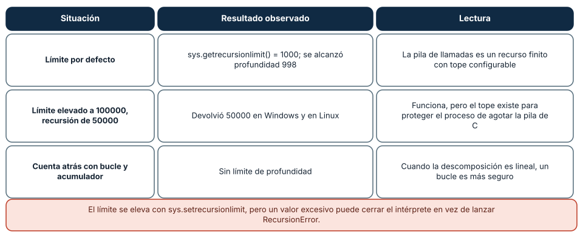
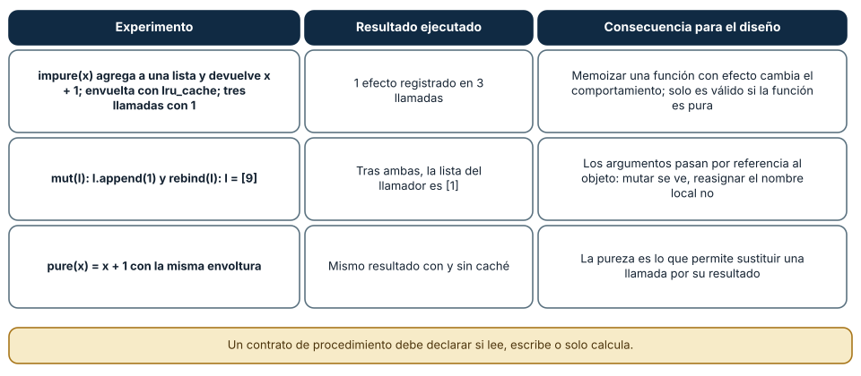

# SE-074 — Programación procedural y descomposición funcional

[← SE-073 — Programación imperativa y estado mutable](../../classes/part-06-paradigmas-de-programacion/se-073-programacion-imperativa-y-estado-mutable/README.md) · [↑ Parte 06](../../classes/part-06-paradigmas-de-programacion/README.md) · [📚 Índice completo](../../classes/README.md) · [🌐 Portal](../../site/classes/SE-074.html) · [SE-075 — Orientación a objetos, mensajes y encapsulación →](../../classes/part-06-paradigmas-de-programacion/se-075-orientacion-a-objetos-mensajes-y-encapsulacion/README.md)


## Punto profesional y fundamento pedagógico

**Punto profesional.** La clase existe para descomponer procedimientos por contratos y efectos, no solo por longitud.

**Por qué aparece aquí.** Se sitúa después de **Programación imperativa y estado mutable** y antes de **Orientación a objetos, mensajes y encapsulación**: convierte el conocimiento anterior en una decisión observable que la clase siguiente podrá reutilizar. La continuidad se comprueba en el artefacto, no por compartir vocabulario.

**Error conceptual que debe corregir.** Extraer funciones que comparten estado implícito y llamar a eso modularidad.

**Secuencia de aprendizaje.** Antes de leer la solución, el estudiante predice el resultado del caso normal y del error conceptual anterior. Luego explica un caso resuelto paso a paso, construye un contraejemplo que cambie la decisión y, sin consultar el texto, reconstruye el mecanismo y lo aplica a una entrada nueva. La secuencia usa predicción, explicación propia, contraste y recuperación. [ICAP](https://icap.education.asu.edu/research) distingue participación de construcción de conocimiento; [How People Learn II](https://nap.nationalacademies.org/catalog/24783/how-people-learn-ii-learners-contexts-and-cultures) exige conectar conocimiento previo, contexto y transferencia; la [práctica de recuperación](https://pubmed.ncbi.nlm.nih.gov/16507066/) respalda producir de nuevo la explicación tras una demora; y [Education for Life and Work](https://nap.nationalacademies.org/resource/13398/dbasse_084153.pdf) exige devolución que explique la causa del error.

**Evidencia de aprendizaje.** Procedure-contracts.md con entradas, salidas, efectos y orden permitido. Debe contener predicción previa, observación, explicación causal, contraejemplo, criterio de aceptación y una nota de qué dato haría cambiar la conclusión.

**Límite de la conclusión.** La descomposición procedural no elimina acoplamiento de datos.

### Trazabilidad fuente → afirmación

| Fuente primaria u oficial | Afirmación que respalda | Lo que no prueba |
|---|---|---|
| [Python Language Reference](https://docs.python.org/3/reference/) | Semántica de sentencias, funciones, clases, generadores y corrutinas; autoridad: Python Software Foundation | No demuestra por sí sola que el artefacto del estudiante sea correcto. |
| [SWEBOK Guide v4.0a](https://www.computer.org/education/bodies-of-knowledge/software-engineering) | Construcción, diseño y fundamentos profesionales; autoridad: IEEE Computer Society | No demuestra por sí sola que el artefacto del estudiante sea correcto. |

## Antes de empezar

Esta clase continúa el **motor de reglas comparado de la Parte 06**. Recupera la evidencia de la clase anterior, añade una decisión propia de **Programación procedural y descomposición funcional** y deja un artefacto que la clase siguiente deberá consumir. La pregunta activa es: **¿Dónde cortar un procedimiento para que cada paso tenga un contrato comprobable?**

## Prerrequisitos

- Haber completado la clase anterior o reconstruir su contrato y evidencia.
- Python 3.11 o posterior, terminal, editor y Git; un segundo runtime es opcional y debe declararse.
- Trabajar con fixtures sintéticos: ninguna observación necesita datos de una persona o sistema real.

## Problema auténtico

El prototipo del motor de reglas comparado valida, puntúa, selecciona y formatea dentro de una función extensa. Reutilizar la regla desde una API obliga a ejecutar también salida de terminal y las pruebas solo pueden observar el resultado final.

## Objetivos observables

Al terminar podrás explicar los cinco mecanismos de esta clase, predecir su comportamiento antes de ejecutar, construir un caso normal y uno límite, diagnosticar el fallo controlado, comparar una alternativa y entregar evidencia que otra persona pueda reproducir.

## Mapa conceptual



El mapa se lee como una cadena de razonamiento, no como fases obligatorias del runtime. La flecha de retorno indica que un fallo o cambio de requisito obliga a revisar el modelo inicial; no autoriza a parchear solo la última salida.

## Temas y por qué importan

| Tema | Por qué cambia una decisión profesional | Evidencia mínima |
|---|---|---|
| Procedimiento y contrato | Un procedimiento agrupa una secuencia bajo un nombre y una interfaz. | Predicción, traza causal y contraejemplo de **Procedimiento y contrato** en `procedure-contracts.md` |
| Descomposición por responsabilidad | Separar parseo, validación, decisión y presentación permite cambiar una razón sin arrastrar las demás. | Predicción, traza causal y contraejemplo de **Descomposición por responsabilidad** en `procedure-contracts.md` |
| Flujo de datos y dependencias | Los parámetros hacen visibles entradas; el retorno hace visible el resultado. | Predicción, traza causal y contraejemplo de **Flujo de datos y dependencias** en `procedure-contracts.md` |
| Efectos en los bordes | El núcleo calcula una recomendación y los adaptadores leen JSON o escriben texto. | Predicción, traza causal y contraejemplo de **Efectos en los bordes** en `procedure-contracts.md` |
| Composición y nivel de abstracción | Una función coordinadora debe leerse como una historia del dominio: validar, evaluar, elegir, presentar. | Predicción, traza causal y contraejemplo de **Composición y nivel de abstracción** en `procedure-contracts.md` |
## Conceptos y decisiones

### 1. Procedimiento y contrato

Un procedimiento agrupa una secuencia bajo un nombre y una interfaz. Su valor no está en reducir líneas, sino en establecer qué recibe, qué devuelve, qué puede modificar y qué error comunica. Un procedimiento sin contrato solo desplaza la complejidad detrás de una llamada.

### 2. Descomposición por responsabilidad

Separar parseo, validación, decisión y presentación permite cambiar una razón sin arrastrar las demás. Cortar por cantidad de líneas produce piezas arbitrarias; cortar por transformación y política produce unidades que pueden explicarse y probarse con ejemplos propios.

### 3. Flujo de datos y dependencias

Los parámetros hacen visibles entradas; el retorno hace visible el resultado. Leer globales o escribir streams desde funciones de dominio crea canales ocultos. Pasar cada dependencia tampoco es una virtud automática: una estructura de contexto puede ser adecuada si su contenido y vida están delimitados.

### 4. Efectos en los bordes

El núcleo calcula una recomendación y los adaptadores leen JSON o escriben texto. Esta separación permite repetir la decisión sin repetir un efecto. El límite falla cuando una función supuestamente pura consulta el reloj, el entorno o un singleton sin declararlo.

### 5. Composición y nivel de abstracción

Una función coordinadora debe leerse como una historia del dominio: validar, evaluar, elegir, presentar. Si mezcla detalles de bytes con reglas de autorización, obliga a razonar en dos niveles a la vez. La descomposición correcta conserva cohesión y evita una cadena de envoltorios triviales.

### Cuánto cuesta separar una función

Extraer un trozo de código a una función tiene un costo de ejecución fijo por llamada: preparar argumentos, crear un marco de pila, retornar. En el microbenchmark de la clase, el mismo bucle de cien iteraciones tardó unos 105 ns por iteración con el cuerpo en línea y unos 161 ns llamando a una función en Windows (un 54 % más); en Linux fueron 96 ns y 134 ns (un 40 % más). Es una diferencia de decenas de nanosegundos por llamada, invisible en un programa que llama a la función miles de veces y relevante en un bucle interno que lo hace cientos de millones.

La conclusión profesional no es «no extraigas funciones», sino que la descomposición se paga y se justifica por otra cosa: un nombre que explica la intención, un contrato que se puede probar de forma aislada y un único lugar donde corregir un error. Se mide antes de deshacer una abstracción por rendimiento, y solo en el camino caliente que el perfilador señale.



**Cómo leer la figura.** Las barras teal son el bucle en línea y las coral el mismo bucle con una función de una línea; la diferencia entre cada par es el costo de llamar. **Dónde deja de valer:** CPython interpreta bytecode y paga cada llamada de forma visible; en lenguajes compilados con inlining (Rust, C++ con optimización) la llamada puede desaparecer por completo. Tampoco incluye el costo de pasar objetos grandes, que son referencias y no se copian.

### La recursión es una descomposición con un tope

Descomponer un problema en uno más pequeño del mismo tipo es natural para recorrer árboles y expresiones, pero cada nivel consume un marco de pila. CPython limita la profundidad: `sys.getrecursionlimit()` devolvió 1000 y una recursión sin salida se detuvo en la profundidad 998 con `RecursionError`, en ambos sistemas. Elevar el límite con `sys.setrecursionlimit(100000)` permitió una cuenta atrás recursiva de 50 000 niveles, pero el límite existe para proteger el proceso de agotar la pila de C: con valores excesivos el intérprete puede terminar abruptamente en lugar de lanzar una excepción manejable.

Cuando la descomposición es lineal (cuenta atrás, sumas, recorridos de listas), un bucle con acumulador es más seguro y no depende del límite. Cuando es arborescente y de profundidad acotada por los datos (un árbol de decisión de pocos niveles), la recursión es la forma más clara. La decisión depende de si la profundidad máxima es conocida y pequeña.



**Cómo leer la figura.** Cada fila es una configuración y lo que ocurrió; la última muestra la alternativa sin pila. **Dónde deja de valer:** el valor de 998 niveles depende de la versión de CPython y de lo que ya hay en la pila al empezar; otros lenguajes optimizan la recursión de cola (Scheme lo garantiza) y CPython no lo hace. El experimento no mide cuánta memoria consume cada marco.

### Efectos ocultos: lo que una función promete y lo que hace

Un procedimiento con contrato estrecho declara qué lee, qué escribe y qué devuelve. Dos experimentos muestran qué se rompe cuando el contrato miente. Primero, una función `impure(x)` que añade a una lista y devuelve `x + 1`, envuelta con `functools.lru_cache`, ejecutó su efecto una sola vez en tres llamadas con el mismo argumento: la memoización sustituye la llamada por su resultado, y eso solo es válido si la llamada no tenía efectos. Segundo, los argumentos de una función son referencias a objetos: `mut(l)` con `l.append(1)` cambió la lista del llamador, y `rebind(l)` con `l = [9]` no, porque reasignó el nombre local. Quien lee solo la firma no puede saber cuál de las dos ocurre.



**Cómo leer la figura.** La primera columna es el experimento, la segunda el resultado ejecutado y la tercera la consecuencia para el diseño. **Dónde deja de valer:** son efectos sobre una lista en memoria; los efectos de E/S, de reloj o de red añaden aleatoriedad y fallos que esta clase no ejecuta. La idea que sí generaliza es que la pureza es una propiedad verificable del contrato, no del tamaño de la función.

## Definiciones de trabajo

- **procedimiento y contrato:** un procedimiento agrupa una secuencia bajo un nombre y una interfaz.
- **descomposición por responsabilidad:** separar parseo, validación, decisión y presentación permite cambiar una razón sin arrastrar las demás.
- **flujo de datos y dependencias:** los parámetros hacen visibles entradas; el retorno hace visible el resultado.
- **efectos en los bordes:** el núcleo calcula una recomendación y los adaptadores leen json o escriben texto.
- **composición y nivel de abstracción:** una función coordinadora debe leerse como una historia del dominio: validar, evaluar, elegir, presentar.

Las definiciones son operativas para el motor de reglas comparado. No convierten términos con historia más amplia en sinónimos y deben contrastarse con la documentación primaria enlazada al final.

## Ejemplo mínimo

```python
def choose_next(observation):
    checked = validate(observation)
    candidates = evaluate_rules(checked)
    return select_highest(candidates)

assert choose_next({"authorized": True, "latency_ms": 850}) == "inspect-transport"
```

Antes de ejecutar, predice estado, resultado y error. Después registra versión, comando y salida. Si el fragmento es pseudocódigo o pertenece a otro lenguaje, etiquétalo como tal y no afirmes que fue ejecutado.

## Ejemplo profesional

En el motor de reglas comparado, una recomendación contiene acción, evidencia usada, versión de política y explicación. La implementación de esta clase debe conservar ese contrato aunque cambie la forma interna. El caso profesional no pregunta únicamente si devuelve una cadena: pregunta quién puede producirla, qué estado observa, cómo falla y qué rastro permite disputar una decisión incorrecta.

Compara el caso normal con autorización falsa, evidencia incompleta, empate y repetición. Un mecanismo es apropiado cuando esas diferencias quedan visibles y localizadas; es peligroso cuando dependen de orden accidental, estado oculto o una convención que el consumidor no puede conocer.

## Práctica guiada

1. Copia el contrato de entrada y salida antes de escribir implementación.
2. Predice el caso normal y un límite; identifica la invariante que no puede romperse.
3. Implementa la versión mínima sin I/O dentro del núcleo.
4. Ejecuta el caso y conserva comando, versión y salida bajo `evidence/`.
5. Introduce el fallo controlado, reduce la reproducción y formula dos hipótesis rivales.
6. Corrige la causa, añade regresión y ejecuta el conjunto completo.
7. Compara con otro paradigma o lenguaje indicando qué semántica se preserva.

## Ejercicios

1. **Costo:** repite el bucle en línea frente a la llamada con 10 millones de iteraciones y calcula a partir de qué tamaño de cuerpo la llamada deja de importar.
2. **Recursión:** escribe una versión recursiva y otra iterativa de la suma de una lista de 5000 elementos, y explica cuál fallaría con el límite por defecto y por qué.
3. **Contrato:** documenta con una línea por función qué lee, qué escribe y qué devuelve en tu motor de reglas; marca cuáles se pueden memoizar.
4. **Argumentos:** predice el valor de una lista tras `f(l)` donde `f` hace `l += [1]` y tras otra donde `f` hace `l = l + [1]`; ejecútalo y explica la diferencia.

## Reto verificable

Entrega implementación, fixtures, pruebas y un informe corto. Se aprueba si otra persona ejecuta desde checkout limpio, obtiene los mismos resultados y puede relacionar cada rama o transformación con una regla del dominio. No se aprueba por cantidad de archivos ni por usar la sintaxis característica del paradigma.

## Caso conductor

El motor de reglas comparado recibe una observación autorizada, evalúa reglas y devuelve una recomendación explicable. En esta clase, ejecuta el caso `latency_ms=900`, el límite `latency_ms=800`, el contraejemplo `authorized=false` y una entrada incompleta. Cambia después una sola regla y revisa qué archivos, pruebas y trazas debieron modificarse. Esa superficie de cambio alimenta la comparación final de la parte.

## Preguntas frecuentes

### ¿Una función corta siempre es mejor?

No. Una función de una línea que solo renombra otra añade un nivel sin explicar nada. El criterio es si el nombre comunica una intención que el cuerpo no, y si el contrato se puede probar solo.

### ¿Cuántos argumentos son demasiados?

No hay un número fijo. Cuando una función necesita muchos valores que viajan juntos, suele faltar un tipo de dato (un objeto o una estructura) que los agrupe, y el contrato se vuelve más legible.

### ¿Por qué Python tiene un límite de recursión?

Para evitar que una recursión infinita agote la pila de C y cierre el proceso. El límite convierte un error fatal en una excepción que el programa puede capturar; por eso se eleva con cuidado y no a un valor arbitrario.

### ¿Puedo memoizar cualquier función?

Solo las que dan el mismo resultado para los mismos argumentos y no tienen efectos observables. En la prueba, una función con efecto ejecutó ese efecto una vez en tres llamadas; el sistema pareció funcionar y dejó de registrar.

## Fallo controlado y diagnóstico

Haz que `evaluate_rules` lea una variable global `POLICY`. Cambia esa variable entre dos pruebas y observa dependencia del orden. Pasa la política como dato inmutable y demuestra que cada caso se ejecuta aislado.

Registra síntoma, entrada mínima, hipótesis, observación que descarta cada hipótesis, causa, corrección y prueba de regresión. No cambies simultáneamente implementación, fixture y expectativa.

Práctica: toma la función `impure` de la clase, envuélvela con `lru_cache` y llámala tres veces con el mismo argumento. **Síntoma esperado:** una sola entrada en la lista de efectos. **Hipótesis rivales:** (a) la caché falló; (b) la caché hizo lo que debía y la función no era pura. **Observación que las separa:** `impure.cache_info()` reporta dos aciertos; si los aciertos existen, la caché funciona y el diseño es el problema. **Corrección:** separar el cálculo puro del efecto y memoizar solo el cálculo. **Regresión:** una prueba que cuenta los efectos en tres llamadas y espera tres.

## Errores comunes y cómo corregirlos

| Síntoma | Causa | Corrección |
|---|---|---|
| `RecursionError` en un recorrido largo | Descomposición recursiva sobre una entrada lineal | Convertir a bucle con acumulador o pila explícita |
| Un efecto «desaparece» tras añadir `lru_cache` | Se memoizó una función con efectos | Memoizar solo la parte pura |
| La lista del llamador cambia sin querer | La función mutó un argumento recibido | Devolver una lista nueva o documentar la mutación |
| Se deshace una función por rendimiento sin medir | Optimización sin perfil | Medir primero y tocar solo el camino caliente |
| La función hace tres cosas y no se puede probar sola | Contrato demasiado ancho | Dividir por responsabilidad con una entrada y una salida claras |

## Entorno y archivos clave

```text
work/SE-074/
├── README.md
├── rule_engine/
│   ├── domain.py
│   └── se_074.py
├── fixtures/cases.json
├── tests/test_se_074.py
└── evidence/diagnosis.md
```

El `README` declara plataforma, runtimes, comandos, limpieza y límites. Evita dependencias externas cuando la biblioteca estándar permita observar el mecanismo; si agregas una, fija procedencia y versión.

## Seguridad, ética y accesibilidad

- la autorización forma parte del dominio y no se infiere por ausencia de rechazo;
- no uses `eval`, reglas descargadas ni serialización insegura;
- limita colas, recursión, tamaño de entrada y tiempo de evaluación;
- redacta trazas y conserva una explicación textual además de color o animación;
- una recomendación automatizada debe poder revisarse, impugnarse y corregirse;
- respeta licencias de ejemplos y atribuye adaptaciones.

## Puente hacia el trabajo con agentes

Un agente que llama a herramientas descompone el trabajo en procedimientos: cada herramienta es una función con contrato. El diseño es el de esta clase: una herramienta debe declarar qué lee, qué escribe y si es idempotente, porque el agente puede repetir una llamada (el equivalente de la memoización con efecto) y encontrarse con un efecto duplicado o ausente. Las partes sobre protocolo de herramientas y evaluación de agentes retoman la pureza y la idempotencia como propiedades que el harness debe verificar, no suponer.

## Transferencia

Traslada un fixture al segundo modelo o lenguaje. Compara representación de ausencia, error, mutabilidad, orden y cancelación. La transferencia está lograda cuando el contrato se conserva y las diferencias están explicadas, no cuando la sintaxis se parece.

## Evaluación y evidencia

| Criterio | Evidencia para aprobar |
|---|---|
| comprensión | explicación causal de los cinco mecanismos |
| corrección | normal, límite, inválido y contraejemplo |
| diseño | estado, efectos y contrato localizables |
| diagnóstico | reproducción mínima y regresión |
| transferencia | comparación semántica, no estética |
| reproducibilidad | versiones, comandos, salida y límites |


## Fuentes


- [Python Language Reference](https://docs.python.org/3/reference/) — Semántica de sentencias, funciones, clases, generadores y corrutinas; autoridad: Python Software Foundation.
- [The Rust Programming Language](https://doc.rust-lang.org/stable/book/) — Ownership, enums, traits, errores y concurrencia sin carreras de datos; autoridad: Rust project.
- [SWI-Prolog Reference Manual](https://www.swi-prolog.org/pldoc/man?section=intro) — Hechos, reglas, unificación, búsqueda y límites operacionales; autoridad: SWI-Prolog project.
- [ReactiveX Observable Contract](https://reactivex.io/documentation/contract.html) — Notificaciones, terminación, errores y control de flujo observable; autoridad: ReactiveX project.
- [Erlang System Documentation: Processes](https://www.erlang.org/doc/system/ref_man_processes.html) — Procesos, buzones, envío de mensajes, enlaces y monitores; autoridad: Erlang/OTP project.
- [SWEBOK Guide v4.0a](https://www.computer.org/education/bodies-of-knowledge/software-engineering) — Construcción, diseño y fundamentos profesionales; autoridad: IEEE Computer Society.

Fuentes verificadas para las mediciones de esta clase (enlaces comprobados con `curl` el 2026-11-13):

- [`sys.setrecursionlimit` y `sys.getrecursionlimit`](https://docs.python.org/3/library/sys.html): el tope de recursión y su riesgo; respalda la figura 2.
- [`functools.lru_cache`](https://docs.python.org/3/library/functools.html): memoización; requisitos de pureza; respalda la figura 3.
- [Definiciones de función en la referencia de Python](https://docs.python.org/3/reference/compound_stmts.html): semántica de la llamada y de los argumentos.
- Parnas, D. L. (1972), «On the Criteria To Be Used in Decomposing Systems into Modules», *Communications of the ACM* 15(12), [doi:10.1145/361598.361623](https://doi.org/10.1145/361598.361623): criterio de descomposición por ocultamiento de decisiones. El editor devolvió 403 a `curl` (bloqueo de clientes automáticos), por lo que el DOI no se verificó por red.

Cada fuente respalda el mecanismo indicado; ninguna demuestra que la implementación del motor de reglas comparado sea correcta. Esa afirmación depende de fixtures, pruebas, trazas y revisión reproducible.

## Límites y siguiente paso

La descomposición procedural no define por sí misma cómo representar entidades con identidad o ciclos de vida largos. La siguiente clase contrasta objetos y mensajes.

## Glosario

- **procedimiento y contrato:** un procedimiento agrupa una secuencia bajo un nombre y una interfaz.
- **descomposición por responsabilidad:** separar parseo, validación, decisión y presentación permite cambiar una razón sin arrastrar las demás.
- **flujo de datos y dependencias:** los parámetros hacen visibles entradas; el retorno hace visible el resultado.
- **efectos en los bordes:** el núcleo calcula una recomendación y los adaptadores leen json o escriben texto.
- **composición y nivel de abstracción:** una función coordinadora debe leerse como una historia del dominio: validar, evaluar, elegir, presentar.

---

[← SE-073 — Programación imperativa y estado mutable](../../classes/part-06-paradigmas-de-programacion/se-073-programacion-imperativa-y-estado-mutable/README.md) · [↑ Parte 06](../../classes/part-06-paradigmas-de-programacion/README.md) · [📚 Índice completo](../../classes/README.md) · [🌐 Portal](../../site/classes/SE-074.html) · [SE-075 — Orientación a objetos, mensajes y encapsulación →](../../classes/part-06-paradigmas-de-programacion/se-075-orientacion-a-objetos-mensajes-y-encapsulacion/README.md)
