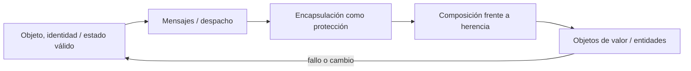
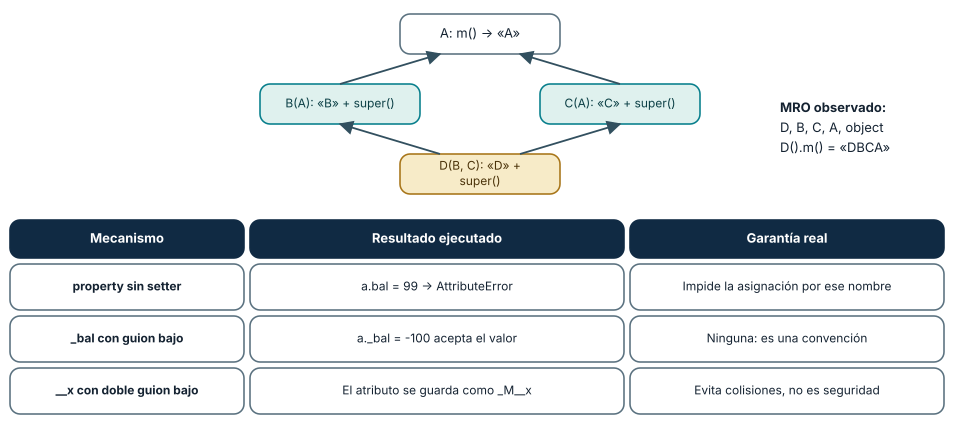
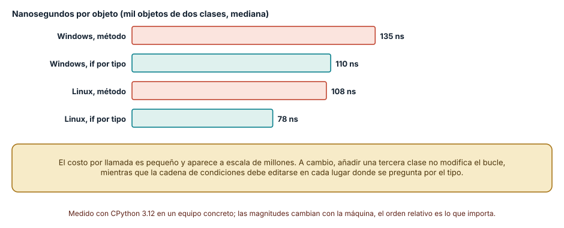

# SE-075 — Orientación a objetos, mensajes y encapsulación

[← SE-074 — Programación procedural y descomposición funcional](../../classes/part-06-paradigmas-de-programacion/se-074-programacion-procedural-y-descomposicion-funcional/README.md) · [↑ Parte 06](../../classes/part-06-paradigmas-de-programacion/README.md) · [📚 Índice completo](../../classes/README.md) · [🌐 Portal](../../site/classes/SE-075.html) · [SE-076 — Programación funcional, composición e inmutabilidad →](../../classes/part-06-paradigmas-de-programacion/se-076-programacion-funcional-composicion-e-inmutabilidad/README.md)


## Punto profesional y fundamento pedagógico

**Punto profesional.** La clase existe para diseñar objetos por responsabilidades, mensajes e invariantes encapsuladas.

**Por qué aparece aquí.** Se sitúa después de **Programación procedural y descomposición funcional** y antes de **Programación funcional, composición e inmutabilidad**: convierte el conocimiento anterior en una decisión observable que la clase siguiente podrá reutilizar. La continuidad se comprueba en el artefacto, no por compartir vocabulario.

**Error conceptual que debe corregir.** Usar clases como contenedores de datos o herencia como reutilización automática.

**Secuencia de aprendizaje.** Antes de leer la solución, el estudiante predice el resultado del caso normal y del error conceptual anterior. Luego explica un caso resuelto paso a paso, construye un contraejemplo que cambie la decisión y, sin consultar el texto, reconstruye el mecanismo y lo aplica a una entrada nueva. La secuencia usa predicción, explicación propia, contraste y recuperación. [ICAP](https://icap.education.asu.edu/research) distingue participación de construcción de conocimiento; [How People Learn II](https://nap.nationalacademies.org/catalog/24783/how-people-learn-ii-learners-contexts-and-cultures) exige conectar conocimiento previo, contexto y transferencia; la [práctica de recuperación](https://pubmed.ncbi.nlm.nih.gov/16507066/) respalda producir de nuevo la explicación tras una demora; y [Education for Life and Work](https://nap.nationalacademies.org/resource/13398/dbasse_084153.pdf) exige devolución que explique la causa del error.

**Evidencia de aprendizaje.** Object-protocol.md con mensajes, estados válidos y sustitución fallida. Debe contener predicción previa, observación, explicación causal, contraejemplo, criterio de aceptación y una nota de qué dato haría cambiar la conclusión.

**Límite de la conclusión.** Encapsular no vuelve correcto ni concurrente al objeto.

### Trazabilidad fuente → afirmación

| Fuente primaria u oficial | Afirmación que respalda | Lo que no prueba |
|---|---|---|
| [Python Language Reference](https://docs.python.org/3/reference/) | Semántica de sentencias, funciones, clases, generadores y corrutinas; autoridad: Python Software Foundation | No demuestra por sí sola que el artefacto del estudiante sea correcto. |
| [The Rust Programming Language](https://doc.rust-lang.org/stable/book/) | Ownership, enums, traits, errores y concurrencia sin carreras de datos; autoridad: Rust project | No demuestra por sí sola que el artefacto del estudiante sea correcto. |
| [SWEBOK Guide v4.0a](https://www.computer.org/education/bodies-of-knowledge/software-engineering) | Construcción, diseño y fundamentos profesionales; autoridad: IEEE Computer Society | No demuestra por sí sola que el artefacto del estudiante sea correcto. |

## Antes de empezar

Esta clase continúa el **motor de reglas comparado de la Parte 06**. Recupera la evidencia de la clase anterior, añade una decisión propia de **Orientación a objetos, mensajes y encapsulación** y deja un artefacto que la clase siguiente deberá consumir. La pregunta activa es: **¿Cuándo una identidad con comportamiento protege mejor una invariante que un conjunto de funciones?**

## Prerrequisitos

- Haber completado la clase anterior o reconstruir su contrato y evidencia.
- Python 3.11 o posterior, terminal, editor y Git; un segundo runtime es opcional y debe declararse.
- Trabajar con fixtures sintéticos: ninguna observación necesita datos de una persona o sistema real.

## Problema auténtico

El motor de reglas comparado pasa diccionarios entre funciones y cualquier consumidor puede crear combinaciones imposibles: una evaluación cerrada acepta nuevas observaciones o una decisión autorizada carece de evidencia.

## Objetivos observables

Al terminar podrás explicar los cinco mecanismos de esta clase, predecir su comportamiento antes de ejecutar, construir un caso normal y uno límite, diagnosticar el fallo controlado, comparar una alternativa y entregar evidencia que otra persona pueda reproducir.

## Mapa conceptual



El mapa se lee como una cadena de razonamiento, no como fases obligatorias del runtime. La flecha de retorno indica que un fallo o cambio de requisito obliga a revisar el modelo inicial; no autoriza a parchear solo la última salida.

## Temas y por qué importan

| Tema | Por qué cambia una decisión profesional | Evidencia mínima |
|---|---|---|
| Objeto, identidad y estado válido | Un objeto reúne identidad, estado y operaciones permitidas durante un ciclo de vida. | Predicción, traza causal y contraejemplo de **Objeto, identidad y estado válido** en `object-protocol.md` |
| Mensajes y despacho | Invocar un método envía una solicitud a un receptor que decide cómo responder según su tipo y estado. | Predicción, traza causal y contraejemplo de **Mensajes y despacho** en `object-protocol.md` |
| Encapsulación como protección | Encapsular no significa esconder campos con getters equivalentes. | Predicción, traza causal y contraejemplo de **Encapsulación como protección** en `object-protocol.md` |
| Composición frente a herencia | La herencia reutiliza un contrato y comportamiento bajo relación de sustitución; la composición ensambla colaboradores. | Predicción, traza causal y contraejemplo de **Composición frente a herencia** en `object-protocol.md` |
| Objetos de valor y entidades | Una duración o resultado puede compararse por valor y ser inmutable; una sesión conserva identidad aunque cambien sus atributos. | Predicción, traza causal y contraejemplo de **Objetos de valor y entidades** en `object-protocol.md` |
## Conceptos y decisiones

### 1. Objeto, identidad y estado válido

Un objeto reúne identidad, estado y operaciones permitidas durante un ciclo de vida. La identidad importa cuando dos instancias con valores iguales representan evaluaciones diferentes. Modelar todo como objeto añade ceremonia si solo existe una transformación de valores sin historia.

### 2. Mensajes y despacho

Invocar un método envía una solicitud a un receptor que decide cómo responder según su tipo y estado. El despacho polimórfico permite sustituir comportamientos detrás de un contrato. No elimina condicionales: los distribuye, y puede volver difícil seguir el flujo si las jerarquías son opacas.

### 3. Encapsulación como protección

Encapsular no significa esconder campos con getters equivalentes. Significa impedir transiciones inválidas y exponer operaciones del dominio como `record_observation` o `close`. Si el consumidor puede reconstruir libremente el estado interno, la invariante sigue fuera del objeto.

### 4. Composición frente a herencia

La herencia reutiliza un contrato y comportamiento bajo relación de sustitución; la composición ensambla colaboradores. Heredar solo para compartir código crea acoplamiento a detalles y jerarquías frágiles. El motor de reglas comparado compone políticas y repositorios, y reserva herencia para tipos realmente sustituibles.

### 5. Objetos de valor y entidades

Una duración o resultado puede compararse por valor y ser inmutable; una sesión conserva identidad aunque cambien sus atributos. Confundirlos produce aliasing, claves inestables o igualdad incorrecta. La distinción se decide por el dominio, no por si se usa `class`.

### El costo de un objeto y lo que compra `__slots__`

Un objeto de Python con atributos arbitrarios guarda sus atributos en un diccionario propio. Con 100 000 instancias de una clase de tres atributos, `tracemalloc` midió unos 96 bytes por objeto (9378 KiB en total); la misma clase declarada con `__slots__` ocupó 64 bytes por objeto (6250 KiB), un tercio menos, con resultados idénticos en Windows y en Linux. La memoria que se ahorra es el diccionario por instancia.

El ahorro tiene precio: con `__slots__` no se pueden crear atributos nuevos en la instancia, se complica la herencia múltiple y las instancias dejan de tener `__dict__`. Es una optimización que se aplica tras medir un problema real de memoria con millones de instancias, no un estilo por defecto. Lo que enseña la medición es el modelo mental correcto: un objeto no es «gratis»; es una asociación de nombres a valores con una representación concreta.


**Cómo leer la figura.** Cada barra es la memoria por instancia; la diferencia es el diccionario de atributos que `__slots__` elimina. **Dónde deja de valer:** el número depende de la versión de CPython y de que los atributos sean enteros pequeños compartidos (el tamaño de los valores no está en la cuenta); con objetos mayores como valores, el peso de los datos domina y la diferencia relativa se reduce.

### Herencia en diamante y encapsulación: qué garantiza el lenguaje

Con herencia múltiple, ¿qué método se ejecuta primero? Python lo resuelve con un orden lineal calculado (MRO, C3). En el diamante `D(B, C)` con `B(A)` y `C(A)`, el orden observado fue `D, B, C, A, object`, y una llamada a `D().m()` en la que cada clase añade su letra y delega con `super()` devolvió `DBCA`: `super()` no significa «la clase padre», sino «la siguiente en el orden de resolución de la instancia». Escribir `A.m(self)` en lugar de `super().m()` rompe la cooperación entre clases y puede ejecutar `A` dos veces.

La encapsulación se probó con tres mecanismos. Una `property` sin setter rechazó `a.bal = 99` con `AttributeError`; es una garantía real, pero solo por ese nombre. El guion bajo en `_bal` no impidió `a._bal = -100`, que dejó un saldo negativo: es una convención. El doble guion bajo (`self.__x`) guardó el atributo como `_M__x`, lo que evita colisiones entre clases, no accesos deliberados. Una invariante se protege dentro de los métodos que modifican el estado, no con el nombre del atributo.



**Cómo leer la figura.** Arriba, las flechas van de cada clase a su base; el cuadro lateral muestra el orden de resolución. Abajo, cada fila ejecutó un mecanismo y dice qué garantiza realmente. **Dónde deja de valer:** son reglas de Python; Java o C# tienen modificadores de acceso que el compilador impone y Smalltalk entrega mensajes sin acceso directo al estado. La lección general es distinguir lo impuesto por el lenguaje de lo acordado por convención.

### Despacho polimórfico: lo que cuesta y lo que evita

Llamar a `o.area()` sobre objetos de dos clases elige el método según el tipo del receptor. Comparado con una condición explícita `if type(o) is D1`, el despacho tardó 135 ns por objeto frente a 110 ns en Windows (un 22 % más) y 108 ns frente a 78 ns en Linux (un 38 % más). Es un costo pequeño y visible solo a gran escala.

La decisión de diseño no se toma por ese costo, sino por el cambio. Con el despacho polimórfico, añadir una tercera clase no toca el bucle que la usa; con la cadena de condiciones, hay que editar cada lugar donde se pregunta por el tipo, y olvidar uno produce un caso sin tratar que ninguna prueba señala. El polimorfismo traslada el conocimiento del tipo desde quien llama hacia quien implementa, a cambio de una indirección. Cuando los tipos son pocos, cerrados y conocidos, la condición puede ser más clara; cuando crecen, el despacho gana.



**Cómo leer la figura.** Cada par compara dos formas de elegir comportamiento sobre los mismos mil objetos. **Dónde deja de valer:** el microbenchmark usa dos clases y llamadas triviales; con más clases, llamadas virtuales cacheadas por un compilador JIT o métodos que hacen trabajo real, la diferencia se diluye o desaparece. La figura no demuestra que el polimorfismo sea mejor, sino que su costo directo es modesto.

## Definiciones de trabajo

- **objeto, identidad y estado válido:** un objeto reúne identidad, estado y operaciones permitidas durante un ciclo de vida.
- **mensajes y despacho:** invocar un método envía una solicitud a un receptor que decide cómo responder según su tipo y estado.
- **encapsulación como protección:** encapsular no significa esconder campos con getters equivalentes.
- **composición frente a herencia:** la herencia reutiliza un contrato y comportamiento bajo relación de sustitución; la composición ensambla colaboradores.
- **objetos de valor y entidades:** una duración o resultado puede compararse por valor y ser inmutable; una sesión conserva identidad aunque cambien sus atributos.

Las definiciones son operativas para el motor de reglas comparado. No convierten términos con historia más amplia en sinónimos y deben contrastarse con la documentación primaria enlazada al final.

## Ejemplo mínimo

```python
class Evaluation:
    def __init__(self):
        self._closed = False
        self._evidence = []

    def record(self, item):
        if self._closed:
            raise RuntimeError("evaluation is closed")
        self._evidence.append(item)

    def close(self):
        self._closed = True
```

Antes de ejecutar, predice estado, resultado y error. Después registra versión, comando y salida. Si el fragmento es pseudocódigo o pertenece a otro lenguaje, etiquétalo como tal y no afirmes que fue ejecutado.

## Ejemplo profesional

En el motor de reglas comparado, una recomendación contiene acción, evidencia usada, versión de política y explicación. La implementación de esta clase debe conservar ese contrato aunque cambie la forma interna. El caso profesional no pregunta únicamente si devuelve una cadena: pregunta quién puede producirla, qué estado observa, cómo falla y qué rastro permite disputar una decisión incorrecta.

Compara el caso normal con autorización falsa, evidencia incompleta, empate y repetición. Un mecanismo es apropiado cuando esas diferencias quedan visibles y localizadas; es peligroso cuando dependen de orden accidental, estado oculto o una convención que el consumidor no puede conocer.

## Práctica guiada

1. Copia el contrato de entrada y salida antes de escribir implementación.
2. Predice el caso normal y un límite; identifica la invariante que no puede romperse.
3. Implementa la versión mínima sin I/O dentro del núcleo.
4. Ejecuta el caso y conserva comando, versión y salida bajo `evidence/`.
5. Introduce el fallo controlado, reduce la reproducción y formula dos hipótesis rivales.
6. Corrige la causa, añade regresión y ejecuta el conjunto completo.
7. Compara con otro paradigma o lenguaje indicando qué semántica se preserva.

## Ejercicios

1. **Memoria:** mide con `tracemalloc` una clase de tu dominio con y sin `__slots__` y calcula a cuántos objetos el ahorro supera un megabyte.
2. **MRO:** dibuja el diamante de tu motor de reglas, predice `__mro__` y compruébalo; explica qué ocurre si una clase llama a `A.m(self)` en lugar de `super().m()`.
3. **Invariante:** protege un saldo no negativo en el único método que lo modifica y escribe una prueba que intente saltarse la protección con el nombre interno; documenta qué parte sigue siendo convención.
4. **Despacho:** añade una tercera clase a la versión polimórfica y a la de condición y cuenta cuántas líneas cambian en cada una.

## Reto verificable

Entrega implementación, fixtures, pruebas y un informe corto. Se aprueba si otra persona ejecuta desde checkout limpio, obtiene los mismos resultados y puede relacionar cada rama o transformación con una regla del dominio. No se aprueba por cantidad de archivos ni por usar la sintaxis característica del paradigma.

## Caso conductor

El motor de reglas comparado recibe una observación autorizada, evalúa reglas y devuelve una recomendación explicable. En esta clase, ejecuta el caso `latency_ms=900`, el límite `latency_ms=800`, el contraejemplo `authorized=false` y una entrada incompleta. Cambia después una sola regla y revisa qué archivos, pruebas y trazas debieron modificarse. Esa superficie de cambio alimenta la comparación final de la parte.

## Preguntas frecuentes

### ¿Orientación a objetos significa herencia?

No. Los mensajes y la encapsulación son lo central; la herencia es un mecanismo de reutilización con costos. Muchos diseños prefieren composición, y el diamante de esta clase muestra por qué la herencia múltiple exige entender el orden de resolución.

### ¿`super()` llama a la clase padre?

Llama a la siguiente clase en el orden de resolución de la instancia. En el diamante, `super()` dentro de `B` llamó a `C`, no a `A`, porque `C` aparece después de `B` en el MRO de `D`.

### ¿`__slots__` hace más seguro un objeto?

No: reduce memoria e impide atributos nuevos, pero no protege invariantes. Un objeto con `__slots__` acepta cualquier valor en sus atributos declarados.

### ¿Cuándo usar una condición en vez de polimorfismo?

Cuando los casos son pocos, cerrados y se evalúan en un solo lugar. Si cada nuevo tipo obligaría a editar varios sitios, el despacho reduce la superficie de cambio, como mostró el ejercicio de añadir una clase.

## Fallo controlado y diagnóstico

Expón `_evidence` mediante una propiedad que devuelve la lista original. Un consumidor la modifica después de cerrar. Devuelve una tupla o copia controlada y añade una prueba que intente romper la invariante desde fuera.

Registra síntoma, entrada mínima, hipótesis, observación que descarta cada hipótesis, causa, corrección y prueba de regresión. No cambies simultáneamente implementación, fixture y expectativa.

Práctica: define el diamante `A, B, C, D` de la clase, haz que `C.m` no llame a `super()` y ejecuta `D().m()`. **Síntoma esperado:** la cadena no incluye a `A`. **Hipótesis rivales:** (a) el MRO cambió; (b) una clase rompió la cooperación. **Observación que las separa:** imprimir `D.__mro__` (idéntico) y trazar quién llamó a quién. **Corrección:** que todas las clases cooperen con `super()` y documentar que la cadena es parte del contrato. **Regresión:** una prueba que compara la salida completa del diamante.

## Errores comunes y cómo corregirlos

| Síntoma | Causa | Corrección |
|---|---|---|
| Un método de la base se ejecuta dos veces o nunca | `A.m(self)` en lugar de `super().m()` en herencia múltiple | Usar `super()` en todas las clases del diamante |
| Se asigna un valor inválido a un atributo «privado» | La privacidad era un guion bajo | Validar en el método que escribe o usar una propiedad con setter |
| Agotamiento de memoria con millones de instancias | Cada instancia mantiene un diccionario de atributos | Medir y considerar `__slots__` o una estructura compacta |
| Una cadena de `if type(o) is ...` falla con una clase nueva | El conocimiento del tipo está disperso en quien llama | Mover el comportamiento a la clase y despachar por método |
| Se atribuye lentitud al polimorfismo sin medir | Suposición en lugar de perfil | Medir con `timeit` en el camino real antes de cambiar el diseño |

## Entorno y archivos clave

```text
work/SE-075/
├── README.md
├── rule_engine/
│   ├── domain.py
│   └── se_075.py
├── fixtures/cases.json
├── tests/test_se_075.py
└── evidence/diagnosis.md
```

El `README` declara plataforma, runtimes, comandos, limpieza y límites. Evita dependencias externas cuando la biblioteca estándar permita observar el mecanismo; si agregas una, fija procedencia y versión.

## Seguridad, ética y accesibilidad

- la autorización forma parte del dominio y no se infiere por ausencia de rechazo;
- no uses `eval`, reglas descargadas ni serialización insegura;
- limita colas, recursión, tamaño de entrada y tiempo de evaluación;
- redacta trazas y conserva una explicación textual además de color o animación;
- una recomendación automatizada debe poder revisarse, impugnarse y corregirse;
- respeta licencias de ejemplos y atribuye adaptaciones.

## Puente hacia el trabajo con agentes

Un agente que expone herramientas suele modelarlas como objetos con métodos: `herramienta.ejecutar(entrada)`. El diseño orientado a mensajes de esta clase es el que permite sustituir una implementación por otra (real, simulada, de laboratorio) sin tocar a quien la usa. La condición para que valga es la encapsulación verificada: si el agente puede alcanzar el estado interno de una herramienta (un token, una ruta), la frontera era una convención. Las partes de seguridad agentic retoman esto como el principio de mínimo privilegio aplicado a objetos.

## Transferencia

Traslada un fixture al segundo modelo o lenguaje. Compara representación de ausencia, error, mutabilidad, orden y cancelación. La transferencia está lograda cuando el contrato se conserva y las diferencias están explicadas, no cuando la sintaxis se parece.

## Evaluación y evidencia

| Criterio | Evidencia para aprobar |
|---|---|
| comprensión | explicación causal de los cinco mecanismos |
| corrección | normal, límite, inválido y contraejemplo |
| diseño | estado, efectos y contrato localizables |
| diagnóstico | reproducción mínima y regresión |
| transferencia | comparación semántica, no estética |
| reproducibilidad | versiones, comandos, salida y límites |


## Fuentes


- [Python Language Reference](https://docs.python.org/3/reference/) — Semántica de sentencias, funciones, clases, generadores y corrutinas; autoridad: Python Software Foundation.
- [The Rust Programming Language](https://doc.rust-lang.org/stable/book/) — Ownership, enums, traits, errores y concurrencia sin carreras de datos; autoridad: Rust project.
- [SWI-Prolog Reference Manual](https://www.swi-prolog.org/pldoc/man?section=intro) — Hechos, reglas, unificación, búsqueda y límites operacionales; autoridad: SWI-Prolog project.
- [ReactiveX Observable Contract](https://reactivex.io/documentation/contract.html) — Notificaciones, terminación, errores y control de flujo observable; autoridad: ReactiveX project.
- [Erlang System Documentation: Processes](https://www.erlang.org/doc/system/ref_man_processes.html) — Procesos, buzones, envío de mensajes, enlaces y monitores; autoridad: Erlang/OTP project.
- [SWEBOK Guide v4.0a](https://www.computer.org/education/bodies-of-knowledge/software-engineering) — Construcción, diseño y fundamentos profesionales; autoridad: IEEE Computer Society.

Fuentes verificadas para las mediciones de esta clase (enlaces comprobados con `curl` el 2026-11-13):

- [Python Data Model: `__slots__`](https://docs.python.org/3/reference/datamodel.html) y [`property`](https://docs.python.org/3/library/functions.html): atributos, `__slots__` y propiedades; respaldan las figuras 1 y 2.
- [El orden de resolución de métodos de Python 2.3](https://docs.python.org/3/howto/mro.html): algoritmo C3 y `super()`; respalda la figura 2.
- [Descriptor HowTo](https://docs.python.org/3/howto/descriptor.html): cómo funcionan propiedades y métodos; respalda la lectura del despacho.
- Kay, A. (1993), «The Early History of Smalltalk», *ACM SIGPLAN Notices* 28(3), [doi:10.1145/155360.155364](https://doi.org/10.1145/155360.155364): mensajes y encapsulación como núcleo de la orientación a objetos. El editor devolvió 403 a `curl`, por lo que el DOI no se verificó por red.

Cada fuente respalda el mecanismo indicado; ninguna demuestra que la implementación del motor de reglas comparado sea correcta. Esa afirmación depende de fixtures, pruebas, trazas y revisión reproducible.

## Límites y siguiente paso

Los objetos reducen estados inválidos solo si sus fronteras son reales. La siguiente clase elimina identidad innecesaria y razona mediante valores y composición funcional.

## Glosario

- **objeto, identidad y estado válido:** un objeto reúne identidad, estado y operaciones permitidas durante un ciclo de vida.
- **mensajes y despacho:** invocar un método envía una solicitud a un receptor que decide cómo responder según su tipo y estado.
- **encapsulación como protección:** encapsular no significa esconder campos con getters equivalentes.
- **composición frente a herencia:** la herencia reutiliza un contrato y comportamiento bajo relación de sustitución; la composición ensambla colaboradores.
- **objetos de valor y entidades:** una duración o resultado puede compararse por valor y ser inmutable; una sesión conserva identidad aunque cambien sus atributos.

---

[← SE-074 — Programación procedural y descomposición funcional](../../classes/part-06-paradigmas-de-programacion/se-074-programacion-procedural-y-descomposicion-funcional/README.md) · [↑ Parte 06](../../classes/part-06-paradigmas-de-programacion/README.md) · [📚 Índice completo](../../classes/README.md) · [🌐 Portal](../../site/classes/SE-075.html) · [SE-076 — Programación funcional, composición e inmutabilidad →](../../classes/part-06-paradigmas-de-programacion/se-076-programacion-funcional-composicion-e-inmutabilidad/README.md)
