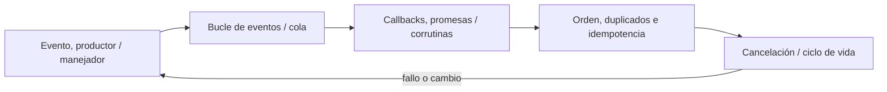
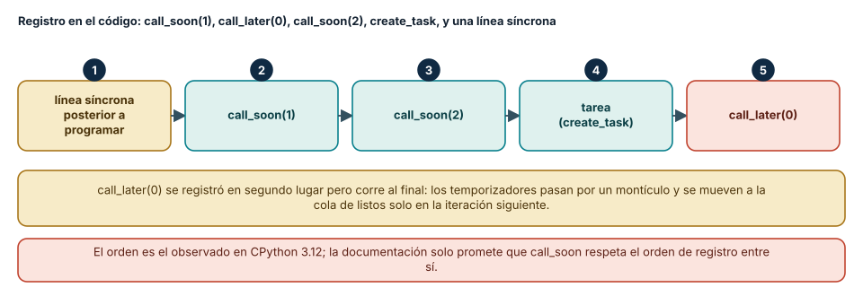
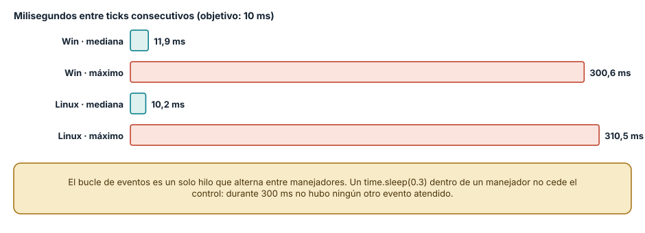
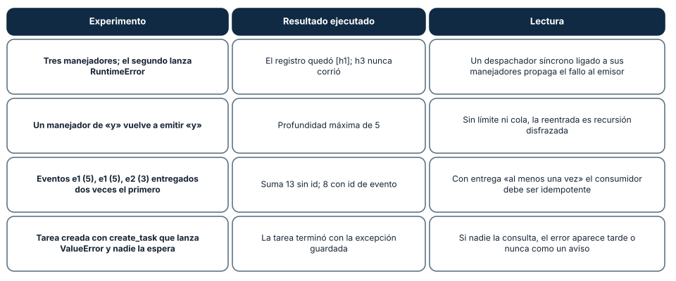

# SE-079 — Programación orientada a eventos

[← SE-078 — Programación lógica y resolución](../../classes/part-06-paradigmas-de-programacion/se-078-programacion-logica-y-resolucion/README.md) · [↑ Parte 06](../../classes/part-06-paradigmas-de-programacion/README.md) · [📚 Índice completo](../../classes/README.md) · [🌐 Portal](../../site/classes/SE-079.html) · [SE-080 — Programación reactiva y flujos →](../../classes/part-06-paradigmas-de-programacion/se-080-programacion-reactiva-y-flujos/README.md)


## Punto profesional y fundamento pedagógico

**Punto profesional.** La clase existe para modelar eventos por fuente, orden, identidad, handler y efecto.

**Por qué aparece aquí.** Se sitúa después de **Programación lógica y resolución** y antes de **Programación reactiva y flujos**: convierte el conocimiento anterior en una decisión observable que la clase siguiente podrá reutilizar. La continuidad se comprueba en el artefacto, no por compartir vocabulario.

**Error conceptual que debe corregir.** Suponer que un callback implica secuencia global o entrega única.

**Secuencia de aprendizaje.** Antes de leer la solución, el estudiante predice el resultado del caso normal y del error conceptual anterior. Luego explica un caso resuelto paso a paso, construye un contraejemplo que cambie la decisión y, sin consultar el texto, reconstruye el mecanismo y lo aplica a una entrada nueva. La secuencia usa predicción, explicación propia, contraste y recuperación. [ICAP](https://icap.education.asu.edu/research) distingue participación de construcción de conocimiento; [How People Learn II](https://nap.nationalacademies.org/catalog/24783/how-people-learn-ii-learners-contexts-and-cultures) exige conectar conocimiento previo, contexto y transferencia; la [práctica de recuperación](https://pubmed.ncbi.nlm.nih.gov/16507066/) respalda producir de nuevo la explicación tras una demora; y [Education for Life and Work](https://nap.nationalacademies.org/resource/13398/dbasse_084153.pdf) exige devolución que explique la causa del error.

**Evidencia de aprendizaje.** Event-timeline.md con emisión, handler, reentrada y duplicado. Debe contener predicción previa, observación, explicación causal, contraejemplo, criterio de aceptación y una nota de qué dato haría cambiar la conclusión.

**Límite de la conclusión.** El modelo local no garantiza orden distribuido.

### Trazabilidad fuente → afirmación

| Fuente primaria u oficial | Afirmación que respalda | Lo que no prueba |
|---|---|---|
| [ReactiveX Observable Contract](https://reactivex.io/documentation/contract.html) | Notificaciones, terminación, errores y control de flujo observable; autoridad: ReactiveX project | No demuestra por sí sola que el artefacto del estudiante sea correcto. |
| [Erlang System Documentation: Processes](https://www.erlang.org/doc/system/ref_man_processes.html) | Procesos, buzones, envío de mensajes, enlaces y monitores; autoridad: Erlang/OTP project | No demuestra por sí sola que el artefacto del estudiante sea correcto. |
| [Python Language Reference](https://docs.python.org/3/reference/) | Semántica de sentencias, funciones, clases, generadores y corrutinas; autoridad: Python Software Foundation | No demuestra por sí sola que el artefacto del estudiante sea correcto. |

## Antes de empezar

Esta clase continúa el **motor de reglas comparado de la Parte 06**. Recupera la evidencia de la clase anterior, añade una decisión propia de **Programación orientada a eventos** y deja un artefacto que la clase siguiente deberá consumir. La pregunta activa es: **¿Cómo conservar causalidad y control cuando el flujo lo inicia un evento externo?**

## Prerrequisitos

- Haber completado la clase anterior o reconstruir su contrato y evidencia.
- Python 3.11 o posterior, terminal, editor y Git; un segundo runtime es opcional y debe declararse.
- Trabajar con fixtures sintéticos: ninguna observación necesita datos de una persona o sistema real.

## Problema auténtico

El motor de reglas comparado recibe observaciones desde terminal, archivo y temporizador. Los callbacks escriben el mismo estado y una notificación tardía revive una evaluación que ya fue cerrada.

## Objetivos observables

Al terminar podrás explicar los cinco mecanismos de esta clase, predecir su comportamiento antes de ejecutar, construir un caso normal y uno límite, diagnosticar el fallo controlado, comparar una alternativa y entregar evidencia que otra persona pueda reproducir.

## Mapa conceptual



El mapa se lee como una cadena de razonamiento, no como fases obligatorias del runtime. La flecha de retorno indica que un fallo o cambio de requisito obliga a revisar el modelo inicial; no autoriza a parchear solo la última salida.

## Temas y por qué importan

| Tema | Por qué cambia una decisión profesional | Evidencia mínima |
|---|---|---|
| Evento, productor y manejador | Un evento afirma que ocurrió algo relevante; contiene identidad, tipo, instante observado y datos mínimos. | Predicción, traza causal y contraejemplo de **Evento, productor y manejador** en `event-timeline.md` |
| Bucle de eventos y cola | El runtime extrae eventos de una cola y ejecuta manejadores. | Predicción, traza causal y contraejemplo de **Bucle de eventos y cola** en `event-timeline.md` |
| Callbacks, promesas y corrutinas | Son formas distintas de expresar continuación. | Predicción, traza causal y contraejemplo de **Callbacks, promesas y corrutinas** en `event-timeline.md` |
| Orden, duplicados e idempotencia | La llegada no garantiza necesariamente el orden de producción y un evento puede repetirse. | Predicción, traza causal y contraejemplo de **Orden, duplicados e idempotencia** en `event-timeline.md` |
| Cancelación y ciclo de vida | Suscribirse crea una obligación de cancelar o desconectar. | Predicción, traza causal y contraejemplo de **Cancelación y ciclo de vida** en `event-timeline.md` |
## Conceptos y decisiones

### 1. Evento, productor y manejador

Un evento afirma que ocurrió algo relevante; contiene identidad, tipo, instante observado y datos mínimos. El productor no debería asumir qué consumidores existen. Un manejador transforma el evento o solicita un efecto, y debe declarar si puede repetirse.

### 2. Bucle de eventos y cola

El runtime extrae eventos de una cola y ejecuta manejadores. Un manejador bloqueante retrasa todos los siguientes en un bucle de un solo hilo. Delegar trabajo permite avanzar, pero introduce concurrencia, orden parcial y necesidad de correlación.

### 3. Callbacks, promesas y corrutinas

Son formas distintas de expresar continuación. `async/await` mejora lectura secuencial, pero no vuelve síncrono el sistema ni elimina cancelación. Una corrutina que no cede o una promesa ignorada puede bloquear o perder fallos tanto como un callback mal diseñado.

### 4. Orden, duplicados e idempotencia

La llegada no garantiza necesariamente el orden de producción y un evento puede repetirse. Un manejador idempotente reconoce la identidad o hace que repetir produzca el mismo estado observable. Descartar duplicados sin ventana ni almacenamiento definido también puede perder trabajo legítimo.

### 5. Cancelación y ciclo de vida

Suscribirse crea una obligación de cancelar o desconectar. Una tarea cerrada no debe aceptar eventos tardíos. El motor de reglas comparado usa un token o estado terminal, propaga cancelación y espera limpieza; matar el proceso no es estrategia de lifecycle.

### Quién atiende primero: el orden del bucle de eventos

En un modelo orientado a eventos el flujo de control lo decide el entorno: el programa registra qué hacer cuando ocurra algo y un bucle lo invoca. Para ver el orden se registraron, dentro de un bucle de `asyncio`, `call_soon(1)`, `call_later(0)`, `call_soon(2)`, una tarea con `create_task` y una línea síncrona. El orden de ejecución observado, idéntico en Windows y en Linux, fue: la línea síncrona, `call_soon(1)`, `call_soon(2)`, la tarea y, al final, `call_later(0)`. Dos hechos se desprenden. El código síncrono que sigue a la programación corre antes que cualquier manejador, porque el bucle no toma el control hasta que el código actual cede. Y un temporizador con retardo cero no es lo mismo que `call_soon`: se registró segundo, pero corrió último, porque los temporizadores pasan por una estructura distinta y se promueven a la cola de listos en la iteración siguiente.

La documentación de `asyncio` solo garantiza que las devoluciones de `call_soon` respetan el orden de registro entre sí. El orden entre tareas, temporizadores y devoluciones es un detalle de implementación observado en CPython 3.12, y un programa que depende de él es frágil ante una actualización.



**Cómo leer la figura.** Los números indican el orden de ejecución, no el de registro; la caja de call_later(0) está al final aunque se registró en segundo lugar. **Dónde deja de valer:** el orden es el de `asyncio` en CPython 3.12 con el bucle por defecto; con `uvloop`, con otro lenguaje (el bucle de Node.js tiene fases distintas) o con un bucle de interfaz gráfica, el orden relativo cambia. No se probaron.

### Un manejador bloqueante detiene todos los eventos

Un bucle de eventos es un solo hilo que alterna entre manejadores. Si uno no cede el control, ninguno más corre. Se midió con un temporizador configurado a 10 ms: su intervalo mediano fue 11,9 ms en Windows y 10,2 ms en Linux; pero cuando otro manejador hizo `time.sleep(0.3)` (un bloqueo de 300 ms), el intervalo máximo observado fue 300,6 ms y 310,5 ms. Durante esos 300 ms no se atendió ningún evento: los temporizadores, las conexiones entrantes y los demás manejadores esperaron.

La causa es la diferencia entre `time.sleep` (bloquea el hilo) y `await asyncio.sleep` (cede el control). La corrección es mover el trabajo bloqueante o intensivo a un ejecutor (hilo o proceso) y esperar su resultado con `await`. El modo de depuración de `asyncio` informa los manejadores lentos, y conviene activarlo en pruebas.



**Cómo leer la figura.** Las barras teal son la mediana de los intervalos y las coral el máximo; la diferencia es el efecto del bloqueo. **Dónde deja de valer:** el bloqueo es sintético y deliberado; un manejador real puede bloquear por un cálculo, por una lectura de archivo o por una llamada a una biblioteca síncrona, con la misma consecuencia. La latencia exacta depende del planificador del sistema operativo.

### Cuatro fallos de un bus de eventos

Un despachador de eventos sencillo (un diccionario de manejadores por tipo) permite ver cuatro fallos. Primero, si el segundo de tres manejadores lanza una excepción, el tercero **nunca corre** y el emisor recibe el error de un manejador que no conoce. Segundo, un manejador que vuelve a emitir el mismo evento produce **reentrada**: la profundidad llegó a 5, y sin tope es una recursión disfrazada. Tercero, con **entrega duplicada** (e1, e1, e2) el consumidor sumó 13 en lugar de 8 porque no usaba el identificador del evento para descartar repetidos. Cuarto, una excepción dentro de una tarea de `asyncio` que nadie espera queda **guardada en la tarea**: la tarea terminó y su excepción se puede leer, pero si nadie la consulta el error aparece tarde o como un aviso al destruir la tarea.

Cada fallo tiene un remedio de diseño: aislar los manejadores (capturar y registrar el error por manejador), poner un límite o una cola a la reentrada, hacer idempotente al consumidor con identificadores de evento y supervisar las tareas creadas.



**Cómo leer la figura.** Cada fila es un experimento, su resultado y la lectura de diseño. **Dónde deja de valer:** el bus es mínimo y síncrono, sin colas persistentes, reintentos ni entrega entre procesos; un broker real (con acuses, reintentos y orden por partición) añade garantías y fallos que aquí no se ejercitan.

## Definiciones de trabajo

- **evento, productor y manejador:** un evento afirma que ocurrió algo relevante; contiene identidad, tipo, instante observado y datos mínimos.
- **bucle de eventos y cola:** el runtime extrae eventos de una cola y ejecuta manejadores.
- **callbacks, promesas y corrutinas:** son formas distintas de expresar continuación.
- **orden, duplicados e idempotencia:** la llegada no garantiza necesariamente el orden de producción y un evento puede repetirse.
- **cancelación y ciclo de vida:** suscribirse crea una obligación de cancelar o desconectar.

Las definiciones son operativas para el motor de reglas comparado. No convierten términos con historia más amplia en sinónimos y deben contrastarse con la documentación primaria enlazada al final.

## Ejemplo mínimo

```python
async def on_observation(event, state):
    if state.closed or event.id in state.seen:
        return state
    decision = choose_next(event.payload)
    return state.record(event.id, decision)
```

Antes de ejecutar, predice estado, resultado y error. Después registra versión, comando y salida. Si el fragmento es pseudocódigo o pertenece a otro lenguaje, etiquétalo como tal y no afirmes que fue ejecutado.

## Ejemplo profesional

En el motor de reglas comparado, una recomendación contiene acción, evidencia usada, versión de política y explicación. La implementación de esta clase debe conservar ese contrato aunque cambie la forma interna. El caso profesional no pregunta únicamente si devuelve una cadena: pregunta quién puede producirla, qué estado observa, cómo falla y qué rastro permite disputar una decisión incorrecta.

Compara el caso normal con autorización falsa, evidencia incompleta, empate y repetición. Un mecanismo es apropiado cuando esas diferencias quedan visibles y localizadas; es peligroso cuando dependen de orden accidental, estado oculto o una convención que el consumidor no puede conocer.

## Práctica guiada

1. Copia el contrato de entrada y salida antes de escribir implementación.
2. Predice el caso normal y un límite; identifica la invariante que no puede romperse.
3. Implementa la versión mínima sin I/O dentro del núcleo.
4. Ejecuta el caso y conserva comando, versión y salida bajo `evidence/`.
5. Introduce el fallo controlado, reduce la reproducción y formula dos hipótesis rivales.
6. Corrige la causa, añade regresión y ejecuta el conjunto completo.
7. Compara con otro paradigma o lenguaje indicando qué semántica se preserva.

## Ejercicios

1. **Predicción:** escribe cinco registros con `call_soon`, `call_later(0)` y tareas, predice el orden y verifícalo; explica qué parte es garantía documentada y cuál es observación.
2. **Bloqueo:** mide el intervalo máximo de un temporizador con un manejador que bloquea y con uno que usa `await`, y mueve el trabajo a `run_in_executor`.
3. **Aislamiento:** modifica el bus para que el fallo de un manejador no impida a los demás y registra el error con el nombre del manejador.
4. **Idempotencia:** implementa un consumidor que ignore eventos repetidos por identificador y una prueba con tres entregas del mismo evento.

## Reto verificable

Entrega implementación, fixtures, pruebas y un informe corto. Se aprueba si otra persona ejecuta desde checkout limpio, obtiene los mismos resultados y puede relacionar cada rama o transformación con una regla del dominio. No se aprueba por cantidad de archivos ni por usar la sintaxis característica del paradigma.

## Caso conductor

El motor de reglas comparado recibe una observación autorizada, evalúa reglas y devuelve una recomendación explicable. En esta clase, ejecuta el caso `latency_ms=900`, el límite `latency_ms=800`, el contraejemplo `authorized=false` y una entrada incompleta. Cambia después una sola regla y revisa qué archivos, pruebas y trazas debieron modificarse. Esa superficie de cambio alimenta la comparación final de la parte.

## Preguntas frecuentes

### ¿Evento es lo mismo que mensaje?

No exactamente. Un evento describe algo que ocurrió y quien lo emite no espera una respuesta; un mensaje dirigido a un destinatario puede esperarla. En la práctica los sistemas los mezclan, y por eso conviene fijar si el emisor depende de que alguien lo atienda.

### ¿`async` hace que mi código sea paralelo?

No. `asyncio` ejecuta una tarea a la vez en un solo hilo y alterna cuando una cede con `await`. Ayuda a esperar muchas operaciones de E/S; no acelera el cálculo, y un bloqueo detiene todo el bucle.

### ¿Cómo garantizo que un evento se procese una sola vez?

En general no se puede garantizar «exactamente una vez» entre sistemas; se logra el efecto con entrega «al menos una vez» y un consumidor idempotente que descarte repetidos por identificador, como en el experimento.

### ¿Por qué mi tarea falló sin que yo viera el error?

Porque una excepción dentro de una tarea no esperada se guarda en la tarea. Hay que esperarla, consultar su resultado o añadir un manejador de finalización; de lo contrario aparece tarde.

## Fallo controlado y diagnóstico

Programa dos callbacks: cerrar evaluación y registrar observación. Invierte su orden y reproduce la resurrección. Añade estado terminal e identidad de evento; prueba ambas intercalaciones.

Registra síntoma, entrada mínima, hipótesis, observación que descarta cada hipótesis, causa, corrección y prueba de regresión. No cambies simultáneamente implementación, fixture y expectativa.

Práctica: añade `time.sleep(0.3)` a un manejador de un bucle de `asyncio` que también ejecuta un temporizador de 10 ms. **Síntoma esperado:** un intervalo de unos 300 ms en el temporizador. **Hipótesis rivales:** (a) el sistema operativo retrasó el proceso; (b) un manejador bloqueó el bucle. **Observación que las separa:** activar el modo de depuración de `asyncio`, que reporta la devolución lenta, o sustituir `time.sleep` por `await asyncio.sleep`: si el intervalo vuelve a 10 ms, fue el bloqueo. **Corrección:** ceder el control o delegar a un ejecutor. **Regresión:** una prueba que falla si el intervalo máximo supera un umbral.

## Errores comunes y cómo corregirlos

| Síntoma | Causa | Corrección |
|---|---|---|
| Un temporizador se retrasa cientos de milisegundos | Un manejador bloquea el hilo del bucle | Usar `await` o delegar el trabajo a un ejecutor |
| Un manejador no se ejecuta tras el fallo de otro | Despacho síncrono que propaga la primera excepción | Aislar y registrar el error por manejador |
| El mismo evento se aplica dos veces | Entrega duplicada sin identificador | Descartar por identificador de evento |
| Un manejador provoca una cadena infinita de eventos | Reentrada sin límite | Poner tope de profundidad o encolar los eventos emitidos |
| Una excepción aparece mucho después de ocurrir | Tarea creada y nunca esperada | Esperar o supervisar las tareas creadas |

## Entorno y archivos clave

```text
work/SE-079/
├── README.md
├── rule_engine/
│   ├── domain.py
│   └── se_079.py
├── fixtures/cases.json
├── tests/test_se_079.py
└── evidence/diagnosis.md
```

El `README` declara plataforma, runtimes, comandos, limpieza y límites. Evita dependencias externas cuando la biblioteca estándar permita observar el mecanismo; si agregas una, fija procedencia y versión.

## Seguridad, ética y accesibilidad

- la autorización forma parte del dominio y no se infiere por ausencia de rechazo;
- no uses `eval`, reglas descargadas ni serialización insegura;
- limita colas, recursión, tamaño de entrada y tiempo de evaluación;
- redacta trazas y conserva una explicación textual además de color o animación;
- una recomendación automatizada debe poder revisarse, impugnarse y corregirse;
- respeta licencias de ejemplos y atribuye adaptaciones.

## Puente hacia el trabajo con agentes

Un agente que reacciona a eventos externos (un correo, un webhook, un cambio en un repositorio) vive en este modelo: el entorno decide cuándo se le invoca y puede hacerlo más de una vez. Los mismos fallos aparecen con costos mayores: un evento duplicado puede enviar dos mensajes, un manejador bloqueante deja al agente sin responder y una reentrada puede disparar un bucle de acciones. El harness debe exigir identificadores de evento, idempotencia de las acciones con efecto, límites de profundidad y supervisión de las tareas. Las partes sobre sistemas multiagente y automatización retoman estos requisitos.

## Transferencia

Traslada un fixture al segundo modelo o lenguaje. Compara representación de ausencia, error, mutabilidad, orden y cancelación. La transferencia está lograda cuando el contrato se conserva y las diferencias están explicadas, no cuando la sintaxis se parece.

## Evaluación y evidencia

| Criterio | Evidencia para aprobar |
|---|---|
| comprensión | explicación causal de los cinco mecanismos |
| corrección | normal, límite, inválido y contraejemplo |
| diseño | estado, efectos y contrato localizables |
| diagnóstico | reproducción mínima y regresión |
| transferencia | comparación semántica, no estética |
| reproducibilidad | versiones, comandos, salida y límites |


## Fuentes


- [Python Language Reference](https://docs.python.org/3/reference/) — Semántica de sentencias, funciones, clases, generadores y corrutinas; autoridad: Python Software Foundation.
- [The Rust Programming Language](https://doc.rust-lang.org/stable/book/) — Ownership, enums, traits, errores y concurrencia sin carreras de datos; autoridad: Rust project.
- [SWI-Prolog Reference Manual](https://www.swi-prolog.org/pldoc/man?section=intro) — Hechos, reglas, unificación, búsqueda y límites operacionales; autoridad: SWI-Prolog project.
- [ReactiveX Observable Contract](https://reactivex.io/documentation/contract.html) — Notificaciones, terminación, errores y control de flujo observable; autoridad: ReactiveX project.
- [Erlang System Documentation: Processes](https://www.erlang.org/doc/system/ref_man_processes.html) — Procesos, buzones, envío de mensajes, enlaces y monitores; autoridad: Erlang/OTP project.
- [SWEBOK Guide v4.0a](https://www.computer.org/education/bodies-of-knowledge/software-engineering) — Construcción, diseño y fundamentos profesionales; autoridad: IEEE Computer Society.

Fuentes verificadas para las mediciones de esta clase (enlaces comprobados con `curl` el 2026-11-13):

- [Bucle de eventos de asyncio](https://docs.python.org/3/library/asyncio-eventloop.html), [Tareas y corrutinas](https://docs.python.org/3/library/asyncio-task.html) y [Modo de depuración](https://docs.python.org/3/library/asyncio-dev.html): `call_soon`, `call_later`, tareas y detección de manejadores lentos; respaldan las figuras 1 y 2.
- [Bucle de eventos de Node.js](https://nodejs.org/en/learn/asynchronous-work/event-loop-timers-and-nexttick): contraste con un bucle con fases distintas.
- [DOM Standard: despacho de eventos](https://dom.spec.whatwg.org/): modelo de eventos con propagación; contexto para la reentrada y el orden de manejadores.

Cada fuente respalda el mecanismo indicado; ninguna demuestra que la implementación del motor de reglas comparado sea correcta. Esa afirmación depende de fixtures, pruebas, trazas y revisión reproducible.

## Límites y siguiente paso

La orientación a eventos organiza reacciones discretas, pero no compone necesariamente flujos largos, presión ni transformación continua. La siguiente clase modela secuencias observables.

## Glosario

- **evento, productor y manejador:** un evento afirma que ocurrió algo relevante; contiene identidad, tipo, instante observado y datos mínimos.
- **bucle de eventos y cola:** el runtime extrae eventos de una cola y ejecuta manejadores.
- **callbacks, promesas y corrutinas:** son formas distintas de expresar continuación.
- **orden, duplicados e idempotencia:** la llegada no garantiza necesariamente el orden de producción y un evento puede repetirse.
- **cancelación y ciclo de vida:** suscribirse crea una obligación de cancelar o desconectar.

---

[← SE-078 — Programación lógica y resolución](../../classes/part-06-paradigmas-de-programacion/se-078-programacion-logica-y-resolucion/README.md) · [↑ Parte 06](../../classes/part-06-paradigmas-de-programacion/README.md) · [📚 Índice completo](../../classes/README.md) · [🌐 Portal](../../site/classes/SE-079.html) · [SE-080 — Programación reactiva y flujos →](../../classes/part-06-paradigmas-de-programacion/se-080-programacion-reactiva-y-flujos/README.md)
