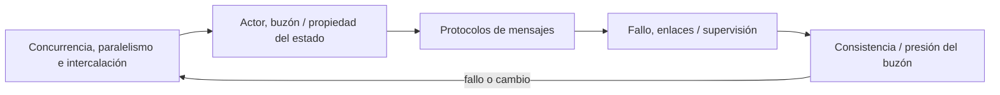
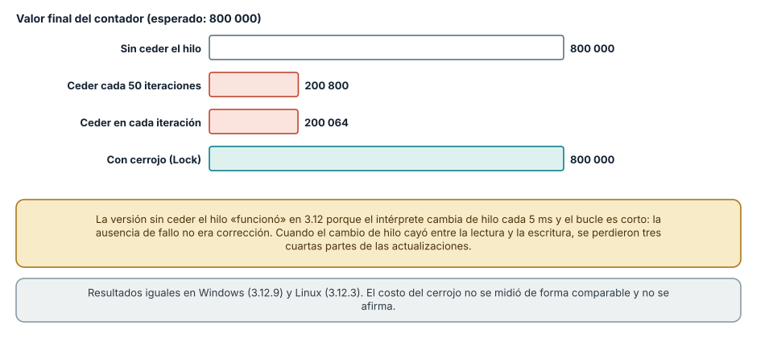
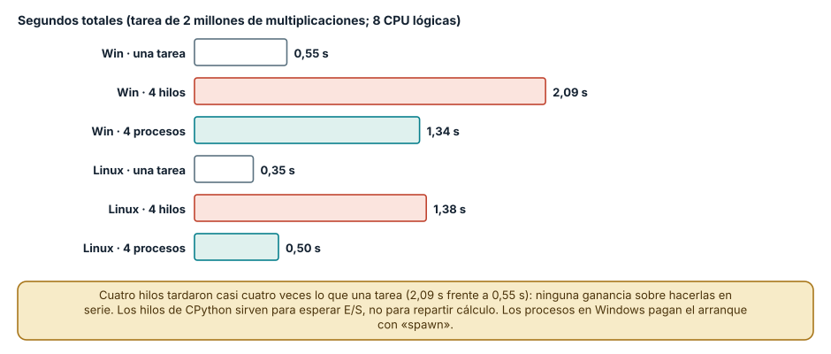
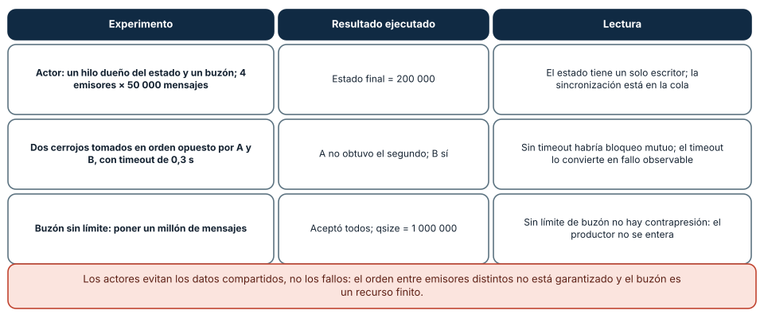

# SE-081 — Programación concurrente y actores

[← SE-080 — Programación reactiva y flujos](../../classes/part-06-paradigmas-de-programacion/se-080-programacion-reactiva-y-flujos/README.md) · [↑ Parte 06](../../classes/part-06-paradigmas-de-programacion/README.md) · [📚 Índice completo](../../classes/README.md) · [🌐 Portal](../../site/classes/SE-081.html) · [SE-082 — Selección y combinación responsable de paradigmas →](../../classes/part-06-paradigmas-de-programacion/se-082-seleccion-y-combinacion-responsable-de-paradigmas/README.md)


## Punto profesional y fundamento pedagógico

**Punto profesional.** La clase existe para comparar memoria compartida y actores por aislamiento, buzones, fallos y supervisión.

**Por qué aparece aquí.** Se sitúa después de **Programación reactiva y flujos** y antes de **Selección y combinación responsable de paradigmas**: convierte el conocimiento anterior en una decisión observable que la clase siguiente podrá reutilizar. La continuidad se comprueba en el artefacto, no por compartir vocabulario.

**Error conceptual que debe corregir.** Creer que mensajes eliminan carreras o garantizan entrega.

**Secuencia de aprendizaje.** Antes de leer la solución, el estudiante predice el resultado del caso normal y del error conceptual anterior. Luego explica un caso resuelto paso a paso, construye un contraejemplo que cambie la decisión y, sin consultar el texto, reconstruye el mecanismo y lo aplica a una entrada nueva. La secuencia usa predicción, explicación propia, contraste y recuperación. [ICAP](https://icap.education.asu.edu/research) distingue participación de construcción de conocimiento; [How People Learn II](https://nap.nationalacademies.org/catalog/24783/how-people-learn-ii-learners-contexts-and-cultures) exige conectar conocimiento previo, contexto y transferencia; la [práctica de recuperación](https://pubmed.ncbi.nlm.nih.gov/16507066/) respalda producir de nuevo la explicación tras una demora; y [Education for Life and Work](https://nap.nationalacademies.org/resource/13398/dbasse_084153.pdf) exige devolución que explique la causa del error.

**Evidencia de aprendizaje.** Actor-failure.md con mailbox, orden, monitor, reinicio y mensaje duplicado. Debe contener predicción previa, observación, explicación causal, contraejemplo, criterio de aceptación y una nota de qué dato haría cambiar la conclusión.

**Límite de la conclusión.** Actores no resuelven consistencia del dominio por sí solos.

### Trazabilidad fuente → afirmación

| Fuente primaria u oficial | Afirmación que respalda | Lo que no prueba |
|---|---|---|
| [Erlang System Documentation: Processes](https://www.erlang.org/doc/system/ref_man_processes.html) | Procesos, buzones, envío de mensajes, enlaces y monitores; autoridad: Erlang/OTP project | No demuestra por sí sola que el artefacto del estudiante sea correcto. |
| [The Rust Programming Language](https://doc.rust-lang.org/stable/book/) | Ownership, enums, traits, errores y concurrencia sin carreras de datos; autoridad: Rust project | No demuestra por sí sola que el artefacto del estudiante sea correcto. |
| [Python Language Reference](https://docs.python.org/3/reference/) | Semántica de sentencias, funciones, clases, generadores y corrutinas; autoridad: Python Software Foundation | No demuestra por sí sola que el artefacto del estudiante sea correcto. |

## Antes de empezar

Esta clase continúa el **motor de reglas comparado de la Parte 06**. Recupera la evidencia de la clase anterior, añade una decisión propia de **Programación concurrente y actores** y deja un artefacto que la clase siguiente deberá consumir. La pregunta activa es: **¿Qué garantías ofrece aislar estado por actor y comunicarse mediante mensajes?**

## Prerrequisitos

- Haber completado la clase anterior o reconstruir su contrato y evidencia.
- Python 3.11 o posterior, terminal, editor y Git; un segundo runtime es opcional y debe declararse.
- Trabajar con fixtures sintéticos: ninguna observación necesita datos de una persona o sistema real.

## Problema auténtico

Varias evaluaciones del motor de reglas comparado avanzan en paralelo. Proteger un diccionario global con un lock evita algunas carreras, pero una operación lenta retiene el bloqueo y detiene casos independientes.

## Objetivos observables

Al terminar podrás explicar los cinco mecanismos de esta clase, predecir su comportamiento antes de ejecutar, construir un caso normal y uno límite, diagnosticar el fallo controlado, comparar una alternativa y entregar evidencia que otra persona pueda reproducir.

## Mapa conceptual



El mapa se lee como una cadena de razonamiento, no como fases obligatorias del runtime. La flecha de retorno indica que un fallo o cambio de requisito obliga a revisar el modelo inicial; no autoriza a parchear solo la última salida.

## Temas y por qué importan

| Tema | Por qué cambia una decisión profesional | Evidencia mínima |
|---|---|---|
| Concurrencia, paralelismo e intercalación | Concurrencia permite progresar en tareas solapadas; paralelismo ejecuta simultáneamente. | Predicción, traza causal y contraejemplo de **Concurrencia, paralelismo e intercalación** en `actor-failure.md` |
| Actor, buzón y propiedad del estado | Cada actor posee estado privado y procesa mensajes de su buzón. | Predicción, traza causal y contraejemplo de **Actor, buzón y propiedad del estado** en `actor-failure.md` |
| Protocolos de mensajes | Un mensaje necesita tipo, datos, correlación y respuesta esperada. | Predicción, traza causal y contraejemplo de **Protocolos de mensajes** en `actor-failure.md` |
| Fallo, enlaces y supervisión | Un actor puede fallar mientras otros continúan. | Predicción, traza causal y contraejemplo de **Fallo, enlaces y supervisión** en `actor-failure.md` |
| Consistencia y presión del buzón | Procesar un mensaje a la vez serializa el estado del actor, no todo el sistema. | Predicción, traza causal y contraejemplo de **Consistencia y presión del buzón** en `actor-failure.md` |
## Conceptos y decisiones

### 1. Concurrencia, paralelismo e intercalación

Concurrencia permite progresar en tareas solapadas; paralelismo ejecuta simultáneamente. Incluso en un solo núcleo, las intercalaciones rompen una operación compuesta de leer-modificar-escribir. Una prueba que pasó una vez no demuestra ausencia de carreras.

### 2. Actor, buzón y propiedad del estado

Cada actor posee estado privado y procesa mensajes de su buzón. Otros actores no lo mutan directamente. Esto reduce memoria compartida, pero el orden suele garantizarse solo bajo condiciones específicas de emisor y receptor, no como orden global.

### 3. Protocolos de mensajes

Un mensaje necesita tipo, datos, correlación y respuesta esperada. Cambiar su forma es cambiar un contrato. Los mensajes mutables o con referencias compartidas erosionan aislamiento; en runtimes distribuidos también deben serializarse y fallar ante versiones distintas.

### 4. Fallo, enlaces y supervisión

Un actor puede fallar mientras otros continúan. Monitores observan terminación; enlaces y supervisores definen propagación y reinicio. Reiniciar sin reconstruir estado ni limitar frecuencia crea un bucle de fallos y no constituye recuperación.

### 5. Consistencia y presión del buzón

Procesar un mensaje a la vez serializa el estado del actor, no todo el sistema. Buzones pueden crecer y respuestas llegar tarde. Se necesitan límites, timeout, rechazo y métricas; prioridad selectiva puede dejar mensajes antiguos sin atención.

### Una condición de carrera que a veces no aparece

Cuatro hilos incrementan un contador compartido 200 000 veces cada uno; el resultado esperado es 800 000. Con la operación leer-modificar-escribir sin sincronizar y sin ceder el hilo entre lectura y escritura, el resultado fue **800 000 en Windows y en Linux**: el programa parecía correcto. Pero el intérprete cambia de hilo a intervalos (5 ms en CPython 3.12), y el bucle era corto. Al ceder el hilo cada 50 iteraciones entre la lectura y la escritura, el resultado fue unos 200 800 (Windows) y 200 050 (Linux); al ceder en cada iteración, 200 064 y 200 006. Se perdieron tres cuartas partes de las actualizaciones. Con un `Lock` alrededor del bloque crítico, el resultado fue 800 000.

Esto separa dos ideas que suelen confundirse. La ausencia de un fallo en una ejecución no demuestra corrección, porque la carrera depende de dónde caiga el cambio de hilo. Y la carrera es un hecho del programa, no del hardware: aparece cuando el planificador interrumpe entre lectura y escritura, y las pruebas solo la detectan si fuerzan ese momento. Ceder el hilo a propósito es una técnica de prueba; no es parte del código de producción.



**Cómo leer la figura.** Las barras coral son resultados con pérdidas; las blancas y teal son resultados correctos, una por azar y otra por exclusión mutua. **Dónde deja de valer:** el ejemplo usa el bloqueo global de CPython 3.12 y un contador; con la versión sin GIL (PEP 703, experimental), o en otros lenguajes, el programa sin cerrojo fallaría sin necesidad de forzar el cambio. El costo del cerrojo no se midió de forma comparable y no se afirma.

### Hilos y procesos para trabajo de CPU

Se ejecutó una tarea de CPU (dos millones de multiplicaciones) sola, en cuatro hilos y en cuatro procesos. En Windows: 0,55 s, 2,09 s y 1,34 s; en Linux: 0,35 s, 1,38 s y 0,50 s. Cuatro hilos tardaron casi cuatro veces lo que una sola tarea, sin ganancia sobre ejecutarlas en serie: el bloqueo global del intérprete (GIL) permite que solo un hilo ejecute bytecode de Python a la vez. Cuatro procesos sí repartieron el trabajo, mucho más en Linux (0,50 s para cuatro tareas, casi lo que tarda una) que en Windows (1,34 s), donde cada proceso nuevo se crea con `spawn` y debe importar el módulo.

La regla práctica: los hilos sirven para **esperar** (E/S) porque el GIL se libera mientras se espera; los procesos sirven para **calcular** en paralelo, a costa de arranque y de comunicar datos por serialización. Una primera ejecución de este experimento sin la guarda `if __name__ == "__main__"` volvió a ejecutar el módulo entero en cada proceso hijo en Windows (el tiempo total pasó a 64 s): un fallo de uso, no del paralelismo.



**Cómo leer la figura.** Cada grupo compara una tarea sola con cuatro hilos y cuatro procesos en el mismo sistema. **Dónde deja de valer:** son cuatro tareas de cálculo puro en un equipo de ocho procesadores lógicos; con tareas de E/S los hilos sí ayudan, y con más procesos que núcleos habría contención. No se midió la versión de CPython sin GIL ni otros lenguajes.

### Actores y buzones: otra respuesta al estado compartido

El modelo de actores evita el dato compartido: cada actor posee su estado, y los demás solo le envían mensajes que él procesa uno a uno. Se implementó un actor mínimo (un hilo con una cola como buzón). Cuatro emisores enviaron 50 000 mensajes cada uno y el estado final fue **200 000**, sin cerrojos en el código de la aplicación: la sincronización quedó dentro de la cola.

El modelo no elimina los problemas. Dos hilos que toman dos cerrojos en orden opuesto, con espera acotada de 0,3 s, terminaron con A sin obtener el segundo cerrojo y B obteniéndolo: sin el tiempo máximo, habría sido un **bloqueo mutuo**. Y un buzón sin límite aceptó **un millón de mensajes** sin rechazar ninguno: sin límite no hay contrapresión (`SE-080`), de modo que un emisor rápido llena la memoria del receptor. Erlang, donde nació el modelo, trata el buzón como un recurso del proceso que se vigila.



**Cómo leer la figura.** Cada fila es un experimento con hilos de Python, su resultado y su lectura. **Dónde deja de valer:** el actor es una imitación didáctica con hilos y una cola, sin supervisión, aislamiento de memoria ni transparencia de ubicación como en Erlang. Erlang no estaba instalado y no se ejecutó; sus garantías se citan de su documentación.

## Definiciones de trabajo

- **concurrencia, paralelismo e intercalación:** concurrencia permite progresar en tareas solapadas; paralelismo ejecuta simultáneamente.
- **actor, buzón y propiedad del estado:** cada actor posee estado privado y procesa mensajes de su buzón.
- **protocolos de mensajes:** un mensaje necesita tipo, datos, correlación y respuesta esperada.
- **fallo, enlaces y supervisión:** un actor puede fallar mientras otros continúan.
- **consistencia y presión del buzón:** procesar un mensaje a la vez serializa el estado del actor, no todo el sistema.

Las definiciones son operativas para el motor de reglas comparado. No convierten términos con historia más amplia en sinónimos y deben contrastarse con la documentación primaria enlazada al final.

## Ejemplo mínimo

```python
# Protocolo conceptual
Start(case_id, policy_version)
Observe(case_id, event_id, payload)
Close(case_id)
Decision(case_id, action, evidence_ids)
Rejected(case_id, reason)
```

Antes de ejecutar, predice estado, resultado y error. Después registra versión, comando y salida. Si el fragmento es pseudocódigo o pertenece a otro lenguaje, etiquétalo como tal y no afirmes que fue ejecutado.

## Ejemplo profesional

En el motor de reglas comparado, una recomendación contiene acción, evidencia usada, versión de política y explicación. La implementación de esta clase debe conservar ese contrato aunque cambie la forma interna. El caso profesional no pregunta únicamente si devuelve una cadena: pregunta quién puede producirla, qué estado observa, cómo falla y qué rastro permite disputar una decisión incorrecta.

Compara el caso normal con autorización falsa, evidencia incompleta, empate y repetición. Un mecanismo es apropiado cuando esas diferencias quedan visibles y localizadas; es peligroso cuando dependen de orden accidental, estado oculto o una convención que el consumidor no puede conocer.

## Práctica guiada

1. Copia el contrato de entrada y salida antes de escribir implementación.
2. Predice el caso normal y un límite; identifica la invariante que no puede romperse.
3. Implementa la versión mínima sin I/O dentro del núcleo.
4. Ejecuta el caso y conserva comando, versión y salida bajo `evidence/`.
5. Introduce el fallo controlado, reduce la reproducción y formula dos hipótesis rivales.
6. Corrige la causa, añade regresión y ejecuta el conjunto completo.
7. Compara con otro paradigma o lenguaje indicando qué semántica se preserva.

## Ejercicios

1. **Carrera:** reproduce el contador con y sin cerrojo y con cesión forzada de hilo, y explica por qué la versión sin cesión «funcionó».
2. **E/S frente a CPU:** compara hilos y procesos con una tarea que espera 0,2 s (con `sleep`) y con una de cálculo, y explica la diferencia con el GIL.
3. **Buzón acotado:** limita el buzón del actor a 100 mensajes y define qué hace el emisor al llenarse; mide el efecto.
4. **Orden de cerrojos:** impón un orden global de adquisición de cerrojos y demuestra que desaparece el riesgo de bloqueo mutuo en el ejemplo.

## Reto verificable

Entrega implementación, fixtures, pruebas y un informe corto. Se aprueba si otra persona ejecuta desde checkout limpio, obtiene los mismos resultados y puede relacionar cada rama o transformación con una regla del dominio. No se aprueba por cantidad de archivos ni por usar la sintaxis característica del paradigma.

## Caso conductor

El motor de reglas comparado recibe una observación autorizada, evalúa reglas y devuelve una recomendación explicable. En esta clase, ejecuta el caso `latency_ms=900`, el límite `latency_ms=800`, el contraejemplo `authorized=false` y una entrada incompleta. Cambia después una sola regla y revisa qué archivos, pruebas y trazas debieron modificarse. Esa superficie de cambio alimenta la comparación final de la parte.

## Preguntas frecuentes

### Si mi programa dio el resultado correcto, ¿no hay condición de carrera?

No. La carrera depende de dónde ocurra el cambio de hilo; el contador sin cerrojo dio 800 000 correctamente en la primera configuración y falló en cuanto se forzó el cambio. La corrección se razona o se prueba con cambios forzados, no se infiere de una ejecución.

### ¿Por qué más hilos no aceleraron mi cálculo?

Porque en CPython (con GIL) solo un hilo ejecuta código de Python a la vez. Los hilos sirven cuando se espera E/S. Para repartir cálculo se usan procesos, extensiones que liberan el GIL o una versión sin GIL.

### ¿Los actores eliminan la concurrencia peligrosa?

Eliminan el dato compartido, no los fallos: los mensajes pueden llegar en otro orden entre emisores, el buzón puede llenar la memoria y dos actores que se esperan mutuamente se bloquean. Se cambia de problema, no se elimina.

### ¿Cuándo uso un cerrojo y cuándo un actor?

Un cerrojo para proteger un bloque corto de un recurso compartido en un solo proceso; un actor o una cola cuando el estado tiene un dueño claro y los demás componentes solo piden cambios. En ambos, definir límites de espera.

## Fallo controlado y diagnóstico

Envía observaciones más rápido de lo que el actor las procesa y observa crecimiento del buzón. Define capacidad, rechazo visible y prueba de que `Close` no queda hambriento tras tráfico continuo.

Registra síntoma, entrada mínima, hipótesis, observación que descarta cada hipótesis, causa, corrección y prueba de regresión. No cambies simultáneamente implementación, fixture y expectativa.

Práctica: ejecuta cuatro hilos sobre un contador compartido con una cesión forzada (`time.sleep(0)`) entre leer y escribir. **Síntoma esperado:** un total cercano a 200 000 en lugar de 800 000. **Hipótesis rivales:** (a) hay un error de aritmética; (b) hay una carrera leer-modificar-escribir. **Observación que las separa:** con un solo hilo el total es correcto; con un `Lock` también. **Corrección:** proteger el bloque crítico con un cerrojo o confiar el contador a un único dueño. **Regresión:** una prueba determinista que fuerza la cesión y exige el total esperado.

## Errores comunes y cómo corregirlos

| Síntoma | Causa | Corrección |
|---|---|---|
| Totales distintos entre ejecuciones | Leer-modificar-escribir sin exclusión mutua | Cerrojo, cola con dueño único u operación atómica |
| Cuatro hilos no aceleran un cálculo | Bloqueo global del intérprete | Usar procesos o liberar el GIL en código nativo |
| El programa se cuelga con dos recursos | Orden opuesto de adquisición de cerrojos | Orden global de cerrojos y tiempos máximos |
| La memoria crece en un actor | Buzón sin límite | Acotar el buzón y definir la política al llenarse |
| Un proceso hijo vuelve a ejecutar el programa en Windows | Falta la guarda `if __name__ == "__main__"` | Proteger el punto de entrada con la guarda |

## Entorno y archivos clave

```text
work/SE-081/
├── README.md
├── rule_engine/
│   ├── domain.py
│   └── se_081.py
├── fixtures/cases.json
├── tests/test_se_081.py
└── evidence/diagnosis.md
```

El `README` declara plataforma, runtimes, comandos, limpieza y límites. Evita dependencias externas cuando la biblioteca estándar permita observar el mecanismo; si agregas una, fija procedencia y versión.

## Seguridad, ética y accesibilidad

- la autorización forma parte del dominio y no se infiere por ausencia de rechazo;
- no uses `eval`, reglas descargadas ni serialización insegura;
- limita colas, recursión, tamaño de entrada y tiempo de evaluación;
- redacta trazas y conserva una explicación textual además de color o animación;
- una recomendación automatizada debe poder revisarse, impugnarse y corregirse;
- respeta licencias de ejemplos y atribuye adaptaciones.

## Puente hacia el trabajo con agentes

Un agente que lanza varias herramientas en paralelo o varios subagentes sobre el mismo repositorio hereda estos problemas: dos escrituras al mismo archivo son una carrera leer-modificar-escribir, y dos agentes que esperan el recurso del otro se bloquean. El harness aplica las soluciones de la clase: un único dueño para cada recurso mutable (una cola de cambios), tiempos máximos para toda espera, buzones acotados para los mensajes entre agentes y registro del orden observado. Las partes de sistemas multiagente retoman el modelo de actores como patrón de orquestación.

## Transferencia

Traslada un fixture al segundo modelo o lenguaje. Compara representación de ausencia, error, mutabilidad, orden y cancelación. La transferencia está lograda cuando el contrato se conserva y las diferencias están explicadas, no cuando la sintaxis se parece.

## Evaluación y evidencia

| Criterio | Evidencia para aprobar |
|---|---|
| comprensión | explicación causal de los cinco mecanismos |
| corrección | normal, límite, inválido y contraejemplo |
| diseño | estado, efectos y contrato localizables |
| diagnóstico | reproducción mínima y regresión |
| transferencia | comparación semántica, no estética |
| reproducibilidad | versiones, comandos, salida y límites |


## Fuentes


- [Python Language Reference](https://docs.python.org/3/reference/) — Semántica de sentencias, funciones, clases, generadores y corrutinas; autoridad: Python Software Foundation.
- [The Rust Programming Language](https://doc.rust-lang.org/stable/book/) — Ownership, enums, traits, errores y concurrencia sin carreras de datos; autoridad: Rust project.
- [SWI-Prolog Reference Manual](https://www.swi-prolog.org/pldoc/man?section=intro) — Hechos, reglas, unificación, búsqueda y límites operacionales; autoridad: SWI-Prolog project.
- [ReactiveX Observable Contract](https://reactivex.io/documentation/contract.html) — Notificaciones, terminación, errores y control de flujo observable; autoridad: ReactiveX project.
- [Erlang System Documentation: Processes](https://www.erlang.org/doc/system/ref_man_processes.html) — Procesos, buzones, envío de mensajes, enlaces y monitores; autoridad: Erlang/OTP project.
- [SWEBOK Guide v4.0a](https://www.computer.org/education/bodies-of-knowledge/software-engineering) — Construcción, diseño y fundamentos profesionales; autoridad: IEEE Computer Society.

Fuentes verificadas para las mediciones de esta clase (enlaces comprobados con `curl` el 2026-11-13):

- [Módulo `threading`](https://docs.python.org/3/library/threading.html), [`multiprocessing`](https://docs.python.org/3/library/multiprocessing.html) y [glosario: GIL](https://docs.python.org/3/glossary.html): hilos, procesos y bloqueo global del intérprete; respaldan las figuras 1 y 2.
- [PEP 703: hacer opcional el GIL](https://peps.python.org/pep-0703/): contexto sobre la versión sin GIL.
- [Erlang: procesos](https://www.erlang.org/doc/system/ref_man_processes.html): buzones, mensajes, enlaces y monitores; respalda la figura 3.
- Lee, E. A. (2006), «The Problem with Threads», *IEEE Computer* 39(5), [doi:10.1109/MC.2006.180](https://doi.org/10.1109/MC.2006.180): no determinismo de los hilos y argumentos a favor de modelos más restringidos.

Cada fuente respalda el mecanismo indicado; ninguna demuestra que la implementación del motor de reglas comparado sea correcta. Esa afirmación depende de fixtures, pruebas, trazas y revisión reproducible.

## Límites y siguiente paso

Actores desplazan problemas hacia protocolos, supervisión y entrega; no vuelven distribuido ni resiliente cualquier programa. La siguiente clase construye un criterio para combinar modelos sin collage arquitectónico.

## Glosario

- **concurrencia, paralelismo e intercalación:** concurrencia permite progresar en tareas solapadas; paralelismo ejecuta simultáneamente.
- **actor, buzón y propiedad del estado:** cada actor posee estado privado y procesa mensajes de su buzón.
- **protocolos de mensajes:** un mensaje necesita tipo, datos, correlación y respuesta esperada.
- **fallo, enlaces y supervisión:** un actor puede fallar mientras otros continúan.
- **consistencia y presión del buzón:** procesar un mensaje a la vez serializa el estado del actor, no todo el sistema.

---

[← SE-080 — Programación reactiva y flujos](../../classes/part-06-paradigmas-de-programacion/se-080-programacion-reactiva-y-flujos/README.md) · [↑ Parte 06](../../classes/part-06-paradigmas-de-programacion/README.md) · [📚 Índice completo](../../classes/README.md) · [🌐 Portal](../../site/classes/SE-081.html) · [SE-082 — Selección y combinación responsable de paradigmas →](../../classes/part-06-paradigmas-de-programacion/se-082-seleccion-y-combinacion-responsable-de-paradigmas/README.md)
