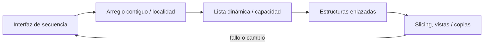
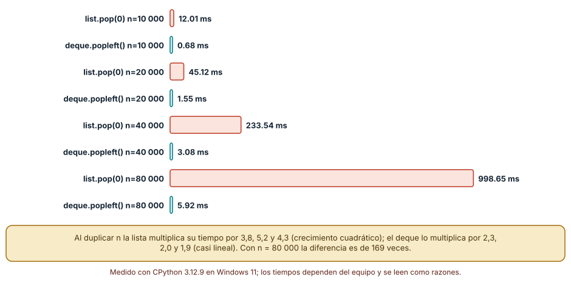
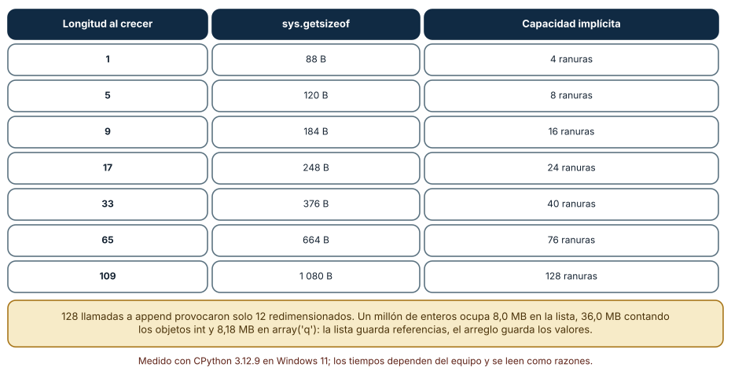
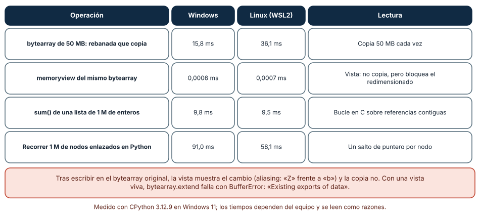

# SE-085 — Arreglos, listas y secuencias

[← SE-084 — Proyecto: comparación semántica con pruebas comunes](../../classes/part-06-paradigmas-de-programacion/se-084-proyecto-comparacion-semantica-con-pruebas-comunes/README.md) · [↑ Parte 07](../../classes/part-07-estructuras-de-datos-y-algoritmos/README.md) · [📚 Índice completo](../../classes/README.md) · [🌐 Portal](../../site/classes/SE-085.html) · [SE-086 — Pilas, colas, deques y prioridades →](../../classes/part-07-estructuras-de-datos-y-algoritmos/se-086-pilas-colas-deques-y-prioridades/README.md)


## Punto profesional y fundamento pedagógico

**Punto profesional.** La clase existe para elegir secuencias por acceso, inserción, localidad y representación.

**Por qué aparece aquí.** Se sitúa después de **Proyecto: comparación semántica con pruebas comunes** y antes de **Pilas, colas, deques y prioridades**: convierte el conocimiento anterior en una decisión observable que la clase siguiente podrá reutilizar. La continuidad se comprueba en el artefacto, no por compartir vocabulario.

**Error conceptual que debe corregir.** Tratar lista y arreglo como nombres intercambiables.

**Secuencia de aprendizaje.** Antes de leer la solución, el estudiante predice el resultado del caso normal y del error conceptual anterior. Luego explica un caso resuelto paso a paso, construye un contraejemplo que cambie la decisión y, sin consultar el texto, reconstruye el mecanismo y lo aplica a una entrada nueva. La secuencia usa predicción, explicación propia, contraste y recuperación. [ICAP](https://icap.education.asu.edu/research) distingue participación de construcción de conocimiento; [How People Learn II](https://nap.nationalacademies.org/catalog/24783/how-people-learn-ii-learners-contexts-and-cultures) exige conectar conocimiento previo, contexto y transferencia; la [práctica de recuperación](https://pubmed.ncbi.nlm.nih.gov/16507066/) respalda producir de nuevo la explicación tras una demora; y [Education for Life and Work](https://nap.nationalacademies.org/resource/13398/dbasse_084153.pdf) exige devolución que explique la causa del error.

**Evidencia de aprendizaje.** Sequence-bench.md con operaciones, tamaños, modelo de costo y medición. Debe contener predicción previa, observación, explicación causal, contraejemplo, criterio de aceptación y una nota de qué dato haría cambiar la conclusión.

**Límite de la conclusión.** Los costos concretos dependen de runtime y carga.

### Trazabilidad fuente → afirmación

| Fuente primaria u oficial | Afirmación que respalda | Lo que no prueba |
|---|---|---|
| [MIT 6.006 Introduction to Algorithms](https://ocw.mit.edu/courses/6-006-introduction-to-algorithms-spring-2020/) | Estructuras, algoritmos, corrección y análisis de complejidad; autoridad: MIT OpenCourseWare | No demuestra por sí sola que el artefacto del estudiante sea correcto. |
| [Python Data Model](https://docs.python.org/3/reference/datamodel.html) | Semántica de secuencias, conjuntos, mappings, igualdad y hash; autoridad: Python Software Foundation | No demuestra por sí sola que el artefacto del estudiante sea correcto. |
| [Python Debugging and Profiling](https://docs.python.org/3/library/debug.html) | Timeit, cprofile y tracemalloc con sus límites; autoridad: Python Software Foundation | No demuestra por sí sola que el artefacto del estudiante sea correcto. |

## Antes de empezar

Esta clase continúa la **biblioteca de estructuras y algoritmos de la Parte 07**. Recupera la evidencia de la clase anterior, añade una decisión propia de **Arreglos, listas y secuencias** y deja un artefacto que la clase siguiente deberá consumir. La pregunta activa es: **¿Qué cambia al elegir almacenamiento contiguo, secuencia dinámica o nodos enlazados?**

## Prerrequisitos

- Haber completado la clase anterior o reconstruir su contrato y evidencia.
- Python 3.11 o posterior, terminal, editor y Git; un segundo runtime es opcional y debe declararse.
- Trabajar con fixtures sintéticos: ninguna observación necesita datos de una persona o sistema real.

## Problema auténtico

La biblioteca de estructuras y algoritmos conserva casos en orden de llegada, consulta por posición y elimina vencidos. Una lista funciona con cien elementos, pero insertar al frente y copiar segmentos domina cuando la carga crece.

## Objetivos observables

Al terminar podrás explicar los cinco mecanismos de esta clase, predecir su comportamiento antes de ejecutar, construir un caso normal y uno límite, diagnosticar el fallo controlado, comparar una alternativa y entregar evidencia que otra persona pueda reproducir.

## Mapa conceptual



El mapa se lee como una cadena de razonamiento, no como fases obligatorias del runtime. La flecha de retorno indica que un fallo o cambio de requisito obliga a revisar el modelo inicial; no autoriza a parchear solo la última salida.

## Temas y por qué importan

| Tema | Por qué cambia una decisión profesional | Evidencia mínima |
|---|---|---|
| Interfaz de secuencia | Una secuencia ofrece orden, longitud, acceso e iteración; la interfaz no fija representación. | Predicción, traza causal y contraejemplo de **Interfaz de secuencia** en `sequence-bench.md` |
| Arreglo contiguo y localidad | Un arreglo coloca elementos o referencias en posiciones contiguas, permite índice constante bajo el modelo RAM y aprovecha caché. | Predicción, traza causal y contraejemplo de **Arreglo contiguo y localidad** en `sequence-bench.md` |
| Lista dinámica y capacidad | Una lista dinámica mantiene tamaño lógico y capacidad reservada. | Predicción, traza causal y contraejemplo de **Lista dinámica y capacidad** en `sequence-bench.md` |
| Estructuras enlazadas | Los nodos enlazados insertan localmente cuando ya se posee el nodo, pero localizar una posición sigue siendo lineal. | Predicción, traza causal y contraejemplo de **Estructuras enlazadas** en `sequence-bench.md` |
| Slicing, vistas y copias | Una rebanada puede copiar o crear una vista según tipo y biblioteca. | Predicción, traza causal y contraejemplo de **Slicing, vistas y copias** en `sequence-bench.md` |
## Conceptos y decisiones

### 1. Interfaz de secuencia

Una secuencia ofrece orden, longitud, acceso e iteración; la interfaz no fija representación. Antes de elegir se enumeran operaciones y frecuencia. Acceso aleatorio, inserción interior y recorrido no pueden optimizarse todos con la misma organización.

### 2. Arreglo contiguo y localidad

Un arreglo coloca elementos o referencias en posiciones contiguas, permite índice constante bajo el modelo RAM y aprovecha caché. Crecer puede requerir reservar y copiar; `O(1)` amortizado describe una secuencia de operaciones, no cada `append`.

### 3. Lista dinámica y capacidad

Una lista dinámica mantiene tamaño lógico y capacidad reservada. Cuando se agota, asigna un bloque mayor y mueve referencias. Ese mecanismo explica picos y memoria ociosa; medir solo la operación media puede ocultar una pausa relevante.

### 4. Estructuras enlazadas

Los nodos enlazados insertan localmente cuando ya se posee el nodo, pero localizar una posición sigue siendo lineal. Punteros, asignaciones y mala localidad pueden superar la ventaja teórica. En Python, la lista incorporada no es una linked list.

### 5. Slicing, vistas y copias

Una rebanada puede copiar o crear una vista según tipo y biblioteca. La complejidad y el aliasing cambian con esa decisión. La biblioteca de estructuras y algoritmos evita retener una gran colección por una vista pequeña y documenta cuándo una salida es snapshot o referencia viva.

### Una cola hecha con `pop(0)`: medir antes de culpar

El fallo clásico de la biblioteca es vaciar una cola de casos con `lista.pop(0)`. Cada extracción mueve todas las referencias restantes una posición hacia la izquierda, de modo que vaciar `n` elementos hace del orden de `n²/2` movimientos. Lo medimos con `n` = 10 000, 20 000, 40 000 y 80 000 (mínimo de tres ejecuciones): la lista tardó 12,0, 45,1, 233,5 y 998,7 ms; `collections.deque` con `popleft()` tardó 0,68, 1,55, 3,08 y 5,92 ms. Al duplicar `n`, la lista multiplicó su tiempo por 3,8, 5,2 y 4,3 (crecimiento cuadrático) y el deque por 2,3, 2,0 y 1,9 (casi lineal). Con 80 000 elementos la diferencia es de 169 veces. Un bucle de `insert(0, x)` mostró lo mismo: 28, 115 y 459 ms para 10 000, 20 000 y 40 000 inserciones.

El deque no es gratis en todo: guarda bloques enlazados y el acceso por índice al medio es lineal, por lo que pierde donde la lista gana. La conclusión no es «usa deque», sino «la operación dominante es sacar del frente, y la lista no está hecha para eso».



**Cómo leer la figura.** Cada par de barras corresponde a un tamaño. Lo que importa es cómo crece la barra coral al duplicar `n`, no su valor absoluto. **Dónde deja de valer:** los valores son de un equipo y un intérprete; en Linux (CPython 3.12.3) la proporción se mantuvo (875,7 ms frente a 10,6 ms con 80 000). Si la cola nunca supera unos cientos de elementos, `pop(0)` es aceptable (véase SE-095).

### Capacidad reservada: por qué `append` es barato en promedio

Una lista de Python guarda un arreglo de referencias con más espacio del que usa. Observamos el mecanismo sin tocar el intérprete: añadimos 128 elementos de uno en uno y registramos `sys.getsizeof` cada vez que cambia. El tamaño cambió solo 12 veces: con 1, 5, 9, 17, 25, 33, 41, 53, 65, 77, 93 y 109 elementos, pasando de 88 a 1 080 bytes. Restando los 56 bytes de la cabecera y dividiendo por 8 se obtiene la capacidad implícita: 4, 8, 16, 24, 32, 40, 52, 64, 76, 92, 108 y 128 ranuras. El crecimiento no es una duplicación exacta (CPython reserva aproximadamente un octavo adicional), pero el efecto es el mismo: cada redimensionado copia las referencias existentes, y el costo se reparte entre muchos `append`.

Esto explica por qué «`O(1)` amortizado» no equivale a «cada llamada cuesta lo mismo»: la llamada que dispara el redimensionado es más cara. También explica la memoria: un millón de enteros ocupó 8,0 MB como lista de referencias, 36,0 MB si se cuentan los objetos `int` a los que apuntan y 8,18 MB como `array('q')`, que guarda los valores en bruto. Un arreglo tipado ahorra memoria y mejora la localidad; a cambio, solo admite un tipo de valor.



**Cómo leer la figura.** Las filas muestran solo algunos de los doce redimensionados; la capacidad crece por escalones, no uno a uno. **Dónde deja de valer:** las cifras corresponden a CPython 3.12 de 64 bits. Otra versión u otro intérprete (PyPy, por ejemplo) usa otra política de crecimiento, y una lista de otro lenguaje puede crecer por factor 2. Se enseña el mecanismo, no las constantes.

### Vistas y copias: el mismo corte, dos semánticas

`bytearray[1:]` crea una copia; `memoryview(bytearray)[1:]` crea una vista sin copiar. Con un buffer de 50 MB, la rebanada que copia tardó 15,8 ms (36,1 ms en Linux) y la vista menos de un microsegundo. La vista, sin embargo, no es un valor sino una referencia viva: tras escribir `big[10] = 7`, la vista mostró 7, mientras que una copia hecha antes de escribir conservó el valor anterior. En un experimento pequeño, `b = bytearray(b'abcdef'); copia = b[1:3]; vista = memoryview(b)[1:3]; b[1] = ord('Z')` dejó la copia en `bc` y la vista en `Zc`. Además, mientras exista una vista, `b.extend(b'x')` falla con `BufferError: Existing exports of data: object cannot be re-sized`.

Los recorridos completan el cuadro. Sumar un millón de enteros con `sum(lista)` tardó 9,8 ms; recorrer un millón de nodos enlazados con un bucle de Python tardó 91,0 ms (58,1 ms en Linux). La estructura enlazada insertaría en `O(1)` si ya tuviéramos el nodo, pero localizar una posición sigue siendo lineal y cada salto de puntero es un acceso a memoria que la caché no puede anticipar. Otro error común de aliasing: `[[0]] * 3` crea tres referencias a la misma lista interna; al añadir un elemento a la primera, las tres midieron 2.



**Cómo leer la figura.** Compara las columnas Windows y Linux solo como razón entre filas; los milisegundos absolutos cambian de máquina a máquina. **Dónde deja de valer:** una vista evita la copia pero ata la vida del buffer original; si el contrato exige una instantánea (snapshot) estable, la copia es obligatoria. El recorrido enlazado se midió con nodos de Python con `__slots__`; en C o Rust, con asignación contigua, la diferencia con un arreglo sería otra.

## Definiciones de trabajo

- **interfaz de secuencia:** una secuencia ofrece orden, longitud, acceso e iteración; la interfaz no fija representación.
- **arreglo contiguo y localidad:** un arreglo coloca elementos o referencias en posiciones contiguas, permite índice constante bajo el modelo ram y aprovecha caché.
- **lista dinámica y capacidad:** una lista dinámica mantiene tamaño lógico y capacidad reservada.
- **estructuras enlazadas:** los nodos enlazados insertan localmente cuando ya se posee el nodo, pero localizar una posición sigue siendo lineal.
- **slicing, vistas y copias:** una rebanada puede copiar o crear una vista según tipo y biblioteca.

Las definiciones son operativas para la biblioteca de estructuras y algoritmos. No convierten términos con historia más amplia en sinónimos y deben contrastarse con la documentación primaria enlazada al final.

## Ejemplo mínimo

```python
cases = ["c1", "c2", "c3"]
assert cases[1] == "c2"
cases.append("c4")
expired = cases.pop(0)  # correcto, pero desplaza el resto
assert expired == "c1"
```

Antes de ejecutar, predice estado, resultado y error. Después registra versión, comando y salida. Si el fragmento es pseudocódigo o pertenece a otro lenguaje, etiquétalo como tal y no afirmes que fue ejecutado.

## Ejemplo profesional

En la biblioteca de estructuras y algoritmos, un caso conserva identidad, prioridad, dependencias, instante de llegada y estado de resolución. La implementación de esta clase debe conservar ese contrato aunque cambie la forma interna. El caso profesional no pregunta únicamente si produce una salida: pregunta quién puede producirla, qué estado observa, cómo falla y qué rastro permite disputar una decisión incorrecta.

Compara el caso normal con autorización falsa, evidencia incompleta, empate y repetición. Un mecanismo es apropiado cuando esas diferencias quedan visibles y localizadas; es peligroso cuando dependen de orden accidental, estado oculto o una convención que el consumidor no puede conocer.

## Práctica guiada

1. Copia el contrato de entrada y salida antes de escribir implementación.
2. Predice el caso normal y un límite; identifica la invariante que no puede romperse.
3. Implementa la versión mínima sin I/O dentro del núcleo.
4. Ejecuta el caso y conserva comando, versión y salida bajo `evidence/`.
5. Introduce el fallo controlado, reduce la reproducción y formula dos hipótesis rivales.
6. Corrige la causa, añade regresión y ejecuta el conjunto completo.
7. Compara con otro paradigma o lenguaje indicando qué semántica se preserva.

## Ejercicios

1. **Medición de una cola:** reproduce el vaciado con `pop(0)` y con `popleft()` para cuatro tamaños. Calcula la razón entre tiempos consecutivos y decide si el crecimiento es lineal o cuadrático.
2. **Capacidad:** añade 200 elementos a una lista y registra `sys.getsizeof` cuando cambie. Ajusta una regla para predecir el siguiente salto y comprueba si acierta.
3. **Aliasing:** construye una cuadrícula 3×3 de dos maneras (`[[0]*3]*3` y por comprensión), escribe una celda y explica por qué una de las dos maneras corrompe filas.
4. **Decisión:** para una carga con 90 % de lecturas por índice y 10 % de inserciones al frente, elige estructura y escribe qué medición cambiaría tu elección.

## Reto verificable

Entrega implementación, fixtures, pruebas y un informe corto. Se aprueba si otra persona ejecuta desde checkout limpio, obtiene los mismos resultados y puede relacionar cada rama o transformación con una regla del dominio. No se aprueba por cantidad de archivos ni por usar la sintaxis característica del paradigma.

## Caso conductor

La biblioteca de estructuras y algoritmos recibe casos del motor de reglas comparado, mantiene una frontera de trabajo priorizada y explica por qué el siguiente caso es elegible. Ejecuta una carga pequeña trazable, duplicados, prioridades iguales y una dependencia ausente. Cambia después una sola regla o condición y revisa qué archivos, pruebas y trazas debieron modificarse. Esa superficie de cambio alimenta el proyecto final de la parte.

## Preguntas frecuentes

### ¿Una lista de Python es una lista enlazada?

No. Es un arreglo dinámico de referencias: el acceso por índice es constante y insertar al frente es lineal. Las pruebas de `pop(0)` (12 ms frente a 0,68 ms con 10 000 elementos) lo muestran sin leer el código del intérprete.

### ¿Cuándo conviene `array('q')` en vez de una lista?

Cuando hay muchos números del mismo tipo y la memoria o la localidad importan: un millón de enteros ocupó 8,18 MB frente a 36 MB con sus objetos. No conviene si los valores son heterogéneos o si el código necesita objetos Python ricos.

### ¿Por qué `append` se llama «`O(1)` amortizado»?

Porque 128 llamadas provocaron solo 12 redimensionados: el costo de copiar se reparte. Se mide el promedio de una secuencia, no cada llamada; si una latencia máxima importa, se reserva capacidad o se usa otra estructura.

### ¿Una rebanada de lista es una vista?

No: `lista[a:b]` copia las referencias. Con `bytearray` también copia; solo `memoryview` crea una vista. Saber cuál se tiene decide si un cambio posterior en el original se ve o no.

## Fallo controlado y diagnóstico

Implementa una cola con `pop(0)` y mide lotes crecientes. Relaciona el crecimiento con desplazamiento lineal; no concluyas todavía que `deque` gana para toda operación.

Registra síntoma, entrada mínima, hipótesis, observación que descarta cada hipótesis, causa, corrección y prueba de regresión. No cambies simultáneamente implementación, fixture y expectativa.

Mide una cola con `pop(0)` en lotes de 10 000, 20 000, 40 000 y 80 000 elementos y registra el tiempo de cada uno. **Síntoma:** al duplicar el tamaño el tiempo se multiplica por más de 3 y se acerca a 5. **Hipótesis rivales:** (a) el recolector de basura o la memoria dominan; (b) el desplazamiento de referencias es lineal por extracción. **Prueba:** repite con `popleft()` y observa que el crecimiento baja a ~2; repite con una cola corta (balanceada, 78 elementos al final) y observa que `pop(0)` apenas pierde (4,4 ms frente a 3,8 ms). **Conclusión:** la causa es el desplazamiento, y su importancia depende de la longitud de la cola, no del hecho de usar `pop(0)`. No cambies a la vez la estructura y el tamaño de la prueba.

## Errores comunes y cómo corregirlos

| Síntoma | Causa probable | Corrección |
|---|---|---|
| Vaciar una cola de 80 000 elementos tarda casi un segundo | Se usa `lista.pop(0)` como operación dominante | Cambiar a `deque.popleft()` y repetir la medición con la misma carga |
| Tres filas de una cuadrícula cambian a la vez | `[[0]] * 3` repite la misma lista interna | Construir con `[[0] for _ in range(3)]` y probar una escritura aislada |
| Un campo de un registro aparece modificado en otro módulo | Se devolvió una vista (o la lista original) creyendo que era una copia | Documentar si la salida es instantánea o referencia viva y copiar en la frontera |
| `bytearray.extend` lanza `BufferError` | Hay un `memoryview` vivo sobre el buffer | Liberar la vista (`with memoryview(b) as v:`) antes de redimensionar |
| «Funciona con 100 elementos» pero no con 100 000 | Se midió un solo tamaño | Medir al menos cuatro tamaños y comparar cómo crece el tiempo al duplicar `n` |

## Entorno y archivos clave

```text
work/SE-085/
├── README.md
├── algorithm_library/
│   ├── domain.py
│   └── se_085.py
├── fixtures/cases.json
├── tests/test_se_085.py
└── evidence/diagnosis.md
```

El `README` declara plataforma, runtimes, comandos, limpieza y límites. Evita dependencias externas cuando la biblioteca estándar permita observar el mecanismo; si agregas una, fija procedencia y versión.

## Seguridad, ética y accesibilidad

- la autorización forma parte del dominio y no se infiere por ausencia de rechazo;
- no uses `eval`, reglas descargadas ni serialización insegura;
- limita colas, recursión, tamaño de entrada y tiempo de evaluación;
- redacta trazas y conserva una explicación textual además de color o animación;
- una recomendación automatizada debe poder revisarse, impugnarse y corregirse;
- respeta licencias de ejemplos y atribuye adaptaciones.

## Puente hacia el trabajo con agentes

Un agente que escribe código y ve que la prueba pasa con 100 elementos no sabe que `pop(0)` es cuadrático: necesita un criterio de aceptación con tamaños y un presupuesto de tiempo que el harness ejecute. Pídele que declare la operación dominante, que mida al menos cuatro tamaños y que adjunte las razones entre tiempos, no un solo número. Revisa especialmente si devuelve copias o vistas en las fronteras: es el tipo de error que una prueba con datos pequeños no detecta y que un agente reproduce sin darse cuenta.

## Transferencia

Traslada un fixture al segundo modelo o lenguaje. Compara representación de ausencia, error, mutabilidad, orden y cancelación. La transferencia está lograda cuando el contrato se conserva y las diferencias están explicadas, no cuando la sintaxis se parece.

## Evaluación y evidencia

| Criterio | Evidencia para aprobar |
|---|---|
| comprensión | explicación causal de los cinco mecanismos |
| corrección | normal, límite, inválido y contraejemplo |
| diseño | estado, efectos y contrato localizables |
| diagnóstico | reproducción mínima y regresión |
| transferencia | comparación semántica, no estética |
| reproducibilidad | versiones, comandos, salida y límites |


## Fuentes


- [MIT 6.006 Introduction to Algorithms](https://ocw.mit.edu/courses/6-006-introduction-to-algorithms-spring-2020/) — Estructuras, algoritmos, corrección y análisis de complejidad; autoridad: MIT OpenCourseWare.
- [Python Data Model](https://docs.python.org/3/reference/datamodel.html) — Semántica de secuencias, conjuntos, mappings, igualdad y hash; autoridad: Python Software Foundation.
- [Python Standard Library](https://docs.python.org/3/library/index.html) — Deque, heapq, bisect, graphlib y contenedores disponibles; autoridad: Python Software Foundation.
- [Python Debugging and Profiling](https://docs.python.org/3/library/debug.html) — Timeit, cprofile y tracemalloc con sus límites; autoridad: Python Software Foundation.
- [Mathematics for Computer Science](https://ocw.mit.edu/courses/6-042j-mathematics-for-computer-science-spring-2015/) — Inducción, grafos, conteo y razonamiento discreto; autoridad: MIT OpenCourseWare.
- [SWEBOK Guide v4.0a](https://www.computer.org/education/bodies-of-knowledge/software-engineering) — Construcción, medición y fundamentos de ingeniería; autoridad: IEEE Computer Society.

Cada fuente respalda el mecanismo indicado; ninguna demuestra que la implementación de la biblioteca de estructuras y algoritmos sea correcta. Esa afirmación depende de fixtures, pruebas, trazas y revisión reproducible.

- [Python: `collections.deque`](https://docs.python.org/3/library/collections.html#collections.deque) — contrato de `append`, `popleft` y `maxlen`; indica que el acceso al medio es `O(n)`.
- [Python: `array`](https://docs.python.org/3/library/array.html) — arreglos tipados con códigos de tipo y tamaño de elemento.
- [Python: tipos integrados, `memoryview`](https://docs.python.org/3/library/stdtypes.html#memoryview) — semántica de vistas sin copia sobre buffers.
- [Python Wiki: TimeComplexity](https://wiki.python.org/moin/TimeComplexity) — costos documentados de las operaciones de `list` y `deque`; son costos promedio de CPython.

## Límites y siguiente paso

La secuencia preserva orden pero no expresa por sí sola disciplina LIFO, FIFO o prioridad. La siguiente clase diseña esas políticas explícitamente.

## Glosario

- **interfaz de secuencia:** una secuencia ofrece orden, longitud, acceso e iteración; la interfaz no fija representación.
- **arreglo contiguo y localidad:** un arreglo coloca elementos o referencias en posiciones contiguas, permite índice constante bajo el modelo ram y aprovecha caché.
- **lista dinámica y capacidad:** una lista dinámica mantiene tamaño lógico y capacidad reservada.
- **estructuras enlazadas:** los nodos enlazados insertan localmente cuando ya se posee el nodo, pero localizar una posición sigue siendo lineal.
- **slicing, vistas y copias:** una rebanada puede copiar o crear una vista según tipo y biblioteca.

---

[← SE-084 — Proyecto: comparación semántica con pruebas comunes](../../classes/part-06-paradigmas-de-programacion/se-084-proyecto-comparacion-semantica-con-pruebas-comunes/README.md) · [↑ Parte 07](../../classes/part-07-estructuras-de-datos-y-algoritmos/README.md) · [📚 Índice completo](../../classes/README.md) · [🌐 Portal](../../site/classes/SE-085.html) · [SE-086 — Pilas, colas, deques y prioridades →](../../classes/part-07-estructuras-de-datos-y-algoritmos/se-086-pilas-colas-deques-y-prioridades/README.md)
