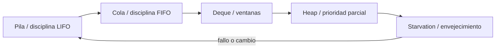
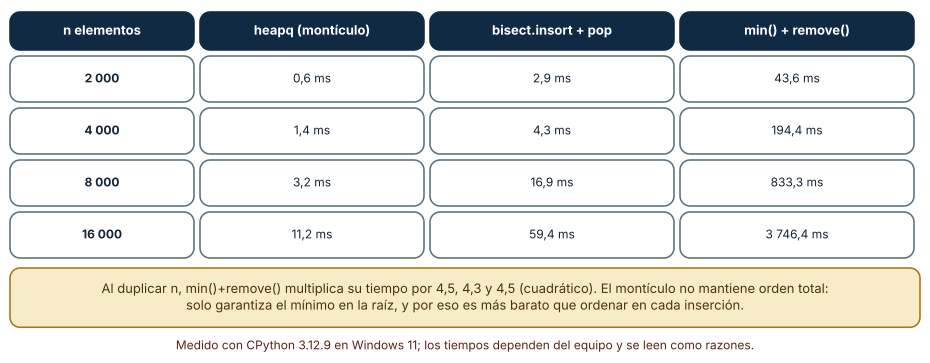
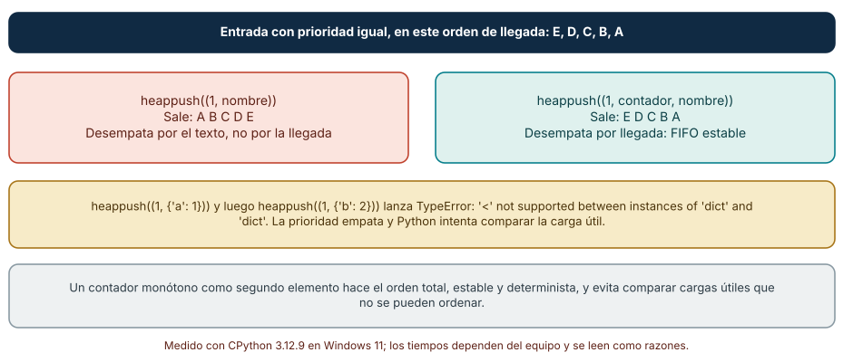
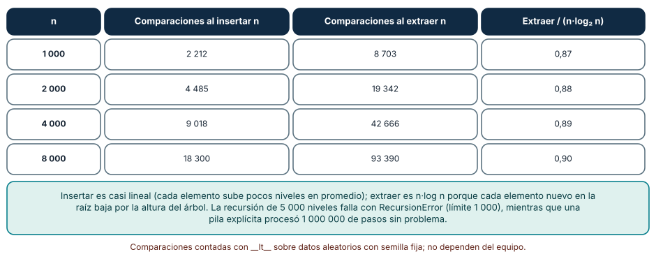

# SE-086 — Pilas, colas, deques y prioridades

[← SE-085 — Arreglos, listas y secuencias](../../classes/part-07-estructuras-de-datos-y-algoritmos/se-085-arreglos-listas-y-secuencias/README.md) · [↑ Parte 07](../../classes/part-07-estructuras-de-datos-y-algoritmos/README.md) · [📚 Índice completo](../../classes/README.md) · [🌐 Portal](../../site/classes/SE-086.html) · [SE-087 — Tablas hash, mapas y conjuntos →](../../classes/part-07-estructuras-de-datos-y-algoritmos/se-087-tablas-hash-mapas-y-conjuntos/README.md)


## Punto profesional y fundamento pedagógico

**Punto profesional.** La clase existe para usar pila, cola, deque o prioridad según la disciplina de extracción requerida.

**Por qué aparece aquí.** Se sitúa después de **Arreglos, listas y secuencias** y antes de **Tablas hash, mapas y conjuntos**: convierte el conocimiento anterior en una decisión observable que la clase siguiente podrá reutilizar. La continuidad se comprueba en el artefacto, no por compartir vocabulario.

**Error conceptual que debe corregir.** Elegir por API disponible sin preservar orden e igualdad de prioridad.

**Secuencia de aprendizaje.** Antes de leer la solución, el estudiante predice el resultado del caso normal y del error conceptual anterior. Luego explica un caso resuelto paso a paso, construye un contraejemplo que cambie la decisión y, sin consultar el texto, reconstruye el mecanismo y lo aplica a una entrada nueva. La secuencia usa predicción, explicación propia, contraste y recuperación. [ICAP](https://icap.education.asu.edu/research) distingue participación de construcción de conocimiento; [How People Learn II](https://nap.nationalacademies.org/catalog/24783/how-people-learn-ii-learners-contexts-and-cultures) exige conectar conocimiento previo, contexto y transferencia; la [práctica de recuperación](https://pubmed.ncbi.nlm.nih.gov/16507066/) respalda producir de nuevo la explicación tras una demora; y [Education for Life and Work](https://nap.nationalacademies.org/resource/13398/dbasse_084153.pdf) exige devolución que explique la causa del error.

**Evidencia de aprendizaje.** Queue-model.md con operaciones, invariante, empate y caso vacío. Debe contener predicción previa, observación, explicación causal, contraejemplo, criterio de aceptación y una nota de qué dato haría cambiar la conclusión.

**Límite de la conclusión.** La estructura no define por sí sola concurrencia ni persistencia.

### Trazabilidad fuente → afirmación

| Fuente primaria u oficial | Afirmación que respalda | Lo que no prueba |
|---|---|---|
| [MIT 6.006 Introduction to Algorithms](https://ocw.mit.edu/courses/6-006-introduction-to-algorithms-spring-2020/) | Estructuras, algoritmos, corrección y análisis de complejidad; autoridad: MIT OpenCourseWare | No demuestra por sí sola que el artefacto del estudiante sea correcto. |
| [Python Standard Library](https://docs.python.org/3/library/index.html) | Deque, heapq, bisect, graphlib y contenedores disponibles; autoridad: Python Software Foundation | No demuestra por sí sola que el artefacto del estudiante sea correcto. |
| [Python Data Model](https://docs.python.org/3/reference/datamodel.html) | Semántica de secuencias, conjuntos, mappings, igualdad y hash; autoridad: Python Software Foundation | No demuestra por sí sola que el artefacto del estudiante sea correcto. |

## Antes de empezar

Esta clase continúa la **biblioteca de estructuras y algoritmos de la Parte 07**. Recupera la evidencia de la clase anterior, añade una decisión propia de **Pilas, colas, deques y prioridades** y deja un artefacto que la clase siguiente deberá consumir. La pregunta activa es: **¿Cómo cambia el comportamiento cuando la estructura impone LIFO, FIFO o prioridad?**

## Prerrequisitos

- Haber completado la clase anterior o reconstruir su contrato y evidencia.
- Python 3.11 o posterior, terminal, editor y Git; un segundo runtime es opcional y debe declararse.
- Trabajar con fixtures sintéticos: ninguna observación necesita datos de una persona o sistema real.

## Problema auténtico

La biblioteca de estructuras y algoritmos mezcla trabajo urgente, reintentos y navegación de historial en una lista. El mismo método inserta en posiciones distintas y nadie puede afirmar qué caso saldrá después.

## Objetivos observables

Al terminar podrás explicar los cinco mecanismos de esta clase, predecir su comportamiento antes de ejecutar, construir un caso normal y uno límite, diagnosticar el fallo controlado, comparar una alternativa y entregar evidencia que otra persona pueda reproducir.

## Mapa conceptual



El mapa se lee como una cadena de razonamiento, no como fases obligatorias del runtime. La flecha de retorno indica que un fallo o cambio de requisito obliga a revisar el modelo inicial; no autoriza a parchear solo la última salida.

## Temas y por qué importan

| Tema | Por qué cambia una decisión profesional | Evidencia mínima |
|---|---|---|
| Pila y disciplina LIFO | Una pila expone `push`, `pop` y `peek`; el último elemento entra primero en salir. | Predicción, traza causal y contraejemplo de **Pila y disciplina LIFO** en `queue-model.md` |
| Cola y disciplina FIFO | Una cola conserva llegada entre elementos de la misma clase. | Predicción, traza causal y contraejemplo de **Cola y disciplina FIFO** en `queue-model.md` |
| Deque y ventanas | La cola doble inserta y retira en ambos extremos; sirve para ventanas deslizantes y work stealing bajo contratos específicos. | Predicción, traza causal y contraejemplo de **Deque y ventanas** en `queue-model.md` |
| Heap y prioridad parcial | Un heap mantiene el mínimo o máximo en la raíz y una propiedad local entre padre e hijos; no mantiene toda la colección ordenada. | Predicción, traza causal y contraejemplo de **Heap y prioridad parcial** en `queue-model.md` |
| Starvation y envejecimiento | Prioridad estricta puede posponer indefinidamente trabajo bajo. | Predicción, traza causal y contraejemplo de **Starvation y envejecimiento** en `queue-model.md` |
## Conceptos y decisiones

### 1. Pila y disciplina LIFO

Una pila expone `push`, `pop` y `peek`; el último elemento entra primero en salir. Modela deshacer, marcos y exploración en profundidad. Buscar arbitrariamente dentro rompe la abstracción y suele indicar que la carga necesita otra estructura.

### 2. Cola y disciplina FIFO

Una cola conserva llegada entre elementos de la misma clase. FIFO no garantiza equidad si un trabajo nunca termina ni si existen varias colas. `deque` permite extremos eficientes, pero operaciones interiores siguen otro costo.

### 3. Deque y ventanas

La cola doble inserta y retira en ambos extremos; sirve para ventanas deslizantes y work stealing bajo contratos específicos. No equivale a un arreglo con acceso aleatorio constante en toda posición. El límite máximo puede descartar elementos y debe hacerse visible.

### 4. Heap y prioridad parcial

Un heap mantiene el mínimo o máximo en la raíz y una propiedad local entre padre e hijos; no mantiene toda la colección ordenada. Insertar y extraer cuestan logarítmico, consultar la raíz constante. Empates requieren una clave estable para evitar comparar cargas incompatibles.

### 5. Starvation y envejecimiento

Prioridad estricta puede posponer indefinidamente trabajo bajo. Aging aumenta prioridad con espera o reserva capacidad por clase. Esa política pertenece al dominio y modifica qué significa correcto, no es un detalle de optimización.

### Prioridad: montículo, lista ordenada o búsqueda del mínimo

Una cola de prioridad responde «¿cuál es el siguiente?». Comparamos tres implementaciones con valores aleatorios (mínimo de tres ejecuciones): `heapq` (insertar y extraer todo), una lista mantenida ordenada con `bisect.insort` y vaciada con `pop()`, y la búsqueda repetida de `min()` seguida de `remove()`. Con 2 000, 4 000, 8 000 y 16 000 elementos tardaron 0,6, 1,4, 3,2 y 11,2 ms (montículo), 2,9, 4,3, 16,9 y 59,4 ms (lista ordenada) y 43,6, 194,4, 833,3 y 3 746 ms (mínimo y borrado). La tercera multiplica su tiempo por 4,5, 4,3 y 4,5 al duplicar `n`: es cuadrática. En Linux el orden se repitió (6,7 ms, 53,0 ms y 3 712 ms con 16 000).

Contamos también las comparaciones con una clase que cuenta cada llamada a `__lt__`: n inserciones cuestan unas 2,2 n comparaciones (2 212 con n = 1 000, 18 300 con 8 000) y n extracciones cuestan 8 703, 19 342, 42 666 y 93 390, entre 0,87 y 0,90 veces `n·log₂ n`. Por eso el montículo no mantiene orden total: solo asegura que el mínimo esté en la raíz, y esa renuncia es lo que lo hace barato.



**Cómo leer la figura.** Mira la última columna: el crecimiento por escalones de ×4 es la firma de una operación cuadrática. **Dónde deja de valer:** el montículo ofrece el mínimo, no recorrido en orden ni borrado de un elemento arbitrario sin trabajo extra. Si hace falta iterar ordenadamente o cambiar prioridades, la comparación cambia (véase la figura sobre empates).

### Empates: el desempate es parte del contrato

Inserta cinco tareas de la misma prioridad en el orden E, D, C, B, A. Con tuplas `(1, nombre)`, `heapq` las devuelve como A, B, C, D, E: desempata por el texto, no por la llegada. Con una tupla `(1, contador, nombre)`, devuelve E, D, C, B, A: es FIFO estable. La diferencia no es un detalle de implementación; es una decisión de política que, si no se escribe, queda fijada por el contenido de las cargas útiles. Y hay un segundo fallo: si la carga útil no es comparable, el empate dispara `TypeError: '<' not supported between instances of 'dict' and 'dict'`, y el error aparece en producción justo cuando dos tareas coinciden en prioridad.

La cola con límite también tiene semántica propia. `deque(maxlen=3)` al que se añaden seis elementos conserva `[3, 4, 5]`: descarta en silencio los más antiguos. Una cola acotada que descarta es una política de carga (conservar lo reciente); una que bloquea o rechaza es otra. La biblioteca debe elegir y registrar cuál ofrece.



**Cómo leer la figura.** La caja coral muestra una salida correcta en apariencia y equivocada como política; la caja verde muestra el contrato escrito. **Dónde deja de valer:** el contador monótono resuelve el desempate FIFO, pero no cambia prioridades ya insertadas ni elimina elementos arbitrarios. Para eso se usan entradas marcadas como eliminadas o estructuras de índice.

### Pilas y recursión: el límite de la pila de llamadas

Una pila (LIFO) convierte una recursión en un bucle explícito. En CPython la recursión tiene un límite: con `sys.getrecursionlimit()` = 1 000, una función recursiva simple de profundidad 5 000 lanzó `RecursionError`, mientras que una pila explícita (una lista con `append` y `pop`) procesó 1 000 000 de pasos sin problema. El mismo mecanismo apareció en la clase siguiente: un recorrido recursivo sobre una cadena de 5 001 nodos falla, y la versión con pila no.

La pila además sirve para validar estructuras anidadas. Un verificador de paréntesis con una pila acepta `([]{})` y rechaza `([)]`, `(((` y `)(` — cuatro de cinco casos de prueba distintos, cada uno con una razón distinta de fallo (cierre cruzado, apertura sin cierre, cierre sin apertura). Pensar la pila como el «estado pendiente» explica el algoritmo: lo último que se abrió debe cerrarse primero.



**Cómo leer la figura.** La última columna se acerca a 1: extraer cuesta aproximadamente `n·log₂ n`; insertar, mucho menos. **Dónde deja de valer:** el contador mide comparaciones, no tiempo. Cada comparación en Python cuesta más que en C, y una clave simple (entero) es más barata que una tupla. El límite de recursión es una política del intérprete, no una propiedad de la pila como estructura.

## Definiciones de trabajo

- **pila y disciplina lifo:** una pila expone `push`, `pop` y `peek`; el último elemento entra primero en salir.
- **cola y disciplina fifo:** una cola conserva llegada entre elementos de la misma clase.
- **deque y ventanas:** la cola doble inserta y retira en ambos extremos; sirve para ventanas deslizantes y work stealing bajo contratos específicos.
- **heap y prioridad parcial:** un heap mantiene el mínimo o máximo en la raíz y una propiedad local entre padre e hijos; no mantiene toda la colección ordenada.
- **starvation y envejecimiento:** prioridad estricta puede posponer indefinidamente trabajo bajo.

Las definiciones son operativas para la biblioteca de estructuras y algoritmos. No convierten términos con historia más amplia en sinónimos y deben contrastarse con la documentación primaria enlazada al final.

## Ejemplo mínimo

```python
import heapq
queue = []
heapq.heappush(queue, (10, 0, "case-old"))
heapq.heappush(queue, (5, 1, "case-urgent"))
assert heapq.heappop(queue)[2] == "case-urgent"
```

Antes de ejecutar, predice estado, resultado y error. Después registra versión, comando y salida. Si el fragmento es pseudocódigo o pertenece a otro lenguaje, etiquétalo como tal y no afirmes que fue ejecutado.

## Ejemplo profesional

En la biblioteca de estructuras y algoritmos, un caso conserva identidad, prioridad, dependencias, instante de llegada y estado de resolución. La implementación de esta clase debe conservar ese contrato aunque cambie la forma interna. El caso profesional no pregunta únicamente si produce una salida: pregunta quién puede producirla, qué estado observa, cómo falla y qué rastro permite disputar una decisión incorrecta.

Compara el caso normal con autorización falsa, evidencia incompleta, empate y repetición. Un mecanismo es apropiado cuando esas diferencias quedan visibles y localizadas; es peligroso cuando dependen de orden accidental, estado oculto o una convención que el consumidor no puede conocer.

## Práctica guiada

1. Copia el contrato de entrada y salida antes de escribir implementación.
2. Predice el caso normal y un límite; identifica la invariante que no puede romperse.
3. Implementa la versión mínima sin I/O dentro del núcleo.
4. Ejecuta el caso y conserva comando, versión y salida bajo `evidence/`.
5. Introduce el fallo controlado, reduce la reproducción y formula dos hipótesis rivales.
6. Corrige la causa, añade regresión y ejecuta el conjunto completo.
7. Compara con otro paradigma o lenguaje indicando qué semántica se preserva.

## Ejercicios

1. **Estabilidad:** inserta cinco tareas con la misma prioridad en un orden dado y demuestra, con y sin contador, qué orden sale. Escribe la política en una frase.
2. **Conteo:** instrumenta `__lt__` y verifica que extraer `n` elementos de un montículo cuesta aproximadamente `n·log₂ n` comparaciones.
3. **Pila:** implementa un verificador de paréntesis con una pila y prepara tres entradas inválidas con causas de fallo distintas.
4. **Límite:** escribe una función recursiva de profundidad 5 000 y su versión con pila explícita; documenta qué ocurre con `sys.getrecursionlimit()`.

## Reto verificable

Entrega implementación, fixtures, pruebas y un informe corto. Se aprueba si otra persona ejecuta desde checkout limpio, obtiene los mismos resultados y puede relacionar cada rama o transformación con una regla del dominio. No se aprueba por cantidad de archivos ni por usar la sintaxis característica del paradigma.

## Caso conductor

La biblioteca de estructuras y algoritmos recibe casos del motor de reglas comparado, mantiene una frontera de trabajo priorizada y explica por qué el siguiente caso es elegible. Ejecuta una carga pequeña trazable, duplicados, prioridades iguales y una dependencia ausente. Cambia después una sola regla o condición y revisa qué archivos, pruebas y trazas debieron modificarse. Esa superficie de cambio alimenta el proyecto final de la parte.

## Preguntas frecuentes

### ¿Cuándo usar `heapq` y cuándo una lista ordenada?

`heapq` si solo necesitas el mínimo repetidamente con inserciones intercaladas (11,2 ms con 16 000 elementos). Una lista ordenada con `bisect` si además necesitas consultas por rango o recorrer en orden. Medir con tus tamaños decide.

### ¿Por qué mis tareas con la misma prioridad salen en otro orden?

Porque el desempate lo decide la comparación de la carga útil. Añade un contador monótono como segundo elemento de la tupla; el orden de llegada pasa a ser parte del contrato.

### ¿Una cola con `maxlen` es segura?

Es segura contra el crecimiento sin límite, pero descarta en silencio los más antiguos. Si perder elementos es inaceptable, usa una cola que rechace o bloquee y registra el rechazo.

### ¿Puedo cambiar la prioridad de un elemento ya insertado?

No directamente en `heapq`. Se inserta una entrada nueva y se marca la anterior como inválida, o se usa una estructura con índice. Hay que decidirlo antes de elegir la estructura.

## Fallo controlado y diagnóstico

Usa `(priority, payload)` y crea dos prioridades iguales cuyos payloads no son comparables. Añade contador estable y prueba que el desempate respeta llegada.

Registra síntoma, entrada mínima, hipótesis, observación que descarta cada hipótesis, causa, corrección y prueba de regresión. No cambies simultáneamente implementación, fixture y expectativa.

Inserta en un `heapq` tuplas `(1, {'a': 1})` y `(1, {'b': 2})`. **Síntoma:** `TypeError` al segundo `heappush`. **Hipótesis rivales:** (a) la prioridad no es comparable; (b) la comparación pasa al segundo elemento cuando el primero empata. **Prueba:** cambia las prioridades a 1 y 2 y observa que ya no falla; vuelve a 1 y 1 y añade un contador `(1, 0, {...})` y `(1, 1, {...})`. **Conclusión:** el fallo aparece solo con empates, por lo que las pruebas con prioridades distintas no lo ven. Conserva el caso como regresión con empate explícito.

## Errores comunes y cómo corregirlos

| Síntoma | Causa probable | Corrección |
|---|---|---|
| Dos tareas con igual prioridad salen en orden alfabético | El desempate recae en el texto de la carga útil | Añadir un contador monótono como segundo elemento de la tupla |
| `TypeError` solo cuando dos prioridades coinciden | La comparación llega a cargas útiles no ordenables | Hacer que la tupla sea totalmente ordenable (prioridad, contador, carga) |
| La cola de prioridad tarda segundos con 16 000 elementos | Se busca el mínimo con `min()` y `remove()` en cada paso | Cambiar a `heapq` y medir al duplicar el tamaño |
| `RecursionError` en un recorrido con datos reales | Profundidad de datos mayor que el límite de recursión | Reescribir con una pila explícita y probar con 1 000 000 de pasos |
| Se pierden mensajes sin aviso | `deque(maxlen=n)` descarta los más antiguos | Elegir política (descartar, rechazar, bloquear) y registrar cada descarte |

## Entorno y archivos clave

```text
work/SE-086/
├── README.md
├── algorithm_library/
│   ├── domain.py
│   └── se_086.py
├── fixtures/cases.json
├── tests/test_se_086.py
└── evidence/diagnosis.md
```

El `README` declara plataforma, runtimes, comandos, limpieza y límites. Evita dependencias externas cuando la biblioteca estándar permita observar el mecanismo; si agregas una, fija procedencia y versión.

## Seguridad, ética y accesibilidad

- la autorización forma parte del dominio y no se infiere por ausencia de rechazo;
- no uses `eval`, reglas descargadas ni serialización insegura;
- limita colas, recursión, tamaño de entrada y tiempo de evaluación;
- redacta trazas y conserva una explicación textual además de color o animación;
- una recomendación automatizada debe poder revisarse, impugnarse y corregirse;
- respeta licencias de ejemplos y atribuye adaptaciones.

## Puente hacia el trabajo con agentes

Un agente que gestiona una cola de trabajos suele resolver los empates por accidente. Al revisar su código, exige tres cosas: qué orden produce un empate, qué pasa cuando la cola está llena y qué ocurre con el elemento más antiguo. Convierte esas tres respuestas en pruebas que el harness ejecute antes de aceptar el cambio; un agente rápido pero sin contrato de empate producirá un sistema que se comporta distinto según el contenido de los mensajes.

## Transferencia

Traslada un fixture al segundo modelo o lenguaje. Compara representación de ausencia, error, mutabilidad, orden y cancelación. La transferencia está lograda cuando el contrato se conserva y las diferencias están explicadas, no cuando la sintaxis se parece.

## Evaluación y evidencia

| Criterio | Evidencia para aprobar |
|---|---|
| comprensión | explicación causal de los cinco mecanismos |
| corrección | normal, límite, inválido y contraejemplo |
| diseño | estado, efectos y contrato localizables |
| diagnóstico | reproducción mínima y regresión |
| transferencia | comparación semántica, no estética |
| reproducibilidad | versiones, comandos, salida y límites |


## Fuentes


- [MIT 6.006 Introduction to Algorithms](https://ocw.mit.edu/courses/6-006-introduction-to-algorithms-spring-2020/) — Estructuras, algoritmos, corrección y análisis de complejidad; autoridad: MIT OpenCourseWare.
- [Python Data Model](https://docs.python.org/3/reference/datamodel.html) — Semántica de secuencias, conjuntos, mappings, igualdad y hash; autoridad: Python Software Foundation.
- [Python Standard Library](https://docs.python.org/3/library/index.html) — Deque, heapq, bisect, graphlib y contenedores disponibles; autoridad: Python Software Foundation.
- [Python Debugging and Profiling](https://docs.python.org/3/library/debug.html) — Timeit, cprofile y tracemalloc con sus límites; autoridad: Python Software Foundation.
- [Mathematics for Computer Science](https://ocw.mit.edu/courses/6-042j-mathematics-for-computer-science-spring-2015/) — Inducción, grafos, conteo y razonamiento discreto; autoridad: MIT OpenCourseWare.
- [SWEBOK Guide v4.0a](https://www.computer.org/education/bodies-of-knowledge/software-engineering) — Construcción, medición y fundamentos de ingeniería; autoridad: IEEE Computer Society.

Cada fuente respalda el mecanismo indicado; ninguna demuestra que la implementación de la biblioteca de estructuras y algoritmos sea correcta. Esa afirmación depende de fixtures, pruebas, trazas y revisión reproducible.

- [Python: `heapq`](https://docs.python.org/3/library/heapq.html) — contrato del montículo binario, notas sobre estabilidad de prioridades y entradas con contador.
- [Python: `bisect`](https://docs.python.org/3/library/bisect.html) — inserción y búsqueda en listas ordenadas; el módulo no ordena por ti.
- [Python: `queue`](https://docs.python.org/3/library/queue.html) — colas FIFO, LIFO y de prioridad seguras entre hilos.
- [Python: `sys.setrecursionlimit`](https://docs.python.org/3/library/sys.html#sys.setrecursionlimit) — límite de profundidad de la pila del intérprete y sus riesgos.

## Límites y siguiente paso

Una cola responde cuál sale después, no cómo encontrar identidad ni evitar duplicados. La siguiente clase añade mapas y conjuntos con contratos de igualdad y hash.

## Glosario

- **pila y disciplina lifo:** una pila expone `push`, `pop` y `peek`; el último elemento entra primero en salir.
- **cola y disciplina fifo:** una cola conserva llegada entre elementos de la misma clase.
- **deque y ventanas:** la cola doble inserta y retira en ambos extremos; sirve para ventanas deslizantes y work stealing bajo contratos específicos.
- **heap y prioridad parcial:** un heap mantiene el mínimo o máximo en la raíz y una propiedad local entre padre e hijos; no mantiene toda la colección ordenada.
- **starvation y envejecimiento:** prioridad estricta puede posponer indefinidamente trabajo bajo.

---

[← SE-085 — Arreglos, listas y secuencias](../../classes/part-07-estructuras-de-datos-y-algoritmos/se-085-arreglos-listas-y-secuencias/README.md) · [↑ Parte 07](../../classes/part-07-estructuras-de-datos-y-algoritmos/README.md) · [📚 Índice completo](../../classes/README.md) · [🌐 Portal](../../site/classes/SE-086.html) · [SE-087 — Tablas hash, mapas y conjuntos →](../../classes/part-07-estructuras-de-datos-y-algoritmos/se-087-tablas-hash-mapas-y-conjuntos/README.md)
