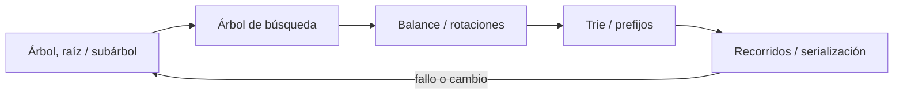
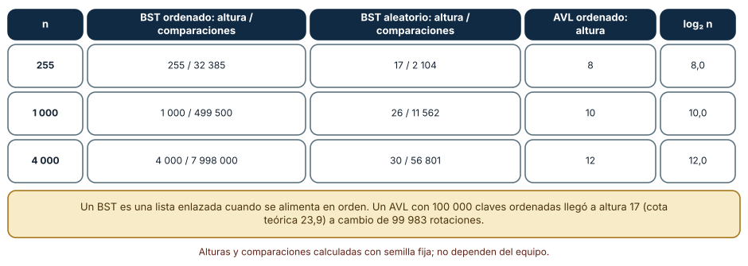
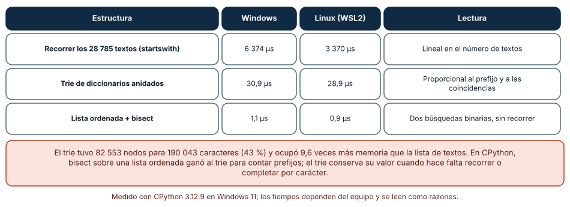
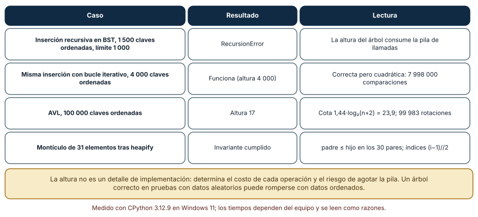

# SE-088 — Árboles, tries y estructuras jerárquicas

[← SE-087 — Tablas hash, mapas y conjuntos](../../classes/part-07-estructuras-de-datos-y-algoritmos/se-087-tablas-hash-mapas-y-conjuntos/README.md) · [↑ Parte 07](../../classes/part-07-estructuras-de-datos-y-algoritmos/README.md) · [📚 Índice completo](../../classes/README.md) · [🌐 Portal](../../site/classes/SE-088.html) · [SE-089 — Grafos y recorridos →](../../classes/part-07-estructuras-de-datos-y-algoritmos/se-089-grafos-y-recorridos/README.md)


## Punto profesional y fundamento pedagógico

**Punto profesional.** La clase existe para modelar jerarquías y prefijos con árboles o tries justificando recorrido y balance.

**Por qué aparece aquí.** Se sitúa después de **Tablas hash, mapas y conjuntos** y antes de **Grafos y recorridos**: convierte el conocimiento anterior en una decisión observable que la clase siguiente podrá reutilizar. La continuidad se comprueba en el artefacto, no por compartir vocabulario.

**Error conceptual que debe corregir.** Elegir árbol porque el dominio ‘parece jerárquico’.

**Secuencia de aprendizaje.** Antes de leer la solución, el estudiante predice el resultado del caso normal y del error conceptual anterior. Luego explica un caso resuelto paso a paso, construye un contraejemplo que cambie la decisión y, sin consultar el texto, reconstruye el mecanismo y lo aplica a una entrada nueva. La secuencia usa predicción, explicación propia, contraste y recuperación. [ICAP](https://icap.education.asu.edu/research) distingue participación de construcción de conocimiento; [How People Learn II](https://nap.nationalacademies.org/catalog/24783/how-people-learn-ii-learners-contexts-and-cultures) exige conectar conocimiento previo, contexto y transferencia; la [práctica de recuperación](https://pubmed.ncbi.nlm.nih.gov/16507066/) respalda producir de nuevo la explicación tras una demora; y [Education for Life and Work](https://nap.nationalacademies.org/resource/13398/dbasse_084153.pdf) exige devolución que explique la causa del error.

**Evidencia de aprendizaje.** Tree-invariants.md con inserción, recorrido, altura y árbol degenerado. Debe contener predicción previa, observación, explicación causal, contraejemplo, criterio de aceptación y una nota de qué dato haría cambiar la conclusión.

**Límite de la conclusión.** Un árbol lógico no implica representación enlazada.

### Trazabilidad fuente → afirmación

| Fuente primaria u oficial | Afirmación que respalda | Lo que no prueba |
|---|---|---|
| [MIT 6.006 Introduction to Algorithms](https://ocw.mit.edu/courses/6-006-introduction-to-algorithms-spring-2020/) | Estructuras, algoritmos, corrección y análisis de complejidad; autoridad: MIT OpenCourseWare | No demuestra por sí sola que el artefacto del estudiante sea correcto. |
| [Mathematics for Computer Science](https://ocw.mit.edu/courses/6-042j-mathematics-for-computer-science-spring-2015/) | Inducción, grafos, conteo y razonamiento discreto; autoridad: MIT OpenCourseWare | No demuestra por sí sola que el artefacto del estudiante sea correcto. |
| [SWEBOK Guide v4.0a](https://www.computer.org/education/bodies-of-knowledge/software-engineering) | Construcción, medición y fundamentos de ingeniería; autoridad: IEEE Computer Society | No demuestra por sí sola que el artefacto del estudiante sea correcto. |

## Antes de empezar

Esta clase continúa la **biblioteca de estructuras y algoritmos de la Parte 07**. Recupera la evidencia de la clase anterior, añade una decisión propia de **Árboles, tries y estructuras jerárquicas** y deja un artefacto que la clase siguiente deberá consumir. La pregunta activa es: **¿Qué invariante convierte una jerarquía en una estructura buscable?**

## Prerrequisitos

- Haber completado la clase anterior o reconstruir su contrato y evidencia.
- Python 3.11 o posterior, terminal, editor y Git; un segundo runtime es opcional y debe declararse.
- Trabajar con fixtures sintéticos: ninguna observación necesita datos de una persona o sistema real.

## Problema auténtico

La biblioteca de estructuras y algoritmos organiza casos por equipo, servicio y componente, y además necesita completar prefijos de etiquetas. Un diccionario plano duplica rutas y no puede listar un subárbol sin escanear todo.

## Objetivos observables

Al terminar podrás explicar los cinco mecanismos de esta clase, predecir su comportamiento antes de ejecutar, construir un caso normal y uno límite, diagnosticar el fallo controlado, comparar una alternativa y entregar evidencia que otra persona pueda reproducir.

## Mapa conceptual



El mapa se lee como una cadena de razonamiento, no como fases obligatorias del runtime. La flecha de retorno indica que un fallo o cambio de requisito obliga a revisar el modelo inicial; no autoriza a parchear solo la última salida.

## Temas y por qué importan

| Tema | Por qué cambia una decisión profesional | Evidencia mínima |
|---|---|---|
| Árbol, raíz y subárbol | Un árbol conecta nodos sin ciclos mediante relación padre-hijo y ofrece un camino único desde la raíz. | Predicción, traza causal y contraejemplo de **Árbol, raíz y subárbol** en `tree-invariants.md` |
| Árbol de búsqueda | En un BST, claves menores y mayores se separan por subárbol. | Predicción, traza causal y contraejemplo de **Árbol de búsqueda** en `tree-invariants.md` |
| Balance y rotaciones | Árboles AVL o rojo-negro acotan altura mediante metadatos y rotaciones que preservan orden. | Predicción, traza causal y contraejemplo de **Balance y rotaciones** en `tree-invariants.md` |
| Trie y prefijos | Un trie comparte prefijos a lo largo de aristas o nodos. | Predicción, traza causal y contraejemplo de **Trie y prefijos** en `tree-invariants.md` |
| Recorridos y serialización | Preorden sirve para copiar estructura, inorden produce claves ordenadas en un BST y postorden procesa hijos antes que padre. | Predicción, traza causal y contraejemplo de **Recorridos y serialización** en `tree-invariants.md` |
## Conceptos y decisiones

### 1. Árbol, raíz y subárbol

Un árbol conecta nodos sin ciclos mediante relación padre-hijo y ofrece un camino único desde la raíz. Profundidad, altura y grado describen forma. Una jerarquía organizacional puede no ser árbol si un nodo tiene varios padres; forzarla pierde relaciones.

### 2. Árbol de búsqueda

En un BST, claves menores y mayores se separan por subárbol. La búsqueda sigue una rama, pero cuesta proporcional a altura. Sin balance, inserciones ordenadas degeneran a lista y convierten el caso esperado logarítmico en lineal.

### 3. Balance y rotaciones

Árboles AVL o rojo-negro acotan altura mediante metadatos y rotaciones que preservan orden. La garantía cuesta trabajo en escritura y complejidad de implementación. La clase razona el mecanismo; no reimplementa un árbol productivo sin necesidad.

### 4. Trie y prefijos

Un trie comparte prefijos a lo largo de aristas o nodos. Buscar depende de longitud de la clave más que del número total, pero el alfabeto y nodos dispersos pueden consumir memoria. Comprimir caminos cambia representación, no el conjunto de claves.

### 5. Recorridos y serialización

Preorden sirve para copiar estructura, inorden produce claves ordenadas en un BST y postorden procesa hijos antes que padre. Recursión puede exceder pila en árboles profundos; una pila explícita hace visible el recurso.

### La altura manda: un árbol de búsqueda según el orden de inserción

Un árbol binario de búsqueda (BST) promete `O(log n)` si está equilibrado. Medimos la altura y las comparaciones acumuladas con tres cargas. Insertando 255, 1 000 y 4 000 claves **en orden**, la altura fue 255, 1 000 y 4 000 y las comparaciones sumaron 32 385, 499 500 y 7 998 000: una lista enlazada disfrazada. Con las mismas claves **barajadas**, la altura fue 17, 26 y 30 y las comparaciones 2 104, 11 562 y 56 801. Un árbol AVL insertando las claves en orden quedó en altura 8, 10 y 12, y con 100 000 claves llegó a 17 (la cota 1,44·log₂(n+2) vale 23,9) al coste de 99 983 rotaciones.

La lección es que el algoritmo correcto con datos aleatorios puede ser terrible con la entrada más natural: datos ya ordenados. Por eso se prueban las tres entradas (ordenada, inversa, aleatoria) y se mide la altura, no solo el resultado funcional.



**Cómo leer la figura.** Compara las dos columnas centrales: la misma estructura con las mismas claves, distinto orden de llegada. **Dónde deja de valer:** el AVL se implementó para el experimento con rotaciones simples y dobles; un árbol rojinegro, un B-tree o una lista ordenada con `bisect` tienen otros costos. La cota 1,44 log₂ vale para AVL, no para cualquier árbol equilibrado.

### Prefijos: trie, bisect y recorrido completo

Generamos 28 785 palabras sintéticas de 4 a 9 letras (190 043 caracteres) y contamos las que empiezan por `abc` (39). Tres soluciones dieron el mismo resultado: recorrer todas con `startswith` (6 374 µs en Windows, 3 370 µs en Linux), un trie de diccionarios anidados (30,9 µs y 28,9 µs) y una lista ordenada con dos búsquedas binarias (1,1 µs y 0,9 µs). El trie tuvo 82 553 nodos (43 % de los caracteres) pero ocupó 15,3 MB, 9,6 veces los 1,6 MB de la lista de textos.

El resultado incómodo es que, en CPython, `bisect` sobre una lista ordenada ganó al trie para contar. Esto no refuta el trie: el trie permite completar carácter a carácter, compartir prefijos y consultar «¿existe algún texto con este prefijo?» sin rangos. Lo que refuta es la idea de que la estructura más específica gana siempre. El criterio es la operación: para contar y paginar por prefijo sobre datos estáticos, una lista ordenada es más simple y más rápida; para autocompletar con inserciones frecuentes, el trie o una variante comprimida tiene sentido.



**Cómo leer la figura.** Fíjate en la última nota: el trie ocupó mucha más memoria que la lista de palabras. **Dónde deja de valer:** las palabras son sintéticas con un alfabeto de diez letras; un diccionario real tiene otra distribución de prefijos. Los diccionarios anidados de Python pagan mucha memoria por nodo; un trie en C o con arreglos compactos la reduciría.

### Recursión sobre árboles y el invariante del montículo

Una inserción recursiva en un BST con 1 500 claves ordenadas falló con `RecursionError` (límite 1 000), porque la profundidad de la recursión es la altura del árbol. La versión iterativa funcionó con 4 000 claves ordenadas, pero con 7 998 000 comparaciones. Una estructura jerárquica sin balanceo convierte la altura en un riesgo de pila y de tiempo a la vez.

El montículo binario muestra otra forma de jerarquía: un arreglo plano donde el padre del índice `i` es `(i − 1) // 2` y el invariante es *padre ≤ hijo*. Tras `heapify` de 31 valores aleatorios, el invariante se cumplió en los 30 pares padre-hijo. Un árbol puede vivir en un arreglo sin punteros; lo que lo hace árbol es el invariante, no la representación. Verificar el invariante tras cada operación es la prueba que más errores atrapa.



**Cómo leer la figura.** Cada fila es un experimento aislado con su lectura a la derecha. **Dónde deja de valer:** el límite de recursión es una política de CPython; otros lenguajes tienen otros límites. El invariante se comprobó para 31 elementos, que es una evidencia, no una demostración de corrección de `heapq`.

## Definiciones de trabajo

- **árbol, raíz y subárbol:** un árbol conecta nodos sin ciclos mediante relación padre-hijo y ofrece un camino único desde la raíz.
- **árbol de búsqueda:** en un bst, claves menores y mayores se separan por subárbol.
- **balance y rotaciones:** árboles avl o rojo-negro acotan altura mediante metadatos y rotaciones que preservan orden.
- **trie y prefijos:** un trie comparte prefijos a lo largo de aristas o nodos.
- **recorridos y serialización:** preorden sirve para copiar estructura, inorden produce claves ordenadas en un bst y postorden procesa hijos antes que padre.

Las definiciones son operativas para la biblioteca de estructuras y algoritmos. No convierten términos con historia más amplia en sinónimos y deben contrastarse con la documentación primaria enlazada al final.

## Ejemplo mínimo

```python
tree = {"platform": {"api": {"auth": {}, "billing": {}}}}
node = tree
for segment in "platform/api/auth".split("/"):
    node = node[segment]
assert node == {}
```

Antes de ejecutar, predice estado, resultado y error. Después registra versión, comando y salida. Si el fragmento es pseudocódigo o pertenece a otro lenguaje, etiquétalo como tal y no afirmes que fue ejecutado.

## Ejemplo profesional

En la biblioteca de estructuras y algoritmos, un caso conserva identidad, prioridad, dependencias, instante de llegada y estado de resolución. La implementación de esta clase debe conservar ese contrato aunque cambie la forma interna. El caso profesional no pregunta únicamente si produce una salida: pregunta quién puede producirla, qué estado observa, cómo falla y qué rastro permite disputar una decisión incorrecta.

Compara el caso normal con autorización falsa, evidencia incompleta, empate y repetición. Un mecanismo es apropiado cuando esas diferencias quedan visibles y localizadas; es peligroso cuando dependen de orden accidental, estado oculto o una convención que el consumidor no puede conocer.

## Práctica guiada

1. Copia el contrato de entrada y salida antes de escribir implementación.
2. Predice el caso normal y un límite; identifica la invariante que no puede romperse.
3. Implementa la versión mínima sin I/O dentro del núcleo.
4. Ejecuta el caso y conserva comando, versión y salida bajo `evidence/`.
5. Introduce el fallo controlado, reduce la reproducción y formula dos hipótesis rivales.
6. Corrige la causa, añade regresión y ejecuta el conjunto completo.
7. Compara con otro paradigma o lenguaje indicando qué semántica se preserva.

## Ejercicios

1. **Altura:** inserta 1 000 claves en orden y barajadas en un BST propio; registra altura y comparaciones, y calcula la razón con `log₂ n`.
2. **Prefijos:** genera 10 000 palabras y compara recorrido, trie y `bisect` para tres prefijos; mide también la memoria con `tracemalloc`.
3. **Invariante:** escribe una función que verifique padre ≤ hijo en un arreglo de montículo y úsala tras cada operación en una prueba aleatoria.
4. **Pila:** reescribe la inserción recursiva con un bucle y comprueba que soporta 4 000 claves ordenadas; mide el costo en comparaciones.

## Reto verificable

Entrega implementación, fixtures, pruebas y un informe corto. Se aprueba si otra persona ejecuta desde checkout limpio, obtiene los mismos resultados y puede relacionar cada rama o transformación con una regla del dominio. No se aprueba por cantidad de archivos ni por usar la sintaxis característica del paradigma.

## Caso conductor

La biblioteca de estructuras y algoritmos recibe casos del motor de reglas comparado, mantiene una frontera de trabajo priorizada y explica por qué el siguiente caso es elegible. Ejecuta una carga pequeña trazable, duplicados, prioridades iguales y una dependencia ausente. Cambia después una sola regla o condición y revisa qué archivos, pruebas y trazas debieron modificarse. Esa superficie de cambio alimenta el proyecto final de la parte.

## Preguntas frecuentes

### ¿Cuándo un árbol es mejor que un `dict`?

Cuando necesitas orden, rangos o vecinos (siguiente, anterior). Un `dict` no ofrece esas operaciones. Si solo consultas por clave exacta, el `dict` es más simple y más rápido.

### ¿Por qué mi BST es lento con datos ya ordenados?

Porque cada inserción cae a la derecha y la altura es n (4 000 claves ordenadas hicieron 7 998 000 comparaciones). Usa un árbol equilibrado, una lista ordenada con bisect o baraja la entrada si el contrato lo permite.

### ¿Un trie ahorra memoria?

No necesariamente: aquí 82 553 nodos de diccionario ocuparon 15,3 MB frente a 1,6 MB de la lista de textos. Comparte prefijos pero paga por nodo.

### ¿Cuándo la recursión sobre un árbol es un problema?

Cuando la altura puede superar el límite de recursión (1 000 por defecto). Con un árbol desequilibrado, usa una pila explícita o equilibra.

## Fallo controlado y diagnóstico

Inserta claves ordenadas en un BST sin balance y mide altura igual a `n`. Contrasta con entrada permutada y explica por qué el promedio no es garantía.

Registra síntoma, entrada mínima, hipótesis, observación que descarta cada hipótesis, causa, corrección y prueba de regresión. No cambies simultáneamente implementación, fixture y expectativa.

Inserta 1 500 claves ordenadas con una función recursiva y el límite de recursión por defecto. **Síntoma:** `RecursionError`. **Hipótesis rivales:** (a) la función tiene un error lógico; (b) la altura del árbol supera el límite. **Prueba:** inserta las mismas claves barajadas (altura ≈ 26) y observa que funciona; inserta ordenadas con un bucle y comprueba la altura 1 500. **Conclusión:** el código es correcto, el árbol está desequilibrado. Añade una prueba con entrada ordenada y registra la altura máxima aceptada.

## Errores comunes y cómo corregirlos

| Síntoma | Causa probable | Corrección |
|---|---|---|
| Inserción lenta y `RecursionError` con datos ordenados | BST sin balanceo con entrada ordenada | Equilibrar, barajar o usar una lista ordenada; probar las tres entradas |
| El trie consume más memoria que la lista de datos | Un diccionario por carácter paga cabecera por nodo | Medir con `tracemalloc` y valorar bisect o un trie comprimido |
| El montículo devuelve valores en un orden raro al recorrerlo | Se recorre el arreglo creyendo que está ordenado | Extraer con `heappop` o ordenar al final; el arreglo solo garantiza el mínimo |
| Búsqueda por prefijo incluye resultados que no corresponden | Límite superior mal calculado en la búsqueda binaria | Usar `prefijo + '\uffff'` o la siguiente cadena y probar prefijos vacíos y ausentes |
| El árbol correcto en pruebas falla en producción | Las pruebas usaron datos aleatorios | Añadir entradas ordenada, inversa y con duplicados |

## Entorno y archivos clave

```text
work/SE-088/
├── README.md
├── algorithm_library/
│   ├── domain.py
│   └── se_088.py
├── fixtures/cases.json
├── tests/test_se_088.py
└── evidence/diagnosis.md
```

El `README` declara plataforma, runtimes, comandos, limpieza y límites. Evita dependencias externas cuando la biblioteca estándar permita observar el mecanismo; si agregas una, fija procedencia y versión.

## Seguridad, ética y accesibilidad

- la autorización forma parte del dominio y no se infiere por ausencia de rechazo;
- no uses `eval`, reglas descargadas ni serialización insegura;
- limita colas, recursión, tamaño de entrada y tiempo de evaluación;
- redacta trazas y conserva una explicación textual además de color o animación;
- una recomendación automatizada debe poder revisarse, impugnarse y corregirse;
- respeta licencias de ejemplos y atribuye adaptaciones.

## Puente hacia el trabajo con agentes

Cuando un agente implementa un árbol o un índice jerárquico, pide la altura máxima que garantiza y la prueba con entrada ordenada. Un agente que solo prueba con datos aleatorios entrega una estructura que pasa todos los controles y se degrada con el primer lote ordenado. El harness puede incluir un generador de entradas adversarias (ordenada, inversa, repetida) y fallar si la altura o el tiempo exceden el presupuesto.

## Transferencia

Traslada un fixture al segundo modelo o lenguaje. Compara representación de ausencia, error, mutabilidad, orden y cancelación. La transferencia está lograda cuando el contrato se conserva y las diferencias están explicadas, no cuando la sintaxis se parece.

## Evaluación y evidencia

| Criterio | Evidencia para aprobar |
|---|---|
| comprensión | explicación causal de los cinco mecanismos |
| corrección | normal, límite, inválido y contraejemplo |
| diseño | estado, efectos y contrato localizables |
| diagnóstico | reproducción mínima y regresión |
| transferencia | comparación semántica, no estética |
| reproducibilidad | versiones, comandos, salida y límites |


## Fuentes


- [MIT 6.006 Introduction to Algorithms](https://ocw.mit.edu/courses/6-006-introduction-to-algorithms-spring-2020/) — Estructuras, algoritmos, corrección y análisis de complejidad; autoridad: MIT OpenCourseWare.
- [Python Data Model](https://docs.python.org/3/reference/datamodel.html) — Semántica de secuencias, conjuntos, mappings, igualdad y hash; autoridad: Python Software Foundation.
- [Python Standard Library](https://docs.python.org/3/library/index.html) — Deque, heapq, bisect, graphlib y contenedores disponibles; autoridad: Python Software Foundation.
- [Python Debugging and Profiling](https://docs.python.org/3/library/debug.html) — Timeit, cprofile y tracemalloc con sus límites; autoridad: Python Software Foundation.
- [Mathematics for Computer Science](https://ocw.mit.edu/courses/6-042j-mathematics-for-computer-science-spring-2015/) — Inducción, grafos, conteo y razonamiento discreto; autoridad: MIT OpenCourseWare.
- [SWEBOK Guide v4.0a](https://www.computer.org/education/bodies-of-knowledge/software-engineering) — Construcción, medición y fundamentos de ingeniería; autoridad: IEEE Computer Society.

Cada fuente respalda el mecanismo indicado; ninguna demuestra que la implementación de la biblioteca de estructuras y algoritmos sea correcta. Esa afirmación depende de fixtures, pruebas, trazas y revisión reproducible.

- [Python: `bisect`](https://docs.python.org/3/library/bisect.html) — búsqueda y ordenamiento incremental sobre listas ordenadas.
- [Python: `heapq`](https://docs.python.org/3/library/heapq.html) — montículo binario sobre listas y su invariante.
- [Python: `tracemalloc`](https://docs.python.org/3/library/tracemalloc.html) — medición de memoria asignada por el código Python, con su sobrecosto.
- [MIT 6.006: Binary Search Trees and AVL](https://ocw.mit.edu/courses/6-006-introduction-to-algorithms-spring-2020/) — árboles de búsqueda, AVL y análisis de altura.

## Límites y siguiente paso

Un árbol representa jerarquía, no dependencias arbitrarias o múltiples rutas. La siguiente clase generaliza a grafos y recorridos.

## Glosario

- **árbol, raíz y subárbol:** un árbol conecta nodos sin ciclos mediante relación padre-hijo y ofrece un camino único desde la raíz.
- **árbol de búsqueda:** en un bst, claves menores y mayores se separan por subárbol.
- **balance y rotaciones:** árboles avl o rojo-negro acotan altura mediante metadatos y rotaciones que preservan orden.
- **trie y prefijos:** un trie comparte prefijos a lo largo de aristas o nodos.
- **recorridos y serialización:** preorden sirve para copiar estructura, inorden produce claves ordenadas en un bst y postorden procesa hijos antes que padre.

---

[← SE-087 — Tablas hash, mapas y conjuntos](../../classes/part-07-estructuras-de-datos-y-algoritmos/se-087-tablas-hash-mapas-y-conjuntos/README.md) · [↑ Parte 07](../../classes/part-07-estructuras-de-datos-y-algoritmos/README.md) · [📚 Índice completo](../../classes/README.md) · [🌐 Portal](../../site/classes/SE-088.html) · [SE-089 — Grafos y recorridos →](../../classes/part-07-estructuras-de-datos-y-algoritmos/se-089-grafos-y-recorridos/README.md)
