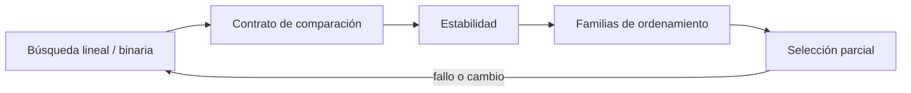
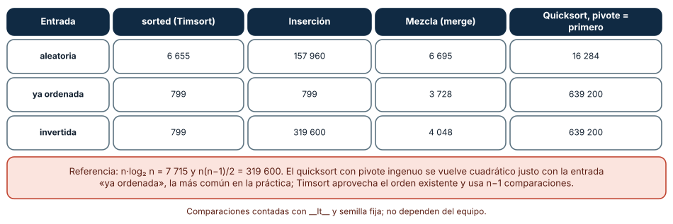
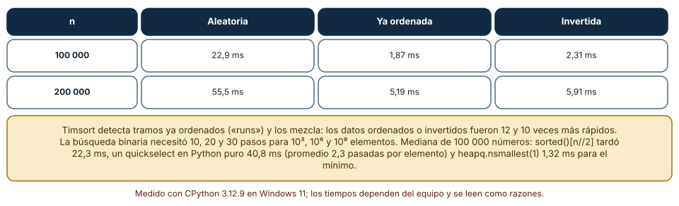
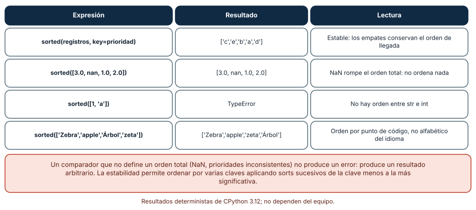

# SE-090 — Búsqueda, ordenamiento y selección

[← SE-089 — Grafos y recorridos](../../classes/part-07-estructuras-de-datos-y-algoritmos/se-089-grafos-y-recorridos/README.md) · [↑ Parte 07](../../classes/part-07-estructuras-de-datos-y-algoritmos/README.md) · [📚 Índice completo](../../classes/README.md) · [🌐 Portal](../../site/classes/SE-090.html) · [SE-091 — Algoritmos voraces y programación dinámica →](../../classes/part-07-estructuras-de-datos-y-algoritmos/se-091-algoritmos-voraces-y-programacion-dinamica/README.md)


## Punto profesional y fundamento pedagógico

**Punto profesional.** La clase existe para seleccionar búsqueda, ordenamiento y selección por precondiciones y estabilidad.

**Por qué aparece aquí.** Se sitúa después de **Grafos y recorridos** y antes de **Algoritmos voraces y programación dinámica**: convierte el conocimiento anterior en una decisión observable que la clase siguiente podrá reutilizar. La continuidad se comprueba en el artefacto, no por compartir vocabulario.

**Error conceptual que debe corregir.** Comparar solo tiempo final o ignorar que los datos ya están ordenados.

**Secuencia de aprendizaje.** Antes de leer la solución, el estudiante predice el resultado del caso normal y del error conceptual anterior. Luego explica un caso resuelto paso a paso, construye un contraejemplo que cambie la decisión y, sin consultar el texto, reconstruye el mecanismo y lo aplica a una entrada nueva. La secuencia usa predicción, explicación propia, contraste y recuperación. [ICAP](https://icap.education.asu.edu/research) distingue participación de construcción de conocimiento; [How People Learn II](https://nap.nationalacademies.org/catalog/24783/how-people-learn-ii-learners-contexts-and-cultures) exige conectar conocimiento previo, contexto y transferencia; la [práctica de recuperación](https://pubmed.ncbi.nlm.nih.gov/16507066/) respalda producir de nuevo la explicación tras una demora; y [Education for Life and Work](https://nap.nationalacademies.org/resource/13398/dbasse_084153.pdf) exige devolución que explique la causa del error.

**Evidencia de aprendizaje.** Algorithm-comparison.md con entradas, comparaciones, estabilidad y umbral. Debe contener predicción previa, observación, explicación causal, contraejemplo, criterio de aceptación y una nota de qué dato haría cambiar la conclusión.

**Límite de la conclusión.** Un microbenchmark no reemplaza análisis de crecimiento.

### Trazabilidad fuente → afirmación

| Fuente primaria u oficial | Afirmación que respalda | Lo que no prueba |
|---|---|---|
| [MIT 6.006 Introduction to Algorithms](https://ocw.mit.edu/courses/6-006-introduction-to-algorithms-spring-2020/) | Estructuras, algoritmos, corrección y análisis de complejidad; autoridad: MIT OpenCourseWare | No demuestra por sí sola que el artefacto del estudiante sea correcto. |
| [Python Standard Library](https://docs.python.org/3/library/index.html) | Deque, heapq, bisect, graphlib y contenedores disponibles; autoridad: Python Software Foundation | No demuestra por sí sola que el artefacto del estudiante sea correcto. |
| [Python Debugging and Profiling](https://docs.python.org/3/library/debug.html) | Timeit, cprofile y tracemalloc con sus límites; autoridad: Python Software Foundation | No demuestra por sí sola que el artefacto del estudiante sea correcto. |

## Antes de empezar

Esta clase continúa la **biblioteca de estructuras y algoritmos de la Parte 07**. Recupera la evidencia de la clase anterior, añade una decisión propia de **Búsqueda, ordenamiento y selección** y deja un artefacto que la clase siguiente deberá consumir. La pregunta activa es: **¿Qué precondición permite buscar, ordenar o seleccionar con una garantía concreta?**

## Prerrequisitos

- Haber completado la clase anterior o reconstruir su contrato y evidencia.
- Python 3.11 o posterior, terminal, editor y Git; un segundo runtime es opcional y debe declararse.
- Trabajar con fixtures sintéticos: ninguna observación necesita datos de una persona o sistema real.

## Problema auténtico

La biblioteca de estructuras y algoritmos ordena todo el backlog para mostrar los cinco casos principales. La salida es correcta, pero paga más trabajo que el necesario y un comparador no transitivo cambia resultados.

## Objetivos observables

Al terminar podrás explicar los cinco mecanismos de esta clase, predecir su comportamiento antes de ejecutar, construir un caso normal y uno límite, diagnosticar el fallo controlado, comparar una alternativa y entregar evidencia que otra persona pueda reproducir.

## Mapa conceptual



El mapa se lee como una cadena de razonamiento, no como fases obligatorias del runtime. La flecha de retorno indica que un fallo o cambio de requisito obliga a revisar el modelo inicial; no autoriza a parchear solo la última salida.

## Temas y por qué importan

| Tema | Por qué cambia una decisión profesional | Evidencia mínima |
|---|---|---|
| Búsqueda lineal y binaria | La búsqueda lineal no exige orden y puede detenerse al hallar; la binaria descarta media región bajo secuencia ordenada y acceso por índice. | Predicción, traza causal y contraejemplo de **Búsqueda lineal y binaria** en `algorithm-comparison.md` |
| Contrato de comparación | Ordenar requiere una relación consistente, normalmente total o una clave total derivada. | Predicción, traza causal y contraejemplo de **Contrato de comparación** en `algorithm-comparison.md` |
| Estabilidad | Un sort estable conserva orden relativo entre claves iguales. | Predicción, traza causal y contraejemplo de **Estabilidad** en `algorithm-comparison.md` |
| Familias de ordenamiento | Merge sort garantiza `n log n` y usa memoria adicional; quicksort depende de pivote y puede degradar; heapsort acota tiempo y opera con otros compromisos. | Predicción, traza causal y contraejemplo de **Familias de ordenamiento** en `algorithm-comparison.md` |
| Selección parcial | Para top-k, un heap de tamaño `k` evita ordenar todo y usa espacio acotado. | Predicción, traza causal y contraejemplo de **Selección parcial** en `algorithm-comparison.md` |
## Conceptos y decisiones

### 1. Búsqueda lineal y binaria

La búsqueda lineal no exige orden y puede detenerse al hallar; la binaria descarta media región bajo secuencia ordenada y acceso por índice. Si el orden se rompe entre consultas, el resultado puede ser incorrecto sin error.

### 2. Contrato de comparación

Ordenar requiere una relación consistente, normalmente total o una clave total derivada. Antisimetría, transitividad y tratamiento de iguales importan. Fechas sin zona o valores ausentes deben normalizarse antes del comparador.

### 3. Estabilidad

Un sort estable conserva orden relativo entre claves iguales. Permite ordenar por varias claves en pasadas o preservar llegada como desempate. Si la estabilidad no está garantizada, depender de ella convierte presentación en comportamiento accidental.

### 4. Familias de ordenamiento

Merge sort garantiza `n log n` y usa memoria adicional; quicksort depende de pivote y puede degradar; heapsort acota tiempo y opera con otros compromisos. Runtimes usan híbridos; comprenderlos evita inferir implementación desde el nombre `sort`.

### 5. Selección parcial

Para top-k, un heap de tamaño `k` evita ordenar todo y usa espacio acotado. Quickselect ofrece selección esperada lineal bajo pivotes adecuados. La mejor opción depende de si llegan datos en streaming, si k cambia y si se necesita salida ordenada.

### Contar comparaciones: el orden de entrada decide el algoritmo

Con una clase que cuenta cada `__lt__` ordenamos 800 elementos de tres maneras. Con **datos aleatorios**: `sorted` (Timsort) 6 655 comparaciones, inserción 157 960, mezcla 6 695 y quicksort con el primer elemento como pivote 16 284. Con **datos ya ordenados**: 799, 799, 3 728 y 639 200. Con **datos invertidos**: 799, 319 600, 4 048 y 639 200. Las referencias son `n·log₂ n` = 7 715 y `n(n−1)/2` = 319 600. La conclusión es incómoda: el quicksort ingenuo, el que muchos escriben primero, hace su peor trabajo (casi `n²`) justamente con la entrada ya ordenada, la más común en la práctica; la inserción es óptima con datos ordenados y pésima con invertidos; Timsort hace `n−1` comparaciones en ambos casos porque detecta tramos ya ordenados.

Contar comparaciones aísla el algoritmo del equipo: estos números no cambian de máquina a máquina, a diferencia de los milisegundos.



**Cómo leer la figura.** Lee cada columna: los números en coral indican entradas que hacen cuadrático a un algoritmo. **Dónde deja de valer:** el quicksort evaluado usa el primer elemento como pivote; con pivote aleatorio o mediana de tres el caso patológico desaparece para esta entrada, aunque no para todas. Las comparaciones no incluyen el costo de mover datos.

### Timsort y selección: aprovechar el orden que ya existe

Medimos `sorted()` con 100 000 y 200 000 flotantes: aleatorios tardó 22,9 y 55,5 ms; ya ordenados 1,87 y 5,19 ms; invertidos 2,31 y 5,91 ms (en Linux 1,38 y 1,41 ms con 100 000). Timsort detecta tramos ya ordenados («runs») y los mezcla, por eso lo ordenado es entre 10 y 12 veces más barato. La búsqueda binaria complementa la idea: necesitó 10, 20 y 30 pasos para 10³, 10⁶ y 10⁹ elementos, pero exige que el orden ya exista.

Para la mediana de 100 000 números comparamos `sorted()[n//2]` (22,3 ms), un quickselect de Python puro con pivote aleatorio (40,8 ms, con 2,33 comparaciones por elemento) y `heapq.nsmallest(1, …)` solo para el mínimo (1,32 ms). El algoritmo de selección es asintóticamente mejor (lineal frente a `n log n`), pero en CPython perdió contra el `sorted` implementado en C. Un resultado así es la razón de medir antes de reemplazar una función de biblioteca por una versión «más eficiente».



**Cómo leer la figura.** La razón entre la primera columna y las otras dos es el beneficio de los tramos ya ordenados. **Dónde deja de valer:** los tiempos corresponden a flotantes. Con objetos con comparaciones caras, o con muchos duplicados, los resultados cambian; y un quickselect escrito en C o en NumPy superaría al ordenamiento completo. Linux dio un quickselect de 13,5 ms: la diferencia entre sistemas muestra que esta comparación es frágil.

### Trampas del orden: estabilidad, NaN y tipos

`sorted(registros, key=prioridad)` con registros `[('b',1),('a',1),('c',0),('d',1),('e',0)]` devolvió `['c','e','b','a','d']`: los empates conservaron el orden de llegada (b antes de a), porque el ordenamiento es estable. Esa propiedad permite ordenar por varios criterios aplicando sorts sucesivos, del menos al más significativo. Tres trampas se midieron: `sorted([3.0, nan, 1.0, 2.0])` devolvió `[3.0, nan, 1.0, 2.0]`, es decir, no ordenó nada, porque NaN rompe el orden total (toda comparación con NaN es falsa); `sorted([1, 'a'])` lanza `TypeError`; y `sorted(['Zebra','apple','Árbol','zeta'])` dio `['Zebra','apple','zeta','Árbol']`, orden por punto de código, no alfabético del español.

El problema de fondo es el orden total: un comparador debe ser transitivo y consistente. Si no lo es, Timsort no falla con un error; produce un resultado arbitrario. Cuando el criterio viene de datos externos (prioridades, puntuaciones con valores ausentes), se normaliza antes de ordenar.



**Cómo leer la figura.** La columna derecha explica la causa; ninguna de las cuatro filas lanzó una advertencia salvo la del TypeError. **Dónde deja de valer:** las cuatro filas son de CPython 3.12. El orden de cadenas depende de la configuración regional si se usa `locale.strxfrm`; aquí se mostró el orden por defecto. Otros lenguajes tienen otras reglas con NaN.

## Definiciones de trabajo

- **búsqueda lineal y binaria:** la búsqueda lineal no exige orden y puede detenerse al hallar; la binaria descarta media región bajo secuencia ordenada y acceso por índice.
- **contrato de comparación:** ordenar requiere una relación consistente, normalmente total o una clave total derivada.
- **estabilidad:** un sort estable conserva orden relativo entre claves iguales.
- **familias de ordenamiento:** merge sort garantiza `n log n` y usa memoria adicional; quicksort depende de pivote y puede degradar; heapsort acota tiempo y opera con otros compromisos.
- **selección parcial:** para top-k, un heap de tamaño `k` evita ordenar todo y usa espacio acotado.

Las definiciones son operativas para la biblioteca de estructuras y algoritmos. No convierten términos con historia más amplia en sinónimos y deben contrastarse con la documentación primaria enlazada al final.

## Ejemplo mínimo

```python
import heapq
cases = [(8, "a"), (2, "b"), (9, "c"), (5, "d")]
top_two = heapq.nlargest(2, cases)
assert top_two == [(9, "c"), (8, "a")]
```

Antes de ejecutar, predice estado, resultado y error. Después registra versión, comando y salida. Si el fragmento es pseudocódigo o pertenece a otro lenguaje, etiquétalo como tal y no afirmes que fue ejecutado.

## Ejemplo profesional

En la biblioteca de estructuras y algoritmos, un caso conserva identidad, prioridad, dependencias, instante de llegada y estado de resolución. La implementación de esta clase debe conservar ese contrato aunque cambie la forma interna. El caso profesional no pregunta únicamente si produce una salida: pregunta quién puede producirla, qué estado observa, cómo falla y qué rastro permite disputar una decisión incorrecta.

Compara el caso normal con autorización falsa, evidencia incompleta, empate y repetición. Un mecanismo es apropiado cuando esas diferencias quedan visibles y localizadas; es peligroso cuando dependen de orden accidental, estado oculto o una convención que el consumidor no puede conocer.

## Práctica guiada

1. Copia el contrato de entrada y salida antes de escribir implementación.
2. Predice el caso normal y un límite; identifica la invariante que no puede romperse.
3. Implementa la versión mínima sin I/O dentro del núcleo.
4. Ejecuta el caso y conserva comando, versión y salida bajo `evidence/`.
5. Introduce el fallo controlado, reduce la reproducción y formula dos hipótesis rivales.
6. Corrige la causa, añade regresión y ejecuta el conjunto completo.
7. Compara con otro paradigma o lenguaje indicando qué semántica se preserva.

## Ejercicios

1. **Conteo:** instrumenta `__lt__` y cuenta comparaciones de inserción, mezcla y quicksort con 800 elementos aleatorios, ordenados e invertidos.
2. **Pivote:** cambia el pivote del quicksort a uno aleatorio y repite; explica por qué desaparece el caso cuadrático para la entrada ordenada.
3. **Selección:** compara `sorted()[n//2]` con tu quickselect para dos tamaños; ¿cuál gana y por qué?
4. **Trampas:** construye tres entradas que rompan un comparador (NaN, tipos, empates) y define cómo tu biblioteca debe reaccionar.

## Reto verificable

Entrega implementación, fixtures, pruebas y un informe corto. Se aprueba si otra persona ejecuta desde checkout limpio, obtiene los mismos resultados y puede relacionar cada rama o transformación con una regla del dominio. No se aprueba por cantidad de archivos ni por usar la sintaxis característica del paradigma.

## Caso conductor

La biblioteca de estructuras y algoritmos recibe casos del motor de reglas comparado, mantiene una frontera de trabajo priorizada y explica por qué el siguiente caso es elegible. Ejecuta una carga pequeña trazable, duplicados, prioridades iguales y una dependencia ausente. Cambia después una sola regla o condición y revisa qué archivos, pruebas y trazas debieron modificarse. Esa superficie de cambio alimenta el proyecto final de la parte.

## Preguntas frecuentes

### ¿Por qué `sorted` es tan rápido con datos ya ordenados?

Porque Timsort detecta tramos monótonos y los mezcla: 799 comparaciones para 800 elementos ordenados frente a 6 655 con datos aleatorios.

### ¿Sirve escribir mi propio ordenamiento?

Casi nunca en producción. Un quicksort ingenuo hizo 639 200 comparaciones con la entrada ordenada; el `sorted` de la biblioteca, 799. Se implementa para aprender y comparar, no para reemplazar la biblioteca.

### ¿Cuándo uso búsqueda binaria?

Cuando los datos ya están ordenados y se consultan varias veces: 30 pasos para mil millones de elementos. Si hay que ordenar primero para una sola consulta, no compensa.

### ¿Qué pasa si hay NaN en los datos?

`sorted` no falla; devuelve un orden sin sentido. Elimina o reemplaza los NaN antes de ordenar y valida el resultado.

## Fallo controlado y diagnóstico

Usa una clave aleatoria durante el sort y observa violación de consistencia. Calcula claves una vez y prueba estabilidad con prioridades iguales.

Registra síntoma, entrada mínima, hipótesis, observación que descarta cada hipótesis, causa, corrección y prueba de regresión. No cambies simultáneamente implementación, fixture y expectativa.

Implementa un quicksort que use el primer elemento como pivote y ordena una lista ya ordenada de 800 elementos. **Síntoma:** casi 40 veces las comparaciones que con datos aleatorios (639 200 frente a 16 284). **Hipótesis rivales:** (a) el algoritmo es incorrecto; (b) el pivote es el peor elemento posible en cada partición. **Prueba:** el resultado es correcto en ambos casos; con pivote aleatorio vuelve a ≈ `n log n`. **Conclusión:** la corrección y el costo son propiedades distintas; una implementación correcta puede ser inaceptable. Añade la entrada ordenada a la suite.

## Errores comunes y cómo corregirlos

| Síntoma | Causa probable | Corrección |
|---|---|---|
| El ordenamiento propio es lento con datos casi ordenados | Pivote fijo en un quicksort ingenuo | Usar `sorted` o un pivote aleatorio; probar con entrada ordenada |
| El resultado «ordenado» no está ordenado | Hay NaN o un comparador no transitivo | Normalizar el criterio y verificar con una prueba de orden total |
| Los empates cambian de orden entre versiones | Se supuso estabilidad en una estructura que no la garantiza | Ordenar con `sorted` (estable) o añadir un desempate explícito |
| `TypeError` al ordenar datos externos | Tipos mezclados | Validar y convertir antes; rechazar con un error propio |
| La búsqueda binaria devuelve una posición sin sentido | La lista no estaba ordenada | Comprobar la precondición o ordenar primero |

## Entorno y archivos clave

```text
work/SE-090/
├── README.md
├── algorithm_library/
│   ├── domain.py
│   └── se_090.py
├── fixtures/cases.json
├── tests/test_se_090.py
└── evidence/diagnosis.md
```

El `README` declara plataforma, runtimes, comandos, limpieza y límites. Evita dependencias externas cuando la biblioteca estándar permita observar el mecanismo; si agregas una, fija procedencia y versión.

## Seguridad, ética y accesibilidad

- la autorización forma parte del dominio y no se infiere por ausencia de rechazo;
- no uses `eval`, reglas descargadas ni serialización insegura;
- limita colas, recursión, tamaño de entrada y tiempo de evaluación;
- redacta trazas y conserva una explicación textual además de color o animación;
- una recomendación automatizada debe poder revisarse, impugnarse y corregirse;
- respeta licencias de ejemplos y atribuye adaptaciones.

## Puente hacia el trabajo con agentes

Un agente al que se le pide «optimiza este ordenamiento» tiene la tentación de sustituir `sorted` por una versión propia. Exige que compare con la biblioteca en tres tipos de entrada y reporte comparaciones, no solo milisegundos: en este experimento el quickselect en Python puro perdió contra el `sorted` en C. Un harness útil rechaza cambios que empeoren cualquiera de las tres entradas respecto de la línea base.

## Transferencia

Traslada un fixture al segundo modelo o lenguaje. Compara representación de ausencia, error, mutabilidad, orden y cancelación. La transferencia está lograda cuando el contrato se conserva y las diferencias están explicadas, no cuando la sintaxis se parece.

## Evaluación y evidencia

| Criterio | Evidencia para aprobar |
|---|---|
| comprensión | explicación causal de los cinco mecanismos |
| corrección | normal, límite, inválido y contraejemplo |
| diseño | estado, efectos y contrato localizables |
| diagnóstico | reproducción mínima y regresión |
| transferencia | comparación semántica, no estética |
| reproducibilidad | versiones, comandos, salida y límites |


## Fuentes


- [MIT 6.006 Introduction to Algorithms](https://ocw.mit.edu/courses/6-006-introduction-to-algorithms-spring-2020/) — Estructuras, algoritmos, corrección y análisis de complejidad; autoridad: MIT OpenCourseWare.
- [Python Data Model](https://docs.python.org/3/reference/datamodel.html) — Semántica de secuencias, conjuntos, mappings, igualdad y hash; autoridad: Python Software Foundation.
- [Python Standard Library](https://docs.python.org/3/library/index.html) — Deque, heapq, bisect, graphlib y contenedores disponibles; autoridad: Python Software Foundation.
- [Python Debugging and Profiling](https://docs.python.org/3/library/debug.html) — Timeit, cprofile y tracemalloc con sus límites; autoridad: Python Software Foundation.
- [Mathematics for Computer Science](https://ocw.mit.edu/courses/6-042j-mathematics-for-computer-science-spring-2015/) — Inducción, grafos, conteo y razonamiento discreto; autoridad: MIT OpenCourseWare.
- [SWEBOK Guide v4.0a](https://www.computer.org/education/bodies-of-knowledge/software-engineering) — Construcción, medición y fundamentos de ingeniería; autoridad: IEEE Computer Society.

Cada fuente respalda el mecanismo indicado; ninguna demuestra que la implementación de la biblioteca de estructuras y algoritmos sea correcta. Esa afirmación depende de fixtures, pruebas, trazas y revisión reproducible.

- [Python: Sorting HOW TO](https://docs.python.org/3/howto/sorting.html) — estabilidad, claves y el orden total que se espera de `sorted`.
- [Tim Peters, descripción de Timsort (`listsort.txt` de CPython)](https://github.com/python/cpython/blob/main/Objects/listsort.txt) — diseño de Timsort, tramos y estrategia de mezcla.
- [de Gouw et al., «OpenJDK's java.utils.Collections.sort() is broken» (CAV 2015)](https://doi.org/10.1007/978-3-319-21690-4_16) — error real en la implementación de Timsort de Java hallado con verificación formal.
- [Hoare, «Algorithm 64: Quicksort» (Communications of the ACM, 1961)](https://doi.org/10.1145/366622.366644) — origen del quicksort y de la partición.

## Límites y siguiente paso

Elegir top-k no resuelve decisiones secuenciales con subproblemas o restricciones. La siguiente clase compara estrategias voraces y programación dinámica.

## Glosario

- **búsqueda lineal y binaria:** la búsqueda lineal no exige orden y puede detenerse al hallar; la binaria descarta media región bajo secuencia ordenada y acceso por índice.
- **contrato de comparación:** ordenar requiere una relación consistente, normalmente total o una clave total derivada.
- **estabilidad:** un sort estable conserva orden relativo entre claves iguales.
- **familias de ordenamiento:** merge sort garantiza `n log n` y usa memoria adicional; quicksort depende de pivote y puede degradar; heapsort acota tiempo y opera con otros compromisos.
- **selección parcial:** para top-k, un heap de tamaño `k` evita ordenar todo y usa espacio acotado.

---

[← SE-089 — Grafos y recorridos](../../classes/part-07-estructuras-de-datos-y-algoritmos/se-089-grafos-y-recorridos/README.md) · [↑ Parte 07](../../classes/part-07-estructuras-de-datos-y-algoritmos/README.md) · [📚 Índice completo](../../classes/README.md) · [🌐 Portal](../../site/classes/SE-090.html) · [SE-091 — Algoritmos voraces y programación dinámica →](../../classes/part-07-estructuras-de-datos-y-algoritmos/se-091-algoritmos-voraces-y-programacion-dinamica/README.md)
