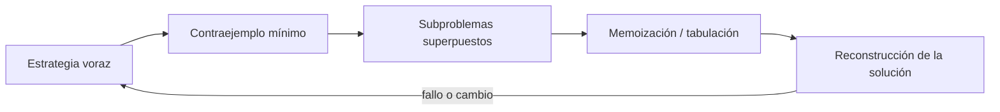
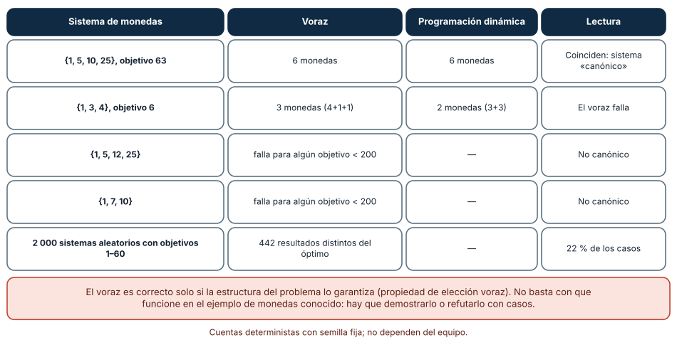
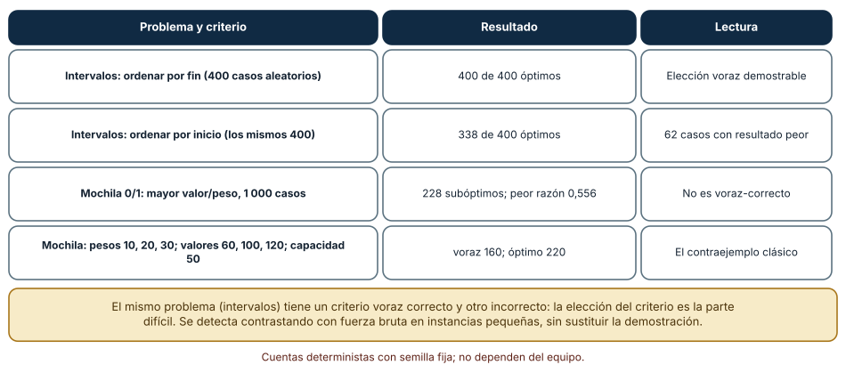
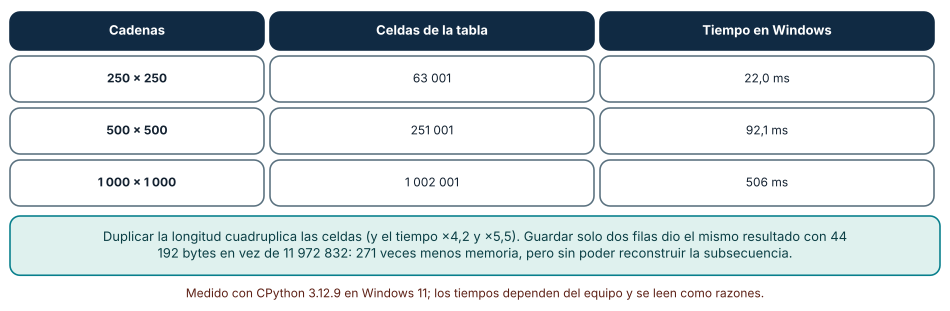

# SE-091 — Algoritmos voraces y programación dinámica

[← SE-090 — Búsqueda, ordenamiento y selección](../../classes/part-07-estructuras-de-datos-y-algoritmos/se-090-busqueda-ordenamiento-y-seleccion/README.md) · [↑ Parte 07](../../classes/part-07-estructuras-de-datos-y-algoritmos/README.md) · [📚 Índice completo](../../classes/README.md) · [🌐 Portal](../../site/classes/SE-091.html) · [SE-092 — Backtracking, divide y vencerás →](../../classes/part-07-estructuras-de-datos-y-algoritmos/se-092-backtracking-divide-y-venceras/README.md)


## Punto profesional y fundamento pedagógico

**Punto profesional.** La clase existe para distinguir elección voraz de subproblemas solapados y justificar optimalidad.

**Por qué aparece aquí.** Se sitúa después de **Búsqueda, ordenamiento y selección** y antes de **Backtracking, divide y vencerás**: convierte el conocimiento anterior en una decisión observable que la clase siguiente podrá reutilizar. La continuidad se comprueba en el artefacto, no por compartir vocabulario.

**Error conceptual que debe corregir.** Llamar dinámica a cualquier caché o asumir que una elección local es globalmente óptima.

**Secuencia de aprendizaje.** Antes de leer la solución, el estudiante predice el resultado del caso normal y del error conceptual anterior. Luego explica un caso resuelto paso a paso, construye un contraejemplo que cambie la decisión y, sin consultar el texto, reconstruye el mecanismo y lo aplica a una entrada nueva. La secuencia usa predicción, explicación propia, contraste y recuperación. [ICAP](https://icap.education.asu.edu/research) distingue participación de construcción de conocimiento; [How People Learn II](https://nap.nationalacademies.org/catalog/24783/how-people-learn-ii-learners-contexts-and-cultures) exige conectar conocimiento previo, contexto y transferencia; la [práctica de recuperación](https://pubmed.ncbi.nlm.nih.gov/16507066/) respalda producir de nuevo la explicación tras una demora; y [Education for Life and Work](https://nap.nationalacademies.org/resource/13398/dbasse_084153.pdf) exige devolución que explique la causa del error.

**Evidencia de aprendizaje.** Strategy-proof.md con recurrencia, propiedad voraz y contraejemplo. Debe contener predicción previa, observación, explicación causal, contraejemplo, criterio de aceptación y una nota de qué dato haría cambiar la conclusión.

**Límite de la conclusión.** La corrección depende de la estructura del problema.

### Trazabilidad fuente → afirmación

| Fuente primaria u oficial | Afirmación que respalda | Lo que no prueba |
|---|---|---|
| [MIT 6.006 Introduction to Algorithms](https://ocw.mit.edu/courses/6-006-introduction-to-algorithms-spring-2020/) | Estructuras, algoritmos, corrección y análisis de complejidad; autoridad: MIT OpenCourseWare | No demuestra por sí sola que el artefacto del estudiante sea correcto. |
| [Mathematics for Computer Science](https://ocw.mit.edu/courses/6-042j-mathematics-for-computer-science-spring-2015/) | Inducción, grafos, conteo y razonamiento discreto; autoridad: MIT OpenCourseWare | No demuestra por sí sola que el artefacto del estudiante sea correcto. |
| [SWEBOK Guide v4.0a](https://www.computer.org/education/bodies-of-knowledge/software-engineering) | Construcción, medición y fundamentos de ingeniería; autoridad: IEEE Computer Society | No demuestra por sí sola que el artefacto del estudiante sea correcto. |

## Antes de empezar

Esta clase continúa la **biblioteca de estructuras y algoritmos de la Parte 07**. Recupera la evidencia de la clase anterior, añade una decisión propia de **Algoritmos voraces y programación dinámica** y deja un artefacto que la clase siguiente deberá consumir. La pregunta activa es: **¿Cuándo una elección local es segura y cuándo debe conservarse historia de subproblemas?**

## Prerrequisitos

- Haber completado la clase anterior o reconstruir su contrato y evidencia.
- Python 3.11 o posterior, terminal, editor y Git; un segundo runtime es opcional y debe declararse.
- Trabajar con fixtures sintéticos: ninguna observación necesita datos de una persona o sistema real.

## Problema auténtico

La biblioteca de estructuras y algoritmos asigna capacidad limitada a casos con valor y costo. Elegir siempre la mayor prioridad parece correcto, pero bloquea una combinación de casos pequeños con mayor valor total.

## Objetivos observables

Al terminar podrás explicar los cinco mecanismos de esta clase, predecir su comportamiento antes de ejecutar, construir un caso normal y uno límite, diagnosticar el fallo controlado, comparar una alternativa y entregar evidencia que otra persona pueda reproducir.

## Mapa conceptual



El mapa se lee como una cadena de razonamiento, no como fases obligatorias del runtime. La flecha de retorno indica que un fallo o cambio de requisito obliga a revisar el modelo inicial; no autoriza a parchear solo la última salida.

## Temas y por qué importan

| Tema | Por qué cambia una decisión profesional | Evidencia mínima |
|---|---|---|
| Estrategia voraz | Un algoritmo voraz toma la mejor opción local y no retrocede. | Predicción, traza causal y contraejemplo de **Estrategia voraz** en `strategy-proof.md` |
| Contraejemplo mínimo | Cuando se propone una regla local, se busca la entrada más pequeña que la rompe. | Predicción, traza causal y contraejemplo de **Contraejemplo mínimo** en `strategy-proof.md` |
| Subproblemas superpuestos | Programación dinámica identifica estados que reaparecen y guarda sus soluciones. | Predicción, traza causal y contraejemplo de **Subproblemas superpuestos** en `strategy-proof.md` |
| Memoización y tabulación | Memoización resuelve bajo demanda con recursión; tabulación llena estados en un orden que satisface dependencias. | Predicción, traza causal y contraejemplo de **Memoización y tabulación** en `strategy-proof.md` |
| Reconstrucción de la solución | El valor óptimo no basta si se necesita explicar qué casos se eligieron. | Predicción, traza causal y contraejemplo de **Reconstrucción de la solución** en `strategy-proof.md` |
## Conceptos y decisiones

### 1. Estrategia voraz

Un algoritmo voraz toma la mejor opción local y no retrocede. Para ser correcto necesita estructura como elección segura y subestructura óptima. Que funcione en monedas canónicas o árboles de expansión no autoriza extrapolar a cualquier asignación.

### 2. Contraejemplo mínimo

Cuando se propone una regla local, se busca la entrada más pequeña que la rompe. Un contraejemplo no solo refuta: muestra qué interacción faltaba en el modelo. La biblioteca de estructuras y algoritmos conserva esos casos como pruebas y no los llama edge cases irrelevantes.

### 3. Subproblemas superpuestos

Programación dinámica identifica estados que reaparecen y guarda sus soluciones. El estado debe contener toda información necesaria para el futuro; omitir una dimensión produce caché rápida pero incorrecta. Añadir dimensiones indiscriminadamente explota memoria.

### 4. Memoización y tabulación

Memoización resuelve bajo demanda con recursión; tabulación llena estados en un orden que satisface dependencias. Ambas aplican la misma recurrencia, pero cambian accesibilidad, stack y estados visitados. Se elige según grafo de dependencia y límites.

### 5. Reconstrucción de la solución

El valor óptimo no basta si se necesita explicar qué casos se eligieron. Guardar predecesores o decisiones permite reconstruir. Empates deben seguir una política estable para que resultados y auditoría sean reproducibles.

### Cambio mínimo: un voraz que funciona y otro que no

El algoritmo voraz para dar cambio elige siempre la moneda más grande posible. Con {1, 5, 10, 25} y objetivo 63 da 6 monedas, igual que la programación dinámica. Con {1, 3, 4} y objetivo 6 da 3 (4+1+1), pero el óptimo son 2 (3+3). Probamos 2 000 sistemas de monedas aleatorios (que siempre incluyen la moneda 1) con objetivos de 1 a 60: en 442 casos (22,1 %) el voraz no fue óptimo. Entre cinco sistemas con objetivos hasta 199, {1, 5, 10, 25} y {1, 2, 5, 10} resultaron «canónicos» (el voraz coincide con el óptimo) y {1, 3, 4}, {1, 5, 12, 25} y {1, 7, 10} no.

La programación dinámica no adivina: define el subproblema («monedas mínimas para el importe `x`»), lo resuelve de menor a mayor y reutiliza resultados. Su corrección se apoya en la subestructura óptima. El voraz solo es correcto si además se demuestra la propiedad de elección voraz; que funcione en los ejemplos habituales no la prueba.



**Cómo leer la figura.** Las filas 2 a 4 son contraejemplos; la primera muestra por qué un sistema real engaña: funciona. **Dónde deja de valer:** la prueba aleatoria cubre importes pequeños; un sistema puede ser canónico para importes hasta 199 y fallar más allá. Es una refutación posible, no una prueba de corrección.

### Intervalos y mochila: el criterio es la parte difícil

La selección de actividades (el mayor número de intervalos sin solapes) admite un voraz correcto: ordenar por hora de fin. Con 400 instancias aleatorias de 3 a 9 intervalos comparamos con fuerza bruta: ordenar por **fin** coincidió con el óptimo en 400 de 400; ordenar por **inicio** solo en 338 de 400. Mismo problema, mismo esquema, otro criterio: 62 casos peores.

La mochila 0/1 no tiene voraz correcto. Elegir por mayor valor/peso fue subóptimo en 228 de 1 000 instancias aleatorias, con un peor caso de 0,556 del óptimo. El contraejemplo clásico: pesos 10, 20 y 30, valores 60, 100 y 120, capacidad 50; el voraz da 160 (toma 10 y 20) y el óptimo es 220 (toma 20 y 30). Si los objetos fueran divisibles, el voraz sería óptimo (mochila fraccionaria); la indivisibilidad lo rompe.



**Cómo leer la figura.** La diferencia entre la primera y segunda fila es solo el criterio de orden. **Dónde deja de valer:** las instancias son pequeñas para que la fuerza bruta sea posible; sobre instancias grandes no se puede verificar así. Un criterio que sobrevive a 400 pruebas aleatorias aún necesita una demostración.

### Programación dinámica: cuántas celdas, cuánta memoria

Para la subsecuencia común más larga (LCS) de dos cadenas de longitud `n`, la tabla tiene `(n+1)²` celdas: 63 001, 251 001 y 1 002 001 para n = 250, 500 y 1 000. El tiempo fue 22,0, 92,1 y 506 ms: al duplicar `n`, ×4,2 y ×5,5, coherente con crecimiento cuadrático. Medimos con `tracemalloc` la memoria pico con n = 1 000: 11,97 MB con la tabla completa y 44 192 bytes conservando solo dos filas, 271 veces menos. Ambas versiones dieron la misma longitud en un par de cadenas de 300 caracteres; es una comprobación, no una prueba de equivalencia.

Reducir a dos filas tiene un precio: ya no se puede reconstruir la subsecuencia (hace falta la tabla o información adicional). La decisión de diseño es qué se debe devolver: solo la longitud, o la subsecuencia. La memoria de una DP suele dominar antes que el tiempo.



**Cómo leer la figura.** La nota inferior contiene el contraste de memoria entre la tabla completa y las dos filas. **Dónde deja de valer:** el tiempo es de Python puro en un solo equipo (Linux: 29,6, 78,4 y 499,5 ms). Con NumPy o C la constante baja mucho. La reducción a dos filas vale para la longitud, no para recuperar el resultado.

## Definiciones de trabajo

- **estrategia voraz:** un algoritmo voraz toma la mejor opción local y no retrocede.
- **contraejemplo mínimo:** cuando se propone una regla local, se busca la entrada más pequeña que la rompe.
- **subproblemas superpuestos:** programación dinámica identifica estados que reaparecen y guarda sus soluciones.
- **memoización y tabulación:** memoización resuelve bajo demanda con recursión; tabulación llena estados en un orden que satisface dependencias.
- **reconstrucción de la solución:** el valor óptimo no basta si se necesita explicar qué casos se eligieron.

Las definiciones son operativas para la biblioteca de estructuras y algoritmos. No convierten términos con historia más amplia en sinónimos y deben contrastarse con la documentación primaria enlazada al final.

## Ejemplo mínimo

```python
# Capacidad 4: el voraz por valor individual elige A=7/costo4;
# B=4/costo2 + C=4/costo2 logra valor 8.
cases = [("A", 4, 7), ("B", 2, 4), ("C", 2, 4)]
```

Antes de ejecutar, predice estado, resultado y error. Después registra versión, comando y salida. Si el fragmento es pseudocódigo o pertenece a otro lenguaje, etiquétalo como tal y no afirmes que fue ejecutado.

## Ejemplo profesional

En la biblioteca de estructuras y algoritmos, un caso conserva identidad, prioridad, dependencias, instante de llegada y estado de resolución. La implementación de esta clase debe conservar ese contrato aunque cambie la forma interna. El caso profesional no pregunta únicamente si produce una salida: pregunta quién puede producirla, qué estado observa, cómo falla y qué rastro permite disputar una decisión incorrecta.

Compara el caso normal con autorización falsa, evidencia incompleta, empate y repetición. Un mecanismo es apropiado cuando esas diferencias quedan visibles y localizadas; es peligroso cuando dependen de orden accidental, estado oculto o una convención que el consumidor no puede conocer.

## Práctica guiada

1. Copia el contrato de entrada y salida antes de escribir implementación.
2. Predice el caso normal y un límite; identifica la invariante que no puede romperse.
3. Implementa la versión mínima sin I/O dentro del núcleo.
4. Ejecuta el caso y conserva comando, versión y salida bajo `evidence/`.
5. Introduce el fallo controlado, reduce la reproducción y formula dos hipótesis rivales.
6. Corrige la causa, añade regresión y ejecuta el conjunto completo.
7. Compara con otro paradigma o lenguaje indicando qué semántica se preserva.

## Ejercicios

1. **Contraejemplo:** busca con código un sistema de monedas de tres valores donde el voraz falle y entrega el menor importe que lo muestra.
2. **Criterio:** implementa selección de intervalos por inicio y por fin; contrástalos con fuerza bruta en 200 instancias y reporta el número de discrepancias.
3. **Mochila:** implementa DP y el voraz por razón; mide la fracción de instancias subóptimas y el peor cociente.
4. **Memoria:** calcula LCS con tabla completa y con dos filas, compara pico de memoria con `tracemalloc` y explica qué información pierdes.

## Reto verificable

Entrega implementación, fixtures, pruebas y un informe corto. Se aprueba si otra persona ejecuta desde checkout limpio, obtiene los mismos resultados y puede relacionar cada rama o transformación con una regla del dominio. No se aprueba por cantidad de archivos ni por usar la sintaxis característica del paradigma.

## Caso conductor

La biblioteca de estructuras y algoritmos recibe casos del motor de reglas comparado, mantiene una frontera de trabajo priorizada y explica por qué el siguiente caso es elegible. Ejecuta una carga pequeña trazable, duplicados, prioridades iguales y una dependencia ausente. Cambia después una sola regla o condición y revisa qué archivos, pruebas y trazas debieron modificarse. Esa superficie de cambio alimenta el proyecto final de la parte.

## Preguntas frecuentes

### ¿Cómo sé si un problema admite un voraz?

Con una demostración (intercambio o inducción) y con contraejemplos buscados activamente. Aquí el mismo problema de intervalos tuvo un criterio correcto (fin, 400/400) y otro incorrecto (inicio, 338/400).

### ¿Cuándo usar programación dinámica?

Cuando hay subproblemas que se repiten y subestructura óptima. Aquí LCS tiene `(n+1)²` subproblemas; la mochila 0/1 tiene capacidad × objetos.

### ¿Por qué la mochila voraz falla?

Porque los objetos no son divisibles: elegir el de mejor razón puede dejar capacidad sin usar. Con pesos 10, 20, 30 el voraz da 160 y el óptimo 220.

### ¿La DP siempre usa mucha memoria?

Puede reducirse: en LCS pasamos de 11,97 MB a 44 KB conservando dos filas, a costa de no poder reconstruir la solución.

## Fallo controlado y diagnóstico

Implementa greedy por valor y usa el ejemplo A/B/C. Luego define estado `dp[i][capacity]`, reconstruye selección y conserva el contraejemplo como regresión.

Registra síntoma, entrada mínima, hipótesis, observación que descarta cada hipótesis, causa, corrección y prueba de regresión. No cambies simultáneamente implementación, fixture y expectativa.

Aplica el voraz de monedas al sistema {1, 3, 4} con objetivo 6. **Síntoma:** devuelve 3 monedas y la DP devuelve 2. **Hipótesis rivales:** (a) hay un error de implementación del voraz; (b) el voraz no es correcto para este sistema. **Prueba:** el voraz funciona con {1, 5, 10, 25} (6 monedas para 63) y fracasa en 442 de 2 000 sistemas aleatorios; ejecuta ambos con objetivos 1 a 60. **Conclusión:** el defecto no está en el código, sino en el supuesto de elección voraz. Guarda el contraejemplo como prueba permanente.

## Errores comunes y cómo corregirlos

| Síntoma | Causa probable | Corrección |
|---|---|---|
| El cambio devuelto usa más monedas de las necesarias | Voraz con un sistema de monedas no canónico | Usar DP o demostrar que el sistema es canónico |
| El conteo de actividades es menor al esperado | Criterio de orden equivocado (por inicio) | Ordenar por fin y contrastar con fuerza bruta en casos pequeños |
| La mochila voraz difiere del óptimo | Se trató un problema indivisible como divisible | Usar DP o una cota explícita de aproximación |
| La DP agota la memoria con entradas grandes | Tabla completa innecesaria | Conservar solo las filas necesarias si no hace falta reconstruir |
| La DP da resultados distintos con índices en cero | Caso base mal definido | Probar vacío y un elemento; escribir el caso base en el contrato |

## Entorno y archivos clave

```text
work/SE-091/
├── README.md
├── algorithm_library/
│   ├── domain.py
│   └── se_091.py
├── fixtures/cases.json
├── tests/test_se_091.py
└── evidence/diagnosis.md
```

El `README` declara plataforma, runtimes, comandos, limpieza y límites. Evita dependencias externas cuando la biblioteca estándar permita observar el mecanismo; si agregas una, fija procedencia y versión.

## Seguridad, ética y accesibilidad

- la autorización forma parte del dominio y no se infiere por ausencia de rechazo;
- no uses `eval`, reglas descargadas ni serialización insegura;
- limita colas, recursión, tamaño de entrada y tiempo de evaluación;
- redacta trazas y conserva una explicación textual además de color o animación;
- una recomendación automatizada debe poder revisarse, impugnarse y corregirse;
- respeta licencias de ejemplos y atribuye adaptaciones.

## Puente hacia el trabajo con agentes

Un agente tiende a ofrecer un voraz porque es corto y pasa los ejemplos que se le dan. Pide dos cosas: una justificación (intercambio o inducción) y un contraste automático contra fuerza bruta o DP en instancias pequeñas aleatorias, con semilla fija. Con ese contraste el agente descubre por sí mismo que el criterio por inicio acierta en 338 de 400 casos y puede corregir antes de entregar; sin él, la entrega sería correcta «en los ejemplos».

## Transferencia

Traslada un fixture al segundo modelo o lenguaje. Compara representación de ausencia, error, mutabilidad, orden y cancelación. La transferencia está lograda cuando el contrato se conserva y las diferencias están explicadas, no cuando la sintaxis se parece.

## Evaluación y evidencia

| Criterio | Evidencia para aprobar |
|---|---|
| comprensión | explicación causal de los cinco mecanismos |
| corrección | normal, límite, inválido y contraejemplo |
| diseño | estado, efectos y contrato localizables |
| diagnóstico | reproducción mínima y regresión |
| transferencia | comparación semántica, no estética |
| reproducibilidad | versiones, comandos, salida y límites |


## Fuentes


- [MIT 6.006 Introduction to Algorithms](https://ocw.mit.edu/courses/6-006-introduction-to-algorithms-spring-2020/) — Estructuras, algoritmos, corrección y análisis de complejidad; autoridad: MIT OpenCourseWare.
- [Python Data Model](https://docs.python.org/3/reference/datamodel.html) — Semántica de secuencias, conjuntos, mappings, igualdad y hash; autoridad: Python Software Foundation.
- [Python Standard Library](https://docs.python.org/3/library/index.html) — Deque, heapq, bisect, graphlib y contenedores disponibles; autoridad: Python Software Foundation.
- [Python Debugging and Profiling](https://docs.python.org/3/library/debug.html) — Timeit, cprofile y tracemalloc con sus límites; autoridad: Python Software Foundation.
- [Mathematics for Computer Science](https://ocw.mit.edu/courses/6-042j-mathematics-for-computer-science-spring-2015/) — Inducción, grafos, conteo y razonamiento discreto; autoridad: MIT OpenCourseWare.
- [SWEBOK Guide v4.0a](https://www.computer.org/education/bodies-of-knowledge/software-engineering) — Construcción, medición y fundamentos de ingeniería; autoridad: IEEE Computer Society.

Cada fuente respalda el mecanismo indicado; ninguna demuestra que la implementación de la biblioteca de estructuras y algoritmos sea correcta. Esa afirmación depende de fixtures, pruebas, trazas y revisión reproducible.

- [MIT 6.006: Dynamic Programming](https://ocw.mit.edu/courses/6-006-introduction-to-algorithms-spring-2020/) — subproblemas, memoización y análisis de tabla.
- [Python: `functools.lru_cache`](https://docs.python.org/3/library/functools.html#functools.lru_cache) — memoización y sus límites de memoria.
- [Python: `tracemalloc`](https://docs.python.org/3/library/tracemalloc.html) — memoria pico y sobrecosto de la medición.
- [MIT 6.046J: Design and Analysis of Algorithms](https://ocw.mit.edu/courses/6-046j-design-and-analysis-of-algorithms-spring-2015/) — algoritmos voraces, programación dinámica y demostraciones de corrección.

## Límites y siguiente paso

La programación dinámica exige un estado finito y manejable. La siguiente clase estudia exploración, poda y descomposición cuando no basta llenar una tabla.

## Glosario

- **estrategia voraz:** un algoritmo voraz toma la mejor opción local y no retrocede.
- **contraejemplo mínimo:** cuando se propone una regla local, se busca la entrada más pequeña que la rompe.
- **subproblemas superpuestos:** programación dinámica identifica estados que reaparecen y guarda sus soluciones.
- **memoización y tabulación:** memoización resuelve bajo demanda con recursión; tabulación llena estados en un orden que satisface dependencias.
- **reconstrucción de la solución:** el valor óptimo no basta si se necesita explicar qué casos se eligieron.

---

[← SE-090 — Búsqueda, ordenamiento y selección](../../classes/part-07-estructuras-de-datos-y-algoritmos/se-090-busqueda-ordenamiento-y-seleccion/README.md) · [↑ Parte 07](../../classes/part-07-estructuras-de-datos-y-algoritmos/README.md) · [📚 Índice completo](../../classes/README.md) · [🌐 Portal](../../site/classes/SE-091.html) · [SE-092 — Backtracking, divide y vencerás →](../../classes/part-07-estructuras-de-datos-y-algoritmos/se-092-backtracking-divide-y-venceras/README.md)
