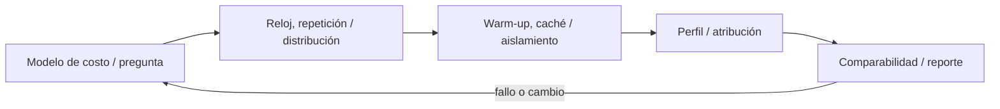
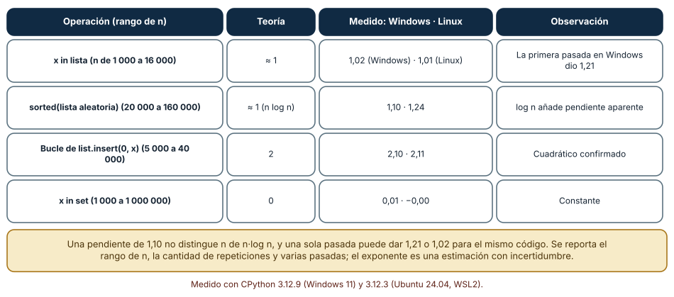
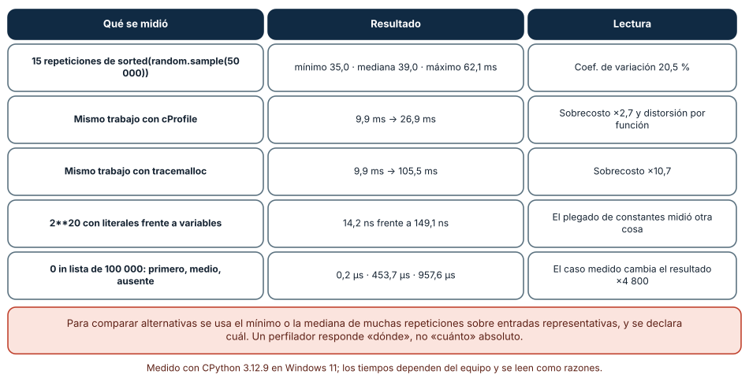
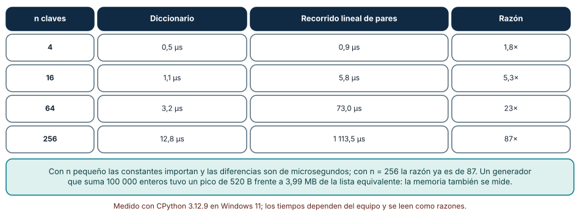

# SE-094 — Complejidad empírica, benchmarks y perfiles

[← SE-093 — Índices, probabilísticas y estructuras persistentes](../../classes/part-07-estructuras-de-datos-y-algoritmos/se-093-indices-probabilisticas-y-estructuras-persistentes/README.md) · [↑ Parte 07](../../classes/part-07-estructuras-de-datos-y-algoritmos/README.md) · [📚 Índice completo](../../classes/README.md) · [🌐 Portal](../../site/classes/SE-094.html) · [SE-095 — Taller: elegir por carga y no por costumbre →](../../classes/part-07-estructuras-de-datos-y-algoritmos/se-095-taller-elegir-por-carga-y-no-por-costumbre/README.md)


## Punto profesional y fundamento pedagógico

**Punto profesional.** La clase existe para confrontar el modelo de complejidad con mediciones reproducibles y perfiles.

**Por qué aparece aquí.** Se sitúa después de **Índices, probabilísticas y estructuras persistentes** y antes de **Taller: elegir por carga y no por costumbre**: convierte el conocimiento anterior en una decisión observable que la clase siguiente podrá reutilizar. La continuidad se comprueba en el artefacto, no por compartir vocabulario.

**Error conceptual que debe corregir.** Optimizar la función más lenta de una muestra sin evaluar representatividad.

**Secuencia de aprendizaje.** Antes de leer la solución, el estudiante predice el resultado del caso normal y del error conceptual anterior. Luego explica un caso resuelto paso a paso, construye un contraejemplo que cambie la decisión y, sin consultar el texto, reconstruye el mecanismo y lo aplica a una entrada nueva. La secuencia usa predicción, explicación propia, contraste y recuperación. [ICAP](https://icap.education.asu.edu/research) distingue participación de construcción de conocimiento; [How People Learn II](https://nap.nationalacademies.org/catalog/24783/how-people-learn-ii-learners-contexts-and-cultures) exige conectar conocimiento previo, contexto y transferencia; la [práctica de recuperación](https://pubmed.ncbi.nlm.nih.gov/16507066/) respalda producir de nuevo la explicación tras una demora; y [Education for Life and Work](https://nap.nationalacademies.org/resource/13398/dbasse_084153.pdf) exige devolución que explique la causa del error.

**Evidencia de aprendizaje.** Benchmark-report.md con warm-up, muestras, perfil, hipótesis y regresión. Debe contener predicción previa, observación, explicación causal, contraejemplo, criterio de aceptación y una nota de qué dato haría cambiar la conclusión.

**Límite de la conclusión.** El profiler altera la ejecución y una máquina no representa todas.

### Trazabilidad fuente → afirmación

| Fuente primaria u oficial | Afirmación que respalda | Lo que no prueba |
|---|---|---|
| [Python Debugging and Profiling](https://docs.python.org/3/library/debug.html) | Timeit, cprofile y tracemalloc con sus límites; autoridad: Python Software Foundation | No demuestra por sí sola que el artefacto del estudiante sea correcto. |
| [MIT 6.006 Introduction to Algorithms](https://ocw.mit.edu/courses/6-006-introduction-to-algorithms-spring-2020/) | Estructuras, algoritmos, corrección y análisis de complejidad; autoridad: MIT OpenCourseWare | No demuestra por sí sola que el artefacto del estudiante sea correcto. |
| [SWEBOK Guide v4.0a](https://www.computer.org/education/bodies-of-knowledge/software-engineering) | Construcción, medición y fundamentos de ingeniería; autoridad: IEEE Computer Society | No demuestra por sí sola que el artefacto del estudiante sea correcto. |

## Antes de empezar

Esta clase continúa la **biblioteca de estructuras y algoritmos de la Parte 07**. Recupera la evidencia de la clase anterior, añade una decisión propia de **Complejidad empírica, benchmarks y perfiles** y deja un artefacto que la clase siguiente deberá consumir. La pregunta activa es: **¿Cómo medir costo sin convertir ruido, calentamiento o una carga irreal en conclusión?**

## Prerrequisitos

- Haber completado la clase anterior o reconstruir su contrato y evidencia.
- Python 3.11 o posterior, terminal, editor y Git; un segundo runtime es opcional y debe declararse.
- Trabajar con fixtures sintéticos: ninguna observación necesita datos de una persona o sistema real.

## Problema auténtico

Dos implementaciones de la biblioteca de estructuras y algoritmos difieren pocos milisegundos en una ejecución. El equipo quiere elegir la más rápida, pero cada prueba incluye generación de datos, logging y distinto orden de calentamiento.

## Objetivos observables

Al terminar podrás explicar los cinco mecanismos de esta clase, predecir su comportamiento antes de ejecutar, construir un caso normal y uno límite, diagnosticar el fallo controlado, comparar una alternativa y entregar evidencia que otra persona pueda reproducir.

## Mapa conceptual



El mapa se lee como una cadena de razonamiento, no como fases obligatorias del runtime. La flecha de retorno indica que un fallo o cambio de requisito obliga a revisar el modelo inicial; no autoriza a parchear solo la última salida.

## Temas y por qué importan

| Tema | Por qué cambia una decisión profesional | Evidencia mínima |
|---|---|---|
| Modelo de costo y pregunta | Antes de medir se formula qué operación, tamaño, distribución y recurso importan. | Predicción, traza causal y contraejemplo de **Modelo de costo y pregunta** en `benchmark-report.md` |
| Reloj, repetición y distribución | Se usa reloj monotónico, múltiples repeticiones y estadísticos robustos. | Predicción, traza causal y contraejemplo de **Reloj, repetición y distribución** en `benchmark-report.md` |
| Warm-up, caché y aislamiento | Importación, JIT, page cache y asignadores cambian primeras corridas. | Predicción, traza causal y contraejemplo de **Warm-up, caché y aislamiento** en `benchmark-report.md` |
| Perfil y atribución | Un profiler atribuye tiempo o asignaciones a funciones y líneas según su método. | Predicción, traza causal y contraejemplo de **Perfil y atribución** en `benchmark-report.md` |
| Comparabilidad y reporte | Misma entrada, versión, afinidad razonable y estado del sistema hacen resultados comparables. | Predicción, traza causal y contraejemplo de **Comparabilidad y reporte** en `benchmark-report.md` |
## Conceptos y decisiones

### 1. Modelo de costo y pregunta

Antes de medir se formula qué operación, tamaño, distribución y recurso importan. Big-O acota crecimiento; benchmark estima comportamiento en un entorno. Uno no sustituye al otro y ambos pueden ser irrelevantes si la carga está mal modelada.

### 2. Reloj, repetición y distribución

Se usa reloj monotónico, múltiples repeticiones y estadísticos robustos. El mínimo puede aproximar menor interferencia; mediana describe centro; percentiles muestran cola. Promedio sin distribución oculta pausas y outliers.

### 3. Warm-up, caché y aislamiento

Importación, JIT, page cache y asignadores cambian primeras corridas. Aleatorizar orden reduce sesgo, pero caches también son parte de algunas cargas reales. El protocolo declara qué se calienta y qué se reinicia.

### 4. Perfil y atribución

Un profiler atribuye tiempo o asignaciones a funciones y líneas según su método. Instrumentar altera ejecución; muestrear pierde eventos cortos. Se usa para generar hipótesis, luego un experimento enfocado confirma el cambio.

### 5. Comparabilidad y reporte

Misma entrada, versión, afinidad razonable y estado del sistema hacen resultados comparables. Velocidad sin memoria, corrección y mantenibilidad no decide. El informe conserva datos crudos, comando y límites, no solo una gráfica atractiva.

### Estimar el exponente en lugar de adivinarlo

Una medición aislada no distingue `n` de `n²`; una serie con tamaños crecientes sí. Medimos el mínimo de varias repeticiones para cinco tamaños y ajustamos una recta en escala log-log: su pendiente estima el exponente. `x in lista` (n de 1 000 a 16 000): 1,02 en Windows y 1,01 en Linux (teoría 1); `sorted` (20 000 a 160 000): 1,10 y 1,24 (teoría ≈ 1, con el factor `log n`); un bucle de `insert(0, x)` (5 000 a 40 000): 2,10 y 2,11 (teoría 2); `x in set` (1 000 a 1 000 000): 0,01 y 0,00 (teoría 0). Una primera pasada en Windows había dado 1,21 para `x in lista`: el punto de 16 000 elementos subió a 319 µs frente a 186 µs de la segunda pasada. La misma medición, dos veces, dos pendientes.

Eso obliga a un protocolo: varias pasadas, mínimo o mediana declarada, rango de `n` explícito y una frase sobre incertidumbre. Una pendiente de 1,10 no distingue `n` de `n log n`, y el ajuste solo describe el rango medido.



**Cómo leer la figura.** Compara la tercera columna con la segunda: el exponente medido se acerca a la teoría pero no la iguala. **Dónde deja de valer:** una pendiente mide solo el rango probado; la caché, el recolector de basura y el cambio de política del asignador pueden doblar la curva fuera de él. No sustituye al análisis del algoritmo.

### Lo que contamina una medición

Repetimos 15 veces `sorted(random.sample(range(50000), 50000))`: el mínimo fue 35,0 ms, la mediana 39,0 y el máximo 62,1, con un coeficiente de variación del 20,5 % (22,0 % en Linux), incluyendo el muestreo aleatorio. Medir el mismo trabajo bajo `cProfile` lo pasó de 9,9 ms a 26,9 ms (×2,7) y bajo `tracemalloc` de 9,9 a 105,5 ms (×10,7): ambos distorsionan lo que miden y responden «dónde» y «cuánta memoria», no «cuánto tarda». `timeit` de `2**20` con literales tardó 14,2 ns por evaluación y 149,1 ns con variables: el compilador plegó la constante, y se midió otra cosa. Buscar el primero, el elemento medio o un elemento ausente en una lista de 100 000 dio 0,2 µs, 453,7 µs y 957,6 µs, un factor de ≈ 4 800 por elegir el caso.

El recolector de basura, en cambio, no afectó: crear 300 000 listas pequeñas tardó 55,6 ms con el recolector activo y 55,2 ms sin él. No todo lo que se sospecha pesa; también esa conclusión se mide.



**Cómo leer la figura.** La columna central es la medición, la derecha su consecuencia. Dos de las cinco filas cambian el resultado en órdenes de magnitud. **Dónde deja de valer:** los coeficientes de variación y los sobrecostos son de este equipo con otras aplicaciones abiertas; en un servidor aislado serán otros. Se muestra el tipo de distorsión, no un valor universal.

### Constantes: dónde la asintótica deja de decidir

La búsqueda de todas las claves en un diccionario frente a un recorrido lineal de pares dio, para 4, 16, 64 y 256 claves: 0,5/0,9 µs, 1,1/5,8 µs, 3,2/73,0 µs y 12,8/1 113,5 µs. Con 4 claves la diferencia es de 1,8 veces y en términos absolutos irrelevante; con 256 es de 87 veces. La complejidad asintótica ordena los algoritmos para `n` grande, pero la decisión práctica depende del `n` real y de las constantes. Por eso la pregunta no es «¿cuál es `O(1)`?», sino «¿cuál es el tamaño típico y el peor?».

La memoria se mide igual. Con `tracemalloc`, sumar 100 000 enteros con un generador tuvo un pico de 520 bytes; una lista por comprensión equivalente, 3,99 MB. Con el mismo resultado, la estructura intermedia fue 7 700 veces mayor.



**Cómo leer la figura.** Mira la última columna: la razón crece con n, y con n pequeño la elección casi no importa. **Dónde deja de valer:** el cruce depende del lenguaje y de la implementación; en C o con otro diseño de datos se desplazaría. Se midió una búsqueda de todas las claves, no una operación aislada.

## Definiciones de trabajo

- **modelo de costo y pregunta:** antes de medir se formula qué operación, tamaño, distribución y recurso importan.
- **reloj, repetición y distribución:** se usa reloj monotónico, múltiples repeticiones y estadísticos robustos.
- **warm-up, caché y aislamiento:** importación, jit, page cache y asignadores cambian primeras corridas.
- **perfil y atribución:** un profiler atribuye tiempo o asignaciones a funciones y líneas según su método.
- **comparabilidad y reporte:** misma entrada, versión, afinidad razonable y estado del sistema hacen resultados comparables.

Las definiciones son operativas para la biblioteca de estructuras y algoritmos. No convierten términos con historia más amplia en sinónimos y deben contrastarse con la documentación primaria enlazada al final.

## Ejemplo mínimo

```python
python -m timeit -s "from algorithm import build_fixture, choose" "choose(build_fixture(1000))"
python -m cProfile -o evidence/algorithm_library.prof -m unittest tests.test_workload
```

Antes de ejecutar, predice estado, resultado y error. Después registra versión, comando y salida. Si el fragmento es pseudocódigo o pertenece a otro lenguaje, etiquétalo como tal y no afirmes que fue ejecutado.

## Ejemplo profesional

En la biblioteca de estructuras y algoritmos, un caso conserva identidad, prioridad, dependencias, instante de llegada y estado de resolución. La implementación de esta clase debe conservar ese contrato aunque cambie la forma interna. El caso profesional no pregunta únicamente si produce una salida: pregunta quién puede producirla, qué estado observa, cómo falla y qué rastro permite disputar una decisión incorrecta.

Compara el caso normal con autorización falsa, evidencia incompleta, empate y repetición. Un mecanismo es apropiado cuando esas diferencias quedan visibles y localizadas; es peligroso cuando dependen de orden accidental, estado oculto o una convención que el consumidor no puede conocer.

## Práctica guiada

1. Copia el contrato de entrada y salida antes de escribir implementación.
2. Predice el caso normal y un límite; identifica la invariante que no puede romperse.
3. Implementa la versión mínima sin I/O dentro del núcleo.
4. Ejecuta el caso y conserva comando, versión y salida bajo `evidence/`.
5. Introduce el fallo controlado, reduce la reproducción y formula dos hipótesis rivales.
6. Corrige la causa, añade regresión y ejecuta el conjunto completo.
7. Compara con otro paradigma o lenguaje indicando qué semántica se preserva.

## Ejercicios

1. **Pendiente:** mide `x in lista` para cinco tamaños, ajusta la recta log-log y compara con 1; repite la pasada y reporta la diferencia.
2. **Ruido:** repite 15 veces una operación y calcula mínimo, mediana, máximo y coeficiente de variación.
3. **Trampa:** diseña una medición que parezca correcta y mida otra cosa (por ejemplo, con una constante plegada) y explica cómo la detectarías.
4. **Cruce:** busca el tamaño a partir del cual el diccionario supera por un factor de 10 a un recorrido lineal en tu máquina.

## Reto verificable

Entrega implementación, fixtures, pruebas y un informe corto. Se aprueba si otra persona ejecuta desde checkout limpio, obtiene los mismos resultados y puede relacionar cada rama o transformación con una regla del dominio. No se aprueba por cantidad de archivos ni por usar la sintaxis característica del paradigma.

## Caso conductor

La biblioteca de estructuras y algoritmos recibe casos del motor de reglas comparado, mantiene una frontera de trabajo priorizada y explica por qué el siguiente caso es elegible. Ejecuta una carga pequeña trazable, duplicados, prioridades iguales y una dependencia ausente. Cambia después una sola regla o condición y revisa qué archivos, pruebas y trazas debieron modificarse. Esa superficie de cambio alimenta el proyecto final de la parte.

## Preguntas frecuentes

### ¿Cuántas repeticiones necesito?

Las suficientes para que el mínimo y la mediana se estabilicen: con 15 repeticiones el coeficiente de variación fue 20,5 %. Reporta cuántas y qué estadístico usas.

### ¿`cProfile` sirve para medir el tiempo?

Para saber dónde se va el tiempo, sí; para saber cuánto, no: añadió un factor de 2,7. Para duración usa `timeit` sin perfilador.

### ¿Por qué mi gráfica log-log no da una recta?

Porque el rango incluye un cambio de régimen (caché, asignador) o el ruido domina. Una pasada dio 1,21 y otra 1,02 para la misma operación.

### ¿La complejidad asintótica basta para decidir?

No cuando `n` es pequeño: con 4 claves la diferencia fue de 1,8 veces (irrelevante) y con 256 de 87 veces. Se decide con el `n` real.

## Fallo controlado y diagnóstico

Incluye `build_fixture` solo en una variante. Separa preparación, alterna orden y verifica resultados antes de cronometrar; un algoritmo incorrecto rápido no participa.

Registra síntoma, entrada mínima, hipótesis, observación que descarta cada hipótesis, causa, corrección y prueba de regresión. No cambies simultáneamente implementación, fixture y expectativa.

Mide `2**20` con `timeit` usando literales y luego con variables definidas en `setup`. **Síntoma:** 14,2 ns frente a 149,1 ns. **Hipótesis rivales:** (a) las variables hacen la operación más cara; (b) el compilador pliega la expresión con literales y no la ejecuta. **Prueba:** mira el bytecode con `dis` y observa que la constante ya está calculada. **Conclusión:** se midió el costo de cargar una constante, no el de elevar. Conserva en el informe la forma de la medición, no solo el número.

## Errores comunes y cómo corregirlos

| Síntoma | Causa probable | Corrección |
|---|---|---|
| Dos ejecuciones dan conclusiones opuestas | Una sola pasada sin estimar el ruido | Repetir, usar mínimo o mediana y reportar la dispersión |
| La operación «constante» resulta gratis | Plegado de constantes o código muerto | Usar variables o datos opacos y verificar con una operación conocida |
| El perfil indica una función que en producción no pesa | El perfilador distorsiona la proporción | Contrastar con `timeit` o una medición de pared sin perfilador |
| Promedio bueno y cola mala | Se reportó solo la media | Registrar percentiles y el caso peor |
| La comparación cambia con otra máquina | Tiempos absolutos, no razones | Reportar razones, rango de n y plataforma |

## Entorno y archivos clave

```text
work/SE-094/
├── README.md
├── algorithm_library/
│   ├── domain.py
│   └── se_094.py
├── fixtures/cases.json
├── tests/test_se_094.py
└── evidence/diagnosis.md
```

El `README` declara plataforma, runtimes, comandos, limpieza y límites. Evita dependencias externas cuando la biblioteca estándar permita observar el mecanismo; si agregas una, fija procedencia y versión.

## Seguridad, ética y accesibilidad

- la autorización forma parte del dominio y no se infiere por ausencia de rechazo;
- no uses `eval`, reglas descargadas ni serialización insegura;
- limita colas, recursión, tamaño de entrada y tiempo de evaluación;
- redacta trazas y conserva una explicación textual además de color o animación;
- una recomendación automatizada debe poder revisarse, impugnarse y corregirse;
- respeta licencias de ejemplos y atribuye adaptaciones.

## Puente hacia el trabajo con agentes

Un agente que informa «mejoré el rendimiento un 40 %» merece tres preguntas: ¿cuántas repeticiones, qué estadístico y en qué máquina? Dale un script de medición fijo que fije semilla, repeticiones y tamaños, y obliga a reportar razones con dispersión. Sin eso, un agente puede perfilar con `cProfile`, comparar tiempos con distorsión y concluir con aparente rigor algo que una segunda ejecución desmiente.

## Transferencia

Traslada un fixture al segundo modelo o lenguaje. Compara representación de ausencia, error, mutabilidad, orden y cancelación. La transferencia está lograda cuando el contrato se conserva y las diferencias están explicadas, no cuando la sintaxis se parece.

## Evaluación y evidencia

| Criterio | Evidencia para aprobar |
|---|---|
| comprensión | explicación causal de los cinco mecanismos |
| corrección | normal, límite, inválido y contraejemplo |
| diseño | estado, efectos y contrato localizables |
| diagnóstico | reproducción mínima y regresión |
| transferencia | comparación semántica, no estética |
| reproducibilidad | versiones, comandos, salida y límites |


## Fuentes


- [MIT 6.006 Introduction to Algorithms](https://ocw.mit.edu/courses/6-006-introduction-to-algorithms-spring-2020/) — Estructuras, algoritmos, corrección y análisis de complejidad; autoridad: MIT OpenCourseWare.
- [Python Data Model](https://docs.python.org/3/reference/datamodel.html) — Semántica de secuencias, conjuntos, mappings, igualdad y hash; autoridad: Python Software Foundation.
- [Python Standard Library](https://docs.python.org/3/library/index.html) — Deque, heapq, bisect, graphlib y contenedores disponibles; autoridad: Python Software Foundation.
- [Python Debugging and Profiling](https://docs.python.org/3/library/debug.html) — Timeit, cprofile y tracemalloc con sus límites; autoridad: Python Software Foundation.
- [Mathematics for Computer Science](https://ocw.mit.edu/courses/6-042j-mathematics-for-computer-science-spring-2015/) — Inducción, grafos, conteo y razonamiento discreto; autoridad: MIT OpenCourseWare.
- [SWEBOK Guide v4.0a](https://www.computer.org/education/bodies-of-knowledge/software-engineering) — Construcción, medición y fundamentos de ingeniería; autoridad: IEEE Computer Society.

Cada fuente respalda el mecanismo indicado; ninguna demuestra que la implementación de la biblioteca de estructuras y algoritmos sea correcta. Esa afirmación depende de fixtures, pruebas, trazas y revisión reproducible.

- [Python: `timeit`](https://docs.python.org/3/library/timeit.html) — medición de fragmentos pequeños y advertencias sobre el recolector.
- [Python: perfiladores `cProfile` y `profile`](https://docs.python.org/3/library/profile.html) — perfil determinista y su sobrecosto.
- [Python: `tracemalloc`](https://docs.python.org/3/library/tracemalloc.html) — medición de memoria y sobrecosto.
- [Mytkowicz et al., «Producing wrong data without doing anything obviously wrong!» (ASPLOS 2009)](https://doi.org/10.1145/1508244.1508275) — sesgos de medición debidos al entorno y al orden de enlace.

## Límites y siguiente paso

La medición local no demuestra latencia productiva ni causalidad por sí sola. El taller siguiente usa una matriz de cargas y fuerza decisiones distintas.

## Glosario

- **modelo de costo y pregunta:** antes de medir se formula qué operación, tamaño, distribución y recurso importan.
- **reloj, repetición y distribución:** se usa reloj monotónico, múltiples repeticiones y estadísticos robustos.
- **warm-up, caché y aislamiento:** importación, jit, page cache y asignadores cambian primeras corridas.
- **perfil y atribución:** un profiler atribuye tiempo o asignaciones a funciones y líneas según su método.
- **comparabilidad y reporte:** misma entrada, versión, afinidad razonable y estado del sistema hacen resultados comparables.

---

[← SE-093 — Índices, probabilísticas y estructuras persistentes](../../classes/part-07-estructuras-de-datos-y-algoritmos/se-093-indices-probabilisticas-y-estructuras-persistentes/README.md) · [↑ Parte 07](../../classes/part-07-estructuras-de-datos-y-algoritmos/README.md) · [📚 Índice completo](../../classes/README.md) · [🌐 Portal](../../site/classes/SE-094.html) · [SE-095 — Taller: elegir por carga y no por costumbre →](../../classes/part-07-estructuras-de-datos-y-algoritmos/se-095-taller-elegir-por-carga-y-no-por-costumbre/README.md)
