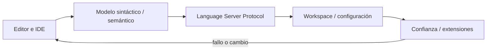
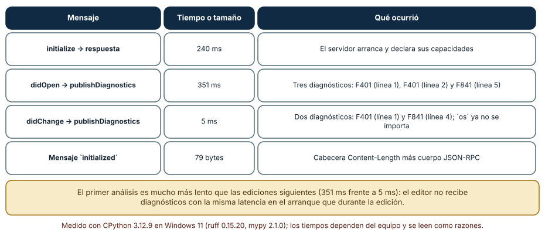
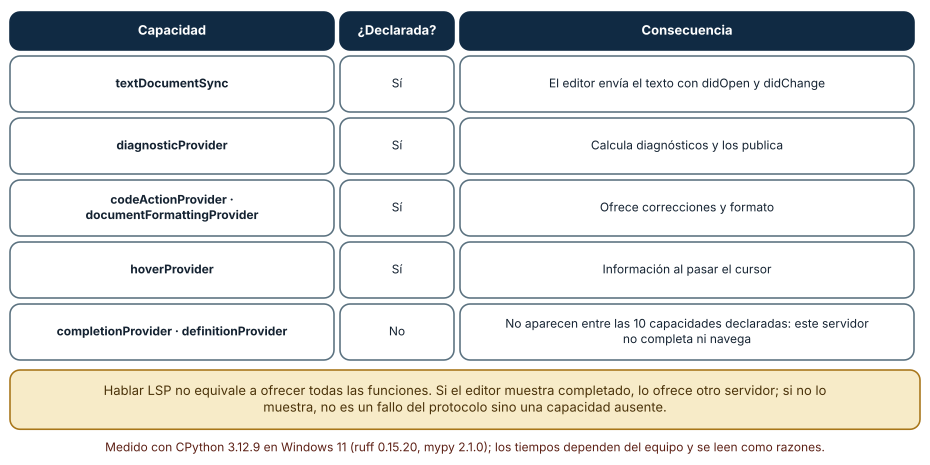
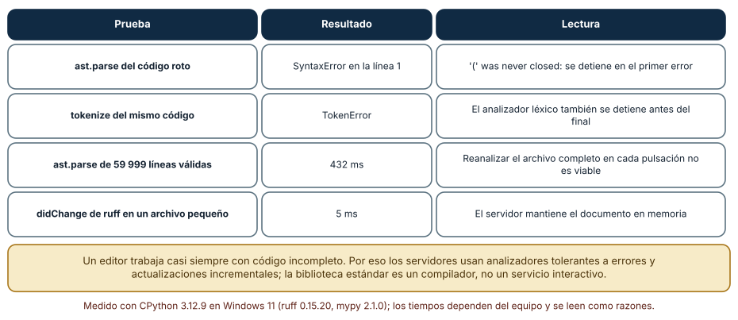

# SE-097 — Editores, IDE y servidores de lenguaje

[← SE-096 — Proyecto: biblioteca comparada con casos límite](../../classes/part-07-estructuras-de-datos-y-algoritmos/se-096-proyecto-biblioteca-comparada-con-casos-limite/README.md) · [↑ Parte 08](../../classes/part-08-entornos-herramientas-y-depuracion/README.md) · [📚 Índice completo](../../classes/README.md) · [🌐 Portal](../../site/classes/SE-097.html) · [SE-098 — Depuradores, breakpoints y observación de estado →](../../classes/part-08-entornos-herramientas-y-depuracion/se-098-depuradores-breakpoints-y-observacion-de-estado/README.md)


## Punto profesional y fundamento pedagógico

**Punto profesional.** La clase existe para entender editor, IDE y servidor de lenguaje como componentes con protocolos y capacidades negociadas.

**Por qué aparece aquí.** Se sitúa después de **Proyecto: biblioteca comparada con casos límite** y antes de **Depuradores, breakpoints y observación de estado**: convierte el conocimiento anterior en una decisión observable que la clase siguiente podrá reutilizar. La continuidad se comprueba en el artefacto, no por compartir vocabulario.

**Error conceptual que debe corregir.** Atribuir al editor análisis que realmente ejecuta otra herramienta.

**Secuencia de aprendizaje.** Antes de leer la solución, el estudiante predice el resultado del caso normal y del error conceptual anterior. Luego explica un caso resuelto paso a paso, construye un contraejemplo que cambie la decisión y, sin consultar el texto, reconstruye el mecanismo y lo aplica a una entrada nueva. La secuencia usa predicción, explicación propia, contraste y recuperación. [ICAP](https://icap.education.asu.edu/research) distingue participación de construcción de conocimiento; [How People Learn II](https://nap.nationalacademies.org/catalog/24783/how-people-learn-ii-learners-contexts-and-cultures) exige conectar conocimiento previo, contexto y transferencia; la [práctica de recuperación](https://pubmed.ncbi.nlm.nih.gov/16507066/) respalda producir de nuevo la explicación tras una demora; y [Education for Life and Work](https://nap.nationalacademies.org/resource/13398/dbasse_084153.pdf) exige devolución que explique la causa del error.

**Evidencia de aprendizaje.** Tooling-map.md con proceso, mensaje LSP, capacidad y modo degradado. Debe contener predicción previa, observación, explicación causal, contraejemplo, criterio de aceptación y una nota de qué dato haría cambiar la conclusión.

**Límite de la conclusión.** Soportar el protocolo no implica soportar todas las capacidades.

### Trazabilidad fuente → afirmación

| Fuente primaria u oficial | Afirmación que respalda | Lo que no prueba |
|---|---|---|
| [Language Server Protocol 3.18](https://microsoft.github.io/language-server-protocol/specifications/lsp/3.18/specification/) | Mensajes, capacidades y sincronización entre editor y servidor; autoridad: Microsoft | No demuestra por sí sola que el artefacto del estudiante sea correcto. |
| [Debug Adapter Protocol](https://microsoft.github.io/debug-adapter-protocol/) | Breakpoints, frames, variables y negociación de capacidades; autoridad: Microsoft | No demuestra por sí sola que el artefacto del estudiante sea correcto. |

## Antes de empezar

Esta clase continúa el **entorno reproducible de diagnóstico de la Parte 08**. Recupera la evidencia de la clase anterior, añade una decisión propia de **Editores, IDE y servidores de lenguaje** y deja un artefacto que la clase siguiente deberá consumir. La pregunta activa es: **¿Qué trabajo pertenece al editor, al IDE y al servidor que entiende el lenguaje?**

## Prerrequisitos

- Haber completado la clase anterior o reconstruir su contrato y evidencia.
- Python 3.11 o posterior, terminal, editor y Git; un segundo runtime es opcional y debe declararse.
- Trabajar con fixtures sintéticos: ninguna observación necesita datos de una persona o sistema real.

## Problema auténtico

En el entorno reproducible de diagnóstico, una importación aparece válida en un editor y rota en CI. Se atribuye al IDE, pero el diagnóstico proviene de otro intérprete configurado por el servidor de lenguaje.

## Objetivos observables

Al terminar podrás explicar los cinco mecanismos de esta clase, predecir su comportamiento antes de ejecutar, construir un caso normal y uno límite, diagnosticar el fallo controlado, comparar una alternativa y entregar evidencia que otra persona pueda reproducir.

## Mapa conceptual



El mapa se lee como una cadena de razonamiento, no como fases obligatorias del runtime. La flecha de retorno indica que un fallo o cambio de requisito obliga a revisar el modelo inicial; no autoriza a parchear solo la última salida.

## Temas y por qué importan

| Tema | Por qué cambia una decisión profesional | Evidencia mínima |
|---|---|---|
| Editor e IDE | Un editor manipula texto y puede integrar capacidades; un IDE reúne proyecto, build, ejecución, depuración y navegación. | Predicción, traza causal y contraejemplo de **Editor e IDE** en `tooling-map.md` |
| Modelo sintáctico y semántico | Resaltado por tokens no equivale a resolver nombres o tipos. | Predicción, traza causal y contraejemplo de **Modelo sintáctico y semántico** en `tooling-map.md` |
| Language Server Protocol | LSP estandariza mensajes JSON-RPC entre cliente y servidor para completado, definición, referencias y diagnósticos. | Predicción, traza causal y contraejemplo de **Language Server Protocol** en `tooling-map.md` |
| Workspace y configuración | La raíz del workspace condiciona búsqueda de configuración, módulos y herramientas. | Predicción, traza causal y contraejemplo de **Workspace y configuración** en `tooling-map.md` |
| Confianza y extensiones | Una extensión ejecuta código con acceso relevante al workspace. | Predicción, traza causal y contraejemplo de **Confianza y extensiones** en `tooling-map.md` |
## Conceptos y decisiones

### 1. Editor e IDE

Un editor manipula texto y puede integrar capacidades; un IDE reúne proyecto, build, ejecución, depuración y navegación. La frontera no es absoluta. Elegir uno exige describir tareas y costos, no usar `IDE` como sinónimo de herramienta profesional.

### 2. Modelo sintáctico y semántico

Resaltado por tokens no equivale a resolver nombres o tipos. Parsing construye estructura; análisis semántico necesita símbolos, imports, configuración y a veces build. Un archivo puede verse correcto mientras el proyecto que interpreta el servidor es otro.

### 3. Language Server Protocol

LSP estandariza mensajes JSON-RPC entre cliente y servidor para completado, definición, referencias y diagnósticos. El protocolo no garantiza calidad del análisis; cliente y servidor negocian capacidades y sincronizan documentos con versiones.

### 4. Workspace y configuración

La raíz del workspace condiciona búsqueda de configuración, módulos y herramientas. Abrir una subcarpeta puede producir otro grafo de proyecto. Configuración de usuario, workspace y repositorio necesita precedencia explícita para que dos personas observen lo mismo.

### 5. Confianza y extensiones

Una extensión ejecuta código con acceso relevante al workspace. Procedencia, permisos, actualización y política de red forman parte del riesgo. Un perfil mínimo reduce variabilidad y facilita recuperar el entorno sin exportar secretos personales.

### Un intercambio LSP real, mensaje a mensaje

El *Language Server Protocol* separa el editor del analizador: el editor envía mensajes JSON-RPC con una cabecera `Content-Length` y el servidor responde. Para no hablar de ello en abstracto se arrancó un servidor real, `ruff server`, y se le enviaron cuatro mensajes. `initialize` se respondió en 240 ms y declaró diez capacidades. `textDocument/didOpen` con un archivo de seis líneas produjo, a los 351 ms, tres diagnósticos: `F401` en la línea 1 (`os` importado y sin usar), `F401` en la línea 2 (`sys`) y `F841` en la línea 5 (la variable `y` asignada y nunca usada). Después de `didChange`, que elimina el `import os`, el servidor publicó nuevos diagnósticos en 5 ms: `F401` en la línea 1 y `F841` en la línea 4, con los números de línea ya desplazados. Un mensaje tan simple como `initialized` ocupa 79 bytes entre cabecera y cuerpo.



**Cómo leer la figura.** Cada fila es un mensaje del protocolo con su tiempo y su efecto. La diferencia entre 351 ms y 5 ms es la del primer análisis frente a la actualización incremental: el servidor mantiene el documento en memoria. **Dónde deja de valer:** son tiempos de un servidor, un archivo diminuto y un equipo; un proyecto grande con un servidor que indexa dependencias tarda segundos en el arranque.

### Protocolo no es capacidad

La respuesta a `initialize` es una declaración: el servidor lista lo que ofrece. `ruff server` anunció `textDocumentSync`, `diagnosticProvider`, `codeActionProvider`, `documentFormattingProvider`, `documentRangeFormattingProvider`, `hoverProvider`, `executeCommandProvider`, `notebookDocumentSync`, `positionEncoding` y `workspace`: diez claves. No aparecen `completionProvider` ni `definitionProvider`. Por tanto, si un editor muestra diagnósticos de ruff pero no completa ni salta a la definición, no hay ningún fallo: ese servidor no ofrece esas funciones y las ofrece otro (o ninguno). La pregunta de diagnóstico correcta no es «¿está roto el editor?» sino «¿qué proceso responde esta función y qué declaró en `initialize`?».



**Cómo leer la figura.** La última fila contiene lo que *no* está declarado, y es la información más útil para atribuir correctamente un comportamiento. **Dónde deja de valer:** las capacidades pueden registrarse más tarde de forma dinámica con `client/registerCapability`; la lista de `initialize` es el punto de partida, no siempre el inventario final.

### Código roto y presupuesto de latencia

Un editor trabaja casi siempre con código incompleto. La biblioteca estándar, en cambio, se detiene: `ast.parse` sobre una definición con un paréntesis sin cerrar falla con `SyntaxError` en la línea 1 («'(' was never closed»), y `tokenize` lanza `TokenError` antes de recorrer el resto. Además, reanalizar un archivo de 59 999 líneas con `ast.parse` tomó 432 ms: hacerlo en cada pulsación no es viable. Los servidores resuelven ambas cosas con analizadores tolerantes a errores y con actualizaciones incrementales, que es lo que explica los 5 ms medidos tras `didChange`.



**Cómo leer la figura.** Las dos primeras filas son fallos de un compilador ante un error; las dos siguientes comparan el costo de reanalizar con el de actualizar. **Dónde deja de valer:** el compilador de CPython no pretende ser interactivo; la comparación muestra una diferencia de diseño, no un defecto de la biblioteca estándar.

## Definiciones de trabajo

- **editor e ide:** un editor manipula texto y puede integrar capacidades; un ide reúne proyecto, build, ejecución, depuración y navegación.
- **modelo sintáctico y semántico:** resaltado por tokens no equivale a resolver nombres o tipos.
- **language server protocol:** lsp estandariza mensajes json-rpc entre cliente y servidor para completado, definición, referencias y diagnósticos.
- **workspace y configuración:** la raíz del workspace condiciona búsqueda de configuración, módulos y herramientas.
- **confianza y extensiones:** una extensión ejecuta código con acceso relevante al workspace.

Las definiciones son operativas para el entorno reproducible de diagnóstico. No convierten términos con historia más amplia en sinónimos y deben contrastarse con la documentación primaria enlazada al final.

## Ejemplo mínimo

```shell
# Evidencia mínima, independiente del editor
python --version
python -c "import sys; print(sys.executable); print(*sys.path, sep='\n')"
python -m unittest -v
```

Antes de ejecutar, predice estado, resultado y error. Después registra versión, comando y salida. Si el fragmento es pseudocódigo o pertenece a otro lenguaje, etiquétalo como tal y no afirmes que fue ejecutado.

## Ejemplo profesional

En el entorno reproducible de diagnóstico, una investigación conserva síntoma, entorno, reproducción, hipótesis, observaciones, causa, corrección y regresión. La implementación de esta clase debe conservar ese contrato aunque cambie la forma interna. El caso profesional no pregunta únicamente si produce una salida: pregunta quién puede producirla, qué estado observa, cómo falla y qué rastro permite disputar una decisión incorrecta.

Compara el caso normal con autorización falsa, evidencia incompleta, empate y repetición. Un mecanismo es apropiado cuando esas diferencias quedan visibles y localizadas; es peligroso cuando dependen de orden accidental, estado oculto o una convención que el consumidor no puede conocer.

## Práctica guiada

1. Copia el contrato de entrada y salida antes de escribir implementación.
2. Predice el caso normal y un límite; identifica la invariante que no puede romperse.
3. Implementa la versión mínima sin I/O dentro del núcleo.
4. Ejecuta el caso y conserva comando, versión y salida bajo `evidence/`.
5. Introduce el fallo controlado, reduce la reproducción y formula dos hipótesis rivales.
6. Corrige la causa, añade regresión y ejecuta el conjunto completo.
7. Compara con otro paradigma o lenguaje indicando qué semántica se preserva.

## Ejercicios

1. **Capacidades:** a partir de la lista de diez capacidades de la Figura 2, indica qué funciones del editor dependen de cada una y cuál falta para navegar a la definición.
2. **Tiempos:** calcula la razón entre el primer análisis (351 ms) y la actualización (5 ms) y explica qué mecanismo la produce.
3. **Código roto:** escribe tres fragmentos incompletos y comprueba cuáles acepta `ast.parse` y cuáles no; relaciona el resultado con lo que un editor necesita.
4. **Tooling map:** completa una fila con proceso, mensaje, capacidad y modo degradado para «formatear al guardar».

## Reto verificable

Entrega implementación, fixtures, pruebas y un informe corto. Se aprueba si otra persona ejecuta desde checkout limpio, obtiene los mismos resultados y puede relacionar cada rama o transformación con una regla del dominio. No se aprueba por cantidad de archivos ni por usar la sintaxis característica del paradigma.

## Caso conductor

El entorno reproducible de diagnóstico parte de una inversión de empates en la biblioteca de estructuras y algoritmos, captura versión y entrada mínima, compara un entorno sano con uno afectado y conserva la primera divergencia observable. Cambia después una sola regla o condición y revisa qué archivos, pruebas y trazas debieron modificarse. Esa superficie de cambio alimenta el proyecto final de la parte.

## Preguntas frecuentes

### ¿Es un editor lo mismo que un IDE?

No. Un editor edita texto; un IDE integra además análisis, ejecución, depuración y gestión de proyectos. Con el protocolo LSP un editor ligero gana funciones de IDE delegándolas en servidores externos, de modo que la frontera entre ambos se difumina.

### ¿Por qué el primer diagnóstico tarda más que los siguientes?

Porque el servidor debe cargar la configuración, analizar el documento y, a menudo, indexar el proyecto. Las actualizaciones posteriores reutilizan el estado en memoria: en la medición, 351 ms frente a 5 ms.

### ¿El linter que veo en el editor es el mismo que el de integración continua?

No necesariamente. Pueden ser versiones distintas, con configuraciones distintas. Para que coincidan se fija la versión de la herramienta y su configuración en el repositorio.

### ¿Puedo confiar en un diagnóstico del editor?

Es una hipótesis automatizada con un código de regla y una posición. Se verifica leyendo la regla, ejecutando la herramienta en la terminal y comprobando que reproduce el mismo diagnóstico.
## Fallo controlado y diagnóstico

Configura el LSP con un intérprete diferente al terminal integrado. Compara `sys.executable`, ruta del servidor y diagnóstico; fija la selección en configuración versionable cuando sea portable.

Registra síntoma, entrada mínima, hipótesis, observación que descarta cada hipótesis, causa, corrección y prueba de regresión. No cambies simultáneamente implementación, fixture y expectativa.


Reproduce un malentendido de capacidad. Abre un archivo con un editor que use solo `ruff server` y pide «ir a la definición» de una función. **Síntoma:** no ocurre nada. **Hipótesis:** el editor está roto. **Prueba:** captura la respuesta a `initialize` (la mayoría de los editores registran el tráfico LSP en un canal de salida) y busca `definitionProvider`. **Conclusión:** la capacidad no está declarada; la navegación necesita otro servidor, y añadirlo o desactivar la expectativa resuelve el caso. Guarda en `tooling-map.md` el servidor, la capacidad declarada y el comportamiento degradado cuando no existe.

## Errores comunes y cómo corregirlos

| Síntoma | Causa | Corrección |
|---|---|---|
| «El editor no completa» | Se asume que el servidor ofrece completado | Revisar las capacidades declaradas en `initialize` |
| El editor y la CI discrepan | Versiones o configuración distintas | Fijar versión y configuración en el repositorio |
| El diagnóstico aparece tarde en el arranque | Primer análisis completo | Esperar al índice o medir la latencia inicial |
| Línea de diagnóstico desplazada tras editar | Se interpretan posiciones viejas | Usar la versión del documento que acompaña al diagnóstico |
| Se atribuye el análisis al editor | Se ignora el proceso del servidor | Identificar el proceso, el mensaje y la capacidad |

## Entorno y archivos clave

```text
work/SE-097/
├── README.md
├── diagnostic_environment/
│   ├── domain.py
│   └── se_097.py
├── fixtures/cases.json
├── tests/test_se_097.py
└── evidence/diagnosis.md
```

El `README` declara plataforma, runtimes, comandos, limpieza y límites. Evita dependencias externas cuando la biblioteca estándar permita observar el mecanismo; si agregas una, fija procedencia y versión.

## Seguridad, ética y accesibilidad

- la autorización forma parte del dominio y no se infiere por ausencia de rechazo;
- no uses `eval`, reglas descargadas ni serialización insegura;
- limita colas, recursión, tamaño de entrada y tiempo de evaluación;
- redacta trazas y conserva una explicación textual además de color o animación;
- una recomendación automatizada debe poder revisarse, impugnarse y corregirse;
- respeta licencias de ejemplos y atribuye adaptaciones.

## Puente hacia el trabajo con agentes

Un agente de programación también necesita un servidor de lenguaje: lo que el editor obtiene como diagnósticos, el agente lo recibe como texto de herramienta. Si el harness no le entrega diagnósticos, el agente propone cambios que no compilan; si se los entrega sin versión de documento, puede corregir líneas que ya se desplazaron. La lección de esta clase se traduce en una regla de diseño: el agente debe ver las capacidades declaradas de cada herramienta y saber qué hacer cuando una no existe, en lugar de inventar una respuesta.

## Transferencia

Traslada un fixture al segundo modelo, herramienta, plataforma o lenguaje. Compara representación de ausencia, error, mutabilidad, orden y cancelación. La transferencia está lograda cuando el contrato se conserva y las diferencias están explicadas, no cuando la interfaz se parece.

## Evaluación y evidencia

| Criterio | Evidencia para aprobar |
|---|---|
| comprensión | explicación causal de los cinco mecanismos |
| corrección | normal, límite, inválido y contraejemplo |
| diseño | estado, efectos y contrato localizables |
| diagnóstico | reproducción mínima y regresión |
| transferencia | comparación semántica, no estética |
| reproducibilidad | versiones, comandos, salida y límites |


## Fuentes


- [Language Server Protocol 3.18](https://microsoft.github.io/language-server-protocol/specifications/lsp/3.18/specification/) — Mensajes, capacidades y sincronización entre editor y servidor; autoridad: Microsoft.
- [Debug Adapter Protocol](https://microsoft.github.io/debug-adapter-protocol/) — Breakpoints, frames, variables y negociación de capacidades; autoridad: Microsoft.
- [Python Debugging and Profiling](https://docs.python.org/3/library/debug.html) — Pdb, cprofile, timeit, tracemalloc y límites instrumentales; autoridad: Python Software Foundation.
- [Python venv](https://docs.python.org/3/library/venv.html) — Aislamiento de intérprete, scripts y entorno virtual; autoridad: Python Software Foundation.
- [Development Container Specification](https://containers.dev/implementors/spec/) — Configuración reproducible de herramientas y ciclo de vida del contenedor; autoridad: Dev Container Specification maintainers.
- [Web Content Accessibility Guidelines 2.2](https://www.w3.org/TR/WCAG22/) — Percepción, operación por teclado y reducción de barreras en interfaces; autoridad: W3C.

Cada fuente respalda el mecanismo indicado; ninguna demuestra que la implementación del entorno reproducible de diagnóstico sea correcta. Esa afirmación depende de fixtures, pruebas, trazas y revisión reproducible.

- [Language Server Protocol, especificación](https://microsoft.github.io/language-server-protocol/specifications/lsp/3.17/specification/): formato de mensajes, `initialize`, capacidades y sincronización de documentos usados en las Figuras 1 y 2.
- [Ruff: integración con editores](https://docs.astral.sh/ruff/editors/): servidor `ruff server` y funciones que ofrece.
- [Python: módulo `ast`](https://docs.python.org/3/library/ast.html): comportamiento de `ast.parse` ante errores de sintaxis, contrastado en la Figura 3.

## Límites y siguiente paso

Un diagnóstico estático no muestra necesariamente el estado que llevó al fallo. La siguiente clase detiene la ejecución y observa frames sin asumir que observar es neutral.

## Glosario

- **editor e ide:** un editor manipula texto y puede integrar capacidades; un ide reúne proyecto, build, ejecución, depuración y navegación.
- **modelo sintáctico y semántico:** resaltado por tokens no equivale a resolver nombres o tipos.
- **language server protocol:** lsp estandariza mensajes json-rpc entre cliente y servidor para completado, definición, referencias y diagnósticos.
- **workspace y configuración:** la raíz del workspace condiciona búsqueda de configuración, módulos y herramientas.
- **confianza y extensiones:** una extensión ejecuta código con acceso relevante al workspace.

---

[← SE-096 — Proyecto: biblioteca comparada con casos límite](../../classes/part-07-estructuras-de-datos-y-algoritmos/se-096-proyecto-biblioteca-comparada-con-casos-limite/README.md) · [↑ Parte 08](../../classes/part-08-entornos-herramientas-y-depuracion/README.md) · [📚 Índice completo](../../classes/README.md) · [🌐 Portal](../../site/classes/SE-097.html) · [SE-098 — Depuradores, breakpoints y observación de estado →](../../classes/part-08-entornos-herramientas-y-depuracion/se-098-depuradores-breakpoints-y-observacion-de-estado/README.md)
