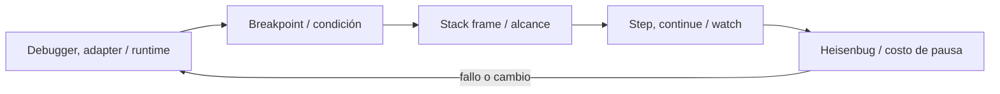
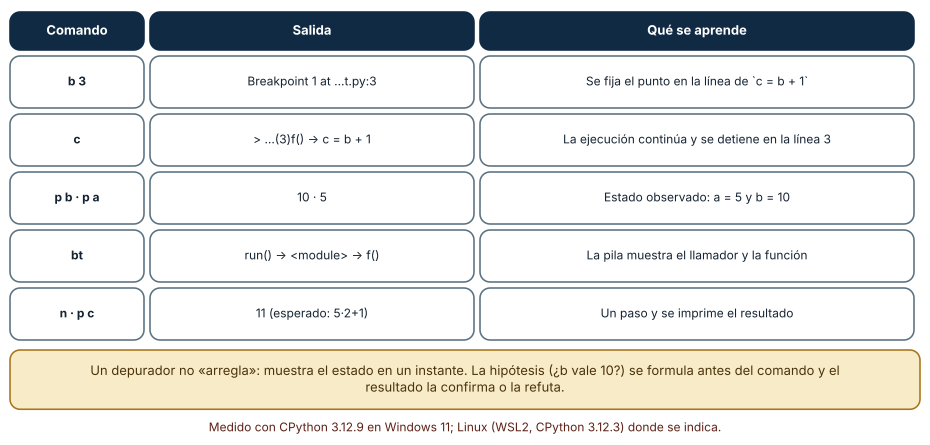
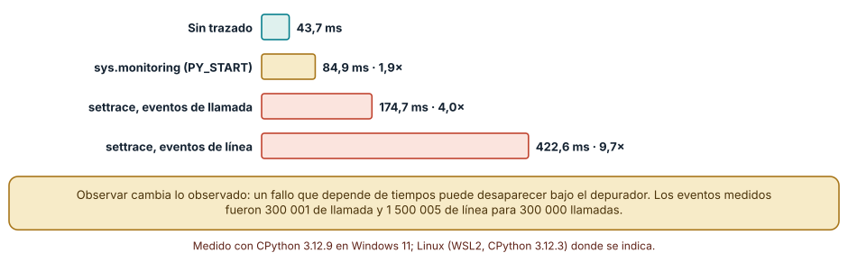
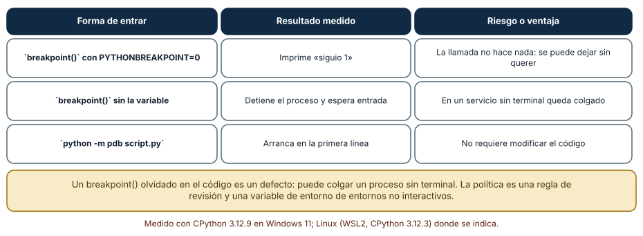

# SE-098 — Depuradores, breakpoints y observación de estado

[← SE-097 — Editores, IDE y servidores de lenguaje](../../classes/part-08-entornos-herramientas-y-depuracion/se-097-editores-ide-y-servidores-de-lenguaje/README.md) · [↑ Parte 08](../../classes/part-08-entornos-herramientas-y-depuracion/README.md) · [📚 Índice completo](../../classes/README.md) · [🌐 Portal](../../site/classes/SE-098.html) · [SE-099 — Profilers de CPU, memoria, I/O y red →](../../classes/part-08-entornos-herramientas-y-depuracion/se-099-profilers-de-cpu-memoria-i-o-y-red/README.md)


## Punto profesional y fundamento pedagógico

**Punto profesional.** La clase existe para observar ejecución con breakpoints, frames y variables sin confundir observación con ausencia de perturbación.

**Por qué aparece aquí.** Se sitúa después de **Editores, IDE y servidores de lenguaje** y antes de **Profilers de CPU, memoria, I/O y red**: convierte el conocimiento anterior en una decisión observable que la clase siguiente podrá reutilizar. La continuidad se comprueba en el artefacto, no por compartir vocabulario.

**Error conceptual que debe corregir.** Cambiar estado desde el depurador y tratar la corrida como equivalente.

**Secuencia de aprendizaje.** Antes de leer la solución, el estudiante predice el resultado del caso normal y del error conceptual anterior. Luego explica un caso resuelto paso a paso, construye un contraejemplo que cambie la decisión y, sin consultar el texto, reconstruye el mecanismo y lo aplica a una entrada nueva. La secuencia usa predicción, explicación propia, contraste y recuperación. [ICAP](https://icap.education.asu.edu/research) distingue participación de construcción de conocimiento; [How People Learn II](https://nap.nationalacademies.org/catalog/24783/how-people-learn-ii-learners-contexts-and-cultures) exige conectar conocimiento previo, contexto y transferencia; la [práctica de recuperación](https://pubmed.ncbi.nlm.nih.gov/16507066/) respalda producir de nuevo la explicación tras una demora; y [Education for Life and Work](https://nap.nationalacademies.org/resource/13398/dbasse_084153.pdf) exige devolución que explique la causa del error.

**Evidencia de aprendizaje.** Debug-session.md con hipótesis, breakpoint, stack, variable y efecto observado. Debe contener predicción previa, observación, explicación causal, contraejemplo, criterio de aceptación y una nota de qué dato haría cambiar la conclusión.

**Límite de la conclusión.** El depurador puede alterar temporización y comportamiento concurrente.

### Trazabilidad fuente → afirmación

| Fuente primaria u oficial | Afirmación que respalda | Lo que no prueba |
|---|---|---|
| [Debug Adapter Protocol](https://microsoft.github.io/debug-adapter-protocol/) | Breakpoints, frames, variables y negociación de capacidades; autoridad: Microsoft | No demuestra por sí sola que el artefacto del estudiante sea correcto. |
| [Python Debugging and Profiling](https://docs.python.org/3/library/debug.html) | Pdb, cprofile, timeit, tracemalloc y límites instrumentales; autoridad: Python Software Foundation | No demuestra por sí sola que el artefacto del estudiante sea correcto. |

## Antes de empezar

Esta clase continúa el **entorno reproducible de diagnóstico de la Parte 08**. Recupera la evidencia de la clase anterior, añade una decisión propia de **Depuradores, breakpoints y observación de estado** y deja un artefacto que la clase siguiente deberá consumir. La pregunta activa es: **¿Dónde detener la ejecución para observar la primera divergencia y no solo el síntoma final?**

## Prerrequisitos

- Haber completado la clase anterior o reconstruir su contrato y evidencia.
- Python 3.11 o posterior, terminal, editor y Git; un segundo runtime es opcional y debe declararse.
- Trabajar con fixtures sintéticos: ninguna observación necesita datos de una persona o sistema real.

## Problema auténtico

El orden incorrecto de la biblioteca de estructuras y algoritmos se manifiesta al final. Un breakpoint en la salida muestra datos ya corrompidos; se necesita ubicar la transición donde dos ejecuciones sanas dejan de coincidir.

## Objetivos observables

Al terminar podrás explicar los cinco mecanismos de esta clase, predecir su comportamiento antes de ejecutar, construir un caso normal y uno límite, diagnosticar el fallo controlado, comparar una alternativa y entregar evidencia que otra persona pueda reproducir.

## Mapa conceptual



El mapa se lee como una cadena de razonamiento, no como fases obligatorias del runtime. La flecha de retorno indica que un fallo o cambio de requisito obliga a revisar el modelo inicial; no autoriza a parchear solo la última salida.

## Temas y por qué importan

| Tema | Por qué cambia una decisión profesional | Evidencia mínima |
|---|---|---|
| Debugger, adapter y runtime | La UI habla con un adaptador mediante DAP y este traduce al debugger o runtime. | Predicción, traza causal y contraejemplo de **Debugger, adapter y runtime** en `debug-session.md` |
| Breakpoint y condición | Un breakpoint pausa antes o después de una ubicación según runtime y mapeo de fuente. | Predicción, traza causal y contraejemplo de **Breakpoint y condición** en `debug-session.md` |
| Stack frame y alcance | Cada frame conserva posición, argumentos, locales y enlace al anterior. | Predicción, traza causal y contraejemplo de **Stack frame y alcance** en `debug-session.md` |
| Step, continue y watch | Step into sigue llamadas, over ejecuta la llamada y out termina el frame. | Predicción, traza causal y contraejemplo de **Step, continue y watch** en `debug-session.md` |
| Heisenbug y costo de pausa | Detener cambia temporización, locks y timeouts. | Predicción, traza causal y contraejemplo de **Heisenbug y costo de pausa** en `debug-session.md` |
## Conceptos y decisiones

### 1. Debugger, adapter y runtime

La UI habla con un adaptador mediante DAP y este traduce al debugger o runtime. Capacidades como breakpoints condicionales o procesos múltiples se negocian. Que la UI muestre un control no implica que el adaptador lo implemente.

### 2. Breakpoint y condición

Un breakpoint pausa antes o después de una ubicación según runtime y mapeo de fuente. La condición reduce ruido, pero evaluar expresiones puede tener efectos o costo. Se elige una condición basada en identidad del caso, no en una línea que cambia con refactors.

### 3. Stack frame y alcance

Cada frame conserva posición, argumentos, locales y enlace al anterior. Inspeccionar la pila reconstruye cómo se llegó, pero variables optimizadas o asincronía pueden no corresponder a una secuencia intuitiva. La evidencia registra frame y evento correlacionado.

### 4. Step, continue y watch

Step into sigue llamadas, over ejecuta la llamada y out termina el frame. Watch reevalúa expresiones al pausar. Avanzar sin hipótesis produce una película larga; el entorno reproducible de diagnóstico marca el estado esperado y busca la primera transición que lo viola.

### 5. Heisenbug y costo de pausa

Detener cambia temporización, locks y timeouts. Un fallo concurrente puede desaparecer. Logpoints, trazas o grabación pueden preservar mejor el fenómeno, aunque también instrumentan. Se declara qué observación pudo alterar el sistema.

### Una sesión de depuración como experimento

Depurar es observar el estado en un instante preciso, y conviene hacerlo con una hipótesis previa. Con `python -m pdb` y órdenes por entrada estándar se ejecutó una sesión reproducible sobre una función de tres líneas: `b 3` fijó un punto de interrupción en `c = b + 1`, `c` continuó hasta ese punto, `p b` y `p a` imprimieron 10 y 5, `bt` mostró la pila (`run()` → `<module>` → `f()`) y `n` avanzó una línea. La hipótesis era «b vale 10 cuando a vale 5»; la observación la confirma. Lo valioso no es el comando, sino que el resultado puede contradecir la hipótesis.



**Cómo leer la figura.** Cada fila es una orden, su salida y lo que se aprende. **Dónde deja de valer:** un depurador muestra el estado, no la causa; para entender por qué `b` tiene ese valor hay que retroceder hasta quien lo calculó, y la sesión sola no lo hace.

### Cuánto cuesta observar

Los depuradores se apoyan en ganchos del intérprete. Con 300 000 llamadas a una función pequeña, la ejecución sin trazado tomó 43,7 ms. Con `sys.settrace` registrando solo llamadas (300 001 eventos) tomó 174,7 ms, 4,0 veces más; registrando también líneas (1 500 005 eventos), 422,6 ms, 9,7 veces. La API `sys.monitoring` de Python 3.12, diseñada para bajar esa sobrecarga, con el evento `PY_START` tomó 84,9 ms, 1,9 veces. Dos consecuencias: un fallo que depende de tiempos puede desaparecer al depurar (porque el programa va 10 veces más lento), y trazar en producción no es gratuito.



**Cómo leer la figura.** Cada barra es la misma carga con un mecanismo de observación distinto. **Dónde deja de valer:** los factores dependen de la carga (una función diminuta exagera la proporción) y de la versión del intérprete; la jerarquía entre mecanismos es lo que se conserva.

### El punto de interrupción olvidado

`breakpoint()` es una llamada ordinaria que consulta la variable `PYTHONBREAKPOINT`. Con `PYTHONBREAKPOINT=0` no hace nada y el programa continúa (se comprobó: imprime «siguio 1»); sin la variable detiene el proceso y espera entrada. En un servicio sin terminal eso significa un proceso colgado. La política es doble: una regla de revisión que rechace `breakpoint()` en código confirmado y una variable de entorno en los entornos no interactivos. Entrar en el depurador sin tocar el código, con `python -m pdb`, evita el problema de raíz.



**Cómo leer la figura.** La columna central es lo observado; la derecha, la consecuencia operativa. **Dónde deja de valer:** otros lenguajes y entornos tienen sus propios mecanismos; la idea general es que un punto de interrupción en el código es un efecto secundario que debe controlarse.

## Definiciones de trabajo

- **debugger, adapter y runtime:** la ui habla con un adaptador mediante dap y este traduce al debugger o runtime.
- **breakpoint y condición:** un breakpoint pausa antes o después de una ubicación según runtime y mapeo de fuente.
- **stack frame y alcance:** cada frame conserva posición, argumentos, locales y enlace al anterior.
- **step, continue y watch:** step into sigue llamadas, over ejecuta la llamada y out termina el frame.
- **heisenbug y costo de pausa:** detener cambia temporización, locks y timeouts.

Las definiciones son operativas para el entorno reproducible de diagnóstico. No convierten términos con historia más amplia en sinónimos y deben contrastarse con la documentación primaria enlazada al final.

## Ejemplo mínimo

```shell
# En pdb
python -m pdb -m unittest tests.test_priority.PriorityTests.test_equal_priority
# Comandos: break, condition, continue, where, p variable, next
```

Antes de ejecutar, predice estado, resultado y error. Después registra versión, comando y salida. Si el fragmento es pseudocódigo o pertenece a otro lenguaje, etiquétalo como tal y no afirmes que fue ejecutado.

## Ejemplo profesional

En el entorno reproducible de diagnóstico, una investigación conserva síntoma, entorno, reproducción, hipótesis, observaciones, causa, corrección y regresión. La implementación de esta clase debe conservar ese contrato aunque cambie la forma interna. El caso profesional no pregunta únicamente si produce una salida: pregunta quién puede producirla, qué estado observa, cómo falla y qué rastro permite disputar una decisión incorrecta.

Compara el caso normal con autorización falsa, evidencia incompleta, empate y repetición. Un mecanismo es apropiado cuando esas diferencias quedan visibles y localizadas; es peligroso cuando dependen de orden accidental, estado oculto o una convención que el consumidor no puede conocer.

## Práctica guiada

1. Copia el contrato de entrada y salida antes de escribir implementación.
2. Predice el caso normal y un límite; identifica la invariante que no puede romperse.
3. Implementa la versión mínima sin I/O dentro del núcleo.
4. Ejecuta el caso y conserva comando, versión y salida bajo `evidence/`.
5. Introduce el fallo controlado, reduce la reproducción y formula dos hipótesis rivales.
6. Corrige la causa, añade regresión y ejecuta el conjunto completo.
7. Compara con otro paradigma o lenguaje indicando qué semántica se preserva.

## Ejercicios

1. **Hipótesis:** formula por escrito qué esperas ver en `a` y `b` antes de ejecutar `pdb` sobre tu propia función y compara con lo observado.
2. **Costo:** calcula cuántos eventos genera un bucle de 10 000 iteraciones con una función de tres líneas bajo `settrace` de líneas.
3. **Condicional:** diseña un breakpoint condicional para detenerte en la iteración 5000 de un bucle y estima su costo adicional.
4. **Política:** redacta la regla de revisión que evita `breakpoint()` olvidados y cómo se comprueba automáticamente.

## Reto verificable

Entrega implementación, fixtures, pruebas y un informe corto. Se aprueba si otra persona ejecuta desde checkout limpio, obtiene los mismos resultados y puede relacionar cada rama o transformación con una regla del dominio. No se aprueba por cantidad de archivos ni por usar la sintaxis característica del paradigma.

## Caso conductor

El entorno reproducible de diagnóstico parte de una inversión de empates en la biblioteca de estructuras y algoritmos, captura versión y entrada mínima, compara un entorno sano con uno afectado y conserva la primera divergencia observable. Cambia después una sola regla o condición y revisa qué archivos, pruebas y trazas debieron modificarse. Esa superficie de cambio alimenta el proyecto final de la parte.

## Preguntas frecuentes

### ¿Para qué sirve un depurador si puedo imprimir valores?

Imprimir exige decidir de antemano qué mostrar y volver a ejecutar; el depurador permite explorar el estado, cambiar de hipótesis y recorrer la pila sin reiniciar. Imprimir sigue siendo útil cuando el depurador altera los tiempos o no se puede conectar.

### ¿Qué es un breakpoint condicional?

Un punto de interrupción que solo detiene la ejecución si una expresión es verdadera (por ejemplo `i == 4999`). Evita detenerse miles de veces, pero la expresión se evalúa en cada paso y añade costo.

### ¿Por qué mi fallo desaparece al depurar?

Porque el depurador cambia la sincronización: los tiempos entre hilos o procesos cambian hasta 10 veces. Es una pista de que el fallo depende de una condición de carrera o de un plazo.

### ¿Se puede depurar un proceso remoto o en producción?

Sí, con adaptadores de depuración, pero detiene el proceso y expone memoria. Se limita a entornos autorizados y se prefiere observar con registros y métricas.
## Fallo controlado y diagnóstico

Añade un breakpoint dentro de una sección con timeout y el fallo desaparece. Cambia a logpoint con contador/ID o una aserción de primera divergencia y compara sin pausa.

Registra síntoma, entrada mínima, hipótesis, observación que descarta cada hipótesis, causa, corrección y prueba de regresión. No cambies simultáneamente implementación, fixture y expectativa.


Reproduce el efecto del observador. Escribe un bucle con dos hilos que comparten un contador sin protección y cuenta cuántas veces el resultado final difiere del esperado en 20 ejecuciones. Repite con `sys.settrace` activo. **Síntoma:** la frecuencia del fallo cambia. **Hipótesis:** el trazado altera la sincronización. **Prueba:** compara las tasas de fallo con y sin trazado, con el mismo número de ejecuciones. **Conclusión:** la observación no es neutral; hay que contrastar con un método menos intrusivo (registros con marcas de tiempo, o `sys.monitoring`). Registra la tasa en cada caso en `checks.md`, y deja un `breakpoint()` a propósito en un guion de prueba para comprobar que `PYTHONBREAKPOINT=0` lo neutraliza.

## Errores comunes y cómo corregirlos

| Síntoma | Causa | Corrección |
|---|---|---|
| El fallo desaparece al depurar | El depurador altera los tiempos | Observar con registros o `sys.monitoring` y comparar |
| Un proceso queda colgado en producción | `breakpoint()` olvidado | Regla de revisión y `PYTHONBREAKPOINT=0` |
| Se depura sin hipótesis | Exploración sin pregunta | Escribir qué valor se espera antes de ejecutar |
| El breakpoint nunca se alcanza | Ruta equivocada o código no ejecutado | Comprobar el archivo, la línea y que el código se importa |
| Se cambia una variable en la sesión y se cree resuelto | Se modificó el estado, no el código | Reproducir la corrección en el código y repetir la prueba |

## Entorno y archivos clave

```text
work/SE-098/
├── README.md
├── diagnostic_environment/
│   ├── domain.py
│   └── se_098.py
├── fixtures/cases.json
├── tests/test_se_098.py
└── evidence/diagnosis.md
```

El `README` declara plataforma, runtimes, comandos, limpieza y límites. Evita dependencias externas cuando la biblioteca estándar permita observar el mecanismo; si agregas una, fija procedencia y versión.

## Seguridad, ética y accesibilidad

- la autorización forma parte del dominio y no se infiere por ausencia de rechazo;
- no uses `eval`, reglas descargadas ni serialización insegura;
- limita colas, recursión, tamaño de entrada y tiempo de evaluación;
- redacta trazas y conserva una explicación textual además de color o animación;
- una recomendación automatizada debe poder revisarse, impugnarse y corregirse;
- respeta licencias de ejemplos y atribuye adaptaciones.

## Puente hacia el trabajo con agentes

Un agente depura leyendo trazas y salidas, no sentado frente a una sesión interactiva; un harness puede darle un depurador no interactivo (órdenes por entrada estándar, como en la Figura 1) y limitar los pasos. La regla de la hipótesis previa es aún más importante: un agente que ejecuta órdenes sin predecir resultados acumula salidas sin criterio para interpretarlas. Y el efecto del observador también existe aquí: instrumentar a un agente (registrar cada paso) cambia su comportamiento si el registro entra en su contexto.

## Transferencia

Traslada un fixture al segundo modelo, herramienta, plataforma o lenguaje. Compara representación de ausencia, error, mutabilidad, orden y cancelación. La transferencia está lograda cuando el contrato se conserva y las diferencias están explicadas, no cuando la interfaz se parece.

## Evaluación y evidencia

| Criterio | Evidencia para aprobar |
|---|---|
| comprensión | explicación causal de los cinco mecanismos |
| corrección | normal, límite, inválido y contraejemplo |
| diseño | estado, efectos y contrato localizables |
| diagnóstico | reproducción mínima y regresión |
| transferencia | comparación semántica, no estética |
| reproducibilidad | versiones, comandos, salida y límites |


## Fuentes


- [Language Server Protocol 3.18](https://microsoft.github.io/language-server-protocol/specifications/lsp/3.18/specification/) — Mensajes, capacidades y sincronización entre editor y servidor; autoridad: Microsoft.
- [Debug Adapter Protocol](https://microsoft.github.io/debug-adapter-protocol/) — Breakpoints, frames, variables y negociación de capacidades; autoridad: Microsoft.
- [Python Debugging and Profiling](https://docs.python.org/3/library/debug.html) — Pdb, cprofile, timeit, tracemalloc y límites instrumentales; autoridad: Python Software Foundation.
- [Python venv](https://docs.python.org/3/library/venv.html) — Aislamiento de intérprete, scripts y entorno virtual; autoridad: Python Software Foundation.
- [Development Container Specification](https://containers.dev/implementors/spec/) — Configuración reproducible de herramientas y ciclo de vida del contenedor; autoridad: Dev Container Specification maintainers.
- [Web Content Accessibility Guidelines 2.2](https://www.w3.org/TR/WCAG22/) — Percepción, operación por teclado y reducción de barreras en interfaces; autoridad: W3C.

Cada fuente respalda el mecanismo indicado; ninguna demuestra que la implementación del entorno reproducible de diagnóstico sea correcta. Esa afirmación depende de fixtures, pruebas, trazas y revisión reproducible.

- [Python: `pdb`, el depurador](https://docs.python.org/3/library/pdb.html): órdenes `b`, `c`, `p`, `bt` y `n` usadas en la Figura 1.
- [Python: `sys.monitoring`](https://docs.python.org/3/library/sys.monitoring.html) y [`sys.settrace`](https://docs.python.org/3/library/sys.html#sys.settrace): mecanismos de observación y sus eventos, medidos en la Figura 2.
- [Debug Adapter Protocol](https://microsoft.github.io/debug-adapter-protocol/): protocolo que conecta editores y depuradores.

## Límites y siguiente paso

El debugger explica una ejecución, no dónde se consume tiempo o memoria en una carga. La siguiente clase usa perfiles dirigidos por pregunta.

## Glosario

- **debugger, adapter y runtime:** la ui habla con un adaptador mediante dap y este traduce al debugger o runtime.
- **breakpoint y condición:** un breakpoint pausa antes o después de una ubicación según runtime y mapeo de fuente.
- **stack frame y alcance:** cada frame conserva posición, argumentos, locales y enlace al anterior.
- **step, continue y watch:** step into sigue llamadas, over ejecuta la llamada y out termina el frame.
- **heisenbug y costo de pausa:** detener cambia temporización, locks y timeouts.

---

[← SE-097 — Editores, IDE y servidores de lenguaje](../../classes/part-08-entornos-herramientas-y-depuracion/se-097-editores-ide-y-servidores-de-lenguaje/README.md) · [↑ Parte 08](../../classes/part-08-entornos-herramientas-y-depuracion/README.md) · [📚 Índice completo](../../classes/README.md) · [🌐 Portal](../../site/classes/SE-098.html) · [SE-099 — Profilers de CPU, memoria, I/O y red →](../../classes/part-08-entornos-herramientas-y-depuracion/se-099-profilers-de-cpu-memoria-i-o-y-red/README.md)
