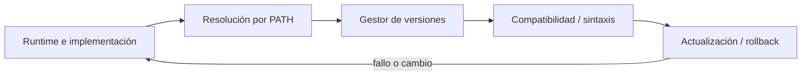
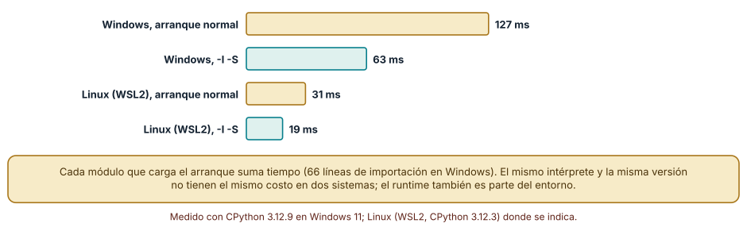
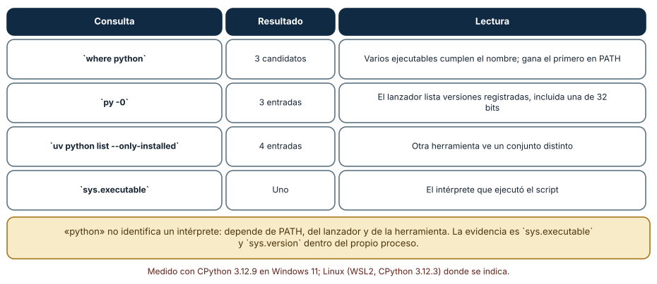
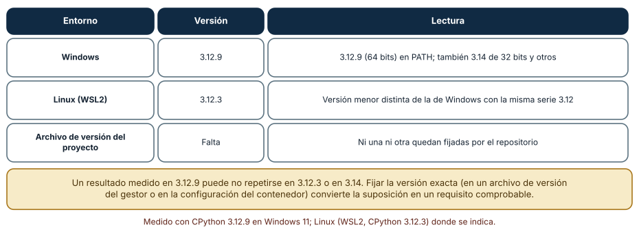

# SE-102 — Gestores de versiones de runtimes

[← SE-101 — REPL, notebooks y desarrollo exploratorio](../../classes/part-08-entornos-herramientas-y-depuracion/se-101-repl-notebooks-y-desarrollo-exploratorio/README.md) · [↑ Parte 08](../../classes/part-08-entornos-herramientas-y-depuracion/README.md) · [📚 Índice completo](../../classes/README.md) · [🌐 Portal](../../site/classes/SE-102.html) · [SE-103 — Entornos virtuales y aislamiento de dependencias →](../../classes/part-08-entornos-herramientas-y-depuracion/se-103-entornos-virtuales-y-aislamiento-de-dependencias/README.md)


## Punto profesional y fundamento pedagógico

**Punto profesional.** La clase existe para fijar y cambiar versiones de runtimes haciendo visible la resolución efectiva.

**Por qué aparece aquí.** Se sitúa después de **REPL, notebooks y desarrollo exploratorio** y antes de **Entornos virtuales y aislamiento de dependencias**: convierte el conocimiento anterior en una decisión observable que la clase siguiente podrá reutilizar. La continuidad se comprueba en el artefacto, no por compartir vocabulario.

**Error conceptual que debe corregir.** Confundir gestor de versiones con entorno de dependencias.

**Secuencia de aprendizaje.** Antes de leer la solución, el estudiante predice el resultado del caso normal y del error conceptual anterior. Luego explica un caso resuelto paso a paso, construye un contraejemplo que cambie la decisión y, sin consultar el texto, reconstruye el mecanismo y lo aplica a una entrada nueva. La secuencia usa predicción, explicación propia, contraste y recuperación. [ICAP](https://icap.education.asu.edu/research) distingue participación de construcción de conocimiento; [How People Learn II](https://nap.nationalacademies.org/catalog/24783/how-people-learn-ii-learners-contexts-and-cultures) exige conectar conocimiento previo, contexto y transferencia; la [práctica de recuperación](https://pubmed.ncbi.nlm.nih.gov/16507066/) respalda producir de nuevo la explicación tras una demora; y [Education for Life and Work](https://nap.nationalacademies.org/resource/13398/dbasse_084153.pdf) exige devolución que explique la causa del error.

**Evidencia de aprendizaje.** Runtime-resolution.md con archivo de versión, PATH, ejecutable y prueba en dos versiones. Debe contener predicción previa, observación, explicación causal, contraejemplo, criterio de aceptación y una nota de qué dato haría cambiar la conclusión.

**Límite de la conclusión.** Instalar una versión no garantiza compatibilidad de dependencias.

### Trazabilidad fuente → afirmación

| Fuente primaria u oficial | Afirmación que respalda | Lo que no prueba |
|---|---|---|
| [Python venv](https://docs.python.org/3/library/venv.html) | Aislamiento de intérprete, scripts y entorno virtual; autoridad: Python Software Foundation | No demuestra por sí sola que el artefacto del estudiante sea correcto. |
| [Development Container Specification](https://containers.dev/implementors/spec/) | Configuración reproducible de herramientas y ciclo de vida del contenedor; autoridad: Dev Container Specification maintainers | No demuestra por sí sola que el artefacto del estudiante sea correcto. |
| [pyenv](https://github.com/pyenv/pyenv) | documenta selección de intérprete mediante shims y archivos de versión | No demuestra por sí sola que el artefacto del estudiante sea correcto. |
| [rustup](https://rust-lang.github.io/rustup/) | documenta toolchains y selección de versiones | No demuestra por sí sola que el artefacto del estudiante sea correcto. |

## Antes de empezar

Esta clase continúa el **entorno reproducible de diagnóstico de la Parte 08**. Recupera la evidencia de la clase anterior, añade una decisión propia de **Gestores de versiones de runtimes** y deja un artefacto que la clase siguiente deberá consumir. La pregunta activa es: **¿Cómo garantizar que terminal, editor, CI y contenedor ejecuten el mismo runtime esperado?**

## Prerrequisitos

- Haber completado la clase anterior o reconstruir su contrato y evidencia.
- Python 3.11 o posterior, terminal, editor y Git; un segundo runtime es opcional y debe declararse.
- Trabajar con fixtures sintéticos: ninguna observación necesita datos de una persona o sistema real.

## Problema auténtico

El entorno reproducible de diagnóstico muestra Python 3.12 en terminal, pero el launcher, el IDE y CI resuelven versiones diferentes. Una característica disponible localmente falla antes de iniciar pruebas.

## Objetivos observables

Al terminar podrás explicar los cinco mecanismos de esta clase, predecir su comportamiento antes de ejecutar, construir un caso normal y uno límite, diagnosticar el fallo controlado, comparar una alternativa y entregar evidencia que otra persona pueda reproducir.

## Mapa conceptual



El mapa se lee como una cadena de razonamiento, no como fases obligatorias del runtime. La flecha de retorno indica que un fallo o cambio de requisito obliga a revisar el modelo inicial; no autoriza a parchear solo la última salida.

## Temas y por qué importan

| Tema | Por qué cambia una decisión profesional | Evidencia mínima |
|---|---|---|
| Runtime e implementación | La versión del lenguaje, la implementación y la arquitectura son dimensiones distintas. | Predicción, traza causal y contraejemplo de **Runtime e implementación** en `runtime-resolution.md` |
| Resolución por PATH | El shell busca ejecutables según PATH, alias, launcher o shim. | Predicción, traza causal y contraejemplo de **Resolución por PATH** en `runtime-resolution.md` |
| Gestor de versiones | Un gestor instala y selecciona runtimes por archivo o comando. | Predicción, traza causal y contraejemplo de **Gestor de versiones** en `runtime-resolution.md` |
| Compatibilidad y sintaxis | Un rango como `>=3. | Predicción, traza causal y contraejemplo de **Compatibilidad y sintaxis** en `runtime-resolution.md` |
| Actualización y rollback | Actualizar runtime requiere suite, dependencias compatibles y plan de reversión. | Predicción, traza causal y contraejemplo de **Actualización y rollback** en `runtime-resolution.md` |
## Conceptos y decisiones

### 1. Runtime e implementación

La versión del lenguaje, la implementación y la arquitectura son dimensiones distintas. `Python 3.12` no identifica necesariamente build, ABI o distribución. El proyecto declara rango soportado y matriz realmente probada.

### 2. Resolución por PATH

El shell busca ejecutables según PATH, alias, launcher o shim. `python` puede cambiar por terminal y directorio. Registrar ruta absoluta observada ayuda a diagnosticar; hardcodearla en el proyecto reduce portabilidad.

### 3. Gestor de versiones

Un gestor instala y selecciona runtimes por archivo o comando. Su shim intercepta resolución y debe inicializarse en el shell. La configuración versionada expresa intención, pero CI debe instalar explícitamente y comprobar la versión efectiva.

### 4. Compatibilidad y sintaxis

Un rango como `>=3.11` promete que código y dependencias funcionan en cada versión incluida. Probar solo la más nueva no sostiene esa promesa. Cambios de stdlib, warnings y orden pueden descubrir dependencias accidentales.

### 5. Actualización y rollback

Actualizar runtime requiere suite, dependencias compatibles y plan de reversión. Se prueba en matriz antes de cambiar el predeterminado. Conservar una versión vulnerable indefinidamente tampoco es estabilidad; riesgo y soporte guían el calendario.

### Cuánto cuesta arrancar el intérprete

El runtime es parte del entorno, y arrancarlo tiene un costo medible. La mediana de siete arranques de `python -c pass` fue de 127 ms en Windows y de 31 ms en Linux (WSL2). Con `-I -S` (modo aislado y sin cargar el módulo `site`) bajó a 63 ms en Windows y 19 ms en Linux. El arranque normal importó 66 módulos según `-X importtime`. La diferencia entre sistemas muestra que *la misma versión no tiene el mismo costo en dos sistemas*; la medición de rendimiento siempre declara el entorno.



**Cómo leer la figura.** Cada par compara arranque normal y aislado en un sistema. **Dónde deja de valer:** el arranque depende del disco, del antivirus y de los paquetes que haya en `site-packages` (que se importan al arrancar si hay archivos `.pth`); en otro equipo los valores cambian, no la jerarquía.

### Qué Python se ejecuta

«Python» no identifica un intérprete. En la misma máquina, `where python` encontró tres candidatos, el lanzador `py -0` listó tres versiones registradas (entre ellas una de 32 bits) y `uv python list --only-installed` mostró cuatro. Cada herramienta ve un conjunto distinto, y quien gana depende del orden de `PATH`. La evidencia fiable es la que da el propio proceso: `sys.executable` y `sys.version`. Un script que dice «usa python» sin más ejecuta lo que encuentre primero.



**Cómo leer la figura.** La columna central cuenta cuántos intérpretes ve cada consulta. **Dónde deja de valer:** en Linux y macOS los mecanismos son otros (enlaces simbólicos, `update-alternatives`, gestores como `pyenv`), pero el problema de ambigüedad es el mismo.

### Fijar la versión exacta

En esta máquina se ejecutó CPython 3.12.9 en Windows y 3.12.3 en Linux: la misma serie, compilaciones distintas. Un resultado medido en una puede no repetirse en la otra, y mucho menos en 3.14. El repositorio no fijaba ninguna de las dos. Un gestor de versiones de runtime (el lanzador `py`, `uv`, `pyenv`, `asdf`) convierte el requisito en un archivo (`.python-version`, `.tool-versions`) que otra persona o la CI pueden leer. La regla es que el repositorio declare *qué* versión necesita y que una herramienta verifique que coincide.



**Cómo leer la figura.** La última fila es la carencia: nada en el repositorio fija la versión. **Dónde deja de valer:** fijar la versión exacta tiene un costo de mantenimiento (actualizaciones de seguridad); se decide cada cuánto se revisa.

## Definiciones de trabajo

- **runtime e implementación:** la versión del lenguaje, la implementación y la arquitectura son dimensiones distintas.
- **resolución por path:** el shell busca ejecutables según path, alias, launcher o shim.
- **gestor de versiones:** un gestor instala y selecciona runtimes por archivo o comando.
- **compatibilidad y sintaxis:** un rango como `>=3.
- **actualización y rollback:** actualizar runtime requiere suite, dependencias compatibles y plan de reversión.

Las definiciones son operativas para el entorno reproducible de diagnóstico. No convierten términos con historia más amplia en sinónimos y deben contrastarse con la documentación primaria enlazada al final.

## Ejemplo mínimo

```shell
python --version
python -c "import platform,sys; print(sys.executable); print(platform.python_implementation()); print(platform.machine())"
```

Antes de ejecutar, predice estado, resultado y error. Después registra versión, comando y salida. Si el fragmento es pseudocódigo o pertenece a otro lenguaje, etiquétalo como tal y no afirmes que fue ejecutado.

## Ejemplo profesional

En el entorno reproducible de diagnóstico, una investigación conserva síntoma, entorno, reproducción, hipótesis, observaciones, causa, corrección y regresión. La implementación de esta clase debe conservar ese contrato aunque cambie la forma interna. El caso profesional no pregunta únicamente si produce una salida: pregunta quién puede producirla, qué estado observa, cómo falla y qué rastro permite disputar una decisión incorrecta.

Compara el caso normal con autorización falsa, evidencia incompleta, empate y repetición. Un mecanismo es apropiado cuando esas diferencias quedan visibles y localizadas; es peligroso cuando dependen de orden accidental, estado oculto o una convención que el consumidor no puede conocer.

## Práctica guiada

1. Copia el contrato de entrada y salida antes de escribir implementación.
2. Predice el caso normal y un límite; identifica la invariante que no puede romperse.
3. Implementa la versión mínima sin I/O dentro del núcleo.
4. Ejecuta el caso y conserva comando, versión y salida bajo `evidence/`.
5. Introduce el fallo controlado, reduce la reproducción y formula dos hipótesis rivales.
6. Corrige la causa, añade regresión y ejecuta el conjunto completo.
7. Compara con otro paradigma o lenguaje indicando qué semántica se preserva.

## Ejercicios

1. **Candidatos:** lista todos los intérpretes que encuentra tu sistema y marca cuál ejecutaría el comando `python`.
2. **Arranque:** mide la mediana de cinco arranques de tu intérprete con y sin `-I -S` y calcula la razón.
3. **Versión:** escribe el archivo que fijaría la versión exacta en tu repositorio y la comprobación que falla si no coincide.
4. **Importaciones:** ejecuta `-X importtime` y señala los tres módulos más costosos del arranque.

## Reto verificable

Entrega implementación, fixtures, pruebas y un informe corto. Se aprueba si otra persona ejecuta desde checkout limpio, obtiene los mismos resultados y puede relacionar cada rama o transformación con una regla del dominio. No se aprueba por cantidad de archivos ni por usar la sintaxis característica del paradigma.

## Caso conductor

El entorno reproducible de diagnóstico parte de una inversión de empates en la biblioteca de estructuras y algoritmos, captura versión y entrada mínima, compara un entorno sano con uno afectado y conserva la primera divergencia observable. Cambia después una sola regla o condición y revisa qué archivos, pruebas y trazas debieron modificarse. Esa superficie de cambio alimenta el proyecto final de la parte.

## Preguntas frecuentes

### ¿Qué hace el lanzador `py` en Windows?

Elige entre las versiones de Python registradas según una opción o un archivo de configuración. `py -0` las lista. Es la forma estándar de elegir versión sin depender de `PATH`.

### ¿Para qué sirve `-I`?

Ejecuta en modo aislado: ignora variables de entorno `PYTHON*` y el directorio del script en `sys.path`. Sirve para ejecutar herramientas sin que el entorno del usuario las altere.

### ¿Fijo la versión menor o la exacta?

Para reproducir mediciones y errores, la exacta. Para compatibilidad de una biblioteca, un rango. La decisión se escribe en el archivo de versión.

### ¿Qué pasa si el sistema actualiza Python?

Los entornos virtuales que apuntan al intérprete anterior dejan de funcionar o cambian de comportamiento. Por eso se recrean desde una definición, no se reparan a mano.
## Fallo controlado y diagnóstico

Configura el archivo de versión pero no el CI. Añade un assert de versión al diagnóstico y una matriz que cubra mínimo y máximo soportado.

Registra síntoma, entrada mínima, hipótesis, observación que descarta cada hipótesis, causa, corrección y prueba de regresión. No cambies simultáneamente implementación, fixture y expectativa.


Reproduce la ambigüedad. En tu máquina, ejecuta `where python` (Windows) o `which -a python3` (Linux) y compara con `py -0` o con `uv python list`. Luego ejecuta `python -c "import sys; print(sys.executable)"` desde dos terminales con distinto `PATH`. **Síntoma:** el mismo comando ejecuta intérpretes distintos. **Hipótesis:** `PATH` decide. **Prueba:** reordena `PATH` en la sesión y repite. **Conclusión:** el nombre `python` no es una dependencia; la versión exacta se declara en un archivo y se verifica al inicio del script. Guarda la lista de candidatos y el intérprete elegido en `tooling-map.md`.

## Errores comunes y cómo corregirlos

| Síntoma | Causa | Corrección |
|---|---|---|
| El script usa otro Python en otra máquina | Se invoca `python` a secas | Declarar la versión y verificarla al inicio |
| La medición no se repite en otro equipo | Compilación o sistema distintos | Registrar versión y sistema con cada medición |
| Un entorno deja de funcionar tras actualizar el sistema | Apunta a un intérprete que cambió | Recrear el entorno desde su definición |
| El arranque es lento | Muchos módulos o `.pth` en `site-packages` | Medir con `-X importtime` y revisar paquetes |
| Dos herramientas discrepan sobre la versión | Ven conjuntos distintos | Comparar con `sys.executable` dentro del proceso |

## Entorno y archivos clave

```text
work/SE-102/
├── README.md
├── diagnostic_environment/
│   ├── domain.py
│   └── se_102.py
├── fixtures/cases.json
├── tests/test_se_102.py
└── evidence/diagnosis.md
```

El `README` declara plataforma, runtimes, comandos, limpieza y límites. Evita dependencias externas cuando la biblioteca estándar permita observar el mecanismo; si agregas una, fija procedencia y versión.

## Seguridad, ética y accesibilidad

- la autorización forma parte del dominio y no se infiere por ausencia de rechazo;
- no uses `eval`, reglas descargadas ni serialización insegura;
- limita colas, recursión, tamaño de entrada y tiempo de evaluación;
- redacta trazas y conserva una explicación textual además de color o animación;
- una recomendación automatizada debe poder revisarse, impugnarse y corregirse;
- respeta licencias de ejemplos y atribuye adaptaciones.

## Puente hacia el trabajo con agentes

Un agente que ejecuta comandos usa el `PATH` del entorno donde corre, que puede no ser el del usuario. Un comando como `python script.py` puede ejecutarse con un intérprete distinto del esperado y producir resultados distintos sin error. El harness debe pasar al agente el intérprete exacto o una forma de verificarlo, y registrar la versión en cada ejecución. Las mediciones de rendimiento que haga un agente sin declarar el entorno no son comparables.

## Transferencia

Traslada un fixture al segundo modelo, herramienta, plataforma o lenguaje. Compara representación de ausencia, error, mutabilidad, orden y cancelación. La transferencia está lograda cuando el contrato se conserva y las diferencias están explicadas, no cuando la interfaz se parece.

## Evaluación y evidencia

| Criterio | Evidencia para aprobar |
|---|---|
| comprensión | explicación causal de los cinco mecanismos |
| corrección | normal, límite, inválido y contraejemplo |
| diseño | estado, efectos y contrato localizables |
| diagnóstico | reproducción mínima y regresión |
| transferencia | comparación semántica, no estética |
| reproducibilidad | versiones, comandos, salida y límites |


## Fuentes


- [Language Server Protocol 3.18](https://microsoft.github.io/language-server-protocol/specifications/lsp/3.18/specification/) — Mensajes, capacidades y sincronización entre editor y servidor; autoridad: Microsoft.
- [Debug Adapter Protocol](https://microsoft.github.io/debug-adapter-protocol/) — Breakpoints, frames, variables y negociación de capacidades; autoridad: Microsoft.
- [Python Debugging and Profiling](https://docs.python.org/3/library/debug.html) — Pdb, cprofile, timeit, tracemalloc y límites instrumentales; autoridad: Python Software Foundation.
- [Python venv](https://docs.python.org/3/library/venv.html) — Aislamiento de intérprete, scripts y entorno virtual; autoridad: Python Software Foundation.
- [Development Container Specification](https://containers.dev/implementors/spec/) — Configuración reproducible de herramientas y ciclo de vida del contenedor; autoridad: Dev Container Specification maintainers.
- [Web Content Accessibility Guidelines 2.2](https://www.w3.org/TR/WCAG22/) — Percepción, operación por teclado y reducción de barreras en interfaces; autoridad: W3C.

Cada fuente respalda el mecanismo indicado; ninguna demuestra que la implementación del entorno reproducible de diagnóstico sea correcta. Esa afirmación depende de fixtures, pruebas, trazas y revisión reproducible.

- [Python en Windows: el lanzador `py`](https://docs.python.org/3/using/windows.html#python-launcher-for-windows): selección de versiones y la opción `-0`.
- [Python: opciones de línea de comandos `-I`, `-S` y `-X importtime`](https://docs.python.org/3/using/cmdline.html): modo aislado, módulo `site` y medición de importaciones, usados en la Figura 1.
- [uv: gestión de versiones de Python](https://docs.astral.sh/uv/concepts/python-versions/): instalación y descubrimiento de intérpretes.

## Límites y siguiente paso

Fijar runtime no aísla paquetes instalados. La siguiente clase explica entornos virtuales, resolución y frontera con herramientas globales.

## Glosario

- **runtime e implementación:** la versión del lenguaje, la implementación y la arquitectura son dimensiones distintas.
- **resolución por path:** el shell busca ejecutables según path, alias, launcher o shim.
- **gestor de versiones:** un gestor instala y selecciona runtimes por archivo o comando.
- **compatibilidad y sintaxis:** un rango como `>=3.
- **actualización y rollback:** actualizar runtime requiere suite, dependencias compatibles y plan de reversión.

---

[← SE-101 — REPL, notebooks y desarrollo exploratorio](../../classes/part-08-entornos-herramientas-y-depuracion/se-101-repl-notebooks-y-desarrollo-exploratorio/README.md) · [↑ Parte 08](../../classes/part-08-entornos-herramientas-y-depuracion/README.md) · [📚 Índice completo](../../classes/README.md) · [🌐 Portal](../../site/classes/SE-102.html) · [SE-103 — Entornos virtuales y aislamiento de dependencias →](../../classes/part-08-entornos-herramientas-y-depuracion/se-103-entornos-virtuales-y-aislamiento-de-dependencias/README.md)
