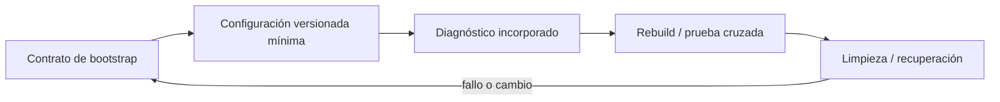
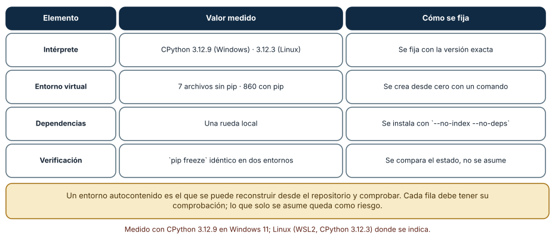
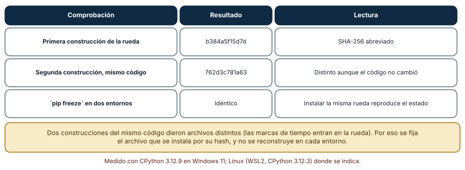
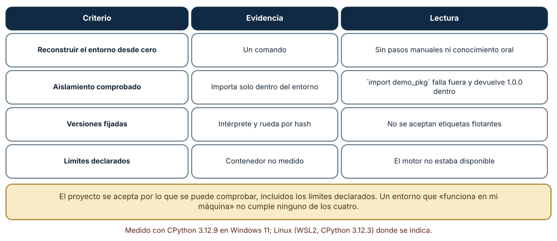

# SE-108 — Proyecto: entorno de desarrollo autocontenido

[← SE-107 — Taller: diagnosticar un fallo desconocido](../../classes/part-08-entornos-herramientas-y-depuracion/se-107-taller-diagnosticar-un-fallo-desconocido/README.md) · [↑ Parte 08](../../classes/part-08-entornos-herramientas-y-depuracion/README.md) · [📚 Índice completo](../../classes/README.md) · [🌐 Portal](../../site/classes/SE-108.html) · [SE-109 — Biblioteca, framework, runtime, plataforma y SDK →](../../classes/part-09-bibliotecas-paquetes-sdk-y-automatizacion/se-109-biblioteca-framework-runtime-plataforma-y-sdk/README.md)


## Punto profesional y fundamento pedagógico

**Punto profesional.** La clase existe para entregar un entorno autocontenido que se reconstruya, diagnostique y recupere.

**Por qué aparece aquí.** Se sitúa después de **Taller: diagnosticar un fallo desconocido** y antes de **Biblioteca, framework, runtime, plataforma y SDK**: convierte el conocimiento anterior en una decisión observable que la clase siguiente podrá reutilizar. La continuidad se comprueba en el artefacto, no por compartir vocabulario.

**Error conceptual que debe corregir.** Considerar reproducible un contenedor que depende de cachés o pasos manuales.

**Secuencia de aprendizaje.** Antes de leer la solución, el estudiante predice el resultado del caso normal y del error conceptual anterior. Luego explica un caso resuelto paso a paso, construye un contraejemplo que cambie la decisión y, sin consultar el texto, reconstruye el mecanismo y lo aplica a una entrada nueva. La secuencia usa predicción, explicación propia, contraste y recuperación. [ICAP](https://icap.education.asu.edu/research) distingue participación de construcción de conocimiento; [How People Learn II](https://nap.nationalacademies.org/catalog/24783/how-people-learn-ii-learners-contexts-and-cultures) exige conectar conocimiento previo, contexto y transferencia; la [práctica de recuperación](https://pubmed.ncbi.nlm.nih.gov/16507066/) respalda producir de nuevo la explicación tras una demora; y [Education for Life and Work](https://nap.nationalacademies.org/resource/13398/dbasse_084153.pdf) exige devolución que explique la causa del error.

**Evidencia de aprendizaje.** Configuración, locks, build limpio, smoke test, SBOM y guía de recuperación. Debe contener predicción previa, observación, explicación causal, contraejemplo, criterio de aceptación y una nota de qué dato haría cambiar la conclusión.

**Límite de la conclusión.** Autocontenido no significa hermético frente a servicios externos.

### Trazabilidad fuente → afirmación

| Fuente primaria u oficial | Afirmación que respalda | Lo que no prueba |
|---|---|---|
| [Development Container Specification](https://containers.dev/implementors/spec/) | Configuración reproducible de herramientas y ciclo de vida del contenedor; autoridad: Dev Container Specification maintainers | No demuestra por sí sola que el artefacto del estudiante sea correcto. |
| [Python venv](https://docs.python.org/3/library/venv.html) | Aislamiento de intérprete, scripts y entorno virtual; autoridad: Python Software Foundation | No demuestra por sí sola que el artefacto del estudiante sea correcto. |
| [Language Server Protocol 3.18](https://microsoft.github.io/language-server-protocol/specifications/lsp/3.18/specification/) | Mensajes, capacidades y sincronización entre editor y servidor; autoridad: Microsoft | No demuestra por sí sola que el artefacto del estudiante sea correcto. |

## Antes de empezar

Esta clase continúa el **entorno reproducible de diagnóstico de la Parte 08**. Recupera la evidencia de la clase anterior, añade una decisión propia de **Proyecto: entorno de desarrollo autocontenido** y deja un artefacto que la clase siguiente deberá consumir. La pregunta activa es: **¿Qué evidencia demuestra que un entorno de desarrollo puede reconstruirse, diagnosticarse y eliminarse con seguridad?**

## Prerrequisitos

- Haber completado la clase anterior o reconstruir su contrato y evidencia.
- Python 3.11 o posterior, terminal, editor y Git; un segundo runtime es opcional y debe declararse.
- Trabajar con fixtures sintéticos: ninguna observación necesita datos de una persona o sistema real.

## Problema auténtico

El entorno reproducible de diagnóstico debe entregarse a otra persona sin exportar el perfil personal del autor. El proyecto integra runtime, dependencias, editor opcional, comandos, fixture, diagnóstico y limpieza.

## Objetivos observables

Al terminar podrás explicar los cinco mecanismos de esta clase, predecir su comportamiento antes de ejecutar, construir un caso normal y uno límite, diagnosticar el fallo controlado, comparar una alternativa y entregar evidencia que otra persona pueda reproducir.

## Mapa conceptual



El mapa se lee como una cadena de razonamiento, no como fases obligatorias del runtime. La flecha de retorno indica que un fallo o cambio de requisito obliga a revisar el modelo inicial; no autoriza a parchear solo la última salida.

## Temas y por qué importan

| Tema | Por qué cambia una decisión profesional | Evidencia mínima |
|---|---|---|
| Contrato de bootstrap | La guía parte de host soportado y termina en una prueba verde. | Predicción, traza causal y contraejemplo de **Contrato de bootstrap** en `configuración` |
| Configuración versionada mínima | Se versionan manifest, lock cuando aplica, contenedor y configuración compartible del editor. | Predicción, traza causal y contraejemplo de **Configuración versionada mínima** en `configuración` |
| Diagnóstico incorporado | Un comando imprime versiones, ejecutable, plataforma y checks sin secretos. | Predicción, traza causal y contraejemplo de **Diagnóstico incorporado** en `configuración` |
| Rebuild y prueba cruzada | La aceptación elimina entorno, reconstruye sin cache relevante y ejecuta en al menos dos superficies declaradas si están disponibles. | Predicción, traza causal y contraejemplo de **Rebuild y prueba cruzada** en `configuración` |
| Limpieza y recuperación | La guía enumera artefactos creados y ofrece eliminación acotada dentro del workspace. | Predicción, traza causal y contraejemplo de **Limpieza y recuperación** en `configuración` |
## Conceptos y decisiones

### 1. Contrato de bootstrap

La guía parte de host soportado y termina en una prueba verde. Declara prerrequisitos, versiones, comandos y tiempo esperado sin asumir configuración personal. Cada paso tiene señal de éxito y corrección para fallo común.

### 2. Configuración versionada mínima

Se versionan manifest, lock cuando aplica, contenedor y configuración compartible del editor. Se excluyen tokens, rutas locales y preferencias no necesarias. Un default ayuda, pero existe ruta CLI independiente del IDE.

### 3. Diagnóstico incorporado

Un comando imprime versiones, ejecutable, plataforma y checks sin secretos. La reproducción del defecto y su regresión viven junto al proyecto. Logs separan stdout consumible de stderr diagnóstico y usan códigos de salida.

### 4. Rebuild y prueba cruzada

La aceptación elimina entorno, reconstruye sin cache relevante y ejecuta en al menos dos superficies declaradas si están disponibles. Si solo se probó una, se dice. Capturas visuales no sustituyen comandos y resultados.

### 5. Limpieza y recuperación

La guía enumera artefactos creados y ofrece eliminación acotada dentro del workspace. Antes de borrar volumen se verifica nombre y datos. Se explica cómo volver al último estado sano sin `reset --hard` ni operaciones destructivas generales.

### Inventario de un entorno autocontenido

Un entorno de desarrollo autocontenido se puede reconstruir desde el repositorio y comprobar. El inventario medido en la parte reúne: intérprete fijado a una versión exacta (CPython 3.12.9 en Windows, 3.12.3 en Linux), un entorno virtual que se crea con un comando (7 archivos sin pip, 860 con pip), dependencias instaladas desde una rueda local con `--no-index --no-deps` y una verificación que compara `pip freeze` en dos entornos nuevos (idéntico). Cada fila del inventario necesita su comprobación; lo que solo se asume queda como riesgo declarado.



**Cómo leer la figura.** Cada fila asocia un elemento con su valor y con la forma en que se fija. **Dónde deja de valer:** el inventario no incluye herramientas del sistema (compiladores, bibliotecas nativas), que un contenedor fijaría pero que aquí no se midieron.

### Reproducir el entorno no es reproducir los bytes

Se construyó dos veces la misma rueda a partir del mismo código. Los hashes SHA-256 abreviados fueron distintos: `b384a5f15d7d` la primera vez y `762d3c781a63` la segunda, aunque el código no cambió (la rueda incluye marcas de tiempo). En cambio, instalar la misma rueda en dos entornos nuevos produjo un `pip freeze` idéntico. La conclusión es operativa: el estado instalado es reproducible si se instala *el mismo archivo*; reconstruir el archivo en cada entorno rompe la identidad. Por eso se fija el archivo que se instala por su hash y no se reconstruye en cada máquina.



**Cómo leer la figura.** Las dos primeras filas muestran la no reproducibilidad de los bytes; la tercera, la reproducibilidad del estado. **Dónde deja de valer:** existen herramientas y variables (como `SOURCE_DATE_EPOCH`) para producir ruedas reproducibles bit a bit; aquí no se aplicaron, y el resultado describe el comportamiento por defecto.

### Criterios de aceptación

El proyecto se acepta por lo que se puede comprobar: reconstruir el entorno desde cero con un comando, sin pasos manuales ni conocimiento oral; comprobar el aislamiento (`import` falla fuera y devuelve la versión dentro); fijar versiones del intérprete y de los archivos por hash, sin etiquetas flotantes; y declarar los límites, como el contenedor no medido por falta de motor. Un entorno que «funciona en mi máquina» no cumple ninguno de los cuatro. Los criterios no premian la complejidad: un entorno sencillo y comprobable vale más que uno sofisticado que nadie puede reconstruir.



**Cómo leer la figura.** Cada criterio tiene su evidencia y su lectura. **Dónde deja de valer:** son criterios mínimos de un entorno individual; un equipo añade actualización de dependencias, escaneo de vulnerabilidades y plazos de revisión.

## Definiciones de trabajo

- **contrato de bootstrap:** la guía parte de host soportado y termina en una prueba verde.
- **configuración versionada mínima:** se versionan manifest, lock cuando aplica, contenedor y configuración compartible del editor.
- **diagnóstico incorporado:** un comando imprime versiones, ejecutable, plataforma y checks sin secretos.
- **rebuild y prueba cruzada:** la aceptación elimina entorno, reconstruye sin cache relevante y ejecuta en al menos dos superficies declaradas si están disponibles.
- **limpieza y recuperación:** la guía enumera artefactos creados y ofrece eliminación acotada dentro del workspace.

Las definiciones son operativas para el entorno reproducible de diagnóstico. No convierten términos con historia más amplia en sinónimos y deben contrastarse con la documentación primaria enlazada al final.

## Ejemplo mínimo

```shell
python tools/doctor.py
python -m unittest -v
python reproduce.py --fixture fixtures/two-equal.json
# Reconstruir desde cero y repetir antes de aceptar.
```

Antes de ejecutar, predice estado, resultado y error. Después registra versión, comando y salida. Si el fragmento es pseudocódigo o pertenece a otro lenguaje, etiquétalo como tal y no afirmes que fue ejecutado.

## Ejemplo profesional

En el entorno reproducible de diagnóstico, una investigación conserva síntoma, entorno, reproducción, hipótesis, observaciones, causa, corrección y regresión. La implementación de esta clase debe conservar ese contrato aunque cambie la forma interna. El caso profesional no pregunta únicamente si produce una salida: pregunta quién puede producirla, qué estado observa, cómo falla y qué rastro permite disputar una decisión incorrecta.

Compara el caso normal con autorización falsa, evidencia incompleta, empate y repetición. Un mecanismo es apropiado cuando esas diferencias quedan visibles y localizadas; es peligroso cuando dependen de orden accidental, estado oculto o una convención que el consumidor no puede conocer.

## Práctica guiada

1. Copia el contrato de entrada y salida antes de escribir implementación.
2. Predice el caso normal y un límite; identifica la invariante que no puede romperse.
3. Implementa la versión mínima sin I/O dentro del núcleo.
4. Ejecuta el caso y conserva comando, versión y salida bajo `evidence/`.
5. Introduce el fallo controlado, reduce la reproducción y formula dos hipótesis rivales.
6. Corrige la causa, añade regresión y ejecuta el conjunto completo.
7. Compara con otro paradigma o lenguaje indicando qué semántica se preserva.

## Ejercicios

1. **Inventario:** completa el inventario de tu proyecto con elemento, valor y forma de fijarlo.
2. **Hashes:** construye dos veces un paquete tuyo y compara sus hashes; explica la diferencia.
3. **Reconstrucción:** escribe el comando y la prueba que recrean tu entorno desde cero.
4. **Límites:** redacta tres límites de tu entrega que un revisor pueda comprobar.

## Reto verificable

Entrega implementación, fixtures, pruebas y un informe corto. Se aprueba si otra persona ejecuta desde checkout limpio, obtiene los mismos resultados y puede relacionar cada rama o transformación con una regla del dominio. No se aprueba por cantidad de archivos ni por usar la sintaxis característica del paradigma.

## Caso conductor

El entorno reproducible de diagnóstico parte de una inversión de empates en la biblioteca de estructuras y algoritmos, captura versión y entrada mínima, compara un entorno sano con uno afectado y conserva la primera divergencia observable. Cambia después una sola regla o condición y revisa qué archivos, pruebas y trazas debieron modificarse. Esa superficie de cambio alimenta el proyecto final de la parte.

## Preguntas frecuentes

### ¿Qué significa que un entorno sea «autocontenido»?

Que el repositorio contiene o referencia todo lo necesario para reconstruirlo y que una persona nueva puede hacerlo sin pasos manuales ni preguntas.

### ¿Cuál es la diferencia entre reproducible y determinista bit a bit?

Reproducible es obtener el mismo estado funcional; determinista bit a bit es obtener archivos idénticos byte a byte. Lo primero suele bastar para desarrollo; lo segundo, para cadenas de suministro verificables.

### ¿Cómo fijo versiones sin bloquear actualizaciones de seguridad?

Con un archivo de bloqueo con hashes y un proceso regular de actualización con pruebas. Fijar sin actualizar acumula vulnerabilidades.

### ¿Qué hago si una dependencia desaparece del índice?

Por eso conviene una copia local o un espejo de las ruedas necesarias; una reconstrucción que depende de una disponibilidad externa no es reproducible.
## Fallo controlado y diagnóstico

La guía funciona solo porque el autor tiene una herramienta global. Prueba en contenedor/usuario limpio, añade prerequisito o reemplaza la dependencia y conserva el log de bootstrap.

Registra síntoma, entrada mínima, hipótesis, observación que descarta cada hipótesis, causa, corrección y prueba de regresión. No cambies simultáneamente implementación, fixture y expectativa.


Rompe la reconstrucción a propósito. Borra el entorno y ejecuta el comando de recreación en una máquina sin red, instalando desde una carpeta local de ruedas. **Síntoma:** si falta una rueda, la instalación falla con un mensaje de «no matching distribution». **Hipótesis:** una dependencia no está en la carpeta local. **Prueba:** lista las dependencias con `pip freeze` del entorno original y compáralas con el contenido de la carpeta. **Conclusión:** una reconstrucción sin red revela dependencias no cubiertas. Guarda la lista faltante y la corrección en `checks.md`, y añade la reconstrucción sin red a la verificación del proyecto.

## Errores comunes y cómo corregirlos

| Síntoma | Causa | Corrección |
|---|---|---|
| El entorno no se reconstruye en otra máquina | Pasos manuales no documentados | Un comando que recree todo, probado desde cero |
| Los hashes de la rueda cambian entre construcciones | Marcas de tiempo en el archivo | Fijar el archivo instalado, no reconstruirlo |
| Una dependencia desaparece del índice | Dependencia solo de un servicio externo | Mantener un espejo o una carpeta de ruedas |
| «Funciona» pero nadie sabe por qué | Versiones no fijadas | Fijar intérprete y archivos por hash |
| Se acepta sin declarar lo no medido | Se oculta un límite | Escribir los límites en la entrega |

## Entorno y archivos clave

```text
work/SE-108/
├── README.md
├── diagnostic_environment/
│   ├── domain.py
│   └── se_108.py
├── fixtures/cases.json
├── tests/test_se_108.py
└── evidence/diagnosis.md
```

El `README` declara plataforma, runtimes, comandos, limpieza y límites. Evita dependencias externas cuando la biblioteca estándar permita observar el mecanismo; si agregas una, fija procedencia y versión.

## Seguridad, ética y accesibilidad

- la autorización forma parte del dominio y no se infiere por ausencia de rechazo;
- no uses `eval`, reglas descargadas ni serialización insegura;
- limita colas, recursión, tamaño de entrada y tiempo de evaluación;
- redacta trazas y conserva una explicación textual además de color o animación;
- una recomendación automatizada debe poder revisarse, impugnarse y corregirse;
- respeta licencias de ejemplos y atribuye adaptaciones.

## Puente hacia el trabajo con agentes

El entorno autocontenido es la base de un harness reproducible: un agente trabaja sobre un entorno que se construye con un comando, se verifica y se descarta. Si el entorno no es reproducible, no se pueden comparar dos ejecuciones del agente ni atribuir una diferencia a su comportamiento. Este proyecto de la parte es, en pequeño, lo que la parte de harness desarrollará: fijar herramientas, verificar su estado y declarar los límites de lo medido.

## Transferencia

Traslada un fixture al segundo modelo, herramienta, plataforma o lenguaje. Compara representación de ausencia, error, mutabilidad, orden y cancelación. La transferencia está lograda cuando el contrato se conserva y las diferencias están explicadas, no cuando la interfaz se parece.

## Evaluación y evidencia

| Criterio | Evidencia para aprobar |
|---|---|
| comprensión | explicación causal de los cinco mecanismos |
| corrección | normal, límite, inválido y contraejemplo |
| diseño | estado, efectos y contrato localizables |
| diagnóstico | reproducción mínima y regresión |
| transferencia | comparación semántica, no estética |
| reproducibilidad | versiones, comandos, salida y límites |


## Fuentes


- [Language Server Protocol 3.18](https://microsoft.github.io/language-server-protocol/specifications/lsp/3.18/specification/) — Mensajes, capacidades y sincronización entre editor y servidor; autoridad: Microsoft.
- [Debug Adapter Protocol](https://microsoft.github.io/debug-adapter-protocol/) — Breakpoints, frames, variables y negociación de capacidades; autoridad: Microsoft.
- [Python Debugging and Profiling](https://docs.python.org/3/library/debug.html) — Pdb, cprofile, timeit, tracemalloc y límites instrumentales; autoridad: Python Software Foundation.
- [Python venv](https://docs.python.org/3/library/venv.html) — Aislamiento de intérprete, scripts y entorno virtual; autoridad: Python Software Foundation.
- [Development Container Specification](https://containers.dev/implementors/spec/) — Configuración reproducible de herramientas y ciclo de vida del contenedor; autoridad: Dev Container Specification maintainers.
- [Web Content Accessibility Guidelines 2.2](https://www.w3.org/TR/WCAG22/) — Percepción, operación por teclado y reducción de barreras en interfaces; autoridad: W3C.

Cada fuente respalda el mecanismo indicado; ninguna demuestra que la implementación del entorno reproducible de diagnóstico sea correcta. Esa afirmación depende de fixtures, pruebas, trazas y revisión reproducible.

- [Reproducible Builds: documentación](https://reproducible-builds.org/docs/): definición de construcción reproducible y variables como `SOURCE_DATE_EPOCH`.
- [PEP 427: formato de ruedas](https://peps.python.org/pep-0427/): estructura del archivo de distribución y sus metadatos.
- [pip: instalación desde archivos locales](https://pip.pypa.io/en/stable/cli/pip_install/): opciones `--no-index` y `--no-deps` usadas en la Figura 2.

## Límites y siguiente paso

El entorno reduce variabilidad conocida, no congela hardware, red o servicios externos. La Parte 9 convertirá la capacidad de la biblioteca de estructuras y algoritmos en una biblioteca, paquete, SDK y CLI con contratos públicos y compatibilidad verificable.

## Glosario

- **contrato de bootstrap:** la guía parte de host soportado y termina en una prueba verde.
- **configuración versionada mínima:** se versionan manifest, lock cuando aplica, contenedor y configuración compartible del editor.
- **diagnóstico incorporado:** un comando imprime versiones, ejecutable, plataforma y checks sin secretos.
- **rebuild y prueba cruzada:** la aceptación elimina entorno, reconstruye sin cache relevante y ejecuta en al menos dos superficies declaradas si están disponibles.
- **limpieza y recuperación:** la guía enumera artefactos creados y ofrece eliminación acotada dentro del workspace.

---

[← SE-107 — Taller: diagnosticar un fallo desconocido](../../classes/part-08-entornos-herramientas-y-depuracion/se-107-taller-diagnosticar-un-fallo-desconocido/README.md) · [↑ Parte 08](../../classes/part-08-entornos-herramientas-y-depuracion/README.md) · [📚 Índice completo](../../classes/README.md) · [🌐 Portal](../../site/classes/SE-108.html) · [SE-109 — Biblioteca, framework, runtime, plataforma y SDK →](../../classes/part-09-bibliotecas-paquetes-sdk-y-automatizacion/se-109-biblioteca-framework-runtime-plataforma-y-sdk/README.md)
