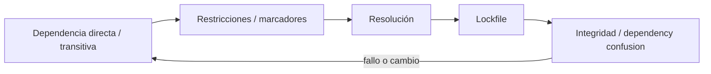
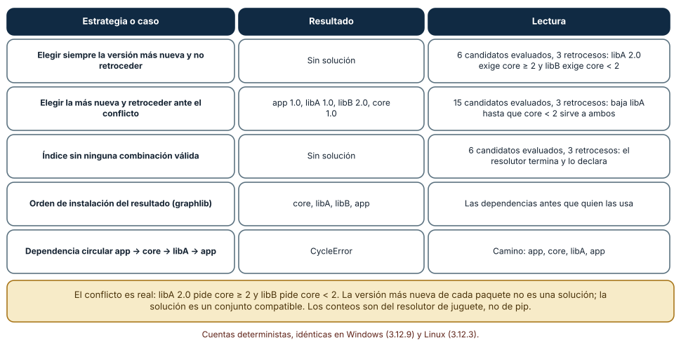
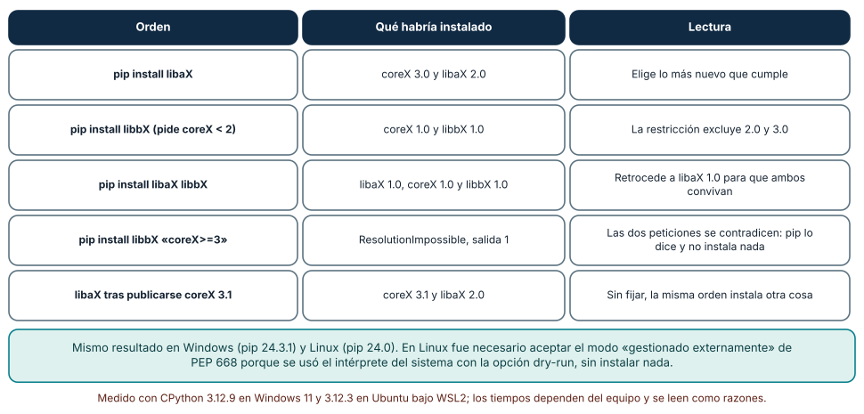
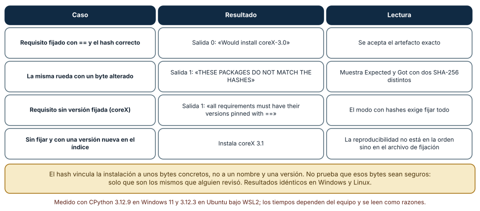

# SE-111 — Resolución de dependencias y lockfiles

[← SE-110 — SemVer, compatibilidad y contratos públicos](../../classes/part-09-bibliotecas-paquetes-sdk-y-automatizacion/se-110-semver-compatibilidad-y-contratos-publicos/README.md) · [↑ Parte 09](../../classes/part-09-bibliotecas-paquetes-sdk-y-automatizacion/README.md) · [📚 Índice completo](../../classes/README.md) · [🌐 Portal](../../site/classes/SE-111.html) · [SE-112 — Paquetes, módulos y publicación →](../../classes/part-09-bibliotecas-paquetes-sdk-y-automatizacion/se-112-paquetes-modulos-y-publicacion/README.md)


## Punto profesional y fundamento pedagógico

**Punto profesional.** La clase existe para explicar resolución de dependencias como satisfacción de restricciones y distinguirla del lock reproducible.

**Por qué aparece aquí.** Se sitúa después de **SemVer, compatibilidad y contratos públicos** y antes de **Paquetes, módulos y publicación**: convierte el conocimiento anterior en una decisión observable que la clase siguiente podrá reutilizar. La continuidad se comprueba en el artefacto, no por compartir vocabulario.

**Error conceptual que debe corregir.** Pedir ‘la última compatible’ como si hubiera una solución única.

**Secuencia de aprendizaje.** Antes de leer la solución, el estudiante predice el resultado del caso normal y del error conceptual anterior. Luego explica un caso resuelto paso a paso, construye un contraejemplo que cambie la decisión y, sin consultar el texto, reconstruye el mecanismo y lo aplica a una entrada nueva. La secuencia usa predicción, explicación propia, contraste y recuperación. [ICAP](https://icap.education.asu.edu/research) distingue participación de construcción de conocimiento; [How People Learn II](https://nap.nationalacademies.org/catalog/24783/how-people-learn-ii-learners-contexts-and-cultures) exige conectar conocimiento previo, contexto y transferencia; la [práctica de recuperación](https://pubmed.ncbi.nlm.nih.gov/16507066/) respalda producir de nuevo la explicación tras una demora; y [Education for Life and Work](https://nap.nationalacademies.org/resource/13398/dbasse_084153.pdf) exige devolución que explique la causa del error.

**Evidencia de aprendizaje.** Resolution-report.md con grafo, restricciones, solución, lock y cambio de entorno. Debe contener predicción previa, observación, explicación causal, contraejemplo, criterio de aceptación y una nota de qué dato haría cambiar la conclusión.

**Límite de la conclusión.** Un lock no garantiza disponibilidad futura ni igualdad entre plataformas.

### Trazabilidad fuente → afirmación

| Fuente primaria u oficial | Afirmación que respalda | Lo que no prueba |
|---|---|---|
| [pylock.toml Specification](https://packaging.python.org/en/latest/specifications/pylock-toml/) | Lock files para instalaciones reproducibles y selección por entorno; autoridad: Python Packaging Authority | No demuestra por sí sola que el artefacto del estudiante sea correcto. |
| [Python Packaging User Guide: Specifications](https://packaging.python.org/en/latest/specifications/) | Metadata, nombres, versiones, dependencias y artefactos de distribución; autoridad: Python Packaging Authority | No demuestra por sí sola que el artefacto del estudiante sea correcto. |
| [Semantic Versioning 2.0.0](https://semver.org/spec/v2.0.0.html) | Api pública, versiones, prereleases y compatibilidad declarada; autoridad: Semantic Versioning project | No demuestra por sí sola que el artefacto del estudiante sea correcto. |

## Antes de empezar

Esta clase continúa el **producto reutilizable con SDK y CLI de la Parte 09**. Recupera la evidencia de la clase anterior, añade una decisión propia de **Resolución de dependencias y lockfiles** y deja un artefacto que la clase siguiente deberá consumir. La pregunta activa es: **¿Cómo convierte un resolvedor restricciones declaradas en una instalación concreta?**

## Prerrequisitos

- Haber completado la clase anterior o reconstruir su contrato y evidencia.
- Python 3.11 o posterior, terminal, editor y Git; un segundo runtime es opcional y debe declararse.
- Trabajar con fixtures sintéticos: ninguna observación necesita datos de una persona o sistema real.

## Problema auténtico

El proyecto pide `A>=1`, `B>=2`; B exige `A<2` y una dependencia opcional cambia por plataforma. Dos instalaciones eligen conjuntos distintos y solo una reproduce el fallo.

## Objetivos observables

Al terminar podrás explicar los cinco mecanismos de esta clase, predecir su comportamiento antes de ejecutar, construir un caso normal y uno límite, diagnosticar el fallo controlado, comparar una alternativa y entregar evidencia que otra persona pueda reproducir.

## Mapa conceptual



El mapa se lee como una cadena de razonamiento, no como fases obligatorias del runtime. La flecha de retorno indica que un fallo o cambio de requisito obliga a revisar el modelo inicial; no autoriza a parchear solo la última salida.

## Temas y por qué importan

| Tema | Por qué cambia una decisión profesional | Evidencia mínima |
|---|---|---|
| Dependencia directa y transitiva | El manifest declara relaciones directas; cada paquete añade transitivas. | Predicción, traza causal y contraejemplo de **Dependencia directa y transitiva** en `resolution-report.md` |
| Restricciones y marcadores | Rangos expresan versiones aceptables; marcadores condicionan por runtime, sistema o extra. | Predicción, traza causal y contraejemplo de **Restricciones y marcadores** en `resolution-report.md` |
| Resolución | El resolvedor busca una asignación que satisfaga restricciones, retrocede ante conflicto y aplica reglas del ecosistema. | Predicción, traza causal y contraejemplo de **Resolución** en `resolution-report.md` |
| Lockfile | Un lock registra selección concreta y, según formato, hashes, fuente, marcadores y grupos. | Predicción, traza causal y contraejemplo de **Lockfile** en `resolution-report.md` |
| Integridad y dependency confusion | Nombre, índice y hash definen procedencia. | Predicción, traza causal y contraejemplo de **Integridad y dependency confusion** en `resolution-report.md` |
## Conceptos y decisiones

### 1. Dependencia directa y transitiva

El manifest declara relaciones directas; cada paquete añade transitivas. El grafo final, no la lista superior, determina superficie. Importar algo disponible solo transitivamente crea dependencia implícita que puede desaparecer cuando el padre cambia.

### 2. Restricciones y marcadores

Rangos expresan versiones aceptables; marcadores condicionan por runtime, sistema o extra. Un rango amplio facilita actualizaciones y también acepta cambios futuros bajo promesa ajena. Pin exacto sin estrategia bloquea parches; ambos extremos requieren política.

### 3. Resolución

El resolvedor busca una asignación que satisfaga restricciones, retrocede ante conflicto y aplica reglas del ecosistema. Puede existir más de una solución válida. Orden de índices, versiones retiradas y plataforma condicionan el resultado.

### 4. Lockfile

Un lock registra selección concreta y, según formato, hashes, fuente, marcadores y grupos. Mejora repetibilidad dentro de su alcance; no congela runtime, sistema ni disponibilidad del índice. Se actualiza deliberadamente y se revisa como cambio de código.

### 5. Integridad y dependency confusion

Nombre, índice y hash definen procedencia. Mezclar repositorio privado y público sin prioridad segura permite sustitución. Verificar hashes detecta bytes distintos, no legitimidad del mantenedor; revisión y política complementan integridad.

### Resolver es buscar: el conflicto, el retroceso y el ciclo

Un resolutor no suma dependencias: busca un conjunto de versiones que satisfaga todas las restricciones a la vez. Se escribió un resolutor de juguete sobre un índice de cuatro paquetes donde `libA 2.0` pide `core >= 2` y `libB` pide `core < 2`. Si el resolutor elige siempre la versión más nueva y no retrocede, no encuentra solución (evaluó 6 candidatos y retrocedió 3 veces). Si retrocede, llega a `libA 1.0`, `libB 2.0`, `core 1.0` tras 15 candidatos evaluados. Y en un índice sin ninguna combinación válida termina y lo declara, en lugar de colgarse.

Además, `graphlib` ordenó el resultado como `core, libA, libB, app` (las dependencias antes de quien las usa) y detectó el ciclo `app → core → libA → app` con `CycleError`. Estos conteos son del juguete, no de pip, pero muestran lo esencial: la «versión más nueva de todo» puede no existir como conjunto, la solución depende del orden de exploración y un ciclo se detecta y se rechaza, no se resuelve.



**Cómo leer la figura.** Compara la primera y la segunda fila: el mismo índice, con y sin retroceso. La última columna cuenta lo que cuesta cada estrategia. **Dónde deja de valer:** el índice es de cuatro paquetes y sin rangos complejos; los resolutores reales (como el de pip, basado en `resolvelib`) también deben tratar extras, marcadores de entorno y versiones yanked, y su complejidad en el peor caso puede crecer exponencialmente.

### pip resuelve sobre ruedas locales: lo que cambia sin tocar tu código

Con ruedas hechas a mano en un directorio local y `pip install --dry-run --no-index --find-links`, pip eligió: para `libaX`, `coreX 3.0` y `libaX 2.0` (lo más nuevo que cumple); para `libbX`, que pide `coreX < 2`, `coreX 1.0`; para `libaX libbX` juntos, retrocedió a `libaX 1.0` con `coreX 1.0`, porque `libaX 2.0` exigía `coreX >= 2`. Con `libbX` y `coreX>=3` el resultado fue `ResolutionImpossible` y salida 1: pip explicó cuál restricción choca con cuál y no instaló nada.

El último caso importa más que el resto: tras publicar `coreX 3.1` en el directorio, la misma orden `pip install libaX` pasó a elegir `coreX 3.1`. Nada en tu proyecto cambió y la instalación es otra. Eso es lo que significa «dependencia sin fijar»: el resultado depende del estado del índice en el momento de instalar. Mismos resultados en Windows (pip 24.3.1) y Linux (pip 24.0).



**Cómo leer la figura.** Lee la columna central como lo que pip decidió y la tercera como el porqué. Las filas tercera y quinta son las que sorprenden. **Dónde deja de valer:** el índice era un directorio local con nueve ruedas; un índice real tiene miles de versiones, ruedas por plataforma y metadatos que pueden estar mal declarados. En Linux se usó el intérprete del sistema con `--dry-run` y `PIP_BREAK_SYSTEM_PACKAGES` (PEP 668); no se instaló nada.

### Fijar con hashes: aceptar bytes, no nombres

Un archivo de requisitos con `==` y `--hash=sha256:...` cambia el criterio de aceptación: pip instala solo si el artefacto descargado tiene exactamente ese hash. Con el hash correcto, `pip install --require-hashes` terminó con salida 0 (`Would install coreX-3.0`). Con la misma rueda alterada en un byte, terminó con salida 1 y el mensaje `THESE PACKAGES DO NOT MATCH THE HASHES`, mostrando `Expected` y `Got` con dos SHA-256 distintos. Con un requisito sin versión fijada, también salida 1: el modo exige `==` en todo.

Qué prueba y qué no: el hash demuestra que los bytes son los que alguien revisó, no que sean seguros ni que la dependencia transitiva sea la deseada (por eso el archivo debe incluir todas las transitivas). La reproducibilidad no está en la orden de instalación sino en el archivo que la fija; y el archivo debe regenerarse deliberadamente cuando se quiere actualizar, con revisión del diff. Resultados idénticos en Windows y Linux.



**Cómo leer la figura.** Cada fila es una variación de un mismo archivo de requisitos. La columna central incluye el código de salida porque es lo que mira la integración continua. **Dónde deja de valer:** la alteración fue de un byte en una rueda local; un ataque real puede ocurrir antes de que calcules el hash. Fijar hashes tampoco sustituye auditar las dependencias ni vigilar avisos de seguridad.

## Definiciones de trabajo

- **dependencia directa y transitiva:** el manifest declara relaciones directas; cada paquete añade transitivas.
- **restricciones y marcadores:** rangos expresan versiones aceptables; marcadores condicionan por runtime, sistema o extra.
- **resolución:** el resolvedor busca una asignación que satisfaga restricciones, retrocede ante conflicto y aplica reglas del ecosistema.
- **lockfile:** un lock registra selección concreta y, según formato, hashes, fuente, marcadores y grupos.
- **integridad y dependency confusion:** nombre, índice y hash definen procedencia.

Las definiciones son operativas para el producto reutilizable con SDK y CLI. No convierten términos con historia más amplia en sinónimos y deben contrastarse con la documentación primaria enlazada al final.

## Ejemplo mínimo

```toml
[project]
dependencies = [
  "http-client>=2,<3",
  "color-support>=1; sys_platform == 'win32'",
]
# El lock registra la solución; el manifest conserva intención.
```

Antes de ejecutar, predice estado, resultado y error. Después registra versión, comando y salida. Si el fragmento es pseudocódigo o pertenece a otro lenguaje, etiquétalo como tal y no afirmes que fue ejecutado.

## Ejemplo profesional

En el producto reutilizable con SDK y CLI, un release contiene contrato público, artefactos inmutables, dependencias, procedencia, ejemplos, errores y ruta de migración. La implementación de esta clase debe conservar ese contrato aunque cambie la forma interna. El caso profesional no pregunta únicamente si produce una salida: pregunta quién puede producirla, qué estado observa, cómo falla y qué rastro permite disputar una decisión incorrecta.

Compara el caso normal con autorización falsa, evidencia incompleta, empate y repetición. Un mecanismo es apropiado cuando esas diferencias quedan visibles y localizadas; es peligroso cuando dependen de orden accidental, estado oculto o una convención que el consumidor no puede conocer.

## Práctica guiada

1. Copia el contrato de entrada y salida antes de escribir implementación.
2. Predice el caso normal y un límite; identifica la invariante que no puede romperse.
3. Implementa la versión mínima sin I/O dentro del núcleo.
4. Ejecuta el caso y conserva comando, versión y salida bajo `evidence/`.
5. Introduce el fallo controlado, reduce la reproducción y formula dos hipótesis rivales.
6. Corrige la causa, añade regresión y ejecuta el conjunto completo.
7. Compara con otro paradigma o lenguaje indicando qué semántica se preserva.

## Ejercicios

1. **Resolutor propio:** implementa un resolutor con retroceso sobre un índice de seis paquetes con un conflicto y un ciclo; cuenta candidatos evaluados y retrocesos, y compara con una estrategia sin retroceso.
2. **Ruedas locales:** crea cuatro ruedas a mano o con `pip wheel`, ejecuta `pip install --dry-run --no-index --find-links` para tres pedidos distintos y predice el resultado antes de ejecutar.
3. **Alterar un byte:** calcula el SHA-256 de una rueda, escribe un requisito con `--hash`, instala en modo seco, altera un byte en una copia y registra el mensaje, la salida y los dos hashes.
4. **Política de actualización:** redacta cuándo, quién y con qué pruebas se regenera tu lockfile; incluye qué haces si el diff de transitivas es grande.

## Reto verificable

Entrega implementación, fixtures, pruebas y un informe corto. Se aprueba si otra persona ejecuta desde checkout limpio, obtiene los mismos resultados y puede relacionar cada rama o transformación con una regla del dominio. No se aprueba por cantidad de archivos ni por usar la sintaxis característica del paradigma.

## Caso conductor

El producto reutilizable con SDK y CLI empaqueta el motor de la biblioteca de estructuras y algoritmos como `engineering_sdk`, expone `choose_next`, una CLI y un punto de extensión. Ejecuta instalación limpia, entrada válida, configuración ausente, plugin incompatible y actualización entre dos versiones. Cambia después una sola regla o condición y revisa qué archivos, pruebas y trazas debieron modificarse. Esa superficie de cambio alimenta el proyecto final de la parte.

## Preguntas frecuentes

### ¿Para qué sirve un lockfile si ya tengo `requirements.txt`?

Un `requirements.txt` con rangos describe lo que aceptas; un lockfile registra lo que se resolvió, incluidas las transitivas y, si quieres, los hashes. En el experimento, la misma orden instaló `coreX 3.0` o `3.1` según el estado del índice.

### ¿Una biblioteca debe publicar lockfile?

Para el consumidor de la biblioteca, el lockfile no se hereda: lo decide la aplicación. La biblioteca declara rangos compatibles y los prueba en CI contra los extremos del rango; la aplicación fija un conjunto concreto y lo despliega.

### ¿Qué hago ante `ResolutionImpossible`?

Lee qué dos restricciones chocan (pip las nombra), decide cuál ceder y vuelve a resolver. No fuerces la instalación: obtendrías un entorno que incumple una restricción declarada.

### ¿Cuándo actualizo las dependencias fijadas?

De forma deliberada y con revisión: regenera el archivo, lee el diff, ejecuta las pruebas de contrato y la prueba de humo en entorno limpio. Una actualización automática sin revisión devuelve la incertidumbre que el archivo eliminaba.

## Fallo controlado y diagnóstico

Borra el lock y resuelve meses después; entra una major permitida por rango incorrecto. Corrige restricción, regenera en entorno limpio y revisa diff del grafo.

Registra síntoma, entrada mínima, hipótesis, observación que descarta cada hipótesis, causa, corrección y prueba de regresión. No cambies simultáneamente implementación, fixture y expectativa.

Publica una versión nueva de una transitiva en el índice local y repite la misma orden `pip install libaX`. **Síntoma:** la instalación cambia de `coreX 3.0` a `coreX 3.1` sin que nada en el proyecto se haya modificado. **Hipótesis rivales:** (a) pip tiene un defecto; (b) la dependencia no estaba fijada. **Prueba:** repite con un archivo de requisitos que fija `coreX==3.0` y su hash: la instalación vuelve a ser estable, y alterar un byte en la rueda produce salida 1 con `Expected` y `Got`. **Conclusión:** la inestabilidad venía de dejar la transitiva libre. Corrección: fijar, registrar plataforma e intérprete, y regenerar el archivo solo de forma deliberada; regresión: una comprobación en CI que falla si el lockfile no coincide con lo resuelto. No cambies a la vez el rango y el hash.

## Errores comunes y cómo corregirlos

| Síntoma | Causa probable | Corrección |
|---|---|---|
| La instalación de ayer y la de hoy dan versiones distintas | Dependencia sin fijar y un lanzamiento nuevo en el índice | Fijar con `==` y archivo generado; actualizar de forma deliberada |
| `ResolutionImpossible` al añadir una librería nueva | Dos restricciones incompatibles sobre la misma transitiva | Leer el mensaje, ceder una restricción o elegir otra versión de la librería |
| `--require-hashes` falla con «must be pinned» | Hay un requisito sin `==` en el archivo | Fijar todas las transitivas, no solo las directas |
| El hash coincide y el paquete sigue siendo malicioso | El hash solo prueba identidad, no inocuidad | Revisar la dependencia antes de fijarla y vigilar avisos de seguridad |
| CI pasa y producción rompe con la misma lista | El lockfile se generó en otra plataforma o versión de Python | Registrar plataforma e intérprete en el lock y probar en cada plataforma soportada |

## Entorno y archivos clave

```text
work/SE-111/
├── README.md
├── engineering_sdk/
│   ├── domain.py
│   └── se_111.py
├── fixtures/cases.json
├── tests/test_se_111.py
└── evidence/diagnosis.md
```

El `README` declara plataforma, runtimes, comandos, limpieza y límites. Evita dependencias externas cuando la biblioteca estándar permita observar el mecanismo; si agregas una, fija procedencia y versión.

## Seguridad, ética y accesibilidad

- la autorización forma parte del dominio y no se infiere por ausencia de rechazo;
- no uses `eval`, reglas descargadas ni serialización insegura;
- limita colas, recursión, tamaño de entrada y tiempo de evaluación;
- redacta trazas y conserva una explicación textual además de color o animación;
- una recomendación automatizada debe poder revisarse, impugnarse y corregirse;
- respeta licencias de ejemplos y atribuye adaptaciones.

## Puente hacia el trabajo con agentes

Un agente que añade una dependencia suele escribir `pip install paquete` y registrar el nombre sin versión, o actualizar varias a la vez para «arreglar» un conflicto. Exige que cada cambio de dependencias vaya con el diff del lockfile, la salida de una instalación en seco y el resultado de las pruebas de contrato y de humo, y que no instale nada sin hash cuando el proyecto trabaja en modo con hashes. Pídele que explique, ante un `ResolutionImpossible`, qué dos restricciones chocan; si propone `--force` o `--no-deps`, es una señal para detenerse.

## Transferencia

Traslada un fixture al segundo modelo, herramienta, plataforma o lenguaje. Compara representación de ausencia, error, mutabilidad, orden y cancelación. La transferencia está lograda cuando el contrato se conserva y las diferencias están explicadas, no cuando la interfaz se parece.

## Evaluación y evidencia

| Criterio | Evidencia para aprobar |
|---|---|
| comprensión | explicación causal de los cinco mecanismos |
| corrección | normal, límite, inválido y contraejemplo |
| diseño | estado, efectos y contrato localizables |
| diagnóstico | reproducción mínima y regresión |
| transferencia | comparación semántica, no estética |
| reproducibilidad | versiones, comandos, salida y límites |


## Fuentes


- [Semantic Versioning 2.0.0](https://semver.org/spec/v2.0.0.html) — Api pública, versiones, prereleases y compatibilidad declarada; autoridad: Semantic Versioning project.
- [Python Packaging User Guide: Specifications](https://packaging.python.org/en/latest/specifications/) — Metadata, nombres, versiones, dependencias y artefactos de distribución; autoridad: Python Packaging Authority.
- [pylock.toml Specification](https://packaging.python.org/en/latest/specifications/pylock-toml/) — Lock files para instalaciones reproducibles y selección por entorno; autoridad: Python Packaging Authority.
- [Python Standard Library](https://docs.python.org/3/library/index.html) — Argparse, importlib.metadata, subprocess y apis de automatización; autoridad: Python Software Foundation.
- [SPDX Specification 3.0](https://spdx.dev/use/specifications/) — Identificadores, sbom y procedencia legible por máquinas; autoridad: Linux Foundation.
- [REUSE Specification](https://reuse.software/spec-3.3/) — Declaración inequívoca y verificable de copyright y licencias por archivo; autoridad: Free Software Foundation Europe.

Cada fuente respalda el mecanismo indicado; ninguna demuestra que la implementación del producto reutilizable con SDK y CLI sea correcta. Esa afirmación depende de fixtures, pruebas, trazas y revisión reproducible.

- [pip: Dependency Resolution](https://pip.pypa.io/en/stable/topics/dependency-resolution/) — describe el resolutor de pip, el retroceso y cómo interpretar un conflicto.
- [pip: Secure installs](https://pip.pypa.io/en/stable/topics/secure-installs/) — documenta el modo con hashes y sus requisitos.
- [pip: Repeatable installs](https://pip.pypa.io/en/stable/topics/repeatable-installs/) — explica cómo obtener instalaciones repetibles.
- [PEP 668: Marking Python base environments as externally managed](https://peps.python.org/pep-0668/) — explica por qué pip se negó a operar sobre el intérprete del sistema en Linux.
- [Russ Cox: Our Software Dependency Problem](https://research.swtch.com/deps) — análisis de práctica sobre el costo de depender de código ajeno.
- [Russ Cox: Version SAT](https://research.swtch.com/version-sat) — muestra que seleccionar versiones es un problema de satisfacibilidad.

## Límites y siguiente paso

Resolver dependencias no produce un artefacto publicable ni garantiza que contenga lo esperado. La siguiente clase construye paquete, distribuciones y publicación verificable.

## Glosario

- **dependencia directa y transitiva:** el manifest declara relaciones directas; cada paquete añade transitivas.
- **restricciones y marcadores:** rangos expresan versiones aceptables; marcadores condicionan por runtime, sistema o extra.
- **resolución:** el resolvedor busca una asignación que satisfaga restricciones, retrocede ante conflicto y aplica reglas del ecosistema.
- **lockfile:** un lock registra selección concreta y, según formato, hashes, fuente, marcadores y grupos.
- **integridad y dependency confusion:** nombre, índice y hash definen procedencia.

---

[← SE-110 — SemVer, compatibilidad y contratos públicos](../../classes/part-09-bibliotecas-paquetes-sdk-y-automatizacion/se-110-semver-compatibilidad-y-contratos-publicos/README.md) · [↑ Parte 09](../../classes/part-09-bibliotecas-paquetes-sdk-y-automatizacion/README.md) · [📚 Índice completo](../../classes/README.md) · [🌐 Portal](../../site/classes/SE-111.html) · [SE-112 — Paquetes, módulos y publicación →](../../classes/part-09-bibliotecas-paquetes-sdk-y-automatizacion/se-112-paquetes-modulos-y-publicacion/README.md)
