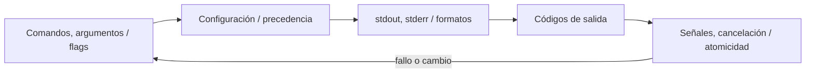
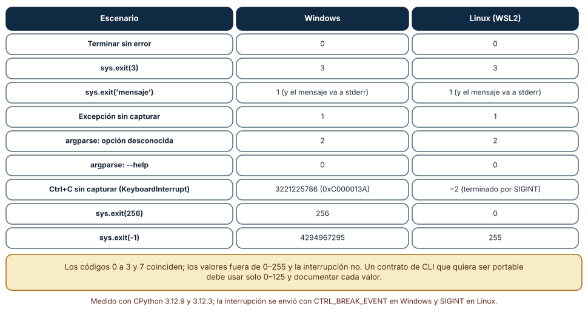
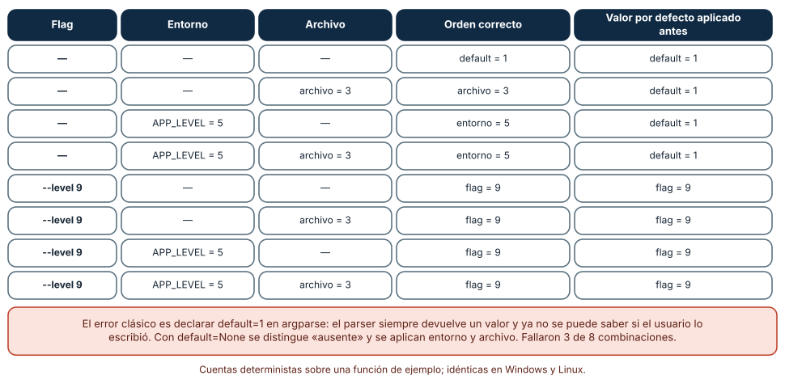
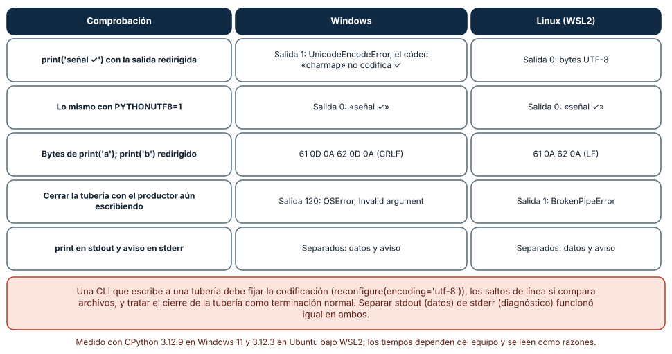

# SE-113 — CLI, flags, configuración y códigos de salida

[← SE-112 — Paquetes, módulos y publicación](../../classes/part-09-bibliotecas-paquetes-sdk-y-automatizacion/se-112-paquetes-modulos-y-publicacion/README.md) · [↑ Parte 09](../../classes/part-09-bibliotecas-paquetes-sdk-y-automatizacion/README.md) · [📚 Índice completo](../../classes/README.md) · [🌐 Portal](../../site/classes/SE-113.html) · [SE-114 — Scripting repetible y tareas idempotentes →](../../classes/part-09-bibliotecas-paquetes-sdk-y-automatizacion/se-114-scripting-repetible-y-tareas-idempotentes/README.md)


## Punto profesional y fundamento pedagógico

**Punto profesional.** La clase existe para diseñar una CLI como interfaz pública con gramática, streams, códigos de salida y compatibilidad.

**Por qué aparece aquí.** Se sitúa después de **Paquetes, módulos y publicación** y antes de **Scripting repetible y tareas idempotentes**: convierte el conocimiento anterior en una decisión observable que la clase siguiente podrá reutilizar. La continuidad se comprueba en el artefacto, no por compartir vocabulario.

**Error conceptual que debe corregir.** Imprimir errores en stdout o devolver cero tras un fallo.

**Secuencia de aprendizaje.** Antes de leer la solución, el estudiante predice el resultado del caso normal y del error conceptual anterior. Luego explica un caso resuelto paso a paso, construye un contraejemplo que cambie la decisión y, sin consultar el texto, reconstruye el mecanismo y lo aplica a una entrada nueva. La secuencia usa predicción, explicación propia, contraste y recuperación. [ICAP](https://icap.education.asu.edu/research) distingue participación de construcción de conocimiento; [How People Learn II](https://nap.nationalacademies.org/catalog/24783/how-people-learn-ii-learners-contexts-and-cultures) exige conectar conocimiento previo, contexto y transferencia; la [práctica de recuperación](https://pubmed.ncbi.nlm.nih.gov/16507066/) respalda producir de nuevo la explicación tras una demora; y [Education for Life and Work](https://nap.nationalacademies.org/resource/13398/dbasse_084153.pdf) exige devolución que explique la causa del error.

**Evidencia de aprendizaje.** Cli-contract.md con help, casos, stdout/stderr, exit codes y automatización. Debe contener predicción previa, observación, explicación causal, contraejemplo, criterio de aceptación y una nota de qué dato haría cambiar la conclusión.

**Límite de la conclusión.** Argparse resuelve parsing; no diseña por sí solo la experiencia.

### Trazabilidad fuente → afirmación

| Fuente primaria u oficial | Afirmación que respalda | Lo que no prueba |
|---|---|---|
| [Python Standard Library](https://docs.python.org/3/library/index.html) | Argparse, importlib.metadata, subprocess y apis de automatización; autoridad: Python Software Foundation | No demuestra por sí sola que el artefacto del estudiante sea correcto. |
| [Semantic Versioning 2.0.0](https://semver.org/spec/v2.0.0.html) | Api pública, versiones, prereleases y compatibilidad declarada; autoridad: Semantic Versioning project | No demuestra por sí sola que el artefacto del estudiante sea correcto. |
| [Python argparse](https://docs.python.org/3/library/argparse.html) | define parsing, ayuda y errores de una CLI | No demuestra por sí sola que el artefacto del estudiante sea correcto. |
| [POSIX Utility Syntax Guidelines](https://pubs.opengroup.org/onlinepubs/9799919799/basedefs/V1_chap12.html) | define convenciones interoperables de argumentos | No demuestra por sí sola que el artefacto del estudiante sea correcto. |

## Antes de empezar

Esta clase continúa el **producto reutilizable con SDK y CLI de la Parte 09**. Recupera la evidencia de la clase anterior, añade una decisión propia de **CLI, flags, configuración y códigos de salida** y deja un artefacto que la clase siguiente deberá consumir. La pregunta activa es: **¿Cómo diseñar una CLI consumible por personas y automatizaciones sin mezclar datos con diagnóstico?**

## Prerrequisitos

- Haber completado la clase anterior o reconstruir su contrato y evidencia.
- Python 3.11 o posterior, terminal, editor y Git; un segundo runtime es opcional y debe declararse.
- Trabajar con fixtures sintéticos: ninguna observación necesita datos de una persona o sistema real.

## Problema auténtico

La CLI imprime progreso y JSON en stdout, acepta flag y variable con precedencia implícita y devuelve cero aunque falle un plugin. Scripts consumidores no pueden distinguir éxito parcial.

## Objetivos observables

Al terminar podrás explicar los cinco mecanismos de esta clase, predecir su comportamiento antes de ejecutar, construir un caso normal y uno límite, diagnosticar el fallo controlado, comparar una alternativa y entregar evidencia que otra persona pueda reproducir.

## Mapa conceptual



El mapa se lee como una cadena de razonamiento, no como fases obligatorias del runtime. La flecha de retorno indica que un fallo o cambio de requisito obliga a revisar el modelo inicial; no autoriza a parchear solo la última salida.

## Temas y por qué importan

| Tema | Por qué cambia una decisión profesional | Evidencia mínima |
|---|---|---|
| Comandos, argumentos y flags | Un comando expresa acción; argumentos suelen identificar operandos y flags modifican comportamiento. | Predicción, traza causal y contraejemplo de **Comandos, argumentos y flags** en `cli-contract.md` |
| Configuración y precedencia | Defaults, archivo, entorno y CLI necesitan orden documentado y opción de explicar valor efectivo sin revelar secreto. | Predicción, traza causal y contraejemplo de **Configuración y precedencia** en `cli-contract.md` |
| stdout, stderr y formatos | stdout transporta resultado consumible; stderr contiene diagnóstico. | Predicción, traza causal y contraejemplo de **stdout, stderr y formatos** en `cli-contract.md` |
| Códigos de salida | Cero indica éxito contractual; valores no cero clasifican uso inválido, datos rechazados, dependencia fallida o error interno según matriz publicada. | Predicción, traza causal y contraejemplo de **Códigos de salida** en `cli-contract.md` |
| Señales, cancelación y atomicidad | Ctrl+C solicita cancelación y debe limpiar archivos temporales o dejar estado recuperable. | Predicción, traza causal y contraejemplo de **Señales, cancelación y atomicidad** en `cli-contract.md` |
## Conceptos y decisiones

### 1. Comandos, argumentos y flags

Un comando expresa acción; argumentos suelen identificar operandos y flags modifican comportamiento. Nombres, defaults y ayuda forman contrato. Flags booleanos deben permitir intención inequívoca y no interpretar `false` textual mediante truthiness.

### 2. Configuración y precedencia

Defaults, archivo, entorno y CLI necesitan orden documentado y opción de explicar valor efectivo sin revelar secreto. Configuración inválida falla antes de producir efectos. Ausencia, vacío y cero se distinguen.

### 3. stdout, stderr y formatos

stdout transporta resultado consumible; stderr contiene diagnóstico. Modo humano y JSON pueden coexistir de forma explícita. Un esquema/version de salida evita que cambiar redacción rompa parsers.

### 4. Códigos de salida

Cero indica éxito contractual; valores no cero clasifican uso inválido, datos rechazados, dependencia fallida o error interno según matriz publicada. El código no transporta detalle completo; stderr o JSON estructurado lo complementan.

### 5. Señales, cancelación y atomicidad

Ctrl+C solicita cancelación y debe limpiar archivos temporales o dejar estado recuperable. Escribir a temporal y reemplazar reduce parciales. Capturar toda excepción para devolver cero destruye observabilidad.

### Códigos de salida: el contrato que lee el shell

El código de salida es la parte de una CLI que el sistema operativo y la integración continua interpretan sin leer una palabra. Se midió con `subprocess` sobre diez escenarios. Terminar bien dio 0; `sys.exit(3)` dio 3; `sys.exit('mensaje')` dio 1 y el texto fue a `stderr`; una excepción sin capturar dio 1; `argparse` con una opción desconocida dio 2 y con `--help` dio 0; `os._exit(7)` dio 7. Hasta aquí Windows y Linux coinciden.

Divergen donde el contrato queda fuera de 0–255 o interviene una señal. `Ctrl+C` sin capturar terminó con 3221225786 (`0xC000013A`, `STATUS_CONTROL_C_EXIT`) en Windows y con −2 en Linux (el proceso fue terminado por SIGINT; el shell lo informa como 130). `sys.exit(256)` dio 256 en Windows y 0 en Linux, y `sys.exit(-1)` dio 4294967295 frente a 255. Un contrato portable usa solo valores 0–125, documenta cada uno (`0` éxito, `1` error de ejecución, `2` uso incorrecto, `3` entrada inválida, por ejemplo) y no promete nada sobre las señales.



**Cómo leer la figura.** Lee por filas; las únicas en las que las dos columnas difieren son las del final. **Dónde deja de valer:** la interrupción se envió con `CTRL_BREAK_EVENT` en Windows y con `SIGINT` en Linux, que no son equivalentes; una CLI dentro de un contenedor o un servicio recibe `SIGTERM`, que no se midió. Los códigos de `argparse` (2) están documentados para ese módulo, no para toda CLI.

### Precedencia de configuración: flag, entorno, archivo, valor por defecto

Una CLI recibe configuración desde cuatro fuentes y necesita un orden único: el flag de la invocación manda sobre la variable de entorno, esta sobre el archivo y el archivo sobre el valor por defecto. Se probaron las ocho combinaciones de «flag presente o no», «entorno presente o no» y «archivo presente o no». Con el orden correcto todas dieron el valor esperado; con una implementación que aplica `default=1` en `argparse` antes de mirar el entorno, tres de las ocho dieron 1 en lugar de 5 (entorno) o 3 (archivo).

El error es sutil porque el parser siempre devuelve un valor: si el valor por defecto está en `argparse`, el programa ya no puede saber si el usuario escribió `--level 1` o no lo escribió. La corrección es declarar `default=None`, resolver las fuentes en una función aparte, probada en una tabla de combinaciones, y registrar en la salida de diagnóstico de dónde salió cada valor (`level=5 (entorno)`). Así, el soporte puede responder «¿por qué usa 5?» sin leer el código.



**Cómo leer la figura.** Compara las dos últimas columnas: en las filas con entorno o archivo y sin flag, la implementación incorrecta devuelve el valor por defecto. **Dónde deja de valer:** es una función de ejemplo con un solo parámetro; en una CLI real hay varios, tipos distintos (booleanos, listas) y fuentes que pueden estar malformadas, y esos casos necesitan su propia tabla.

### Tuberías y codificación: la misma CLI, dos comportamientos

Una CLI se encadena con otras (`cli | otra`), y ahí aparecen diferencias de plataforma. Con la salida redirigida, `print('señal ✓')` falló en Windows con salida 1 y `UnicodeEncodeError: 'charmap' codec can't encode character '\u2713'`, porque la codificación de la tubería era una página de códigos heredada; en Linux produjo bytes UTF-8. Con `PYTHONUTF8=1` funcionó en ambos. Los saltos de línea de `print('a'); print('b')` fueron `61 0D 0A 62 0D 0A` (CRLF) en Windows y `61 0A 62 0A` en Linux.

Cuando el consumidor cierra la tubería mientras el productor escribe, Windows terminó con salida 120 y `OSError: [Errno 22] Invalid argument`; Linux con salida 1 y `BrokenPipeError`. Y la separación `stdout` para datos y `stderr` para avisos funcionó igual en ambas. Reglas de diseño: fijar la codificación de salida en el programa (`sys.stdout.reconfigure(encoding='utf-8', newline='\n')`), tratar el cierre de la tubería como terminación normal y no mezclar diagnóstico con datos, porque `--json` solo es máquina-legible si en `stdout` no hay nada más.



**Cómo leer la figura.** Lee cada fila como una prueba que debería existir en la suite de la CLI. **Dónde deja de valer:** el comportamiento depende de la versión de Python (a partir de 3.15 UTF-8 será el modo por defecto, según PEP 686) y de la configuración regional de Windows; el intérprete era 3.12.9 y la consola, redirigida por `subprocess`.

## Definiciones de trabajo

- **comandos, argumentos y flags:** un comando expresa acción; argumentos suelen identificar operandos y flags modifican comportamiento.
- **configuración y precedencia:** defaults, archivo, entorno y cli necesitan orden documentado y opción de explicar valor efectivo sin revelar secreto.
- **stdout, stderr y formatos:** stdout transporta resultado consumible; stderr contiene diagnóstico.
- **códigos de salida:** cero indica éxito contractual; valores no cero clasifican uso inválido, datos rechazados, dependencia fallida o error interno según matriz publicada.
- **señales, cancelación y atomicidad:** ctrl+c solicita cancelación y debe limpiar archivos temporales o dejar estado recuperable.

Las definiciones son operativas para el producto reutilizable con SDK y CLI. No convierten términos con historia más amplia en sinónimos y deben contrastarse con la documentación primaria enlazada al final.

## Ejemplo mínimo

```shell
engineering_sdk choose --input cases.json --format json
engineering_sdk config explain --redact
# stdout: resultado; stderr: diagnóstico; códigos documentados.
```

Antes de ejecutar, predice estado, resultado y error. Después registra versión, comando y salida. Si el fragmento es pseudocódigo o pertenece a otro lenguaje, etiquétalo como tal y no afirmes que fue ejecutado.

## Ejemplo profesional

En el producto reutilizable con SDK y CLI, un release contiene contrato público, artefactos inmutables, dependencias, procedencia, ejemplos, errores y ruta de migración. La implementación de esta clase debe conservar ese contrato aunque cambie la forma interna. El caso profesional no pregunta únicamente si produce una salida: pregunta quién puede producirla, qué estado observa, cómo falla y qué rastro permite disputar una decisión incorrecta.

Compara el caso normal con autorización falsa, evidencia incompleta, empate y repetición. Un mecanismo es apropiado cuando esas diferencias quedan visibles y localizadas; es peligroso cuando dependen de orden accidental, estado oculto o una convención que el consumidor no puede conocer.

## Práctica guiada

1. Copia el contrato de entrada y salida antes de escribir implementación.
2. Predice el caso normal y un límite; identifica la invariante que no puede romperse.
3. Implementa la versión mínima sin I/O dentro del núcleo.
4. Ejecuta el caso y conserva comando, versión y salida bajo `evidence/`.
5. Introduce el fallo controlado, reduce la reproducción y formula dos hipótesis rivales.
6. Corrige la causa, añade regresión y ejecuta el conjunto completo.
7. Compara con otro paradigma o lenguaje indicando qué semántica se preserva.

## Ejercicios

1. **Tabla de salidas:** ejecuta diez variantes de un programa con `subprocess` y registra código de salida y destino del texto; marca las que dependen del sistema operativo.
2. **Tabla de precedencia:** implementa la resolución de un parámetro con flag, entorno, archivo y valor por defecto; escribe las ocho combinaciones como una prueba parametrizada y rompe la implementación aplicando el default antes.
3. **Tubería:** redirige la salida de tu CLI con un carácter fuera de ASCII; registra salida, error y bytes, y corrige la CLI para que se comporte igual con y sin `PYTHONUTF8`.
4. **Contrato escrito:** redacta la sección «códigos de salida y formatos» de una CLI de tu programa con un ejemplo de invocación y la salida esperada en bytes.

## Reto verificable

Entrega implementación, fixtures, pruebas y un informe corto. Se aprueba si otra persona ejecuta desde checkout limpio, obtiene los mismos resultados y puede relacionar cada rama o transformación con una regla del dominio. No se aprueba por cantidad de archivos ni por usar la sintaxis característica del paradigma.

## Caso conductor

El producto reutilizable con SDK y CLI empaqueta el motor de la biblioteca de estructuras y algoritmos como `engineering_sdk`, expone `choose_next`, una CLI y un punto de extensión. Ejecuta instalación limpia, entrada válida, configuración ausente, plugin incompatible y actualización entre dos versiones. Cambia después una sola regla o condición y revisa qué archivos, pruebas y trazas debieron modificarse. Esa superficie de cambio alimenta el proyecto final de la parte.

## Preguntas frecuentes

### ¿Qué códigos de salida debo definir?

Pocos, documentados y estables: 0 éxito, 1 error de ejecución, 2 uso incorrecto (coincide con `argparse`) y, si hace falta, uno por categoría de fallo que un script quiera distinguir. Evita valores mayores de 125 y no codifiques información en ellos.

### ¿Dónde pongo los valores por defecto de la configuración?

En una sola función que resuelve las fuentes en orden, no en `argparse`. Con `default=None` sabes si el usuario escribió el flag; en el experimento, aplicar el valor por defecto antes dio un resultado erróneo en 3 de 8 combinaciones.

### ¿`--json` basta para que la salida sea parseable?

No, si el programa imprime avisos en `stdout`, usa una codificación que cambia con la plataforma o termina con un código distinto cuando falla. Parseable significa: bytes fijados, esquema versionado y diagnóstico en `stderr`.

### ¿Cómo pruebo una CLI sin depender de mi terminal?

Con `subprocess` y entradas explícitas: `capture_output=True`, entorno controlado y comparación de código de salida y bytes. Así se vieron la codificación y el CRLF; ejecutar la función `main()` directamente no pasa por la tubería.

## Fallo controlado y diagnóstico

Envía un warning a stdout antes del JSON. El consumidor falla al parsear. Mueve diagnóstico a stderr y prueba streams por separado.

Registra síntoma, entrada mínima, hipótesis, observación que descarta cada hipótesis, causa, corrección y prueba de regresión. No cambies simultáneamente implementación, fixture y expectativa.

Ejecuta la CLI con la salida redirigida y un carácter fuera de la página de códigos de Windows. **Síntoma:** funciona en la terminal y termina con salida 1 y `UnicodeEncodeError` al redirigir. **Hipótesis rivales:** (a) el dato es inválido; (b) la codificación de la tubería es otra. **Prueba:** con `PYTHONUTF8=1` el mismo comando termina con salida 0 y escribe `señal ✓`; en Linux, sin ninguna variable, produce bytes UTF-8. **Conclusión:** la causa es la codificación del canal, no el dato. Corrección: `sys.stdout.reconfigure(encoding='utf-8')` en el arranque de la CLI y una prueba con `subprocess` que fija el entorno. No cambies a la vez el dato de prueba y la configuración.

## Errores comunes y cómo corregirlos

| Síntoma | Causa probable | Corrección |
|---|---|---|
| La CLI imprime bien en la terminal y falla en una tubería de Windows | La codificación de la tubería no es UTF-8 | Reconfigurar `stdout` o definir `PYTHONUTF8=1` y probar con `subprocess` |
| Un `--help` o un error de uso devuelve un código inesperado | No se documentaron los códigos de salida | Tabla de códigos en el README y una prueba por cada valor |
| La variable de entorno se ignora aunque está definida | El valor por defecto de `argparse` se aplicó antes de mirar el entorno | `default=None` y una función de resolución con orden explícito |
| Canalizar la CLI hacia `head` imprime un traceback | No se trató el cierre de la tubería como terminación normal | Capturar `BrokenPipeError` / `OSError` en la salida y terminar sin traceback |
| La prueba de salida pasa en Linux y falla en Windows | El archivo de referencia incluye `\n` y la salida lleva CRLF | Fijar `newline` en el programa y comparar bytes |

## Entorno y archivos clave

```text
work/SE-113/
├── README.md
├── engineering_sdk/
│   ├── domain.py
│   └── se_113.py
├── fixtures/cases.json
├── tests/test_se_113.py
└── evidence/diagnosis.md
```

El `README` declara plataforma, runtimes, comandos, limpieza y límites. Evita dependencias externas cuando la biblioteca estándar permita observar el mecanismo; si agregas una, fija procedencia y versión.

## Seguridad, ética y accesibilidad

- la autorización forma parte del dominio y no se infiere por ausencia de rechazo;
- no uses `eval`, reglas descargadas ni serialización insegura;
- limita colas, recursión, tamaño de entrada y tiempo de evaluación;
- redacta trazas y conserva una explicación textual además de color o animación;
- una recomendación automatizada debe poder revisarse, impugnarse y corregirse;
- respeta licencias de ejemplos y atribuye adaptaciones.

## Puente hacia el trabajo con agentes

Un agente que escribe una CLI casi siempre la prueba llamando a `main(argv)` en el mismo proceso, con `capsys`, y declara que funciona. Eso no recorre la tubería, ni la codificación, ni el código de salida real. Exige una prueba de extremo a extremo con `subprocess` en las plataformas que soportas, que verifique código de salida, bytes de `stdout` y que `stderr` esté vacío cuando no hay error, y una tabla de precedencia de configuración con las combinaciones. Pídele que enumere los códigos de salida antes de escribir código.

## Transferencia

Traslada un fixture al segundo modelo, herramienta, plataforma o lenguaje. Compara representación de ausencia, error, mutabilidad, orden y cancelación. La transferencia está lograda cuando el contrato se conserva y las diferencias están explicadas, no cuando la interfaz se parece.

## Evaluación y evidencia

| Criterio | Evidencia para aprobar |
|---|---|
| comprensión | explicación causal de los cinco mecanismos |
| corrección | normal, límite, inválido y contraejemplo |
| diseño | estado, efectos y contrato localizables |
| diagnóstico | reproducción mínima y regresión |
| transferencia | comparación semántica, no estética |
| reproducibilidad | versiones, comandos, salida y límites |


## Fuentes


- [Semantic Versioning 2.0.0](https://semver.org/spec/v2.0.0.html) — Api pública, versiones, prereleases y compatibilidad declarada; autoridad: Semantic Versioning project.
- [Python Packaging User Guide: Specifications](https://packaging.python.org/en/latest/specifications/) — Metadata, nombres, versiones, dependencias y artefactos de distribución; autoridad: Python Packaging Authority.
- [pylock.toml Specification](https://packaging.python.org/en/latest/specifications/pylock-toml/) — Lock files para instalaciones reproducibles y selección por entorno; autoridad: Python Packaging Authority.
- [Python Standard Library](https://docs.python.org/3/library/index.html) — Argparse, importlib.metadata, subprocess y apis de automatización; autoridad: Python Software Foundation.
- [SPDX Specification 3.0](https://spdx.dev/use/specifications/) — Identificadores, sbom y procedencia legible por máquinas; autoridad: Linux Foundation.
- [REUSE Specification](https://reuse.software/spec-3.3/) — Declaración inequívoca y verificable de copyright y licencias por archivo; autoridad: Free Software Foundation Europe.

Cada fuente respalda el mecanismo indicado; ninguna demuestra que la implementación del producto reutilizable con SDK y CLI sea correcta. Esa afirmación depende de fixtures, pruebas, trazas y revisión reproducible.

- [Command Line Interface Guidelines](https://clig.dev/) — guía de práctica sobre salida, códigos, errores y configuración de CLIs.
- [Python: `argparse`](https://docs.python.org/3/library/argparse.html) — comportamiento de errores de uso y `--help`, con salida 2 y 0.
- [Python: `signal`](https://docs.python.org/3/library/signal.html) — señales y diferencias entre Windows y Unix, incluidos `CTRL_BREAK_EVENT` y `SIGINT`.
- [Python: `subprocess`](https://docs.python.org/3/library/subprocess.html) — captura de salida, entorno y códigos de retorno, con el signo negativo para señales.
- [The Twelve-Factor App: Config](https://12factor.net/config) — argumento de práctica para configurar mediante entorno.
- [Python: variables y opciones de modo UTF-8](https://docs.python.org/3/using/cmdline.html) — `PYTHONUTF8` y modos de codificación.
- [PEP 686: Make UTF-8 mode default](https://peps.python.org/pep-0686/) — aceptado para Python 3.15; explica el origen de las diferencias de codificación en Windows.

## Límites y siguiente paso

Una CLI clara puede ejecutar efectos repetidos de forma peligrosa. La siguiente clase diseña scripts idempotentes, precondiciones y recuperación.

## Glosario

- **comandos, argumentos y flags:** un comando expresa acción; argumentos suelen identificar operandos y flags modifican comportamiento.
- **configuración y precedencia:** defaults, archivo, entorno y cli necesitan orden documentado y opción de explicar valor efectivo sin revelar secreto.
- **stdout, stderr y formatos:** stdout transporta resultado consumible; stderr contiene diagnóstico.
- **códigos de salida:** cero indica éxito contractual; valores no cero clasifican uso inválido, datos rechazados, dependencia fallida o error interno según matriz publicada.
- **señales, cancelación y atomicidad:** ctrl+c solicita cancelación y debe limpiar archivos temporales o dejar estado recuperable.

---

[← SE-112 — Paquetes, módulos y publicación](../../classes/part-09-bibliotecas-paquetes-sdk-y-automatizacion/se-112-paquetes-modulos-y-publicacion/README.md) · [↑ Parte 09](../../classes/part-09-bibliotecas-paquetes-sdk-y-automatizacion/README.md) · [📚 Índice completo](../../classes/README.md) · [🌐 Portal](../../site/classes/SE-113.html) · [SE-114 — Scripting repetible y tareas idempotentes →](../../classes/part-09-bibliotecas-paquetes-sdk-y-automatizacion/se-114-scripting-repetible-y-tareas-idempotentes/README.md)
