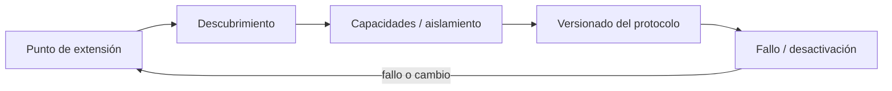
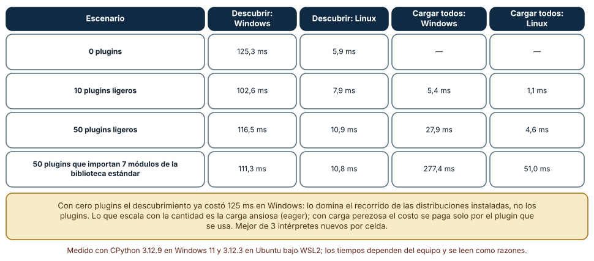
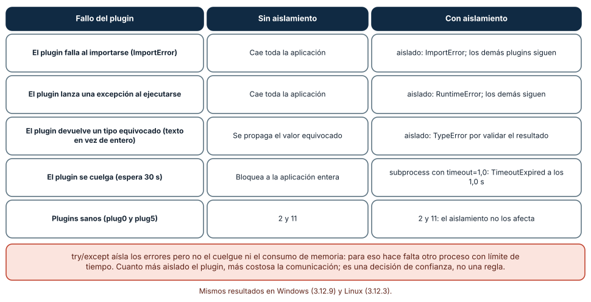
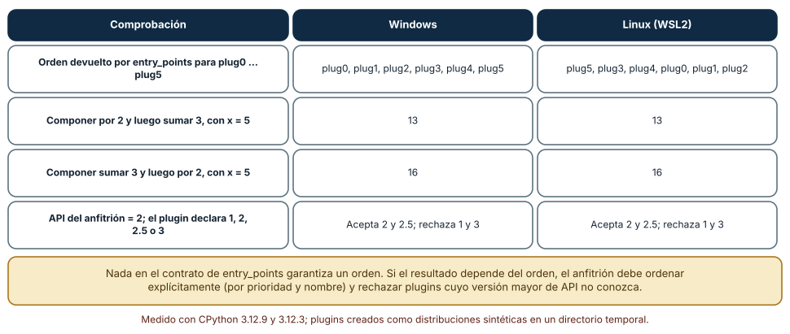

# SE-115 — Plugins, extensiones y puntos de integración

[← SE-114 — Scripting repetible y tareas idempotentes](../../classes/part-09-bibliotecas-paquetes-sdk-y-automatizacion/se-114-scripting-repetible-y-tareas-idempotentes/README.md) · [↑ Parte 09](../../classes/part-09-bibliotecas-paquetes-sdk-y-automatizacion/README.md) · [📚 Índice completo](../../classes/README.md) · [🌐 Portal](../../site/classes/SE-115.html) · [SE-116 — Generación de código y metaprogramación →](../../classes/part-09-bibliotecas-paquetes-sdk-y-automatizacion/se-116-generacion-de-codigo-y-metaprogramacion/README.md)


## Punto profesional y fundamento pedagógico

**Punto profesional.** La clase existe para diseñar plugins con descubrimiento, contrato, compatibilidad, aislamiento y confianza explícitos.

**Por qué aparece aquí.** Se sitúa después de **Scripting repetible y tareas idempotentes** y antes de **Generación de código y metaprogramación**: convierte el conocimiento anterior en una decisión observable que la clase siguiente podrá reutilizar. La continuidad se comprueba en el artefacto, no por compartir vocabulario.

**Error conceptual que debe corregir.** Cargar código encontrado y tratar extensión como configuración.

**Secuencia de aprendizaje.** Antes de leer la solución, el estudiante predice el resultado del caso normal y del error conceptual anterior. Luego explica un caso resuelto paso a paso, construye un contraejemplo que cambie la decisión y, sin consultar el texto, reconstruye el mecanismo y lo aplica a una entrada nueva. La secuencia usa predicción, explicación propia, contraste y recuperación. [ICAP](https://icap.education.asu.edu/research) distingue participación de construcción de conocimiento; [How People Learn II](https://nap.nationalacademies.org/catalog/24783/how-people-learn-ii-learners-contexts-and-cultures) exige conectar conocimiento previo, contexto y transferencia; la [práctica de recuperación](https://pubmed.ncbi.nlm.nih.gov/16507066/) respalda producir de nuevo la explicación tras una demora; y [Education for Life and Work](https://nap.nationalacademies.org/resource/13398/dbasse_084153.pdf) exige devolución que explique la causa del error.

**Evidencia de aprendizaje.** Plugin-contract.md con entry point, versión incompatible, fallo aislado y procedencia. Debe contener predicción previa, observación, explicación causal, contraejemplo, criterio de aceptación y una nota de qué dato haría cambiar la conclusión.

**Límite de la conclusión.** Un punto de extensión aumenta superficie de ataque y soporte.

### Trazabilidad fuente → afirmación

| Fuente primaria u oficial | Afirmación que respalda | Lo que no prueba |
|---|---|---|
| [Python Packaging User Guide: Specifications](https://packaging.python.org/en/latest/specifications/) | Metadata, nombres, versiones, dependencias y artefactos de distribución; autoridad: Python Packaging Authority | No demuestra por sí sola que el artefacto del estudiante sea correcto. |
| [Python Standard Library](https://docs.python.org/3/library/index.html) | Argparse, importlib.metadata, subprocess y apis de automatización; autoridad: Python Software Foundation | No demuestra por sí sola que el artefacto del estudiante sea correcto. |
| [Semantic Versioning 2.0.0](https://semver.org/spec/v2.0.0.html) | Api pública, versiones, prereleases y compatibilidad declarada; autoridad: Semantic Versioning project | No demuestra por sí sola que el artefacto del estudiante sea correcto. |
| [PyPA plugin discovery](https://packaging.python.org/en/latest/guides/creating-and-discovering-plugins/) | documenta estrategias de descubrimiento de plugins | No demuestra por sí sola que el artefacto del estudiante sea correcto. |

## Antes de empezar

Esta clase continúa el **producto reutilizable con SDK y CLI de la Parte 09**. Recupera la evidencia de la clase anterior, añade una decisión propia de **Plugins, extensiones y puntos de integración** y deja un artefacto que la clase siguiente deberá consumir. La pregunta activa es: **¿Cómo ampliar un sistema sin convertir cada extensión en dependencia privilegiada e incompatible?**

## Prerrequisitos

- Haber completado la clase anterior o reconstruir su contrato y evidencia.
- Python 3.11 o posterior, terminal, editor y Git; un segundo runtime es opcional y debe declararse.
- Trabajar con fixtures sintéticos: ninguna observación necesita datos de una persona o sistema real.

## Problema auténtico

El producto reutilizable con SDK y CLI carga cualquier módulo encontrado, ejecuta código al importar y permite que un plugin cambie registros internos. Un plugin antiguo rompe el arranque completo.

## Objetivos observables

Al terminar podrás explicar los cinco mecanismos de esta clase, predecir su comportamiento antes de ejecutar, construir un caso normal y uno límite, diagnosticar el fallo controlado, comparar una alternativa y entregar evidencia que otra persona pueda reproducir.

## Mapa conceptual



El mapa se lee como una cadena de razonamiento, no como fases obligatorias del runtime. La flecha de retorno indica que un fallo o cambio de requisito obliga a revisar el modelo inicial; no autoriza a parchear solo la última salida.

## Temas y por qué importan

| Tema | Por qué cambia una decisión profesional | Evidencia mínima |
|---|---|---|
| Punto de extensión | Un extension point define interfaz, lifecycle, errores y compatibilidad. | Predicción, traza causal y contraejemplo de **Punto de extensión** en `plugin-contract.md` |
| Descubrimiento | Entry points o registro explícito enumeran proveedores con metadata. | Predicción, traza causal y contraejemplo de **Descubrimiento** en `plugin-contract.md` |
| Capacidades y aislamiento | El plugin recibe solo servicios necesarios mediante interfaz. | Predicción, traza causal y contraejemplo de **Capacidades y aislamiento** en `plugin-contract.md` |
| Versionado del protocolo | Host y plugin negocian versión/capacidades antes de ejecutar. | Predicción, traza causal y contraejemplo de **Versionado del protocolo** en `plugin-contract.md` |
| Fallo y desactivación | Timeout, excepción o output inválido se atribuyen al plugin y siguen política: aislar, desactivar o abortar. | Predicción, traza causal y contraejemplo de **Fallo y desactivación** en `plugin-contract.md` |
## Conceptos y decisiones

### 1. Punto de extensión

Un extension point define interfaz, lifecycle, errores y compatibilidad. Es más estrecho que exponer internals. Hooks sin orden o reentrancia documentada producen interacciones invisibles entre plugins.

### 2. Descubrimiento

Entry points o registro explícito enumeran proveedores con metadata. Importar por escaneo de carpetas mezcla procedencia y orden. Descubrir no implica activar: el usuario o política decide qué plugin se carga.

### 3. Capacidades y aislamiento

El plugin recibe solo servicios necesarios mediante interfaz. En proceso comparte memoria y permisos; para código no confiable puede requerirse proceso o sandbox real. Un prefijo de nombre no es frontera de seguridad.

### 4. Versionado del protocolo

Host y plugin negocian versión/capacidades antes de ejecutar. Una versión del paquete no basta si existen contratos independientes. Incompatibilidad produce error accionable y no corrupción silenciosa.

### 5. Fallo y desactivación

Timeout, excepción o output inválido se atribuyen al plugin y siguen política: aislar, desactivar o abortar. Continuar puede ser incorrecto si el plugin era obligatorio. La configuración distingue optional de required.

### Descubrir no es cargar: el costo del arranque

Los plugins se descubren por metadatos (`importlib.metadata.entry_points(group=...)`) y se cargan ejecutando su código (`ep.load()`). Se crearon distribuciones sintéticas y se midió, en un intérprete nuevo y mejor de tres, el costo de cada fase. Descubrir 0, 10 y 50 plugins costó 125,3, 102,6 y 116,5 ms en Windows y 5,9, 7,9 y 10,9 ms en Linux: casi no depende de cuántos plugins hay, y con cero plugins ya costaba 125 ms en Windows, porque lo domina el recorrido de las distribuciones instaladas del entorno.

Lo que sí escala es la carga ansiosa. Cargar los 50 plugins ligeros costó 27,9 ms en Windows y 4,6 en Linux; cargar 50 que importan siete módulos de la biblioteca estándar cada uno costó 277,4 y 51,0 ms, aunque el programa solo use uno. La carga perezosa (cargar el plugin solicitado por nombre) paga solo ese costo. Por eso un host que quiera arrancar rápido separa el catálogo (nombres y metadatos, barato) de la activación (código, caro) y la dispara por uso.



**Cómo leer la figura.** Compara las dos columnas de descubrimiento (casi planas) con las de carga (crecen con la cantidad y con el peso). **Dónde deja de valer:** son distribuciones sintéticas en un directorio temporal añadido a `sys.path`; en un entorno real el recorrido de metadatos crece con el total de paquetes instalados, no solo con los plugins, y un plugin real puede abrir conexiones o procesos al cargarse.

### Cinco formas de fallar de un plugin, con y sin aislamiento

Se escribieron plugins que fallan de cinco maneras y un host sin protección y otro con ella. Un `ImportError` al cargar hizo caer toda la aplicación en el host sin protección; con `try/except` por plugin, el host registró «aislado: ImportError» y siguió. Una excepción al ejecutar produjo lo mismo. Un plugin que devolvía un texto donde el contrato pedía un entero se propagó en el host sin protección y se rechazó con `TypeError` en el que valida el resultado. Los plugins sanos (`plug0` y `plug5`) siguieron devolviendo 2 y 11.

El plugin que se cuelga (esperaba 30 s) es distinto: `try/except` no lo detiene. Se ejecutó en un subproceso con `timeout=1.0` y `subprocess.TimeoutExpired` saltó a 1,0 s. La enseñanza es una escala: capturar excepciones aísla errores, validar resultados aísla contratos rotos, y solo otro proceso con límite de tiempo (y, si hace falta, de memoria) aísla el consumo y el cuelgue. Cuanto más aislado, más costosa la comunicación; es una decisión de confianza: un plugin de la misma organización no se trata como uno de un tercero.



**Cómo leer la figura.** Lee cada fila de izquierda a derecha: el fallo, lo que pasa si el host no se protege y lo que pasa si lo hace. La cuarta fila es la única que exige un proceso aparte. **Dónde deja de valer:** el aislamiento por subproceso se midió con un plugin que duerme; un plugin malicioso puede leer el entorno, escribir en disco o consumir memoria, y para eso hace falta un sandbox real, que no se evaluó.

### Orden de carga y versión de la API

El mismo código y los mismos plugins devolvieron un orden distinto: `entry_points` entregó `plug0 … plug5` en orden alfabético en Windows y `plug5, plug3, plug4, plug0, plug1, plug2` en Linux. El contrato de la API no promete un orden; el orden depende de cómo el sistema de archivos lista los directorios. Si el resultado depende del orden, importa: aplicar «por 2» y luego «sumar 3» a 5 da 13, y en el orden inverso da 16.

La versión de la API es la otra mitad del contrato. Con un host en la versión mayor 2, un plugin que declara 1 o 3 se rechazó y los que declaran 2 o 2.5 se aceptaron, con una regla simple de «misma versión mayor». El host debe ordenar de forma explícita (por prioridad y nombre), validar la versión antes de cargar y decir por qué rechaza un plugin. Un mensaje que nombra el plugin, su versión declarada y la versión soportada convierte un fallo misterioso en un trámite.



**Cómo leer la figura.** La primera fila es el hallazgo: el mismo código, dos órdenes. Las dos siguientes muestran por qué importa. **Dónde deja de valer:** el orden de Linux es el del sistema de archivos del directorio temporal y puede variar entre sistemas o ejecuciones; no se afirma que sea aleatorio sino que no está garantizado. La regla de «misma mayor» es un ejemplo; SemVer para APIs de plugin puede requerir rangos.

## Definiciones de trabajo

- **punto de extensión:** un extension point define interfaz, lifecycle, errores y compatibilidad.
- **descubrimiento:** entry points o registro explícito enumeran proveedores con metadata.
- **capacidades y aislamiento:** el plugin recibe solo servicios necesarios mediante interfaz.
- **versionado del protocolo:** host y plugin negocian versión/capacidades antes de ejecutar.
- **fallo y desactivación:** timeout, excepción o output inválido se atribuyen al plugin y siguen política: aislar, desactivar o abortar.

Las definiciones son operativas para el producto reutilizable con SDK y CLI. No convierten términos con historia más amplia en sinónimos y deben contrastarse con la documentación primaria enlazada al final.

## Ejemplo mínimo

```python
class PluginProtocol:
    api_version = 1
    def evaluate(self, case, context): ...

def load(plugin):
    if plugin.api_version != 1:
        raise IncompatiblePlugin(plugin.api_version)
    return plugin
```

Antes de ejecutar, predice estado, resultado y error. Después registra versión, comando y salida. Si el fragmento es pseudocódigo o pertenece a otro lenguaje, etiquétalo como tal y no afirmes que fue ejecutado.

## Ejemplo profesional

En el producto reutilizable con SDK y CLI, un release contiene contrato público, artefactos inmutables, dependencias, procedencia, ejemplos, errores y ruta de migración. La implementación de esta clase debe conservar ese contrato aunque cambie la forma interna. El caso profesional no pregunta únicamente si produce una salida: pregunta quién puede producirla, qué estado observa, cómo falla y qué rastro permite disputar una decisión incorrecta.

Compara el caso normal con autorización falsa, evidencia incompleta, empate y repetición. Un mecanismo es apropiado cuando esas diferencias quedan visibles y localizadas; es peligroso cuando dependen de orden accidental, estado oculto o una convención que el consumidor no puede conocer.

## Práctica guiada

1. Copia el contrato de entrada y salida antes de escribir implementación.
2. Predice el caso normal y un límite; identifica la invariante que no puede romperse.
3. Implementa la versión mínima sin I/O dentro del núcleo.
4. Ejecuta el caso y conserva comando, versión y salida bajo `evidence/`.
5. Introduce el fallo controlado, reduce la reproducción y formula dos hipótesis rivales.
6. Corrige la causa, añade regresión y ejecuta el conjunto completo.
7. Compara con otro paradigma o lenguaje indicando qué semántica se preserva.

## Ejercicios

1. **Distribuciones sintéticas:** crea tres directorios `.dist-info` con `entry_points.txt`, añádelos a `sys.path` y lista el grupo con `importlib.metadata`; compara el orden en dos máquinas o dos directorios distintos.
2. **Costo de arranque:** mide en un intérprete nuevo el descubrimiento y la carga de 0, 10 y 50 plugins; repite con plugins que importan módulos pesados y calcula las razones.
3. **Cinco fallos:** escribe plugins que fallen al importar, al ejecutar, devuelvan un tipo equivocado y se cuelguen; implementa un host con aislamiento y registra el mensaje de cada caso.
4. **Negociación de versión:** define `API_VERSION` del host y la declaración de cada plugin; implementa la regla de «misma mayor» y un mensaje de rechazo que nombre el plugin, lo declarado y lo soportado.

## Reto verificable

Entrega implementación, fixtures, pruebas y un informe corto. Se aprueba si otra persona ejecuta desde checkout limpio, obtiene los mismos resultados y puede relacionar cada rama o transformación con una regla del dominio. No se aprueba por cantidad de archivos ni por usar la sintaxis característica del paradigma.

## Caso conductor

El producto reutilizable con SDK y CLI empaqueta el motor de la biblioteca de estructuras y algoritmos como `engineering_sdk`, expone `choose_next`, una CLI y un punto de extensión. Ejecuta instalación limpia, entrada válida, configuración ausente, plugin incompatible y actualización entre dos versiones. Cambia después una sola regla o condición y revisa qué archivos, pruebas y trazas debieron modificarse. Esa superficie de cambio alimenta el proyecto final de la parte.

## Preguntas frecuentes

### ¿Cómo descubro plugins sin importarlos?

Con `importlib.metadata.entry_points(group=...)`, que lee metadatos sin ejecutar código del plugin; solo `ep.load()` lo ejecuta. Así el host puede listar, filtrar y mostrar errores antes de activar nada.

### ¿Por qué mi lista de plugins sale en otro orden en otra máquina?

Porque el orden de `entry_points` no está garantizado. En el experimento difirió entre Windows y Linux. Ordena de forma explícita por una clave de tu contrato.

### ¿Un `try/except` alrededor de cada plugin es suficiente?

Para errores, sí; para cuelgues, bucles y consumo de memoria, no. Necesitas otro proceso con límite de tiempo. Y para código no confiable, un sandbox, que es otra categoría.

### ¿Cuándo un plugin es una dependencia y cuándo una extensión?

Una dependencia la elige el desarrollador del producto y se fija en el lockfile; una extensión la elige quien instala y el host debe tolerar su ausencia, su fallo y su versión. Esa asimetría define cuánto aislamiento hace falta.

## Fallo controlado y diagnóstico

Carga un plugin incompatible antes de validar `api_version` y su import modifica un registro global. Lee metadata sin activar o aísla discovery; prueba que el host sigue diagnosticable.

Registra síntoma, entrada mínima, hipótesis, observación que descarta cada hipótesis, causa, corrección y prueba de regresión. No cambies simultáneamente implementación, fixture y expectativa.

Instala un plugin cuyo módulo lance `ImportError` al importarse y arranca el host con carga ansiosa y sin protección. **Síntoma:** la aplicación no arranca y el traceback nombra un módulo del plugin. **Hipótesis rivales:** (a) el host tiene un defecto; (b) el plugin está roto y el host no lo tolera. **Prueba:** carga ese plugin aislado: falla igual; carga los otros cinco: funcionan (2 y 11 en los sanos). **Conclusión:** la causa es el plugin roto y la falta de aislamiento del host. Corrección: carga por plugin con `try/except`, registro con nombre y versión, y un modo `--strict` que falle si se desea; regresión: una prueba con un plugin roto en el grupo que exige que los demás funcionen. No cambies a la vez el plugin y el host.

## Errores comunes y cómo corregirlos

| Síntoma | Causa probable | Corrección |
|---|---|---|
| La aplicación no arranca porque un plugin no se importa | Carga ansiosa sin aislamiento | Cargar por plugin con `try/except`, registrar y continuar |
| El arranque tarda más cuanto más plugins hay instalados | Se cargan todos aunque se use uno | Descubrir los nombres y cargar solo el solicitado |
| El resultado cambia entre máquinas | Se confió en el orden de `entry_points` | Ordenar por prioridad y nombre y probarlo con dos órdenes |
| Un plugin devuelve un tipo que rompe más adelante | No se validó el resultado en la frontera | Validar tipo y rango al recibirlo y rechazar con el nombre del plugin |
| Un plugin lento bloquea toda la aplicación | Se ejecuta en el mismo proceso sin límite de tiempo | Subproceso con `timeout` o cola con límite, y registro del vencimiento |

## Entorno y archivos clave

```text
work/SE-115/
├── README.md
├── engineering_sdk/
│   ├── domain.py
│   └── se_115.py
├── fixtures/cases.json
├── tests/test_se_115.py
└── evidence/diagnosis.md
```

El `README` declara plataforma, runtimes, comandos, limpieza y límites. Evita dependencias externas cuando la biblioteca estándar permita observar el mecanismo; si agregas una, fija procedencia y versión.

## Seguridad, ética y accesibilidad

- la autorización forma parte del dominio y no se infiere por ausencia de rechazo;
- no uses `eval`, reglas descargadas ni serialización insegura;
- limita colas, recursión, tamaño de entrada y tiempo de evaluación;
- redacta trazas y conserva una explicación textual además de color o animación;
- una recomendación automatizada debe poder revisarse, impugnarse y corregirse;
- respeta licencias de ejemplos y atribuye adaptaciones.

## Puente hacia el trabajo con agentes

Un agente que añade un punto de extensión suele escribir el `for ep in entry_points(): ep.load()()` y probarlo con un plugin de juguete que funciona. Dale tres criterios ejecutables: una prueba con un plugin que falla al importar, otro que lanza al ejecutar y otro que devuelve un tipo equivocado; una prueba con el orden de carga invertido; y una medición del arranque con 0 y 50 plugins ligeros. Pídele que declare qué garantiza el host (orden, aislamiento, versión de API) y qué no, porque un agente tiende a asumir que lo que vio funcionar con un plugin vale con cualquiera.

## Transferencia

Traslada un fixture al segundo modelo, herramienta, plataforma o lenguaje. Compara representación de ausencia, error, mutabilidad, orden y cancelación. La transferencia está lograda cuando el contrato se conserva y las diferencias están explicadas, no cuando la interfaz se parece.

## Evaluación y evidencia

| Criterio | Evidencia para aprobar |
|---|---|
| comprensión | explicación causal de los cinco mecanismos |
| corrección | normal, límite, inválido y contraejemplo |
| diseño | estado, efectos y contrato localizables |
| diagnóstico | reproducción mínima y regresión |
| transferencia | comparación semántica, no estética |
| reproducibilidad | versiones, comandos, salida y límites |


## Fuentes


- [Semantic Versioning 2.0.0](https://semver.org/spec/v2.0.0.html) — Api pública, versiones, prereleases y compatibilidad declarada; autoridad: Semantic Versioning project.
- [Python Packaging User Guide: Specifications](https://packaging.python.org/en/latest/specifications/) — Metadata, nombres, versiones, dependencias y artefactos de distribución; autoridad: Python Packaging Authority.
- [pylock.toml Specification](https://packaging.python.org/en/latest/specifications/pylock-toml/) — Lock files para instalaciones reproducibles y selección por entorno; autoridad: Python Packaging Authority.
- [Python Standard Library](https://docs.python.org/3/library/index.html) — Argparse, importlib.metadata, subprocess y apis de automatización; autoridad: Python Software Foundation.
- [SPDX Specification 3.0](https://spdx.dev/use/specifications/) — Identificadores, sbom y procedencia legible por máquinas; autoridad: Linux Foundation.
- [REUSE Specification](https://reuse.software/spec-3.3/) — Declaración inequívoca y verificable de copyright y licencias por archivo; autoridad: Free Software Foundation Europe.

Cada fuente respalda el mecanismo indicado; ninguna demuestra que la implementación del producto reutilizable con SDK y CLI sea correcta. Esa afirmación depende de fixtures, pruebas, trazas y revisión reproducible.

- [Python Packaging: Entry points specification](https://packaging.python.org/en/latest/specifications/entry-points/) — formato de `entry_points.txt` y grupos.
- [Python: `importlib.metadata`](https://docs.python.org/3/library/importlib.metadata.html) — `entry_points` y metadatos de distribuciones instaladas.
- [Python: `subprocess`](https://docs.python.org/3/library/subprocess.html) — `timeout` y `TimeoutExpired` para aislar ejecuciones lentas.
- [Python: `importlib`](https://docs.python.org/3/library/importlib.html) — mecanismo de importación, invalidación de cachés y carga dinámica.
- [Python: `logging`](https://docs.python.org/3/library/logging.html) — registro de fallos de plugins con nivel y contexto.

## Límites y siguiente paso

Un protocolo reduce acoplamiento, no hace seguro código arbitrario. La siguiente clase estudia generación y metaprogramación como transformaciones que requieren fuente de verdad y diff.

## Glosario

- **punto de extensión:** un extension point define interfaz, lifecycle, errores y compatibilidad.
- **descubrimiento:** entry points o registro explícito enumeran proveedores con metadata.
- **capacidades y aislamiento:** el plugin recibe solo servicios necesarios mediante interfaz.
- **versionado del protocolo:** host y plugin negocian versión/capacidades antes de ejecutar.
- **fallo y desactivación:** timeout, excepción o output inválido se atribuyen al plugin y siguen política: aislar, desactivar o abortar.

---

[← SE-114 — Scripting repetible y tareas idempotentes](../../classes/part-09-bibliotecas-paquetes-sdk-y-automatizacion/se-114-scripting-repetible-y-tareas-idempotentes/README.md) · [↑ Parte 09](../../classes/part-09-bibliotecas-paquetes-sdk-y-automatizacion/README.md) · [📚 Índice completo](../../classes/README.md) · [🌐 Portal](../../site/classes/SE-115.html) · [SE-116 — Generación de código y metaprogramación →](../../classes/part-09-bibliotecas-paquetes-sdk-y-automatizacion/se-116-generacion-de-codigo-y-metaprogramacion/README.md)
