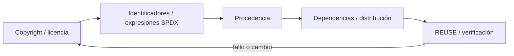
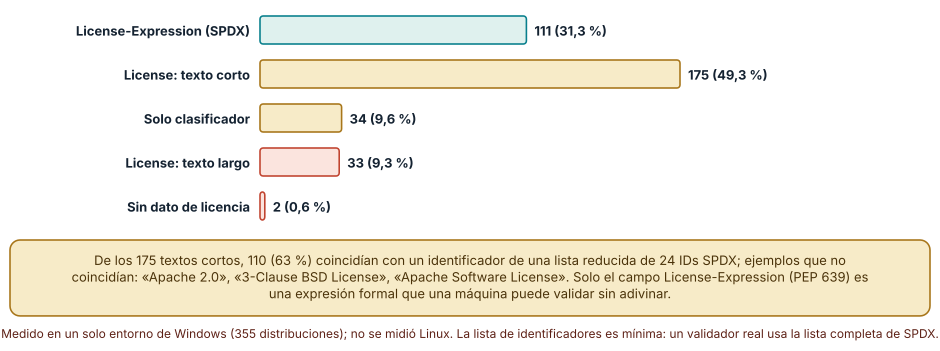
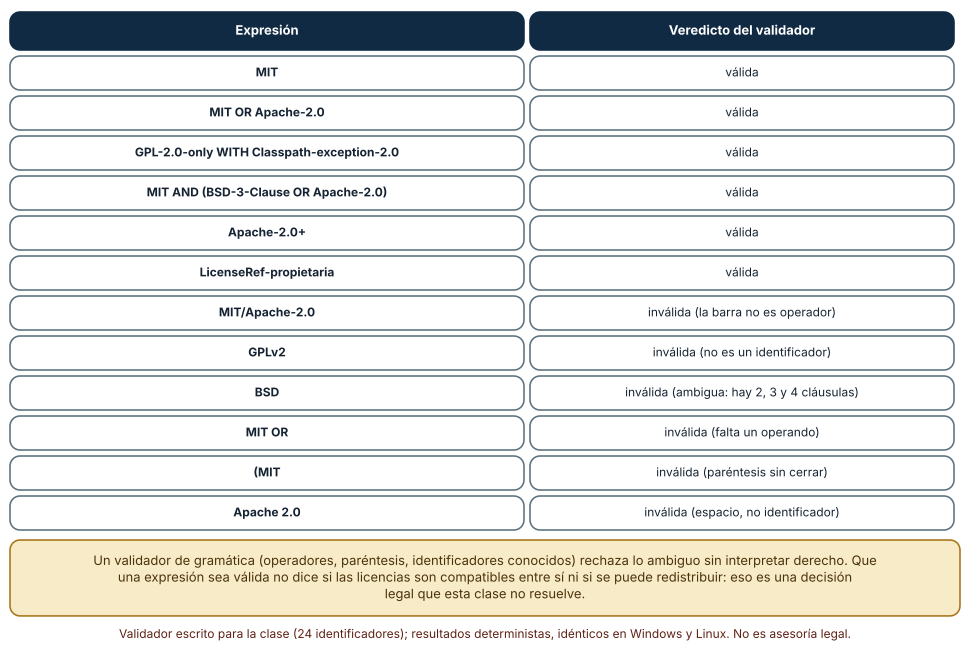
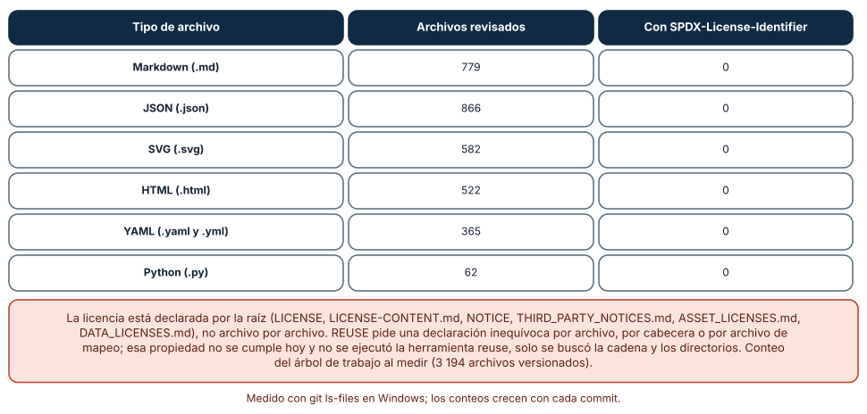

# SE-117 — Licencias, procedencia y reutilización

[← SE-116 — Generación de código y metaprogramación](../../classes/part-09-bibliotecas-paquetes-sdk-y-automatizacion/se-116-generacion-de-codigo-y-metaprogramacion/README.md) · [↑ Parte 09](../../classes/part-09-bibliotecas-paquetes-sdk-y-automatizacion/README.md) · [📚 Índice completo](../../classes/README.md) · [🌐 Portal](../../site/classes/SE-117.html) · [SE-118 — Diseño de experiencia para desarrolladores →](../../classes/part-09-bibliotecas-paquetes-sdk-y-automatizacion/se-118-diseno-de-experiencia-para-desarrolladores/README.md)


## Punto profesional y fundamento pedagógico

**Punto profesional.** La clase existe para registrar licencia, copyright, procedencia y SBOM para reutilización verificable.

**Por qué aparece aquí.** Se sitúa después de **Generación de código y metaprogramación** y antes de **Diseño de experiencia para desarrolladores**: convierte el conocimiento anterior en una decisión observable que la clase siguiente podrá reutilizar. La continuidad se comprueba en el artefacto, no por compartir vocabulario.

**Error conceptual que debe corregir.** Copiar una licencia raíz y asumir que cubre todos los archivos y dependencias.

**Secuencia de aprendizaje.** Antes de leer la solución, el estudiante predice el resultado del caso normal y del error conceptual anterior. Luego explica un caso resuelto paso a paso, construye un contraejemplo que cambie la decisión y, sin consultar el texto, reconstruye el mecanismo y lo aplica a una entrada nueva. La secuencia usa predicción, explicación propia, contraste y recuperación. [ICAP](https://icap.education.asu.edu/research) distingue participación de construcción de conocimiento; [How People Learn II](https://nap.nationalacademies.org/catalog/24783/how-people-learn-ii-learners-contexts-and-cultures) exige conectar conocimiento previo, contexto y transferencia; la [práctica de recuperación](https://pubmed.ncbi.nlm.nih.gov/16507066/) respalda producir de nuevo la explicación tras una demora; y [Education for Life and Work](https://nap.nationalacademies.org/resource/13398/dbasse_084153.pdf) exige devolución que explique la causa del error.

**Evidencia de aprendizaje.** Provenance.md, headers REUSE, SPDX y excepción documentada. Debe contener predicción previa, observación, explicación causal, contraejemplo, criterio de aceptación y una nota de qué dato haría cambiar la conclusión.

**Límite de la conclusión.** Metadata correcta no resuelve por sí sola compatibilidad jurídica; no es asesoría legal.

### Trazabilidad fuente → afirmación

| Fuente primaria u oficial | Afirmación que respalda | Lo que no prueba |
|---|---|---|
| [SPDX Specification 3.0](https://spdx.dev/use/specifications/) | Identificadores, sbom y procedencia legible por máquinas; autoridad: Linux Foundation | No demuestra por sí sola que el artefacto del estudiante sea correcto. |
| [REUSE Specification](https://reuse.software/spec-3.3/) | Declaración inequívoca y verificable de copyright y licencias por archivo; autoridad: Free Software Foundation Europe | No demuestra por sí sola que el artefacto del estudiante sea correcto. |
| [Python Packaging User Guide: Specifications](https://packaging.python.org/en/latest/specifications/) | Metadata, nombres, versiones, dependencias y artefactos de distribución; autoridad: Python Packaging Authority | No demuestra por sí sola que el artefacto del estudiante sea correcto. |

## Antes de empezar

Esta clase continúa el **producto reutilizable con SDK y CLI de la Parte 09**. Recupera la evidencia de la clase anterior, añade una decisión propia de **Licencias, procedencia y reutilización** y deja un artefacto que la clase siguiente deberá consumir. La pregunta activa es: **¿Qué derecho permite reutilizar cada componente y qué evidencia conserva su procedencia?**

## Prerrequisitos

- Haber completado la clase anterior o reconstruir su contrato y evidencia.
- Python 3.11 o posterior, terminal, editor y Git; un segundo runtime es opcional y debe declararse.
- Trabajar con fixtures sintéticos: ninguna observación necesita datos de una persona o sistema real.

## Problema auténtico

El producto reutilizable con SDK y CLI copia una utilidad de un gist sin licencia y combina dependencias con obligaciones distintas. El paquete declara MIT para todo, una afirmación que no posee autoridad para hacer.

## Objetivos observables

Al terminar podrás explicar los cinco mecanismos de esta clase, predecir su comportamiento antes de ejecutar, construir un caso normal y uno límite, diagnosticar el fallo controlado, comparar una alternativa y entregar evidencia que otra persona pueda reproducir.

## Mapa conceptual



El mapa se lee como una cadena de razonamiento, no como fases obligatorias del runtime. La flecha de retorno indica que un fallo o cambio de requisito obliga a revisar el modelo inicial; no autoriza a parchear solo la última salida.

## Temas y por qué importan

| Tema | Por qué cambia una decisión profesional | Evidencia mínima |
|---|---|---|
| Copyright y licencia | El copyright surge sobre una obra y la licencia concede permisos bajo condiciones. | Predicción, traza causal y contraejemplo de **Copyright y licencia** en `provenance.md` |
| Identificadores y expresiones SPDX | SPDX normaliza identificadores y expresiones `AND`, `OR`, `WITH`. | Predicción, traza causal y contraejemplo de **Identificadores y expresiones SPDX** en `provenance.md` |
| Procedencia | Origen, versión, autor, URL, hash y transformación permiten rastrear un componente. | Predicción, traza causal y contraejemplo de **Procedencia** en `provenance.md` |
| Dependencias y distribución | Obligaciones pueden cambiar al distribuir binario, ofrecer servicio o enlazar componentes según licencia y jurisdicción. | Predicción, traza causal y contraejemplo de **Dependencias y distribución** en `provenance.md` |
| REUSE y verificación | REUSE propone información de copyright/licencia por archivo y textos en ubicaciones convencionales. | Predicción, traza causal y contraejemplo de **REUSE y verificación** en `provenance.md` |
## Conceptos y decisiones

### 1. Copyright y licencia

El copyright surge sobre una obra y la licencia concede permisos bajo condiciones. Código público sin licencia no equivale a permiso abierto. La licencia del repositorio cubre contribuciones propias según su política, no material externo automáticamente.

### 2. Identificadores y expresiones SPDX

SPDX normaliza identificadores y expresiones `AND`, `OR`, `WITH`. Una expresión representa obligaciones combinadas o alternativas; no decide compatibilidad jurídica por sí sola. Se conserva texto de licencia y avisos exigidos.

### 3. Procedencia

Origen, versión, autor, URL, hash y transformación permiten rastrear un componente. Copiar y modificar requiere registrar cambios y conservar atribución. Un SBOM describe composición; no certifica que cada dato sea correcto.

### 4. Dependencias y distribución

Obligaciones pueden cambiar al distribuir binario, ofrecer servicio o enlazar componentes según licencia y jurisdicción. La clase enseña triage técnico, no asesoría legal. Dudas se escalan con inventario preciso, no con suposiciones.

### 5. REUSE y verificación

REUSE propone información de copyright/licencia por archivo y textos en ubicaciones convencionales. La herramienta detecta declaraciones faltantes y expresiones inválidas; no sustituye revisión de compatibilidad o titularidad.

### Cómo declaran su licencia 355 paquetes instalados

Se recorrieron con `importlib.metadata` las 355 distribuciones instaladas en un entorno de Python 3.12.9 en Windows y se clasificó cómo declara cada una su licencia. 111 (31,3 %) usan el campo `License-Expression` con un identificador SPDX; 175 (49,3 %) escriben un texto corto en `License`; 34 (9,6 %) solo tienen un clasificador (`License :: OSI Approved :: ...`); 33 (9,3 %) pegan en `License` un texto largo, a menudo el de la propia licencia; y 2 (0,6 %) no declaran nada.

De los 175 textos cortos, 110 (63 %) coincidieron con un identificador de una lista reducida de 24 identificadores SPDX; los que no coincidieron incluían «Apache 2.0», «3-Clause BSD License» y «Apache Software License». Esa variedad es el problema: solo `License-Expression` (PEP 639) es una expresión formal que una herramienta puede validar sin adivinar. Para el consumidor significa que un inventario automático de licencias tiene, en este entorno, un 31 % de datos limpios, un 49 % que requiere normalización y un 19 % que requiere lectura humana. Es una medición de un entorno, no una estadística de PyPI.



**Cómo leer la figura.** Cada barra es una forma de declarar. La verde es la única que una máquina puede validar sin interpretación. **Dónde deja de valer:** es un solo entorno de Windows con las dependencias de las herramientas del equipo; el reparto en otro proyecto será otro. La lista de identificadores usada es mínima y la comparación fue exacta: un validador real usa la lista completa de SPDX y reglas de normalización.

### Expresiones SPDX: la gramática que rechaza lo ambiguo

Se escribió un validador mínimo (identificadores conocidos, `AND`, `OR`, `WITH`, paréntesis, sufijo `+` y `LicenseRef-`) y se probaron doce expresiones. Aceptó `MIT`, `MIT OR Apache-2.0`, `GPL-2.0-only WITH Classpath-exception-2.0`, `MIT AND (BSD-3-Clause OR Apache-2.0)`, `Apache-2.0+` y `LicenseRef-propietaria`. Rechazó `MIT/Apache-2.0` (la barra no es operador), `GPLv2` (no es un identificador), `BSD` (ambiguo: hay variantes de dos, tres y cuatro cláusulas), `MIT OR` (falta un operando), `(MIT` (paréntesis sin cerrar) y `Apache 2.0` (un espacio no es un identificador).

La utilidad está en el rechazo: una gramática detecta lo que un lector humano «entiende» pero una herramienta no puede usar. Su límite es igual de importante: que una expresión sea válida no dice si las licencias son compatibles entre sí, si el uso previsto las respeta ni si el archivo realmente está bajo ella. Esas son decisiones legales y de procedencia; esta clase enseña a hacer la información comprobable, no a dar asesoría jurídica.



**Cómo leer la figura.** Cada fila es una cadena que podría aparecer en un campo de licencia; la segunda columna dice por qué se acepta o se rechaza. **Dónde deja de valer:** el validador conoce 24 identificadores, no los más de seiscientos de SPDX, y no aplica las reglas de excepciones ni de identificadores obsoletos. No es asesoría legal.

### Cobertura de licencia por archivo en este repositorio

Se aplicó la misma lógica al propio repositorio: de 3 194 archivos versionados, se revisaron 3 176 de seis tipos (Markdown 779, JSON 866, SVG 582, HTML 522, YAML 365 y Python 62) buscando la cadena `SPDX-License-Identifier` en sus primeros 2 000 caracteres. Ninguno la contiene. Tampoco existen un directorio `LICENSES/` ni `.reuse/`. La licencia se declara en la raíz, mediante seis archivos: `LICENSE`, `LICENSE-CONTENT.md`, `NOTICE`, `THIRD_PARTY_NOTICES.md`, `ASSET_LICENSES.md` y `DATA_LICENSES.md`.

Eso es una declaración a nivel de repositorio, no archivo por archivo. REUSE pide una declaración inequívoca por archivo, por cabecera o por un archivo de mapeo, y esa propiedad no se cumple hoy; no se ejecutó la herramienta `reuse`, solo se buscó la cadena y los directorios, así que la afirmación es «no hay cabeceras SPDX ni directorio de licencias», no «incumple REUSE» en todos los sentidos. Lo que el hallazgo enseña es la diferencia entre procedencia declarada y procedencia comprobable: cuando alguien copia un archivo suelto, la licencia de la raíz no viaja con él.



**Cómo leer la figura.** Lee la última columna: cero en todas las filas es el hallazgo. La nota inferior enumera dónde sí está la declaración. **Dónde deja de valer:** el conteo corresponde al árbol de trabajo al medir y crece con cada commit; la búsqueda cubre solo los primeros 2 000 caracteres y no mira los archivos binarios ni los mapeos de `REUSE.toml`, que no existen. Un repositorio puede cumplir REUSE sin cabeceras si usa ese mapeo.

## Definiciones de trabajo

- **copyright y licencia:** el copyright surge sobre una obra y la licencia concede permisos bajo condiciones.
- **identificadores y expresiones spdx:** spdx normaliza identificadores y expresiones `and`, `or`, `with`.
- **procedencia:** origen, versión, autor, url, hash y transformación permiten rastrear un componente.
- **dependencias y distribución:** obligaciones pueden cambiar al distribuir binario, ofrecer servicio o enlazar componentes según licencia y jurisdicción.
- **reuse y verificación:** reuse propone información de copyright/licencia por archivo y textos en ubicaciones convencionales.

Las definiciones son operativas para el producto reutilizable con SDK y CLI. No convierten términos con historia más amplia en sinónimos y deben contrastarse con la documentación primaria enlazada al final.

## Ejemplo mínimo

```text
# SPDX-FileCopyrightText: 2026 Contributors to el producto reutilizable con SDK y CLI
# SPDX-License-Identifier: MIT

# Registrar además fuente, versión, hash y modificaciones de material externo.
```

Antes de ejecutar, predice estado, resultado y error. Después registra versión, comando y salida. Si el fragmento es pseudocódigo o pertenece a otro lenguaje, etiquétalo como tal y no afirmes que fue ejecutado.

## Ejemplo profesional

En el producto reutilizable con SDK y CLI, un release contiene contrato público, artefactos inmutables, dependencias, procedencia, ejemplos, errores y ruta de migración. La implementación de esta clase debe conservar ese contrato aunque cambie la forma interna. El caso profesional no pregunta únicamente si produce una salida: pregunta quién puede producirla, qué estado observa, cómo falla y qué rastro permite disputar una decisión incorrecta.

Compara el caso normal con autorización falsa, evidencia incompleta, empate y repetición. Un mecanismo es apropiado cuando esas diferencias quedan visibles y localizadas; es peligroso cuando dependen de orden accidental, estado oculto o una convención que el consumidor no puede conocer.

## Práctica guiada

1. Copia el contrato de entrada y salida antes de escribir implementación.
2. Predice el caso normal y un límite; identifica la invariante que no puede romperse.
3. Implementa la versión mínima sin I/O dentro del núcleo.
4. Ejecuta el caso y conserva comando, versión y salida bajo `evidence/`.
5. Introduce el fallo controlado, reduce la reproducción y formula dos hipótesis rivales.
6. Corrige la causa, añade regresión y ejecuta el conjunto completo.
7. Compara con otro paradigma o lenguaje indicando qué semántica se preserva.

## Ejercicios

1. **Inventario:** con `importlib.metadata`, clasifica las licencias de tu entorno por forma de declaración y calcula los porcentajes; selecciona cinco paquetes «desconocidos» y determina su licencia real en el repositorio del proyecto.
2. **Validador:** implementa un validador de expresiones SPDX con diez identificadores, `AND`, `OR`, `WITH` y paréntesis; escribe doce casos válidos e inválidos como pruebas.
3. **Cobertura:** cuenta en un repositorio tuyo cuántos archivos tienen cabecera SPDX y dónde está declarada la licencia; propón el cambio mínimo para que cada archivo copiado conserve su licencia.
4. **Registro de procedencia:** para tres componentes que uses, escribe un registro con origen, versión, hash y licencia; indica qué campo tendrías que verificar de forma manual y por qué.

## Reto verificable

Entrega implementación, fixtures, pruebas y un informe corto. Se aprueba si otra persona ejecuta desde checkout limpio, obtiene los mismos resultados y puede relacionar cada rama o transformación con una regla del dominio. No se aprueba por cantidad de archivos ni por usar la sintaxis característica del paradigma.

## Caso conductor

El producto reutilizable con SDK y CLI empaqueta el motor de la biblioteca de estructuras y algoritmos como `engineering_sdk`, expone `choose_next`, una CLI y un punto de extensión. Ejecuta instalación limpia, entrada válida, configuración ausente, plugin incompatible y actualización entre dos versiones. Cambia después una sola regla o condición y revisa qué archivos, pruebas y trazas debieron modificarse. Esa superficie de cambio alimenta el proyecto final de la parte.

## Preguntas frecuentes

### ¿Basta con tener un archivo `LICENSE` en la raíz?

Cubre la intención del proyecto, pero no viaja con cada archivo copiado ni distingue contenido, datos y código con licencias distintas. En este repositorio hay seis archivos de licencias en la raíz y ninguna cabecera por archivo.

### ¿Qué diferencia hay entre `License` y `License-Expression`?

`License` es texto libre histórico; `License-Expression` es una expresión SPDX validable (PEP 639). En 355 paquetes, 111 usaban la segunda y 175 un texto corto de formato libre.

### ¿Una expresión SPDX válida significa que puedo usar el paquete?

No. Significa que la declaración está bien formada. Que el uso sea permitido, que las licencias de tus dependencias sean compatibles entre sí y con tu distribución, y que la declaración sea cierta, son preguntas distintas que requieren revisión y, si el riesgo es alto, asesoría legal.

### ¿Qué es una procedencia comprobable?

Un registro de origen, versión, hash y licencia por componente, en un formato que una máquina lee (SPDX, CycloneDX). Se complementa con hashes verificados al instalar, como se vio en la fijación de dependencias.

## Fallo controlado y diagnóstico

Añade un archivo copiado sin licencia y el paquete sigue construyendo. Haz fallar el gate de procedencia/REUSE y reemplaza, obtiene permiso o documenta una licencia válida.

Registra síntoma, entrada mínima, hipótesis, observación que descarta cada hipótesis, causa, corrección y prueba de regresión. No cambies simultáneamente implementación, fixture y expectativa.

Compara la licencia declarada de una dependencia con el texto de su `LICENSE` en el repositorio del proyecto. **Síntoma:** el metadato dice «BSD» o «Apache Software License» y el inventario no puede decir cuál. **Hipótesis rivales:** (a) el metadato es erróneo; (b) el metadato es correcto pero ambiguo. **Prueba:** valida el texto con el validador de expresiones (falla por no ser identificador) y lee el archivo de licencia real. **Conclusión:** el problema es la ambigüedad del formato libre; corrección: registrar la expresión normalizada (`BSD-3-Clause`) con la evidencia (enlace y hash del archivo leído); regresión: una prueba que rechaza metadatos que no sean expresiones válidas en lo que tú publicas. No cambies a la vez la normalización y la lista de identificadores.

## Errores comunes y cómo corregirlos

| Síntoma | Causa probable | Corrección |
|---|---|---|
| El inventario de licencias tiene cientos de filas «desconocidas» | Las dependencias usan texto libre en vez de expresiones SPDX | Normalizar con una tabla revisada por humanos y exigir `License-Expression` en lo propio |
| Se copió un archivo a otro repositorio y se perdió su licencia | La declaración está solo en la raíz | Cabecera SPDX por archivo o mapeo REUSE; conservar el aviso original |
| `MIT/Apache-2.0` falla en una herramienta | La barra no es operador SPDX | Escribir `MIT OR Apache-2.0` |
| Un paquete declara «BSD» y no se sabe cuál | Identificador ambiguo | Pedir o determinar la variante (2, 3 o 4 cláusulas) y registrar `BSD-3-Clause` |
| Se asume que «es de código abierto» equivale a «puedo redistribuirlo» | Se confunde disponibilidad con permiso | Leer la licencia concreta y registrar la decisión con su responsable |

## Entorno y archivos clave

```text
work/SE-117/
├── README.md
├── engineering_sdk/
│   ├── domain.py
│   └── se_117.py
├── fixtures/cases.json
├── tests/test_se_117.py
└── evidence/diagnosis.md
```

El `README` declara plataforma, runtimes, comandos, limpieza y límites. Evita dependencias externas cuando la biblioteca estándar permita observar el mecanismo; si agregas una, fija procedencia y versión.

## Seguridad, ética y accesibilidad

- la autorización forma parte del dominio y no se infiere por ausencia de rechazo;
- no uses `eval`, reglas descargadas ni serialización insegura;
- limita colas, recursión, tamaño de entrada y tiempo de evaluación;
- redacta trazas y conserva una explicación textual además de color o animación;
- una recomendación automatizada debe poder revisarse, impugnarse y corregirse;
- respeta licencias de ejemplos y atribuye adaptaciones.

## Puente hacia el trabajo con agentes

Un agente que añade una dependencia o copia un fragmento de código de otro proyecto no registra la licencia ni verifica que su aviso viaje con el código. Dale una regla ejecutable: toda dependencia nueva se acompaña de su expresión SPDX validada, su origen y versión; todo archivo copiado conserva el aviso y se añade a `THIRD_PARTY_NOTICES`; y una prueba falla si aparece un metadato de licencia no válido. No le pidas que decida si dos licencias son compatibles: pídele que reúna la evidencia y marque la duda para una persona responsable.

## Transferencia

Traslada un fixture al segundo modelo, herramienta, plataforma o lenguaje. Compara representación de ausencia, error, mutabilidad, orden y cancelación. La transferencia está lograda cuando el contrato se conserva y las diferencias están explicadas, no cuando la interfaz se parece.

## Evaluación y evidencia

| Criterio | Evidencia para aprobar |
|---|---|
| comprensión | explicación causal de los cinco mecanismos |
| corrección | normal, límite, inválido y contraejemplo |
| diseño | estado, efectos y contrato localizables |
| diagnóstico | reproducción mínima y regresión |
| transferencia | comparación semántica, no estética |
| reproducibilidad | versiones, comandos, salida y límites |


## Fuentes


- [Semantic Versioning 2.0.0](https://semver.org/spec/v2.0.0.html) — Api pública, versiones, prereleases y compatibilidad declarada; autoridad: Semantic Versioning project.
- [Python Packaging User Guide: Specifications](https://packaging.python.org/en/latest/specifications/) — Metadata, nombres, versiones, dependencias y artefactos de distribución; autoridad: Python Packaging Authority.
- [pylock.toml Specification](https://packaging.python.org/en/latest/specifications/pylock-toml/) — Lock files para instalaciones reproducibles y selección por entorno; autoridad: Python Packaging Authority.
- [Python Standard Library](https://docs.python.org/3/library/index.html) — Argparse, importlib.metadata, subprocess y apis de automatización; autoridad: Python Software Foundation.
- [SPDX Specification 3.0](https://spdx.dev/use/specifications/) — Identificadores, sbom y procedencia legible por máquinas; autoridad: Linux Foundation.
- [REUSE Specification](https://reuse.software/spec-3.3/) — Declaración inequívoca y verificable de copyright y licencias por archivo; autoridad: Free Software Foundation Europe.

Cada fuente respalda el mecanismo indicado; ninguna demuestra que la implementación del producto reutilizable con SDK y CLI sea correcta. Esa afirmación depende de fixtures, pruebas, trazas y revisión reproducible.

- [PEP 639: Improving License Clarity with Better Metadata](https://peps.python.org/pep-0639/) — introduce `License-Expression` y archivos de licencia en los metadatos.
- [SPDX License Expressions](https://spdx.github.io/spdx-spec/v2.3/SPDX-license-expressions/) — gramática de operadores, paréntesis y excepciones.
- [SPDX License List](https://spdx.org/licenses/) — lista de identificadores de licencia.
- [REUSE Specification 3.3](https://reuse.software/spec-3.3/) — declaración de licencia y copyright por archivo, cabeceras y archivo de mapeo.
- [CycloneDX specification overview](https://cyclonedx.org/specification/overview/) — formato de lista de materiales de software (SBOM) con licencias y hashes.
- [Apache License, Version 2.0](https://www.apache.org/licenses/LICENSE-2.0) — texto de una licencia permisiva citada en los ejemplos; no es asesoría legal.

## Límites y siguiente paso

Cumplir metadata y licencias no garantiza que el producto sea fácil de adoptar. La siguiente clase mide la experiencia desde descubrimiento hasta recuperación.

## Glosario

- **copyright y licencia:** el copyright surge sobre una obra y la licencia concede permisos bajo condiciones.
- **identificadores y expresiones spdx:** spdx normaliza identificadores y expresiones `and`, `or`, `with`.
- **procedencia:** origen, versión, autor, url, hash y transformación permiten rastrear un componente.
- **dependencias y distribución:** obligaciones pueden cambiar al distribuir binario, ofrecer servicio o enlazar componentes según licencia y jurisdicción.
- **reuse y verificación:** reuse propone información de copyright/licencia por archivo y textos en ubicaciones convencionales.

---

[← SE-116 — Generación de código y metaprogramación](../../classes/part-09-bibliotecas-paquetes-sdk-y-automatizacion/se-116-generacion-de-codigo-y-metaprogramacion/README.md) · [↑ Parte 09](../../classes/part-09-bibliotecas-paquetes-sdk-y-automatizacion/README.md) · [📚 Índice completo](../../classes/README.md) · [🌐 Portal](../../site/classes/SE-117.html) · [SE-118 — Diseño de experiencia para desarrolladores →](../../classes/part-09-bibliotecas-paquetes-sdk-y-automatizacion/se-118-diseno-de-experiencia-para-desarrolladores/README.md)
