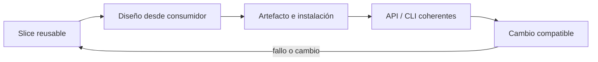
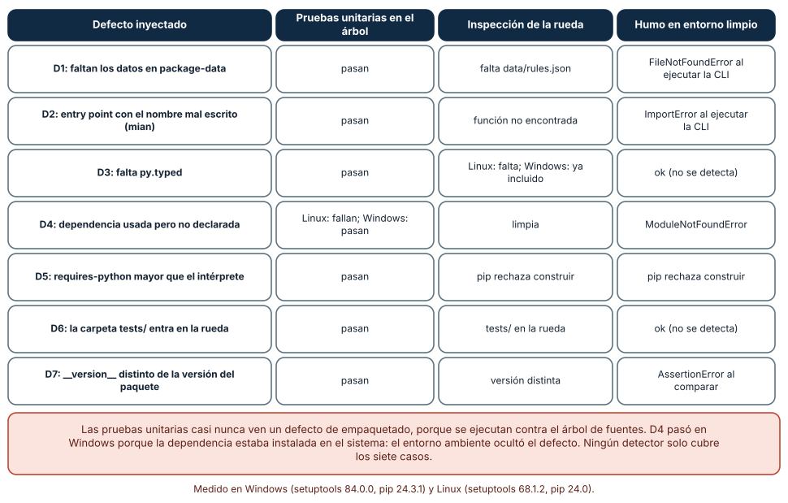
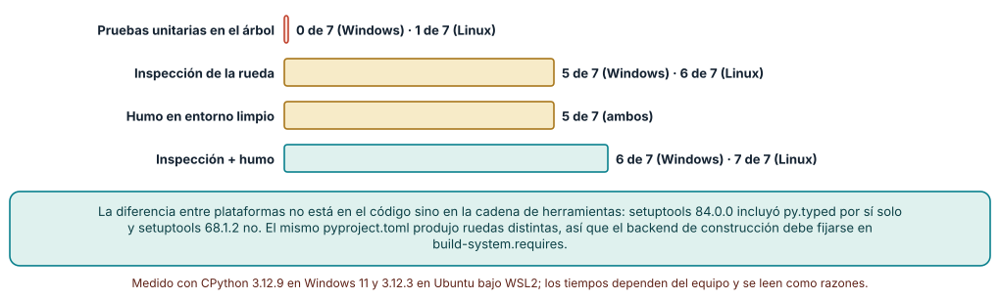
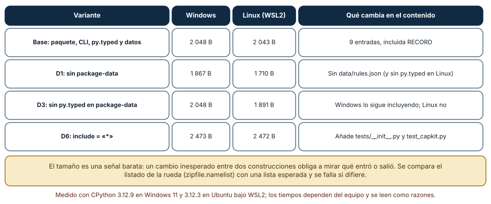

# SE-119 — Taller: empaquetar una capacidad reusable

[← SE-118 — Diseño de experiencia para desarrolladores](../../classes/part-09-bibliotecas-paquetes-sdk-y-automatizacion/se-118-diseno-de-experiencia-para-desarrolladores/README.md) · [↑ Parte 09](../../classes/part-09-bibliotecas-paquetes-sdk-y-automatizacion/README.md) · [📚 Índice completo](../../classes/README.md) · [🌐 Portal](../../site/classes/SE-119.html) · [SE-120 — Proyecto: SDK y CLI con compatibilidad verificada →](../../classes/part-09-bibliotecas-paquetes-sdk-y-automatizacion/se-120-proyecto-sdk-y-cli-con-compatibilidad-verificada/README.md)


## Punto profesional y fundamento pedagógico

**Punto profesional.** La clase existe para empaquetar una capacidad reutilizable con API, metadata, documentación y consumidor externo.

**Por qué aparece aquí.** Se sitúa después de **Diseño de experiencia para desarrolladores** y antes de **Proyecto: SDK y CLI con compatibilidad verificada**: convierte el conocimiento anterior en una decisión observable que la clase siguiente podrá reutilizar. La continuidad se comprueba en el artefacto, no por compartir vocabulario.

**Error conceptual que debe corregir.** Probar solo desde el árbol fuente y confundir eso con instalación.

**Secuencia de aprendizaje.** Antes de leer la solución, el estudiante predice el resultado del caso normal y del error conceptual anterior. Luego explica un caso resuelto paso a paso, construye un contraejemplo que cambie la decisión y, sin consultar el texto, reconstruye el mecanismo y lo aplica a una entrada nueva. La secuencia usa predicción, explicación propia, contraste y recuperación. [ICAP](https://icap.education.asu.edu/research) distingue participación de construcción de conocimiento; [How People Learn II](https://nap.nationalacademies.org/catalog/24783/how-people-learn-ii-learners-contexts-and-cultures) exige conectar conocimiento previo, contexto y transferencia; la [práctica de recuperación](https://pubmed.ncbi.nlm.nih.gov/16507066/) respalda producir de nuevo la explicación tras una demora; y [Education for Life and Work](https://nap.nationalacademies.org/resource/13398/dbasse_084153.pdf) exige devolución que explique la causa del error.

**Evidencia de aprendizaje.** Sdist/wheel, instalación aislada, consumidor, licencia y comprobación de metadata. Debe contener predicción previa, observación, explicación causal, contraejemplo, criterio de aceptación y una nota de qué dato haría cambiar la conclusión.

**Límite de la conclusión.** El taller no publica ni promete mantenimiento futuro.

### Trazabilidad fuente → afirmación

| Fuente primaria u oficial | Afirmación que respalda | Lo que no prueba |
|---|---|---|
| [Python Packaging User Guide: Specifications](https://packaging.python.org/en/latest/specifications/) | Metadata, nombres, versiones, dependencias y artefactos de distribución; autoridad: Python Packaging Authority | No demuestra por sí sola que el artefacto del estudiante sea correcto. |
| [pylock.toml Specification](https://packaging.python.org/en/latest/specifications/pylock-toml/) | Lock files para instalaciones reproducibles y selección por entorno; autoridad: Python Packaging Authority | No demuestra por sí sola que el artefacto del estudiante sea correcto. |
| [REUSE Specification](https://reuse.software/spec-3.3/) | Declaración inequívoca y verificable de copyright y licencias por archivo; autoridad: Free Software Foundation Europe | No demuestra por sí sola que el artefacto del estudiante sea correcto. |

## Antes de empezar

Esta clase continúa el **producto reutilizable con SDK y CLI de la Parte 09**. Recupera la evidencia de la clase anterior, añade una decisión propia de **Taller: empaquetar una capacidad reusable** y deja un artefacto que la clase siguiente deberá consumir. La pregunta activa es: **¿Cómo demostrar que una capacidad reusable sobrevive a build, instalación y uso externo?**

## Prerrequisitos

- Haber completado la clase anterior o reconstruir su contrato y evidencia.
- Python 3.11 o posterior, terminal, editor y Git; un segundo runtime es opcional y debe declararse.
- Trabajar con fixtures sintéticos: ninguna observación necesita datos de una persona o sistema real.

## Problema auténtico

El taller debe extraer `choose_next` de la biblioteca de estructuras y algoritmos sin exponer internals, construir wheel/sdist, instalar en un proyecto consumidor y comprobar API y CLI.

## Objetivos observables

Al terminar podrás explicar los cinco mecanismos de esta clase, predecir su comportamiento antes de ejecutar, construir un caso normal y uno límite, diagnosticar el fallo controlado, comparar una alternativa y entregar evidencia que otra persona pueda reproducir.

## Mapa conceptual



El mapa se lee como una cadena de razonamiento, no como fases obligatorias del runtime. La flecha de retorno indica que un fallo o cambio de requisito obliga a revisar el modelo inicial; no autoriza a parchear solo la última salida.

## Temas y por qué importan

| Tema | Por qué cambia una decisión profesional | Evidencia mínima |
|---|---|---|
| Slice reusable | Se elige una capacidad pequeña con entrada, salida, errores y dependencia claros. | Predicción, traza causal y contraejemplo de **Slice reusable** en `sdist/wheel` |
| Diseño desde consumidor | La prueba se escribe desde un directorio externo usando solo imports públicos. | Predicción, traza causal y contraejemplo de **Diseño desde consumidor** en `sdist/wheel` |
| Artefacto e instalación | Se construyen sdist y wheel, inspeccionan contenidos y se instalan en venv limpio. | Predicción, traza causal y contraejemplo de **Artefacto e instalación** en `sdist/wheel` |
| API y CLI coherentes | Ambas superficies llaman el mismo núcleo pero adaptan errores a su medio. | Predicción, traza causal y contraejemplo de **API y CLI coherentes** en `sdist/wheel` |
| Cambio compatible | Se agrega una opción sin romper consumidor anterior y se ejecutan ambas pruebas. | Predicción, traza causal y contraejemplo de **Cambio compatible** en `sdist/wheel` |
## Conceptos y decisiones

### 1. Slice reusable

Se elige una capacidad pequeña con entrada, salida, errores y dependencia claros. Extraer todo el sistema crea una API extensa antes de entender consumidores. El slice conserva semántica y deja adaptadores en el producto original.

### 2. Diseño desde consumidor

La prueba se escribe desde un directorio externo usando solo imports públicos. Mocks de internals no participan. Esto revela nombres, defaults, errores y documentación que el autor daba por supuestos.

### 3. Artefacto e instalación

Se construyen sdist y wheel, inspeccionan contenidos y se instalan en venv limpio. Ejecutar desde checkout no cuenta. Los hashes del artefacto se conservan para comparar lo probado con lo entregado.

### 4. API y CLI coherentes

Ambas superficies llaman el mismo núcleo pero adaptan errores a su medio. La CLI no captura una excepción de dominio para devolver éxito; el SDK no imprime. Fixtures compartidos comprueban equivalencia observable.

### 5. Cambio compatible

Se agrega una opción sin romper consumidor anterior y se ejecutan ambas pruebas. El taller propone versión según API declarada y revisa changelog/migración. El número se decide después de clasificar el cambio.

### Siete defectos de empaquetado frente a tres detectores

Se construyó un paquete de ejemplo con una CLI, un archivo de datos y `py.typed`, y se inyectó un defecto cada vez: D1 falta `package-data`; D2 el entry point tiene el nombre mal escrito; D3 falta `py.typed`; D4 se usa una dependencia sin declararla; D5 `requires-python` exige una versión mayor que el intérprete; D6 la carpeta `tests/` entra en la rueda; D7 `__version__` no coincide con la versión del paquete. Cada variante se evaluó con tres detectores: las pruebas unitarias ejecutadas desde el árbol de fuentes, una inspección del contenido de la rueda y una prueba de humo en un entorno virtual limpio (instalar, ejecutar la CLI, importar, comparar versión).

Las pruebas unitarias pasaron en los siete casos salvo uno en Linux (D4, donde la dependencia no estaba instalada); en Windows pasaron en todos, porque la dependencia sí estaba en el sistema: el entorno ambiente ocultó el defecto. La inspección detectó cinco defectos en Windows y seis en Linux, y el humo cinco en ambos; D3 y D6 pasan el humo, porque no cambian la ejecución. Ningún detector aislado cubre todo, y las pruebas unitarias casi no ven nada de empaquetado, porque corren contra el árbol y no contra el artefacto.



**Cómo leer la figura.** Lee cada fila como un defecto y las tres columnas como tres oportunidades de verlo. Las celdas «pasan» u «ok» son las que dan falsa seguridad. **Dónde deja de valer:** los defectos fueron siete elegidos por el autor, no un catálogo; la medición se hizo con setuptools y un solo paquete; y D4 depende de qué hay instalado en el sistema de quien ejecuta las pruebas.

### Qué detecta cada capa y por qué difieren las plataformas

Contando defectos detectados de siete: las pruebas unitarias vieron 0 en Windows y 1 en Linux; la inspección de la rueda 5 y 6; el humo en un entorno limpio 5 en ambos; la combinación de inspección y humo 6 en Windows y 7 en Linux. La diferencia entre plataformas no está en el código sino en la cadena de herramientas: setuptools 84.0.0 (Windows) incluyó `py.typed` por sí solo, aunque el defecto D3 lo había quitado de `package-data`, y setuptools 68.1.2 (Linux) no lo incluyó. El mismo `pyproject.toml` produjo ruedas distintas.

De ahí salen dos reglas. La primera: el backend de construcción forma parte de la receta y se fija en `build-system.requires` (con una versión o un rango estrecho) y se registra en la evidencia del release. La segunda: la lista de lo que debe contener la rueda se verifica contra una lista esperada, no contra la intención. Un defecto que una versión de la herramienta arregla sola puede reaparecer cuando alguien construye con otra.



**Cómo leer la figura.** Compara la longitud de cada barra con 7. La última es la suma de las dos capas que miran el artefacto. **Dónde deja de valer:** las cifras son de este conjunto de defectos y de dos versiones de setuptools; con otro conjunto, otro constructor (hatchling, flit) o más plataformas, los números cambian. Que el 7 sea alcanzable no prueba que el paquete esté libre de defectos de empaquetado.

### Qué contiene la rueda según la configuración

El tamaño de la rueda es una señal barata de que algo cambió. La base midió 2 048 bytes en Windows y 2 043 en Linux (nueve entradas, incluida `RECORD`). Sin `package-data` (D1) bajó a 1 867 y 1 710 bytes: falta `data/rules.json` y en Linux también `py.typed`. Sin `py.typed` declarado (D3) quedó en 2 048 y 1 891: Windows lo siguió incluyendo. Con `include = ["*"]` (D6) subió a 2 473 y 2 472: entraron `tests/__init__.py` y `tests/test_capkit.py`.

La verificación recomendada es abrir la rueda con `zipfile` y comparar `namelist()` con una lista esperada (incluidas las que no deben estar: `tests/`, archivos de configuración local) y comprobar `RECORD` contra los hashes de los archivos. El tamaño solo sirve como alarma: un cambio inesperado entre dos construcciones obliga a mirar qué entró o salió. Una rueda que incluya pruebas o archivos de entorno no es solo un asunto de peso: puede exponer información que no debía publicarse.



**Cómo leer la figura.** Compara las filas: cada una cambia una sola línea de configuración. La última columna dice qué entró o salió. **Dónde deja de valer:** los tamaños incluyen metadatos que dependen de la versión de setuptools; dos tamaños distintos pueden esconder el mismo contenido y dos iguales pueden esconder contenido distinto, por eso se compara el listado y no solo el tamaño.

## Definiciones de trabajo

- **slice reusable:** se elige una capacidad pequeña con entrada, salida, errores y dependencia claros.
- **diseño desde consumidor:** la prueba se escribe desde un directorio externo usando solo imports públicos.
- **artefacto e instalación:** se construyen sdist y wheel, inspeccionan contenidos y se instalan en venv limpio.
- **api y cli coherentes:** ambas superficies llaman el mismo núcleo pero adaptan errores a su medio.
- **cambio compatible:** se agrega una opción sin romper consumidor anterior y se ejecutan ambas pruebas.

Las definiciones son operativas para el producto reutilizable con SDK y CLI. No convierten términos con historia más amplia en sinónimos y deben contrastarse con la documentación primaria enlazada al final.

## Ejemplo mínimo

```shell
python -m build
python -m venv consumer/.venv
consumer/.venv/Scripts/python -m pip install dist/engineering_sdk-*.whl
consumer/.venv/Scripts/python consumer/check_api.py
consumer/.venv/Scripts/engineering_sdk choose --input consumer/cases.json
```

Antes de ejecutar, predice estado, resultado y error. Después registra versión, comando y salida. Si el fragmento es pseudocódigo o pertenece a otro lenguaje, etiquétalo como tal y no afirmes que fue ejecutado.

## Ejemplo profesional

En el producto reutilizable con SDK y CLI, un release contiene contrato público, artefactos inmutables, dependencias, procedencia, ejemplos, errores y ruta de migración. La implementación de esta clase debe conservar ese contrato aunque cambie la forma interna. El caso profesional no pregunta únicamente si produce una salida: pregunta quién puede producirla, qué estado observa, cómo falla y qué rastro permite disputar una decisión incorrecta.

Compara el caso normal con autorización falsa, evidencia incompleta, empate y repetición. Un mecanismo es apropiado cuando esas diferencias quedan visibles y localizadas; es peligroso cuando dependen de orden accidental, estado oculto o una convención que el consumidor no puede conocer.

## Práctica guiada

1. Copia el contrato de entrada y salida antes de escribir implementación.
2. Predice el caso normal y un límite; identifica la invariante que no puede romperse.
3. Implementa la versión mínima sin I/O dentro del núcleo.
4. Ejecuta el caso y conserva comando, versión y salida bajo `evidence/`.
5. Introduce el fallo controlado, reduce la reproducción y formula dos hipótesis rivales.
6. Corrige la causa, añade regresión y ejecuta el conjunto completo.
7. Compara con otro paradigma o lenguaje indicando qué semántica se preserva.

## Ejercicios

1. **Una rueda, siete defectos:** parte de un paquete mínimo con CLI y datos; inyecta los defectos D1 a D7 uno a uno y construye una tabla con tres detectores; registra cuál detecta cuál.
2. **Prueba de humo:** escribe un script que cree un entorno limpio, instale la rueda, ejecute el comando desde otro directorio, importe, compare versiones y cargue los datos; mide el tiempo en tu máquina.
3. **Lista esperada:** escribe una prueba que abra la rueda y falle si falta `py.typed`, el archivo de datos o `entry_points.txt`, o si aparece `tests/` o cualquier archivo `.env`.
4. **Constructor fijado:** construye con dos versiones de setuptools si puedes y compara `namelist()`; escribe el cambio en `build-system.requires` y el aviso que añadirías a la guía de release.

## Reto verificable

Entrega implementación, fixtures, pruebas y un informe corto. Se aprueba si otra persona ejecuta desde checkout limpio, obtiene los mismos resultados y puede relacionar cada rama o transformación con una regla del dominio. No se aprueba por cantidad de archivos ni por usar la sintaxis característica del paradigma.

## Caso conductor

El producto reutilizable con SDK y CLI empaqueta el motor de la biblioteca de estructuras y algoritmos como `engineering_sdk`, expone `choose_next`, una CLI y un punto de extensión. Ejecuta instalación limpia, entrada válida, configuración ausente, plugin incompatible y actualización entre dos versiones. Cambia después una sola regla o condición y revisa qué archivos, pruebas y trazas debieron modificarse. Esa superficie de cambio alimenta el proyecto final de la parte.

## Preguntas frecuentes

### ¿Por qué mis pruebas pasan y el paquete publicado falla?

Porque se ejecutan contra el árbol de fuentes, que contiene archivos y dependencias que la rueda no tiene. En el experimento las pruebas unitarias pasaron con los siete defectos (en Linux, con seis).

### ¿Qué incluye una prueba de humo mínima?

Crear un entorno limpio, instalar solo la rueda, ejecutar la CLI desde un directorio ajeno al proyecto, importar el paquete, comparar la versión importada con la de los metadatos y cargar un archivo de datos. Esos pasos detectaron cinco de siete defectos.

### ¿Debo incluir las pruebas en la rueda?

Normalmente no: aumentan el tamaño, pueden requerir dependencias de prueba y exponen casos internos. Si las incluyes (por ejemplo, para que los distribuidores las ejecuten), que sea una decisión declarada y no un efecto de `include = ["*"]`.

### ¿Fijo la versión de setuptools?

Sí: `build-system.requires` con una versión o un rango estrecho, y registra la versión en la evidencia del release. En el experimento, dos versiones produjeron ruedas con contenidos distintos.

## Fallo controlado y diagnóstico

El consumidor importa `engineering_sdk._internal`. Renombra internals y la prueba rompe: corrige al contrato público o reconoce que esa superficie ya se volvió pública.

Registra síntoma, entrada mínima, hipótesis, observación que descarta cada hipótesis, causa, corrección y prueba de regresión. No cambies simultáneamente implementación, fixture y expectativa.

Deja `package-data` sin declarar el archivo de datos y ejecuta primero las pruebas unitarias y después la prueba de humo. **Síntoma:** las pruebas unitarias pasan y la CLI instalada falla con `FileNotFoundError`. **Hipótesis rivales:** (a) hay un error de código en la lectura; (b) el archivo no viajó en la rueda. **Prueba:** la inspección muestra que `data/rules.json` no está (1 867 bytes en Windows frente a 2 048); el mismo código funciona desde el árbol. **Conclusión:** la causa es el empaquetado; corrección: declarar `package-data`; regresión: la prueba de humo en entorno limpio y la comparación de `namelist()`. No cambies a la vez el código de lectura y la configuración.

## Errores comunes y cómo corregirlos

| Síntoma | Causa probable | Corrección |
|---|---|---|
| El paquete instalado no encuentra su archivo de datos | Falta `package-data` | Declararlo y comparar `namelist()` con una lista esperada |
| `ModuleNotFoundError` solo en un entorno limpio | Dependencia usada pero no declarada | Declararla en `dependencies` y ejecutar la prueba de humo en un entorno vacío |
| El comando de consola falla con `ImportError` | Entry point con el nombre de módulo o función mal escrito | Probar el comando instalado, no solo la función |
| `pip install` rechaza el paquete en una versión soportada | `requires-python` demasiado estricto | Probar la instalación en las versiones declaradas |
| La rueda cambia de contenido entre dos máquinas | Versiones distintas del constructor | Fijar `build-system.requires` y registrar versiones |

## Entorno y archivos clave

```text
work/SE-119/
├── README.md
├── engineering_sdk/
│   ├── domain.py
│   └── se_119.py
├── fixtures/cases.json
├── tests/test_se_119.py
└── evidence/diagnosis.md
```

El `README` declara plataforma, runtimes, comandos, limpieza y límites. Evita dependencias externas cuando la biblioteca estándar permita observar el mecanismo; si agregas una, fija procedencia y versión.

## Seguridad, ética y accesibilidad

- la autorización forma parte del dominio y no se infiere por ausencia de rechazo;
- no uses `eval`, reglas descargadas ni serialización insegura;
- limita colas, recursión, tamaño de entrada y tiempo de evaluación;
- redacta trazas y conserva una explicación textual además de color o animación;
- una recomendación automatizada debe poder revisarse, impugnarse y corregirse;
- respeta licencias de ejemplos y atribuye adaptaciones.

## Puente hacia el trabajo con agentes

Un agente que prepara un paquete reutilizable suele ejecutar las pruebas unitarias, ver verde y declarar la tarea terminada. El criterio de aceptación debe ser el artefacto: lista del contenido de la rueda contra una lista esperada, instalación en un entorno vacío, ejecución del comando desde otro directorio y comparación de versión. Pídele que registre las versiones de las herramientas de construcción y que, si cambia `pyproject.toml`, explique qué defecto de la matriz previene o introduce. Un agente que «arregla» un fallo de empaquetado copiando el archivo en el árbol no ha arreglado nada.

## Transferencia

Traslada un fixture al segundo modelo, herramienta, plataforma o lenguaje. Compara representación de ausencia, error, mutabilidad, orden y cancelación. La transferencia está lograda cuando el contrato se conserva y las diferencias están explicadas, no cuando la interfaz se parece.

## Evaluación y evidencia

| Criterio | Evidencia para aprobar |
|---|---|
| comprensión | explicación causal de los cinco mecanismos |
| corrección | normal, límite, inválido y contraejemplo |
| diseño | estado, efectos y contrato localizables |
| diagnóstico | reproducción mínima y regresión |
| transferencia | comparación semántica, no estética |
| reproducibilidad | versiones, comandos, salida y límites |


## Fuentes


- [Semantic Versioning 2.0.0](https://semver.org/spec/v2.0.0.html) — Api pública, versiones, prereleases y compatibilidad declarada; autoridad: Semantic Versioning project.
- [Python Packaging User Guide: Specifications](https://packaging.python.org/en/latest/specifications/) — Metadata, nombres, versiones, dependencias y artefactos de distribución; autoridad: Python Packaging Authority.
- [pylock.toml Specification](https://packaging.python.org/en/latest/specifications/pylock-toml/) — Lock files para instalaciones reproducibles y selección por entorno; autoridad: Python Packaging Authority.
- [Python Standard Library](https://docs.python.org/3/library/index.html) — Argparse, importlib.metadata, subprocess y apis de automatización; autoridad: Python Software Foundation.
- [SPDX Specification 3.0](https://spdx.dev/use/specifications/) — Identificadores, sbom y procedencia legible por máquinas; autoridad: Linux Foundation.
- [REUSE Specification](https://reuse.software/spec-3.3/) — Declaración inequívoca y verificable de copyright y licencias por archivo; autoridad: Free Software Foundation Europe.

Cada fuente respalda el mecanismo indicado; ninguna demuestra que la implementación del producto reutilizable con SDK y CLI sea correcta. Esa afirmación depende de fixtures, pruebas, trazas y revisión reproducible.

- [Python Packaging: Writing your pyproject.toml](https://packaging.python.org/en/latest/guides/writing-pyproject-toml/) — campos `project`, `dependencies`, `requires-python` y `scripts`.
- [Python Packaging: Entry points specification](https://packaging.python.org/en/latest/specifications/entry-points/) — formato de `console_scripts`.
- [Python Packaging: Recording installed packages](https://packaging.python.org/en/latest/specifications/recording-installed-packages/) — `RECORD` y verificación de hashes de archivos instalados.
- [setuptools: Data files support](https://setuptools.pypa.io/en/latest/userguide/datafiles.html) — `package-data` e inclusión de archivos.
- [pip: `pip wheel`](https://pip.pypa.io/en/stable/cli/pip_wheel/) — construcción de ruedas y aislamiento de construcción.
- [PEP 621: Storing project metadata in pyproject.toml](https://peps.python.org/pep-0621/) — metadatos estándar del proyecto.

## Límites y siguiente paso

El taller verifica una versión y un entorno principal. El proyecto siguiente construye una matriz de compatibilidad, plugin, automatización y procedencia para SDK+CLI.

## Glosario

- **slice reusable:** se elige una capacidad pequeña con entrada, salida, errores y dependencia claros.
- **diseño desde consumidor:** la prueba se escribe desde un directorio externo usando solo imports públicos.
- **artefacto e instalación:** se construyen sdist y wheel, inspeccionan contenidos y se instalan en venv limpio.
- **api y cli coherentes:** ambas superficies llaman el mismo núcleo pero adaptan errores a su medio.
- **cambio compatible:** se agrega una opción sin romper consumidor anterior y se ejecutan ambas pruebas.

---

[← SE-118 — Diseño de experiencia para desarrolladores](../../classes/part-09-bibliotecas-paquetes-sdk-y-automatizacion/se-118-diseno-de-experiencia-para-desarrolladores/README.md) · [↑ Parte 09](../../classes/part-09-bibliotecas-paquetes-sdk-y-automatizacion/README.md) · [📚 Índice completo](../../classes/README.md) · [🌐 Portal](../../site/classes/SE-119.html) · [SE-120 — Proyecto: SDK y CLI con compatibilidad verificada →](../../classes/part-09-bibliotecas-paquetes-sdk-y-automatizacion/se-120-proyecto-sdk-y-cli-con-compatibilidad-verificada/README.md)
