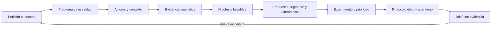

# Parte 10 — Descubrimiento y estrategia de producto

La Parte 09 dejó un SDK y una CLI cuyo contrato otra persona puede consumir. La pregunta cambia de «cómo se construye» a «qué merece construirse y cómo lo sabríamos». Esta parte trabaja sobre la **plataforma de entregas de tareas**, un caso sintético que recorre las doce clases: tickets que parecen pedir un botón, personas con contextos distintos, entrevistas que no deben sugerir la respuesta, hipótesis que pueden fallar, experimentos con tamaño y calendario, prioridades con incertidumbre, un protocolo ético y criterios de abandono. Termina en un brief que otra persona puede revisar sin pedir contexto.

## Pregunta rectora

> ¿Qué incertidumbre crítica se intenta reducir, con qué evidencia, y qué resultado haría cambiar o abandonar la decisión?

## Antes del recorrido clase por clase

Esta parte no enseña una metodología de producto como lista de ceremonias. Enseña a separar lo que alguien reporta, lo que ocurre, lo que necesita y lo que el equipo podría hacer; a obtener evidencia que se pueda rastrear; a contrastar hipótesis con umbrales fijados antes; y a decidir con rangos en lugar de cifras únicas. Cada clase ejecuta experimentos con datos sintéticos que muestran un mecanismo (un conteo que reordena prioridades, un promedio que no describe a nadie, un hash que se revierte) y declara lo que ese experimento no demuestra.

El diagrama se lee de izquierda a derecha y no es un proceso obligatorio. El retorno indica que una evidencia nueva, un experimento inconcluso o un criterio de abandono activado reabre el problema; un brief aprobado no cierra la pregunta, la fecha.

## Resultados acumulativos

Podrás distinguir síntoma, problema, necesidad y oportunidad; describir actores y contextos sin recurrir a un promedio; planificar entrevistas con una probabilidad declarada de oír un tema y medir el acuerdo entre codificadoras; redactar hipótesis con umbral y regla de decisión antes de observar; formular una propuesta de valor con resultados medibles; mapear segmentos y alternativas incluyendo no hacer nada; dimensionar experimentos por tamaño y potencia; priorizar con una regla cuya robustez se mide; proteger a las personas que participan; fijar criterios de abandono; y entregar un brief cuyas afirmaciones se rastrean a evidencia.

Al finalizar podrás defender una decisión de producto con evidencia trazable, rangos de incertidumbre, un responsable, una fecha y un criterio que la detendría, y podrás indicar qué parte de tu conclusión es observación, cuál es inferencia y cuál es suposición.

## Prerrequisitos enlazados

- [Parte 4 — Pensamiento computacional](../../classes/part-04-pensamiento-computacional-y-resolucion-de-problemas/): modelado, invariantes y razonamiento sobre evidencia.
- [Parte 7 — Estructuras de datos y algoritmos](../../classes/part-07-estructuras-de-datos-y-algoritmos/): medir, comparar y no confundir un resultado con un modelo.
- [Parte 9 — Bibliotecas, paquetes, SDK y automatización](../../classes/part-09-bibliotecas-paquetes-sdk-y-automatizacion/): contratos que otra persona consume.
- Python 3.11+ y terminal; los experimentos usan solo la biblioteca estándar y datos sintéticos.

## Bloques y progresión

1. **Entender el problema y a las personas:** las clases 121–123 separan síntoma de causa, describen actores, trabajos y contextos y obtienen evidencia cualitativa trazable.
2. **Formular y contrastar:** las clases 124–127 convierten lo aprendido en hipótesis, propuesta de valor, segmentos y alternativas, y experimentos con tamaño y calendario.
3. **Decidir con cuidado:** las clases 128–130 ordenan por valor, riesgo y aprendizaje, protegen a las personas que participan y fijan criterios de abandono.
4. **Aplicar e integrar:** las clases 131–132 convierten una petición en un problema investigable y reúnen todo en un brief respaldado por evidencia.

## Evidencia medida y límites

Las figuras y los ejemplos de esta parte usan experimentos ejecutados con CPython 3.12.9 en Windows 11 y repetidos con CPython 3.12.3 en Ubuntu bajo WSL2. Los datos son **sintéticos** y las semillas están fijadas: las salidas fueron idénticas en ambos sistemas, salvo los tiempos de cálculo de hashes de `SE-129` (19,6 s en Windows y 16,2 s en Ubuntu para recorrer diez millones de identificadores), que se informan como medidas de un solo equipo. Los experimentos son: conteo de frases frente a conteo de causas, dimensionamiento con rangos y una regla de revisión de enunciados (`SE-121`); la fracción de población cercana al promedio en varias dimensiones, la paradoja de Simpson y la agrupación de trabajos por umbral (`SE-122`); saturación de temas, acuerdo bruto frente a kappa y trazabilidad cita-afirmación (`SE-123`); sensibilidad de un embudo, probabilidad posterior frente a un umbral y comparaciones múltiples (`SE-124`); estabilidad de un ranking de encuesta, semanas de detección según el indicador y adopción según el múltiplo de valor (`SE-125`); estabilidad de k-means frente a ruido, dos estimaciones de mercado y cobertura de alternativas (`SE-126`); tamaño de muestra y potencia, falsos positivos al mirar varias veces e intervalos de Wilson (`SE-127`); ranking RICE bajo perturbación, coste del retraso sobre todas las permutaciones y valor de aprender antes (`SE-128`); unicidad por cuasi-identificadores, reversión de un hash frente a HMAC y un detector de datos personales (`SE-129`); una regla de abandono, la zona gris y un revisor de criterios (`SE-130`); un clasificador de preguntas, una rúbrica automática y la agrupación de peticiones (`SE-131`); y un validador de briefs con doce mutaciones, la ponderación de evidencia y el solapamiento de rangos (`SE-132`). Los rangos, las tasas, las ponderaciones y las etiquetas son supuestos o juicios del autor, no datos de un mercado, un producto ni de personas reales; las reglas léxicas se afinaron con pocos ejemplos y se evaluaron con casos nuevos mínimos (seis preguntas y tres enunciados), por lo que su exactitud real es desconocida. No se entrevistó a nadie, no se ejecutó ninguna prueba con usuarios ni se consultó a un comité ético o a un especialista legal. Esta parte no tiene laboratorio propio en `labs/`; el proyecto integrador `SE-132` define el contrato y la evidencia. Cada clase termina con un puente hacia el trabajo con agentes.

## Guía razonada clase por clase

La plataforma de entregas mantiene un problema, un mapa de actores, evidencia y criterios estables mientras cambian las decisiones. Cada clase explica qué incertidumbre reduce, qué experimento la muestra, qué no demuestra y qué evidencia permite abandonar la conclusión.

### Bloque 1 — Entender el problema y a las personas

#### SE-121 — Problemas, síntomas, necesidades y oportunidades

Un síntoma es lo que se dice o se observa; el problema, la brecha con consecuencia y causa investigable; la necesidad, el resultado que la persona busca sin nombrar la solución; la oportunidad, un problema con tamaño y ventana. La clase muestra con 600 tickets sintéticos que la frase más repetida no es la causa más frecuente.

El estudiante cuenta por frase y por causa, redacta un enunciado y una necesidad, dimensiona la oportunidad con un rango y prueba una regla de revisión que acierta con sus ejemplos y falla con un actor nuevo. `SE-122` pregunta quiénes son las personas detrás de esos tickets.

#### SE-122 — Usuarios, actores, trabajos y contextos

Quien usa, quien elige y quien paga suelen ser personas distintas, y el mismo trabajo se cumple o fracasa según el contexto. La clase demuestra que casi nadie se parece al «usuario promedio» al sumar dimensiones y que una opción puede ganar en cada contexto y perder en el total.

El estudiante dibuja actores y su capacidad de decidir o vetar, redacta trabajos con «cuando… quiero… para…» y compara métricas agregadas y desagregadas. `SE-123` decide a quién preguntar.

#### SE-123 — Investigación, entrevistas y evidencia cualitativa

Una entrevista produce evidencia situada, no una medición representativa. La clase calcula cuántas entrevistas hacen falta para oír un tema con cierta prevalencia, mide el acuerdo entre codificadoras con kappa y comprueba que cada afirmación del informe tenga citas literales de personas distintas.

El estudiante reescribe preguntas guiadas como relatos de episodios pasados y marca como hipótesis toda afirmación con una sola fuente. `SE-124` convierte las afirmaciones en hipótesis que puedan fallar.

### Bloque 2 — Formular y contrastar

#### SE-124 — Hipótesis, supuestos y preguntas críticas

Toda idea descansa en supuestos que son creencias hasta que se contrastan. La clase ordena supuestos por cuánto mueven el resultado, calcula la confianza de un umbral con distintos tamaños de muestra y muestra que contrastar veinte hipótesis produce un falso positivo casi seguro.

El estudiante redacta hipótesis con umbral y regla fijados antes de observar. `SE-125` formula la promesa que esas hipótesis ponen a prueba.

#### SE-125 — Propuesta de valor y resultados deseados

Una propuesta de valor promete progreso a un trabajo y se mide con resultados deseados, no con funciones. La clase simula con cuántas personas un ranking de resultados es estable, cuánto tarda en notarse una mejora según el indicador y qué porcentaje adopta un producto que vale el doble que su alternativa.

El estudiante redacta resultados medibles y declara su supuesto de apego a lo actual. `SE-126` compara la promesa con lo que la gente ya usa.

#### SE-126 — Segmentación, mercado y alternativas existentes

Un segmento útil cambia una decisión y se reconoce; un algoritmo siempre devuelve grupos, y su estabilidad no prueba que existan. La clase compara datos con estructura y ruido, estima el mercado con dos métodos y rangos, y mapea qué cubre cada alternativa, incluida no hacer nada.

El estudiante elige un segmento inicial y declara qué evidencia lo cambiaría. `SE-127` diseña el experimento mínimo para contrastar la hipótesis en ese segmento.

#### SE-127 — Prototipos, experimentos y reducción de incertidumbre

El experimento más barato que pueda refutar la hipótesis más riesgosa se elige por la pregunta que responde. La clase calcula el tamaño por rama y la potencia, mide cuánto infla los falsos positivos mirar los resultados varias veces y muestra qué incertidumbre deja una puerta falsa con pocas personas.

El estudiante entrega un plan fechado con tamaño, calendario e intervalo esperado. `SE-128` ordena los candidatos incluyendo el valor de aprender.

### Bloque 3 — Decidir con cuidado

#### SE-128 — Priorización por valor, riesgo y aprendizaje

Una fórmula de priorización no es un hecho. La clase perturba las entradas de un ranking RICE para medir qué ítems resisten, compara criterios de orden por coste del retraso sobre todas las permutaciones y calcula cuándo una prueba previa vale su costo.

El estudiante documenta la regla, sus entradas y su robustez. `SE-129` revisa qué pruebas son éticamente aceptables.

#### SE-129 — Ética del descubrimiento y protección de participantes

Investigar con personas exige finalidad, consentimiento revocable, minimización y protección. La clase mide con datos sintéticos cuántas personas quedan identificables al combinar atributos inocuos, revierte un hash sin clave en segundos y evalúa un detector de datos personales que deja pasar la mitad.

El estudiante redacta un protocolo con retención, borrado y seudonimización con clave. `SE-130` fija cuándo se detiene la investigación.

#### SE-130 — Criterios de no éxito y decisiones de abandono

Un criterio sin umbral, ventana y responsable no puede fallar. La clase compara una regla de abandono definida de antemano con consumir todo el presupuesto, calcula cuántas personas hacen falta para decidir entre una tasa mala y una buena y revisa si los criterios son medibles.

El estudiante escribe criterios de éxito y de no éxito, la zona gris con su acción y el formato de cierre. `SE-131` aplica todo a una petición.

### Bloque 4 — Aplicar e integrar

#### SE-131 — Taller: convertir una petición en un problema investigable

El taller descompone una petición en actor, intención, qué se hace hoy, consecuencia y solución propuesta, la reformula como problema, escribe preguntas sobre episodios pasados y agrupa dieciséis peticiones en seis necesidades. Las reglas automáticas se evalúan con casos que no vieron, y el resultado honesto baja del 100 % al 50 %.

El estudiante deja un archivo que permite reconstruir el camino de la petición al problema. `SE-132` reúne todo en el brief.

#### SE-132 — Proyecto: product brief respaldado por evidencia

El proyecto integra problema, evidencia, hipótesis, propuesta, segmento, experimento, prioridad, protocolo y criterios de abandono en un brief con responsable y fecha. Un validador estructural detecta diez de doce defectos inyectados y deja pasar un número alterado y una afirmación exagerada: eso lo cubre la revisión.

El estudiante entrega el brief, el validador con sus pruebas, el registro de mutaciones y la decisión bajo varias ponderaciones y con rangos solapados. La Parte 11 somete ese brief a modelos de negocio, costos y métricas.

## Resumen operativo del recorrido

| Clase | Capacidad que construye | Pregunta que resuelve | Evidencia acumulativa |
|---|---|---|---|
| [SE-121](../../classes/part-10-descubrimiento-y-estrategia-de-producto/se-121-problemas-sintomas-necesidades-y-oportunidades/) | Problemas, síntomas, necesidades y oportunidades | ¿Qué se dice, qué ocurre y qué se necesita? | `discovery-log.md` con conteo por causa y rango de oportunidad |
| [SE-122](../../classes/part-10-descubrimiento-y-estrategia-de-producto/se-122-usuarios-actores-trabajos-y-contextos/) | Usuarios, actores, trabajos y contextos | ¿Para quién se decide y en qué contexto? | `actors-map.md` con actores, trabajos y métricas desagregadas |
| [SE-123](../../classes/part-10-descubrimiento-y-estrategia-de-producto/se-123-investigacion-entrevistas-y-evidencia-cualitativa/) | Entrevistas y evidencia cualitativa | ¿Qué puede afirmarse con las entrevistas hechas? | `interview-evidence.md` con citas verificadas y kappa |
| [SE-124](../../classes/part-10-descubrimiento-y-estrategia-de-producto/se-124-hipotesis-supuestos-y-preguntas-criticas/) | Hipótesis, supuestos y preguntas críticas | ¿Qué debe ser verdad y qué lo refutaría? | `hypothesis-map.md` con umbral y regla fijados |
| [SE-125](../../classes/part-10-descubrimiento-y-estrategia-de-producto/se-125-propuesta-de-valor-y-resultados-deseados/) | Propuesta de valor y resultados deseados | ¿Qué progreso se promete y cómo se mide? | `value-proposition.md` con ranking y su estabilidad |
| [SE-126](../../classes/part-10-descubrimiento-y-estrategia-de-producto/se-126-segmentacion-mercado-y-alternativas-existentes/) | Segmentación, mercado y alternativas | ¿A quién primero, cuántos son y contra qué se compite? | `market-map.md` con segmentos, rangos y alternativas |
| [SE-127](../../classes/part-10-descubrimiento-y-estrategia-de-producto/se-127-prototipos-experimentos-y-reduccion-de-incertidumbre/) | Prototipos y experimentos | ¿Qué experimento mínimo puede refutar la hipótesis? | `experiment-plan.md` con tamaño, calendario e intervalo |
| [SE-128](../../classes/part-10-descubrimiento-y-estrategia-de-producto/se-128-priorizacion-por-valor-riesgo-y-aprendizaje/) | Priorización por valor, riesgo y aprendizaje | ¿Qué hacer primero y qué tan seguro es ese orden? | `prioritization-log.md` con robustez y valor de aprender |
| [SE-129](../../classes/part-10-descubrimiento-y-estrategia-de-producto/se-129-etica-del-descubrimiento-y-proteccion-de-participantes/) | Ética y protección de participantes | ¿Qué se le puede pedir a una persona y cómo se protege? | `ethics-protocol.md` con unicidad y seudonimización |
| [SE-130](../../classes/part-10-descubrimiento-y-estrategia-de-producto/se-130-criterios-de-no-exito-y-decisiones-de-abandono/) | Criterios de no éxito y abandono | ¿Qué resultado detiene la idea y quién decide? | `stop-rules.md` con regla, zona gris y cierre |
| [SE-131](../../classes/part-10-descubrimiento-y-estrategia-de-producto/se-131-taller-convertir-una-peticion-en-un-problema-investigable/) | Taller: de la petición al problema | ¿Qué habría que averiguar para saber si es un problema real? | `request-to-problem.md` con descomposición y rúbrica |
| [SE-132](../../classes/part-10-descubrimiento-y-estrategia-de-producto/se-132-proyecto-product-brief-respaldado-por-evidencia/) | Proyecto: brief respaldado por evidencia | ¿Puede otra persona decidir y comprobar con este brief? | `brief.md`, validador, mutaciones y decisión con rangos |

## Proyecto integrador

El proyecto **SE-132** entrega un brief con problema investigable, evidencias tipificadas (dijeron, hicieron, comprometieron, registro), afirmaciones trazables, una decisión con responsable y fecha, el criterio de abandono heredado de `SE-130`, el protocolo ético de `SE-129` y los límites. Se acompaña de un validador con pruebas y de un registro de mutaciones detectadas y no detectadas. El brief solo respalda las conclusiones que el expediente sostiene y conserva la opción de aprender más cuando los rangos de las alternativas se solapan.

## Criterios de salida

- las doce clases explican todos sus temas mediante mecanismos, ejemplos y límites;
- cada afirmación del brief remite a evidencias que existen, de más de una persona o de un registro;
- cada hipótesis tiene umbral, regla de decisión y fecha de fijación anteriores a la observación;
- los experimentos declaran tamaño, potencia, calendario de análisis e intervalo esperado;
- los criterios de abandono tienen comparador, umbral, ventana y responsable;
- el protocolo ético mide la unicidad del conjunto que se comparte y conserva la clave de seudonimización aparte;
- otra persona reproduce comandos y resultados desde checkout limpio;
- el informe declara lo observado, lo inferido y lo no ejecutado.

## Preguntas de control por bloque

- ¿Qué parte de este enunciado es síntoma, cuál es causa y cuál es suposición?
- ¿Cuántas personas respaldan esta afirmación y qué tipo de evidencia aportan?
- ¿Qué resultado haría abandonar la idea, con qué umbral y quién lo decide?
- ¿Qué cambia en la conclusión si el peso de la evidencia o el rango de un supuesto cambia?

## Fuentes de la parte

- [GOV.UK Service Manual: User research](https://www.gov.uk/service-manual/user-research) — cómo investigar a las personas usuarias a lo largo del desarrollo; autoridad: Government Digital Service (Reino Unido).
- [GOV.UK Service Manual: How the discovery phase works](https://www.gov.uk/service-manual/agile-delivery/how-the-discovery-phase-works) — reformular una solución como problema y decidir si avanzar o detenerse; autoridad: Government Digital Service.
- [NIST Privacy Framework](https://www.nist.gov/privacy-framework) — gestión del riesgo de privacidad al recoger datos de personas; autoridad: NIST.
- [The Menlo Report](https://www.dhs.gov/publication/menlo-report) — principios éticos de la investigación en tecnologías de la información; autoridad: U.S. Department of Homeland Security.
- [Reglamento (UE) 2016/679](https://eur-lex.europa.eu/eli/reg/2016/679/oj) — minimización, conservación, seudonimización y consentimiento; autoridad: Unión Europea.
- [SWEBOK Guide v4.0a](https://www.computer.org/education/bodies-of-knowledge/software-engineering) — requisitos, medición y fundamentos de ingeniería; autoridad: IEEE Computer Society.

Las fuentes se vinculan también dentro de cada clase. Definen vocabulario y mecanismos; la adecuación de las decisiones de la plataforma de entregas se demuestra con el caso, la evidencia trazable y la revisión de otra persona, no con la autoridad de la fuente.
