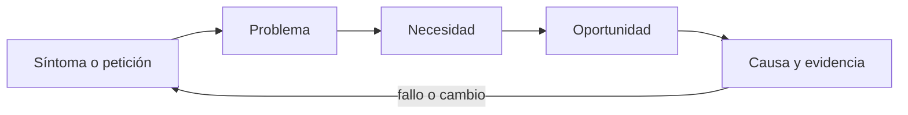
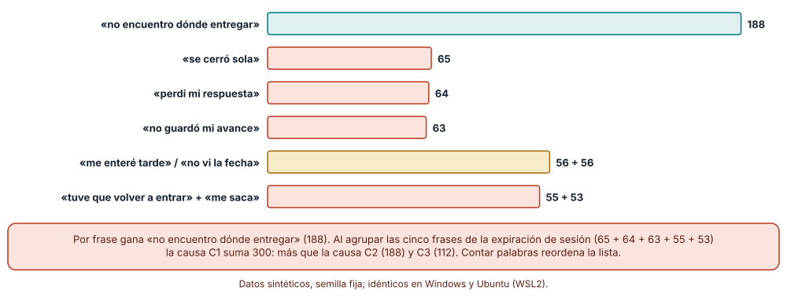
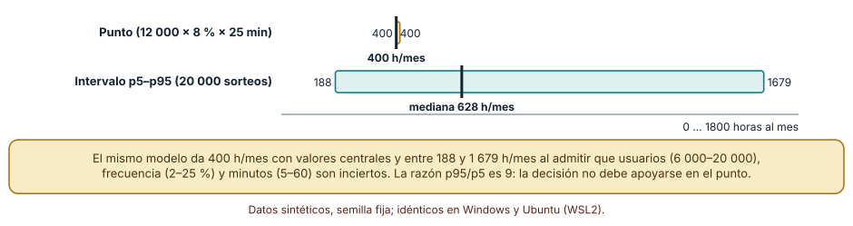
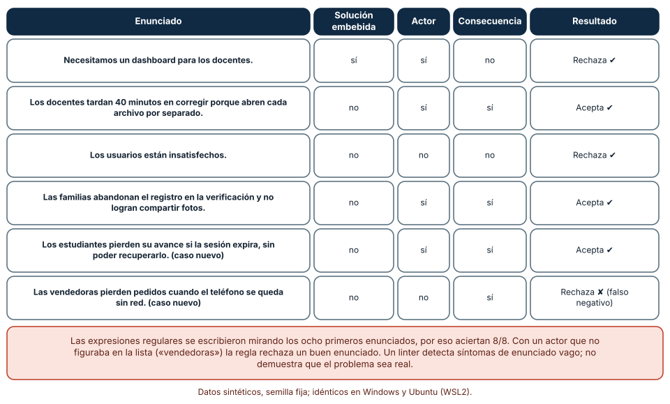

# SE-121 — Problemas, síntomas, necesidades y oportunidades

[← SE-120 — Proyecto: SDK y CLI con compatibilidad verificada](../../classes/part-09-bibliotecas-paquetes-sdk-y-automatizacion/se-120-proyecto-sdk-y-cli-con-compatibilidad-verificada/README.md) · [↑ Parte 10](../../classes/part-10-descubrimiento-y-estrategia-de-producto/README.md) · [📚 Índice completo](../../classes/README.md) · [🌐 Portal](../../site/classes/SE-121.html) · [SE-122 — Usuarios, actores, trabajos y contextos →](../../classes/part-10-descubrimiento-y-estrategia-de-producto/se-122-usuarios-actores-trabajos-y-contextos/README.md)

## Punto profesional y fundamento pedagógico

**Punto profesional.** La clase existe para separar lo que alguien reporta, lo que de verdad ocurre, lo que la persona necesita y lo que el equipo podría hacer, de modo que una decisión de producto no descanse en la frase más repetida de un ticket.

**Por qué aparece aquí.** Se sitúa después de **Proyecto: SDK y CLI con compatibilidad verificada** y antes de **Usuarios, actores, trabajos y contextos**: la Parte 09 terminó con un SDK y una CLI cuyo contrato otra persona puede consumir; la Parte 10 cambia la pregunta de «cómo se construye» a «qué merece construirse». Esta clase fija el vocabulario (síntoma, problema, necesidad, oportunidad) que las once siguientes usarán como unidades de evidencia, y deja un enunciado de problema revisable que `SE-122` convertirá en personas, actores y contextos.

**Error conceptual que debe corregir.** Tomar un síntoma repetido como si fuera el problema, y un problema como si ya fuera una oportunidad validada.

**Secuencia de aprendizaje.** Antes de leer la solución, predices qué frase de un conjunto de tickets es la más frecuente y qué causa lo es; después ejecutas el conteo, explicas por qué difieren, construyes un enunciado de problema que sobreviva a una regla automática y a una segunda lectura, y reconstruyes sin apoyo la cadena síntoma → problema → necesidad → oportunidad. La secuencia usa predicción, explicación propia, contraste y recuperación. [ICAP](https://icap.education.asu.edu/research) distingue participación de construcción de conocimiento; [How People Learn II](https://nap.nationalacademies.org/catalog/24783/how-people-learn-ii-learners-contexts-and-cultures) exige conectar conocimiento previo, contexto y transferencia; la [práctica de recuperación](https://pubmed.ncbi.nlm.nih.gov/16507066/) respalda producir de nuevo la explicación tras una demora; y [Education for Life and Work](https://nap.nationalacademies.org/resource/13398/dbasse_084153.pdf) exige devolución que explique la causa del error.

**Evidencia de aprendizaje.** `discovery-log.md` con los tickets sintéticos, el agrupamiento por causa, un enunciado de problema, una necesidad redactada sin solución y un rango (no un punto) para el tamaño de la oportunidad. Debe contener predicción previa, observación, explicación causal, contraejemplo, criterio de aceptación y una nota de qué dato haría cambiar la conclusión.

**Límite de la conclusión.** Los tickets son sintéticos y la causa de cada uno es conocida porque la asignó el generador; con tickets reales la causa se infiere y puede ser errónea. Los rangos del dimensionamiento son supuestos del autor, no datos de mercado.

### Trazabilidad fuente → afirmación

| Fuente primaria u oficial | Afirmación que respalda | Lo que no prueba |
|---|---|---|
| [GOV.UK Service Manual: Learning about users and their needs](https://www.gov.uk/service-manual/user-research/start-by-learning-user-needs) | Propone redactar necesidades como «necesito… para…» y exige que se basen en evidencia y se centren en el problema, no en una posible solución (necesitar un recordatorio, no un correo). | No demuestra que las necesidades de tu plataforma sean las de su ejemplo. |
| [GOV.UK Service Manual: How the discovery phase works](https://www.gov.uk/service-manual/agile-delivery/how-the-discovery-phase-works) | Indica que, ante una solución ya definida, el equipo debe interrogarla y reformularla como un problema por resolver. | No prescribe cuánta evidencia basta para dar por entendido el problema. |
| [Python: random](https://docs.python.org/3/library/random.html) | Un generador con semilla (`random.Random(121)`) produce una secuencia reproducible, lo que permite repetir el experimento de conteo. | No garantiza que la distribución sintética se parezca a la de tickets reales. |

## Antes de empezar

Esta clase abre la **Parte 10 sobre la plataforma de entregas de tareas**, el caso que recorrerá las doce clases. Recupera lo aprendido en la Parte 09 sobre contratos: un contrato dice qué se promete, no si alguien lo necesita. La pregunta activa es: **¿qué diferencia hay entre lo que la gente dice, lo que ocurre y lo que necesita, y cuál de las tres debe guiar una decisión?**

## Prerrequisitos

- Haber completado `SE-120` o poder explicar qué contrato de SDK y CLI entregó.
- Python 3.11 o posterior y un terminal; la hoja de cálculo es opcional.
- Trabajar solo con tickets y cifras sintéticas: ninguna observación necesita datos de una persona o sistema real.

## Problema auténtico

La plataforma de entregas de tareas recibe 600 tickets al mes. El tablero muestra que «no encuentro dónde entregar» es la frase más repetida y el equipo propone rediseñar el botón de entrega. Nadie ha preguntado cuántas de las demás frases («se cerró sola», «perdí mi respuesta», «no guardó mi avance») describen en realidad una sola falla distinta.

## Objetivos observables

Al terminar podrás:

1. distinguir un síntoma, un problema, una necesidad y una oportunidad con un ejemplo y un contraejemplo de la plataforma de entregas;
2. predecir cuándo contar frases y contar causas producen listas de prioridades distintas, y comprobarlo con un conteo;
3. redactar una necesidad sin solución embebida y un enunciado de problema con actor, consecuencia y observable;
4. dimensionar una oportunidad como rango p5–p95 en lugar de como número único;
5. declarar qué detecta y qué no detecta una regla automática de revisión de enunciados.

## Mapa conceptual



El mapa se lee como una cadena de razonamiento, no como fases obligatorias. La flecha de retorno indica que una causa nueva o un dato que contradice el enunciado obliga a reabrir el síntoma de partida; no autoriza a parchear solo la oportunidad.

## Temas y por qué importan

| Tema | Por qué cambia una decisión profesional | Evidencia mínima |
|---|---|---|
| Síntomas y peticiones | Un síntoma es lo que se observa o se dice; contarlo reordena prioridades sin explicar nada. | Predicción, traza causal y contraejemplo de **Síntomas y peticiones** en `discovery-log.md` |
| Problemas | Un problema es una brecha con consecuencia observable y causa investigable; sin esos tres elementos es una opinión. | Predicción, traza causal y contraejemplo de **Problemas** en `discovery-log.md` |
| Necesidades | Una necesidad bien formulada no menciona la solución y deja abiertas varias respuestas posibles. | Predicción, traza causal y contraejemplo de **Necesidades** en `discovery-log.md` |
| Oportunidades | Una oportunidad es un problema con tamaño, frecuencia y ventana de acción; sin esos números no se puede comparar. | Predicción, traza causal y contraejemplo de **Oportunidades** en `discovery-log.md` |
| Causa y evidencia | Agrupar síntomas por causa cambia el orden de prioridades, y solo la evidencia sostiene la agrupación. | Predicción, traza causal y contraejemplo de **Causa y evidencia** en `discovery-log.md` |

## Conceptos y decisiones

### 1. Síntomas y peticiones

Un síntoma es la parte visible de una situación: una frase en un ticket, una caída en una métrica, una petición. Su valor es que se puede observar y contar; su límite es que varias causas pueden producir el mismo síntoma y una misma causa puede producir síntomas con palabras distintas. Una petición («agrega un botón de exportar») es un síntoma que ya trae una solución adentro, y por eso exige preguntar qué intenta lograr quien la hace. Registrar el síntoma textual, con fecha y fuente, es el primer paso de trazabilidad: permite después volver y ver qué frase originó cada conclusión.

### 2. Problemas

Un problema se enuncia con un actor, algo que intenta lograr, lo que se lo impide y la consecuencia: «los estudiantes pierden su avance cuando la sesión expira y no pueden recuperarlo». Es investigable cuando existe una observación que lo confirmaría o lo refutaría (por ejemplo, registros de sesiones expiradas con borrador sin guardar). «Los usuarios están insatisfechos» no es un problema sino un estado de ánimo sin actor concreto ni observable. La diferencia importa porque solo un enunciado investigable permite que otra persona llegue a la misma conclusión o la discuta con datos.

### 3. Necesidades

El Service Manual del gobierno británico propone redactar las necesidades como «necesito/quiero/espero… para…», con palabras que la persona reconocería, basadas en evidencia y centradas en su problema, no en una solución. Su ejemplo es útil: la necesidad es un recordatorio, no un correo ni una carta. En la plataforma, «necesito saber que mi entrega llegó para no repetirla» admite una confirmación en pantalla, un correo o un comprobante; «necesito un correo de confirmación» ya eligió. Redactar así conserva el espacio de diseño y evita que la primera idea se convierta en requisito.

### 4. Oportunidades

No todo problema es una oportunidad: se vuelve una cuando alcanza a suficientes personas, con suficiente consecuencia y con una posibilidad razonable de actuar. Por eso se estima con tres factores —cuántas personas, con qué frecuencia, qué costo por ocurrencia— y se expresa como rango, porque cada factor es incierto. Un número único (400 horas al mes) transmite una precisión que no existe; un rango (de unas 190 a unas 1 700) muestra cuánto del tamaño es conocimiento y cuánto suposición. El rango también señala qué factor conviene investigar primero.

### 5. Causa y evidencia

Cada afirmación del tipo «estos cinco síntomas tienen la misma causa» es una hipótesis hasta que se observa algo que la distinga de las alternativas: un registro, una sesión observada, un contraejemplo. La regla de trabajo es separar tres columnas —hecho observado, inferencia, incógnita— y no mezclarlas. Cuando la causa se asigna por intuición y luego se usa como dato, el error se arrastra a las clases siguientes. Esta clase deja explícito qué parte de cada conclusión es observada y cuál es interpretación.

### Contar frases no es contar causas

El tablero de la plataforma cuenta frases. Generamos 600 tickets sintéticos con semilla fija (`random.Random(121)`): tres causas verdaderas con ponderaciones 0,45, 0,33 y 0,22, cada una con sus propias maneras de redactar el síntoma. La causa C1 (la sesión expira sin aviso) se expresa de cinco formas distintas; C2 (el botón de entrega es poco visible) de una sola; C3 (notificaciones tardías) de dos. Predicción antes de contar: la frase más repetida no debería ser la causa más frecuente.

```python
from collections import Counter
por_frase = Counter(frase for causa, frase in tickets)
por_causa = Counter(causa for causa, frase in tickets)
```

Resultado, idéntico en Windows (CPython 3.12.9) y en Ubuntu bajo WSL2 (3.12.3): la frase más repetida es «no encuentro dónde entregar» con 188 tickets, seguida de «se cerró sola» (65), «perdí mi respuesta» (64) y «no guardó mi avance» (63). Por causa, en cambio, C1 reúne 300 tickets (50 %), C2 188 (31 %) y C3 112 (19 %). El tablero por frases habría llevado al equipo a rediseñar el botón; el tablero por causas apunta a la expiración de sesión, que es una falla distinta y más frecuente. Sumar las cinco frases de C1 exige haber leído los tickets o haberlos observado, no basta con una consulta.



**Cómo leer la figura.** La barra verde es la frase más frecuente; las coral son cinco maneras de decir una misma falla, y su suma (300) supera a cualquier frase individual. **Dónde deja de valer:** aquí la causa de cada ticket es conocida porque la asignó el generador. Con tickets reales la causa se infiere, y agrupar mal es tan posible como no agrupar: si dos fallas distintas se fusionan, el tablero por causas también miente.

### Dimensionar una oportunidad con un rango, no con un punto

Para decidir si la expiración de sesión merece trabajo se estima el tiempo que pierden las personas. La cuenta del punto es inmediata: 12 000 usuarios activos × 8 % que sufre la falla cada mes × 25 minutos perdidos = 24 000 minutos, es decir 400 horas al mes. Pero cada factor es incierto. Sorteamos 20 000 veces con distribuciones triangulares: usuarios entre 6 000 y 20 000 (moda 12 000), proporción afectada entre 2 % y 25 % (moda 8 %) y minutos entre 5 y 60 (moda 25).

```python
rng = random.Random(1212)
horas = sorted(
    rng.triangular(6000, 20000, 12000)
    * rng.triangular(0.02, 0.25, 0.08)
    * rng.triangular(5, 60, 25) / 60
    for _ in range(20000)
)
```

El resultado: percentil 5 = 188 h/mes, mediana = 628, percentil 95 = 1 679; la razón entre p95 y p5 es 9,0. Dos lecciones. La primera: el rango es nueve veces más ancho en su extremo que en su base, de modo que decir «400 horas» sugiere una precisión inexistente. La segunda: la mediana (628) supera a la estimación puntual (400) porque los rangos son asimétricos hacia arriba; usar los valores centrales no equivale a usar el valor esperado.



**Cómo leer la figura.** La marca negra dentro de cada barra es el valor central; el punto dorado es una sola cifra, el intervalo verde es lo que queda cuando se admite la incertidumbre. **Dónde deja de valer:** los rangos son supuestos del autor, no datos de la plataforma; con rangos más estrechos obtenidos de registros reales el intervalo se cerraría. Además asume que los tres factores son independientes: si los usuarios más activos también sufren la falla con mayor frecuencia, el intervalo real sería más ancho.

### Un linter de enunciados: qué detecta y qué no

Para revisar enunciados de problema antes de que lleguen a una reunión se escribió una regla con tres expresiones regulares: marca como defecto la *solución embebida* (verbos como «necesitamos», «agregar», «crear», o sustantivos como «un dashboard»), y exige un actor reconocible y una consecuencia (palabras como «tardan», «pierden», «abandonan», «no logran»). Se aplicó a ocho enunciados que el autor etiquetó antes de escribir la regla: cuatro aceptables y cuatro no. Resultado: 4 aciertos de aceptación, 0 falsos positivos, 4 rechazos correctos y 0 falsos negativos. Un 8 de 8 que no debe celebrarse: la regla se afinó mirando esos ocho.

La prueba real es un caso que la regla no conocía. «Las vendedoras pierden pedidos cuando el teléfono se queda sin red» es un buen enunciado (actor, consecuencia, observable), pero la lista de actores no incluía «vendedoras» y la regla lo rechazó. El linter aporta una comprobación barata y repetible de defectos comunes —solución embebida, ausencia de actor, ausencia de consecuencia—, y falla cuando el vocabulario cambia.



**Cómo leer la figura.** Cada fila es un enunciado y las columnas dicen qué defectos encontró la regla; la última fila coral es el falso negativo. **Dónde deja de valer:** una lista de palabras no sustituye la lectura de una segunda persona, y un enunciado que pasa la regla puede seguir siendo falso (el problema puede no existir). Úsala como revisión previa, y registra cada falso negativo para ampliar la regla o para dejar de confiar en ella.

## Definiciones de trabajo

- **síntomas y peticiones:** frase reportada o señal observable; describe qué se ve o se pide, no por qué ocurre.
- **problemas:** brecha entre lo que una persona intenta lograr y lo que logra, con una consecuencia observable y una causa que puede investigarse.
- **necesidades:** resultado que una persona busca, expresado desde su perspectiva y sin nombrar la solución (necesito… para…).
- **oportunidades:** problema o necesidad con alcance estimado, consecuencia cuantificable y una ventana en la que actuar tiene sentido.
- **causa y evidencia:** explicación de por qué ocurre un conjunto de síntomas, sostenida por observaciones que otra persona puede revisar.

Las definiciones son operativas para la plataforma de entregas. No convierten términos con historia más amplia en sinónimos y deben contrastarse con la documentación primaria enlazada al final.

## Ejemplo mínimo

El fragmento siguiente cuenta los mismos tickets de dos maneras. Antes de ejecutarlo, predice qué ocurre con el orden.

```python
from collections import Counter

tickets = [
    ("sesion", "se cerro sola"), ("sesion", "perdi mi respuesta"),
    ("sesion", "no guardo mi avance"), ("boton", "no encuentro donde entregar"),
    ("boton", "no encuentro donde entregar"), ("aviso", "me entere tarde"),
]
por_frase = Counter(f for _, f in tickets)
por_causa = Counter(c for c, _ in tickets)
assert por_frase.most_common(1)[0][0] == "no encuentro donde entregar"
assert por_causa.most_common(1)[0][0] == "sesion"
```

Con seis tickets la frase más repetida es del botón (2) y la causa más repetida es la sesión (3). Registra versión del intérprete, comando y salida. Si cambias las etiquetas de causa, el orden puede invertirse otra vez: ese es el punto.

## Ejemplo profesional

En la plataforma de entregas, un ticket conserva identificador, fecha, texto original, canal y, cuando existe, una etiqueta de causa asignada por una persona identificada, con la fecha de asignación. El contrato del registro es que el texto original nunca se sobrescribe: la etiqueta de causa es una interpretación que puede cambiar, y el texto es el dato. Esa separación permite que un revisor vea cuántos síntomas se fusionaron y rehaga la agrupación.

Compara el caso normal con el ticket que describe dos fallas a la vez, con el que no tiene causa asignable, con el duplicado enviado por un grupo de personas y con la queja de alguien que no es usuario. Una agrupación es apropiada cuando esas diferencias quedan visibles y localizadas; es peligrosa cuando se hace en un solo paso y deja solo la etiqueta final.

## Práctica guiada

1. Copia el contrato de datos de un ticket (texto original, fecha, canal, etiqueta de causa y quién la asignó) antes de analizar nada.
2. Predice, para tu muestra, si la frase más repetida coincide con la causa más frecuente y anota por qué.
3. Genera 600 tickets sintéticos con semilla fija y tres causas, una de ellas con varias redacciones.
4. Cuenta por frase y por causa; guarda ambos conteos bajo `evidence/`.
5. Redacta un enunciado de problema y una necesidad sin solución para la causa más frecuente.
6. Estima la oportunidad con un rango triangular y registra p5, mediana y p95.
7. Pide a otra persona que reconstruya la cadena síntoma → problema → necesidad → oportunidad solo con `discovery-log.md`.

## Ejercicios

1. **Conteo:** reproduce el experimento con otra semilla y calcula cuántas veces la frase más repetida coincide con la causa más frecuente en 20 semillas.
2. **Reescritura:** transforma cuatro peticiones («agrega un botón de exportar», «necesitamos notificaciones push», «hay que hacer un dashboard», «quiero modo oscuro») en necesidades de la forma «necesito… para…» sin nombrar solución.
3. **Rango:** cambia los rangos del dimensionamiento a la mitad de ancho y explica cuánto se estrecha la razón p95/p5 y qué factor aporta más a la anchura.
4. **Linter:** escribe tres enunciados que la regla acepte siendo malos y tres que rechace siendo buenos; explica qué ampliarías y qué no se puede arreglar con palabras.

## Reto verificable

Entrega `discovery-log.md` con 600 tickets sintéticos (o los generados por tu semilla), el conteo por frase y por causa, un enunciado de problema, una necesidad sin solución y un rango de oportunidad. Se aprueba si otra persona ejecuta el código desde un checkout limpio, obtiene los mismos conteos y puede señalar qué dato haría que la prioridad cambiara. No se aprueba por la cantidad de tickets ni por la longitud del informe.

## Caso conductor

La plataforma de entregas de tareas es el caso conductor de la Parte 10. Esta clase deja el primer artefacto: tickets sintéticos, causa más frecuente (la expiración de sesión), un enunciado de problema y un rango de oportunidad. Las clases siguientes preguntarán quiénes son las personas afectadas (`SE-122`), qué se sabe de ellas por entrevistas (`SE-123`) y qué hipótesis se pueden contrastar (`SE-124`). Cambia después una sola decisión —por ejemplo, fusionar dos causas— y revisa qué conclusiones del registro cambian.

## Preguntas frecuentes

### ¿La frase más repetida no es entonces la más importante?

Puede serlo, pero no por ser la más repetida. En el experimento, «no encuentro dónde entregar» lidera con 188 tickets y aun así la causa que más tickets genera (300) se expresa de cinco maneras. Contar frases es el punto de partida; decidir exige saber cuántas personas y cuánta consecuencia hay detrás de cada causa.

### ¿Cuál es la diferencia entre una necesidad y un requisito?

La necesidad describe un resultado desde la perspectiva de la persona («necesito saber que mi entrega llegó»); el requisito es una decisión del equipo sobre cómo satisfacerla («enviar un correo de confirmación»). Si el requisito aparece antes que la necesidad, la solución ya fue elegida sin comprobar alternativas.

### ¿Por qué dar un rango si el jefe pide un número?

Porque un número único oculta que la incertidumbre cambia la decisión: 400 horas al mes y 1 679 horas al mes no justifican el mismo esfuerzo. Puedes dar ambos: la mediana (628) como estimación de trabajo y el intervalo (188–1 679) como advertencia de cuánto puede variar.

### ¿Puedo usar un modelo de lenguaje para agrupar tickets por causa?

Puedes usarlo para proponer agrupaciones, pero no para decidirlas: cada agrupación es una hipótesis con una persona que la revisa y con tickets de ejemplo visibles. Un agrupamiento no revisado repite el defecto del tablero por frases con apariencia de análisis.

## Fallo controlado y diagnóstico

Reproduce el fallo clásico de la clase: **convertir la primera petición en requisito definitivo**. Toma el tablero por frases, elige la más repetida y escribe el requisito «rediseñar el botón de entrega». Después agrupa los tickets por causa y observa que la causa más frecuente es otra.

Registra síntoma, entrada mínima, hipótesis, observación que descarta cada hipótesis, causa, corrección y prueba de regresión. **Síntoma:** el equipo mejora el botón y los tickets de «se cerró sola», «perdí mi respuesta» y «no guardó mi avance» no bajan. **Hipótesis rivales:** (a) el botón rediseñado es todavía poco visible; (b) los tickets restantes pertenecen a otra causa. **Prueba:** cuenta por causa, no por frase: C1 suma 300 y C2 solo 188; además los 188 de C2 no incluyen ninguna de las cinco frases de C1. **Conclusión:** la causa estaba mal elegida desde el conteo. **Regresión:** añade al contrato del registro la etiqueta de causa y una prueba que falle si la prioridad se calcula únicamente con `Counter` sobre el texto. No cambies a la vez la agrupación y el criterio de prioridad.

## Errores comunes y cómo corregirlos

| Síntoma | Causa probable | Corrección |
|---|---|---|
| El tablero prioriza una falla que, al arreglarla, no reduce los tickets | Se contó la frase y no la causa; varias redacciones de una causa quedaron dispersas | Etiquetar la causa por ticket (con quién y cuándo) y contar por causa, conservando el texto original |
| La reunión discute «la solución» durante una hora sin acordar el problema | La petición original se aceptó como requisito | Reformular la petición como necesidad («necesito… para…») antes de proponer opciones |
| El informe da «400 horas al mes» y luego «1 600» sin explicación | Se usó el valor central de cada factor y luego otro conjunto de valores | Declarar el rango de cada factor y reportar p5, mediana y p95 del resultado |
| Un enunciado de problema pasa el linter pero nadie lo reconoce como real | La regla comprueba forma, no existencia | Pedir a una segunda persona que cite un registro o una observación que confirme el enunciado |
| La etiqueta de causa cambia y se pierde el ticket original | Se sobrescribió el texto al reetiquetar | Guardar el texto como dato inmutable y la etiqueta como interpretación con autor y fecha |

## Entorno y archivos clave

```text
work/SE-121/
├── README.md
├── discovery_log/
│   ├── tickets.py
│   └── oportunidad.py
├── fixtures/tickets.csv
├── tests/test_conteo.py
└── evidence/discovery-log.md
```

El `README` declara plataforma, versión de Python, semilla y comandos. Los experimentos de esta clase usan solo la biblioteca estándar (`random`, `collections`, `re`) y se ejecutaron con CPython 3.12.9 en Windows 11 y 3.12.3 en Ubuntu bajo WSL2; las salidas fueron idénticas. Si añades una dependencia, fija procedencia y versión.

## Seguridad, ética y accesibilidad

- los tickets reales contienen nombres, correos y a veces datos académicos: trabaja con tickets sintéticos o con una copia minimizada y sin identificadores;
- la etiqueta de causa es una interpretación con consecuencias: registra quién la asignó para que pueda cuestionarse;
- un tablero que prioriza por volumen favorece a quien más escribe; considera a las personas que no reportan (por barreras de idioma, acceso o confianza);
- redacta los enunciados con lenguaje comprensible y ofrece una alternativa textual a los gráficos;
- no uses un modelo de lenguaje con tickets reales sin una política de datos que lo permita;
- respeta licencias de ejemplos y atribuye adaptaciones.

## Puente hacia el trabajo con agentes

Un agente al que se le pide «analiza los tickets y propone mejoras» tenderá a devolver una lista ordenada por frecuencia de palabras con soluciones plausibles. Pídele en cambio que separe hecho observado, inferencia e incógnita, que conserve el texto original con un identificador por ticket y que entregue la agrupación por causa como hipótesis con tres tickets de ejemplo cada una. Revisa especialmente si propone una solución antes de formular una necesidad: es el mismo error de la primera petición, ahora con apariencia de análisis.

## Transferencia

Traslada el experimento a otro de los dominios persistentes (por ejemplo, un servicio de entregas a domicilio): cambia las causas y las redacciones, conserva el contrato del registro y comprueba si la frase más repetida sigue sin coincidir con la causa más frecuente. La transferencia está lograda cuando puedes explicar qué parte del método dependía del dominio y cuál no, no cuando el código se parece.

## Evaluación y evidencia

| Criterio | Evidencia para aprobar |
|---|---|
| comprensión | explicación causal de la diferencia entre síntoma, problema, necesidad y oportunidad, con ejemplo y contraejemplo |
| corrección | conteos reproducibles por frase y por causa con la misma semilla |
| diseño | contrato del registro que separa texto original e interpretación |
| diagnóstico | reproducción del fallo «petición como requisito» con regresión |
| incertidumbre | rango p5–p95 en lugar de una cifra única y factor que más contribuye |
| reproducibilidad | versiones, comandos, salida y límites declarados |


## Fuentes


- [GOV.UK Service Manual: User research](https://www.gov.uk/service-manual/user-research) — marco oficial para investigar necesidades antes y durante el desarrollo; autoridad: Government Digital Service (Reino Unido).
- [GOV.UK Service Manual: Learning about users and their needs](https://www.gov.uk/service-manual/user-research/start-by-learning-user-needs) — formato de necesidad de usuario y criterios para validarla; autoridad: Government Digital Service.
- [GOV.UK Service Manual: How the discovery phase works](https://www.gov.uk/service-manual/agile-delivery/how-the-discovery-phase-works) — la discovery empieza reformulando una solución dada como problema por resolver; autoridad: Government Digital Service.
- [Know Your Customers' «Jobs to Be Done» (Harvard Business Review, 2016)](https://hbr.org/2016/09/know-your-customers-jobs-to-be-done) — propone observar el trabajo que la persona intenta hacer antes que sus características demográficas; autoridad: Harvard Business Review (artículo parcialmente de pago).
- [NIST Privacy Framework](https://www.nist.gov/privacy-framework) — vocabulario para gestionar riesgo de privacidad al recoger datos de personas; autoridad: NIST.
- [SWEBOK Guide v4.0a](https://www.computer.org/education/bodies-of-knowledge/software-engineering) — requisitos, medición y fundamentos de ingeniería; autoridad: IEEE Computer Society.

Cada fuente respalda el mecanismo indicado; ninguna demuestra que las causas de los tickets de la plataforma estén bien agrupadas. Esa afirmación depende de los tickets, de quién etiqueta y de la revisión de una segunda persona.

- [Python: `collections.Counter`](https://docs.python.org/3/library/collections.html#collections.Counter) — contrato del contador usado para las frases y las causas.
- [Python: `random.triangular`](https://docs.python.org/3/library/random.html#random.triangular) — distribución triangular usada para los rangos del dimensionamiento.
- [Python: `re`, expresiones regulares](https://docs.python.org/3/library/re.html) — sintaxis y límites de las expresiones regulares de la regla de revisión.

## Límites y siguiente paso

Se ejecutaron tres experimentos con datos sintéticos en Windows y Ubuntu (WSL2) con resultados idénticos. No se analizaron tickets reales, no se midió a ninguna persona y los rangos del dimensionamiento son supuestos. La siguiente clase pregunta quiénes son las personas detrás de los tickets y en qué contexto intentan hacer su trabajo.

## Glosario

- **síntomas y peticiones:** frase reportada o señal observable; describe qué se ve o se pide, no por qué ocurre.
- **problemas:** brecha entre lo que una persona intenta lograr y lo que logra, con una consecuencia observable y una causa que puede investigarse.
- **necesidades:** resultado que una persona busca, expresado desde su perspectiva y sin nombrar la solución (necesito… para…).
- **oportunidades:** problema o necesidad con alcance estimado, consecuencia cuantificable y una ventana en la que actuar tiene sentido.
- **causa y evidencia:** explicación de por qué ocurre un conjunto de síntomas, sostenida por observaciones que otra persona puede revisar.

---

[← SE-120 — Proyecto: SDK y CLI con compatibilidad verificada](../../classes/part-09-bibliotecas-paquetes-sdk-y-automatizacion/se-120-proyecto-sdk-y-cli-con-compatibilidad-verificada/README.md) · [↑ Parte 10](../../classes/part-10-descubrimiento-y-estrategia-de-producto/README.md) · [📚 Índice completo](../../classes/README.md) · [🌐 Portal](../../site/classes/SE-121.html) · [SE-122 — Usuarios, actores, trabajos y contextos →](../../classes/part-10-descubrimiento-y-estrategia-de-producto/se-122-usuarios-actores-trabajos-y-contextos/README.md)
