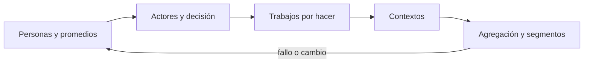
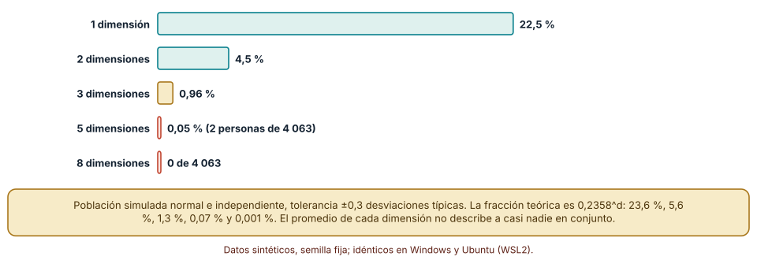
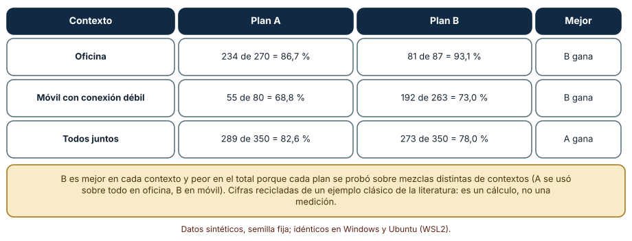
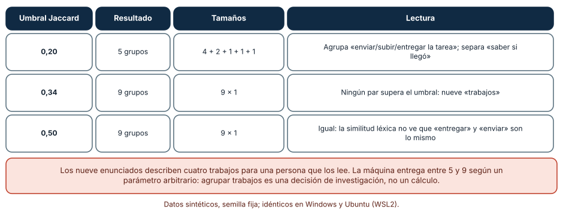

# SE-122 — Usuarios, actores, trabajos y contextos

[← SE-121 — Problemas, síntomas, necesidades y oportunidades](../../classes/part-10-descubrimiento-y-estrategia-de-producto/se-121-problemas-sintomas-necesidades-y-oportunidades/README.md) · [↑ Parte 10](../../classes/part-10-descubrimiento-y-estrategia-de-producto/README.md) · [📚 Índice completo](../../classes/README.md) · [🌐 Portal](../../site/classes/SE-122.html) · [SE-123 — Investigación, entrevistas y evidencia cualitativa →](../../classes/part-10-descubrimiento-y-estrategia-de-producto/se-123-investigacion-entrevistas-y-evidencia-cualitativa/README.md)

## Punto profesional y fundamento pedagógico

**Punto profesional.** La clase existe para describir a las personas de un producto por lo que intentan hacer y en qué condiciones, y no por un promedio o una etiqueta, de modo que las decisiones no se calibren para alguien que no existe.

**Por qué aparece aquí.** Se sitúa después de **Problemas, síntomas, necesidades y oportunidades** y antes de **Investigación, entrevistas y evidencia cualitativa**: `SE-121` dejó un enunciado de problema con un actor mencionado de pasada («los estudiantes»); esta clase abre ese actor: quién decide, quién usa, quién paga, quién queda afectado y en qué contexto intenta cumplir su trabajo. Su mapa de actores y trabajos es la entrada de `SE-123`, que decidirá a quién entrevistar.

**Error conceptual que debe corregir.** Creer que un promedio de edad, uso o ingreso describe a un usuario típico, y que quien usa el producto es también quien lo elige, lo paga y lo sufre.

**Secuencia de aprendizaje.** Antes de leer la solución, predices qué fracción de una población se parece al promedio en una, tres y ocho dimensiones; después ejecutas la simulación, explicas por qué cae tan rápido, construyes una tabla donde una opción gane en cada contexto y pierda en el total, y reconstruyes sin apoyo la diferencia entre actor, trabajo y contexto. La secuencia usa predicción, explicación propia, contraste y recuperación. [ICAP](https://icap.education.asu.edu/research) distingue participación de construcción de conocimiento; [How People Learn II](https://nap.nationalacademies.org/catalog/24783/how-people-learn-ii-learners-contexts-and-cultures) exige conectar conocimiento previo, contexto y transferencia; la [práctica de recuperación](https://pubmed.ncbi.nlm.nih.gov/16507066/) respalda producir de nuevo la explicación tras una demora; y [Education for Life and Work](https://nap.nationalacademies.org/resource/13398/dbasse_084153.pdf) exige devolución que explique la causa del error.

**Evidencia de aprendizaje.** `actors-map.md` con actores y su relación de decisión, trabajos redactados como «cuando… quiero… para…», contextos que cambian el éxito y una tabla agregada y desagregada de una métrica. Debe contener predicción previa, observación, explicación causal, contraejemplo, criterio de aceptación y una nota de qué dato haría cambiar la conclusión.

**Límite de la conclusión.** La simulación supone dimensiones independientes y normales y la paradoja de Simpson se calcula con cifras recicladas de un ejemplo clásico: son cálculos que muestran un mecanismo, no mediciones de personas reales.

### Trazabilidad fuente → afirmación

| Fuente primaria u oficial | Afirmación que respalda | Lo que no prueba |
|---|---|---|
| [Stanford Encyclopedia of Philosophy: Simpson's Paradox](https://plato.stanford.edu/entries/paradox-simpson/) | Una asociación presente en cada subgrupo puede desaparecer o invertirse al combinar los grupos; la conclusión depende de cómo se reparta la población entre ellos. | No dice cuál agregación es correcta en tu caso: eso depende del mecanismo causal. |
| [Know Your Customers' «Jobs to Be Done» (HBR, 2016)](https://hbr.org/2016/09/know-your-customers-jobs-to-be-done) | Propone describir al cliente por el trabajo que intenta hacer y no por atributos demográficos o del producto. | No prueba que el trabajo que propones sea el que tus usuarios realizan. |
| [Strategyzer: Value Proposition Canvas](https://www.strategyzer.com/library/the-value-proposition-canvas) | El perfil de cliente organiza trabajos, frustraciones y ganancias de un segmento antes de diseñar la propuesta. | No es un método de validación: sus casillas pueden llenarse con suposiciones. |

## Antes de empezar

Esta clase continúa **el caso de la plataforma de entregas de tareas**. Recupera el enunciado de `SE-121` («los estudiantes pierden su avance cuando la sesión expira»), añade una decisión propia sobre **quién es ese «estudiante» y en qué contexto lo vive**, y deja un mapa que `SE-123` usará para elegir entrevistas. La pregunta activa es: **¿para quién exactamente se está decidiendo, y cambia la decisión según su contexto?**

## Prerrequisitos

- Haber completado `SE-121` o reconstruir su enunciado de problema y su necesidad.
- Python 3.11 o posterior; solo se usa la biblioteca estándar.
- Trabajar con poblaciones y tablas sintéticas: ninguna cifra procede de personas reales.

## Problema auténtico

El equipo de la plataforma de entregas diseña para la «estudiante promedio»: 19 años, portátil, conexión estable. Pero la decisión de adoptar la plataforma la toma la dirección académica, el docente la usa para corregir, una familia ayuda desde un teléfono con datos limitados y una persona de soporte la administra. Un cambio que mejora la tasa de tareas completadas en el total puede empeorarla para quienes entregan desde móviles con conexión débil.

## Objetivos observables

Al terminar podrás:

1. distinguir usuario, comprador, pagador, administrador y persona afectada, y dibujar quién decide qué;
2. redactar un trabajo por hacer con la forma «cuando… quiero… para…» sin nombrar una solución;
3. predecir y comprobar cuánta población queda cerca de un «promedio» al sumar dimensiones;
4. detectar cuándo una conclusión agregada se invierte al separar por contexto;
5. explicar por qué agrupar enunciados de trabajo exige un criterio humano y no solo un algoritmo.

## Mapa conceptual



El mapa se lee como una cadena de razonamiento, no como fases obligatorias. La flecha de retorno indica que un contexto nuevo o una agregación que se invierte obliga a revisar los actores y los trabajos; no autoriza a corregir solo la métrica.

## Temas y por qué importan

| Tema | Por qué cambia una decisión profesional | Evidencia mínima |
|---|---|---|
| Personas y promedios | Un promedio de varias dimensiones casi no describe a nadie; diseñar para él deja sin servicio a casi todos. | Predicción, traza causal y contraejemplo de **Personas y promedios** en `actors-map.md` |
| Actores y cadena de decisión | Quien usa, quien elige y quien paga suelen ser personas distintas, con incentivos distintos. | Predicción, traza causal y contraejemplo de **Actores y cadena de decisión** en `actors-map.md` |
| Trabajos por hacer | El trabajo describe la situación y el progreso buscado, y admite soluciones muy distintas; el rol o la edad, no. | Predicción, traza causal y contraejemplo de **Trabajos por hacer** en `actors-map.md` |
| Contextos | El mismo trabajo se cumple o fracasa según dispositivo, conexión, tiempo, ayuda disponible y consecuencias de equivocarse. | Predicción, traza causal y contraejemplo de **Contextos** en `actors-map.md` |
| Agregación y segmentos | Una métrica agregada puede dar la conclusión contraria a la de cada contexto por separado. | Predicción, traza causal y contraejemplo de **Agregación y segmentos** en `actors-map.md` |

## Conceptos y decisiones

### 1. Personas y promedios

Describir a la audiencia con promedios (edad media, uso medio) es cómodo y falla por un motivo aritmético: la probabilidad de estar cerca del centro en todas las dimensiones a la vez es el producto de las probabilidades de cada una. Con una dimensión cerca del 24 % de la población queda en la banda central; con tres, poco más del 1 %. Por eso una «persona» de producto no puede ser el promedio de nadie: debe ser un caso concreto con un contexto reconocible, construido a partir de observaciones, y debe declararse como ilustración, no como estadística.

### 2. Actores y cadena de decisión

En la plataforma de entregas, la dirección académica elige, la docente usa para corregir, el estudiante usa para entregar, la familia apoya, soporte administra y la institución responde ante las consecuencias de una nota perdida. Un producto puede encantar a quien lo usa y morir porque quien lo elige o lo autoriza no lo ve. El mapa de actores se dibuja con una pregunta por cada uno: ¿qué decide, qué teme, qué evidencia aceptaría? No es un organigrama; es una guía para saber a quién investigar y quién puede detener una decisión.

### 3. Trabajos por hacer

La idea de «trabajo por hacer» propone que las personas «contratan» un producto para progresar en una situación, no para tener sus características. «Cuando se acerca el plazo y no estoy segura de que mi borrador se guardó, quiero confirmar que mi trabajo está a salvo, para dejar de pensar en ello» describe una circunstancia, un deseo y un resultado, sin nombrar una solución. Compárese con «los estudiantes de primer año»: ese segmento demográfico no dice qué hacen. Un buen trabajo es lo bastante específico para observarse y lo bastante abstracto para tener varias soluciones.

### 4. Contextos

El contexto incluye lo que no está en la pantalla: una conexión que se corta, un teléfono compartido, la ayuda de un familiar, una fecha límite que cae un domingo, un lector de pantalla. Dos personas con el mismo trabajo y contextos distintos pueden necesitar productos distintos. Por eso la descripción de un trabajo se acompaña de una lista corta de contextos que cambian el resultado, y cada afirmación sobre una mejora se acompaña de la pregunta «¿en qué contexto?». Un contexto raro puede ser el único donde el producto falla, y un promedio global lo oculta.

### 5. Agregación y segmentos

Agregar es resumir, y resumir descarta estructura. Cuando dos opciones se prueban sobre mezclas de contextos distintas, la mejor en cada contexto puede resultar peor en el total (paradoja de Simpson). No es un error de cálculo: es una consecuencia de que la composición de la muestra difiere. La defensa es declarar de antemano por qué dimensiones se desagrega, mirar la métrica por contexto relevante y preguntar cómo se asignó cada opción a cada grupo. Un segmento útil es el que cambia una decisión, no el que reduce el promedio de varianza.

### Cuánta gente se parece al «usuario promedio»

Simulamos 4 063 personas con dimensiones normales e independientes (edad, horas de uso, ancho de banda, número de entregas, etc.) y contamos cuántas quedan dentro de ±0,3 desviaciones típicas de la mediana en **todas** las dimensiones a la vez. Predicción antes de ejecutar: con una dimensión, alrededor de una cuarta parte; con cinco, casi nadie.

```python
rng = random.Random(122)
datos = [[rng.gauss(0, 1) for _ in range(d)] for _ in range(4063)]
med = [statistics.median(col) for col in zip(*datos)]
sd = [statistics.pstdev(col) for col in zip(*datos)]
cerca = sum(all(abs(r[j] - med[j]) <= 0.30 * sd[j] for j in range(d)) for r in datos)
```

Con una dimensión 22,5 % de las personas quedó dentro de la banda; con dos, 4,5 %; con tres, 0,96 %; con cinco, 0,05 % (2 personas) y con ocho y diez, ninguna. La fracción teórica es 0,2358 elevado al número de dimensiones: 23,6 %, 5,6 %, 1,3 %, 0,07 % y 0,001 %. La semilla 122 dio valores algo bajos; repetida con otras 20 semillas (solo en Windows) la media fue 23,7 %, 5,6 % y 1,35 % para una, dos y tres dimensiones, es decir, el cálculo teórico se sostiene. La lección: «el usuario promedio» de ocho dimensiones no existe en una población de cuatro mil personas.



**Cómo leer la figura.** Cada barra suma una dimensión; la longitud cae casi geométricamente y la última es cero. **Dónde deja de valer:** el modelo supone dimensiones independientes. En datos reales las dimensiones se correlacionan (más tiempo disponible, más uso), lo que aumenta la fracción cercana al promedio sin cambiar la conclusión cualitativa. Además la banda de ±0,3 es una elección: con ±1 desviación el porcentaje sería mayor, aunque sigue cayendo con cada dimensión.

### Una opción puede ganar en cada contexto y perder en el total

La plataforma compara dos flujos de entrega, A y B, y mide la tasa de tareas completadas. Las cifras son un cálculo reciclado de un ejemplo clásico de la literatura estadística (no una medición): en oficina, A completa 234 de 270 (86,7 %) y B 81 de 87 (93,1 %); en móvil con conexión débil, A completa 55 de 80 (68,8 %) y B 192 de 263 (73,0 %). B es mejor en cada contexto. Sin embargo, en el total A completa 289 de 350 (82,6 %) y B 273 de 350 (78,0 %): A «gana».

La explicación está en la composición: A se probó sobre todo en oficina (270 de 350 intentos), un contexto fácil, y B sobre todo en móvil (263 de 350), un contexto difícil. Comparar los totales equivale a comparar mezclas distintas. El equipo que mirase solo el total elegiría A y empeoraría la experiencia en ambos contextos. Un contrafactual útil es preguntarse cómo se asignó cada flujo a cada intento: si fue por elección de las personas, el contexto confunde la comparación.



**Cómo leer la figura.** Las dos primeras filas dicen que B gana; la última, que A gana. Ambas son aritméticamente correctas. **Dónde deja de valer:** la paradoja muestra que agregar puede invertir una conclusión, pero no dice cuál nivel es el correcto: depende de si el contexto es una causa común que debe controlarse o un mediador que no debe separarse. Eso exige un modelo del mecanismo, no solo datos.

### Agrupar enunciados de trabajo: el umbral decide cuántos trabajos hay

Nueve enunciados de trabajo de la plataforma (por ejemplo «enviar la tarea a tiempo», «subir mi entrega antes de la fecha», «saber si mi entrega llegó», «pedir una prórroga») se agruparon por similitud de Jaccard sobre palabras, uniendo cada enunciado al primer grupo cuyo miembro supera un umbral. Con umbral 0,20 salieron cinco grupos (tamaños 4, 2, 1, 1, 1); con 0,34 y con 0,50, nueve grupos de un elemento. Para una persona que los lee hay cuatro trabajos: entregar, confirmar, consultar notas y pedir plazo.

La causa es léxica: «enviar», «subir» y «entregar» son el mismo acto con tres palabras, y una medida que cuenta palabras compartidas no lo sabe. Con el umbral bajo sale una agrupación parcial; con el alto, ninguna. El número de trabajos que el equipo «descubre» depende de un parámetro arbitrario. Eso no hace inútil la automatización: sirve para proponer un primer borrador y encontrar casi duplicados, pero la decisión de qué enunciados describen el mismo trabajo se toma leyendo, preferiblemente entre dos personas.



**Cómo leer la figura.** Cada fila es un umbral y la columna «Tamaños» muestra cuántos enunciados cayeron en cada grupo; compara con los cuatro trabajos que una lectura humana distingue. **Dónde deja de valer:** son nueve enunciados escritos por el autor; con cientos de enunciados reales un algoritmo semántico (incrustaciones) agruparía mejor que las palabras compartidas, pero seguiría necesitando revisión y seguiría teniendo un umbral.

## Definiciones de trabajo

- **personas y promedios:** descripción de un grupo por una medida central; útil para resumir, engañosa para representar a un individuo.
- **actores y cadena de decisión:** cada persona o rol que interviene en la compra, el uso, la administración o los efectos del producto, con su capacidad de decidir o vetar.
- **trabajos por hacer:** progreso que una persona intenta lograr en una circunstancia concreta, formulado como «cuando… quiero… para…».
- **contextos:** conjunto de condiciones físicas, sociales y técnicas en que ocurre un trabajo y que alteran su probabilidad de éxito.
- **agregación y segmentos:** forma de combinar o separar grupos al calcular una medida; decide si una diferencia aparece, desaparece o se invierte.

Las definiciones son operativas para la plataforma de entregas. No convierten términos con historia más amplia en sinónimos y deben contrastarse con la documentación primaria enlazada al final.

## Ejemplo mínimo

Un fragmento mínimo que reproduce la inversión por agregación. Antes de ejecutarlo, predice si A o B gana en el total.

```python
A = {"oficina": (234, 270), "movil": (55, 80)}
B = {"oficina": (81, 87), "movil": (192, 263)}

def tasa(d):
    return sum(s for s, n in d.values()) / sum(n for s, n in d.values())

assert all(B[c][0] / B[c][1] > A[c][0] / A[c][1] for c in A)   # B gana en cada contexto
assert tasa(A) > tasa(B)                                       # pero A gana en el total
```

Registra versión, comando y salida. Si añades un tercer contexto, comprueba si la inversión persiste: depende de cuántos intentos aporta cada plan a cada contexto, no solo de las tasas.

## Ejemplo profesional

En la plataforma de entregas, el mapa de actores conserva por cada actor: rol, qué decide o veta, qué evidencia aceptaría, qué teme y qué contexto habita. Un trabajo conserva circunstancia, deseo, resultado y contexto que lo altera. El contrato es que ninguna afirmación de mejora se publica sin su desagregación por los contextos declarados.

Compara el caso normal con una cuenta administrada por una familia, con una persona que entrega por un dispositivo compartido, con soporte que actúa en nombre de otra y con la docente que corrige desde un teléfono. Un mapa es apropiado cuando esas diferencias quedan visibles; es peligroso cuando una sola «persona» promedio absorbe todas.

## Práctica guiada

1. Copia el enunciado de problema de `SE-121` y subraya la palabra que nombra al actor.
2. Lista los actores que intervienen: quién elige, quién usa, quién paga, quién administra y quién queda afectado.
3. Redacta tres trabajos con la forma «cuando… quiero… para…» sin nombrar solución.
4. Define tres contextos que cambian el resultado (dispositivo, conexión, ayuda disponible).
5. Calcula una métrica agregada y desagregada por contexto para dos opciones con la tabla del ejemplo.
6. Agrupa tus enunciados de trabajo con un umbral y con otro; anota cuántos grupos salen y por qué.
7. Pide a otra persona que identifique qué actor podría vetar la decisión usando solo `actors-map.md`.

## Ejercicios

1. **Promedio:** repite la simulación con tolerancia ±0,5 y ±1,0 desviaciones y calcula en cuántas dimensiones la fracción baja de 1 %; explica el resultado.
2. **Simpson:** construye otra tabla con dos contextos en la que la opción X gane en ambos y pierda en el total, cambiando solo el número de intentos por celda.
3. **Trabajos:** reescribe «los profesores jóvenes» y «los alumnos de primer año» como trabajos en circunstancia; decide qué contexto cambiaría la solución.
4. **Decisión:** si la dirección decide, el docente usa y el estudiante sufre, ¿a quién entrevistarías primero y qué evidencia pedirías a cada uno? Justifica.

## Reto verificable

Entrega `actors-map.md` con al menos cinco actores y su relación de decisión, tres trabajos, tres contextos y una tabla de una métrica agregada y desagregada. Se aprueba si otra persona puede decir, solo con el documento, quién puede vetar la decisión y en qué contexto la mejora podría no cumplirse. No se aprueba por el número de personas dibujadas ni por una «persona» promedio con foto.

## Caso conductor

La plataforma de entregas ya tiene un problema (`SE-121`): la sesión expira y se pierde el avance. Esta clase pregunta quién lo sufre más. Observa que el tamaño del problema puede estar concentrado en móvil con conexión débil, donde el borrador no se guarda cuando la conexión se corta. Cambia después un solo supuesto de contexto —por ejemplo, la proporción de entregas por móvil— y revisa qué conclusiones del mapa cambian.

## Preguntas frecuentes

### ¿Una «persona» (persona-ficha) no es entonces inútil?

No, pero su función es comunicar un contexto concreto, no representar estadísticamente. Una persona útil nace de observaciones y declara en qué se basa; una persona basada en promedios es un retrato del que nadie se reconoce. La simulación muestra que el promedio de ocho dimensiones no existe en cuatro mil personas.

### ¿Qué diferencia hay entre un segmento y un contexto?

El segmento clasifica a quién; el contexto describe en qué condiciones. Una misma persona cambia de contexto (oficina, tren) y por eso conviene describir el trabajo y la situación. Un segmento por edad no predice si la conexión se corta; un contexto sí lo hace.

### ¿Cuándo la paradoja de Simpson es un problema real y cuándo no?

Es un problema cuando los grupos tienen composiciones muy distintas entre opciones, como en la tabla (A en oficina, B en móvil). Si las opciones se asignan al azar a las personas, la composición es parecida y la agregación suele ser fiable; la desagregación sigue siendo útil para ver dónde falla.

### ¿Debo entrevistar a todos los actores?

No a todos, pero sí a los que pueden decidir, vetar o sufrir una consecuencia desproporcionada. El mapa sirve para justificar a quién no se entrevista y qué riesgo se asume por ello.

## Fallo controlado y diagnóstico

Reproduce el fallo de la clase: **diseñar para el promedio y juzgar por el total**. Elige entre A y B por la tasa agregada de la tabla (82,6 % frente a 78,0 %) y despliega A.

Registra síntoma, entrada mínima, hipótesis, observación que descarta cada hipótesis, causa, corrección y prueba de regresión. **Síntoma:** tras desplegar A, la tasa de tareas completadas en móvil con conexión débil baja de 73,0 % a 68,8 % y las quejas de las familias suben. **Hipótesis rivales:** (a) el despliegue tuvo un error técnico en móvil; (b) la conclusión original provenía de una agregación con composiciones distintas. **Prueba:** desagrega por contexto: B ganaba en ambos y el total lo contradecía por la mezcla. **Conclusión:** la causa fue la agregación, no el despliegue. **Regresión:** añade al informe de métricas una tabla por contexto y una comprobación automática que avise cuando la clasificación de opciones difiere entre el total y algún contexto. No cambies a la vez el criterio de agregación y la política de asignación.

## Errores comunes y cómo corregirlos

| Síntoma | Causa probable | Corrección |
|---|---|---|
| La opción «ganadora» empeora la experiencia de un grupo específico | Se decidió con la métrica agregada y composiciones distintas por opción | Desagregar por los contextos declarados y comparar con la misma mezcla (estandarizar) antes de decidir |
| La persona-ficha no se parece a nadie que se haya entrevistado | Se construyó con promedios o con intuición | Construir la persona desde observaciones concretas y declarar de dónde viene cada rasgo |
| Quien usa el producto no puede cambiar nada y quien decide nunca lo vio | El mapa solo incluyó a quien usa | Añadir elector, pagador, administrador y afectado, con qué evidencia aceptaría cada uno |
| Dos informes cuentan «cuatro» y «nueve» trabajos para los mismos enunciados | Se agrupó con umbrales distintos sin declararlo | Fijar y documentar el criterio de agrupación; revisar entre dos personas |
| El trabajo se redacta como «el usuario quiere un botón de…» | La solución se coló en la formulación | Reescribir con «cuando… quiero… para…» y comprobar que admite al menos dos soluciones |

## Entorno y archivos clave

```text
work/SE-122/
├── README.md
├── actors/
│   ├── promedio.py
│   └── simpson.py
├── fixtures/contextos.json
├── tests/test_agregacion.py
└── evidence/actors-map.md
```

El `README` declara plataforma, versión, semilla y comandos. Las simulaciones usan solo `random`, `statistics` y `re`, y se ejecutaron con CPython 3.12.9 en Windows 11 y 3.12.3 en Ubuntu bajo WSL2 con salidas idénticas (la verificación con 20 semillas se hizo solo en Windows).

## Seguridad, ética y accesibilidad

- no incluyas datos identificables de estudiantes, familias o docentes; usa roles y contextos genéricos;
- los contextos de menor conexión o acceso suelen coincidir con personas ya desfavorecidas: declara explícitamente a quién deja fuera cada decisión;
- una persona-ficha puede reforzar estereotipos: evita atribuir rasgos personales no observados;
- los mapas de actores pueden revelar relaciones de poder: trátalos como documentos internos;
- ofrece una alternativa textual a tablas y gráficos y no uses color como única señal;
- atribuye las cifras reutilizadas de ejemplos clásicos y declara que son cálculos.

## Puente hacia el trabajo con agentes

Un agente al que se le pide «crea personas de usuario para la plataforma» producirá fichas plausibles con nombre, edad y frase de cabecera que nadie ha observado. Pídele en cambio que parta de transcripciones o registros que le entregues, que cite el fragmento de origen de cada rasgo, que declare qué dimensión es suposición y que desagregue cada métrica por los contextos acordados. Revisa especialmente si calcula promedios sin desagregar: es el error de esta clase con apariencia de resumen.

## Transferencia

Traslada el mapa a otro de los dominios persistentes (un comercio responsable, por ejemplo): cambia los actores y contextos, conserva la forma «cuando… quiero… para…» y la tabla agregada y desagregada. La transferencia está lograda cuando puedes explicar qué contexto del nuevo dominio juega el papel de «móvil con conexión débil» y por qué.

## Evaluación y evidencia

| Criterio | Evidencia para aprobar |
|---|---|
| comprensión | explicación causal de por qué el promedio de varias dimensiones no describe a nadie |
| corrección | simulación y tabla reproducibles con la misma semilla y las mismas cifras |
| diseño | mapa de actores con relación de decisión y contextos |
| diagnóstico | reproducción del fallo «juzgar por el total» con regresión |
| responsabilidad | declaración de a quién deja fuera cada decisión |
| reproducibilidad | versiones, comandos, salida y límites declarados |


## Fuentes


- [Stanford Encyclopedia of Philosophy: Simpson's Paradox](https://plato.stanford.edu/entries/paradox-simpson/) — definición, ejemplos y discusión causal de la inversión por agregación; autoridad: Stanford University.
- [Know Your Customers' «Jobs to Be Done» (Harvard Business Review, 2016)](https://hbr.org/2016/09/know-your-customers-jobs-to-be-done) — describir al cliente por el trabajo que intenta hacer; autoridad: Harvard Business Review (artículo parcialmente de pago).
- [Strategyzer: Value Proposition Canvas](https://www.strategyzer.com/library/the-value-proposition-canvas) — perfil de cliente con trabajos, frustraciones y ganancias; autoridad: Strategyzer.
- [GOV.UK Service Standard](https://www.gov.uk/service-manual/service-standard) — su punto 1 es entender a las personas usuarias y sus necesidades y su punto 5 asegurar que todas puedan usar el servicio; autoridad: Government Digital Service.
- [GOV.UK Service Manual: User research](https://www.gov.uk/service-manual/user-research) — cómo investigar a las personas usuarias a lo largo del desarrollo; autoridad: Government Digital Service.
- [SWEBOK Guide v4.0a](https://www.computer.org/education/bodies-of-knowledge/software-engineering) — requisitos, partes interesadas y fundamentos de ingeniería; autoridad: IEEE Computer Society.

Cada fuente respalda el mecanismo indicado; ninguna demuestra que el mapa de actores de la plataforma sea completo. Esa afirmación depende de entrevistas, registros y revisión.

- [Python: `statistics`](https://docs.python.org/3/library/statistics.html) — mediana y desviación típica poblacional usadas en la simulación.
- [Python: `random`](https://docs.python.org/3/library/random.html) — generador con semilla para datos reproducibles.

## Límites y siguiente paso

Se ejecutaron tres cálculos y simulaciones con datos sintéticos en Windows y Ubuntu (WSL2), con salidas idénticas. No se entrevistó a nadie, las dimensiones se simularon independientes y las tasas de Simpson son un cálculo reciclado. La siguiente clase pregunta cómo obtener evidencia cualitativa de las personas del mapa sin convertir una anécdota en verdad general.

## Glosario

- **personas y promedios:** descripción de un grupo por una medida central; útil para resumir, engañosa para representar a un individuo.
- **actores y cadena de decisión:** cada persona o rol que interviene en la compra, el uso, la administración o los efectos del producto, con su capacidad de decidir o vetar.
- **trabajos por hacer:** progreso que una persona intenta lograr en una circunstancia concreta, formulado como «cuando… quiero… para…».
- **contextos:** conjunto de condiciones físicas, sociales y técnicas en que ocurre un trabajo y que alteran su probabilidad de éxito.
- **agregación y segmentos:** forma de combinar o separar grupos al calcular una medida; decide si una diferencia aparece, desaparece o se invierte.

---

[← SE-121 — Problemas, síntomas, necesidades y oportunidades](../../classes/part-10-descubrimiento-y-estrategia-de-producto/se-121-problemas-sintomas-necesidades-y-oportunidades/README.md) · [↑ Parte 10](../../classes/part-10-descubrimiento-y-estrategia-de-producto/README.md) · [📚 Índice completo](../../classes/README.md) · [🌐 Portal](../../site/classes/SE-122.html) · [SE-123 — Investigación, entrevistas y evidencia cualitativa →](../../classes/part-10-descubrimiento-y-estrategia-de-producto/se-123-investigacion-entrevistas-y-evidencia-cualitativa/README.md)
