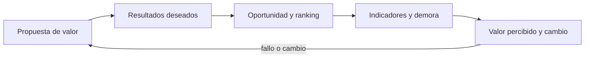
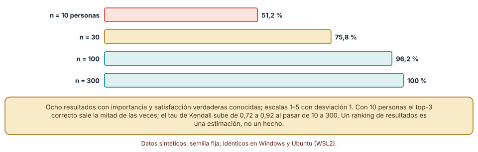
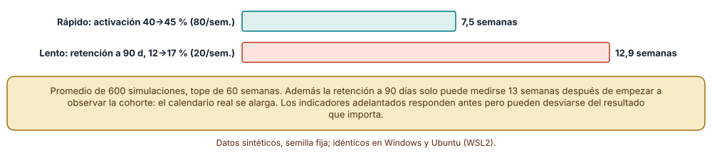
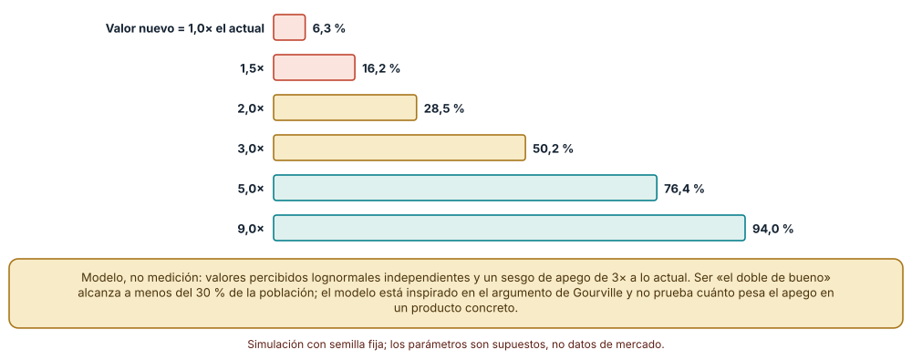

# SE-125 — Propuesta de valor y resultados deseados

[← SE-124 — Hipótesis, supuestos y preguntas críticas](../../classes/part-10-descubrimiento-y-estrategia-de-producto/se-124-hipotesis-supuestos-y-preguntas-criticas/README.md) · [↑ Parte 10](../../classes/part-10-descubrimiento-y-estrategia-de-producto/README.md) · [📚 Índice completo](../../classes/README.md) · [🌐 Portal](../../site/classes/SE-125.html) · [SE-126 — Segmentación, mercado y alternativas existentes →](../../classes/part-10-descubrimiento-y-estrategia-de-producto/se-126-segmentacion-mercado-y-alternativas-existentes/README.md)

## Punto profesional y fundamento pedagógico

**Punto profesional.** La clase existe para formular qué progreso promete un producto a quién, medirlo con resultados deseados y no con funciones, y estimar cuánto hay que mejorar lo existente para que alguien cambie.

**Por qué aparece aquí.** Se sitúa después de **Hipótesis, supuestos y preguntas críticas** y antes de **Segmentación, mercado y alternativas existentes**: `SE-124` dejó hipótesis falsables sobre un supuesto sensible; esta clase redacta la promesa que esas hipótesis ponen a prueba y las métricas con las que se sabrá si se cumple. Su propuesta de valor, con resultados medibles y un múltiplo de valor frente a la alternativa actual, es la entrada de `SE-126`, que compara esa promesa con lo que la gente ya usa.

**Error conceptual que debe corregir.** Confundir una lista de funciones con una propuesta de valor, medir actividad (clics, mensajes) en lugar de progreso, y suponer que ser un poco mejor que lo actual basta para que alguien cambie.

**Secuencia de aprendizaje.** Antes de leer la solución, predices con cuántas personas encuestadas un ranking de resultados deseados recupera los tres principales, cuántas semanas tarda en notarse una mejora según el indicador y qué porcentaje de la población adopta un producto que vale el doble que su alternativa; luego simulas, explicas cada resultado y reconstruyes sin apoyo cómo se redacta un resultado deseado medible. La secuencia usa predicción, explicación propia, contraste y recuperación. [ICAP](https://icap.education.asu.edu/research) distingue participación de construcción de conocimiento; [How People Learn II](https://nap.nationalacademies.org/catalog/24783/how-people-learn-ii-learners-contexts-and-cultures) exige conectar conocimiento previo, contexto y transferencia; la [práctica de recuperación](https://pubmed.ncbi.nlm.nih.gov/16507066/) respalda producir de nuevo la explicación tras una demora; y [Education for Life and Work](https://nap.nationalacademies.org/resource/13398/dbasse_084153.pdf) exige devolución que explique la causa del error.

**Evidencia de aprendizaje.** `value-proposition.md` con la promesa en una frase, los resultados deseados redactados con dirección, métrica y contexto, un ranking con su estabilidad, el indicador elegido con su demora y un múltiplo de valor frente a la alternativa actual. Debe contener predicción previa, observación, explicación causal, contraejemplo, criterio de aceptación y una nota de qué dato haría cambiar la conclusión.

**Límite de la conclusión.** El ranking usa personas simuladas con escalas 1–5 y desviación supuesta, el tiempo de detección es un cálculo y el modelo de adopción incorpora un sesgo de apego supuesto; ninguno mide el comportamiento de usuarios reales.

### Trazabilidad fuente → afirmación

| Fuente primaria u oficial | Afirmación que respalda | Lo que no prueba |
|---|---|---|
| [Strategyzer: Value Proposition Canvas](https://www.strategyzer.com/library/the-value-proposition-canvas) | Organiza la propuesta de valor frente a un perfil de cliente con trabajos, frustraciones y ganancias, para comprobar el ajuste entre ambos. | No demuestra que las casillas llenas correspondan a la realidad de tus clientes. |
| [Strategyn: Outcome-Driven Innovation](https://strategyn.com/outcome-driven-innovation-process/) | Describe una encuesta que califica cada resultado deseado por importancia y satisfacción, con muestras de 180 a 3 000 personas, para calcular oportunidades. | No garantiza que los resultados listados sean los correctos ni valida la fórmula frente a alternativas. |
| [Gourville: Eager Sellers and Stony Buyers (HBR, 2006)](https://hbr.org/2006/06/eager-sellers-and-stony-buyers-understanding-the-psychology-of-new-product-adoption) | Argumenta que quien vende sobrevalora lo nuevo y quien compra sobrevalora lo que ya tiene, por lo que la adopción exige una mejora considerablemente mayor que la percibida por el vendedor. | No fija un múltiplo universal ni sustituye medir el apego en tu producto. |

## Antes de empezar

Esta clase continúa **el caso de la plataforma de entregas**. Recupera la hipótesis de `SE-124` (el interés por recuperar borradores es el supuesto más sensible), añade una decisión propia sobre **qué progreso se promete y cómo se sabría que se cumplió** y deja una propuesta de valor medible para `SE-126`. La pregunta activa es: **¿qué debe lograr mejor la persona, cuánto mejor y cómo lo notaríamos?**

## Prerrequisitos

- Haber completado `SE-124` o reconstruir la hipótesis principal y su umbral.
- Python 3.11 o posterior; solo se usa la biblioteca estándar.
- Trabajar con encuestas y poblaciones sintéticas: ninguna cifra procede de personas reales.

## Problema auténtico

El equipo describe la función como «recuperación de borradores con historial y notificaciones inteligentes». Cuando se le pide la promesa en una frase, la lista de funciones tiene nueve ítems y ningún verbo de progreso. Para decidir qué construir primero lanza una encuesta con 12 personas, ordena los resultados por la puntuación media y descubre, al repetirla con otras 12, que el orden de los tres primeros cambia.

## Objetivos observables

Al terminar podrás:

1. redactar una propuesta de valor como progreso prometido a un trabajo, no como lista de funciones;
2. formular resultados deseados con dirección, métrica, objeto y contexto;
3. estimar cuántas personas hacen falta para que un ranking de resultados sea estable y cuantificar la estabilidad;
4. elegir un indicador adelantado y calcular cuánto tarda en detectar un cambio frente a uno rezagado;
5. explicar con un modelo por qué ser «el doble de bueno» no garantiza la adopción.

## Mapa conceptual



El mapa se lee como una cadena de razonamiento, no como fases obligatorias. La flecha de retorno indica que un ranking inestable, un indicador demasiado lento o una adopción menor a la esperada obliga a revisar la promesa; no autoriza a aumentar el esfuerzo de comunicación sin cambiar el valor.

## Temas y por qué importan

| Tema | Por qué cambia una decisión profesional | Evidencia mínima |
|---|---|---|
| Propuesta de valor | La propuesta dice qué progreso se promete a qué trabajo; una lista de funciones deja la decisión sin criterio. | Predicción, traza causal y contraejemplo de **Propuesta de valor** en `value-proposition.md` |
| Resultados deseados | Un resultado deseado medible permite saber si hubo progreso sin depender de la solución. | Predicción, traza causal y contraejemplo de **Resultados deseados** en `value-proposition.md` |
| Oportunidad y ranking | Calificar importancia y satisfacción señala dónde la gente está peor servida, pero el orden depende del tamaño de la muestra. | Predicción, traza causal y contraejemplo de **Oportunidad y ranking** en `value-proposition.md` |
| Indicadores y demora | Un indicador rápido permite aprender antes pero puede no representar el resultado; uno lento representa mejor y llega tarde. | Predicción, traza causal y contraejemplo de **Indicadores y demora** en `value-proposition.md` |
| Valor percibido y cambio | Una mejora pequeña no compensa el esfuerzo y el apego a lo conocido; la adopción exige un múltiplo de valor. | Predicción, traza causal y contraejemplo de **Valor percibido y cambio** en `value-proposition.md` |

## Conceptos y decisiones

### 1. Propuesta de valor

Una propuesta de valor responde, para un trabajo concreto, qué logra mejor la persona y por qué lo notaría. «Recuperación de borradores con historial» describe una función; «cuando se acerca el plazo, comprobar en menos de diez segundos que mi trabajo está a salvo» describe un progreso. El lienzo de propuesta de valor organiza esta relación: trabajos, frustraciones y ganancias del cliente en un lado; aliviadores y creadores de ganancia del producto en el otro. Es una hipótesis estructurada, no un resultado: se completa con suposiciones hasta que se contrasta.

### 2. Resultados deseados

Un resultado deseado tiene una dirección (minimizar, aumentar), una métrica (tiempo, probabilidad, número de), un objeto y un contexto: «minimizar la probabilidad de perder el trabajo cuando se corta la conexión a pocas horas del plazo». Es medible sin nombrar la solución, de modo que varias soluciones pueden compararse con él. La lista típica de un trabajo reúne decenas de resultados; quien diseña no puede construir para todos, por eso se califican por importancia y satisfacción. Un resultado mal redactado («tener una buena experiencia») no se puede medir ni comparar.

### 3. Oportunidad y ranking

Una forma habitual es sumar la importancia a la brecha positiva entre importancia y satisfacción: importancia + máx(importancia − satisfacción, 0). Un resultado importante y mal servido sube; uno importante y bien servido no. La encuesta tiene ruido: cada persona responde en una escala de 1 a 5 y la media de pocas respuestas varía mucho. Por eso el ranking se acompaña de su estabilidad —cuántas veces los mismos tres resultados aparecen al repetir la encuesta— y no se presenta como un orden exacto.

### 4. Indicadores y demora

La activación de una función se observa en días; la retención a noventa días, en meses. El indicador adelantado responde pronto y por eso permite iterar, pero se puede mover sin que el resultado cambie (más clics, no más progreso); el rezagado refleja lo que importa y llega cuando ya se gastó el presupuesto. La elección se justifica con el tiempo que tarda en detectar un cambio realista y con la evidencia de que el adelantado predice al rezagado. Medir actividad (mensajes enviados) como si fuera resultado es la forma más común de engañarse.

### 5. Valor percibido y cambio

Quien diseña sobrevalora lo nuevo; quien usa algo ya tiene una rutina, datos, hábitos y atención ocupada en ello. Un modelo simple: la persona cambia si el valor percibido del producto nuevo supera al del actual multiplicado por un factor de apego. Con un apego de 3×, un producto que vale el doble que el actual lo adopta menos de un tercio de la población; hace falta mucho más para llegar a la mayoría. El argumento no fija un número; indica que «un poco mejor» no suele bastar y que reducir el coste de cambio es una forma de aumentar el valor.

### Con cuántas personas un ranking de resultados es estable

Ocho resultados deseados de la plataforma tienen importancia y satisfacción «verdaderas» conocidas (en escalas de 1 a 5). La oportunidad se calcula como importancia + máx(importancia − satisfacción, 0): los tres primeros son «saber que mi entrega llegó» (5,8), «recuperar un borrador» (5,7) y «entregar a tiempo» (4,7). Simulamos encuestas de n personas: cada una responde con la media verdadera más ruido normal de desviación 1, redondeada y acotada a 1–5. Para cada n repetimos 400 encuestas y medimos con qué frecuencia el conjunto de los tres primeros coincide con el verdadero. Predicción antes de ejecutar: con 10 personas, acierta la mitad de las veces.

```python
def likert(rng, media, sd=1.0):
    return min(5, max(1, round(rng.gauss(media, sd))))

oportunidad = imp_media + max(imp_media - sat_media, 0)
```

Resultados: n = 10 → 51,2 % de aciertos del top 3 y tau de Kendall medio 0,72; n = 30 → 75,8 % y 0,82; n = 100 → 96,2 % y 0,89; n = 300 → 100 % y 0,92. Con doce personas (la encuesta del equipo) el ranking de los tres primeros sería correcto algo más de la mitad de las veces: que el orden cambie al repetirla no es un descuido, es lo esperado. Idéntico en Windows y Ubuntu.



**Cómo leer la figura.** Cada barra es un tamaño de encuesta; su longitud es la frecuencia con que el top 3 es correcto. **Dónde deja de valer:** las respuestas simuladas son independientes y con ruido simétrico; las personas reales responden con sesgos (aquiescencia, extremos) que no se modelan, y los resultados verdaderos son un supuesto. Muestra la lógica de la estabilidad, no el tamaño de muestra que necesitará tu encuesta.

### Cuánto tarda en notarse la misma mejora según el indicador

Supongamos una mejora real de cinco puntos porcentuales y dos indicadores. El adelantado es la activación (40 % → 45 %) con 80 personas nuevas por semana en cada rama; el rezagado es la retención a noventa días (12 % → 17 %) con una cohorte de 20 personas por semana. Cada semana se acumulan las muestras y se aplica una prueba de dos proporciones unilateral al 5 %; se cuenta cuántas semanas pasan hasta que la mejora se detecta (tope de 60). Promedio de 600 simulaciones. Predicción antes de ejecutar: el indicador lento tarda más, no solo por el calendario sino por la muestra.

```python
while True:
    semana += 1
    a += sum(rng.random() < base for _ in range(n_sem)); na += n_sem
    b += sum(rng.random() < base + delta for _ in range(n_sem)); nb += n_sem
    z = (b / nb - a / na) / se(a, b, na, nb)
    if z > 1.645 or semana >= 60:
        break
```

Resultado: 7,5 semanas en promedio con el indicador rápido y 12,9 con el lento. Aún hay que sumar la demora del calendario: la retención a noventa días de una persona que entra hoy solo se conoce dentro de unas trece semanas, así que el aprendizaje real del indicador lento tarda más de 25 semanas. Idéntico en Windows y Ubuntu.



**Cómo leer la figura.** La barra verde es el indicador rápido y la coral el lento; la diferencia viene de la tasa de base y del tamaño semanal, sin contar la demora de calendario. **Dónde deja de valer:** el cálculo supone muestras independientes, mejora constante y una prueba sin miradas intermedias (`SE-127` muestra el problema de mirar varias veces). Un indicador rápido solo es útil si hay evidencia de que predice al lento.

### Ser el doble de bueno no basta

Modelamos la decisión de cambiar de una persona: compara el valor percibido del producto nuevo (múltiplo × un valor aleatorio lognormal) con el de lo que ya usa multiplicado por un factor de apego de 3 (otro valor aleatorio lognormal independiente). Con 20 000 personas por fila, el porcentaje que adopta según el múltiplo de valor del producto nuevo es: 6,3 % con 1×, 16,2 % con 1,5×, 28,5 % con 2×, 50,2 % con 3×, 76,4 % con 5× y 94,0 % con 9×. Predicción antes de ejecutar: con 3× de apego, el producto necesita 3× para empatar.

```python
adopta = mult * rng.lognormvariate(0, 0.5) > 3 * rng.lognormvariate(0, 0.5)
```

El resultado confirma la intuición: con un valor igual al actual adopta menos de una persona de cada diez; con el doble, menos de tres de diez. El modelo está inspirado en el argumento de Gourville (quien vende sobrevalora lo nuevo y quien compra sobrevalora lo que ya tiene), pero el factor 3 es un supuesto de este modelo, no una medida. Su lectura práctica: para mover a la mitad de la población hace falta que el producto se perciba unas tres veces mejor, o que el costo de cambiar baje hasta que el apego deje de pesar tanto.



**Cómo leer la figura.** Cada barra es un múltiplo de valor del producto nuevo respecto del actual; la longitud es el porcentaje de adopción simulado. **Dónde deja de valer:** es un modelo, no una medición: el factor de apego, la distribución lognormal y la independencia entre valores son supuestos. En un producto con efectos de red o con una alternativa gratuita, o cuando cambiar no cuesta nada, la curva sería otra.

## Definiciones de trabajo

- **propuesta de valor:** promesa específica de un progreso que una persona logra en su trabajo con este producto y no con la alternativa actual.
- **resultados deseados:** enunciado de lo que la persona quiere lograr, con dirección de mejora, métrica, objeto y contexto, independiente de cómo se logre.
- **oportunidad y ranking:** puntuación que combina cuán importante es un resultado con cuán insatisfecha está la persona con las soluciones actuales.
- **indicadores y demora:** medida elegida para detectar un cambio; adelantada si responde pronto a lo que se hace, rezagada si refleja el resultado final con demora.
- **valor percibido y cambio:** comparación subjetiva entre el valor que la persona espera del producto nuevo y el que da lo que ya usa, con el costo de cambiar y el apego incluidos.

Las definiciones son operativas para la plataforma de entregas. No convierten términos con historia más amplia en sinónimos y deben contrastarse con la documentación primaria enlazada al final.

## Ejemplo mínimo

Un fragmento mínimo que calcula la oportunidad de un resultado. Antes de ejecutarlo, predice cuál de los dos sube más.

```python
def oportunidad(importancia, satisfaccion):
    return importancia + max(importancia - satisfaccion, 0)

assert round(oportunidad(4.1, 2.4), 1) == 5.8      # importante y mal servido
assert round(oportunidad(4.3, 3.9), 1) == 4.7      # importante y bien servido
assert oportunidad(3.1, 3.5) == 3.1                # la brecha negativa no suma
```

Registra versión, comando y salida. El resultado depende de que importancia y satisfacción se midan con la misma escala y con una muestra suficiente: con 12 personas el orden puede cambiar al repetir la encuesta.

## Ejemplo profesional

En la plataforma de entregas, la propuesta conserva la promesa en una frase, el trabajo al que responde, la alternativa actual, los resultados deseados con su métrica, la fecha de la encuesta, el tamaño de la muestra y la estabilidad del ranking. El contrato es que ninguna función entra al plan si no mueve al menos un resultado listado y que cada resultado declara el indicador con el que se sabrá si mejoró y el tiempo que tarda en notarse.

Compara el caso normal con un resultado que importa a pocas personas pero con consecuencias graves, con una encuesta cuyo ranking cambia al repetirse, con un indicador rápido que no predice el lento y con una alternativa actual que cuesta cero. Una propuesta es apropiada cuando esas diferencias se ven en el documento; es peligrosa cuando una puntuación media decide sola.

## Práctica guiada

1. Escribe la promesa en una frase con la forma «cuando… puedo… sin…» y comprueba que no nombra la solución.
2. Redacta cinco resultados deseados con dirección, métrica, objeto y contexto.
3. Define importancia y satisfacción con la misma escala y calcula la oportunidad de cada uno.
4. Simula la encuesta con 10, 30, 100 y 300 personas y mide con qué frecuencia el top 3 coincide con el verdadero.
5. Elige un indicador adelantado y otro rezagado y calcula semanas hasta detectar una mejora de cinco puntos.
6. Estima el múltiplo de valor frente a la alternativa actual y el porcentaje de adopción con tu supuesto de apego.
7. Pide a otra persona que reconstruya la promesa y los resultados solo con `value-proposition.md`.

## Ejercicios

1. **Ranking:** repite el experimento con desviación 0,5 y con desviación 1,5 y explica cómo cambian el acierto y el tau para n = 30.
2. **Indicador:** calcula las semanas para detectar una mejora de 3 puntos (en vez de 5) con ambos indicadores; decide si el rápido sigue justificando la iteración.
3. **Adopción:** cambia el factor de apego de 3 a 1,5 y 5; dibuja la curva de adopción y explica qué intervención baja el apego sin cambiar el producto.
4. **Redacción:** reescribe «mejor experiencia de entrega», «más rápido» y «integración con calendarios» como resultados deseados medibles.

## Reto verificable

Entrega `value-proposition.md` con la promesa en una frase, cinco resultados deseados medibles, el ranking con su estabilidad simulada, el indicador elegido con su tiempo de detección y el múltiplo de valor con tu supuesto de apego. Se aprueba si otra persona ejecuta la simulación, obtiene el mismo ranking y puede decir qué resultado resultaría más afectado por una encuesta de 12 personas. No se aprueba por la cantidad de resultados ni por una puntuación sin su estabilidad.

## Caso conductor

La plataforma de entregas promete: «cuando se acerca el plazo, comprobar en segundos que mi trabajo está a salvo». Los dos resultados más desatendidos son saber que la entrega llegó y recuperar un borrador. Cambia después un solo supuesto —por ejemplo, el apego a la plataforma actual— y revisa qué conclusiones de la propuesta cambian.

## Preguntas frecuentes

### ¿Una propuesta de valor es un eslogan?

No. El eslogan es comunicación; la propuesta es una hipótesis sobre un progreso, con resultado medible y alternativa actual. Puede comunicarse con un eslogan, pero se discute con datos.

### ¿Por qué el ranking cambia cuando repito la encuesta?

Porque cada media tiene ruido. Con 10 personas el top 3 correcto sale la mitad de las veces; con 100, 96 de cada 100. Presenta el ranking con su estabilidad o aumenta la muestra.

### ¿Es mejor medir activación o retención?

Depende de qué decisión alimentan. La activación se mueve en 7–8 semanas, la retención a noventa días en 13 más; si no hay evidencia de que la activación predice la retención, úsala para iterar pero no para declarar éxito.

### ¿El factor 3 de apego se aplica a mi producto?

No: es un supuesto del modelo, inspirado en un argumento de la literatura. El valor real varía y se estima preguntando a quienes usan la alternativa qué les haría cambiar y cuánto les costaría.

## Fallo controlado y diagnóstico

Reproduce el fallo de la clase: **decidir con el orden de una encuesta pequeña**. Pregunta a 12 personas, ordena por la puntuación media y construye lo que salió primero.

Registra síntoma, entrada mínima, hipótesis, observación que descarta cada hipótesis, causa, corrección y prueba de regresión. **Síntoma:** al repetir la encuesta con otras 12 personas, los tres primeros resultados cambian. **Hipótesis rivales:** (a) las poblaciones eran distintas; (b) el ruido del muestreo es suficiente para reordenar. **Prueba:** simula 400 encuestas de 10 personas con una verdad conocida y observa que el top 3 correcto sale 51,2 % de las veces; con 100 personas, 96,2 %. **Conclusión:** el cambio de orden es compatible con el ruido de una muestra pequeña. **Regresión:** añade al informe la estabilidad simulada (no solo el ranking) y una prueba que falle si se publica un orden sin ella. No cambies a la vez el tamaño de la muestra y la fórmula de oportunidad.

## Errores comunes y cómo corregirlos

| Síntoma | Causa probable | Corrección |
|---|---|---|
| El plan lista nueve funciones y ninguna promesa | Se describió la solución, no el progreso | Redactar la promesa como «cuando… puedo… sin…» y vincular cada función a un resultado |
| El orden de prioridades cambia en cada encuesta | La muestra es pequeña y el ruido reordena los primeros puestos | Reportar la estabilidad simulada o aumentar la muestra antes de decidir |
| El indicador mejora y los resultados no | Se eligió un indicador de actividad que no predice el progreso | Justificar el indicador con evidencia de que predice el resultado o usar uno rezagado |
| La función es «el doble de buena» y casi nadie la adopta | Se ignoró el coste de cambiar y el apego a lo conocido | Estimar el múltiplo de valor necesario y reducir el coste de cambio |
| Los resultados deseados nombran la solución | Se redactaron desde el producto y no desde el trabajo | Reescribir con dirección, métrica, objeto y contexto sin mencionar la solución |

## Entorno y archivos clave

```text
work/SE-125/
├── README.md
├── value/
│   ├── ranking.py
│   ├── deteccion.py
│   └── adopcion.py
├── fixtures/resultados.json
├── tests/test_oportunidad.py
└── evidence/value-proposition.md
```

El `README` declara plataforma, versiones, semilla y comandos. Los scripts usan solo la biblioteca estándar y se ejecutaron con CPython 3.12.9 en Windows 11 y 3.12.3 en Ubuntu bajo WSL2 con salidas idénticas. Los parámetros (importancia y satisfacción verdaderas, desviación 1, apego 3) son supuestos del autor.

## Seguridad, ética y accesibilidad

- no incluyas datos de encuestas de personas reales; usa datos sintéticos o agregados anonimizados;
- un ranking por importancia media puede relegar a una minoría con una necesidad grave: revisa por separado los resultados que afectan a seguridad o acceso;
- la promesa de valor no debe prometer lo que el equipo no puede garantizar ni ocultar costos para quien cambia;
- evita diseñar métricas que premien la dependencia o el uso compulsivo como si fueran progreso;
- ofrece una alternativa textual a los gráficos y no uses color como única señal;
- atribuye los marcos reutilizados y respeta sus licencias.

## Puente hacia el trabajo con agentes

Un agente al que se le pide «prioriza las funciones por valor para el usuario» devolverá una lista ordenada con puntuaciones plausibles inventadas. Pídele que parta de los resultados deseados que le entregues, que pida la muestra y la escala de cada puntuación, que reporte la estabilidad del ranking con una simulación y que no mezcle indicadores de actividad con indicadores de progreso. Revisa especialmente si ordena con una precisión que la muestra no sostiene: es el error de esta clase con apariencia de análisis.

## Transferencia

Traslada el ejercicio a otro dominio persistente (por ejemplo, una suite familiar privada): cambia el trabajo y los resultados, conserva la fórmula de oportunidad, la estabilidad simulada y el cálculo de semanas de detección. La transferencia está lograda cuando puedes explicar qué indicador rápido sustituye a la activación y qué evidencia hace falta para confiar en él.

## Evaluación y evidencia

| Criterio | Evidencia para aprobar |
|---|---|
| comprensión | explicación causal de por qué el orden de una encuesta pequeña no es estable |
| corrección | ranking, semanas de detección y adopción reproducibles con la misma semilla |
| diseño | promesa en una frase y resultados deseados medibles |
| diagnóstico | reproducción del fallo «decidir con una encuesta pequeña» con regresión |
| responsabilidad | revisión de minorías y de métricas que premian dependencia |
| reproducibilidad | versiones, comandos, salida y límites declarados |


## Fuentes


- [Strategyzer: Value Proposition Canvas](https://www.strategyzer.com/library/the-value-proposition-canvas) — relación entre perfil de cliente y propuesta de valor; autoridad: Strategyzer.
- [Strategyn: Outcome-Driven Innovation](https://strategyn.com/outcome-driven-innovation-process/) — resultados deseados calificados por importancia y satisfacción; autoridad: Strategyn (fuente del autor del método).
- [Gourville: Eager Sellers and Stony Buyers (Harvard Business Review, 2006)](https://hbr.org/2006/06/eager-sellers-and-stony-buyers-understanding-the-psychology-of-new-product-adoption) — psicología de la adopción de productos nuevos; autoridad: Harvard Business Review (artículo de pago).
- [Know Your Customers' «Jobs to Be Done» (Harvard Business Review, 2016)](https://hbr.org/2016/09/know-your-customers-jobs-to-be-done) — describir el progreso que la persona busca; autoridad: Harvard Business Review (artículo parcialmente de pago).
- [The Lean Startup: principios](https://theleanstartup.com/principles) — aprendizaje validado y métricas accionables; autoridad: Eric Ries (fuente del autor).
- [SWEBOK Guide v4.0a](https://www.computer.org/education/bodies-of-knowledge/software-engineering) — requisitos, valor y fundamentos de ingeniería; autoridad: IEEE Computer Society.

Cada fuente respalda el mecanismo indicado; ninguna demuestra que la propuesta de la plataforma sea la correcta ni que el ranking reproduzca la realidad. Esa afirmación depende de la encuesta, de la muestra y de la revisión.

- [Python: `random.lognormvariate`](https://docs.python.org/3/library/random.html#random.lognormvariate) — distribución usada para el valor percibido en el modelo de adopción.
- [Python: `statistics`](https://docs.python.org/3/library/statistics.html) — media y funciones auxiliares usadas en los experimentos.

## Límites y siguiente paso

Se ejecutaron tres simulaciones con datos sintéticos en Windows y Ubuntu (WSL2) con salidas idénticas. No se encuestó a nadie, los parámetros son supuestos y el modelo de adopción no se contrastó con comportamiento real. La siguiente clase compara esta propuesta con las alternativas que las personas ya usan, incluida no hacer nada.

## Glosario

- **propuesta de valor:** promesa específica de un progreso que una persona logra en su trabajo con este producto y no con la alternativa actual.
- **resultados deseados:** enunciado de lo que la persona quiere lograr, con dirección de mejora, métrica, objeto y contexto, independiente de cómo se logre.
- **oportunidad y ranking:** puntuación que combina cuán importante es un resultado con cuán insatisfecha está la persona con las soluciones actuales.
- **indicadores y demora:** medida elegida para detectar un cambio; adelantada si responde pronto a lo que se hace, rezagada si refleja el resultado final con demora.
- **valor percibido y cambio:** comparación subjetiva entre el valor que la persona espera del producto nuevo y el que da lo que ya usa, con el costo de cambiar y el apego incluidos.

---

[← SE-124 — Hipótesis, supuestos y preguntas críticas](../../classes/part-10-descubrimiento-y-estrategia-de-producto/se-124-hipotesis-supuestos-y-preguntas-criticas/README.md) · [↑ Parte 10](../../classes/part-10-descubrimiento-y-estrategia-de-producto/README.md) · [📚 Índice completo](../../classes/README.md) · [🌐 Portal](../../site/classes/SE-125.html) · [SE-126 — Segmentación, mercado y alternativas existentes →](../../classes/part-10-descubrimiento-y-estrategia-de-producto/se-126-segmentacion-mercado-y-alternativas-existentes/README.md)
