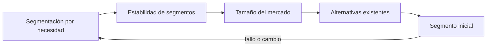
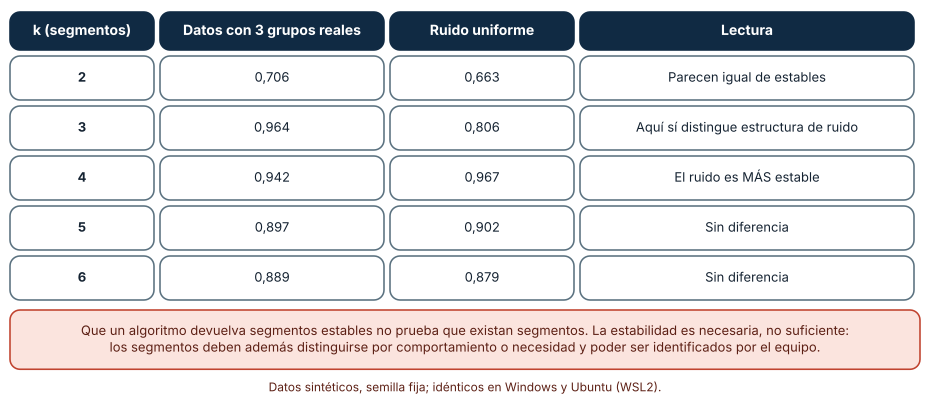
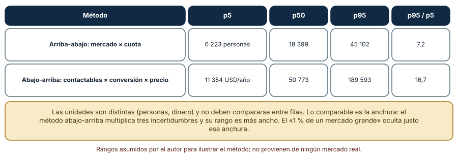
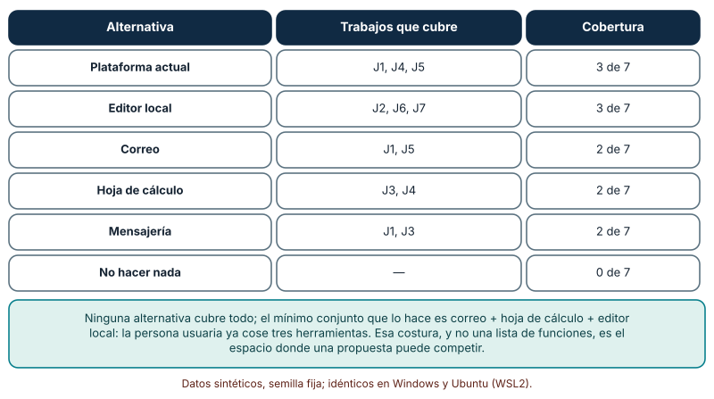

# SE-126 — Segmentación, mercado y alternativas existentes

[← SE-125 — Propuesta de valor y resultados deseados](../../classes/part-10-descubrimiento-y-estrategia-de-producto/se-125-propuesta-de-valor-y-resultados-deseados/README.md) · [↑ Parte 10](../../classes/part-10-descubrimiento-y-estrategia-de-producto/README.md) · [📚 Índice completo](../../classes/README.md) · [🌐 Portal](../../site/classes/SE-126.html) · [SE-127 — Prototipos, experimentos y reducción de incertidumbre →](../../classes/part-10-descubrimiento-y-estrategia-de-producto/se-127-prototipos-experimentos-y-reduccion-de-incertidumbre/README.md)

## Punto profesional y fundamento pedagógico

**Punto profesional.** La clase existe para decidir a qué grupo se sirve primero, cuánta gente hay realmente detrás de esa decisión y contra qué compite el producto, incluidas las soluciones caseras y no hacer nada.

**Por qué aparece aquí.** Se sitúa después de **Propuesta de valor y resultados deseados** y antes de **Prototipos, experimentos y reducción de incertidumbre**: `SE-125` dejó una promesa con resultados deseados y un múltiplo de valor frente a la alternativa actual; esta clase pregunta quiénes comparten esa necesidad lo bastante como para formar un segmento, cuántos son con un rango honesto y qué usan hoy. Su mapa de segmentos y alternativas es la base de los prototipos y experimentos de `SE-127`.

**Error conceptual que debe corregir.** Segmentar con un algoritmo y creer que los segmentos existen porque son estables, estimar el mercado con «el 1 % de un número grande» y olvidar que la alternativa más fuerte suele ser una hoja de cálculo o no hacer nada.

**Secuencia de aprendizaje.** Antes de leer la solución, predices si un algoritmo de agrupamiento devuelve resultados menos estables sobre ruido que sobre datos con grupos reales, qué método de estimación de mercado produce un rango más ancho y qué cubre cada alternativa actual; luego ejecutas los tres experimentos, explicas cada resultado y reconstruyes sin apoyo cómo se mapean alternativas por trabajo. La secuencia usa predicción, explicación propia, contraste y recuperación. [ICAP](https://icap.education.asu.edu/research) distingue participación de construcción de conocimiento; [How People Learn II](https://nap.nationalacademies.org/catalog/24783/how-people-learn-ii-learners-contexts-and-cultures) exige conectar conocimiento previo, contexto y transferencia; la [práctica de recuperación](https://pubmed.ncbi.nlm.nih.gov/16507066/) respalda producir de nuevo la explicación tras una demora; y [Education for Life and Work](https://nap.nationalacademies.org/resource/13398/dbasse_084153.pdf) exige devolución que explique la causa del error.

**Evidencia de aprendizaje.** `market-map.md` con los criterios de segmentación, la estabilidad de los segmentos frente a ruido, dos estimaciones de tamaño con rango, la tabla de alternativas por trabajo (incluida «no hacer nada») y el segmento inicial elegido con su justificación. Debe contener predicción previa, observación, explicación causal, contraejemplo, criterio de aceptación y una nota de qué dato haría cambiar la conclusión.

**Límite de la conclusión.** Los datos de segmentación, los rangos de mercado y las alternativas son sintéticos y supuestos del autor; ninguna cifra es de un mercado real y el agrupamiento se hizo con dos dimensiones, mucho menos que en datos reales.

### Trazabilidad fuente → afirmación

| Fuente primaria u oficial | Afirmación que respalda | Lo que no prueba |
|---|---|---|
| [Ben-Hur, Elisseeff y Guyon: A stability based method for discovering structure in clustered data](https://psb.stanford.edu/psb-online/proceedings/psb02/benhur.pdf) | Propone usar la estabilidad de los agrupamientos ante submuestras para evaluar cuántos grupos hay en los datos. | No afirma que la estabilidad pruebe que los grupos tengan sentido para el negocio. |
| [Strategyn: Outcome-Driven Innovation](https://strategyn.com/outcome-driven-innovation-process/) | Sostiene que los segmentos útiles se descubren agrupando personas por necesidades insatisfechas y no por demografía o psicografía. | Es la postura del autor del método; no compara empíricamente con otras formas de segmentar. |
| [Douglas Hubbard: How to Measure Anything](https://www.howtomeasureanything.com/) | Defiende expresar la incertidumbre con rangos y medir primero lo que más reduce el riesgo de la decisión. | No valida los rangos concretos de la estimación de mercado de esta clase. |

## Antes de empezar

Esta clase continúa **el caso de la plataforma de entregas**. Recupera la promesa y los resultados de `SE-125`, añade una decisión propia sobre **a quién servir primero y contra qué se compite** y deja un mapa de segmentos y alternativas para `SE-127`. La pregunta activa es: **¿quién comparte esta necesidad, cuántos son con un rango honesto y qué hacen hoy en lugar de usar el producto?**

## Prerrequisitos

- Haber completado `SE-125` o reconstruir la promesa, los resultados y el múltiplo de valor.
- Python 3.11 o posterior; solo se usa la biblioteca estándar.
- Trabajar con poblaciones y mercados sintéticos: ninguna cifra procede de un mercado real.

## Problema auténtico

El equipo agrupa 300 respuestas de una encuesta en tres «segmentos» con un algoritmo y los presenta como hallazgo. Dice además que el mercado es de 20 000 personas porque «el 1 % de un millón» lo es, y que no hay competencia porque ninguna herramienta hace exactamente lo mismo. Nadie ha comprobado si los segmentos aparecerían con datos al azar, ni cuánto varía la cifra de mercado con supuestos razonables, ni qué usan hoy las personas que pierden un borrador.

## Objetivos observables

Al terminar podrás:

1. definir un segmento por necesidad y situación y no solo por demografía;
2. medir la estabilidad de un agrupamiento y compararla con la obtenida sobre ruido para no confundir estabilidad con existencia;
3. estimar el tamaño de un mercado con dos métodos y comparar el ancho de sus rangos;
4. mapear las alternativas existentes por trabajo, incluidas las caseras y no hacer nada;
5. elegir un segmento inicial y declarar qué evidencia lo cambiaría.

## Mapa conceptual



El mapa se lee como una cadena de razonamiento, no como fases obligatorias. La flecha de retorno indica que un segmento inestable, un rango de mercado demasiado ancho o una alternativa que cubre el trabajo obliga a revisar el criterio de segmentación; no autoriza a reetiquetar los grupos.

## Temas y por qué importan

| Tema | Por qué cambia una decisión profesional | Evidencia mínima |
|---|---|---|
| Segmentación por necesidad | Un segmento útil se distingue por lo que necesita y hace, no por edad o cargo, y cambia qué se construye. | Predicción, traza causal y contraejemplo de **Segmentación por necesidad** en `market-map.md` |
| Estabilidad de segmentos | Un algoritmo siempre devuelve grupos; que sean estables es necesario, pero no prueba que existan. | Predicción, traza causal y contraejemplo de **Estabilidad de segmentos** en `market-map.md` |
| Tamaño del mercado | El tamaño estimado con «el 1 % de un mercado grande» esconde una incertidumbre que cambia la decisión. | Predicción, traza causal y contraejemplo de **Tamaño del mercado** en `market-map.md` |
| Alternativas existentes | La competencia real incluye soluciones caseras, herramientas genéricas y no hacer nada. | Predicción, traza causal y contraejemplo de **Alternativas existentes** en `market-map.md` |
| Segmento inicial | Empezar por un segmento pequeño y bien servido permite aprender; empezar por todos suele producir un producto para nadie. | Predicción, traza causal y contraejemplo de **Segmento inicial** en `market-map.md` |

## Conceptos y decisiones

### 1. Segmentación por necesidad

Segmentar por edad, cargo o región es fácil de medir y casi nunca cambia el producto. Un segmento por necesidad agrupa a quienes tienen el mismo trabajo, el mismo contexto y los mismos resultados insatisfechos: quienes entregan desde móvil con conexión débil, por ejemplo. La prueba de utilidad es si el segmento cambia una decisión (qué se construye, cómo se llega a él, cuánto está dispuesto a esforzarse) y si el equipo puede reconocer a una persona como parte de él. Un segmento que nadie puede identificar no sirve para llegar a él.

### 2. Estabilidad de segmentos

K-means asigna cada punto al centro más cercano y recalcula centros; el resultado depende de dónde empiecen. Si dos ejecuciones con semillas distintas devuelven la misma partición, el agrupamiento es estable. Sin embargo, la estabilidad se puede obtener sobre datos sin estructura: con ruido uniforme y cuatro grupos el algoritmo devuelve particiones tan reproducibles como con datos que sí tienen grupos. La estabilidad se compara con la obtenida sobre ruido; y aun así, los grupos deben distinguirse por comportamiento, ser identificables y tener sentido para el equipo.

### 3. Tamaño del mercado

Hay dos maneras de estimar. Arriba-abajo parte de un total (personas en el sector) y aplica una cuota; es rápida y se apoya en un porcentaje que nadie ha observado. Abajo-arriba parte de lo que se puede alcanzar con un canal concreto, aplica una conversión y un precio, y se parece a un plan de ventas; multiplica tres incertidumbres y por eso su rango es ancho. Ninguna da «el» tamaño: ambas dan un rango. Comparar los dos revela qué supuesto domina y si el segmento inicial es lo bastante grande para sostener un piloto o un negocio.

### 4. Alternativas existentes

Ante el trabajo «comprobar que mi entrega llegó», las alternativas son el correo, una hoja de cálculo, un mensaje a un compañero, hacer una captura de pantalla o confiar. Ninguna se anuncia como competidora, y todas compiten. Cada una cubre ciertos trabajos y deja otros. Mapear qué cubre cada alternativa, y en qué contextos falla, revela dónde hay hueco y qué costura debe resolver el producto. «No hacer nada» entra en la lista con cobertura cero y con un coste: lo que hoy se pierde por no actuar.

### 5. Segmento inicial

Elegir un segmento inicial no significa renunciar a los demás, sino ordenar el aprendizaje. Los criterios son cuán insatisfecha está su necesidad, cuántas personas son con un rango honesto, si el equipo puede llegar a ellas con un canal real y si son lo bastante parecidas entre sí como para que una solución las sirva. Se declara también qué evidencia haría cambiar de segmento. Un segmento inicial razonable puede ser pequeño; un mercado «total» no es un segmento.

### Estabilidad no es existencia: grupos reales frente a ruido

Generamos 300 puntos con tres grupos reales (centros en (0, 0), (4, 0) y (2, 4), desviación 0,9) y otros 300 puntos de ruido uniforme en un cuadrado. Para k entre 2 y 6 ejecutamos un k-means propio dos veces con semillas distintas sobre submuestras de 150 puntos (8 repeticiones) y medimos el índice de Rand entre las dos particiones (1 = idénticas). Predicción antes de ejecutar: con tres grupos reales, k = 3 será mucho más estable que con ruido.

```python
def estabilidad(puntos, k, repeticiones=8, tam=150):
    rng = random.Random(1260)
    for r in range(repeticiones):
        sub = [puntos[i] for i in rng.sample(range(len(puntos)), tam)]
        l1, l2 = kmeans(sub, k, 100 + r), kmeans(sub, k, 200 + r)
        yield rand_index(l1, l2)
```

Resultados (estructurado / ruido): k = 2: 0,706 / 0,663; k = 3: 0,964 / 0,806; k = 4: 0,942 / 0,967; k = 5: 0,897 / 0,902; k = 6: 0,889 / 0,879. Con k = 3 la estabilidad distingue la estructura del ruido (0,964 frente a 0,806). Con k = 4, 5 y 6 el ruido es igual de estable, o más (0,967 frente a 0,942 con k = 4). La estabilidad por sí sola no diferencia datos con grupos de datos sin ellos; un agrupamiento sobre ruido puede ser perfectamente reproducible. Idéntico en Windows y Ubuntu.



**Cómo leer la figura.** Cada fila es un número de grupos pedido; las dos columnas centrales comparan datos con estructura y ruido, y la tercera da la lectura. **Dónde deja de valer:** son dos dimensiones y datos gaussianos; en datos reales con decenas de dimensiones y variables categóricas la estabilidad se comporta distinto, y existen métodos más finos (estadístico de brecha, silueta) que tampoco prueban utilidad comercial. Úsala como descarte, no como validación.

### Dos estimaciones del mercado y el ancho de sus rangos

Estimamos el segmento inicial de dos maneras con 20 000 sorteos triangulares cada una. Arriba-abajo: mercado total entre 500 000 y 3 000 000 personas (moda 1 000 000) × cuota entre 0,2 % y 3 % (moda 1 %). Abajo-arriba: personas alcanzables por un canal entre 2 000 y 40 000 (moda 8 000) × conversión entre 0,5 % y 8 % (moda 2 %) × precio anual entre 30 y 240 dólares (moda 80). Predicción antes de ejecutar: el método de tres factores será el más ancho.

```python
top_down = tri(5e5, 3e6, 1e6) * tri(0.002, 0.03, 0.01)
bottom_up = tri(2000, 40000, 8000) * tri(0.005, 0.08, 0.02) * tri(30, 240, 80)
```

Arriba-abajo: p5 = 6 223 personas, mediana 18 399, p95 45 102 (razón p95/p5 = 7,2). Abajo-arriba: p5 = 11 354 USD al año, mediana 50 773, p95 189 593 (razón 16,7). Las unidades son distintas (personas, dinero) y no se comparan entre filas; lo comparable es la anchura relativa: el método abajo-arriba, con tres incertidumbres multiplicadas, tiene un rango más del doble de ancho. El «1 % de un millón» (10 000 personas) cae dentro del intervalo arriba-abajo pero oculta que el rango llega a 45 000 y baja a 6 000.



**Cómo leer la figura.** Cada fila es un método y las columnas p5, p50 y p95 dan el rango; la última es la razón entre extremos. **Dónde deja de valer:** los rangos son supuestos del autor, no datos de un mercado; con información real el intervalo se estrecha o se desplaza. Los factores se suponen independientes: si el canal más efectivo también atrae a quienes convierten más, el rango real sería distinto.

### Qué cubre cada alternativa, y qué no cubre ninguna

Siete trabajos de la plataforma (J1 recibir recordatorios, J2 guardar borradores, J3 coordinar el grupo, J4 ver notas, J5 pedir prórroga, J6 recuperar versiones, J7 trabajar sin conexión) y seis alternativas que las personas usan hoy, cada una con el conjunto de trabajos que cubre: plataforma actual {J1, J4, J5}, editor local {J2, J6, J7}, correo {J1, J5}, hoja de cálculo {J3, J4}, mensajería {J1, J3} y «no hacer nada» (conjunto vacío). Predicción antes de ejecutar: ninguna alternativa cubre todo, y no hay trabajos huérfanos.

```python
cobertura = set().union(*alternativas.values())
huerfanos = trabajos - cobertura
minimo = next(c for r in range(1, 6) for c in combinations(nombres, r)
              if set().union(*[alternativas[a] for a in c]) == trabajos)
```

Resultado: no hay trabajos huérfanos (todos están cubiertos por alguna alternativa); la mayor cobertura individual es de tres trabajos de siete (plataforma actual y editor local) y el mínimo conjunto que cubre todo es correo + hoja de cálculo + editor local, tres herramientas. La persona que quiere todo debe coser tres herramientas; esa costura —no una lista de funciones— es el espacio donde una propuesta puede competir. Y «no hacer nada» cubre cero trabajos pero cuesta nada: es la alternativa a batir en el trabajo con menor consecuencia.



**Cómo leer la figura.** Cada fila es una alternativa; la columna central lista los trabajos que cubre y la última cuántos de siete. **Dónde deja de valer:** «cubre» es binario y lo decidió el autor; en la realidad una alternativa cubre un trabajo mejor o peor, en ciertos contextos y con cierto esfuerzo. La tabla orienta la investigación (¿qué hacen de verdad?), no la sustituye.

## Definiciones de trabajo

- **segmentación por necesidad:** grupo de personas que comparten un trabajo, un contexto y resultados insatisfechos, y que justifican una decisión de producto distinta de la del resto.
- **estabilidad de segmentos:** grado en que un agrupamiento se reproduce al repetirlo con otra semilla o con otra submuestra de los mismos datos.
- **tamaño del mercado:** estimación de cuántas personas o cuánto dinero hay detrás de un segmento, con el método y los rangos usados a la vista.
- **alternativas existentes:** todo lo que una persona usa o hace hoy para cumplir el trabajo, con o sin producto especializado, incluido no actuar.
- **segmento inicial:** grupo concreto al que se dirige primero la propuesta, elegido por necesidad insatisfecha, alcance y facilidad para aprender de él.

Las definiciones son operativas para la plataforma de entregas. No convierten términos con historia más amplia en sinónimos y deben contrastarse con la documentación primaria enlazada al final.

## Ejemplo mínimo

Un fragmento mínimo que calcula cobertura y trabajos huérfanos. Antes de ejecutarlo, predice si hay algún trabajo sin alternativa.

```python
alternativas = {
    "correo": {"J1", "J5"}, "hoja": {"J3", "J4"},
    "plataforma": {"J1", "J4", "J5"}, "editor": {"J2", "J6", "J7"},
    "mensajeria": {"J1", "J3"}, "nada": set(),
}
trabajos = {"J1", "J2", "J3", "J4", "J5", "J6", "J7"}
cubiertos = set().union(*alternativas.values())
assert trabajos - cubiertos == set()
assert max(len(s) for s in alternativas.values()) == 3
```

Registra versión, comando y salida. Si añades un trabajo J8 que ninguna alternativa cubre, la primera aserción falla: ese es el hueco que se investiga.

## Ejemplo profesional

En la plataforma de entregas, el mapa conserva por segmento: criterio de definición, trabajos, contextos, resultados insatisfechos, tamaño como rango con método y supuestos, canal de acceso y alternativas con los trabajos que cubren. El contrato es que ningún segmento se declare sin decir cómo se reconocería a una persona de él y que ninguna cifra de mercado se publique sin su rango.

Compara el caso normal con un segmento definido por demografía, con un agrupamiento inestable, con una estimación que cae fuera del rango del otro método y con un trabajo sin alternativa. Un mapa es apropiado cuando esas diferencias se ven; es peligroso cuando un solo número de mercado o un solo agrupamiento deciden.

## Práctica guiada

1. Define tres criterios de segmentación por necesidad y descarta los puramente demográficos.
2. Genera datos con y sin estructura y ejecuta el agrupamiento con dos semillas para varios k.
3. Compara la estabilidad entre datos estructurados y ruido y decide si el agrupamiento aporta algo.
4. Estima el tamaño del segmento por los dos métodos, con rangos y 20 000 sorteos.
5. Construye la tabla de trabajos por alternativa e incluye «no hacer nada».
6. Identifica el hueco (trabajos poco cubiertos o costura entre herramientas) y elige un segmento inicial.
7. Pide a otra persona que diga, solo con `market-map.md`, qué evidencia cambiaría el segmento elegido.

## Ejercicios

1. **Estabilidad:** repite el experimento con 2 y con 5 grupos reales y averigua si la estabilidad diferencia estructura de ruido para algún k; explica por qué.
2. **Mercado:** reduce a la mitad el ancho de los rangos del factor que más contribuye y recalcula la razón p95/p5; decide qué investigarías para lograr ese estrechamiento.
3. **Alternativas:** añade dos alternativas caseras y un trabajo nuevo que nadie cubre; recalcula el mínimo conjunto y la cobertura.
4. **Segmento:** compara dos segmentos candidatos con los criterios de insatisfacción, tamaño, alcance y homogeneidad y justifica la elección con una tabla.

## Reto verificable

Entrega `market-map.md` con tres criterios de segmentación, la estabilidad comparada con ruido, dos estimaciones de tamaño con rango, la tabla de alternativas por trabajo y el segmento inicial con la evidencia que lo cambiaría. Se aprueba si otra persona ejecuta los cálculos desde un checkout limpio, obtiene los mismos números y puede decir qué trabajo queda sin cubrir. No se aprueba por la cantidad de segmentos ni por una cifra de mercado sin rango.

## Caso conductor

La plataforma de entregas tiene una promesa clara (`SE-125`). Esta clase observa que quienes entregan desde móvil con conexión débil cosen tres herramientas (correo, hoja de cálculo, editor local) y son el segmento más desatendido. El tamaño estimado va de unos 6 000 a unos 45 000 personas según el método. Cambia después un solo supuesto —por ejemplo, la cuota— y revisa qué decisiones del mapa cambian.

## Preguntas frecuentes

### ¿Un agrupamiento estable demuestra que hay segmentos?

No: sobre ruido uniforme con k = 4 la estabilidad fue 0,967, mayor que sobre datos con tres grupos reales (0,942). La estabilidad descarta agrupamientos caprichosos, pero la existencia se justifica por comportamiento, utilidad y capacidad de identificar a las personas.

### ¿Por qué dos métodos de mercado y no uno?

Porque cada uno revela una incertidumbre distinta. Arriba-abajo muestra cuánto depende la cifra de una cuota que nadie ha observado; abajo-arriba obliga a imaginar un canal, una conversión y un precio. Si los rangos no se solapan, hay un supuesto que investigar.

### ¿«No hacer nada» es realmente una alternativa?

Sí, y a menudo la más fuerte: significa que el trabajo no duele lo suficiente como para actuar. Se incluye con cobertura cero y con el coste de no actuar, y se pregunta qué haría que alguien dejara de usarla.

### ¿Cuándo es demasiado pequeño un segmento inicial?

Cuando el rango bajo (p5) no alcanza para un piloto con una muestra que permita decidir (`SE-127`) o cuando no hay un canal para llegar a él. Un segmento pequeño y alcanzable es mejor que uno grande al que no se llega.

## Fallo controlado y diagnóstico

Reproduce el fallo de la clase: **creer que un agrupamiento estable es un segmento real**. Ejecuta k-means con k = 4 sobre ruido uniforme y compara con los datos estructurados.

Registra síntoma, entrada mínima, hipótesis, observación que descarta cada hipótesis, causa, corrección y prueba de regresión. **Síntoma:** el algoritmo devuelve cuatro grupos estables que el equipo bautiza como «segmentos». **Hipótesis rivales:** (a) los datos tienen cuatro grupos reales; (b) el algoritmo siempre devuelve grupos, estables o no. **Prueba:** sobre ruido uniforme la estabilidad con k = 4 es 0,967 (frente a 0,942 en datos con tres grupos reales), de modo que la estabilidad no distingue (a) de (b); además los grupos no se diferencian por ningún comportamiento observable. **Conclusión:** los «segmentos» son un artefacto del algoritmo. **Regresión:** añade al informe la estabilidad sobre ruido y un criterio de utilidad (cambia una decisión, es identificable) y una prueba que rechace segmentos sin ambos. No cambies a la vez el número de grupos y el conjunto de variables.

## Errores comunes y cómo corregirlos

| Síntoma | Causa probable | Corrección |
|---|---|---|
| Los «segmentos» cambian cuando se vuelve a ejecutar el análisis | El agrupamiento es inestable o depende de la semilla | Medir estabilidad entre semillas y submuestras y no usar el agrupamiento si es bajo |
| Los segmentos son estables pero nadie los reconoce | Estabilidad sobre ruido o variables sin significado de negocio | Comparar con ruido y exigir que los grupos difieran en comportamiento o necesidad |
| El plan cita «20 000 personas» y luego «60 000» | Se usó una cuota distinta sin declararla | Reportar el rango con método y supuestos, no un número |
| Se concluye que «no hay competencia» | Solo se buscaron productos idénticos | Mapear alternativas por trabajo, incluidas las caseras y no hacer nada |
| El piloto no consigue reclutar al segmento elegido | No se pensó en el canal de acceso | Declarar canal y tamaño alcanzable (p5) antes de elegir el segmento |

## Entorno y archivos clave

```text
work/SE-126/
├── README.md
├── market/
│   ├── segmentos.py
│   ├── mercado.py
│   └── alternativas.py
├── fixtures/trabajos.json
├── tests/test_cobertura.py
└── evidence/market-map.md
```

El `README` declara plataforma, versiones, semilla y comandos. Los scripts usan solo la biblioteca estándar (k-means e índice de Rand implementados a mano) y se ejecutaron con CPython 3.12.9 en Windows 11 y 3.12.3 en Ubuntu bajo WSL2 con salidas idénticas. Los rangos del mercado son supuestos y se declaran en el `README`.

## Seguridad, ética y accesibilidad

- los segmentos pueden convertirse en etiquetas sobre personas: describe situaciones y necesidades, no atributos personales sensibles;
- al excluir un segmento, declara qué riesgo se transfiere a las personas excluidas;
- evita segmentar por rasgos protegidos o que puedan inferirse de ellos si eso lleva a un trato desigual;
- estima el mercado sin recoger datos de personas reales: usa fuentes agregadas;
- ofrece una alternativa textual a las tablas y no uses color como única señal;
- atribuye las cifras de fuentes externas y respeta sus licencias.

## Puente hacia el trabajo con agentes

Un agente al que se le pide «segmenta a los usuarios y estima el mercado» devolverá tres segmentos con nombres atractivos y una cifra de mercado con falsa precisión. Pídele que ejecute el agrupamiento con semillas distintas y contra ruido, que reporte la estabilidad en ambos casos, que dé dos estimaciones de tamaño con rangos y que liste las alternativas por trabajo, incluida no hacer nada. Revisa especialmente si nombra los grupos antes de probar que se distinguen por algo observable: es el error de esta clase con buen diseño.

## Transferencia

Traslada el mapa a otro dominio persistente (por ejemplo, un comercio responsable): cambia los trabajos, las alternativas y los rangos, conserva la comparación contra ruido, los dos métodos de mercado y la tabla de cobertura. La transferencia está lograda cuando puedes explicar qué alternativa casera juega el papel de la hoja de cálculo y qué evidencia la mostraría.

## Evaluación y evidencia

| Criterio | Evidencia para aprobar |
|---|---|
| comprensión | explicación causal de por qué la estabilidad no prueba la existencia de segmentos |
| corrección | estabilidad, percentiles y cobertura reproducibles con la misma semilla |
| diseño | criterios de segmentación por necesidad y mapa de alternativas por trabajo |
| diagnóstico | reproducción del fallo «estable equivale a real» con regresión |
| responsabilidad | declaración de quién queda excluido y de qué riesgo se transfiere |
| reproducibilidad | versiones, comandos, salida y límites declarados |


## Fuentes


- [Ben-Hur, Elisseeff y Guyon (2002): A stability based method for discovering structure in clustered data](https://psb.stanford.edu/psb-online/proceedings/psb02/benhur.pdf) — estabilidad de agrupamientos ante submuestras; autoridad: Pacific Symposium on Biocomputing.
- [Strategyn: Outcome-Driven Innovation](https://strategyn.com/outcome-driven-innovation-process/) — segmentación por necesidades insatisfechas; autoridad: Strategyn (fuente del autor del método).
- [Douglas Hubbard: How to Measure Anything](https://www.howtomeasureanything.com/) — rangos e incertidumbre en la estimación; autoridad: Hubbard Decision Research.
- [Strategyzer: Value Proposition Canvas](https://www.strategyzer.com/library/the-value-proposition-canvas) — ajuste entre propuesta y perfil de cliente; autoridad: Strategyzer.
- [Know Your Customers' «Jobs to Be Done» (Harvard Business Review, 2016)](https://hbr.org/2016/09/know-your-customers-jobs-to-be-done) — trabajos como base de la competencia; autoridad: Harvard Business Review (artículo parcialmente de pago).
- [SWEBOK Guide v4.0a](https://www.computer.org/education/bodies-of-knowledge/software-engineering) — requisitos, alcance y fundamentos de ingeniería; autoridad: IEEE Computer Society.

Cada fuente respalda el mecanismo indicado; ninguna demuestra que los segmentos, el tamaño o las alternativas de la plataforma sean correctos. Esa afirmación depende de datos reales, de la investigación con las personas y de la revisión.

- [Python: `random.triangular`](https://docs.python.org/3/library/random.html#random.triangular) — distribución usada para los rangos del tamaño de mercado.
- [Python: `itertools.combinations`](https://docs.python.org/3/library/itertools.html#itertools.combinations) — enumeración de combinaciones de alternativas para el mínimo conjunto de cobertura.

## Límites y siguiente paso

Se ejecutaron tres experimentos con datos sintéticos en Windows y Ubuntu (WSL2) con salidas idénticas. No se segmentó ningún mercado real, los rangos son supuestos y el agrupamiento se hizo en dos dimensiones. La siguiente clase convierte el segmento y la hipótesis más sensible en prototipos y experimentos que reduzcan la incertidumbre.

## Glosario

- **segmentación por necesidad:** grupo de personas que comparten un trabajo, un contexto y resultados insatisfechos, y que justifican una decisión de producto distinta de la del resto.
- **estabilidad de segmentos:** grado en que un agrupamiento se reproduce al repetirlo con otra semilla o con otra submuestra de los mismos datos.
- **tamaño del mercado:** estimación de cuántas personas o cuánto dinero hay detrás de un segmento, con el método y los rangos usados a la vista.
- **alternativas existentes:** todo lo que una persona usa o hace hoy para cumplir el trabajo, con o sin producto especializado, incluido no actuar.
- **segmento inicial:** grupo concreto al que se dirige primero la propuesta, elegido por necesidad insatisfecha, alcance y facilidad para aprender de él.

---

[← SE-125 — Propuesta de valor y resultados deseados](../../classes/part-10-descubrimiento-y-estrategia-de-producto/se-125-propuesta-de-valor-y-resultados-deseados/README.md) · [↑ Parte 10](../../classes/part-10-descubrimiento-y-estrategia-de-producto/README.md) · [📚 Índice completo](../../classes/README.md) · [🌐 Portal](../../site/classes/SE-126.html) · [SE-127 — Prototipos, experimentos y reducción de incertidumbre →](../../classes/part-10-descubrimiento-y-estrategia-de-producto/se-127-prototipos-experimentos-y-reduccion-de-incertidumbre/README.md)
