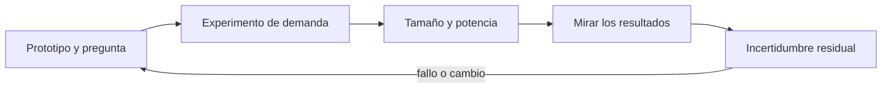
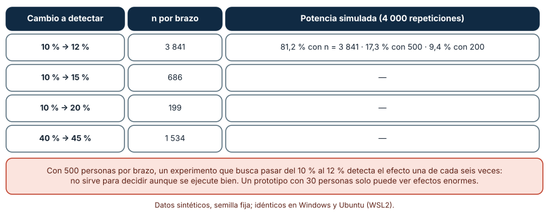
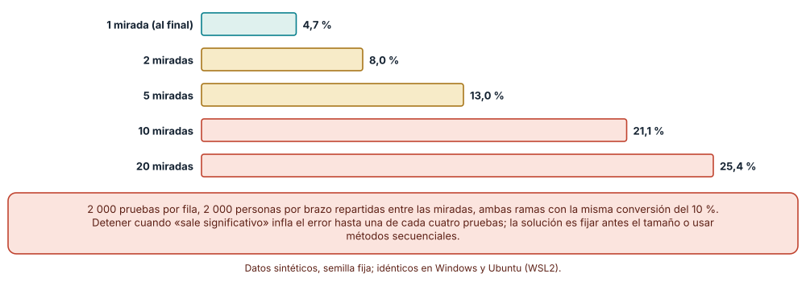
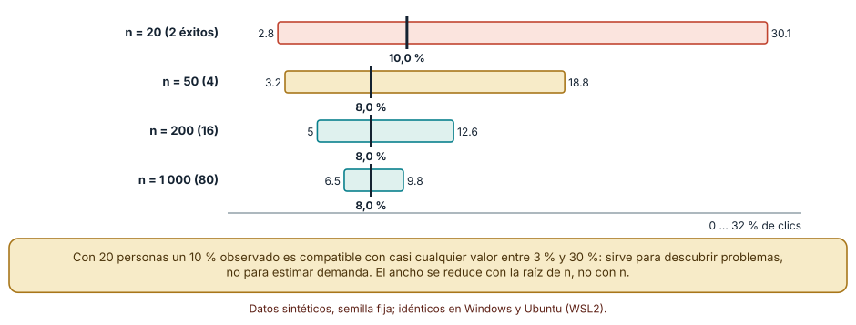

# SE-127 — Prototipos, experimentos y reducción de incertidumbre

[← SE-126 — Segmentación, mercado y alternativas existentes](../../classes/part-10-descubrimiento-y-estrategia-de-producto/se-126-segmentacion-mercado-y-alternativas-existentes/README.md) · [↑ Parte 10](../../classes/part-10-descubrimiento-y-estrategia-de-producto/README.md) · [📚 Índice completo](../../classes/README.md) · [🌐 Portal](../../site/classes/SE-127.html) · [SE-128 — Priorización por valor, riesgo y aprendizaje →](../../classes/part-10-descubrimiento-y-estrategia-de-producto/se-128-priorizacion-por-valor-riesgo-y-aprendizaje/README.md)

## Punto profesional y fundamento pedagógico

**Punto profesional.** La clase existe para elegir el experimento más barato que pueda refutar la hipótesis más riesgosa y para saber de antemano cuánta gente hace falta, cuándo mirar los resultados y qué incertidumbre quedará.

**Por qué aparece aquí.** Se sitúa después de **Segmentación, mercado y alternativas existentes** y antes de **Priorización por valor, riesgo y aprendizaje**: `SE-126` dejó un segmento inicial y alternativas mapeadas; ahora hay que aprender algo sobre él sin construir el producto. Esta clase convierte la hipótesis de `SE-124` en un prototipo o experimento con tamaño, regla de parada e intervalo esperado, y deja un plan que `SE-128` usará para priorizar por aprendizaje además de por valor.

**Error conceptual que debe corregir.** Construir una versión completa para saber si interesa, lanzar una prueba sin calcular cuánta gente necesita y declararla ganadora al primer resultado «significativo».

**Secuencia de aprendizaje.** Antes de leer la solución, predices cuántas personas por rama exige detectar una mejora de dos puntos, cuánto sube la tasa de falsos positivos si se detiene al primer resultado favorable y cuán ancha es la incertidumbre de una puerta falsa con veinte personas; luego simulas, explicas cada resultado y reconstruyes sin apoyo cómo se fija el tamaño y la regla de parada de un experimento. La secuencia usa predicción, explicación propia, contraste y recuperación. [ICAP](https://icap.education.asu.edu/research) distingue participación de construcción de conocimiento; [How People Learn II](https://nap.nationalacademies.org/catalog/24783/how-people-learn-ii-learners-contexts-and-cultures) exige conectar conocimiento previo, contexto y transferencia; la [práctica de recuperación](https://pubmed.ncbi.nlm.nih.gov/16507066/) respalda producir de nuevo la explicación tras una demora; y [Education for Life and Work](https://nap.nationalacademies.org/resource/13398/dbasse_084153.pdf) exige devolución que explique la causa del error.

**Evidencia de aprendizaje.** `experiment-plan.md` con la hipótesis, el prototipo o experimento elegido, el tamaño por rama y la potencia, la regla de parada, el intervalo esperado y lo que se decidirá con cada resultado. Debe contener predicción previa, observación, explicación causal, contraejemplo, criterio de aceptación y una nota de qué dato haría cambiar la conclusión.

**Límite de la conclusión.** Las pruebas A/A y los intervalos son simulaciones y cálculos con tasas supuestas; no miden el comportamiento de personas reales ni capturan efectos de novedad, estacionalidad o interferencia entre ramas.

### Trazabilidad fuente → afirmación

| Fuente primaria u oficial | Afirmación que respalda | Lo que no prueba |
|---|---|---|
| [Johari, Pekelis y Walsh: Always Valid Inference](https://arxiv.org/abs/1512.04922) | Muestra que los p-valores y los intervalos habituales no son fiables si se decide el tamaño de la muestra monitoreando de forma continua, y propone alternativas secuenciales. | No dice cuántas veces es seguro mirar con el método clásico ni resuelve el diseño de tu experimento. |
| [Brown, Cai y DasGupta: Interval Estimation for a Binomial Proportion](https://projecteuclid.org/journals/statistical-science/volume-16/issue-2/Interval-Estimation-for-a-Binomial-Proportion/10.1214/ss/1009213286.full) | Compara intervalos para una proporción y documenta que el intervalo de Wald clásico se comporta mal con muestras pequeñas, a diferencia de alternativas como el de Wilson. | No indica qué intervalo es el adecuado para tu decisión de producto. |
| [Kohavi, Tang y Xu: Trustworthy Online Controlled Experiments](https://experimentguide.com/) | Reúne prácticas para diseñar y analizar experimentos controlados en línea, incluidas la potencia, las comprobaciones de validez y los errores de interpretación. | Es un libro de referencia, no una garantía de que tu experimento esté bien diseñado. |

## Antes de empezar

Esta clase continúa **el caso de la plataforma de entregas**. Recupera el segmento y la hipótesis de `SE-124` y `SE-126`, añade una decisión propia sobre **qué experimento mínimo puede refutarla y con cuánta gente** y deja un plan para `SE-128`. La pregunta activa es: **¿qué es lo más barato que podría demostrar que estoy equivocado?**

## Prerrequisitos

- Haber completado `SE-126` o reconstruir el segmento inicial y la hipótesis principal con su umbral.
- Python 3.11 o posterior; solo se usa la biblioteca estándar.
- Trabajar con tasas y poblaciones sintéticas: ninguna cifra procede de personas reales.

## Problema auténtico

El equipo quiere saber si la función de recuperación de borradores aumenta la entrega a tiempo del 10 % al 12 %. Planea una prueba de dos semanas con 500 personas por rama y la revisará todos los días; si en algún momento la diferencia es «significativa», la detendrá y la lanzará. Nadie ha calculado la potencia ni cuántos falsos positivos produce mirar cada día.

## Objetivos observables

Al terminar podrás:

1. elegir un prototipo o experimento por la pregunta que responde y por su costo, no por su fidelidad;
2. calcular el tamaño de muestra por rama y estimar la potencia de un diseño por simulación;
3. medir cuánto aumenta la tasa de falsos positivos al mirar varias veces y explicar por qué;
4. expresar el resultado de una prueba pequeña con un intervalo y no con una tasa puntual;
5. registrar qué se decidirá con cada resultado posible antes de empezar.

## Mapa conceptual



El mapa se lee como una cadena de razonamiento, no como fases obligatorias. La flecha de retorno indica que una potencia insuficiente, un resultado que depende de cuándo se mira o un intervalo demasiado ancho obliga a rediseñar el experimento; no autoriza a prolongarlo hasta que salga lo esperado.

## Temas y por qué importan

| Tema | Por qué cambia una decisión profesional | Evidencia mínima |
|---|---|---|
| Prototipo y pregunta | El nivel de fidelidad se elige por la pregunta a responder, no por orgullo de producto. | Predicción, traza causal y contraejemplo de **Prototipo y pregunta** en `experiment-plan.md` |
| Experimento de demanda | Observar lo que la gente hace con un compromiso pequeño cuesta menos que construir y mide más que preguntar. | Predicción, traza causal y contraejemplo de **Experimento de demanda** en `experiment-plan.md` |
| Tamaño y potencia | Un experimento sin potencia suficiente no puede decidir, aunque se ejecute impecablemente. | Predicción, traza causal y contraejemplo de **Tamaño y potencia** en `experiment-plan.md` |
| Mirar los resultados | Detener la prueba cuando el resultado parece bueno infla los falsos positivos. | Predicción, traza causal y contraejemplo de **Mirar los resultados** en `experiment-plan.md` |
| Incertidumbre residual | Toda prueba termina con un intervalo; ignorarlo convierte una estimación en un hecho. | Predicción, traza causal y contraejemplo de **Incertidumbre residual** en `experiment-plan.md` |

## Conceptos y decisiones

### 1. Prototipo y pregunta

Un prototipo responde preguntas. Un boceto en papel dice si la gente entiende el flujo; una maqueta navegable, si encuentra lo que busca; una versión con «mago de Oz» (una persona hace manualmente lo que luego hará el sistema) dice si el resultado importa lo suficiente como para usarlo. Cada nivel cuesta más y responde más. La regla es construir lo mínimo que pueda refutar la hipótesis más riesgosa. Un prototipo que responde a todo es una versión del producto con otro nombre y compromete al equipo antes de aprender.

### 2. Experimento de demanda

Una puerta falsa muestra la oferta y mide cuántas personas hacen clic para pedirla; un mago de Oz entrega el servicio a mano a unas pocas; un concierge lo hace con acompañamiento total. Todas observan comportamiento y no opinión, y todas deben ser honestas con la persona (nadie debe creer que recibió algo que no existe sin una explicación posterior). El compromiso exigido importa: un clic cuesta casi nada; entregar un borrador real o reservar una cita cuesta algo, y por eso dice más.

### 3. Tamaño y potencia

Para detectar un cambio de 10 % a 12 % con 80 % de potencia y 5 % de error se necesitan unas 3 841 personas por rama; para 10 % a 20 %, 199. Cuanto menor la diferencia, mayor la muestra: crece con el inverso del cuadrado de la diferencia. Con una muestra más pequeña el experimento sigue siendo válido pero casi siempre «no concluyente». Por eso se decide antes cuál es la diferencia mínima que justifica actuar, se calcula el tamaño y, si es inalcanzable, se elige otro tipo de prueba (cualitativa, de efecto grande) o se acepta la incertidumbre.

### 4. Mirar los resultados

Un p-valor está calibrado para un único análisis planificado. Si se calcula cada día y se detiene al primer «significativo», se da al azar muchas oportunidades de aparecer y la tasa de falsos positivos sube. Hay dos salidas: fijar de antemano el tamaño y mirar una sola vez, o usar métodos secuenciales diseñados para monitorear. Lo que no vale es mirar libremente y aplicar la prueba clásica. Registrar el calendario de análisis en el plan evita decidir sobre la marcha.

### 5. Incertidumbre residual

Observar 8 % de clics en 20 personas no dice que la demanda sea de 8 %: es compatible con entre 3 % y 30 %. Con 200 personas el rango se reduce a 5–13 % y con 1 000 a 6,5–9,8 %. El intervalo de Wilson funciona razonablemente con muestras pequeñas y valores cercanos a 0 o 1, donde el intervalo clásico falla. Se reporta junto a la tasa y se compara con el umbral de decisión declarado en el plan: si el intervalo lo atraviesa, el resultado es inconcluso, no favorable.

### Cuánta gente hace falta, y qué potencia tiene un diseño más pequeño

La fórmula de tamaño por rama para dos proporciones (error 5 %, potencia 80 %) da: 10 % → 12 %, 3 841 personas; 10 % → 15 %, 686; 10 % → 20 %, 199; 40 % → 45 %, 1 534. Predicción antes de ejecutar: el diseño del equipo (500 por rama) tiene mucha menos potencia de la deseada.

```python
def n_por_rama(p1, p2, za=1.959964, zb=0.841621):
    pm = (p1 + p2) / 2
    num = (za * (2 * pm * (1 - pm)) ** .5 + zb * (p1 * (1 - p1) + p2 * (1 - p2)) ** .5) ** 2
    return math.ceil(num / (p1 - p2) ** 2)
```

Para comprobar que la fórmula describe lo que ocurre, se simularon 4 000 experimentos con tasas reales de 10 % y 12 % y se contó con qué frecuencia la prueba de dos proporciones al 5 % detectaba la diferencia: con n = 3 841 la potencia empírica fue 81,2 % (≈ 80 %), con n = 500, 17,3 % y con n = 200, 9,4 %. El diseño del equipo detectaría el efecto una vez de cada seis. Las salidas fueron idénticas en Windows y Ubuntu.



**Cómo leer la figura.** Cada fila es un cambio que se quiere detectar; la columna «n por brazo» es la muestra necesaria y la última da la potencia empírica en tres tamaños para el primer caso. **Dónde deja de valer:** el cálculo supone observaciones independientes, tasas estables y una prueba de dos proporciones; con medidas repetidas por persona, conglomerados o efectos de novedad hay que ajustar el tamaño. Si el tamaño necesario es inalcanzable, la salida no es relajar la exigencia sino cambiar de método.

### Mirar cada día: falsos positivos en una prueba A/A

Una prueba A/A compara dos ramas idénticas (misma conversión del 10 %): cualquier «efecto significativo» es un falso positivo. Para cada número de miradas repartimos 2 000 personas por rama en tramos iguales, analizamos al final de cada tramo con una prueba al 5 % y contamos las pruebas que en algún tramo resultaron significativas. Predicción antes de ejecutar: con una sola mirada el error ronda el 5 %; con veinte, mucho más.

```python
for tramo in range(miradas):
    a += sum(rng.random() < 0.1 for _ in range(paso)); na += paso
    b += sum(rng.random() < 0.1 for _ in range(paso)); nb += paso
    if abs(b / nb - a / na) / error_estandar(a, b, na, nb) > 1.959964:
        alguna = True
```

Resultados de 2 000 pruebas por fila: 1 mirada → 4,7 % de falsos positivos; 2 miradas → 8,0 %; 5 → 13,0 %; 10 → 21,1 %; 20 → 25,4 %. Mirar diez veces cuadruplica el error nominal y una de cada cuatro pruebas A/A con veinte miradas declara un efecto que no existe. El plan del equipo (mirar cada día durante dos semanas) cae en esta zona. Idéntico en Windows y Ubuntu.



**Cómo leer la figura.** Cada barra es un número de miradas; la primera, con una sola, queda en el nivel nominal y las demás lo superan cada vez más. **Dónde deja de valer:** la inflación depende del calendario y del número de miradas; con pocas, planificadas y espaciadas el aumento es menor, y existen métodos secuenciales con garantías (la literatura de inferencia «siempre válida»). El gráfico no dice que mirar sea malo: dice que la prueba clásica no está calibrada para mirar.

### Una puerta falsa con 20 personas: qué dice y qué no

Una puerta falsa muestra la oferta de recuperar borradores y registra cuántas personas hacen clic. Supongamos una tasa observada de 8 % (con 20 personas, 10 %, es decir, 2 éxitos). El intervalo de Wilson al 95 % para cada tamaño: n = 20, 2 éxitos → 10,0 % con intervalo 2,8–30,1 %; n = 50, 4 éxitos → 8,0 %, 3,2–18,8 %; n = 200, 16 → 8,0 %, 5,0–12,6 %; n = 1 000, 80 → 8,0 %, 6,5–9,8 %. Predicción antes de ejecutar: el intervalo se estrecha, pero mucho más despacio que el tamaño crece.

```python
def wilson(k, n, z=1.959964):
    p = k / n
    centro = (p + z * z / (2 * n)) / (1 + z * z / n)
    mitad = z * (p * (1 - p) / n + z * z / (4 * n * n)) ** .5 / (1 + z * z / n)
    return centro - mitad, centro + mitad
```

Pasar de 20 a 1 000 personas (50 veces más) reduce el ancho del intervalo de 27 a 3,3 puntos porcentuales (unas 8 veces menos), coherente con la raíz de n. Con 20 personas un 10 % observado es compatible con casi cualquier demanda entre 3 % y 30 %: sirve para descubrir problemas y reacciones, no para estimar el mercado. Idéntico en Windows y Ubuntu.



**Cómo leer la figura.** Cada barra es el intervalo de la tasa real compatible con lo observado; la marca negra es la tasa observada. **Dónde deja de valer:** el intervalo supone una muestra aleatoria y clics independientes; en una puerta falsa la muestra viene de quienes llegaron a la página, que no es la población, y un clic no es un compromiso. Un intervalo estrecho sobre una muestra sesgada sigue siendo engañoso.

## Definiciones de trabajo

- **prototipo y pregunta:** versión parcial o simulada de un producto construida para responder una pregunta específica sobre uso, comprensión o interés.
- **experimento de demanda:** prueba que registra una acción costosa para la persona (hacer clic, registrarse, pagar, comprometer tiempo) como señal de interés.
- **tamaño y potencia:** número de personas por rama necesario para detectar, con una probabilidad dada, una diferencia mínima relevante; la probabilidad de detectarla es la potencia.
- **mirar los resultados:** decisión de cuándo analizar los datos de un experimento; si se hace repetidamente y se detiene al primer resultado favorable, el error real supera al nominal.
- **incertidumbre residual:** rango de valores de la tasa real que son compatibles con lo observado, expresado como intervalo de confianza o de credibilidad.

Las definiciones son operativas para la plataforma de entregas. No convierten términos con historia más amplia en sinónimos y deben contrastarse con la documentación primaria enlazada al final.

## Ejemplo mínimo

Un fragmento mínimo que calcula el tamaño por rama y lo usa para decidir si un diseño es viable. Antes de ejecutarlo, predice el resultado para 10 % → 12 %.

```python
import math

def n_por_rama(p1, p2, za=1.959964, zb=0.841621):
    pm = (p1 + p2) / 2
    num = (za * math.sqrt(2 * pm * (1 - pm)) + zb * math.sqrt(p1 * (1 - p1) + p2 * (1 - p2))) ** 2
    return math.ceil(num / (p1 - p2) ** 2)

assert n_por_rama(0.10, 0.12) == 3841
assert n_por_rama(0.10, 0.20) == 199
presupuesto = 500
assert n_por_rama(0.10, 0.12) > presupuesto      # el diseño no puede decidir este efecto
```

Registra versión, comando y salida. La última aserción documenta que el diseño del equipo no puede decidir la diferencia deseada; la acción correcta es cambiar el diseño, no ejecutarlo igual.

## Ejemplo profesional

En la plataforma de entregas, el plan de experimento conserva la hipótesis, la diferencia mínima relevante, el tamaño por rama y la potencia, el calendario de análisis (una mirada o un método secuencial declarado), la población, el criterio de asignación, el intervalo esperado y las decisiones asociadas a cada resultado posible. El contrato es que el plan se fecha antes de empezar y no se reescribe después de mirar los datos.

Compara el caso normal con un experimento con muy poca potencia, con uno al que se le añade una métrica después, con una rama que sufre una caída técnica y con una puerta falsa sin explicación posterior a las personas. Un plan es apropiado cuando esas diferencias están previstas; es peligroso cuando se decide sobre la marcha.

## Práctica guiada

1. Reformula la hipótesis de `SE-124` con una diferencia mínima relevante.
2. Calcula el tamaño por rama y compáralo con lo que el segmento permite reclutar.
3. Si es inalcanzable, elige un prototipo o un experimento de efecto mayor y recalcula.
4. Simula 4 000 experimentos y mide la potencia empírica de tu diseño.
5. Decide cuántas veces vas a analizar y simula una prueba A/A con ese calendario.
6. Calcula el intervalo de Wilson esperado y compáralo con el umbral de decisión.
7. Pide a otra persona que diga, solo con `experiment-plan.md`, qué se hará si el resultado cae en la zona gris.

## Ejercicios

1. **Tamaño:** calcula el tamaño por rama para 20 % → 23 % y 20 % → 30 % y explica por qué el segundo es mucho menor.
2. **Potencia:** simula 5 000 experimentos con tasas 10 % y 14 % y n = 500 por rama; compara la potencia empírica con 80 %.
3. **Miradas:** diseña un calendario con tres miradas y mide por simulación el error real; propone una corrección sencilla (nivel por mirada) y evalúala.
4. **Intervalo:** calcula el intervalo de Wilson para 3 de 15 y decide si la puerta falsa permite concluir algo frente a un umbral de 10 %.

## Reto verificable

Entrega `experiment-plan.md` con la hipótesis y su diferencia mínima, el tamaño por rama, la potencia simulada, el calendario de análisis, el intervalo esperado y la decisión asociada a cada resultado. Se aprueba si otra persona ejecuta los cálculos desde un checkout limpio, obtiene el mismo tamaño y puede decir qué decisión se toma si el intervalo atraviesa el umbral. No se aprueba por ejecutar el experimento ni por una potencia calculada con una diferencia no justificada.

## Caso conductor

La plataforma de entregas quiere saber si la recuperación de borradores aumenta la entrega a tiempo del 10 % al 12 %. El cálculo muestra que se necesitan 3 841 personas por rama; el segmento accesible permite cerca de 500. El plan cambia: un mago de Oz con 20 estudiantes para ver si recuperar importa, y una puerta falsa con intervalo declarado para estimar interés. Cambia después una sola decisión —por ejemplo, la diferencia mínima relevante— y revisa qué cambia en el plan.

## Preguntas frecuentes

### ¿Por qué no basta con 500 personas por rama?

Porque para detectar un cambio de 10 % a 12 % hacen falta unas 3 841: con 500 la potencia empírica fue 17,3 %. El experimento seguirá siendo válido, pero casi siempre dirá «no concluyente»; si el equipo lo interpreta como «no funciona», habrá tirado una buena idea.

### ¿Puedo mirar los resultados una vez a mitad del experimento?

Puedes, pero la prueba clásica ya no tiene el error declarado: con dos miradas el falso positivo fue 8,0 %. Si necesitas parar antes, declara en el plan un método secuencial o un nivel de significación ajustado por mirada.

### ¿Una puerta falsa es engañosa para las personas?

Puede serlo si nadie les explica después que la función no existía. La práctica honesta es informar de inmediato o tras el clic que se trata de una prueba y ofrecer una alternativa, y registrar el protocolo en `SE-129`.

### ¿Cuándo me sirve un prototipo de baja fidelidad en lugar de un experimento?

Cuando la pregunta es de comprensión o usabilidad («¿entienden este flujo?»): con 5–8 personas se detectan problemas frecuentes. No sirve para estimar la proporción de personas que lo adoptarían, que exige muestras mucho mayores.

## Fallo controlado y diagnóstico

Reproduce el fallo de la clase: **detener la prueba al primer resultado significativo**. Ejecuta 2 000 pruebas A/A (dos ramas idénticas al 10 %) con veinte miradas y cuenta cuántas declaran un efecto.

Registra síntoma, entrada mínima, hipótesis, observación que descarta cada hipótesis, causa, corrección y prueba de regresión. **Síntoma:** una prueba real «ganadora» detenida al quinto día pierde su efecto al repetirse con el tamaño planificado. **Hipótesis rivales:** (a) hubo un efecto de novedad; (b) el resultado inicial fue un falso positivo por mirar repetidamente. **Prueba:** en pruebas A/A con veinte miradas el 25,4 % declara un efecto inexistente; con una sola mirada, 4,7 %. **Conclusión:** mirar y detener al primer resultado favorable infla el error; no se puede descartar un efecto de novedad, pero la inflación por sí sola explica el síntoma. **Regresión:** añade al plan el calendario de análisis y una prueba que rechace detener antes sin un método secuencial declarado. No cambies a la vez el tamaño y el calendario.

## Errores comunes y cómo corregirlos

| Síntoma | Causa probable | Corrección |
|---|---|---|
| La prueba «ganadora» desaparece al repetirla | Se detuvo al primer resultado significativo tras mirar muchas veces | Fijar el tamaño y el calendario de análisis o usar un método secuencial |
| El experimento dice «no hay diferencia» siempre | La muestra no tenía potencia para el efecto buscado | Calcular el tamaño por rama antes de empezar y cambiar de método si es inalcanzable |
| La puerta falsa muestra «10 % de demanda» | Se reportó la tasa sin su intervalo y con 20 personas | Reportar el intervalo de Wilson y comparar con el umbral de decisión |
| El prototipo responde a todo y no refuta nada | Se construyó con más fidelidad de la necesaria | Elegir el nivel de fidelidad por la pregunta y el costo de equivocarse |
| Las personas se enteran después de que el servicio era manual | No se informó ni se ofreció alternativa | Explicar la prueba, pedir consentimiento y ofrecer una salida (véase `SE-129`) |

## Entorno y archivos clave

```text
work/SE-127/
├── README.md
├── experiment/
│   ├── muestra.py
│   ├── miradas.py
│   └── intervalos.py
├── fixtures/tasas.json
├── tests/test_potencia.py
└── evidence/experiment-plan.md
```

El `README` declara plataforma, versiones, semilla y comandos. Los scripts usan solo `random` y `math` y se ejecutaron con CPython 3.12.9 en Windows 11 y 3.12.3 en Ubuntu bajo WSL2 con salidas idénticas. Las tasas (10 %, 12 %, 8 %) son supuestos del autor, no datos de la plataforma.

## Seguridad, ética y accesibilidad

- una prueba con personas reales requiere consentimiento y una salida; no pruebes variantes que dañen (por ejemplo, ocultar un aviso de plazo) solo para medir el efecto;
- la puerta falsa debe aclararse a quien hace clic y no debe cobrar ni recoger datos sensibles;
- define criterios de parada por daño además de por resultado: si una rama perjudica a las personas, se detiene sin esperar al tamaño planificado;
- evita asignar ramas por rasgos que produzcan un trato desigual sin justificación;
- ofrece una alternativa textual a los gráficos y no uses color como única señal;
- atribuye las fórmulas y métodos reutilizados.

## Puente hacia el trabajo con agentes

Un agente al que se le pide «ejecuta el A/B test y dime si ganó» puede analizar los datos cada vez que lo invoques y declarar victoria al primer p-valor bajo. Pídele que lea el plan fechado, que use el tamaño y el calendario declarados, que reporte el intervalo y la potencia y que no cambie métricas ni umbrales tras ver los datos. Revisa especialmente si calcula p-valores repetidos sobre el mismo experimento: es el error de esta clase con herramientas modernas.

## Transferencia

Traslada el plan a otro dominio persistente (por ejemplo, una comunidad social): cambia la hipótesis y las tasas, conserva el cálculo del tamaño, la simulación A/A y el intervalo de Wilson. La transferencia está lograda cuando puedes explicar qué experimento sustituye al A/B si el tamaño necesario es inalcanzable y por qué ofrece menos garantías.

## Evaluación y evidencia

| Criterio | Evidencia para aprobar |
|---|---|
| comprensión | explicación causal de por qué mirar varias veces infla los falsos positivos |
| corrección | tamaño, potencia, tasa de falsos positivos e intervalo reproducibles con la misma semilla |
| diseño | plan fechado con hipótesis, tamaño, calendario y decisiones por resultado |
| diagnóstico | reproducción del fallo «detener al primer significativo» con regresión |
| responsabilidad | consentimiento, criterio de parada por daño y honestidad con las personas |
| reproducibilidad | versiones, comandos, salida y límites declarados |


## Fuentes


- [Johari, Pekelis y Walsh: Always Valid Inference (arXiv:1512.04922)](https://arxiv.org/abs/1512.04922) — inferencia válida bajo monitoreo continuo de pruebas A/B; autoridad: preprint de investigación revisado en varias versiones.
- [Brown, Cai y DasGupta: Interval Estimation for a Binomial Proportion (Statistical Science, 2001)](https://projecteuclid.org/journals/statistical-science/volume-16/issue-2/Interval-Estimation-for-a-Binomial-Proportion/10.1214/ss/1009213286.full) — comparación de intervalos para proporciones; autoridad: Statistical Science.
- [Kohavi, Tang y Xu: Trustworthy Online Controlled Experiments](https://experimentguide.com/) — guía de experimentos controlados en línea; autoridad: libro de referencia de los autores.
- [The Lean Startup: principios](https://theleanstartup.com/principles) — aprendizaje validado y producto mínimo viable como experimento; autoridad: Eric Ries (fuente del autor).
- [GOV.UK Service Manual: User research](https://www.gov.uk/service-manual/user-research) — cómo probar con personas usuarias durante el desarrollo; autoridad: Government Digital Service.
- [Nielsen Norman Group: Why You Only Need to Test with 5 Users](https://www.nngroup.com/articles/why-you-only-need-to-test-with-5-users/) — cuándo bastan pocas personas (problemas frecuentes de usabilidad) y cuándo no; autoridad: Nielsen Norman Group.

Cada fuente respalda el mecanismo indicado; ninguna demuestra que el experimento de la plataforma esté bien diseñado ni que sus tasas sean las reales. Esa afirmación depende del plan fechado, de los datos y de la revisión.

- [Python: `math`](https://docs.python.org/3/library/math.html) — funciones usadas en el cálculo del tamaño y del intervalo.
- [Python: `random`](https://docs.python.org/3/library/random.html) — generador con semilla usado en las simulaciones A/A y de potencia.

## Límites y siguiente paso

Se ejecutaron tres cálculos y simulaciones con tasas supuestas en Windows y Ubuntu (WSL2) con salidas idénticas. No se probó ningún prototipo con personas, no se midió efecto de novedad ni interferencia entre ramas. La siguiente clase usa lo aprendido para priorizar por valor, riesgo y aprendizaje.

## Glosario

- **prototipo y pregunta:** versión parcial o simulada de un producto construida para responder una pregunta específica sobre uso, comprensión o interés.
- **experimento de demanda:** prueba que registra una acción costosa para la persona (hacer clic, registrarse, pagar, comprometer tiempo) como señal de interés.
- **tamaño y potencia:** número de personas por rama necesario para detectar, con una probabilidad dada, una diferencia mínima relevante; la probabilidad de detectarla es la potencia.
- **mirar los resultados:** decisión de cuándo analizar los datos de un experimento; si se hace repetidamente y se detiene al primer resultado favorable, el error real supera al nominal.
- **incertidumbre residual:** rango de valores de la tasa real que son compatibles con lo observado, expresado como intervalo de confianza o de credibilidad.

---

[← SE-126 — Segmentación, mercado y alternativas existentes](../../classes/part-10-descubrimiento-y-estrategia-de-producto/se-126-segmentacion-mercado-y-alternativas-existentes/README.md) · [↑ Parte 10](../../classes/part-10-descubrimiento-y-estrategia-de-producto/README.md) · [📚 Índice completo](../../classes/README.md) · [🌐 Portal](../../site/classes/SE-127.html) · [SE-128 — Priorización por valor, riesgo y aprendizaje →](../../classes/part-10-descubrimiento-y-estrategia-de-producto/se-128-priorizacion-por-valor-riesgo-y-aprendizaje/README.md)
