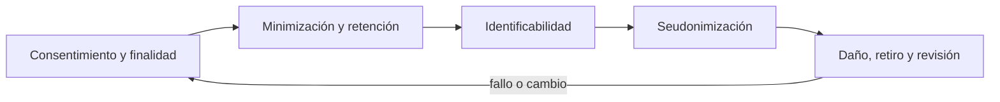
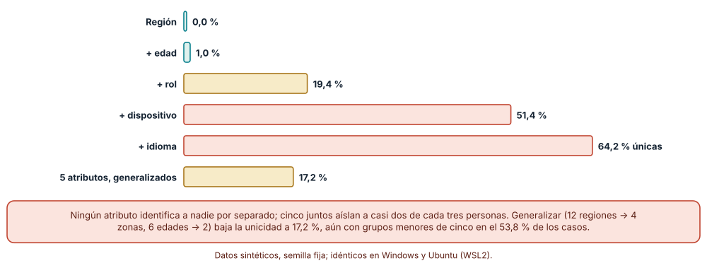
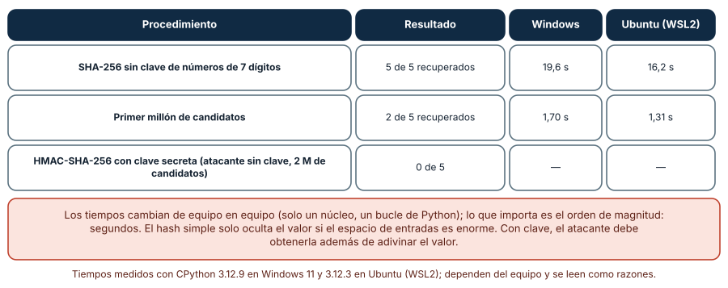
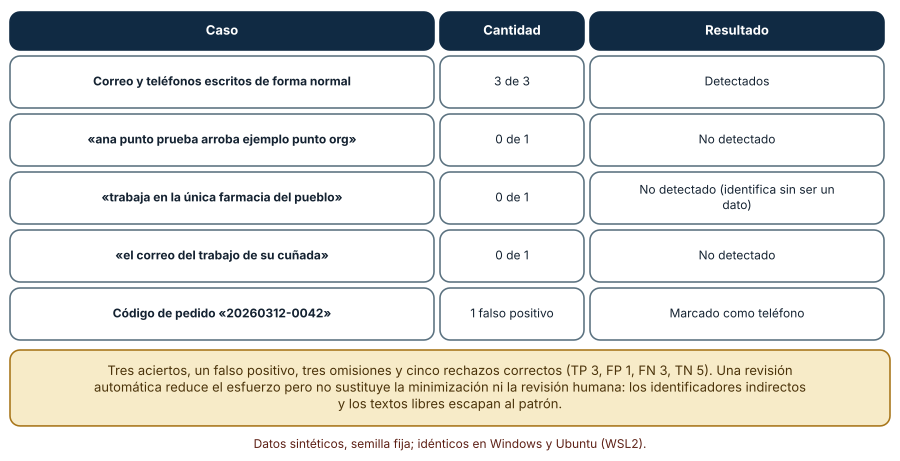

# SE-129 — Ética del descubrimiento y protección de participantes

[← SE-128 — Priorización por valor, riesgo y aprendizaje](../../classes/part-10-descubrimiento-y-estrategia-de-producto/se-128-priorizacion-por-valor-riesgo-y-aprendizaje/README.md) · [↑ Parte 10](../../classes/part-10-descubrimiento-y-estrategia-de-producto/README.md) · [📚 Índice completo](../../classes/README.md) · [🌐 Portal](../../site/classes/SE-129.html) · [SE-130 — Criterios de no éxito y decisiones de abandono →](../../classes/part-10-descubrimiento-y-estrategia-de-producto/se-130-criterios-de-no-exito-y-decisiones-de-abandono/README.md)

## Punto profesional y fundamento pedagógico

**Punto profesional.** La clase existe para investigar con personas sin dañarlas: pedir consentimiento con información suficiente, recoger y conservar solo lo necesario, medir con qué facilidad un conjunto de datos «anónimo» identifica a alguien y poder retirar lo que una persona aportó.

**Por qué aparece aquí.** Se sitúa después de **Priorización por valor, riesgo y aprendizaje** y antes de **Criterios de no éxito y decisiones de abandono**: `SE-128` dejó un registro de priorización que incluye pruebas y entrevistas con personas reales; antes de ejecutarlas hay que decidir qué se recoge, cómo se protege y cuándo se borra. Esta clase fija el protocolo ético y de protección que `SE-130` (criterios de abandono) y `SE-132` (brief) citarán como condición para usar cualquier evidencia.

**Error conceptual que debe corregir.** Creer que quitar el nombre vuelve anónimo un conjunto de datos, que un hash es un seudónimo seguro y que el consentimiento se agota con una casilla marcada.

**Secuencia de aprendizaje.** Antes de leer la solución, predices qué fracción de 500 participantes queda identificable cuando se combinan cinco atributos inocuos, cuánto tarda en revertirse un hash de un identificador de siete dígitos y qué datos personales deja pasar un detector de expresiones regulares; luego ejecutas los tres experimentos, explicas cada resultado y reconstruyes sin apoyo qué debe contener un protocolo de investigación con personas. La secuencia usa predicción, explicación propia, contraste y recuperación. [ICAP](https://icap.education.asu.edu/research) distingue participación de construcción de conocimiento; [How People Learn II](https://nap.nationalacademies.org/catalog/24783/how-people-learn-ii-learners-contexts-and-cultures) exige conectar conocimiento previo, contexto y transferencia; la [práctica de recuperación](https://pubmed.ncbi.nlm.nih.gov/16507066/) respalda producir de nuevo la explicación tras una demora; y [Education for Life and Work](https://nap.nationalacademies.org/resource/13398/dbasse_084153.pdf) exige devolución que explique la causa del error.

**Evidencia de aprendizaje.** `ethics-protocol.md` con la finalidad, los datos recogidos y su justificación, el consentimiento y la forma de retirarlo, la medida de unicidad del conjunto, la técnica de seudonimización con su clave y la política de retención y borrado. Debe contener predicción previa, observación, explicación causal, contraejemplo, criterio de aceptación y una nota de qué dato haría cambiar la conclusión.

**Límite de la conclusión.** Los participantes, atributos e identificadores son sintéticos y los tiempos de hash son de un equipo; el protocolo describe una práctica razonable, no asesoría legal ni sustituye la revisión de un comité ético o de un delegado de protección de datos.

### Trazabilidad fuente → afirmación

| Fuente primaria u oficial | Afirmación que respalda | Lo que no prueba |
|---|---|---|
| [The Menlo Report (U.S. Department of Homeland Security)](https://www.dhs.gov/publication/menlo-report) | Adapta los principios éticos de la investigación con personas —respeto por las personas, beneficencia, justicia— a la investigación en tecnologías de la información y las comunicaciones, y añade el respeto por la ley y el interés público. | No sustituye la normativa aplicable ni resuelve casos concretos. |
| [Reglamento (UE) 2016/679 (RGPD)](https://eur-lex.europa.eu/eli/reg/2016/679/oj) | Establece principios como la minimización de datos y la limitación del plazo de conservación, define la seudonimización y fija condiciones para el consentimiento, incluida la posibilidad de retirarlo. | Es una norma de la UE; la que rige tu proyecto depende de dónde estén las personas y de quién trate los datos. |
| [Sweeney: Simple Demographics Often Identify People Uniquely](https://dataprivacylab.org/projects/identifiability/paper1.pdf) | Muestra que combinaciones de pocos atributos demográficos corrientes bastan para identificar de forma única a una parte considerable de una población. | No dice qué atributos te identifican en tu conjunto: eso se mide con tus datos. |

## Antes de empezar

Esta clase continúa **el caso de la plataforma de entregas**. Recupera el registro de priorización de `SE-128` (pruebas y entrevistas planificadas), añade una decisión propia sobre **qué se le puede pedir y quitar a una persona y cómo se protege** y deja un protocolo que `SE-130` y `SE-132` exigirán. La pregunta activa es: **¿qué es lo mínimo que necesito saber de esta persona, y qué pasa si alguien más lo ve?**

## Prerrequisitos

- Haber completado `SE-128` o reconstruir qué pruebas y entrevistas planifica el registro.
- Python 3.11 o posterior; solo se usa la biblioteca estándar (`hashlib`, `hmac`, `re`).
- Trabajar con participantes e identificadores sintéticos: no uses datos de personas reales.

## Problema auténtico

El equipo publicó, para que otro equipo analizara, una tabla de 500 participantes de un piloto: identificador con hash, región, rango de edad, rol, dispositivo e idioma. «No tiene nombres ni correos», dijo. Un revisor externo identifica a una docente que usa un idioma poco frecuente en una región pequeña y, probando los diez millones de identificadores posibles, recupera todos los números detrás de los hashes.

## Objetivos observables

Al terminar podrás:

1. definir finalidad y datos mínimos de una investigación y redactar un consentimiento que permita retirarse;
2. medir la unicidad de un conjunto sintético al combinar atributos y reducirla con generalización;
3. explicar por qué un hash sin clave no es un seudónimo seguro en un espacio pequeño y cuándo una clave lo corrige;
4. evaluar un detector automático de datos personales con precisión y exhaustividad y reconocer lo que no ve;
5. redactar una política de retención, borrado y retirada que otra persona pueda ejecutar.

## Mapa conceptual



El mapa se lee como una cadena de razonamiento, no como fases obligatorias. La flecha de retorno indica que una unicidad alta, un seudónimo reversible o un dato personal detectado en lugar equivocado obliga a revisar la finalidad y la minimización; no autoriza a mantener el dato porque «ya está recogido».

## Temas y por qué importan

| Tema | Por qué cambia una decisión profesional | Evidencia mínima |
|---|---|---|
| Consentimiento y finalidad | Sin finalidad declarada y consentimiento revocable, la evidencia se obtiene de personas que no sabían para qué. | Predicción, traza causal y contraejemplo de **Consentimiento y finalidad** en `ethics-protocol.md` |
| Minimización y retención | El dato que no se recoge no puede filtrarse; el que se conserva sin plazo es una deuda. | Predicción, traza causal y contraejemplo de **Minimización y retención** en `ethics-protocol.md` |
| Identificabilidad | Varios atributos inocuos, combinados, pueden identificar a una persona; quitar el nombre no basta. | Predicción, traza causal y contraejemplo de **Identificabilidad** en `ethics-protocol.md` |
| Seudonimización | Sustituir un identificador por otro es útil solo si el atacante no puede revertir la sustitución. | Predicción, traza causal y contraejemplo de **Seudonimización** en `ethics-protocol.md` |
| Daño, retiro y revisión | La ética no termina en el consentimiento: hay que anticipar quién puede salir perjudicado y poder detenerse. | Predicción, traza causal y contraejemplo de **Daño, retiro y revisión** en `ethics-protocol.md` |

## Conceptos y decisiones

### 1. Consentimiento y finalidad

Un consentimiento válido dice quién investiga, para qué, qué se recoge, cuánto tiempo se conserva, quién lo verá y cómo retirarse, en un lenguaje que la persona entienda y sin presión (la nota o el acceso a un servicio no pueden depender de participar). La finalidad limita: un dato recogido para entender plazos no se reutiliza para evaluar a la persona. Retirarse debe ser tan fácil como entrar y debe incluir el borrado de lo aportado cuando sea técnicamente posible. El consentimiento no es una casilla: es un proceso que se repite si la finalidad cambia.

### 2. Minimización y retención

Para cada campo se responde: ¿qué decisión cambia si lo tengo? Si ninguna, no se recoge. La edad exacta puede sobrar frente a un rango; la región exacta, frente a una zona; la grabación, frente a notas. La retención tiene fecha: transcripciones sin identificar, un año; datos de contacto, hasta el fin del piloto; grabaciones, hasta transcribirse. Los plazos figuran en el protocolo y alguien responsable verifica el borrado. La minimización también protege al equipo: reduce lo que debe custodiar y lo que puede perder.

### 3. Identificabilidad

Un cuasi-identificador es un atributo que no identifica por sí mismo pero sí junto con otros: región, rango de edad, rol, dispositivo e idioma. El k-anonimato exige que cada combinación aparezca en al menos k personas; si una combinación es única (k = 1), esa persona es reconocible por quien conozca esos atributos. La unicidad crece rápidamente con el número de atributos y depende del tamaño del grupo. Se reduce generalizando (rangos más amplios, zonas más grandes), suprimiendo registros atípicos y limitando quién recibe qué.

### 4. Seudonimización

Un hash sin clave de un identificador de siete dígitos no protege: quien conozca el formato puede calcular el hash de los diez millones de valores posibles y comparar, y la misma tabla sirve para todos los registros. Un código de autenticación con clave secreta (HMAC) obliga a conocer la clave; la clave se guarda aparte, con acceso restringido, y se destruye cuando la finalidad termina. Incluso así, el dato seudonimizado sigue siendo personal para la normativa de protección de datos, porque la reidentificación es posible con la información adicional.

### 5. Daño, retiro y revisión

Antes de empezar se pregunta qué daño puede causar la actividad (revelar una nota baja, exponer a alguien ante su docente, inducir una conducta) y a quién; qué grupos cargan con el riesgo y cuáles reciben el beneficio (justicia); y qué señal detiene la actividad. Una revisión por alguien ajeno al equipo detecta lo que el equipo no ve. La honestidad con los participantes —incluida la explicación posterior de pruebas como una puerta falsa o un mago de Oz (`SE-127`)— es parte del protocolo, no un adorno.

### Cuántas personas quedan identificables al combinar atributos

Generamos 500 participantes sintéticos con cinco atributos: región (12 valores), rango de edad (6), rol (5), dispositivo (4) e idioma (3), con distribuciones desiguales como en la realidad. Para cada combinación de los primeros 1, 2, 3, 4 y 5 atributos contamos cuántos participantes son únicos (su combinación aparece una sola vez) y el valor mínimo de k. Predicción antes de ejecutar: con un atributo nadie es único; con cinco, una parte importante sí.

```python
claves = [tuple(p[c] for c in cols) for p in personas]
cuenta = Counter(claves)
unicos = sum(1 for k in claves if cuenta[k] == 1) / len(claves)
```

Resultados: región sola: 0,0 % únicos (k mínimo 35); región + edad: 1,0 %; + rol: 19,4 % (el 69,0 % en grupos menores de cinco); + dispositivo: 51,4 % (97,4 % en grupos menores de cinco); + idioma: 64,2 % únicos. Generalizar —12 regiones en 4 zonas y 6 rangos de edad en 2— baja la unicidad con los cinco atributos a 17,2 %, aunque el 53,8 % sigue en grupos menores de cinco y el k mínimo sigue siendo 1. Ningún atributo identifica por sí mismo; cinco juntos aíslan a casi dos de cada tres personas. Idéntico en Windows y Ubuntu.



**Cómo leer la figura.** Cada barra añade un atributo a la anterior; la última, más corta, muestra el efecto de generalizar. **Dónde deja de valer:** los atributos son sintéticos, independientes entre sí y con distribuciones elegidas por el autor; en un conjunto real la unicidad depende de las correlaciones (rol y dispositivo suelen estar ligados) y del tamaño de la población. Aún con k alto, un atributo sensible homogéneo en el grupo revela información sin reidentificar a nadie.

### Un hash sin clave se revierte en segundos

Seudonimizamos cinco identificadores sintéticos de siete dígitos con SHA-256 sin clave y los guardamos en un diccionario hash → identificador. Recorremos todos los números de 0 a 9 999 999, calculamos su hash y comparamos con el diccionario; con un solo recorrido se recuperan los cinco, porque el diccionario sirve para todos. Después repetimos con HMAC-SHA-256 y una clave secreta: el atacante, que no la tiene, solo puede calcular hashes simples y compararlos. Predicción antes de ejecutar: el hash sin clave cae en segundos; el HMAC resiste.

```python
objetivo = {hashlib.sha256(i.encode()).hexdigest(): i for i in ids}
for n in range(10**7):
    h = hashlib.sha256(f"{n:07d}".encode()).hexdigest()
    if h in objetivo:
        recuperados[h] = f"{n:07d}"
```

Resultados: el primer millón de candidatos tardó 1,70 s en Windows (CPython 3.12.9) y 1,31 s en Ubuntu (WSL2, 3.12.3) y recuperó 2 de 5 identificadores; el espacio completo de diez millones tardó 19,6 s y 16,2 s respectivamente y recuperó 5 de 5. Contra HMAC con clave, dos millones de candidatos produjeron 0 coincidencias. Los tiempos son de una sola ejecución en un solo núcleo y un bucle de Python; con herramientas especializadas serían mucho menores. Lo importante es el orden de magnitud: segundos, no años.



**Cómo leer la figura.** Las dos primeras filas son el ataque al hash simple (primer millón y espacio completo) y la última el ataque contra HMAC; las dos columnas de la derecha dan los tiempos medidos en cada sistema. **Dónde deja de valer:** el ataque funciona porque el espacio de identificadores es pequeño y conocido; con un identificador aleatorio de 128 bits el hash simple no se revierte por enumeración, aunque sigue permitiendo vincular registros. Una sal por registro encarece el ataque en proporción al número de registros (no se midió aquí), y una clave filtrada anula el HMAC.

### Un detector de datos personales: lo que ve y lo que deja pasar

Para revisar notas de investigación antes de compartirlas se escribió un detector con dos expresiones regulares (correos y secuencias de 9–10 dígitos que parecen teléfonos). Se aplicó a doce notas sintéticas etiquetadas a mano: seis con datos personales y seis sin ellos. Predicción antes de ejecutar: encuentra los casos con formato y se le escapan los que no lo tienen.

```python
EMAIL = re.compile(r"[\w.+-]+@[\w-]+\.[\w.-]+")
PHONE = re.compile(r"(?<!\d)(?:\+?\d{1,3}[ -]?)?(?:\d[ -]?){8,10}(?!\d)")
marcada = bool(EMAIL.search(texto)) or bool(PHONE.search(texto))
```

Resultados: 3 verdaderos positivos (un correo y dos teléfonos con formato), 1 falso positivo (el código de pedido «20260312-0042» se lee como teléfono), 3 falsos negativos y 5 verdaderos negativos. Precisión 0,75 y exhaustividad 0,50. Se le escaparon un correo ofuscado en palabras («ana punto prueba arroba ejemplo punto org»), una identificación indirecta («trabaja en la única farmacia del pueblo») y una pista sobre el empleador («el correo del trabajo de su cuñada»). Idéntico en Windows y Ubuntu.



**Cómo leer la figura.** Cada fila agrupa un tipo de caso; la columna «Resultado» dice si el detector lo ve. **Dónde deja de valer:** doce notas son una muestra diminuta y los patrones se escribieron conociendo el tipo de dato; en texto real habría nombres, direcciones y datos indirectos mucho más variados. Un detector reduce el trabajo, pero un 0,50 de exhaustividad significa que la mitad de los datos pasa: no sustituye la minimización ni la lectura humana.

## Definiciones de trabajo

- **consentimiento y finalidad:** acuerdo informado y libre de una persona a participar, para fines declarados, con la posibilidad real de retirarse.
- **minimización y retención:** recoger solo lo necesario para la finalidad declarada y borrarlo cuando deja de serlo.
- **identificabilidad:** posibilidad de distinguir a una persona de otras en un conjunto de datos, directamente o combinando atributos (cuasi-identificadores).
- **seudonimización:** reemplazo de un identificador por un seudónimo de modo que la persona solo pueda reidentificarse con información adicional guardada aparte.
- **daño, retiro y revisión:** evaluación previa de los daños posibles, criterio para detener la actividad y revisión por una persona ajena al equipo.

Las definiciones son operativas para la plataforma de entregas. No convierten términos con historia más amplia en sinónimos y deben contrastarse con la documentación primaria enlazada al final.

## Ejemplo mínimo

Un fragmento mínimo que mide la unicidad de una tabla. Antes de ejecutarlo, predice el valor de k mínimo con dos atributos.

```python
from collections import Counter

personas = [
    ("R1", "18-24", "estudiante"), ("R1", "18-24", "estudiante"),
    ("R1", "25-34", "docente"), ("R2", "25-34", "familia"),
]
cuenta = Counter((r, e) for r, e, _ in personas)
assert min(cuenta.values()) == 1                 # hay una combinación única
cuenta3 = Counter(personas)
unicos = sum(1 for p in personas if cuenta3[p] == 1)
assert unicos == 2                                # con tres atributos, dos personas son únicas
```

Registra versión, comando y salida. Con más atributos, más personas son únicas; la decisión de qué publicar se toma mirando k mínimo y el porcentaje en grupos pequeños, no pensando que «no hay nombres».

## Ejemplo profesional

En la plataforma de entregas, el protocolo conserva: finalidad, datos recogidos con la decisión que justifica cada uno, base y forma de consentimiento, modo de retirarse, plazos de retención y borrado, quién accede a qué, técnica de seudonimización con ubicación de la clave, medida de unicidad del conjunto que se comparte y revisor externo. El contrato es que ninguna persona pasa a un conjunto compartido sin que el protocolo indique su k mínimo y que la clave de seudonimización se guarde separada de los datos.

Compara el caso normal con una persona que se retira a mitad del estudio, con un docente que aparece en una cita, con un menor y con un grupo tan pequeño que cualquier atributo identifica. Un protocolo es apropiado cuando esas situaciones tienen respuesta escrita; es peligroso cuando se improvisan.

## Práctica guiada

1. Escribe la finalidad en una frase y, para cada campo, la decisión que cambiaría si lo tuvieras; elimina los que no cambian ninguna.
2. Redacta el consentimiento con quién investiga, para qué, qué se recoge, cuánto se guarda, quién lo ve y cómo retirarse.
3. Genera 500 participantes sintéticos y mide la unicidad con 1 a 5 atributos.
4. Generaliza atributos hasta que el k mínimo sea al menos 5 o suprime los registros atípicos, y mide lo que pierdes.
5. Seudonimiza un identificador con HMAC y guarda la clave aparte; comprueba que el hash simple se revierte y el HMAC no.
6. Ejecuta el detector de datos personales y anota lo que deja pasar; añade una revisión humana.
7. Pide a otra persona que ejecute el borrado de un participante usando solo `ethics-protocol.md`.

## Ejercicios

1. **Unicidad:** repite la medición con 2 000 y con 100 participantes y explica cómo cambia el porcentaje de únicos con el tamaño del grupo.
2. **Generalización:** encuentra una combinación de rangos con la que k mínimo ≥ 5 y estima cuánta información de región y edad se pierde.
3. **Hash:** calcula cuánto tardaría en revertirse un identificador de 10 dígitos con la velocidad medida y decide si el hash simple sería aceptable; justifica.
4. **Detector:** añade una expresión para nombres propios con prefijo («Sra.», «Dr.») y mide precisión y exhaustividad en las doce notas y en cinco nuevas que escribas.

## Reto verificable

Entrega `ethics-protocol.md` con la finalidad, los datos justificados, el consentimiento y la forma de retirarlo, la unicidad medida del conjunto compartido, la técnica de seudonimización con su clave guardada aparte y la política de retención. Se aprueba si otra persona ejecuta la medición, obtiene el mismo porcentaje de únicos y puede ejecutar el borrado de un participante sin ayuda oral. No se aprueba por tener un formulario de consentimiento ni por usar un hash.

## Caso conductor

La plataforma de entregas planea entrevistar a estudiantes y docentes y probar una puerta falsa. El protocolo limita los datos a rol, zona y dispositivo en rangos, guarda un código por participante con HMAC y retira las grabaciones tras transcribirlas. Cambia después un solo dato recogido —por ejemplo, añadir el idioma— y revisa qué cambia en la unicidad y en la política de retención.

## Preguntas frecuentes

### ¿Si quito nombres y correos, los datos son anónimos?

No necesariamente: cinco atributos corrientes aislaron a 64,2 % de 500 personas sintéticas. Un conjunto es anónimo si nadie puede reidentificar a una persona con medios razonables; eso se mide (k mínimo, porcentaje en grupos pequeños) y no se presume.

### ¿Un hash es un seudónimo seguro?

Solo si el espacio de entradas es enorme o si se usa con clave. Un identificador de siete dígitos con SHA-256 sin clave se revirtió completo en 16–20 s. Usa HMAC con una clave guardada aparte o un identificador aleatorio sin relación con el original.

### ¿Puedo usar datos que recogí para otra cosa si los anonimizo?

Si la nueva finalidad es compatible con la original y el consentimiento la cubre, puede ser válido; si no, no. «Anonimizar» no legitima por sí solo un uso que las personas no esperaban. Regístralo en el protocolo y pide revisión.

### ¿Basta con un detector automático para revisar notas antes de compartirlas?

No: con precisión 0,75 y exhaustividad 0,50, la mitad de los datos personales pasa. Úsalo como primer filtro, combínalo con minimización y haz una revisión humana de lo que sale.

## Fallo controlado y diagnóstico

Reproduce el fallo de la clase: **publicar un conjunto «anónimo» con identificadores con hash y varios cuasi-identificadores**. Genera los 500 participantes sintéticos, reemplaza el identificador por su SHA-256 y publica región, edad, rol, dispositivo e idioma.

Registra síntoma, entrada mínima, hipótesis, observación que descarta cada hipótesis, causa, corrección y prueba de regresión. **Síntoma:** un revisor reconoce a una docente y recupera todos los identificadores. **Hipótesis rivales:** (a) el revisor tenía información privilegiada; (b) el conjunto era reidentificable con medios públicos. **Prueba:** el 64,2 % de los participantes es único con los cinco atributos y el espacio de 10⁷ identificadores se recorre en menos de 20 s: no hace falta información privilegiada. **Conclusión:** el conjunto no era anónimo ni estaba seudonimizado de forma segura. **Regresión:** añade al protocolo un umbral (k mínimo ≥ 5 antes de compartir), HMAC con clave aparte y una prueba que falle si se publica una tabla sin esa medición. No cambies a la vez los atributos y la técnica de seudonimización.

## Errores comunes y cómo corregirlos

| Síntoma | Causa probable | Corrección |
|---|---|---|
| Un revisor identifica a una persona en una tabla sin nombres | Se combinaron cuasi-identificadores que la hacían única | Medir k mínimo, generalizar o suprimir y no publicar combinaciones con k menor que el umbral |
| Los identificadores con hash se recuperan con un script corto | Hash sin clave sobre un espacio pequeño | Usar HMAC con clave guardada aparte o identificadores aleatorios sin relación con el original |
| Una persona pide que borren sus datos y nadie sabe dónde están | No hay inventario ni responsable de borrado | Mantener un inventario de dónde se guarda cada dato y un procedimiento de retirada ejecutable |
| Una nota compartida incluye un correo ofuscado | El detector solo busca formatos exactos | Combinar detector, minimización en origen y lectura humana antes de compartir |
| Las grabaciones siguen guardadas dos años después del estudio | No hay plazo de retención ni responsable de verificarlo | Fijar plazos por tipo de dato en el protocolo y registrar la verificación del borrado |

## Entorno y archivos clave

```text
work/SE-129/
├── README.md
├── privacy/
│   ├── unicidad.py
│   ├── hash_vs_hmac.py
│   └── detector.py
├── fixtures/participantes_sinteticos.json
├── tests/test_unicidad.py
└── evidence/ethics-protocol.md
```

El `README` declara plataforma, versiones, semilla y comandos. Los scripts usan solo `hashlib`, `hmac`, `re`, `random` y `collections` y se ejecutaron con CPython 3.12.9 en Windows 11 y 3.12.3 en Ubuntu bajo WSL2; los resultados fueron idénticos salvo los tiempos de hash, que se informan como medidas de un equipo. La clave de ejemplo es de prueba y no debe usarse en ningún sistema real.

## Seguridad, ética y accesibilidad

- no uses datos reales de participantes para ensayar estas medidas: genera datos sintéticos;
- la clave de seudonimización se guarda fuera del repositorio y del conjunto de datos, con acceso restringido y registro de uso;
- si el conjunto incluye menores, personas en relación de dependencia (estudiantes y su docente) o datos sensibles, aplica una revisión más estricta y consentimiento reforzado;
- no ocultes a las personas que participan en una prueba: explica después lo que no era real y ofrece una salida;
- ofrece una alternativa textual a las tablas y no uses color como única señal;
- atribuye las plantillas de consentimiento que adaptes y respeta sus licencias.

## Puente hacia el trabajo con agentes

Un agente con acceso a transcripciones puede copiarlas a un servicio externo, resumirlas con nombres incluidos o pegar una cita identificable en un informe. Pídele que trabaje solo con el conjunto minimizado y seudonimizado, que no envíe texto fuera del entorno aprobado, que ejecute el detector y marque lo que no puede decidir, y que registre cada acceso. Revisa especialmente si copia citas completas a documentos compartidos y si reconstruye identidades a partir de varios atributos: es el error de esta clase con herramientas de resumen.

## Transferencia

Traslada el protocolo a otro dominio persistente (por ejemplo, un servicio financiero): cambia los datos recogidos, el riesgo de daño y la normativa aplicable, conserva la medida de unicidad, la seudonimización con clave y la política de retirada. La transferencia está lograda cuando puedes explicar qué dato del nuevo dominio juega el papel del idioma raro en una región pequeña.

## Evaluación y evidencia

| Criterio | Evidencia para aprobar |
|---|---|
| comprensión | explicación causal de por qué quitar nombres no anonimiza y de por qué un hash simple no seudonimiza |
| corrección | unicidad, reversión del hash y métricas del detector reproducibles con la misma semilla |
| diseño | protocolo con finalidad, datos justificados, consentimiento, retención y borrado |
| diagnóstico | reproducción del fallo «conjunto anónimo reidentificable» con regresión |
| responsabilidad | evaluación de daños, revisión externa y honestidad con las personas |
| reproducibilidad | versiones, comandos, salida y límites declarados |


## Fuentes


- [The Menlo Report (U.S. Department of Homeland Security)](https://www.dhs.gov/publication/menlo-report) — principios éticos para la investigación en tecnologías de la información; autoridad: U.S. Department of Homeland Security.
- [Reglamento (UE) 2016/679 (RGPD)](https://eur-lex.europa.eu/eli/reg/2016/679/oj) — minimización, limitación de la conservación, seudonimización y consentimiento; autoridad: Unión Europea.
- [U.S. eCFR, 45 CFR Part 46: Protection of Human Subjects](https://www.ecfr.gov/current/title-45/subtitle-A/subchapter-A/part-46) — normas federales de protección de sujetos humanos, incluido el consentimiento informado; autoridad: Electronic Code of Federal Regulations.
- [Sweeney: Simple Demographics Often Identify People Uniquely](https://dataprivacylab.org/projects/identifiability/paper1.pdf) — identificación única a partir de pocos atributos demográficos; autoridad: Data Privacy Lab, Carnegie Mellon University.
- [NIST Privacy Framework](https://www.nist.gov/privacy-framework) — marco para gestionar el riesgo de privacidad; autoridad: NIST.
- [RFC 2104: HMAC](https://www.rfc-editor.org/rfc/rfc2104) — definición del código de autenticación de mensajes con clave; autoridad: IETF.

Cada fuente respalda el mecanismo indicado; ninguna demuestra que el protocolo de la plataforma cumpla la normativa que le aplica ni que sea éticamente suficiente. Esa afirmación depende de la revisión de un comité o responsable competente y de los hechos del proyecto.

- [Python: `hashlib`](https://docs.python.org/3/library/hashlib.html) — funciones hash usadas en la reversión del seudónimo.
- [Python: `hmac`](https://docs.python.org/3/library/hmac.html) — código de autenticación con clave usado como seudónimo.
- [Python: `re`, expresiones regulares](https://docs.python.org/3/library/re.html) — sintaxis de las expresiones del detector y sus límites.

## Límites y siguiente paso

Se ejecutaron tres experimentos con datos sintéticos en Windows y Ubuntu (WSL2); los resultados fueron idénticos salvo los tiempos de hash, que se informan como medidas de un solo equipo. No se recogieron datos de personas, no se consultó a un comité ético ni a un especialista legal, y la normativa aplicable depende del lugar del proyecto. La siguiente clase define cuándo una investigación debe detenerse.

## Glosario

- **consentimiento y finalidad:** acuerdo informado y libre de una persona a participar, para fines declarados, con la posibilidad real de retirarse.
- **minimización y retención:** recoger solo lo necesario para la finalidad declarada y borrarlo cuando deja de serlo.
- **identificabilidad:** posibilidad de distinguir a una persona de otras en un conjunto de datos, directamente o combinando atributos (cuasi-identificadores).
- **seudonimización:** reemplazo de un identificador por un seudónimo de modo que la persona solo pueda reidentificarse con información adicional guardada aparte.
- **daño, retiro y revisión:** evaluación previa de los daños posibles, criterio para detener la actividad y revisión por una persona ajena al equipo.

---

[← SE-128 — Priorización por valor, riesgo y aprendizaje](../../classes/part-10-descubrimiento-y-estrategia-de-producto/se-128-priorizacion-por-valor-riesgo-y-aprendizaje/README.md) · [↑ Parte 10](../../classes/part-10-descubrimiento-y-estrategia-de-producto/README.md) · [📚 Índice completo](../../classes/README.md) · [🌐 Portal](../../site/classes/SE-129.html) · [SE-130 — Criterios de no éxito y decisiones de abandono →](../../classes/part-10-descubrimiento-y-estrategia-de-producto/se-130-criterios-de-no-exito-y-decisiones-de-abandono/README.md)
