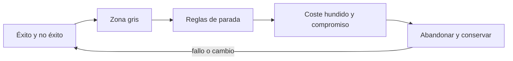
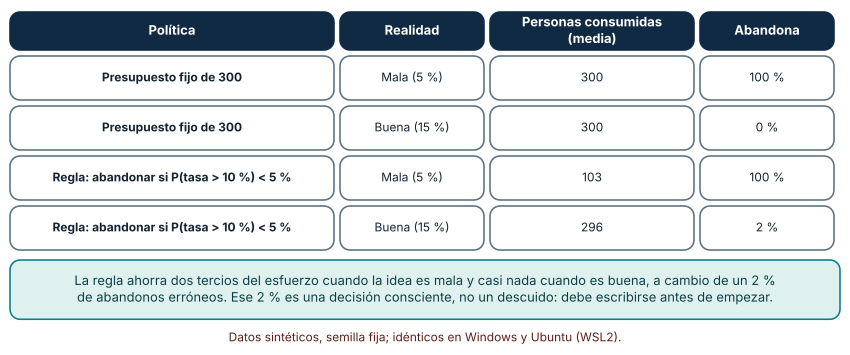
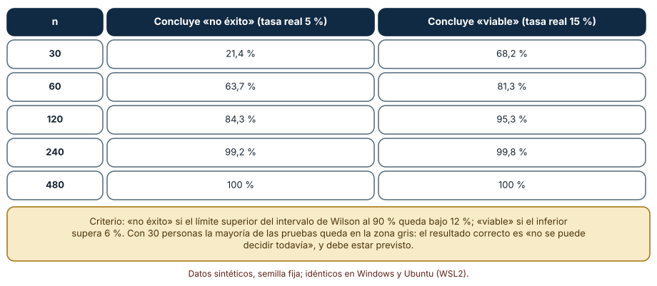
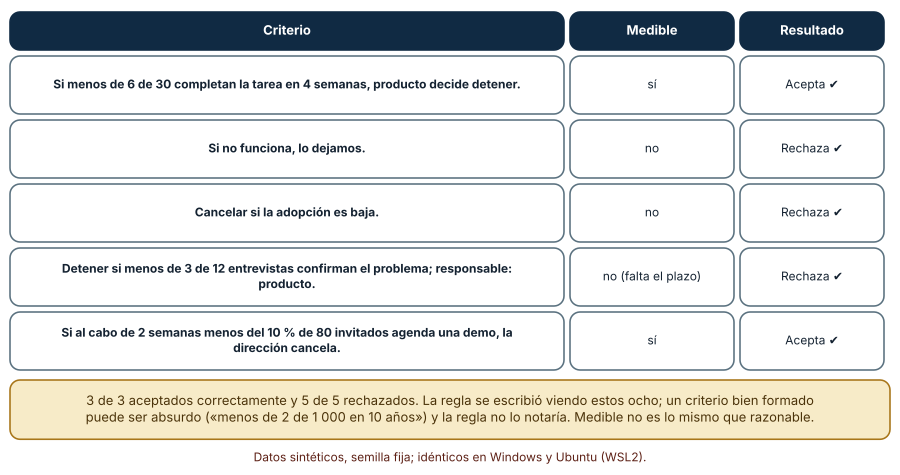

# SE-130 — Criterios de no éxito y decisiones de abandono

[← SE-129 — Ética del descubrimiento y protección de participantes](../../classes/part-10-descubrimiento-y-estrategia-de-producto/se-129-etica-del-descubrimiento-y-proteccion-de-participantes/README.md) · [↑ Parte 10](../../classes/part-10-descubrimiento-y-estrategia-de-producto/README.md) · [📚 Índice completo](../../classes/README.md) · [🌐 Portal](../../site/classes/SE-130.html) · [SE-131 — Taller: convertir una petición en un problema investigable →](../../classes/part-10-descubrimiento-y-estrategia-de-producto/se-131-taller-convertir-una-peticion-en-un-problema-investigable/README.md)

## Punto profesional y fundamento pedagógico

**Punto profesional.** La clase existe para decidir antes de empezar qué resultado significará «no» y qué se hará entonces: criterios medibles de no éxito, reglas de parada con su costo de error y una zona gris reconocida como tal.

**Por qué aparece aquí.** Se sitúa después de **Ética del descubrimiento y protección de participantes** y antes de **Taller: convertir una petición en un problema investigable**: `SE-129` dejó un protocolo que limita qué se puede probar y con quién; ahora hay que decidir cuándo dejar de probar. Esta clase fija criterios de no éxito y de abandono con umbral, ventana y responsable, y calcula qué muestra hace falta para que «no hay evidencia» no se confunda con «la idea es mala». Su documento es la condición de salida que `SE-132` exigirá al brief.

**Error conceptual que debe corregir.** Seguir hasta que algo funcione, mover la meta cuando el resultado no llega y confundir un experimento inconcluso con una prueba de que la idea fracasó o de que prospera.

**Secuencia de aprendizaje.** Antes de leer la solución, predices cuánto ahorra una regla de abandono definida de antemano cuando la idea es mala, cuántas personas hacen falta para distinguir una tasa del 5 % de una del 15 % y qué criterios de una lista son realmente medibles; luego simulas, explicas cada resultado y reconstruyes sin apoyo cómo se redacta un criterio de abandono con umbral, ventana y responsable. La secuencia usa predicción, explicación propia, contraste y recuperación. [ICAP](https://icap.education.asu.edu/research) distingue participación de construcción de conocimiento; [How People Learn II](https://nap.nationalacademies.org/catalog/24783/how-people-learn-ii-learners-contexts-and-cultures) exige conectar conocimiento previo, contexto y transferencia; la [práctica de recuperación](https://pubmed.ncbi.nlm.nih.gov/16507066/) respalda producir de nuevo la explicación tras una demora; y [Education for Life and Work](https://nap.nationalacademies.org/resource/13398/dbasse_084153.pdf) exige devolución que explique la causa del error.

**Evidencia de aprendizaje.** `stop-rules.md` con los criterios de éxito y de no éxito, la zona gris, la regla de parada y su costo de error simulado, el responsable de la decisión y lo que se conserva al abandonar. Debe contener predicción previa, observación, explicación causal, contraejemplo, criterio de aceptación y una nota de qué dato haría cambiar la conclusión.

**Límite de la conclusión.** Las tasas (5 %, 10 %, 15 %), los tamaños y las reglas son supuestos y datos sintéticos; la regla de parada no se probó con un piloto real y el linter de criterios se afinó con ocho ejemplos escritos por el autor.

### Trazabilidad fuente → afirmación

| Fuente primaria u oficial | Afirmación que respalda | Lo que no prueba |
|---|---|---|
| [GOV.UK Service Manual: How the discovery phase works](https://www.gov.uk/service-manual/agile-delivery/how-the-discovery-phase-works) | Señala que lo aprendido en la discovery debe ayudar a decidir si avanzar a la fase siguiente, que puede ser razonable detenerse al final de la discovery y que no se debe empezar a construir el servicio en ella. | No fija umbrales ni tamaños de muestra concretos. |
| [The Lean Startup: principios](https://theleanstartup.com/principles) | Plantea que, si las métricas no mueven el modelo de negocio, es momento de pivotar o hacer una corrección estructural y probar una hipótesis fundamental nueva. | No define cuándo exactamente se activa esa decisión. |
| [Johari, Pekelis y Walsh: Always Valid Inference](https://arxiv.org/abs/1512.04922) | Muestra que decidir el tamaño de la muestra monitoreando continuamente invalida la inferencia clásica y propone inferencia secuencial válida en cualquier momento. | No prescribe el umbral de abandono de tu proyecto. |

## Antes de empezar

Esta clase continúa **el caso de la plataforma de entregas**. Recupera el plan de experimento de `SE-127`, el registro de priorización de `SE-128` y el protocolo de `SE-129`, añade una decisión propia sobre **qué resultado haría detener la idea y quién lo decide** y deja un documento de abandono para `SE-131` y `SE-132`. La pregunta activa es: **¿qué tendría que pasar para que dijéramos «no» sin sentir que fracasamos?**

## Prerrequisitos

- Haber completado `SE-129` o reconstruir el protocolo ético y el plan de experimento.
- Python 3.11 o posterior; solo se usa la biblioteca estándar.
- Trabajar con tasas y participantes sintéticos: ninguna cifra procede de un piloto real.

## Problema auténtico

El piloto de recuperación de borradores lleva ocho semanas. El criterio de éxito era «que lo use una proporción razonable» y el de abandono «si no funciona». La tasa de uso es 8 %; el equipo argumenta que «hay que darle más tiempo» y propone añadir una función. Nadie escribió antes qué tasa bastaba, con cuántas personas, en cuántas semanas ni quién decidía detener.

## Objetivos observables

Al terminar podrás:

1. redactar un criterio de no éxito con comparador, umbral, población, ventana y responsable;
2. comparar una regla de abandono definida de antemano con un presupuesto fijo por personas consumidas y por errores;
3. calcular cuántas personas hacen falta para decidir entre una tasa mala y una buena y reconocer la zona gris;
4. distinguir «no hay evidencia suficiente» de «hay evidencia de que no funciona»;
5. documentar qué se conserva al abandonar para que el aprendizaje no se pierda.

## Mapa conceptual



El mapa se lee como una cadena de razonamiento, no como fases obligatorias. La flecha de retorno indica que una zona gris que no se resuelve, un criterio imposible de medir o una regla que abandona ideas buenas obliga a revisar los umbrales; no autoriza a moverlos tras ver el resultado.

## Temas y por qué importan

| Tema | Por qué cambia una decisión profesional | Evidencia mínima |
|---|---|---|
| Éxito y no éxito | Si solo se define el éxito, cualquier resultado intermedio se interpreta como «casi» y la decisión se pospone. | Predicción, traza causal y contraejemplo de **Éxito y no éxito** en `stop-rules.md` |
| Zona gris | Con pocas personas casi todo resultado cae entre «sí» y «no»; el diseño debe prever qué hacer ahí. | Predicción, traza causal y contraejemplo de **Zona gris** en `stop-rules.md` |
| Reglas de parada | Una regla fijada de antemano ahorra recursos cuando la idea es mala y limita cuántas ideas buenas se pierden. | Predicción, traza causal y contraejemplo de **Reglas de parada** en `stop-rules.md` |
| Coste hundido y compromiso | Cuanto más se invirtió, más cuesta abandonar; los criterios previos protegen la decisión de esa presión. | Predicción, traza causal y contraejemplo de **Coste hundido y compromiso** en `stop-rules.md` |
| Abandonar y conservar | Abandonar bien conserva el aprendizaje y deja abiertas otras opciones. | Predicción, traza causal y contraejemplo de **Abandonar y conservar** en `stop-rules.md` |

## Conceptos y decisiones

### 1. Éxito y no éxito

Un criterio de éxito dice qué resultado justifica continuar; uno de no éxito, qué resultado justifica detener. Entre ambos queda una zona intermedia que debe tener su propia decisión (extender hasta una fecha, cambiar el experimento). Un criterio útil tiene cinco elementos: comparador («menos de»), umbral (6 de 30), población (quienes entregaron desde móvil), ventana (4 semanas) y responsable (producto). «Si no funciona, lo dejamos» no tiene ninguno y por eso no se puede incumplir ni cumplir, que es la razón por la que a nadie le molesta escribirlo.

### 2. Zona gris

Si la tasa buena es 15 % y la mala 5 %, con 30 personas muchas pruebas no podrán decir cuál es la real: el resultado «inconcluso» es frecuente. Reconocer la zona gris obliga a decidir de antemano si se amplía la muestra, se acepta la incertidumbre o se cambia de prueba. Equivale a admitir que no todo experimento decide. Un criterio que no admite zona gris suele esconder la decisión real en un empate al que se responde con lo que el equipo ya quería.

### 3. Reglas de parada

Una regla de futilidad abandona si, dado lo observado, la probabilidad de que la tasa real supere el umbral cae por debajo de un valor declarado (por ejemplo, 5 %). Ahorra personas cuando la idea es mala, a costa de un pequeño porcentaje de ideas buenas abandonadas por mala suerte. Ese porcentaje es una elección: se calcula por simulación y se acepta o no. Lo que no vale es decidir sobre la marcha; las reglas secuenciales con garantías (y no el análisis repetido con una prueba clásica) son lo que permite parar antes sin inflar el error.

### 4. Coste hundido y compromiso

Lo gastado no se recupera abandonando ni continuando, y por tanto no debería influir en la decisión; pero a las personas les pesa. Los compromisos previos —criterios con fecha, responsable externo al equipo, revisión por alguien que no construyó la idea— reducen ese peso. Una práctica útil es preguntar «si empezáramos hoy con lo que sabemos, ¿lo haríamos?». Si la respuesta es no, continuar es una nueva inversión que requiere su propia justificación.

### 5. Abandonar y conservar

Abandonar no es borrar. El cierre registra la hipótesis refutada, los datos y la regla que activó el abandono, lo que se desmonta (prototipos, accesos, datos de participantes según `SE-129`), lo que se reutiliza y qué cambio de contexto reabriría la idea. Distingue tres decisiones: detener, pivotar (cambiar una hipótesis fundamental conservando el problema) y perseverar con otro experimento. Documentarlo evita repetir el mismo experimento dos años después y respeta a las personas que participaron.

### Una regla de abandono frente a gastar todo el presupuesto

Simulamos un piloto con presupuesto de 300 personas. Si la tasa real es mala (5 %) o buena (15 %) y el umbral de decisión es 10 %, comparamos dos políticas con 300 repeticiones cada una: presupuesto fijo (se consumen las 300 personas y se decide al final) y regla de futilidad (a partir de 30 personas y cada 10, se abandona si la probabilidad posterior de que la tasa supere el 10 % —con un a priori Beta(1, 1)— es menor de 5 %). Predicción antes de ejecutar: la regla ahorra mucho cuando la idea es mala y casi nada cuando es buena.

```python
if n >= 30 and n % 10 == 0 and p_supera(k, n, 0.10) < 0.05:
    return n, "abandona"
```

Resultados: presupuesto fijo, idea mala: 300 personas y 100 % de abandonos; idea buena: 300 personas y 0 % de abandonos. Regla de futilidad, idea mala: 103 personas en promedio (66 % menos) y 100 % de abandonos; idea buena: 296 personas y 2 % de abandonos erróneos. La regla recorta dos tercios del esfuerzo cuando conviene abandonar, casi no cambia el esfuerzo cuando conviene seguir, y cuesta un 2 % de ideas buenas abandonadas. Ese 2 % es el precio de parar antes y debe quedar escrito. Idéntico en Windows y Ubuntu.



**Cómo leer la figura.** Cada fila combina una política con la realidad (mala o buena); la penúltima columna son las personas consumidas y la última el porcentaje de abandonos. **Dónde deja de valer:** la simulación supone observaciones independientes, una tasa constante y las dos únicas tasas posibles (5 % y 15 %); con tasas cercanas al umbral la regla abandonaría más ideas buenas. El 2 % depende del a priori, del umbral de 5 % y del calendario de comprobación.

### La zona gris: cuántas personas hacen falta para decidir

Queremos distinguir una tasa real de 5 % (no éxito) de una de 15 % (viable). La decisión: concluir «no éxito» si el límite superior del intervalo de Wilson al 90 % queda por debajo de 12 %, y concluir «viable» si el límite inferior supera el 6 %. Para cada tamaño de muestra, 2 000 repeticiones por tasa. Predicción antes de ejecutar: con 30 personas la mayoría de las pruebas no concluye.

```python
lo, hi = wilson(k, n, z=1.644854)
no_exito = hi < 0.12
viable = lo > 0.06
```

Resultados (tasa real 5 %: concluye «no éxito»; tasa real 15 %: concluye «viable»): n = 30: 21,4 % y 68,2 %; n = 60: 63,7 % y 81,3 %; n = 120: 84,3 % y 95,3 %; n = 240: 99,2 % y 99,8 %; n = 480: 100 % y 100 %. Con 30 personas, cuando la idea es mala, solo dos de cada diez pruebas lo concluyen; el resto queda en la zona gris. Hacen falta unas 120 personas para que ambas conclusiones se alcancen con más del 84 %. Idéntico en Windows y Ubuntu.



**Cómo leer la figura.** Cada fila es un tamaño de muestra; la segunda columna es la frecuencia con que una idea mala se descarta y la tercera con que una buena se confirma. **Dónde deja de valer:** los umbrales (12 % y 6 %) y las tasas (5 % y 15 %) son supuestos; si la diferencia entre ambas tasas fuera menor, haría falta mucha más gente. El resultado «inconcluso» es legítimo y debe tener asignada una acción en el documento.

### Criterios de abandono: ¿medibles o ruido?

Para revisar criterios de abandono antes de aprobarlos se escribió una regla con cuatro comprobaciones: un comparador («menos de», «por debajo de»), un número, una ventana de tiempo (semanas, días, una fecha) y un responsable (producto, la dirección, el comité). Se aplicó a ocho criterios etiquetados a mano antes de escribir la regla: tres medibles y cinco que no. Resultado: 3 de 3 aceptados, 5 de 5 rechazados, incluidos «si no funciona, lo dejamos», «cancelar si la adopción es baja» y «seguir hasta que el cliente quede contento». Un criterio rechazado por falta de ventana («detener si menos de 3 de 12 entrevistas confirman el problema; responsable: producto») muestra que la regla exige los cuatro elementos.

La regla acierta porque se afinó con esos ocho; su límite es que valida forma, no sensatez. «Detener si menos de 2 de 1 000 personas completan la tarea en diez años» pasaría y no sirve. Y un criterio mal formado en palabras que la regla no conoce (por ejemplo, «a menos que el piloto no despegue») pasaría o fallaría por azar.



**Cómo leer la figura.** Cada fila es un criterio; la columna central dice si cumple los cuatro elementos y la última el resultado de la regla. **Dónde deja de valer:** ocho ejemplos escritos por el autor no dicen cómo se comportaría con criterios reales; medible no es lo mismo que razonable, y la regla no sustituye la revisión de una segunda persona.

## Definiciones de trabajo

- **éxito y no éxito:** par de umbrales fijados antes de observar: por encima del primero se continúa y por debajo del segundo se abandona o se cambia de rumbo.
- **zona gris:** rango de resultados que no permite distinguir con la confianza declarada entre el éxito y el no éxito.
- **reglas de parada:** procedimiento que, tras cada observación o lote, decide continuar, detener por futilidad o detener por éxito, con tasas de error conocidas.
- **coste hundido y compromiso:** tendencia a continuar un proyecto por lo ya invertido y no por su valor futuro esperado; se contrarresta comprometiendo la decisión de antemano.
- **abandonar y conservar:** cierre explícito de una línea de trabajo que registra qué se aprendió, qué se retira y qué podría reabrirla.

Las definiciones son operativas para la plataforma de entregas. No convierten términos con historia más amplia en sinónimos y deben contrastarse con la documentación primaria enlazada al final.

## Ejemplo mínimo

Un fragmento mínimo con un criterio de abandono ejecutable. Antes de ejecutarlo, predice la decisión para 4 de 30 y para 9 de 30.

```python
CRITERIO = {
    "comparador": "<", "umbral": 6, "de": 30,         # menos de 6 de 30 personas completan la tarea
    "ventana": "4 semanas", "responsable": "producto",
}

def decide(completan, observadas, c=CRITERIO):
    if observadas < c["de"]:
        return "seguir observando"
    return "abandonar" if completan < c["umbral"] else "continuar"

assert decide(4, 30) == "abandonar"
assert decide(9, 30) == "continuar"
assert decide(2, 12) == "seguir observando"     # aún no hay muestra para decidir
```

Registra versión, comando y salida. El criterio es un dato fechado y con responsable, no una frase: cambiar el umbral después de observar equivale a cambiar de criterio y debe registrarse como tal.

## Ejemplo profesional

En la plataforma de entregas, el documento de abandono conserva por cada hipótesis: criterio de éxito, criterio de no éxito, zona gris con su acción, regla de parada y su error simulado, ventana, responsable (externo al equipo que construye), fecha de fijación, y el cierre: qué se aprendió, qué se desmonta, qué reabriría la idea. El contrato es que el criterio se fecha antes de empezar y que cualquier cambio se registra con quién lo aprobó.

Compara el caso normal con un resultado exactamente en el umbral, con una muestra que se queda corta, con una interrupción externa (un incidente) y con un proyecto que pide extender «una semana más». Un documento es apropiado cuando esas situaciones tienen acción asignada; es peligroso cuando se renegocian después de mirar.

## Práctica guiada

1. Reformula la hipótesis principal de `SE-124` con un criterio de éxito y uno de no éxito.
2. Redacta cada criterio con comparador, umbral, población, ventana y responsable.
3. Define la zona gris y asigna la acción para ese caso.
4. Simula el piloto con presupuesto fijo y con regla de futilidad y registra personas consumidas y errores.
5. Calcula la muestra necesaria para que «no éxito» y «viable» se concluyan más del 80 % de las veces.
6. Ejecuta el revisor de criterios sobre tu lista y corrige los rechazados.
7. Pide a otra persona que diga, solo con `stop-rules.md`, qué resultado detendría la idea y quién lo decide.

## Ejercicios

1. **Regla:** cambia el umbral de futilidad de 5 % a 1 % y a 10 % y mide personas consumidas y abandonos erróneos; elige uno justificando el equilibrio.
2. **Zona gris:** calcula cuántas personas necesitas para distinguir 8 % de 12 % con las mismas reglas y explica por qué es mucho mayor.
3. **Criterios:** escribe tres criterios medibles pero absurdos que el revisor acepte y explica qué comprobación añadirías.
4. **Cierre:** redacta el cierre de una idea abandonada con aprendizaje, desmontaje y condiciones de reapertura en menos de 200 palabras.

## Reto verificable

Entrega `stop-rules.md` con criterios de éxito y no éxito de una hipótesis, su zona gris con acción, la regla de parada con el error simulado, el responsable externo y el formato de cierre. Se aprueba si otra persona ejecuta la simulación desde un checkout limpio, obtiene las mismas personas consumidas y puede decir qué resultado detiene la idea sin pedir contexto oral. No se aprueba por tener una regla sin responsable ni un umbral sin ventana.

## Caso conductor

La plataforma de entregas fija: «si menos de 6 de 30 estudiantes del segmento móvil recuperan su texto con la función en 3 semanas, producto detiene la recuperación y retoma el aviso de sesión». La simulación indica que con 30 personas la zona gris es amplia, así que el documento añade: «entre 6 y 9, se extiende a 120 personas». Cambia después un solo supuesto —por ejemplo, la tasa mala— y revisa qué cambia en la muestra necesaria.

## Preguntas frecuentes

### ¿Por qué escribir cuándo abandonar si estoy convencido de que funcionará?

Porque la convicción es justo lo que impide ver los datos adversos. Escribir el criterio antes convierte la decisión en un compromiso y permite que alguien externo la haga cumplir. Si los datos lo superan, mejor; si no, el criterio ahorra semanas de discusión.

### ¿Un experimento inconcluso significa que la idea es mala?

No: significa que la muestra no alcanzó para distinguir. Con 30 personas, solo el 21,4 % de las ideas malas se concluyen como «no éxito». Se registra «inconcluso», se aplica la acción de la zona gris y se evita decir ni «funciona» ni «no funciona».

### ¿La regla de futilidad puede abandonar una idea buena?

Sí: en la simulación lo hizo en el 2 % de los casos. Ese riesgo se acepta a cambio de ahorrar el 66 % del esfuerzo cuando la idea es mala. Si el costo de perder una idea buena es alto, se usa un umbral más estricto (1 %) y se acepta consumir más personas.

### ¿Pivotar es lo mismo que abandonar?

No. Abandonar detiene la línea de trabajo; pivotar conserva el problema y cambia una hipótesis fundamental (el segmento, la solución, el modelo). Ambos requieren cierre escrito y criterio, porque «pivotar» sin criterio es una manera de no abandonar nunca.

## Fallo controlado y diagnóstico

Reproduce el fallo de la clase: **mover la meta cuando el resultado no llega**. Escribe «éxito: tasa de uso razonable» sin umbral, observa 8 % y declara «hay que darle más tiempo».

Registra síntoma, entrada mínima, hipótesis, observación que descarta cada hipótesis, causa, corrección y prueba de regresión. **Síntoma:** el piloto se extiende cada dos semanas durante ocho semanas y se añaden funciones sin que cambie la tasa de uso. **Hipótesis rivales:** (a) la idea necesita más tiempo para madurar; (b) el criterio no permitía fallar y se estaba posponiendo la decisión. **Prueba:** con una tasa real de 5 % la regla de futilidad abandona en promedio con 103 personas, mientras que sin regla se consumen 300; y el criterio original no tenía comparador, umbral, ventana ni responsable. **Conclusión:** la causa fue un criterio que no podía fallar. **Regresión:** añade al documento los cinco elementos obligatorios y una prueba que rechace criterios sin ellos. No cambies a la vez el umbral y la ventana.

## Errores comunes y cómo corregirlos

| Síntoma | Causa probable | Corrección |
|---|---|---|
| El piloto se extiende sin fin y siempre «casi funciona» | El criterio de no éxito no existía o no tenía umbral | Escribir comparador, umbral, población, ventana y responsable antes de empezar |
| Se abandona una idea que luego otro equipo hace funcionar | La muestra era demasiado pequeña y el resultado era inconcluso, no negativo | Distinguir «no hay evidencia» de «hay evidencia en contra» y calcular la zona gris |
| Se añaden funciones para «salvar» el piloto | Coste hundido: se evalúa lo invertido y no el valor futuro | Preguntar «¿empezaríamos hoy con lo que sabemos?» y revisar con alguien externo |
| La regla de parada abandona demasiadas ideas buenas | Umbral de futilidad demasiado alto para el costo de perder una idea buena | Simular el error con tasas realistas y elegir el umbral con el costo en la mano |
| Nadie recuerda por qué se cerró la línea hace un año | El cierre no registró aprendizaje ni condiciones de reapertura | Usar un formato de cierre con hipótesis, datos, regla activada y qué reabriría la idea |

## Entorno y archivos clave

```text
work/SE-130/
├── README.md
├── stop/
│   ├── regla.py
│   ├── zona_gris.py
│   └── criterios.py
├── fixtures/criterios.json
├── tests/test_criterios.py
└── evidence/stop-rules.md
```

El `README` declara plataforma, versiones, semilla y comandos. Los scripts usan solo `random`, `math` y `re` y se ejecutaron con CPython 3.12.9 en Windows 11 y 3.12.3 en Ubuntu bajo WSL2 con salidas idénticas. Las tasas, umbrales y presupuestos son supuestos del autor.

## Seguridad, ética y accesibilidad

- define criterios de parada por daño además de por resultado: si algo perjudica a los participantes, se detiene sin esperar a la muestra planificada;
- el responsable externo no debe depender jerárquicamente de quien propone la idea para que el criterio no se negocie;
- abandonar una línea no autoriza a conservar los datos de los participantes: aplica la retención de `SE-129`;
- evita criterios que premien extender el piloto para mantener cuentas o equipos;
- ofrece una alternativa textual a las tablas y no uses color como única señal;
- atribuye las reglas y métodos reutilizados.

## Puente hacia el trabajo con agentes

Un agente al que se le pide «ejecuta el piloto y dime si continuar» puede interpretar los datos a su favor, extender la ventana o proponer una función adicional cuando el resultado es malo. Pídele que lea `stop-rules.md` con su fecha, que aplique el criterio sin modificarlo, que informe del resultado en la categoría que corresponda (éxito, no éxito o zona gris) y que no proponga cambios de umbral. Revisa especialmente si sugiere «darle una semana más» o añadir una métrica: es el error de esta clase con apariencia de diligencia.

## Transferencia

Traslada el documento a otro dominio persistente (por ejemplo, un servicio financiero): cambia la hipótesis, las tasas y la población, conserva los cinco elementos del criterio, la simulación de la regla y el formato de cierre. La transferencia está lograda cuando puedes explicar quién ocuparía el papel del responsable externo y por qué.

## Evaluación y evidencia

| Criterio | Evidencia para aprobar |
|---|---|
| comprensión | explicación causal de por qué un criterio sin umbral no puede fallar |
| corrección | simulación de la regla y tabla de la zona gris reproducibles con la misma semilla |
| diseño | criterios con comparador, umbral, población, ventana y responsable, y cierre |
| diagnóstico | reproducción del fallo «mover la meta» con regresión |
| responsabilidad | criterio de parada por daño y responsable externo |
| reproducibilidad | versiones, comandos, salida y límites declarados |


## Fuentes


- [GOV.UK Service Manual: How the discovery phase works](https://www.gov.uk/service-manual/agile-delivery/how-the-discovery-phase-works) — decidir al final de la discovery si avanzar o detenerse; autoridad: Government Digital Service.
- [The Lean Startup: principios](https://theleanstartup.com/principles) — aprendizaje validado y decisión de pivotar o perseverar; autoridad: Eric Ries (fuente del autor).
- [Johari, Pekelis y Walsh: Always Valid Inference (arXiv:1512.04922)](https://arxiv.org/abs/1512.04922) — inferencia secuencial válida con monitoreo continuo; autoridad: preprint de investigación.
- [Brown, Cai y DasGupta: Interval Estimation for a Binomial Proportion (Statistical Science, 2001)](https://projecteuclid.org/journals/statistical-science/volume-16/issue-2/Interval-Estimation-for-a-Binomial-Proportion/10.1214/ss/1009213286.full) — intervalos para proporciones con muestras pequeñas; autoridad: Statistical Science.
- [Douglas Hubbard: How to Measure Anything](https://www.howtomeasureanything.com/) — valor de la información y costo de decidir con incertidumbre; autoridad: Hubbard Decision Research.
- [SWEBOK Guide v4.0a](https://www.computer.org/education/bodies-of-knowledge/software-engineering) — gestión de proyectos, riesgo y fundamentos de ingeniería; autoridad: IEEE Computer Society.

Cada fuente respalda el mecanismo indicado; ninguna demuestra que los umbrales de la plataforma sean los adecuados. Esa afirmación depende de las tasas reales, del costo de cada tipo de error y de la revisión.

- [Python: `random.betavariate`](https://docs.python.org/3/library/random.html#random.betavariate) — distribución beta usada en la probabilidad posterior de la regla de futilidad.
- [Python: `re`, expresiones regulares](https://docs.python.org/3/library/re.html) — sintaxis de las comprobaciones del revisor de criterios.

## Límites y siguiente paso

Se ejecutaron tres experimentos con tasas y criterios sintéticos en Windows y Ubuntu (WSL2) con salidas idénticas. No se probó la regla con un piloto real y no se midió el efecto del coste hundido en personas. La siguiente clase aplica todo lo anterior a un taller: convertir una petición en un problema investigable.

## Glosario

- **éxito y no éxito:** par de umbrales fijados antes de observar: por encima del primero se continúa y por debajo del segundo se abandona o se cambia de rumbo.
- **zona gris:** rango de resultados que no permite distinguir con la confianza declarada entre el éxito y el no éxito.
- **reglas de parada:** procedimiento que, tras cada observación o lote, decide continuar, detener por futilidad o detener por éxito, con tasas de error conocidas.
- **coste hundido y compromiso:** tendencia a continuar un proyecto por lo ya invertido y no por su valor futuro esperado; se contrarresta comprometiendo la decisión de antemano.
- **abandonar y conservar:** cierre explícito de una línea de trabajo que registra qué se aprendió, qué se retira y qué podría reabrirla.

---

[← SE-129 — Ética del descubrimiento y protección de participantes](../../classes/part-10-descubrimiento-y-estrategia-de-producto/se-129-etica-del-descubrimiento-y-proteccion-de-participantes/README.md) · [↑ Parte 10](../../classes/part-10-descubrimiento-y-estrategia-de-producto/README.md) · [📚 Índice completo](../../classes/README.md) · [🌐 Portal](../../site/classes/SE-130.html) · [SE-131 — Taller: convertir una petición en un problema investigable →](../../classes/part-10-descubrimiento-y-estrategia-de-producto/se-131-taller-convertir-una-peticion-en-un-problema-investigable/README.md)
