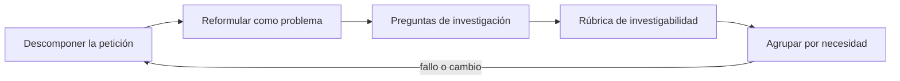
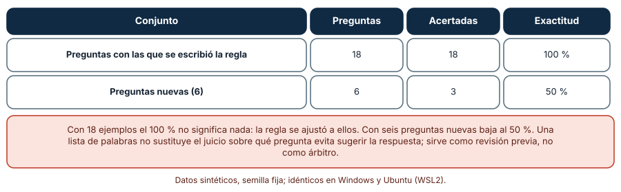
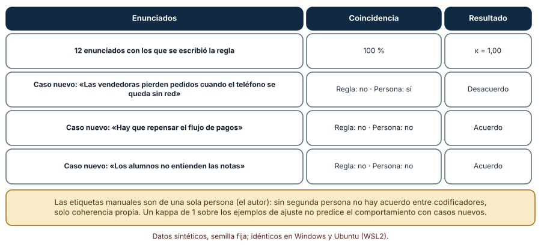
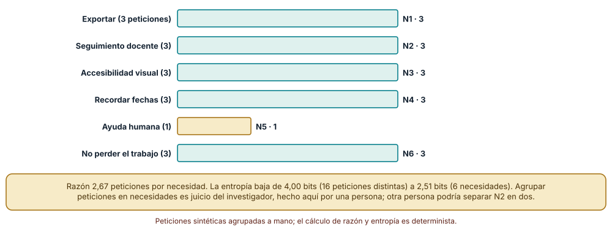

# SE-131 — Taller: convertir una petición en un problema investigable

[← SE-130 — Criterios de no éxito y decisiones de abandono](../../classes/part-10-descubrimiento-y-estrategia-de-producto/se-130-criterios-de-no-exito-y-decisiones-de-abandono/README.md) · [↑ Parte 10](../../classes/part-10-descubrimiento-y-estrategia-de-producto/README.md) · [📚 Índice completo](../../classes/README.md) · [🌐 Portal](../../site/classes/SE-131.html) · [SE-132 — Proyecto: product brief respaldado por evidencia →](../../classes/part-10-descubrimiento-y-estrategia-de-producto/se-132-proyecto-product-brief-respaldado-por-evidencia/README.md)

## Punto profesional y fundamento pedagógico

**Punto profesional.** El taller existe para practicar, con una petición concreta, el paso más frecuente y más descuidado del descubrimiento: preguntar qué hay detrás de «necesitamos un panel» hasta llegar a un problema que pueda investigarse, con preguntas que no sugieren la respuesta.

**Por qué aparece aquí.** Se sitúa después de **Criterios de no éxito y decisiones de abandono** y antes de **Proyecto: product brief respaldado por evidencia**: `SE-130` cerró la parte conceptual con criterios de abandono; este taller reúne las herramientas de `SE-121` a `SE-130` sobre una petición real (sintética) y produce el problema investigable, la guía de preguntas y la rúbrica que `SE-132` usará para construir el brief. Es la última práctica antes del proyecto integrador.

**Error conceptual que debe corregir.** Aceptar la petición como requisito, clasificar las preguntas de entrevista por intuición y creer que una regla automática de revisión sustituye el juicio de una segunda persona.

**Secuencia de aprendizaje.** Antes de leer la solución, predices cuántas necesidades de fondo hay detrás de dieciséis peticiones, qué proporción de preguntas nuevas clasificará bien una regla afinada con dieciocho ejemplos y si una rúbrica automática coincide con tus etiquetas en casos que no vio; luego ejecutas el taller, explicas cada resultado y reconstruyes sin apoyo la secuencia petición → necesidad → problema → pregunta. La secuencia usa predicción, explicación propia, contraste y recuperación. [ICAP](https://icap.education.asu.edu/research) distingue participación de construcción de conocimiento; [How People Learn II](https://nap.nationalacademies.org/catalog/24783/how-people-learn-ii-learners-contexts-and-cultures) exige conectar conocimiento previo, contexto y transferencia; la [práctica de recuperación](https://pubmed.ncbi.nlm.nih.gov/16507066/) respalda producir de nuevo la explicación tras una demora; y [Education for Life and Work](https://nap.nationalacademies.org/resource/13398/dbasse_084153.pdf) exige devolución que explique la causa del error.

**Evidencia de aprendizaje.** `request-to-problem.md` con la petición original, su descomposición, el problema investigable, la guía de preguntas clasificadas, la rúbrica con su acuerdo frente a una segunda persona y las peticiones del backlog agrupadas por necesidad. Debe contener predicción previa, observación, explicación causal, contraejemplo, criterio de aceptación y una nota de qué dato haría cambiar la conclusión.

**Límite de la conclusión.** Las peticiones, preguntas y enunciados son sintéticos y las etiquetas son de una sola persona (el autor); sin segundo etiquetador no hay acuerdo entre personas y las reglas léxicas solo se probaron con seis preguntas y tres enunciados nuevos.

### Trazabilidad fuente → afirmación

| Fuente primaria u oficial | Afirmación que respalda | Lo que no prueba |
|---|---|---|
| [GOV.UK Service Manual: How the discovery phase works](https://www.gov.uk/service-manual/agile-delivery/how-the-discovery-phase-works) | Indica que, ante una solución ya definida, el equipo debe interrogarla y reformularla como un problema que resolver antes de investigar. | No incluye una rúbrica para decidir si el problema reformulado es investigable. |
| [GOV.UK Service Manual: Learning about users and their needs](https://www.gov.uk/service-manual/user-research/start-by-learning-user-needs) | Pide que las necesidades se formulen con palabras de las personas, se basen en evidencia y se centren en el problema y no en la solución. | No dice cómo agrupar peticiones en necesidades. |
| [The Mom Test (Rob Fitzpatrick)](https://www.momtestbook.com/) | Propone conversaciones con clientes centradas en su vida y en hechos pasados, para obtener información útil incluso cuando las personas son amables. | Es una guía práctica de un autor, no un estudio empírico. |

## Antes de empezar

Esta clase continúa **el caso de la plataforma de entregas** y reúne las herramientas de la Parte 10. Recupera el problema de `SE-121`, el mapa de actores de `SE-122`, la guía de entrevista de `SE-123`, las hipótesis de `SE-124` a `SE-127`, la priorización de `SE-128`, el protocolo de `SE-129` y los criterios de `SE-130`, y los aplica a una petición. La pregunta activa es: **¿qué habría que averiguar para saber si esta petición describe un problema real?**

## Prerrequisitos

- Haber completado `SE-130` o reconstruir los criterios de éxito y no éxito y el protocolo ético.
- Python 3.11 o posterior; solo se usa la biblioteca estándar.
- Trabajar con peticiones y transcripciones sintéticas: ninguna observación necesita datos de una persona real.

## Problema auténtico

Un docente pide, en una reunión, «un panel para ver quién no entregó». El jefe de producto lo anota como requisito. Nadie preguntó qué hace hoy con esa información, cuánto tarda, a quién avisa después ni qué pasa si no la tiene. En el backlog hay otras quince peticiones, y el equipo sospecha que varias hablan de lo mismo con palabras distintas.

## Objetivos observables

Al terminar podrás:

1. descomponer una petición en quién la hace, qué intenta lograr, qué hace hoy, qué consecuencia tiene y qué solución propone;
2. redactar un problema investigable y compararlo con la petición original;
3. clasificar preguntas de entrevista como sobre el pasado, guiadas o neutras y reescribir las defectuosas;
4. medir el acuerdo entre una rúbrica automática y las etiquetas de una persona, y reconocer sus límites con casos nuevos;
5. agrupar peticiones en necesidades de fondo y cuantificar la reducción de variedad.

## Mapa conceptual



El mapa se lee como una cadena de razonamiento, no como fases obligatorias. La flecha de retorno indica que una pregunta guiada, un enunciado que no pasa la rúbrica o una agrupación discutida obliga a volver a descomponer la petición; no autoriza a defender el requisito original.

## Temas y por qué importan

| Tema | Por qué cambia una decisión profesional | Evidencia mínima |
|---|---|---|
| Descomponer la petición | Una petición mezcla un actor, una intención, una solución y una consecuencia; separarlos revela qué falta. | Predicción, traza causal y contraejemplo de **Descomponer la petición** en `request-to-problem.md` |
| Reformular como problema | El problema reformulado admite varias soluciones y puede contrastarse con observaciones. | Predicción, traza causal y contraejemplo de **Reformular como problema** en `request-to-problem.md` |
| Preguntas de investigación | La forma de la pregunta decide si la respuesta es un hecho o cortesía. | Predicción, traza causal y contraejemplo de **Preguntas de investigación** en `request-to-problem.md` |
| Rúbrica de investigabilidad | Una rúbrica hace explícito qué hace investigable un enunciado y permite revisarlo entre personas. | Predicción, traza causal y contraejemplo de **Rúbrica de investigabilidad** en `request-to-problem.md` |
| Agrupar por necesidad | Muchas peticiones comparten una necesidad; contarlas por separado distorsiona prioridades. | Predicción, traza causal y contraejemplo de **Agrupar por necesidad** en `request-to-problem.md` |

## Conceptos y decisiones

### 1. Descomponer la petición

«Un panel para ver quién no entregó» contiene un actor (docente), una solución (panel), una información deseada (quién no entregó) y una intención implícita (hacer algo con esa información). Lo que falta: qué hace hoy el docente con esa información, qué le cuesta, qué pasa si no la tiene y qué considera éxito. Descomponer no es cuestionar a la persona: es identificar qué partes son observación (tarda 40 minutos), cuáles son inferencia (quiere recordar a quienes no entregaron) y cuáles son solución (panel). Esas tres columnas ordenan la investigación.

### 2. Reformular como problema

La reformulación pasa de «necesito un panel» a «los docentes tardan 40 minutos por entrega en saber quiénes no han entregado porque deben abrir cada archivo por separado, y por eso avisan tarde». Mantiene el actor, expresa el obstáculo y la consecuencia y deja abiertas varias soluciones (un panel, un correo automático, una lista exportable). Se contrasta pidiendo a dos o tres docentes que cuenten la última vez que lo hicieron. Si no coinciden con el enunciado, el enunciado era una hipótesis, y se reescribe.

### 3. Preguntas de investigación

Las preguntas sobre el pasado («cuéntame la última vez que…») traen hechos; las guiadas («¿no crees que sería útil…?») traen acuerdos; las hipotéticas («¿lo usarías?») traen predicciones poco fiables; las cerradas («¿es difícil?») ahorran el relato. Una guía de investigación contiene pocas preguntas abiertas sobre episodios y una lista de sondeos. Revisarla con una regla léxica ayuda a detectar defectos obvios, pero la regla no ve el tono ni el contexto, y por eso una persona revisa.

### 4. Rúbrica de investigabilidad

Una rúbrica de cuatro criterios —actor reconocible, obstáculo observable, consecuencia y ausencia de solución embebida— puede aplicarla una persona o un script. Su valor está en el acuerdo: si dos personas puntúan igual, el criterio es claro; si no, hay que precisarlo. Un script automatiza lo mecánico y deja en evidencia lo que no entiende (vocabulario nuevo, actores no listados). El acuerdo con una sola persona es coherencia propia, no acuerdo entre personas.

### 5. Agrupar por necesidad

Dieciséis peticiones del backlog («agregar botón exportar», «descargar mis notas», «exportar a PDF», «modo oscuro», «letra más grande», «más contraste»…) pueden reducirse a unas seis necesidades: exportar, seguimiento docente, accesibilidad visual, recordar fechas, ayuda humana y no perder el trabajo. La agrupación es un juicio de investigación, hecho aquí por una persona; otra podría separar «seguimiento docente» en dos. Se registra con la petición original para poder rehacerla y se contrasta con entrevistas.

### Clasificar preguntas de entrevista con una regla léxica

Se escribió una regla con dos listas de expresiones: preguntas guiadas o hipotéticas («¿no crees que…?», «¿pagarías…?», «imagina que…», «¿te gustaría…?») y preguntas sobre el pasado («cuéntame la última vez…», «¿qué hiciste…?», «¿qué pasó…?»). Se aplicó a dieciocho preguntas etiquetadas a mano antes de escribir la regla: 7 sobre el pasado, 6 guiadas y 5 neutras (abiertas o cerradas). Predicción antes de ejecutar: la regla acierta casi todas las dieciocho, pero falla con preguntas nuevas.

```python
pred = "guiada" if GUIADA.search(texto) else "pasado" if PASADO.search(texto) else "otra"
```

Resultado sobre las dieciocho: 18 de 18 (100 %). Sobre seis preguntas nuevas, escritas después: 3 de 6 (50 %). Aciertos: «¿Qué fue lo último que hiciste cuando no encontraste la fecha?» (pasado), «Cuéntame de tu último día de entregas» (pasado) y «¿Cómo te sientes con los plazos?» (neutra). Fallos: «¿Sería útil para ti un recordatorio, no?» (guiada, clasificada como neutra), «Muéstrame cómo entregas una tarea» (sobre el presente observable, sin marca léxica) y «¿Recomendarías esta herramienta a un colega?» (hipotética). El 100 % inicial refleja que la regla se ajustó a esos ejemplos; el 50 % es el estimador honesto. Idéntico en Windows y Ubuntu.



**Cómo leer la figura.** La primera fila es el conjunto con el que se escribió la regla y la segunda el conjunto nuevo; la diferencia entre ambas es el sobreajuste. **Dónde deja de valer:** seis preguntas son una muestra mínima; el intervalo de confianza de un 50 % con n = 6 es enorme. Sirve como demostración de por qué se evalúa con casos que la regla no vio, no como estimación de su exactitud en general.

### Una rúbrica automática frente a mis propias etiquetas

Doce enunciados de problema fueron etiquetados a mano como investigables (1) o no (0): seis y seis. Una rúbrica automática comprueba tres cosas: ausencia de solución embebida («necesitamos», «agregar», «chatbot», «panel»…), presencia de un actor de una lista y presencia de un observable (verbos como «tardan», «abandonan», «pierden», o una cifra). Resultado sobre los doce: acuerdo bruto 100 % y kappa 1,00. Pero las etiquetas son de una sola persona que además escribió la regla.

La prueba fue con tres enunciados nuevos: «Las vendedoras pierden pedidos cuando el teléfono se queda sin red» (etiqueta manual: investigable), «Hay que repensar el flujo de pagos» (no) y «Los alumnos no entienden las notas» (no). La rúbrica devolvió 0, 0 y 0: acertó dos de tres; falló el primero porque «vendedoras» no estaba en la lista de actores. Un kappa de 1,00 sobre los ejemplos de ajuste no predijo el fallo con un caso nuevo. Idéntico en Windows y Ubuntu.



**Cómo leer la figura.** La primera fila resume el acuerdo sobre los doce enunciados; las demás son los casos nuevos, con lo que dijo la regla, lo que dijo la persona y si coinciden. **Dónde deja de valer:** el acuerdo entre un script y su autor no es acuerdo entre personas; para estimar la fiabilidad de la rúbrica se necesitan al menos dos personas etiquetando de forma independiente y un conjunto más grande, con el cálculo de kappa de `SE-123`.

### Dieciséis peticiones, seis necesidades

El backlog del taller tiene dieciséis peticiones sintéticas que una persona agrupó en seis necesidades: N1 exportar (agregar botón exportar, exportar a PDF, descargar mis notas), N2 seguimiento docente (panel para docentes, ver quién no entregó, reporte semanal), N3 accesibilidad visual (modo oscuro, letra más grande, más contraste), N4 recordar fechas (notificaciones push, recordar fechas, calendario), N5 ayuda humana (chat con soporte) y N6 no perder el trabajo (guardar borrador, no perder el texto, versión anterior). Predicción antes de ejecutar: la variedad se reduce a la mitad o menos.

```python
razon = len(peticiones) / len(necesidades)
entropia = -sum(c / n * math.log2(c / n) for c in cuenta_por_necesidad.values())
```

Resultado: 16 peticiones y 6 necesidades, razón 2,67 peticiones por necesidad; cinco necesidades reúnen tres peticiones cada una y una (ayuda humana) una sola. La entropía baja de 4,00 bits (dieciséis peticiones todas distintas) a 2,51 bits (seis necesidades). Dicho de otro modo: lo que parece un backlog de dieciséis cosas es un problema de seis cosas, y tres de esas seis (exportar, accesibilidad visual, recordar fechas) son baratas de investigar. Idéntico en Windows y Ubuntu.



**Cómo leer la figura.** Cada barra es una necesidad; su longitud es cuántas peticiones del backlog la expresan. **Dónde deja de valer:** la agrupación es un juicio de una persona; si se separara «seguimiento docente» en «saber quién no entregó» y «reportar a coordinación», el número de necesidades sería siete. Debe contrastarse con entrevistas (`SE-123`) y revisarse por otra persona antes de dar la reducción por válida.

## Definiciones de trabajo

- **descomponer la petición:** separación de una petición en quién la hace, qué intenta lograr, qué hace hoy, qué consecuencia sufre y qué solución propone.
- **reformular como problema:** enunciado de actor, intención, obstáculo y consecuencia que no nombra la solución y se puede confirmar o refutar con observaciones.
- **preguntas de investigación:** pregunta que pide a la persona relatar episodios concretos y no opinar, predecir ni confirmar una idea del entrevistador.
- **rúbrica de investigabilidad:** conjunto de criterios (actor, observable, consecuencia, ausencia de solución) con los que dos personas deciden si un problema puede investigarse.
- **agrupar por necesidad:** asignación de peticiones distintas a la necesidad de fondo que expresan, con criterio explícito y revisable.

Las definiciones son operativas para la plataforma de entregas. No convierten términos con historia más amplia en sinónimos y deben contrastarse con la documentación primaria enlazada al final.

## Ejemplo mínimo

Un fragmento mínimo que cuenta la reducción de variedad al agrupar peticiones. Antes de ejecutarlo, predice la razón.

```python
import math
from collections import Counter

peticiones = [
    ("agregar boton exportar", "exportar"), ("exportar a PDF", "exportar"),
    ("descargar mis notas", "exportar"), ("panel para docentes", "seguimiento"),
    ("ver quien no entrego", "seguimiento"), ("guardar borrador", "no perder trabajo"),
]
necesidades = Counter(n for _, n in peticiones)
assert len(peticiones) / len(necesidades) == 2.0
h = -sum(c / len(peticiones) * math.log2(c / len(peticiones)) for c in necesidades.values())
assert round(h, 2) == 1.46
```

Registra versión, comando y salida. La razón y la entropía solo cuantifican el efecto de una agrupación; que la agrupación sea correcta lo decide la investigación, no el cálculo.

## Ejemplo profesional

En la plataforma de entregas, el archivo del taller conserva la petición original textual, quién la hizo y cuándo, su descomposición (observación, inferencia, solución), el problema reformulado, la guía de preguntas con su clasificación, la rúbrica aplicada por dos personas y las peticiones del backlog con su necesidad asignada. El contrato es que la petición original no se sobrescribe y que el problema reformulado indica qué observación lo confirmaría.

Compara el caso normal con una petición ambigua, con dos peticiones contradictorias de dos actores, con una petición que viene de quien decide y no de quien usa y con una que ya viene con un plazo político. Un archivo es apropiado cuando esas diferencias se ven; es peligroso cuando la petición se transforma en problema sin dejar rastro de cómo.

## Práctica guiada

1. Copia la petición textual y anota quién la hizo, cuándo y en qué contexto.
2. Descompón en actor, intención, qué hace hoy, consecuencia y solución propuesta; marca observación, inferencia y solución.
3. Reformula el problema sin solución y escribe qué observación lo confirmaría.
4. Escribe diez preguntas de entrevista y clasifícalas; reescribe las guiadas, hipotéticas y cerradas.
5. Aplica la rúbrica de investigabilidad con otra persona y calcula el acuerdo.
6. Agrupa las peticiones del backlog por necesidad y calcula la razón y la entropía.
7. Pide a otra persona que reconstruya el camino petición → problema usando solo `request-to-problem.md`.

## Ejercicios

1. **Descomposición:** descompón «necesitamos un chatbot de soporte» y «queremos integración con el calendario» en las cinco partes y propón el problema investigable de cada una.
2. **Preguntas:** escribe diez preguntas nuevas sobre el pasado y mide con la regla léxica cuántas clasifica bien; documenta qué expresiones faltan.
3. **Rúbrica:** consigue que otra persona etiquete de forma independiente los doce enunciados; calcula kappa y analiza los desacuerdos.
4. **Agrupación:** pide a otra persona que agrupe las dieciséis peticiones sin ver tu agrupación; compara y explica las diferencias.

## Reto verificable

Entrega `request-to-problem.md` con una petición textual, su descomposición, el problema investigable con la observación que lo confirmaría, una guía de diez preguntas clasificadas con exactitud medida sobre preguntas nuevas, la rúbrica aplicada por dos personas y las peticiones agrupadas. Se aprueba si otra persona reconstruye el camino de la petición al problema y encuentra una pregunta guiada que quedó sin corregir. No se aprueba por la cantidad de preguntas ni por una exactitud medida solo sobre los ejemplos de ajuste.

## Caso conductor

El docente pidió un panel para ver quién no entregó. El taller descompone: el docente tarda 40 minutos por entrega en saber quién no entregó, abre cada archivo por separado y avisa tarde. El problema investigable se contrasta con tres docentes sintéticos y se suma a la necesidad N2 (seguimiento docente) del backlog. Cambia después un solo dato —por ejemplo, que el aviso lo envía soporte— y revisa qué cambia en el problema y en las preguntas.

## Preguntas frecuentes

### ¿Debo siempre rechazar la petición original?

No: la petición es un dato valioso sobre una intención, y la solución propuesta puede ser la correcta. Lo que se evita es adoptarla sin contrastar. Si tras investigar el problema resulta ser el que la persona describía, la solución original queda como una opción más, con evidencia.

### ¿Por qué una regla de preguntas acierta el 100 % y luego el 50 %?

Porque se ajustó a los dieciocho ejemplos. Con seis preguntas nuevas acertó tres. Reporta siempre la exactitud sobre casos que no se usaron para afinar la regla.

### ¿Para qué sirve una rúbrica automática si falla con casos nuevos?

Para revisar lo mecánico de forma repetible y barata: ausencia de solución, de actor o de consecuencia. Cada falso negativo muestra qué amplía la regla y qué requiere a una persona. No sustituye a la segunda lectura.

### ¿Cuántas necesidades debería tener un backlog agrupado?

No hay un número correcto. Las dieciséis peticiones del taller se redujeron a seis por una persona; otra podría llegar a siete. Lo importante es que la agrupación sea explícita, revisable y contrastada con entrevistas.

## Fallo controlado y diagnóstico

Reproduce el fallo de la clase: **aceptar la petición como requisito y entrevistar con preguntas guiadas para confirmarla**. Toma «un panel para ver quién no entregó», escribe cinco preguntas del tipo «¿te sería útil un panel?» y recoge cinco respuestas favorables (sintéticas).

Registra síntoma, entrada mínima, hipótesis, observación que descarta cada hipótesis, causa, corrección y prueba de regresión. **Síntoma:** se construye el panel y los docentes siguen abriendo los archivos uno a uno. **Hipótesis rivales:** (a) el panel tiene un defecto de usabilidad; (b) nunca se investigó qué hacían los docentes. **Prueba:** clasifica las cinco preguntas con la regla y observa que las cinco son guiadas o hipotéticas; reescribe una como «cuéntame la última vez que supiste quién no había entregado» y compara las respuestas. **Conclusión:** la evidencia de apoyo provenía de preguntas que sugerían la respuesta. **Regresión:** añade a la guía una comprobación de preguntas (regla más revisión de una segunda persona) y una prueba que falle si la guía contiene más de una pregunta guiada. No cambies a la vez la guía y la muestra.

## Errores comunes y cómo corregirlos

| Síntoma | Causa probable | Corrección |
|---|---|---|
| Los docentes dicen «sí» a todo y el panel no se usa | Las preguntas eran guiadas o hipotéticas | Preguntar por episodios pasados concretos y revisar la guía con una segunda persona |
| El backlog crece con peticiones que parecen distintas y resultan iguales | No se agruparon por necesidad | Agrupar por necesidad con criterio explícito y contar necesidades, no peticiones |
| La regla de preguntas se publica con 100 % de exactitud y falla con casos nuevos | Se evaluó con los mismos ejemplos usados para afinarla | Evaluar con preguntas nuevas y reportar la exactitud sobre ellas |
| El problema reformulado no puede contrastarse | No indica qué observación lo confirmaría | Añadir la observación (registro, sesión observada, relato de un episodio) que lo confirmaría o refutaría |
| El enunciado pasa la rúbrica y nadie lo reconoce como real | La rúbrica comprueba forma y no existencia | Pedir a dos personas del segmento que cuenten un episodio que lo confirme |

## Entorno y archivos clave

```text
work/SE-131/
├── README.md
├── taller/
│   ├── preguntas.py
│   ├── rubrica.py
│   └── necesidades.py
├── fixtures/peticiones.json
├── tests/test_preguntas.py
└── evidence/request-to-problem.md
```

El `README` declara plataforma, versiones y comandos. Los scripts usan solo `re`, `math` y `collections` y se ejecutaron con CPython 3.12.9 en Windows 11 y 3.12.3 en Ubuntu bajo WSL2 con salidas idénticas. Las etiquetas son de una sola persona y se declara.

## Seguridad, ética y accesibilidad

- no incluyas peticiones ni transcripciones de personas reales sin consentimiento y sin minimizar (`SE-129`);
- una petición puede venir de una persona con poder; registra el origen para que la presión jerárquica no sustituya a la evidencia;
- evita ridiculizar la petición original: se trata de entender, no de ganar;
- la agrupación por necesidad no debe invisibilizar una petición minoritaria con consecuencia grave (por ejemplo, accesibilidad);
- ofrece una alternativa textual a las tablas y no uses color como única señal;
- atribuye las guías de preguntas adaptadas y respeta sus licencias.

## Puente hacia el trabajo con agentes

Un agente al que se le pide «convierte estas peticiones en historias de usuario» producirá frases con la forma «como docente quiero un panel para ver quién no entregó», es decir, la petición con otra sintaxis. Pídele que descomponga primero (observación, inferencia, solución), que proponga el problema sin solución con la observación que lo confirmaría y que escriba preguntas sobre episodios pasados que luego revisa una persona. Revisa especialmente si conserva la solución dentro de la historia: es el error de esta clase con un formato aceptado.

## Transferencia

Traslada el taller a otro dominio persistente (por ejemplo, un sistema de control de agentes): cambia la petición y los actores, conserva la descomposición en cinco partes, la guía clasificada con evaluación sobre casos nuevos y la agrupación por necesidad. La transferencia está lograda cuando puedes explicar qué parte de la petición era solución y qué observación confirmaría el problema.

## Evaluación y evidencia

| Criterio | Evidencia para aprobar |
|---|---|
| comprensión | explicación causal de por qué una petición no es un requisito |
| corrección | clasificación, acuerdo y agrupación reproducibles con las mismas entradas |
| diseño | guía de preguntas sobre episodios pasados y rúbrica con criterios |
| diagnóstico | reproducción del fallo «preguntas guiadas confirman la petición» con regresión |
| responsabilidad | registro del origen de la petición y protección de minorías |
| reproducibilidad | versiones, comandos, salida y límites declarados |


## Fuentes


- [GOV.UK Service Manual: How the discovery phase works](https://www.gov.uk/service-manual/agile-delivery/how-the-discovery-phase-works) — reformular una solución dada como problema; autoridad: Government Digital Service.
- [GOV.UK Service Manual: Learning about users and their needs](https://www.gov.uk/service-manual/user-research/start-by-learning-user-needs) — formato y validación de necesidades; autoridad: Government Digital Service.
- [The Mom Test](https://www.momtestbook.com/) — preguntar por hechos pasados; autoridad: autor (guía práctica, no estudio empírico).
- [Nielsen Norman Group: User Interviews 101](https://www.nngroup.com/articles/user-interviews/) — introducción a la entrevista de usuario; autoridad: Nielsen Norman Group.
- [McHugh: Interrater reliability, the kappa statistic](https://pmc.ncbi.nlm.nih.gov/articles/PMC3900052/) — kappa frente al acuerdo bruto; autoridad: revisión indexada en PubMed Central.
- [Know Your Customers' «Jobs to Be Done» (Harvard Business Review, 2016)](https://hbr.org/2016/09/know-your-customers-jobs-to-be-done) — describir el progreso detrás de la petición; autoridad: Harvard Business Review (artículo parcialmente de pago).

Cada fuente respalda el mecanismo indicado; ninguna demuestra que el problema reformulado de la plataforma sea el real. Esa afirmación depende de entrevistas, registros y revisión por una segunda persona.

- [Python: `re`, expresiones regulares](https://docs.python.org/3/library/re.html) — sintaxis de las reglas léxicas de preguntas y de la rúbrica.
- [Python: `math.log2`](https://docs.python.org/3/library/math.html#math.log2) — logaritmo usado en el cálculo de la entropía de las peticiones.

## Límites y siguiente paso

Se ejecutaron tres experimentos con peticiones, preguntas y enunciados sintéticos en Windows y Ubuntu (WSL2) con salidas idénticas. Las etiquetas son de una sola persona, las reglas se afinaron con pocos ejemplos y las pruebas con casos nuevos son de seis y tres elementos. El proyecto final reúne todo en un brief respaldado por evidencia.

## Glosario

- **descomponer la petición:** separación de una petición en quién la hace, qué intenta lograr, qué hace hoy, qué consecuencia sufre y qué solución propone.
- **reformular como problema:** enunciado de actor, intención, obstáculo y consecuencia que no nombra la solución y se puede confirmar o refutar con observaciones.
- **preguntas de investigación:** pregunta que pide a la persona relatar episodios concretos y no opinar, predecir ni confirmar una idea del entrevistador.
- **rúbrica de investigabilidad:** conjunto de criterios (actor, observable, consecuencia, ausencia de solución) con los que dos personas deciden si un problema puede investigarse.
- **agrupar por necesidad:** asignación de peticiones distintas a la necesidad de fondo que expresan, con criterio explícito y revisable.

---

[← SE-130 — Criterios de no éxito y decisiones de abandono](../../classes/part-10-descubrimiento-y-estrategia-de-producto/se-130-criterios-de-no-exito-y-decisiones-de-abandono/README.md) · [↑ Parte 10](../../classes/part-10-descubrimiento-y-estrategia-de-producto/README.md) · [📚 Índice completo](../../classes/README.md) · [🌐 Portal](../../site/classes/SE-131.html) · [SE-132 — Proyecto: product brief respaldado por evidencia →](../../classes/part-10-descubrimiento-y-estrategia-de-producto/se-132-proyecto-product-brief-respaldado-por-evidencia/README.md)
