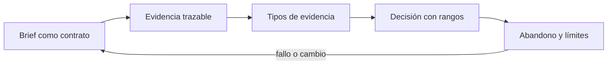
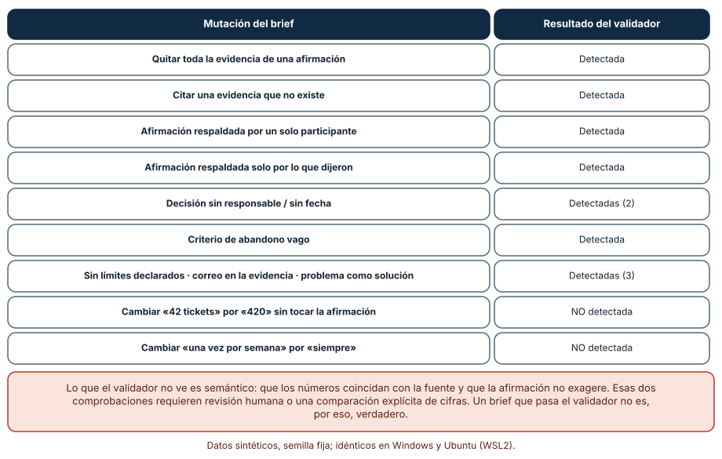
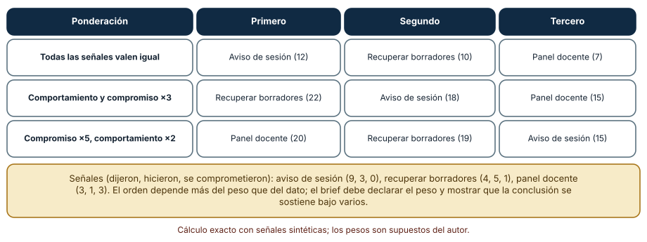
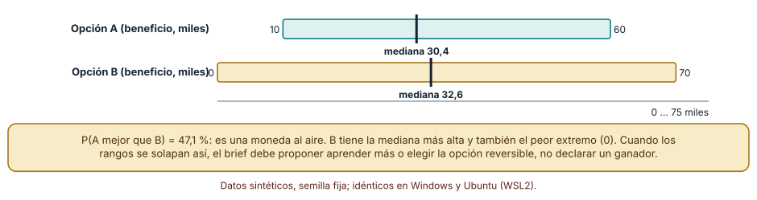

# SE-132 — Proyecto: product brief respaldado por evidencia

[← SE-131 — Taller: convertir una petición en un problema investigable](../../classes/part-10-descubrimiento-y-estrategia-de-producto/se-131-taller-convertir-una-peticion-en-un-problema-investigable/README.md) · [↑ Parte 10](../../classes/part-10-descubrimiento-y-estrategia-de-producto/README.md) · [📚 Índice completo](../../classes/README.md) · [🌐 Portal](../../site/classes/SE-132.html) · [SE-133 — Modelos de negocio y sostenibilidad →](../../classes/part-11-economia-metricas-y-decisiones-de-producto/se-133-modelos-de-negocio-y-sostenibilidad/README.md)

## Punto profesional y fundamento pedagógico

**Punto profesional.** El proyecto existe para entregar un product brief en el que cada afirmación se pueda rastrear a evidencia, cada decisión tenga responsable, fecha y criterio de abandono, y los límites estén dichos; y para comprobar por qué un brief que pasa una validación mecánica aún puede ser falso.

**Por qué aparece aquí.** Se sitúa después de **Taller: convertir una petición en un problema investigable** y antes de **Modelos de negocio y sostenibilidad**: `SE-131` practicó la transformación de una petición en un problema investigable; este proyecto integra lo producido en `SE-121` a `SE-131` —problema, actores, evidencia, hipótesis, propuesta, segmento, experimento, prioridad, protocolo y criterios de abandono— en un único documento que otra persona pueda revisar, disputar y ejecutar. Cierra la Parte 10 y entrega el insumo de la Parte 11, que examina el brief con modelos de negocio, costos y métricas.

**Error conceptual que debe corregir.** Presentar un brief como un documento de convicción, con afirmaciones sin evidencia trazable, una decisión sin responsable y sin criterio de abandono, y creer que si pasa una validación mecánica es correcto.

**Secuencia de aprendizaje.** Antes de leer la solución, predices cuántos defectos inyectados detectaría un validador de briefs, qué defectos se le escaparían, cómo cambia el orden de las opciones al cambiar el peso de la evidencia declarada frente a la observada y cuál es la probabilidad de que una opción supere a otra cuando sus rangos se solapan; luego ejecutas el proyecto, explicas cada resultado y reconstruyes sin apoyo qué convierte un brief en un documento de evidencia. La secuencia usa predicción, explicación propia, contraste y recuperación. [ICAP](https://icap.education.asu.edu/research) distingue participación de construcción de conocimiento; [How People Learn II](https://nap.nationalacademies.org/catalog/24783/how-people-learn-ii-learners-contexts-and-cultures) exige conectar conocimiento previo, contexto y transferencia; la [práctica de recuperación](https://pubmed.ncbi.nlm.nih.gov/16507066/) respalda producir de nuevo la explicación tras una demora; y [Education for Life and Work](https://nap.nationalacademies.org/resource/13398/dbasse_084153.pdf) exige devolución que explique la causa del error.

**Evidencia de aprendizaje.** `brief.md` con problema, evidencias con tipo y participante, afirmaciones con evidencias, decisión con responsable y fecha, criterio de abandono, límites; el validador `validate_brief.py` con sus pruebas y el registro de mutaciones detectadas y no detectadas. Debe contener predicción previa, observación, explicación causal, contraejemplo, criterio de aceptación y una nota de qué dato haría cambiar la conclusión.

**Límite de la conclusión.** El brief, las evidencias y los participantes son sintéticos; el validador comprueba estructura (existencia, cantidad, formato) pero no el significado, y las ponderaciones de evidencia y los rangos de beneficio son supuestos del autor.

### Trazabilidad fuente → afirmación

| Fuente primaria u oficial | Afirmación que respalda | Lo que no prueba |
|---|---|---|
| [GOV.UK Service Manual: How the discovery phase works](https://www.gov.uk/service-manual/agile-delivery/how-the-discovery-phase-works) | Indica que lo aprendido en la discovery ayuda a decidir si avanzar o detenerse, que se comparte con el equipo y que no se construye el servicio en esa fase. | No prescribe un formato de brief ni criterios de aceptación. |
| [Nielsen Norman Group: User Interviews 101](https://www.nngroup.com/articles/user-interviews/) | Presenta la entrevista como método de investigación cualitativa con usuarios y sus consideraciones de uso. | No define cuándo la evidencia de entrevistas es suficiente para una decisión. |
| [Douglas Hubbard: How to Measure Anything](https://www.howtomeasureanything.com/) | Defiende cuantificar la incertidumbre con rangos y calcular el valor de reducirla antes de decidir. | No valida las ponderaciones ni los rangos de este proyecto. |

## Antes de empezar

Este es **el proyecto integrador de la Parte 10 sobre la plataforma de entregas**. Recupera cada artefacto producido: el registro de tickets (`SE-121`), el mapa de actores (`SE-122`), la evidencia de entrevistas (`SE-123`), el mapa de hipótesis (`SE-124`), la propuesta de valor (`SE-125`), el mapa de mercado (`SE-126`), el plan de experimento (`SE-127`), el registro de prioridad (`SE-128`), el protocolo ético (`SE-129`), las reglas de parada (`SE-130`) y el taller (`SE-131`). La pregunta activa es: **¿puede otra persona leer este brief, comprobar de dónde sale cada afirmación y decidir con él sin pedirme nada más?**

## Prerrequisitos

- Haber completado `SE-131` o contar con los artefactos de `SE-121` a `SE-130` (o reconstruirlos sintéticos).
- Python 3.11 o posterior, terminal, editor y Git; solo se usa la biblioteca estándar.
- Trabajar con evidencias y participantes sintéticos: no uses datos de personas reales.

## Problema auténtico

El equipo de la plataforma debe decidir si construir la recuperación de borradores, el aviso de sesión o el panel docente. Tiene tickets, entrevistas, hipótesis, un plan y un protocolo, repartidos en once documentos. La dirección pide «una página» para decidir. La primera versión afirma «los estudiantes pierden su trabajo todas las semanas» sin citar de dónde sale, recomienda una opción sin responsable ni fecha y no dice qué resultado la haría abandonar.

## Objetivos observables

Al terminar podrás:

1. redactar un brief con problema, evidencia trazable, decisión con responsable y fecha, criterio de abandono y límites;
2. construir y ejecutar un validador que compruebe estructura y trazabilidad, y medir con mutaciones qué defectos detecta;
3. reconocer qué defectos no puede detectar un validador estructural y cómo cubrirlos con revisión;
4. mostrar cómo cambia el orden de las opciones con el peso de la evidencia y declarar el peso elegido;
5. calcular la probabilidad de que una opción supere a otra cuando sus rangos se solapan y decidir si procede decidir o aprender.

## Mapa conceptual



El mapa se lee como una cadena de razonamiento, no como fases obligatorias. La flecha de retorno indica que una afirmación sin evidencia, una conclusión que depende del peso elegido o un solapamiento que impide decidir obliga a volver a la evidencia; no autoriza a mejorar la redacción del brief.

## Temas y por qué importan

| Tema | Por qué cambia una decisión profesional | Evidencia mínima |
|---|---|---|
| Brief como contrato de evidencia | Un brief que no se puede revisar es una opinión; uno revisable es un contrato entre quien propone y quien decide. | Predicción, traza causal y contraejemplo de **Brief como contrato de evidencia** en `brief.md` |
| Evidencia trazable | Cada afirmación debe poder rastrearse a una evidencia que exista, de más de una persona o fuente. | Predicción, traza causal y contraejemplo de **Evidencia trazable** en `brief.md` |
| Tipos de evidencia | Lo que alguien hizo o comprometió pesa distinto de lo que dijo; el brief debe declarar el peso. | Predicción, traza causal y contraejemplo de **Tipos de evidencia** en `brief.md` |
| Decisión con rangos | Cuando los rangos de beneficio se solapan, declarar un ganador es fingir precisión. | Predicción, traza causal y contraejemplo de **Decisión con rangos** en `brief.md` |
| Abandono y límites | Un brief honesto dice cuándo se equivoca y qué no sabe. | Predicción, traza causal y contraejemplo de **Abandono y límites** en `brief.md` |

## Conceptos y decisiones

### 1. Brief como contrato de evidencia

Un brief no pretende convencer: pretende permitir que otra persona decida. Contiene el problema en una frase investigable, las afirmaciones que lo sostienen con la evidencia de cada una, las opciones consideradas (incluida no hacer nada), la decisión propuesta con responsable y fecha, el criterio de abandono con su umbral, el protocolo ético aplicado y los límites: qué no se midió, quién no participó, qué haría cambiar la conclusión. Es corto porque remite a los artefactos y largo en trazabilidad.

### 2. Evidencia trazable

Una afirmación sin evidencia es una hipótesis; con una sola persona, una pista; con dos o más personas o con un registro, un hallazgo con límites. La trazabilidad se comprueba en parte de forma mecánica —que el identificador de evidencia exista, que haya al menos dos participantes distintos o un registro, que no sea solo lo declarado— y en parte leyendo: que la evidencia diga lo que la afirmación dice. Lo primero lo hace un validador; lo segundo, una persona.

### 3. Tipos de evidencia

Lo que una persona dice es el tipo más barato y el menos fiable; lo que hace (copia su texto a un documento aparte) es más fiable; lo que compromete (reserva tiempo, entrega un borrador real) lo es más; un registro (42 tickets) cuenta frecuencia pero no motivos. Al ponderar, el orden de opciones puede cambiar: por eso el peso es una decisión del brief, no un detalle interno, y se muestra la conclusión bajo varias ponderaciones. Una opción que gana solo con un peso es frágil.

### 4. Decisión con rangos

Si dos opciones tienen beneficios de 30 y 33 con rangos amplios y solapados, la mediana más alta no basta: la probabilidad de que una supere a la otra puede ser cercana al 50 %. El brief entonces recomienda aprender más (con el plan de `SE-127`), elegir la opción reversible o la de menor peor caso, y no declarar un ganador. Cuando una opción domina claramente, lo dice con la probabilidad. La decisión incluye responsable y fecha para que no se difumine.

### 5. Abandono y límites

El criterio de abandono se hereda de `SE-130`: umbral, ventana y responsable externo. Los límites dicen qué población no participó, qué contexto no se cubrió y qué supuesto sigue sin contrastarse. Un brief sin límites sugiere que no hay nada que cuestionar. Declararlos no debilita la decisión: protege a quien decide de sorpresas y a las personas afectadas de que un uso no previsto se base en evidencia que no las incluía.

### Un validador de briefs y doce defectos inyectados

Un brief sintético (problema, cuatro evidencias con tipo y participante, dos afirmaciones, decisión con responsable y fecha, criterio de abandono y límites) se valida con un script que comprueba: cada afirmación tiene evidencias y todas existen; cada afirmación tiene al menos dos participantes distintos o un registro, y no descansa solo en lo declarado; la decisión tiene responsable y fecha; el criterio de abandono tiene número y comparador; hay límites; no aparecen correos; el problema no es una frase vacía. El brief base no produce errores. Aplicamos doce mutaciones, una por una, y registramos si el validador las detecta. Predicción antes de ejecutar: detecta las estructurales y no las semánticas.

```python
def validar(b):
    errs = []
    for c in b["afirmaciones"]:
        ids = c.get("evidencia", [])
        if not ids: errs.append(f"{c['id']}: sin evidencia"); continue
        participantes = {ev[i]["participante"] for i in ids if i in ev and ev[i]["participante"]}
        if len(participantes) < 2 and "registro" not in {ev[i]["tipo"] for i in ids if i in ev}:
            errs.append(f"{c['id']}: menos de 2 participantes y sin registro")
    return errs
```

Resultado: 10 de 12 mutaciones detectadas: quitar toda la evidencia de una afirmación, citar una evidencia inexistente, respaldar con un solo participante, respaldar solo con lo que dijeron, quitar responsable, quitar fecha, volver vago el criterio de abandono, quitar los límites, incluir un correo en la evidencia y convertir el problema en una solución de dos palabras. No se detectaron: (a) cambiar «42 tickets» por «420 tickets» en la evidencia sin actualizar la afirmación, y (b) cambiar «una vez por semana» por «siempre» en la afirmación. El validador es estructural: no compara cifras con la fuente ni juzga si una afirmación exagera. Idéntico en Windows y Ubuntu.



**Cómo leer la figura.** Cada fila es una mutación (o un grupo de mutaciones) y la columna derecha dice si el validador las detectó; las dos últimas filas son las que escaparon. **Dónde deja de valer:** doce mutaciones escritas por el autor no cubren los defectos que otro equipo cometería, y un 83 % de detección no es una probabilidad de que un brief real esté bien. Sirve para saber qué cubre la herramienta y qué debe cubrir la revisión humana, no para certificar un brief.

### El mismo conjunto de señales, tres órdenes

Tres opciones se evalúan con señales sintéticas contadas por tipo (dijeron, hicieron, se comprometieron): «aviso de sesión» (9, 3, 0), «recuperar borradores» (4, 5, 1) y «panel docente» (3, 1, 3). Calculamos la suma ponderada con tres juegos de pesos. Predicción antes de ejecutar: el orden cambia con el peso, aunque los datos no cambien.

```python
pesos = {"iguales": (1, 1, 1), "comportamiento x3": (1, 3, 3), "compromiso x5": (1, 2, 5)}
puntaje = {op: sum(s * w for s, w in zip(senales, pesos[nombre])) for op, senales in opciones.items()}
```

Con pesos iguales: aviso de sesión 12, recuperar borradores 10, panel docente 7. Con comportamiento y compromiso ×3: recuperar borradores 22, aviso de sesión 18, panel docente 15. Con compromiso ×5 y comportamiento ×2: panel docente 20, recuperar borradores 19, aviso de sesión 15. Los tres juegos de pesos son razonables y los tres primeros puestos son distintos. El brief no puede esconder el peso: debe declararlo, justificarlo y mostrar que la conclusión resiste (o que no resiste) varios. Cálculo exacto, idéntico en Windows y Ubuntu.



**Cómo leer la figura.** Cada fila es una ponderación y las tres columnas son los puestos; compara cómo la misma evidencia produce tres primeros distintos. **Dónde deja de valer:** las señales son conteos sintéticos y los pesos son del autor; en una investigación real las señales no son independientes ni del mismo tamaño y los pesos deberían justificarse con la calidad de cada fuente. La suma ponderada es un resumen, no un modelo.

### Dos opciones con rangos solapados: ¿decidir o aprender?

La opción A tiene un beneficio incierto entre 10 y 60 (moda 25, en miles) y la opción B entre 0 y 70 (moda 30). Sorteamos 20 000 veces cada una con distribuciones triangulares y comparamos. Predicción antes de ejecutar: la que tenga la mediana más alta no será claramente mejor.

```python
A = [rng.triangular(10, 60, 25) for _ in range(20000)]
B = [rng.triangular(0, 70, 30) for _ in range(20000)]
p_a_mejor = sum(a > b for a, b in zip(A, B)) / 20000
```

Resultado: mediana de A = 30,4; mediana de B = 32,6; probabilidad de que A supere a B = 47,1 %. La diferencia de medianas es de 2,2 sobre una anchura de 50–70, y la probabilidad es una moneda al aire. B tiene la mediana más alta pero también el peor extremo (0); A tiene un mínimo de 10. Con estos rangos declarar «B es mejor» sería fingir precisión. El brief debe decir que no hay base para decidir entre ambas y recomendar la acción de menor costo de arrepentimiento: aprender con el plan de `SE-127` o elegir la opción reversible. Idéntico en Windows y Ubuntu.



**Cómo leer la figura.** Cada barra es el rango del beneficio de una opción y la marca negra su mediana; se solapan casi por completo. **Dónde deja de valer:** los rangos y las modas son supuestos del autor; con evidencia real los rangos se estrecharían o se desplazarían. El cálculo supone independencia entre A y B; si ambas dependen de un mismo factor (adopción), su comparación cambia.

## Definiciones de trabajo

- **brief como contrato de evidencia:** documento breve que reúne problema, evidencia, opciones, decisión, criterio de abandono y límites, de modo que otra persona pueda comprobarlo y disputarlo.
- **evidencia trazable:** relación verificable entre una afirmación del brief y uno o más registros (citas, datos, observaciones) que existen y la respaldan.
- **tipos de evidencia:** clasificación de la evidencia según su origen (dijo, hizo, comprometió, registro), con una ponderación explícita y revisable.
- **decisión con rangos:** decisión que compara opciones con intervalos de beneficio y declara la probabilidad de que una supere a otra y el costo de equivocarse.
- **abandono y límites:** criterio de abandono con comparador, umbral, ventana y responsable, más una lista de lo que no se midió ni a quién no se preguntó.

Las definiciones son operativas para la plataforma de entregas. No convierten términos con historia más amplia en sinónimos y deben contrastarse con la documentación primaria enlazada al final.

## Ejemplo mínimo

Un fragmento mínimo con la estructura de un brief y una comprobación de trazabilidad. Antes de ejecutarlo, predice si la afirmación A2 pasa.

```python
evidencias = {
    "E1": {"tipo": "hizo", "participante": "P1"},
    "E2": {"tipo": "hizo", "participante": "P3"},
    "E4": {"tipo": "registro", "participante": None},
}
afirmaciones = {"A1": ["E1", "E2", "E4"], "A2": ["E2"]}

def respaldada(ids):
    personas = {evidencias[i]["participante"] for i in ids if evidencias[i]["participante"]}
    return len(personas) >= 2 or any(evidencias[i]["tipo"] == "registro" for i in ids)

assert respaldada(afirmaciones["A1"])
assert not respaldada(afirmaciones["A2"])         # una sola persona y ningún registro
```

Registra versión, comando y salida. La función solo comprueba cantidad y tipo, no si la evidencia dice lo que la afirmación dice: esa lectura sigue siendo humana.

## Ejemplo profesional

En la plataforma de entregas, el brief se acompaña de un expediente: tickets y su agrupación, mapa de actores, transcripciones y códigos, mapa de hipótesis, propuesta, mapa de mercado, plan de experimento, registro de prioridad, protocolo ético, reglas de parada y petición descompuesta. El contrato es que `brief.md` remite a ellos por identificador, que cada afirmación declare sus evidencias, que la decisión indique responsable y fecha, y que el validador pase en un checkout limpio.

Compara el caso normal con una afirmación que depende de una sola persona, con una cifra cambiada en la evidencia, con una opción que solo gana bajo un peso, con rangos que se solapan y con un participante que se retira. Un brief es apropiado cuando esas diferencias están previstas; es peligroso cuando la elegancia de la redacción oculta que nadie comprobó la evidencia.

## Práctica guiada

1. Reúne los artefactos de las clases anteriores y asigna un identificador a cada evidencia (tipo y participante).
2. Redacta el problema en una frase investigable y tres afirmaciones, cada una con sus evidencias.
3. Escribe la decisión con responsable y fecha, y el criterio de abandono heredado de `SE-130`.
4. Declara los límites: qué no se midió, a quién no se preguntó, qué cambiaría la conclusión.
5. Ejecuta el validador, corrige los errores y registra la salida en `evidence/`.
6. Aplica las doce mutaciones, anota las detectadas y las no detectadas, y añade una comprobación para una de las no detectadas.
7. Pide a otra persona que reconstruya la decisión y su criterio de abandono solo con `brief.md` y el expediente.

## Ejercicios

1. **Mutaciones:** inventa tres mutaciones nuevas que el validador no detecte; añade una comprobación para una de ellas y vuelve a medir la cobertura.
2. **Cifras:** escribe un script que compare cada número de las afirmaciones con las evidencias citadas y reporte discrepancias; indica qué falsos positivos produce.
3. **Pesos:** busca un juego de pesos que haga ganar a la opción que quedó última con los tres anteriores y analiza si es razonable.
4. **Rangos:** estrecha el rango de B a 15–55 y calcula la probabilidad de que A supere a B; decide qué experimento de `SE-127` reduciría más la incertidumbre.

## Reto verificable

Entrega `brief.md` con problema, cuatro o más evidencias tipificadas, tres afirmaciones trazables, decisión con responsable y fecha, criterio de abandono y límites; `validate_brief.py` con pruebas; el registro de las doce mutaciones con las no detectadas explicadas; y la decisión bajo tres ponderaciones y con el solapamiento de rangos. Se aprueba si otra persona ejecuta el validador desde un checkout limpio, obtiene la misma cobertura de mutaciones y puede decir qué opción se recomienda, con qué responsable, qué evidencia la respalda y qué resultado la abandonaría. No se aprueba por la extensión del brief ni porque el validador pase.

## Caso conductor

El brief de la plataforma de entregas recomienda probar el aviso de sesión antes de construir la recuperación de borradores: el registro muestra 42 tickets al mes de sesión expirada (`SE-121`), dos participantes confirman que copian su texto fuera (`SE-123`), la hipótesis principal tiene umbral y confianza (`SE-124`), el plan usa un mago de Oz con 20 estudiantes (`SE-127`) y el criterio de abandono es «menos de 5 de 30 recuperan su texto en 3 semanas» con responsable de producto (`SE-130`). Cambia después una sola ponderación y revisa qué cambia en la recomendación; registra el cambio.

## Preguntas frecuentes

### ¿Si el validador pasa, el brief es correcto?

No: el validador comprueba estructura y trazabilidad formal. Dejó pasar un número alterado de 42 a 420 y una afirmación exagerada de «una vez por semana» a «siempre», que cambian el significado. Esas dos las cubre una comparación de cifras y la lectura de otra persona.

### ¿Cuánta evidencia necesita una afirmación?

Al menos dos participantes distintos o un registro, y mejor de tipos distintos (lo que hicieron, no solo lo que dijeron). Con una sola persona la afirmación se etiqueta hipótesis. La cantidad exacta depende de la prevalencia que importa (`SE-123`) y del costo de equivocarse.

### ¿Por qué mostrar la conclusión bajo varios pesos?

Porque los tres pesos razonables dieron tres primeros distintos. Si una opción solo gana con un peso, la decisión es frágil; si gana con varios, la recomendación es robusta. El brief declara el peso elegido y la sensibilidad.

### ¿Qué hago si los rangos de dos opciones se solapan?

No declares un ganador: calcula la probabilidad de que una supere a la otra (47,1 % en el ejemplo), recomienda aprender con un experimento barato o elegir la opción reversible, y deja escrito qué resultado separaría las opciones.

## Fallo controlado y diagnóstico

Reproduce el fallo de la clase: **creer que un brief que pasa el validador es correcto**. Cambia «42 tickets» por «420 tickets» en la evidencia E4 y ejecuta el validador.

Registra síntoma, entrada mínima, hipótesis, observación que descarta cada hipótesis, causa, corrección y prueba de regresión. **Síntoma:** el validador no reporta errores y el brief recomienda priorizar la sesión por «10 veces más tickets». **Hipótesis rivales:** (a) el validador es incorrecto; (b) el validador no comprueba cifras. **Prueba:** el brief base pasa sin errores y las diez mutaciones estructurales se detectan, pero la mutación numérica deja `[]`; ninguna regla compara números. **Conclusión:** el validador es correcto para lo que comprueba y no cubre la semántica de las cifras. **Regresión:** añade una comprobación que extraiga los números de la evidencia y los compare con los que cita la afirmación, más una revisión humana obligatoria antes de la decisión. No cambies a la vez el validador y el brief.

## Errores comunes y cómo corregirlos

| Síntoma | Causa probable | Corrección |
|---|---|---|
| El brief pasa el validador pero una cifra no coincide con la evidencia | El validador solo comprueba estructura | Añadir una comparación de cifras con la fuente y una lectura humana antes de decidir |
| La decisión no tiene responsable ni fecha | Se redactó como recomendación general | Exigir responsable y fecha en el formato y rechazar briefs sin ellos |
| La opción ganadora cambia al discutir el peso de la evidencia | El peso quedó implícito en la hoja | Declarar el peso, justificarlo y mostrar el orden bajo al menos tres ponderaciones |
| Se declara un ganador con rangos solapados | Se comparó solo la mediana | Calcular la probabilidad de que una supere a la otra y recomendar aprender o la opción reversible |
| El brief no menciona a quién no se preguntó | No hay sección de límites | Añadir límites: población ausente, contexto no cubierto y qué cambiaría la conclusión |

## Entorno y archivos clave

```text
work/SE-132/
├── README.md
├── brief.md
├── brief_validator/
│   ├── validate_brief.py
│   ├── mutaciones.py
│   └── decision.py
├── fixtures/brief_base.json
├── tests/test_validate_brief.py
├── expediente/
│   ├── discovery-log.md ... request-to-problem.md
│   └── stop-rules.md
└── evidence/diagnosis.md
```

El `README` declara plataforma, versiones, semilla y comandos. El validador y los experimentos usan solo la biblioteca estándar y se ejecutaron con CPython 3.12.9 en Windows 11 y 3.12.3 en Ubuntu bajo WSL2 con salidas idénticas. Todas las evidencias y participantes son sintéticos; el `README` lo declara y repite los límites del brief.

## Seguridad, ética y accesibilidad

- no incluyas datos de personas reales ni correos en el expediente; el validador rechaza correos pero no otros identificadores (`SE-129`);
- la decisión recomendada puede afectar a personas que no participaron: declara quién queda fuera y cómo se cuidará;
- el responsable de la decisión no debe ser quien más se beneficia de ella;
- conserva el criterio de abandono y los límites aunque el brief se resuma para la dirección;
- ofrece una alternativa textual a tablas y gráficos y no uses color como única señal;
- atribuye plantillas y marcos reutilizados y respeta sus licencias.

## Puente hacia el trabajo con agentes

Un agente al que se le pide «redacta el product brief con lo que tenemos» producirá un documento fluido y convincente, con cifras redondas y afirmaciones sin identificador de evidencia. Pídele que cite el identificador de cada evidencia, que no complete huecos con estimaciones, que declare qué falta, que ejecute el validador y que reporte el resultado aunque sea desfavorable. Revisa especialmente las cifras y las palabras absolutas («siempre», «nadie»): son los dos defectos que tu validador no ve y que un modelo introduce con naturalidad.

## Transferencia

Traslada el brief a otro dominio persistente (por ejemplo, una suite familiar privada): cambia el problema, las evidencias y las opciones, conserva la estructura, el validador con sus mutaciones y la decisión bajo varias ponderaciones y con el solapamiento de rangos. La transferencia está lograda cuando puedes explicar qué defecto del nuevo dominio escaparía al validador y qué revisión lo cubriría.

## Evaluación y evidencia

| Criterio | Evidencia para aprobar |
|---|---|
| comprensión | explicación causal de por qué un brief que pasa el validador puede ser falso |
| corrección | validador, mutaciones y decisión bajo pesos y rangos reproducibles con la misma semilla |
| diseño | brief con evidencias tipificadas, trazabilidad, responsable, fecha, abandono y límites |
| diagnóstico | reproducción del fallo «cifra alterada» con regresión |
| responsabilidad | personas afectadas, personas excluidas y responsable de la decisión |
| reproducibilidad | versiones, comandos, salida y límites declarados |


## Fuentes


- [GOV.UK Service Manual: How the discovery phase works](https://www.gov.uk/service-manual/agile-delivery/how-the-discovery-phase-works) — qué producir al terminar la discovery y cómo decidir si avanzar; autoridad: Government Digital Service.
- [GOV.UK Service Manual: User research](https://www.gov.uk/service-manual/user-research) — investigación con personas usuarias durante el desarrollo; autoridad: Government Digital Service.
- [Nielsen Norman Group: User Interviews 101](https://www.nngroup.com/articles/user-interviews/) — entrevista de usuario como método cualitativo; autoridad: Nielsen Norman Group.
- [Douglas Hubbard: How to Measure Anything](https://www.howtomeasureanything.com/) — rangos, incertidumbre y valor de la información; autoridad: Hubbard Decision Research.
- [The Menlo Report (U.S. Department of Homeland Security)](https://www.dhs.gov/publication/menlo-report) — principios éticos de la investigación en tecnologías de la información; autoridad: U.S. Department of Homeland Security.
- [SWEBOK Guide v4.0a](https://www.computer.org/education/bodies-of-knowledge/software-engineering) — requisitos, validación y fundamentos de ingeniería; autoridad: IEEE Computer Society.

Cada fuente respalda el mecanismo indicado; ninguna demuestra que el brief de la plataforma sea correcto. Esa afirmación depende de la evidencia, de las comprobaciones mecánicas y de la lectura de otra persona.

- [Python: `random.triangular`](https://docs.python.org/3/library/random.html#random.triangular) — distribución usada para los rangos de beneficio de las dos opciones.
- [Python: `copy.deepcopy`](https://docs.python.org/3/library/copy.html#copy.deepcopy) — copia profunda del brief base para aplicar cada mutación sin alterar el original.

## Límites y siguiente paso

Se ejecutaron tres experimentos y un validador con evidencias y participantes sintéticos en Windows y Ubuntu (WSL2) con salidas idénticas. El validador solo comprueba estructura, las doce mutaciones no representan todos los defectos posibles y las ponderaciones y rangos son supuestos del autor. La Parte 10 termina aquí; la Parte 11 somete el brief a modelos de negocio, costos de construcción y operación, y métricas de producto.

## Glosario

- **brief como contrato de evidencia:** documento breve que reúne problema, evidencia, opciones, decisión, criterio de abandono y límites, de modo que otra persona pueda comprobarlo y disputarlo.
- **evidencia trazable:** relación verificable entre una afirmación del brief y uno o más registros (citas, datos, observaciones) que existen y la respaldan.
- **tipos de evidencia:** clasificación de la evidencia según su origen (dijo, hizo, comprometió, registro), con una ponderación explícita y revisable.
- **decisión con rangos:** decisión que compara opciones con intervalos de beneficio y declara la probabilidad de que una supere a otra y el costo de equivocarse.
- **abandono y límites:** criterio de abandono con comparador, umbral, ventana y responsable, más una lista de lo que no se midió ni a quién no se preguntó.

---

[← SE-131 — Taller: convertir una petición en un problema investigable](../../classes/part-10-descubrimiento-y-estrategia-de-producto/se-131-taller-convertir-una-peticion-en-un-problema-investigable/README.md) · [↑ Parte 10](../../classes/part-10-descubrimiento-y-estrategia-de-producto/README.md) · [📚 Índice completo](../../classes/README.md) · [🌐 Portal](../../site/classes/SE-132.html) · [SE-133 — Modelos de negocio y sostenibilidad →](../../classes/part-11-economia-metricas-y-decisiones-de-producto/se-133-modelos-de-negocio-y-sostenibilidad/README.md)
