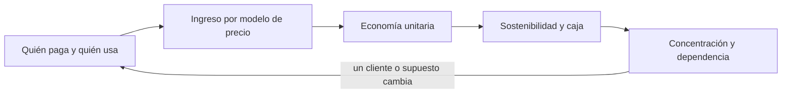
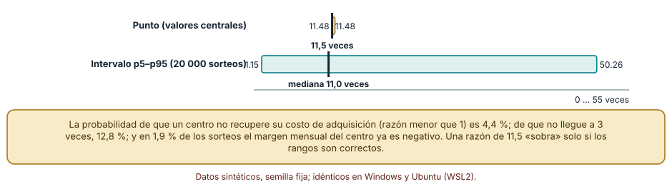
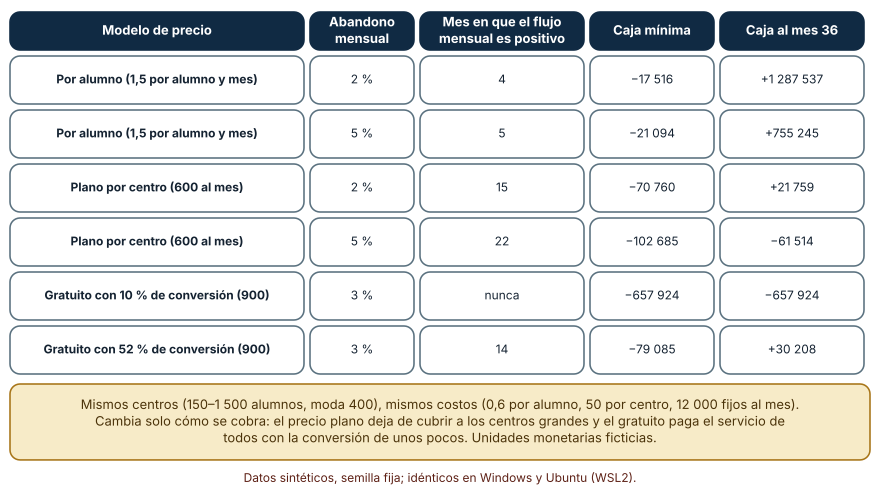
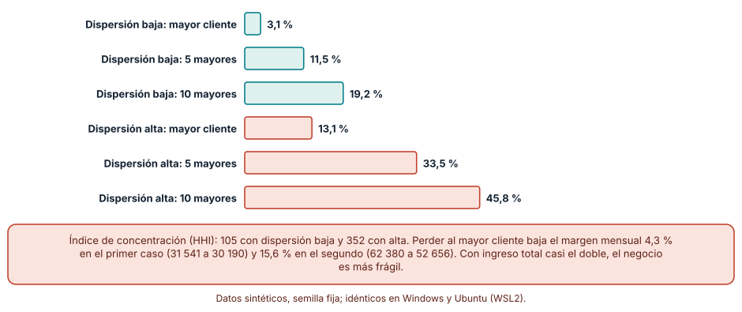

# SE-133 — Modelos de negocio y sostenibilidad

[← SE-132 — Proyecto: product brief respaldado por evidencia](../../classes/part-10-descubrimiento-y-estrategia-de-producto/se-132-proyecto-product-brief-respaldado-por-evidencia/README.md) · [↑ Parte 11](../../classes/part-11-economia-metricas-y-decisiones-de-producto/README.md) · [📚 Índice completo](../../classes/README.md) · [🌐 Portal](../../site/classes/SE-133.html) · [SE-134 — Costos de construcción, operación y oportunidad →](../../classes/part-11-economia-metricas-y-decisiones-de-producto/se-134-costos-de-construccion-operacion-y-oportunidad/README.md)

## Punto profesional y fundamento pedagógico

**Punto profesional.** La clase existe para separar quién paga, qué valor recibe, cuánto cuesta servirlo y qué mantiene vivo al producto, de modo que una decisión de negocio no descanse en una razón de adquisición que solo funciona con los valores centrales.

**Por qué aparece aquí.** Se sitúa después de **Proyecto: product brief respaldado por evidencia** y antes de **Costos de construcción, operación y oportunidad**: la Parte 10 terminó con un brief que dice qué merece construirse; la Parte 11 pregunta si puede sostenerse y con qué evidencia se medirá. Esta clase fija el vocabulario económico (pagador, ingreso, margen de contribución, adquisición, abandono, concentración) que las once siguientes usarán, y deja un modelo de negocio con rangos que `SE-134` descompondrá en costos.

**Error conceptual que debe corregir.** Tomar el crecimiento o una razón entre valor de vida y costo de adquisición como prueba de sostenibilidad, cuando ambos dependen de supuestos de abandono y de precio que casi nunca se conocen con precisión.

**Secuencia de aprendizaje.** Antes de leer los resultados, predices si una razón de 11 veces entre valor de vida y costo de adquisición es segura; después ejecutas la simulación, explicas por qué el intervalo es tan ancho, comparas tres modelos de precio sobre los mismos centros y reconstruyes sin apoyo qué hace frágil a un negocio con pocos clientes grandes. La secuencia usa predicción, explicación propia, contraste y recuperación. [ICAP](https://icap.education.asu.edu/research) distingue participación de construcción de conocimiento; [How People Learn II](https://nap.nationalacademies.org/catalog/24783/how-people-learn-ii-learners-contexts-and-cultures) exige conectar conocimiento previo, contexto y transferencia; la [práctica de recuperación](https://pubmed.ncbi.nlm.nih.gov/16507066/) respalda producir de nuevo la explicación tras una demora; y [Education for Life and Work](https://nap.nationalacademies.org/resource/13398/dbasse_084153.pdf) exige devolución que explique la causa del error.

**Evidencia de aprendizaje.** `viability-log.md` con los supuestos y sus rangos, la razón entre valor de vida y costo de adquisición como intervalo, la comparación de modelos de precio con mes de equilibrio y caja mínima, el índice de concentración y una nota de qué dato haría cambiar la conclusión.

**Límite de la conclusión.** Todos los precios, costos, tamaños y tasas son supuestos del autor en unidades monetarias ficticias; no se midió ningún centro, mercado ni empresa. Los experimentos muestran cómo se comporta un modelo, no cuánto rinde la plataforma real.

### Trazabilidad fuente → afirmación

| Fuente primaria u oficial | Afirmación que respalda | Lo que no prueba |
|---|---|---|
| [Open Source Guides: Getting paid for open source work](https://opensource.guide/getting-paid/) | Sostener un proyecto exige decidir quién paga y por qué; la financiación y el trabajo remunerado son decisiones distintas del valor técnico. | No dice cuánto cobrar ni qué modelo conviene a la plataforma. |
| [Strategyzer: The Business Model Canvas](https://www.strategyzer.com/library/the-business-model-canvas) | Un modelo de negocio puede describirse con segmentos, propuesta de valor, fuentes de ingreso y estructura de costos, y cada bloque es una hipótesis. | No valida ninguna hipótesis ni sustituye la medición. |
| [Python: random](https://docs.python.org/3/library/random.html) | `random.Random(semilla)` produce una secuencia reproducible y `triangular` muestrea un rango con moda. | No garantiza que la distribución triangular sea la forma real de la incertidumbre. |

## Antes de empezar

Esta clase abre la **Parte 11 sobre la economía de la plataforma de entregas de tareas**, el caso que la Parte 10 dejó con un brief. Recupera lo aprendido sobre rangos y supuestos declarados: un número sin rango oculta cuánto de él es suposición. La pregunta activa es: **¿qué tendría que ser verdad para que este negocio se sostenga, y qué parte de eso se ha medido?**

## Prerrequisitos

- Haber completado `SE-132` o poder explicar qué afirmaciones respalda el brief de la plataforma.
- Python 3.11 o posterior y un terminal; la hoja de cálculo es opcional.
- Trabajar solo con cifras sintéticas y unidades monetarias ficticias: ninguna observación necesita datos de una empresa o persona real.

## Problema auténtico

La plataforma de entregas de tareas quiere venderse a centros educativos. El equipo presenta una hoja con «valor de vida del cliente 11 veces el costo de adquirirlo» y pide aprobar la contratación de dos personas de ventas. Nadie ha preguntado cuántos de los tres factores de esa cifra (precio, abandono, costo de adquisición) se han medido, ni qué ocurre si el cliente mayor se va.

## Objetivos observables

Al terminar podrás:

1. distinguir pagador, usuario y decisor en la plataforma y explicar por qué el ingreso depende del primero y el uso del segundo;
2. calcular el margen de contribución por centro y el valor de vida, y expresar la razón con adquisición como intervalo, no como punto;
3. comparar tres modelos de precio sobre los mismos centros con mes de equilibrio y caja mínima;
4. medir la concentración de ingresos y estimar el efecto de perder al mayor cliente;
5. declarar qué supuestos del modelo se han medido y cuáles son suposición.

## Mapa conceptual



El mapa se lee como una cadena de razonamiento, no como fases obligatorias. La flecha de retorno indica que la pérdida de un cliente grande o un abandono mayor que el supuesto obliga a revisar quién paga y qué recibe; no autoriza a retocar solo la hoja de cálculo.

## Temas y por qué importan

| Tema | Por qué cambia una decisión profesional | Evidencia mínima |
|---|---|---|
| Quién paga y quién usa | El pagador compra por un resultado distinto del que busca el usuario; confundirlos produce funciones que se usan y no se pagan, o al revés. | Mapa de pagador, usuario y decisor con una cita o registro por cada uno en `viability-log.md` |
| Modelos de ingreso | El mismo uso produce ingresos muy distintos según se cobre por alumno, por centro o con un nivel gratuito. | Comparación de tres modelos con mes de equilibrio y caja mínima |
| Economía unitaria | Si cada cliente deja margen positivo y recupera su adquisición, crecer ayuda; si no, crecer acelera la pérdida. | Margen de contribución y razón con adquisición como intervalo |
| Sostenibilidad y caja | Un negocio rentable al cabo de tres años puede quedarse sin caja en el mes ocho. | Caja mínima acumulada y mes de equilibrio mensual |
| Concentración y dependencia | Pocos clientes grandes convierten una salida en una crisis; el promedio no lo muestra. | Participación de los mayores clientes e índice de concentración |

## Conceptos y decisiones

### 1. Quién paga y quién usa

En la plataforma de entregas, los estudiantes envían, los docentes corrigen y el centro paga. Cada actor valora algo distinto: el estudiante, que su entrega llegue; el docente, corregir menos tiempo; el centro, cumplir un reglamento y reducir reclamos. El ingreso depende de la valoración del pagador y la retención depende del uso, así que ambos se miden por separado. Cuando un modelo supone que el uso intenso del estudiante produce renovación del centro, está afirmando algo que debe comprobarse con renovaciones reales, no con sesiones.

### 2. Modelos de ingreso

Cobrar por alumno hace que el ingreso crezca con el tamaño del centro y con el costo de servirlo; un precio plano por centro simplifica la venta pero subsidia a los grandes; un nivel gratuito reduce la fricción de entrada y traslada el costo de servir a quienes pagan. Ninguno es mejor en abstracto: cada uno reparte de otra manera el riesgo (¿quién paga si el uso baja?) y el incentivo (¿qué se premia?). Elegir modelo es elegir qué hipótesis se apuesta a sostener, y el Business Model Canvas ayuda a nombrarla, no a probarla.

### 3. Economía unitaria

El margen de contribución de un centro es su ingreso menos lo que cuesta servirlo (infraestructura por alumno, soporte, comisiones). El valor de vida aproxima el margen futuro como margen mensual dividido por abandono mensual; si el abandono tiende a cero, el valor tiende a infinito, y por eso un abandono pequeño supuesto convierte cualquier negocio en bueno. La razón entre valor de vida y costo de adquisición solo es informativa con un rango, el horizonte declarado y un abandono medido, no deseado.

### 4. Sostenibilidad y caja

Un negocio puede tener margen positivo por cliente y quedarse sin dinero antes de que los clientes se acumulen: la caja mínima acumulada, y no solo el mes en que el flujo mensual es positivo, indica cuánto financiamiento hace falta. En un producto con mantenimiento, sostenibilidad también es operativa: el equipo que lo sostiene, la deuda técnica y la dependencia de personas concretas cuentan. Una evaluación completa nombra las dos.

### 5. Concentración y dependencia

La participación de los mayores clientes y el índice de Herfindahl-Hirschman (suma de los cuadrados de las participaciones, escala de 0 a 10 000) resumen cuánto depende el ingreso de pocos. No dicen si esos clientes son estables, pero indican cuánto ingreso está en riesgo con una sola decisión ajena.

### La razón entre valor de vida y costo de adquisición: un punto o un rango

La hoja del equipo calcula la razón con valores centrales: 400 alumnos por centro, un precio de 1,5 por alumno y mes, un costo de servir de 0,6 por alumno, 50 de soporte mensual, un abandono de 3 % mensual y 900 de costo de adquisición. El margen mensual es 400 × (1,5 − 0,6) − 50 = 310, el valor de vida 310 / 0,03 = 10 333 y la razón 11,5 veces. Predicción antes de ejecutar: si cada supuesto es incierto, la razón no debería ser un punto.

```python
rng = random.Random(1331)
def centro():
    alumnos = rng.triangular(150, 1500, 400)
    precio = rng.triangular(0.8, 3.0, 1.5)
    costo = rng.triangular(0.3, 1.2, 0.6)
    soporte = rng.triangular(20, 150, 50)
    adquisicion = rng.triangular(300, 3000, 900)
    abandono = rng.triangular(0.01, 0.08, 0.03)
    margen = alumnos * (precio - costo) - soporte
    return margen / abandono / adquisicion, margen
```

Con 20 000 sorteos, idéntico en Windows (CPython 3.12.9) y en Ubuntu bajo WSL2 (3.12.3): percentil 5 = 1,15; mediana = 10,96; percentil 95 = 50,3. La razón es menor que 1 (el centro no recupera su adquisición) en 4,4 % de los casos y menor que 3 en 12,8 %; en 1,9 % de los sorteos el margen mensual del centro es negativo. Dos lecciones: el punto de 11,5 cae en la parte baja del intervalo, y el intervalo se estira hacia arriba porque un abandono de 1 % hace que el valor de vida se dispare. La cola superior es la que menos conviene mencionar en una presentación y la inferior la que decide si se contrata.



**Cómo leer la figura.** El punto dorado es la cifra de la hoja; el intervalo verde es lo que queda al admitir que seis supuestos son inciertos, y la marca negra es la mediana. **Dónde deja de valer:** los rangos son supuestos del autor y los seis factores se muestrean de forma independiente; si los centros grandes también abandonan menos o cuestan más de adquirir, el intervalo real sería distinto. Con abandono medido de cohortes reales (`SE-136`) el rango se estrecharía.

### Tres modelos de precio sobre los mismos centros

Para comparar modelos se simula una plataforma durante 36 meses: seis centros nuevos por mes, tamaño de 150 a 1 500 alumnos (moda 400), costo de servir de 0,6 por alumno y mes, 50 de soporte por centro y 12 000 de costos fijos del equipo. Se compara cobrar 1,5 por alumno, un precio plano de 600 por centro y un nivel gratuito en que solo una fracción de los centros paga un plano de 900 (los gratuitos cuestan una cuarta parte de servir).

```python
def mes(modelo, escuelas, conv, fijos=12000):
    ingreso = {"alumno": sum(escuelas) * 1.5, "plano": len(escuelas) * 600,
               "gratuito": len(escuelas) * conv * 900}[modelo]
    servir = sum(escuelas) * 0.6 * (1 if modelo != "gratuito" else conv + (1 - conv) * 0.25)
    return ingreso - servir - fijos - len(escuelas) * 50
```

Resultado, idéntico en ambos sistemas: con precio por alumno el flujo mensual es positivo en el mes 4 (abandono de 2 %) o 5 (5 %) y la caja a 36 meses es 1,29 millones y 0,76 millones; con precio plano el equilibrio llega en el mes 15 (2 %) o 22 (5 %) y con abandono de 5 % la caja a 36 meses sigue siendo negativa (−61 514); con nivel gratuito y 10 % de conversión el flujo mensual nunca es positivo y la caja mínima es −657 924. Solo con una conversión de 52 % el modelo gratuito se equilibra (mes 14). El precio plano falla porque la media de ingreso por centro (600) queda por debajo de la del modelo por alumno (alrededor de 1 000); el gratuito, porque la conversión debía cubrir el servicio de todos.



**Cómo leer la figura.** Cada fila es una simulación con la misma semilla de centros; el mes de equilibrio es el primero con flujo mensual positivo y la caja mínima, el punto más bajo de la caja acumulada. **Dónde deja de valer:** la simulación supone que los centros llegan a ritmo constante, que el precio no cambia con la competencia y que el costo de servir es lineal. No dice qué precio aceptaría un centro real: eso se averigua vendiendo, no simulando.

### Concentración: cuánto ingreso depende de pocos clientes

Se generan 120 centros con ingreso lognormal de mediana 600 y dos dispersiones: σ = 0,5 (centros parecidos) y σ = 1,2 (muy desiguales).

```python
rng = random.Random(1333)
ingresos = sorted((math.exp(rng.gauss(0, sigma)) * 600 for _ in range(120)), reverse=True)
hhi = sum((x / sum(ingresos)) ** 2 for x in ingresos) * 10000
```

Con σ = 0,5 el mayor cliente aporta 3,1 % del ingreso, los cinco mayores 11,5 % y los diez mayores 19,2 %; el índice es 105. Con σ = 1,2 aportan 13,1 %, 33,5 % y 45,8 %, y el índice es 352. Perder al mayor cliente baja el margen mensual de 31 541 a 30 190 en el primer caso (−4,3 %) y de 62 380 a 52 656 en el segundo (−15,6 %). El segundo negocio ingresa casi el doble y es más frágil.



**Cómo leer la figura.** Las barras verdes son centros parecidos; las coral, centros muy desiguales. **Dónde deja de valer:** la lognormal es una forma común de describir tamaños desiguales, no la distribución de tus clientes. La concentración mide dependencia, no riesgo: un cliente grande con contrato de cinco años puede ser menos riesgoso que cinco medianos que renuevan cada mes.

## Definiciones de trabajo

- **pagador, usuario y decisor:** quien paga el servicio, quien lo usa y quien decide comprarlo o renovarlo; pueden ser personas distintas.
- **modelo de ingreso:** regla que convierte uso o presencia de un cliente en dinero (por alumno, plano, gratuito con conversión).
- **margen de contribución:** ingreso de un cliente menos el costo variable de servirlo.
- **valor de vida y costo de adquisición:** margen futuro esperado de un cliente (margen mensual dividido por abandono mensual) y lo que cuesta conseguirlo.
- **concentración:** parte del ingreso que aportan los mayores clientes; el índice de Herfindahl-Hirschman es la suma de los cuadrados de las participaciones.

Las definiciones son operativas para la plataforma de entregas y deben contrastarse con la documentación primaria enlazada al final.

## Ejemplo mínimo

El fragmento siguiente calcula la razón con los valores centrales. Antes de ejecutarlo, predice qué ocurre si el abandono mensual baja de 3 % a 1 %.

```python
margen = 400 * (1.5 - 0.6) - 50        # 310 por centro y mes
for abandono in (0.03, 0.02, 0.01):
    print(abandono, round(margen / abandono / 900, 1))
```

Con 3 % la razón es 11,5; con 2 %, 17,2; con 1 %, 34,4. Triplicar la razón cambiando una décima de un supuesto muestra por qué un solo valor no basta. Registra versión del intérprete, comando y salida.

## Ejemplo profesional

En la plataforma de entregas, el modelo vive en `viability-log.md` con una fila por supuesto: nombre, unidad, mínimo, moda, máximo, fuente y estado (medido, derivado, suposición). El contrato del registro es que ningún resultado se informa sin la fila de supuestos que lo produjo y que cambiar una fila cambia la fecha del resultado. Esa separación permite que un revisor recalcule el modelo con otros valores.

Compara el caso normal con el centro que paga tarde, con el que cancela a mitad de año, con el que negocia un descuento por volumen y con el que usa mucho y no renueva. Un modelo es apropiado cuando esas diferencias quedan visibles como escenarios; es peligroso cuando se promedian en una tasa de abandono y se pierde la causa.

## Práctica guiada

1. Copia el contrato de supuestos (nombre, unidad, rango, fuente, estado) antes de calcular nada.
2. Predice si la razón con adquisición de 11 veces es robusta y anota por qué.
3. Reproduce el cálculo del punto y luego el de 20 000 sorteos con semilla fija; guarda p5, mediana y p95.
4. Simula los tres modelos de precio durante 36 meses y registra mes de equilibrio, caja mínima y caja final.
5. Genera 120 centros con dos dispersiones y calcula la participación de los mayores clientes y el índice.
6. Redacta una condición de abandono del plan comercial (qué resultado haría detener la contratación) y su responsable.
7. Pide a otra persona que reconstruya la conclusión solo con `viability-log.md`.

## Ejercicios

1. **Abandono:** reproduce el intervalo de la razón con el abandono en 0,02–0,06 (moda 0,03) y explica cuánto se acorta la cola superior y por qué.
2. **Precio plano:** busca el precio plano por centro que iguala el flujo mensual del modelo por alumno en el mes 24 y explica qué centros subsidia.
3. **Conversión:** calcula la conversión mínima del nivel gratuito para que la caja a 36 meses sea positiva con abandono de 3 % y justifica por qué es difícil de lograr.
4. **Concentración:** crea un escenario con un cliente de 40 % del ingreso y otro con diez de 4 %; compara el índice, el margen tras perder al mayor y qué contrato lo hace aceptable.

## Reto verificable

Entrega `viability-log.md` con la tabla de supuestos (rango, fuente, estado), la razón con adquisición como intervalo, la comparación de los tres modelos con mes de equilibrio y caja mínima, y el índice de concentración con el efecto de perder al mayor cliente. Se aprueba si otra persona ejecuta el código desde un checkout limpio, obtiene los mismos números con la semilla indicada y puede señalar qué supuesto, de ser falso, haría cambiar la decisión de contratar. No se aprueba por la cantidad de escenarios ni por la longitud del informe.

## Caso conductor

La plataforma de entregas de tareas es el caso conductor de la Parte 11. Esta clase deja el primer artefacto: un modelo con supuestos y rangos, una razón con adquisición expresada como intervalo y una medida de concentración. `SE-134` descompondrá los costos que aquí entraron como un solo número; `SE-135` y `SE-136` definirán qué se mide para saber si los supuestos de uso y abandono se cumplen. Cambia después un solo supuesto —por ejemplo, el abandono— y revisa qué conclusiones del registro cambian.

## Preguntas frecuentes

### ¿Una razón de 3 o más entre valor de vida y costo de adquisición no es suficiente?

Es una regla de bolsillo muy repetida, no una propiedad del negocio. En el experimento, el 12,8 % de los sorteos queda por debajo de 3 aunque la razón central sea 11,5, y cualquier umbral fijo ignora el horizonte, el costo de capital y el abandono. Úsala como alarma para investigar, no como criterio de aprobación.

### ¿Por qué no basta con el crecimiento de usuarios?

Porque el crecimiento mide llegada, no sostenibilidad. En la simulación por alumno el flujo mensual es positivo en el mes 4; en el modelo gratuito con 10 % de conversión, los usuarios crecen igual y la caja mínima llega a −657 924. El crecimiento es una hipótesis sobre el negocio, no su resultado.

### ¿Se puede estimar el abandono antes de tener clientes?

Se puede declarar como suposición con rango y fuente (por ejemplo, de un piloto o de una alternativa comparable), pero no medir. Por eso `SE-136` mide retención con cohortes reales y por eso la decisión inicial debe incluir una regla que la revise cuando haya datos.

### ¿Un modelo de lenguaje puede construir la hoja de cálculo del modelo de negocio?

Puede proponer la estructura y detectar fórmulas inconsistentes, pero los rangos y su fuente los decide una persona que responde por ellos. Una hoja generada sin esa fila de fuente repite el defecto de la cifra única con apariencia de rigor.

## Fallo controlado y diagnóstico

Reproduce el fallo clásico de la clase: **optimizar actividad o una cifra de crecimiento en lugar del resultado**. Toma la hoja con razón de 11,5 y aprueba la contratación. Después reemplaza el abandono por 1 % y por 8 % y observa cómo la misma razón pasa de 34 a 4.

Registra síntoma, entrada mínima, hipótesis, observación que descarta cada hipótesis, causa, corrección y prueba de regresión. **Síntoma:** la razón aprobada se reduce a menos de la mitad cuando se mide el abandono real. **Hipótesis rivales:** (a) el costo de adquisición estaba mal; (b) el abandono estaba mal; (c) ambos dependían del tamaño del centro. **Prueba:** lleva un supuesto a la vez de su mínimo a su máximo y registra qué razón produce; el que más la mueve es el que hay que medir primero. **Conclusión:** la cifra única ocultaba que un supuesto no medido dominaba. **Regresión:** añade al contrato de `viability-log.md` una columna «estado» y una prueba que falle si un resultado se informa sin intervalo o con un supuesto en estado «suposición» sin fecha de revisión.

## Errores comunes y cómo corregirlos

| Síntoma | Causa probable | Corrección |
|---|---|---|
| La hoja muestra 11 veces y la dirección pide más ventas sin preguntar nada | Se informó la razón con valores centrales y sin intervalo | Informar p5, mediana y p95 con el supuesto que más contribuye |
| El plan se equilibra en el mes 4 y la caja se agota en el mes 8 | Se miró el flujo mensual y no la caja acumulada | Calcular la caja mínima y financiar hasta ese punto |
| El precio plano «simplifica» y pierde dinero con los centros grandes | Se promedió el ingreso por centro sin ver el costo de servir por tamaño | Comparar el margen por centro según tamaño antes de fijar el precio |
| Un cliente se va y el equipo descubre que era 13 % del ingreso | Nadie midió la concentración | Informar participación de los mayores clientes y revisarla cada trimestre |
| El modelo gratuito crece y no cierra | La conversión necesaria nunca se calculó | Calcular la conversión de equilibrio y compararla con la observada |

## Entorno y archivos clave

```text
work/SE-133/
├── README.md
├── negocio/
│   ├── unitario.py
│   ├── precios.py
│   └── concentracion.py
├── fixtures/supuestos.csv
├── tests/test_unitario.py
└── evidence/viability-log.md
```

El `README` declara plataforma, versión de Python, semillas (1331, 1332, 1333) y comandos. Los experimentos usan solo la biblioteca estándar (`random`, `math`, `statistics`) y se ejecutaron con CPython 3.12.9 en Windows 11 y 3.12.3 en Ubuntu bajo WSL2 con salidas idénticas. Si añades una dependencia, fija procedencia y versión.

## Seguridad, ética y accesibilidad

- los precios y los datos de clientes reales son confidenciales: trabaja con cifras ficticias y registra de dónde salió cada rango;
- un modelo que supone el abandono bajo para aprobar una contratación traslada riesgo a quien depende de ese empleo: declara los rangos aunque incomoden;
- cobrar por alumno puede excluir a centros pequeños o con menos recursos; considera su efecto antes de optimizar margen;
- ofrece una alternativa textual a cada gráfico y explica los intervalos con palabras, no solo con colores;
- no pegues contratos o listas de clientes reales en un modelo de lenguaje sin una política de datos que lo permita;
- atribuye las fuentes de los marcos usados.

## Puente hacia el trabajo con agentes

Un agente al que se le pide «construye el modelo financiero de la plataforma» tenderá a devolver una hoja con valores centrales plausibles y una razón favorable. Pídele en cambio que declare cada supuesto con unidad, rango, fuente y estado, que entregue p5, mediana y p95 de cada resultado con la semilla y el código, y que señale qué supuesto domina. Revisa especialmente si aparece un abandono o un precio sin fuente: es el mismo error de la cifra única, ahora con apariencia de modelo.

## Transferencia

Traslada el experimento a otro de los dominios persistentes (por ejemplo, un servicio de entregas a domicilio con comercios como clientes): cambia el pagador, los costos y la dispersión de tamaños, conserva el contrato de supuestos y comprueba si el precio plano sigue subsidiando a los grandes. La transferencia está lograda cuando puedes explicar qué parte del método dependía del dominio y cuál no, no cuando el código se parece.

## Evaluación y evidencia

| Criterio | Evidencia para aprobar |
|---|---|
| comprensión | explicación de quién paga, quién usa y qué hipótesis apuesta cada modelo de precio |
| corrección | razón con adquisición, mes de equilibrio, caja mínima e índice reproducibles con la misma semilla |
| diseño | contrato de supuestos con rango, fuente y estado |
| diagnóstico | reproducción del fallo «cifra de crecimiento como prueba» con regresión |
| incertidumbre | intervalo p5–p95 y supuesto dominante en lugar de una razón única |
| reproducibilidad | versiones, comandos, salida y límites declarados |

## Fuentes

- [Open Source Guides: Getting paid for open source work](https://opensource.guide/getting-paid/) — decisiones de financiación y sostenimiento de un proyecto; autoridad: GitHub, con contribuciones de la comunidad.
- [Strategyzer: The Business Model Canvas](https://www.strategyzer.com/library/the-business-model-canvas) — descripción de un modelo de negocio por bloques; autoridad: Strategyzer (Osterwalder y Pigneur).
- [Why Business Models Matter (Harvard Business Review, 2002)](https://hbr.org/2002/05/why-business-models-matter) — qué es un modelo de negocio y por qué debe poder contrastarse; autoridad: Harvard Business Review (artículo parcialmente de pago).
- [SWEBOK Guide v4.0a](https://www.computer.org/education/bodies-of-knowledge/software-engineering) — economía de la ingeniería de software y medición; autoridad: IEEE Computer Society.
- [GOV.UK Service Manual: Measuring success](https://www.gov.uk/service-manual/measuring-success) — cómo medir si un servicio cumple su propósito; autoridad: Government Digital Service (Reino Unido).

Cada fuente respalda el mecanismo indicado; ninguna demuestra que los supuestos de precio, abandono y adquisición de la plataforma sean correctos. Esa afirmación depende de datos de clientes reales y de la revisión de otra persona.

- [Python: `random.triangular`](https://docs.python.org/3/library/random.html#random.triangular) — distribución triangular usada para los rangos.
- [Python: `statistics`](https://docs.python.org/3/library/statistics.html) — funciones de resumen usadas en los experimentos.
- [Python: `math`](https://docs.python.org/3/library/math.html) — logaritmos y exponenciales de la dispersión lognormal.

## Límites y siguiente paso

Se ejecutaron tres experimentos con datos sintéticos en Windows y Ubuntu (WSL2) con resultados idénticos. No se midió ningún centro, mercado ni empresa; los rangos, precios y costos son supuestos del autor en unidades monetarias ficticias, y los factores se muestrearon de forma independiente. La siguiente clase descompone el costo que aquí entró como un solo número.

## Glosario

- **pagador, usuario y decisor:** quien paga el servicio, quien lo usa y quien decide comprarlo o renovarlo; pueden ser personas distintas.
- **modelo de ingreso:** regla que convierte uso o presencia de un cliente en dinero (por alumno, plano, gratuito con conversión).
- **margen de contribución:** ingreso de un cliente menos el costo variable de servirlo.
- **valor de vida y costo de adquisición:** margen futuro esperado de un cliente (margen mensual dividido por abandono mensual) y lo que cuesta conseguirlo.
- **concentración:** parte del ingreso que aportan los mayores clientes; el índice de Herfindahl-Hirschman es la suma de los cuadrados de las participaciones.

---

[← SE-132 — Proyecto: product brief respaldado por evidencia](../../classes/part-10-descubrimiento-y-estrategia-de-producto/se-132-proyecto-product-brief-respaldado-por-evidencia/README.md) · [↑ Parte 11](../../classes/part-11-economia-metricas-y-decisiones-de-producto/README.md) · [📚 Índice completo](../../classes/README.md) · [🌐 Portal](../../site/classes/SE-133.html) · [SE-134 — Costos de construcción, operación y oportunidad →](../../classes/part-11-economia-metricas-y-decisiones-de-producto/se-134-costos-de-construccion-operacion-y-oportunidad/README.md)
