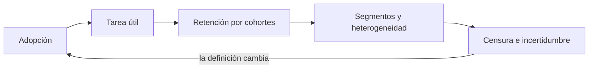
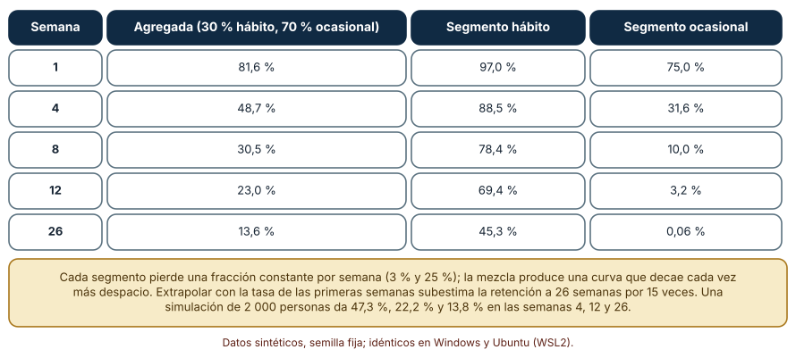
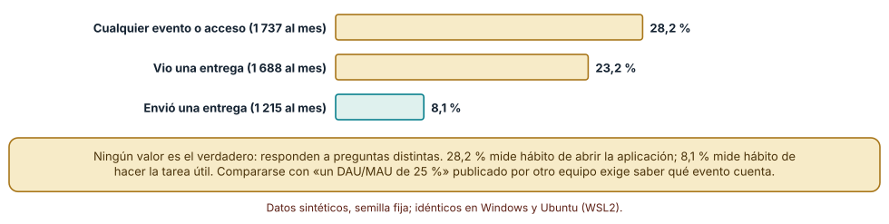
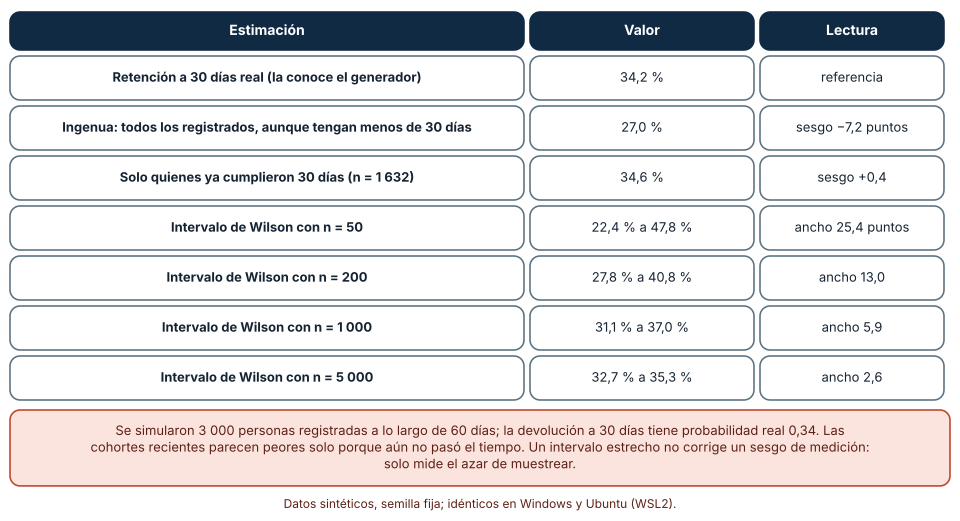

# SE-136 — Métricas de adopción, retención y tarea útil

[← SE-135 — Resultados, outputs, actividad y vanity metrics](../../classes/part-11-economia-metricas-y-decisiones-de-producto/se-135-resultados-outputs-actividad-y-vanity-metrics/README.md) · [↑ Parte 11](../../classes/part-11-economia-metricas-y-decisiones-de-producto/README.md) · [📚 Índice completo](../../classes/README.md) · [🌐 Portal](../../site/classes/SE-136.html) · [SE-137 — Telemetría de producto y consentimiento →](../../classes/part-11-economia-metricas-y-decisiones-de-producto/se-137-telemetria-de-producto-y-consentimiento/README.md)

## Punto profesional y fundamento pedagógico

**Punto profesional.** La clase existe para medir si las personas llegan a hacer la tarea que importa, si vuelven a hacerla y en qué se diferencian quienes lo logran de quienes no, sin confundir una curva promedio con el comportamiento de alguien.

**Por qué aparece aquí.** Se sitúa después de **Resultados, outputs, actividad y vanity metrics** y antes de **Telemetría de producto y consentimiento**: `SE-135` separó actividad de resultado; esta clase define las métricas de adopción, retención y tarea útil que aproximan el resultado, y deja un conjunto de definiciones calculables cuya recolección `SE-137` someterá al consentimiento y a la minimización.

**Error conceptual que debe corregir.** Interpretar una curva de retención agregada como si todos decayeran igual, extrapolarla y leer una cohorte reciente o pequeña como si estuviera completa.

**Secuencia de aprendizaje.** Antes de ejecutar, predices si una curva que se aplana implica que alguien «se queda»; después simulas dos segmentos, cuentas «activo» de tres maneras sobre la misma población y comparas una retención naive con una que respeta cohortes incompletas. La secuencia usa predicción, explicación propia, contraste y recuperación. [ICAP](https://icap.education.asu.edu/research) distingue participación de construcción de conocimiento; [How People Learn II](https://nap.nationalacademies.org/catalog/24783/how-people-learn-ii-learners-contexts-and-cultures) exige conectar conocimiento previo, contexto y transferencia; la [práctica de recuperación](https://pubmed.ncbi.nlm.nih.gov/16507066/) respalda producir de nuevo la explicación tras una demora; y [Education for Life and Work](https://nap.nationalacademies.org/resource/13398/dbasse_084153.pdf) exige devolución que explique la causa del error.

**Evidencia de aprendizaje.** `adoption-metrics.md` con la definición calculable de adopción, tarea útil y retención por cohortes, las tres variantes de actividad con sus cifras, el efecto de la censura y los intervalos de una retención según tamaño de cohorte.

**Límite de la conclusión.** Los segmentos, las probabilidades y los comportamientos son sintéticos; no se midió a ninguna persona. Se muestra cómo se distorsiona una métrica de retención, no cuánto retiene la plataforma real.

### Trazabilidad fuente → afirmación

| Fuente primaria u oficial | Afirmación que respalda | Lo que no prueba |
|---|---|---|
| [GOV.UK Service Manual: Measuring completion rate](https://www.gov.uk/service-manual/measuring-success/measuring-completion-rate) | La tasa de finalización se define sobre quienes empezaron una transacción y se calcula con un numerador y un denominador explícitos. | No fija qué cuenta como finalización en la plataforma. |
| [GOV.UK Service Manual: Measuring digital take-up](https://www.gov.uk/service-manual/measuring-success/measuring-digital-take-up) | Adopción se define como la parte de una población objetivo que usa el canal, con una población declarada. | No indica qué adopción es suficiente. |
| [NIST/SEMATECH e-Handbook: intervalos para proporciones](https://www.itl.nist.gov/div898/handbook/prc/section2/prc241.htm) | Una proporción observada en una muestra tiene un intervalo de confianza que depende del tamaño de la muestra. | No corrige sesgos de medición ni de selección. |

## Antes de empezar

Recupera lo aprendido en `SE-135`: una métrica de actividad no es resultado. La pregunta activa es: **¿qué evento prueba que alguien logró lo que venía a hacer, y cuántas personas de una cohorte completa lo repiten?**

## Prerrequisitos

- Haber completado `SE-135` o poder clasificar una métrica como producción, actividad o resultado.
- Python 3.11 o posterior y un terminal.
- Trabajar solo con usuarios sintéticos; ninguna observación necesita datos de una persona real.

## Problema auténtico

El panel de la plataforma muestra una retención «de 25 %» a las 12 semanas y la dirección proyecta que se estabilizará. Otro panel dice que «DAU/MAU es 28 %». Un tercer informe celebra una retención a 30 días de 27 % para la cohorte de este mes. Nadie ha preguntado qué cuenta como activo, si la cohorte ya cumplió 30 días ni si la curva baja porque todos se cansan o porque se van pocos y se quedan otros.

## Objetivos observables

Al terminar podrás:

1. definir adopción, tarea útil y retención con numerador, denominador, población y ventana;
2. explicar por qué una curva agregada que se aplana no implica que cada persona decaiga más despacio;
3. medir cuánto cambia un cociente de actividad según qué evento cuenta como activo;
4. calcular una retención que respete cohortes incompletas y dar su intervalo según el tamaño de la cohorte;
5. declarar qué población y qué ventana usa cada cifra.

## Mapa conceptual



El mapa se lee como una cadena de razonamiento, no como fases obligatorias. La flecha de retorno indica que una cohorte incompleta o un segmento oculto obliga a revisar la definición de adopción; no autoriza a cambiar solo el gráfico.

## Temas y por qué importan

| Tema | Por qué cambia una decisión profesional | Evidencia mínima |
|---|---|---|
| Adopción | Sin una población objetivo declarada, «adopción» es un porcentaje sin referente. | Definición con población y ventana en `adoption-metrics.md` |
| Tarea útil | El evento que prueba un logro decide qué se premia; cambiarlo cambia todas las cifras posteriores. | Evento de valor y por qué no es actividad pura |
| Retención por cohortes | Mide si quienes llegaron en un periodo vuelven; las cifras agregadas mezclan edades. | Tabla de retención por cohorte con n de cada una |
| Segmentos y heterogeneidad | Una curva promedio puede esconder dos poblaciones con comportamientos opuestos. | Retención por segmento y comparación con la agregada |
| Censura e incertidumbre | Una cohorte reciente no ha tenido tiempo; una pequeña tiene un intervalo ancho. | Solo cohortes completas y su intervalo de Wilson |

## Conceptos y decisiones

### 1. Adopción

Adopción es la parte de una población objetivo que empieza a usar el servicio en una ventana. Su denominador es el punto delicado: ¿todos los centros con cuenta, los que activaron, los que firmaron? Cada elección cambia el valor. La guía del Gobierno británico sobre adopción digital exige declarar la población para que la cifra tenga referente.

### 2. Tarea útil

La tarea útil es el evento que prueba que alguien obtuvo valor: en la plataforma, una entrega aceptada, no un inicio de sesión. Elegirla es una decisión de producto, no de analítica, y se valida preguntando si quien la hizo diría que logró lo que buscaba. Una tarea útil demasiado fácil de lograr se vuelve actividad; una demasiado rara no ofrece datos.

### 3. Retención por cohortes

Una cohorte es el grupo de personas que empezaron en un mismo periodo; la retención en la semana k es la fracción de la cohorte que realiza la tarea útil en esa semana. Comparar cohortes de la misma edad evita mezclar a quien lleva dos días con quien lleva dos meses. La retención de la semana 1 en la cohorte de ayer no es comparable con la de la semana 12 de hace seis meses.

### 4. Segmentos y heterogeneidad

Si la población se compone de grupos con tasas de abandono distintas, la curva agregada es una mezcla: los de abandono rápido desaparecen primero y la curva se aplana porque quedan los de abandono lento. La forma «aplanada» no dice que cada persona se estabiliza. Ver los segmentos separados (plan, tamaño del centro, canal de llegada) es la manera de comprobarlo.

### 5. Censura e incertidumbre

Una cohorte de hace 10 días no puede mostrar retención a 30 días: la información aún no existe (censura por la derecha). Contar a esas personas como «no retenidas» sesga hacia abajo. Y una cohorte pequeña tiene un intervalo ancho: con 50 personas, una retención de 34 % es compatible con valores entre 22 % y 48 %.

### Una curva agregada que se aplana oculta dos poblaciones

La plataforma tiene dos tipos de centros: 30 % de «hábito» que conserva cada semana al 97 % de sus usuarios y 70 % de «visitas ocasionales» que conserva al 75 %. Predicción: ¿qué forma tiene la curva agregada y qué tan bien se extrapola con la tasa de las primeras semanas?

```python
def agregada(semana):
    return 0.3 * 0.97 ** semana + 0.7 * 0.75 ** semana
tasa = agregada(4) ** (1 / 4)          # tasa constante ajustada a las primeras 4 semanas
```

Resultado, idéntico en Windows (CPython 3.12.9) y en Ubuntu bajo WSL2 (3.12.3): la retención agregada es 81,6 % en la semana 1, 48,7 % en la 4, 30,5 % en la 8, 23,0 % en la 12 y 13,6 % en la 26. Los segmentos por separado: hábito 97,0 % → 45,3 % (semana 26); ocasional 75,0 % → 0,06 %. Si se ajusta una tasa constante a las primeras cuatro semanas (83,5 % por semana), la proyección a la semana 26 es 0,9 %, quince veces menos que el valor real (13,6 %). Una simulación de 2 000 personas con semilla 1361 da 47,3 %, 22,2 % y 13,8 % en las semanas 4, 12 y 26, consistente con la fórmula. La curva se aplana porque la población cambia de composición, no porque cada persona se estabilice.



**Cómo leer la figura.** La primera columna es la curva que ve el panel; las otras dos son los segmentos que la componen. La nota compara la extrapolación ingenua con el valor real. **Dónde deja de valer:** los dos segmentos y sus tasas constantes son supuestos del autor; las poblaciones reales tienen más grupos y tasas que cambian con el tiempo. La figura muestra un mecanismo y no autoriza a suponer que tu retención se comporta así.

### «Activo» tiene tres significados

Se simulan 2 000 personas durante 28 días con una propensión individual a usar el producto (beta 0,8 y 2,5). Cada día una persona inicia sesión con su propensión, vio una entrega con probabilidad 0,8 si inició, y envió una con probabilidad 0,25 si la vio. El cociente DAU/MAU se calcula con tres definiciones de activo.

```python
rng = random.Random(1362)
propension = rng.betavariate(0.8, 2.5)
login = rng.random() < propension
vio = login and rng.random() < 0.8
envio = vio and rng.random() < 0.25
```

Con «cualquier acceso», 1 737 personas son activas en el mes y el promedio diario es 491: DAU/MAU = 28,2 %. Con «vio una entrega», 1 688 y 392: 23,2 %. Con «envió una entrega», 1 215 y 99: 8,1 %. La misma población produce cifras que van de 8 % a 28 % según el evento. Ninguna es «la verdadera»: miden hábitos distintos (abrir la aplicación frente a hacer la tarea). Comparar un 28 % interno con un 25 % publicado por otro equipo exige saber qué evento contó cada uno.



**Cómo leer la figura.** Cada barra es la misma población medida con un evento distinto; la verde es la tarea útil. **Dónde deja de valer:** las probabilidades diarias son supuestos y la propensión se reparte con una beta; en datos reales los eventos se correlacionan por día de la semana y calendario escolar, y el cociente varía con la ventana.

### Cohortes incompletas y cohortes pequeñas

Se generan 3 000 personas que se registran de manera uniforme a lo largo de 60 días; cada una vuelve dentro de 30 días con probabilidad 0,34 en un día uniforme entre 1 y 30. Se observa hasta el día 60. Predicción: ¿cuánto subestima la retención una cuenta que incluye cohortes de menos de 30 días?

```python
rng = random.Random(1363)
elegibles = [u for u in usuarios if 60 - u.alta >= 30]
retencion = sum(u.volvio for u in elegibles) / len(elegibles)
```

La retención real a 30 días es 34,2 %. Contar a todas las personas, aunque tengan menos de 30 días observados, da 27,0 % (−7,2 puntos). Usar solo a quienes ya cumplieron 30 días (1 632 personas) da 34,6 % (+0,4). Aparte, el intervalo de Wilson de una retención de 34 % tiene un ancho de 25,4 puntos con 50 personas (22,4–47,8 %), 13,0 con 200 (27,8–40,8 %), 5,9 con 1 000 (31,1–37,0 %) y 2,6 con 5 000 (32,7–35,3 %).



**Cómo leer la figura.** Las primeras filas comparan formas de calcular la misma retención; las siguientes muestran cómo se estrecha el intervalo con el tamaño. **Dónde deja de valer:** el modelo supone que la probabilidad de volver no depende de cuándo se registró la persona (sin estacionalidad) y que el momento de la vuelta es uniforme. Un intervalo estrecho mide solo el azar de muestrear: no corrige un sesgo de definición.

## Definiciones de trabajo

- **adopción:** parte de una población objetivo declarada que comienza a usar el servicio en una ventana.
- **tarea útil:** evento que prueba que la persona logró lo que buscaba (en la plataforma, una entrega aceptada).
- **retención por cohorte:** fracción de las personas que empezaron en un periodo y repiten la tarea útil k periodos después.
- **heterogeneidad:** coexistencia de segmentos con comportamientos distintos dentro de una misma curva.
- **censura:** ausencia de datos porque el tiempo de observación aún no alcanzó la ventana medida.

Las definiciones son operativas para la plataforma de entregas y deben contrastarse con las fuentes enlazadas al final.

## Ejemplo mínimo

Predice la retención agregada a cuatro semanas de una población con la mitad de cada segmento (97 % y 75 % semanal).

```python
semanas = 4
print(round(0.5 * 0.97 ** semanas + 0.5 * 0.75 ** semanas, 3))
```

El resultado es 0,601: la mezcla retiene 60,1 % a cuatro semanas, como si perdiera 12 % por semana, pero ningún segmento pierde eso (pierden 3 % y 25 %). Registra versión del intérprete, comando y salida.

## Ejemplo profesional

En la plataforma, `adoption-metrics.md` define cada métrica con población, evento, ventana y filtros: adopción es «centros con al menos una entrega aceptada en los primeros 14 días, sobre centros con cuenta activada»; retención es «estudiantes con una entrega aceptada en la semana k sobre quienes tuvieron una en la semana 0». El contrato es que ninguna cifra se publica sin n, sin edad mínima de la cohorte y sin su intervalo.

Compara el caso normal con el centro que activa en agosto (vacaciones), con el que migra desde otra herramienta, con el que cambia de plan y con el que usa la plataforma solo en cierres de trimestre. La definición es apropiada cuando esas diferencias aparecen como segmentos; es peligrosa cuando una sola cifra las promedia.

## Práctica guiada

1. Copia el contrato de métrica (población, evento, ventana, filtros, n, intervalo) antes de calcular.
2. Predice si la curva agregada que se aplana implica que cada persona se estabiliza.
3. Simula dos segmentos con semilla fija y guarda la curva agregada y por segmento.
4. Calcula DAU/MAU con tres definiciones de activo sobre la misma población.
5. Genera una cohorte con censura y calcula la retención ingenua y la de elegibles.
6. Calcula el intervalo de Wilson para cuatro tamaños de cohorte.
7. Pide a otra persona que reconstruya las definiciones y los cuatro resultados solo con `adoption-metrics.md`.

## Ejercicios

1. **Segmentos:** cambia la proporción de hábito a 10 % y a 60 % y describe cómo cambia la forma de la curva agregada y el error de la extrapolación.
2. **Actividad:** propone una cuarta definición de activo (por ejemplo, tres entregas en la semana) y calcula su DAU/MAU con la misma simulación.
3. **Censura:** calcula la retención a 14 días con la misma población y explica por qué la subestimación ingenua es menor que a 30.
4. **Intervalo:** calcula cuántas personas necesita una cohorte para que el intervalo de una retención de 34 % tenga menos de 4 puntos de ancho.

## Reto verificable

Entrega `adoption-metrics.md` con las definiciones, la curva agregada y por segmento, las tres variantes de DAU/MAU, la retención ingenua y la de elegibles con su n, y los cuatro intervalos. Se aprueba si otra persona ejecuta el código desde un checkout limpio, obtiene los mismos números con la semilla indicada y puede decir qué población y qué ventana usó cada cifra. No se aprueba por la cantidad de gráficos.

## Caso conductor

La plataforma de entregas continúa como caso. Esta clase deja las definiciones calculables que `SE-139` usará para elegir una métrica norte y `SE-137` para decidir qué eventos recoger. Cambia después una sola definición —por ejemplo, el evento de tarea útil— y revisa qué conclusiones del registro cambian.

## Preguntas frecuentes

### ¿Una curva de retención que se estabiliza no demuestra que hay usuarios fieles?

Sugiere que hay un segmento que se queda, pero también ocurre al mezclar grupos con abandono rápido y lento. En el experimento, la curva agregada baja a 13,6 % y se aplana, mientras el segmento ocasional llega a 0,06 % y el de hábito a 45,3 %. Solo separando segmentos se sabe cuál es cuál.

### ¿Cuál de las tres definiciones de activo es la correcta?

Depende de la decisión. Para saber si el producto se abre, vale el acceso (28,2 %); para saber si cumple su función, la tarea útil (8,1 %). Lo incorrecto es mezclar definiciones entre paneles o comparar con cifras ajenas sin saber qué eventos cuentan.

### ¿Cuánto tengo que esperar para medir la retención a 30 días?

Hasta que la cohorte cumpla 30 días de observación; antes, la cifra está censurada. En el experimento, contar a las cohortes incompletas como no retenidas da 27,0 % en lugar de 34,2 %. Mientras tanto, se pueden mostrar retenciones a 7 o 14 días, claramente rotuladas.

### ¿Puede un modelo de lenguaje calcular la retención de mis cohortes?

Puede escribir el código, pero debes dar la definición de población, evento y ventana, y comprobar que respeta la censura. Un cálculo generado sin esa especificación suele usar «usuarios con algún evento» como denominador, que es otra cohorte.

## Fallo controlado y diagnóstico

Reproduce el fallo clásico de la clase: **leer una retención agregada y una cohorte incompleta como si fueran el comportamiento de cada persona**. Proyecta la retención a la semana 26 con la tasa de las primeras cuatro y compárala con la real.

Registra síntoma, entrada mínima, hipótesis, observación que descarta cada hipótesis, causa, corrección y prueba de regresión. **Síntoma:** la proyección dice 0,9 % y el valor es 13,6 %. **Hipótesis rivales:** (a) hubo una mejora del producto; (b) la población tiene segmentos de abandono distinto; (c) la medición cambió. **Prueba:** calcula la retención por segmento: el hábito conserva 45,3 % y el ocasional 0,06 %, lo que sostiene (b) sin cambios de producto. **Conclusión:** la curva agregada mezclaba dos poblaciones. **Regresión:** añade al contrato una prueba que falle si una proyección de retención se calcula sin separar segmentos o con cohortes de edad menor a la ventana. No cambies a la vez la definición y el modelo de extrapolación.

## Errores comunes y cómo corregirlos

| Síntoma | Causa probable | Corrección |
|---|---|---|
| La retención «mejora» sola en las cohortes nuevas | Se contó a quienes no han cumplido la ventana | Medir solo cohortes completas y rotular las parciales |
| Dos paneles dan DAU/MAU de 28 % y 8 % | Distinto evento de activo | Publicar el evento y la ventana en cada cifra |
| Se proyecta una caída que nunca ocurre | Se extrapoló una tasa constante sobre una mezcla | Separar segmentos antes de proyectar |
| Una cifra de retención cambia mucho de una semana a otra | Cohorte pequeña | Informar n y el intervalo, y agrupar cohortes |
| La adopción baja al crecer la base | El denominador cambió | Fijar y declarar la población objetivo |

## Entorno y archivos clave

```text
work/SE-136/
├── README.md
├── adopcion/
│   ├── segmentos.py
│   ├── activos.py
│   └── cohortes.py
├── fixtures/cohortes.csv
├── tests/test_cohortes.py
└── evidence/adoption-metrics.md
```

El `README` declara plataforma, versión de Python, semillas (1361, 1362, 1363) y comandos. Los experimentos usan solo la biblioteca estándar (`random`, `math`, `statistics`) y se ejecutaron con CPython 3.12.9 en Windows 11 y 3.12.3 en Ubuntu bajo WSL2 con salidas idénticas. Si añades una dependencia, fija procedencia y versión.

## Seguridad, ética y accesibilidad

- medir retención individual exige identificadores estables: aplica minimización y seudonimización (`SE-137`);
- una retención baja puede reflejar barreras de acceso (conectividad, idioma, discapacidad) y no falta de interés: no la atribuyas al usuario sin descartar otras causas;
- los segmentos pueden recrear categorías sensibles; no segmentes por atributos protegidos sin base legítima;
- ofrece una alternativa textual a cada gráfico y describe las curvas con palabras;
- no pegues bases de usuarios reales en un modelo de lenguaje sin política de datos;
- atribuye las fuentes de las definiciones usadas.

## Puente hacia el trabajo con agentes

Un agente al que se le pide «calcula la retención» tomará los usuarios con algún evento y devolverá un porcentaje. Pídele que declare población, evento, ventana y edad mínima de la cohorte, que informe n e intervalo, que separe por segmento antes de proyectar y que marque cohortes incompletas. Revisa especialmente si el denominador cambió entre cohortes: es el mismo error de la cifra sin referente, ahora con apariencia de cálculo.

## Transferencia

Traslada el experimento a otro dominio persistente (por ejemplo, un servicio de reparto con comercios): cambia la tarea útil por «pedido entregado» y los segmentos por «comercio frecuente» y «ocasional»; conserva el contrato de métrica y comprueba si la curva agregada vuelve a aplanarse sin que ninguna persona decaiga más despacio. La transferencia está lograda cuando puedes explicar qué dependía del dominio y qué no.

## Evaluación y evidencia

| Criterio | Evidencia para aprobar |
|---|---|
| comprensión | explicación de por qué una curva agregada se aplana y de qué es la censura |
| corrección | curvas, DAU/MAU y retenciones reproducibles con la semilla |
| diseño | contrato de métrica con población, evento, ventana, n e intervalo |
| diagnóstico | reproducción del fallo «proyección de una mezcla» con regresión |
| incertidumbre | intervalo de Wilson por tamaño de cohorte |
| reproducibilidad | versiones, comandos, salida y límites declarados |

## Fuentes

- [GOV.UK Service Manual: Measuring completion rate](https://www.gov.uk/service-manual/measuring-success/measuring-completion-rate) — finalización con numerador y denominador explícitos; autoridad: Government Digital Service (Reino Unido).
- [GOV.UK Service Manual: Measuring digital take-up](https://www.gov.uk/service-manual/measuring-success/measuring-digital-take-up) — adopción sobre una población declarada; autoridad: Government Digital Service.
- [GOV.UK Service Manual: Measuring success](https://www.gov.uk/service-manual/measuring-success) — qué medir y para qué decisión; autoridad: Government Digital Service.
- [NIST/SEMATECH e-Handbook of Statistical Methods: Proportions](https://www.itl.nist.gov/div898/handbook/prc/section2/prc241.htm) — intervalos de confianza para proporciones; autoridad: NIST.
- [Google Research: HEART framework](https://research.google/pubs/measuring-the-user-experience-on-a-large-scale-user-centered-metrics-for-web-applications/) — marco de métricas de experiencia de usuario (felicidad, compromiso, adopción, retención, éxito en la tarea); autoridad: Google Research.

Cada fuente respalda el mecanismo indicado; ninguna demuestra que las definiciones de la plataforma sean las correctas. Esa afirmación depende de datos reales y de la revisión de otra persona.

- [Python: `random.betavariate`](https://docs.python.org/3/library/random.html) — propensión individual de los usuarios sintéticos.
- [Python: `statistics`](https://docs.python.org/3/library/statistics.html) — promedios usados en el cociente de actividad.

## Límites y siguiente paso

Se ejecutaron tres experimentos con datos sintéticos en Windows y Ubuntu (WSL2) con resultados idénticos. No se midió a ninguna persona; los segmentos, las tasas y las probabilidades son supuestos del autor, y el modelo omite estacionalidad y correlación entre eventos. La siguiente clase pregunta con qué consentimiento y con qué minimización se pueden recoger los eventos que estas métricas necesitan.

## Glosario

- **adopción:** parte de una población objetivo declarada que comienza a usar el servicio en una ventana.
- **tarea útil:** evento que prueba que la persona logró lo que buscaba (en la plataforma, una entrega aceptada).
- **retención por cohorte:** fracción de las personas que empezaron en un periodo y repiten la tarea útil k periodos después.
- **heterogeneidad:** coexistencia de segmentos con comportamientos distintos dentro de una misma curva.
- **censura:** ausencia de datos porque el tiempo de observación aún no alcanzó la ventana medida.

---

[← SE-135 — Resultados, outputs, actividad y vanity metrics](../../classes/part-11-economia-metricas-y-decisiones-de-producto/se-135-resultados-outputs-actividad-y-vanity-metrics/README.md) · [↑ Parte 11](../../classes/part-11-economia-metricas-y-decisiones-de-producto/README.md) · [📚 Índice completo](../../classes/README.md) · [🌐 Portal](../../site/classes/SE-136.html) · [SE-137 — Telemetría de producto y consentimiento →](../../classes/part-11-economia-metricas-y-decisiones-de-producto/se-137-telemetria-de-producto-y-consentimiento/README.md)
