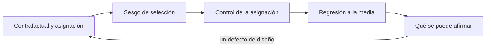
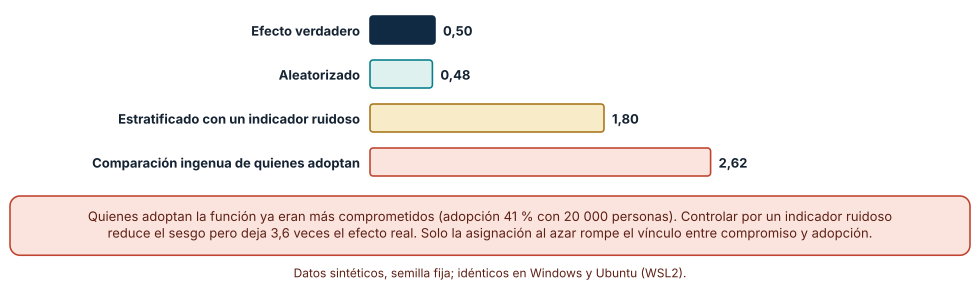
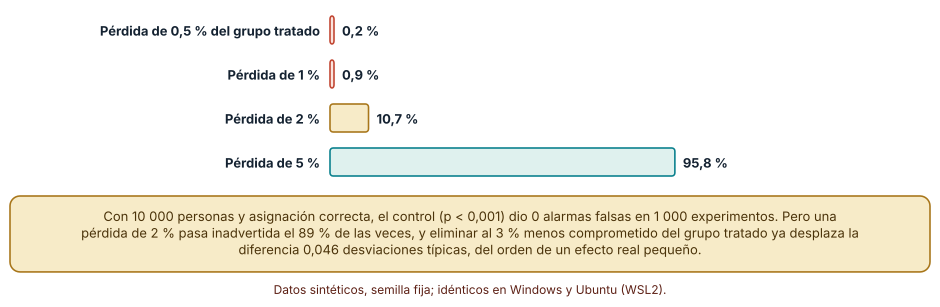
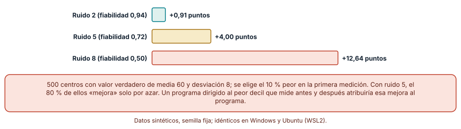

# SE-138 — Experimentos, sesgos y causalidad básica

[← SE-137 — Telemetría de producto y consentimiento](../../classes/part-11-economia-metricas-y-decisiones-de-producto/se-137-telemetria-de-producto-y-consentimiento/README.md) · [↑ Parte 11](../../classes/part-11-economia-metricas-y-decisiones-de-producto/README.md) · [📚 Índice completo](../../classes/README.md) · [🌐 Portal](../../site/classes/SE-138.html) · [SE-139 — North Star, guardrails y métricas contrarias →](../../classes/part-11-economia-metricas-y-decisiones-de-producto/se-139-north-star-guardrails-y-metricas-contrarias/README.md)

## Punto profesional y fundamento pedagógico

**Punto profesional.** La clase existe para distinguir una diferencia observada de un efecto causado, y para saber cuándo un experimento con asignación al azar es posible, cuándo se ha roto y qué se puede afirmar sin él.

**Por qué aparece aquí.** Se sitúa después de **Telemetría de producto y consentimiento** y antes de **North Star, guardrails y métricas contrarias**: `SE-137` dejó eventos recogidos con permiso; esta clase usa esos eventos para estimar si un cambio causó una mejora, y deja un criterio para no atribuir a una función lo que viene de quién la usa, de un error de asignación o del azar.

**Error conceptual que debe corregir.** Atribuir una mejora a una intervención porque ocurrió después de ella, o porque quienes la usan rinden más.

**Secuencia de aprendizaje.** Antes de ejecutar, predices cuánto sobrestima el efecto una comparación entre quienes adoptan y quienes no; después simulas la asignación al azar, mides cuántas veces un control de proporciones detecta que se rompió y compruebas que los peores centros mejoran solos al medirlos de nuevo. La secuencia usa predicción, explicación propia, contraste y recuperación. [ICAP](https://icap.education.asu.edu/research) distingue participación de construcción de conocimiento; [How People Learn II](https://nap.nationalacademies.org/catalog/24783/how-people-learn-ii-learners-contexts-and-cultures) exige conectar conocimiento previo, contexto y transferencia; la [práctica de recuperación](https://pubmed.ncbi.nlm.nih.gov/16507066/) respalda producir de nuevo la explicación tras una demora; y [Education for Life and Work](https://nap.nationalacademies.org/resource/13398/dbasse_084153.pdf) exige devolución que explique la causa del error.

**Evidencia de aprendizaje.** `experiment-readout.md` con el efecto estimado por comparación observacional, por estratificación y por asignación al azar frente al verdadero, la tasa de detección del control de proporciones, la regresión a la media de los peores centros y una nota de qué afirmaciones causales se sostienen.

**Límite de la conclusión.** Los efectos, los sesgos y los ruidos son parámetros sintéticos de los generadores; en datos reales el efecto verdadero no se conoce. Los experimentos muestran el mecanismo de los sesgos, no cuánto sesgan tus datos.

### Trazabilidad fuente → afirmación

| Fuente primaria u oficial | Afirmación que respalda | Lo que no prueba |
|---|---|---|
| [Trustworthy Online Controlled Experiments (Kohavi, Tang y Xu)](https://experimentguide.com/) | La asignación aleatoria permite atribuir diferencias a la intervención, y el libro recoge fallos frecuentes de implementación y análisis. | No garantiza que tu experimento esté bien diseñado. |
| [Fabijan et al.: Diagnosing Sample Ratio Mismatch (KDD 2019)](https://exp-platform.com/Documents/2019_KDDFabijanGupchupFuptaOmhoverVermeerDmitriev.pdf) | Un desajuste entre las proporciones esperadas y observadas de la asignación indica un defecto que invalida el análisis, y tiene causas catalogadas. | No dice cuánto sesgo produce un desajuste concreto. |
| [Python: random](https://docs.python.org/3/library/random.html) | Un generador con semilla repite exactamente la asignación y los ruidos. | No hace que el generador represente a las personas reales. |

## Antes de empezar

Recupera lo aprendido en `SE-137`: los eventos reflejan a quienes consintieron. La pregunta activa es: **¿qué comparación sería justa y qué podría hacer que una diferencia parezca efecto sin serlo?**

## Prerrequisitos

- Haber completado `SE-137` o poder describir qué eventos recoge la plataforma.
- Python 3.11 o posterior y un terminal.
- Trabajar solo con datos sintéticos; ninguna observación necesita datos de personas reales.

## Problema auténtico

Una función nueva de la plataforma, el recordatorio de entrega, se lanza a quien la active. A las dos semanas, quienes la usan envían 2,6 entregas más por semana que quienes no. El equipo propone atribuirle la mejora y desplegarla para todos. Otro equipo propone un experimento, aunque nadie ha comprobado que la asignación funcione, y un tercero propone «relanzar» el programa en los centros de peores resultados, que ya muestran una mejora sin que nada haya cambiado.

## Objetivos observables

Al terminar podrás:

1. estimar un efecto con comparación observacional, estratificación y asignación aleatoria y explicar por qué difieren;
2. aplicar un control de proporciones de asignación y decir qué pérdidas detecta y cuáles no;
3. explicar la regresión a la media y calcular cuánto «mejoran» los peores casos sin intervención;
4. redactar una afirmación causal con su contrafactual y declarar qué la limita;
5. decidir cuándo un experimento es posible, necesario o innecesario.

## Mapa conceptual



El mapa se lee como una cadena de razonamiento, no como fases obligatorias. La flecha de retorno indica que un defecto de asignación o de análisis obliga a rehacer el diseño; no autoriza a corregir solo la estadística.

## Temas y por qué importan

| Tema | Por qué cambia una decisión profesional | Evidencia mínima |
|---|---|---|
| Contrafactual y asignación | Un efecto causal es la diferencia con lo que habría ocurrido sin intervención; la aleatorización fabrica un contrafactual comparable. | Descripción del contrafactual y de la unidad asignada en `experiment-readout.md` |
| Sesgo de selección y confusión | Quien elige adoptar suele ser distinto de quien no; esa diferencia se mezcla con el efecto. | Efecto observacional frente a aleatorizado |
| Control de la asignación | Un defecto en la asignación invalida el análisis aunque el número parezca razonable. | Tasa de detección del control de proporciones |
| Regresión a la media | Los casos extremos en una medición ruidosa tienden a acercarse al promedio en la siguiente. | Mejora de los peores sin intervención |
| Qué se puede afirmar | Una afirmación causal declara contrafactual, población y límites; sin eso es una correlación. | Lista de afirmaciones con evidencia que las sostiene |

## Conceptos y decisiones

### 1. Contrafactual y asignación

Decir que una función «causó» una mejora es decir que sin ella la mejora no habría ocurrido. Ese «sin ella» no se observa para la misma persona. La asignación aleatoria crea dos grupos que, en promedio, solo difieren en la intervención; su diferencia estima el efecto. Para que valga, la unidad asignada (persona, centro, sesión) debe coincidir con la unidad analizada y los grupos no deben contaminarse.

### 2. Sesgo de selección y confusión

Cuando las personas eligen si usar la función, la elección depende de factores (compromiso, tamaño del centro) que también afectan al resultado. Esos factores confunden: la diferencia observada mezcla el efecto con la diferencia previa entre quienes eligen. Estratificar por una variable observada reduce el sesgo atribuible a ella y deja el resto; si la variable mide mal el factor real, la reducción es parcial.

### 3. Control de la asignación

Si se esperaba un reparto 50/50 y se observa otro con más desviación de la esperable por azar, algo falló: un error de código, una pérdida de datos que depende del grupo, un filtro que excluye a unos y no a otros. El control de la proporción de la muestra (sample ratio mismatch) compara las cuentas observadas con las esperadas con un contraste estadístico, con un umbral muy estricto para evitar falsas alarmas. Un resultado con asignación defectuosa no se interpreta: se corrige y se repite.

### 4. Regresión a la media

Una medición es el valor verdadero más ruido. Si se selecciona a los peores por una primera medición, parte de su mala posición es ruido que no se repetirá: en la segunda medición se acercarán al promedio sin intervención. Un programa dirigido a los peores y evaluado «antes y después» atribuye esa mejora al programa. Cuanto menos fiable la medición, mayor la regresión.

### 5. Qué se puede afirmar

Una afirmación causal responde: ¿efecto de qué sobre qué?, ¿en qué población?, ¿comparado con qué?, ¿con qué incertidumbre? Sin experimento, lo defendible es una asociación con las razones por las que podría ser confusa. A veces un experimento no es posible o no se justifica (el costo de equivocarse es bajo y es reversible); entonces se declara que la decisión se toma sin evidencia causal.

### Quién adopta no se parece a quien no adopta

Se generan 20 000 personas con compromiso estándar normal; el resultado base depende de él (peso 2) y la función suma 0,5 entregas por semana. En el escenario observacional la probabilidad de adoptar crece con el compromiso (logística de 1,5 × compromiso − 0,5); en el aleatorizado se asigna con moneda. Predicción: ¿cuánto vale la diferencia observacional?

```python
rng = random.Random(1381)
adopta = rng.random() < 1 / (1 + math.exp(-(1.5 * compromiso - 0.5)))
resultado = 5 + 2 * compromiso + (0.5 if adopta else 0) + rng.gauss(0, 1)
```

Resultado, idéntico en Windows (CPython 3.12.9) y Ubuntu bajo WSL2 (3.12.3): adopta el 40,8 % y la diferencia observacional es 2,62 entregas por semana, 5,2 veces el efecto verdadero (0,50). Estratificar en diez grupos por un indicador ruidoso del compromiso (compromiso más ruido de desviación 1) la reduce a 1,80, todavía 3,6 veces el verdadero. La asignación al azar estima 0,48. El indicador ruidoso corrige una parte del sesgo y deja el resto, porque no mide el compromiso, solo se parece a él.



**Cómo leer la figura.** La barra azul es el efecto que puso el generador; la verde, el estimado con asignación al azar; la dorada, con estratificación; la coral, la comparación ingenua. **Dónde deja de valer:** el sesgo depende de cuánto compromiso determine la adopción (1,5), que es un supuesto. Con un efecto de confusión menor, la diferencia sería menor. En datos reales no conoces el efecto verdadero: la figura enseña a sospechar de una diferencia grande entre quienes eligen.

### El control de proporciones detecta pérdidas grandes, no pequeñas

Se simulan 1 000 experimentos de 10 000 personas asignadas 50/50 y se calcula el contraste de proporciones con umbral p < 0,001. Luego se simula una pérdida: las personas del grupo tratado cuyo cliente falla (por ejemplo, un error de la función) no quedan registradas, en proporciones de 0,5 %, 1 %, 2 % y 5 % del grupo.

```python
z = (n1 - n / 2) / math.sqrt(n / 4)
p = math.erfc(abs(z) / math.sqrt(2))
alarma = p < 0.001
```

Con asignación correcta hubo 0 alarmas falsas en 1 000 experimentos. Con una pérdida de 0,5 % se detectó el 0,2 %; con 1 %, el 0,9 %; con 2 %, el 10,7 %; con 5 %, el 95,8 %. Una pérdida de 2 % pasa inadvertida el 89 % de las veces. Y no es inocua: si se pierde justo el 3 % menos comprometido del grupo tratado, la diferencia de medias entre dos poblaciones idénticas pasa a +0,046 desviaciones típicas, del orden de un efecto pequeño real. El control es necesario y no es suficiente: el umbral estricto evita falsas alarmas a costa de potencia.



**Cómo leer la figura.** Cada barra es la fracción de 1 000 experimentos con alarma; la verde es la pérdida de 5 %, que sí se detecta. **Dónde deja de valer:** la pérdida se modela como una fracción fija y al azar del grupo tratado; la pérdida real depende del comportamiento (quien falla suele ser distinto) y su efecto sobre la media puede ser mayor o menor. La figura no dice que una pérdida pequeña sea irrelevante: dice que este control no la ve.

### Los peores mejoran solos

Se generan 500 centros con valor verdadero de media 60 y desviación 8, se miden dos veces con ruido de desviación 2, 5 u 8 y se elige el 10 % peor en la primera medición, sin aplicar ninguna intervención.

```python
rng = random.Random(1384)
t1 = [v + rng.gauss(0, ruido) for v in verdadero]
t2 = [v + rng.gauss(0, ruido) for v in verdadero]
peores = sorted(range(500), key=lambda i: t1[i])[:50]
mejora = statistics.mean(t2[i] - t1[i] for i in peores)
```

Con ruido 2 (fiabilidad 0,94) los peores «mejoran» 0,91 puntos; con ruido 5 (0,72), 4,00; con ruido 8 (0,50), 12,64. Con ruido 5, 40 de los 50 peores (80 %) suben. Un programa de apoyo aplicado al peor decil y evaluado «antes y después» habría atribuido a su acción una mejora de 4 puntos que ocurre sin él.



**Cómo leer la figura.** Cada barra es la mejora del 10 % peor entre la primera y la segunda medición; cuanto menos fiable la medición, mayor la barra. **Dónde deja de valer:** supone que el valor verdadero no cambia entre mediciones y que el ruido es independiente y normal; en datos reales hay tendencias y cambios reales. La corrección es un grupo de comparación seleccionado de igual manera, no un ajuste matemático.

## Definiciones de trabajo

- **contrafactual:** lo que habría ocurrido a las mismas personas sin la intervención; no se observa.
- **asignación aleatoria:** reparto por azar de las unidades entre grupos para que solo la intervención los distinga en promedio.
- **sesgo de selección:** diferencia previa entre quienes eligen una opción y quienes no, mezclada con el efecto.
- **desajuste de proporción de muestra:** diferencia entre el reparto esperado y el observado mayor que la que explica el azar.
- **regresión a la media:** tendencia de los casos extremos de una medición ruidosa a acercarse al promedio en la siguiente.

Las definiciones son operativas para la plataforma de entregas y deben contrastarse con las fuentes enlazadas al final.

## Ejemplo mínimo

Predice cuántas personas deberían quedar en cada grupo con 1 000 asignadas al azar y qué ocurriría si se observan 540 y 460.

```python
import math
n, n1 = 1000, 540
z = (n1 - n / 2) / math.sqrt(n / 4)
print(round(z, 2), math.erfc(abs(z) / math.sqrt(2)) < 0.001)
```

El contraste da z = 2,53 y p ≈ 0,011: no supera el umbral estricto de 0,001. Con 560 y 440 sí lo supera. Registra versión del intérprete, comando y salida; el umbral decide qué asignaciones se aceptan.

## Ejemplo profesional

En la plataforma, `experiment-readout.md` registra por experimento: unidad asignada, mecanismo de asignación, proporciones esperadas y observadas con el resultado del control, población y ventana, métrica primaria con su métrica contraria, efecto estimado con intervalo y límites. El contrato es que ningún efecto se informa si el control de proporciones falló, y que toda comparación observacional se rotula como tal.

Compara el caso normal con un experimento en que dos docentes del mismo centro quedan en grupos distintos y comparten información, con una función que falla en un tipo de dispositivo, con un grupo que se redujo por un filtro y con un centro que cambió de plan durante el experimento. El readout es adecuado cuando esas diferencias aparecen como notas de validez; es peligroso cuando una cifra sola las absorbe.

## Práctica guiada

1. Copia el contrato de readout (unidad, asignación, proporciones, métrica, efecto, límites) antes de analizar nada.
2. Predice cuánto sobrestima el efecto una comparación entre adoptantes y no adoptantes y anota por qué.
3. Simula los tres estimadores con semilla fija y registra el efecto de cada uno.
4. Implementa el control de proporciones y mide falsas alarmas y detección con cuatro pérdidas.
5. Simula la regresión a la media con tres niveles de ruido y registra la mejora de los peores.
6. Redacta tres afirmaciones causales con su contrafactual y los límites de cada una.
7. Pide a otra persona que reconstruya efectos, tasas de detección y mejoras solo con `experiment-readout.md`.

## Ejercicios

1. **Confusión:** cambia el peso del compromiso en la adopción a 0,5 y a 3 y describe cómo cambian las estimaciones observacional y estratificada.
2. **Umbral:** repite el control con p < 0,05 y compara falsas alarmas y detección; explica por qué no se usa ese umbral.
3. **Regresión:** calcula la mejora esperada de los peores 25 % con ruido 5 y explica cómo un grupo de comparación seleccionado igual la eliminaría.
4. **Afirmación:** reescribe «el recordatorio aumentó las entregas» como afirmación causal con contrafactual, población y límite.

## Reto verificable

Entrega `experiment-readout.md` con los tres estimadores, el control de proporciones con sus cuatro pérdidas, la regresión a la media con tres ruidos y tres afirmaciones causales con sus límites. Se aprueba si otra persona ejecuta el código desde un checkout limpio, obtiene los mismos números con la semilla indicada y puede decir cuál de las afirmaciones no se sostiene sin experimento. No se aprueba por la cantidad de simulaciones.

## Caso conductor

La plataforma de entregas continúa como caso. Esta clase deja un readout con tres estimadores y una lista de afirmaciones que se pueden hacer con los datos observacionales y las que exigen experimento. `SE-139` usará esas métricas con sus contrapesos y `SE-142` tratará cuándo conviene experimentar y cuándo decidir sin evidencia causal. Cambia después una sola decisión de diseño —por ejemplo, la unidad asignada— y revisa qué conclusiones cambian.

## Preguntas frecuentes

### Si controlo por muchas variables, ¿puedo prescindir del experimento?

Solo por las que se miden bien y explican la selección. En el experimento, estratificar por un indicador ruidoso redujo el sesgo de 2,62 a 1,80, pero el efecto verdadero era 0,50. Las variables relevantes no observadas, o mal medidas, quedan sin controlar.

### ¿Un control de proporciones que no da alarma prueba que la asignación está bien?

No. Detecta desviaciones grandes: una pérdida de 2 % pasa inadvertida el 89 % de las veces con 10 000 personas. Se complementa con revisar el código de asignación, comparar covariables previas entre grupos y vigilar los filtros del análisis.

### ¿Cómo sé si una mejora es regresión a la media?

Compara con un grupo seleccionado igual y no intervenido. Si los peores que no recibieron el programa también mejoran, parte de la mejora es regresión. Cuanto menos fiable la medición, mayor es la regresión esperada, y por eso se mide la fiabilidad.

### ¿Puede un modelo de lenguaje analizar un experimento?

Puede ejecutar el análisis, pero debe recibir la unidad asignada, las proporciones esperadas y el control de calidad. Un análisis sin estos datos devuelve una diferencia de medias con su intervalo, que se leerá como causal aunque la asignación estuviera rota.

## Fallo controlado y diagnóstico

Reproduce el fallo clásico de la clase: **atribuir a la función la diferencia entre quienes la usan y quienes no**. Compara adoptantes y no adoptantes y luego repite con asignación al azar.

Registra síntoma, entrada mínima, hipótesis, observación que descarta cada hipótesis, causa, corrección y prueba de regresión. **Síntoma:** la diferencia es 2,62 y el equipo quiere desplegar a todos esperando un aumento similar. **Hipótesis rivales:** (a) el efecto es grande; (b) quienes adoptan ya eran más activos; (c) la medición tiene ruido. **Prueba:** estratifica por compromiso observado y asigna al azar; la diferencia baja a 1,80 y a 0,48, lo que sostiene (b). **Conclusión:** la selección explicaba la mayor parte. **Regresión:** añade al contrato una prueba que falle si una comparación observacional se informa como efecto sin rotularla. No cambies a la vez el diseño y el análisis.

## Errores comunes y cómo corregirlos

| Síntoma | Causa probable | Corrección |
|---|---|---|
| La función «mejora» las entregas en 2,6 y al desplegarla no ocurre nada | Se comparó a quienes eligen adoptar | Asignar al azar o rotular como asociación |
| Un experimento de 10 000 personas reparte 46 % y 54 % y nadie lo cuestiona | El control de proporciones no se aplicó | Aplicar el control antes de analizar y corregir la asignación |
| El programa de apoyo «funcionó» en el peor decil | Regresión a la media | Comparar con un grupo seleccionado igual |
| El efecto aparece solo en un subgrupo elegido a posteriori | Se miraron muchos subgrupos | Declarar subgrupos antes y corregir comparaciones múltiples |
| El grupo control recibió la función por contagio | La unidad asignada era menor que la unidad de interacción | Asignar por centro y no por persona |

## Entorno y archivos clave

```text
work/SE-138/
├── README.md
├── experimentos/
│   ├── seleccion.py
│   ├── srm.py
│   └── regresion.py
├── fixtures/asignacion.csv
├── tests/test_srm.py
└── evidence/experiment-readout.md
```

El `README` declara plataforma, versión de Python, semillas (1381, 1382, 1383, 1384) y comandos. Los experimentos usan solo la biblioteca estándar (`random`, `math`, `statistics`) y se ejecutaron con CPython 3.12.9 en Windows 11 y 3.12.3 en Ubuntu bajo WSL2 con salidas idénticas. Si añades una dependencia, fija procedencia y versión.

## Seguridad, ética y accesibilidad

- asignar personas a una experiencia distinta es una decisión sobre ellas: considera quién puede salir perjudicado y la necesidad de informarlo según el caso;
- no experimentes con características que afecten derechos o acceso (calificaciones, plazos) sin una revisión que lo permita;
- los experimentos usan los eventos de `SE-137`: respeta el consentimiento y la minimización;
- describe cada resultado con palabras y ofrece una alternativa textual a los gráficos;
- no pegues datos reales de experimentos en un modelo de lenguaje sin política de datos;
- atribuye las fuentes usadas.

## Puente hacia el trabajo con agentes

Un agente al que se le pide «analiza el experimento» calculará una diferencia de medias y un intervalo. Pídele que confirme primero la unidad asignada y el control de proporciones, que rotule como asociación cualquier comparación sin asignación y que busque regresión a la media si se seleccionó por una medición extrema. Revisa especialmente si omite el control de proporciones: es el mismo error de fiarse de un número sin comprobar cómo se generó.

## Transferencia

Traslada el experimento a otro dominio persistente (por ejemplo, un servicio de reparto): cambia la función por una promoción y el compromiso por la frecuencia de pedidos; conserva el contrato de readout y comprueba si la diferencia entre quienes aprovechan la promoción y quienes no vuelve a sobrestimar el efecto. La transferencia está lograda cuando puedes explicar qué dependía del dominio y qué no.

## Evaluación y evidencia

| Criterio | Evidencia para aprobar |
|---|---|
| comprensión | explicación del contrafactual, la selección y la regresión a la media |
| corrección | efectos, tasas de detección y mejoras reproducibles con la misma semilla |
| diseño | contrato de readout con unidad, asignación y control |
| diagnóstico | reproducción del fallo «usuarios frente a no usuarios» con regresión |
| incertidumbre | límites de cada afirmación causal y qué experimento la sostendría |
| reproducibilidad | versiones, comandos, salida y límites declarados |

## Fuentes

- [Trustworthy Online Controlled Experiments](https://experimentguide.com/) — diseño, calidad y análisis de experimentos controlados en línea; autoridad: R. Kohavi, D. Tang y Y. Xu (Cambridge University Press).
- [Diagnosing Sample Ratio Mismatch in Online Controlled Experiments (KDD 2019)](https://exp-platform.com/Documents/2019_KDDFabijanGupchupFuptaOmhoverVermeerDmitriev.pdf) — taxonomía y reglas para diagnosticar un desajuste de asignación; autoridad: A. Fabijan y colaboradores (Microsoft).
- [GOV.UK Service Manual: Measuring success](https://www.gov.uk/service-manual/measuring-success) — usar datos para decidir cómo mejorar un servicio; autoridad: Government Digital Service.
- [SWEBOK Guide v4.0a](https://www.computer.org/education/bodies-of-knowledge/software-engineering) — medición y evidencia empírica en ingeniería de software; autoridad: IEEE Computer Society.

Cada fuente respalda el mecanismo indicado; ninguna demuestra que un experimento de la plataforma esté bien diseñado. Esa afirmación depende del diseño, del control de la asignación y de la revisión de otra persona.

- [Python: `random`](https://docs.python.org/3/library/random.html) — generadores con semilla.
- [Python: `math.erfc`](https://docs.python.org/3/library/math.html#math.erfc) — función de error complementaria usada para el contraste.
- [Python: `statistics`](https://docs.python.org/3/library/statistics.html) — promedios y diferencias.

## Límites y siguiente paso

Se ejecutaron tres experimentos con datos sintéticos en Windows y Ubuntu (WSL2) con resultados idénticos. No se asignó a ninguna persona real, el efecto verdadero lo fija el generador y los parámetros de confusión, ruido y pérdida son supuestos del autor. La siguiente clase usa métricas con contrapesos para evitar que un experimento optimice una cifra a costa de otra.

## Glosario

- **contrafactual:** lo que habría ocurrido a las mismas personas sin la intervención; no se observa.
- **asignación aleatoria:** reparto por azar de las unidades entre grupos para que solo la intervención los distinga en promedio.
- **sesgo de selección:** diferencia previa entre quienes eligen una opción y quienes no, mezclada con el efecto.
- **desajuste de proporción de muestra:** diferencia entre el reparto esperado y el observado mayor que la que explica el azar.
- **regresión a la media:** tendencia de los casos extremos de una medición ruidosa a acercarse al promedio en la siguiente.

---

[← SE-137 — Telemetría de producto y consentimiento](../../classes/part-11-economia-metricas-y-decisiones-de-producto/se-137-telemetria-de-producto-y-consentimiento/README.md) · [↑ Parte 11](../../classes/part-11-economia-metricas-y-decisiones-de-producto/README.md) · [📚 Índice completo](../../classes/README.md) · [🌐 Portal](../../site/classes/SE-138.html) · [SE-139 — North Star, guardrails y métricas contrarias →](../../classes/part-11-economia-metricas-y-decisiones-de-producto/se-139-north-star-guardrails-y-metricas-contrarias/README.md)
