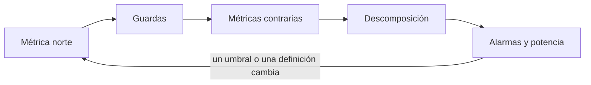
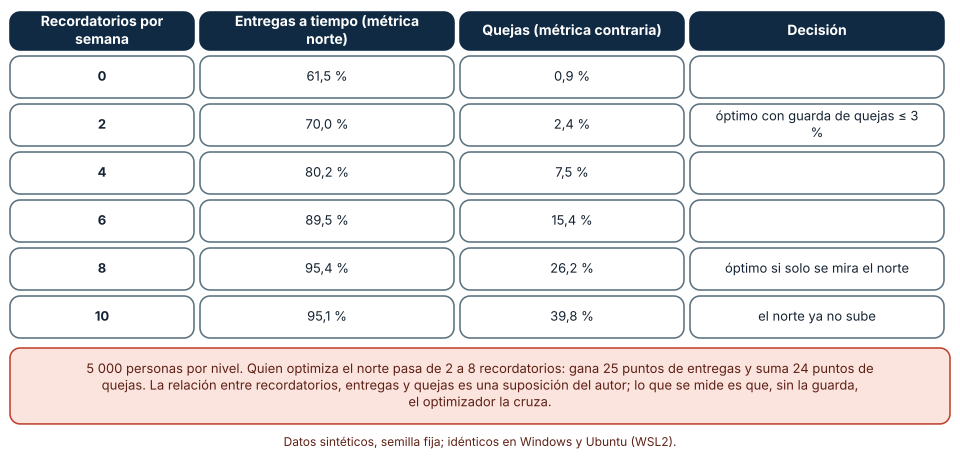
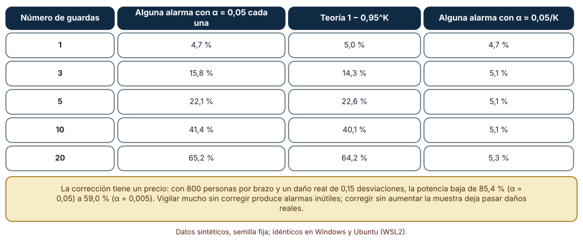
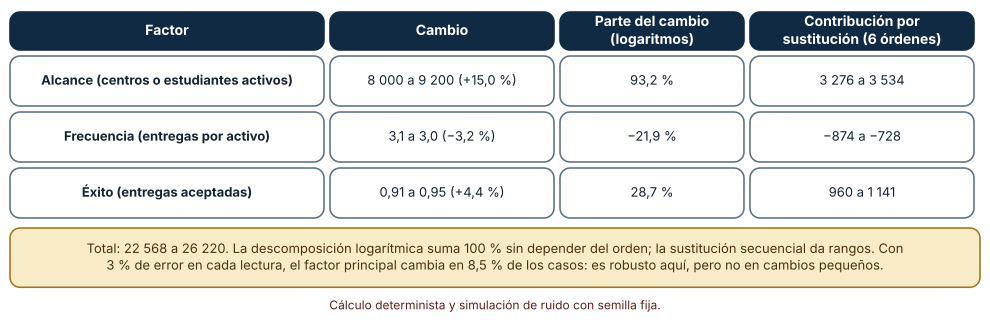

# SE-139 — North Star, guardrails y métricas contrarias

[← SE-138 — Experimentos, sesgos y causalidad básica](../../classes/part-11-economia-metricas-y-decisiones-de-producto/se-138-experimentos-sesgos-y-causalidad-basica/README.md) · [↑ Parte 11](../../classes/part-11-economia-metricas-y-decisiones-de-producto/README.md) · [📚 Índice completo](../../classes/README.md) · [🌐 Portal](../../site/classes/SE-139.html) · [SE-140 — FinOps de producto y costo por resultado →](../../classes/part-11-economia-metricas-y-decisiones-de-producto/se-140-finops-de-producto-y-costo-por-resultado/README.md)

## Punto profesional y fundamento pedagógico

**Punto profesional.** La clase existe para elegir una métrica que oriente al equipo sin que arrastre lo que no se mide, y para acompañarla de límites que no se cruzan y de métricas contrarias que avisan cuándo la mejora de una cifra se paga con el deterioro de otra.

**Por qué aparece aquí.** Se sitúa después de **Experimentos, sesgos y causalidad básica** y antes de **FinOps de producto y costo por resultado**: `SE-138` dejó cómo estimar un efecto; esta clase decide qué efecto interesa y qué no puede empeorar mientras se persigue. Fija el vocabulario (métrica norte, guarda, métrica contraria, descomposición) y deja un conjunto de métricas con contrapesos que `SE-143` organizará en un árbol.

**Error conceptual que debe corregir.** Creer que una sola métrica norte basta, y que cuando sube todo va bien.

**Secuencia de aprendizaje.** Antes de ejecutar, predices hasta dónde empujaría una métrica norte un recordatorio semanal si nada la frenara; después simulas el optimizador con y sin guarda, mides cuántas alarmas falsas produce vigilar varias guardas a la vez y descompones un cambio de la métrica norte en sus factores. La secuencia usa predicción, explicación propia, contraste y recuperación. [ICAP](https://icap.education.asu.edu/research) distingue participación de construcción de conocimiento; [How People Learn II](https://nap.nationalacademies.org/catalog/24783/how-people-learn-ii-learners-contexts-and-cultures) exige conectar conocimiento previo, contexto y transferencia; la [práctica de recuperación](https://pubmed.ncbi.nlm.nih.gov/16507066/) respalda producir de nuevo la explicación tras una demora; y [Education for Life and Work](https://nap.nationalacademies.org/resource/13398/dbasse_084153.pdf) exige devolución que explique la causa del error.

**Evidencia de aprendizaje.** `metric-guardrails.md` con la métrica norte y su definición calculable, las guardas con umbral y responsable, el resultado de optimizar con y sin guarda, la tasa de alarmas falsas con varias guardas y la descomposición de un cambio con su incertidumbre.

**Límite de la conclusión.** Las relaciones entre recordatorios, entregas y quejas son supuestos del autor; no se midió ninguna plataforma. Los experimentos muestran el mecanismo por el que una métrica optimizada sin contrapeso se aleja del objetivo y el precio estadístico de vigilar varias guardas.

### Trazabilidad fuente → afirmación

| Fuente primaria u oficial | Afirmación que respalda | Lo que no prueba |
|---|---|---|
| [Google Research: HEART framework](https://research.google/pubs/measuring-the-user-experience-on-a-large-scale-user-centered-metrics-for-web-applications/) | Propone medir la experiencia con varias dimensiones (felicidad, compromiso, adopción, retención, éxito en la tarea) y definir objetivos, señales y métricas para cada una. | No dice cuál es la dimensión norte de la plataforma. |
| [Google SRE: Embracing Risk](https://sre.google/sre-book/embracing-risk/) | Un presupuesto de error fija un límite explícito al riesgo que se acepta por velocidad de cambio, y decide cuándo se detiene el lanzamiento. | No fija el umbral de queja o de error que conviene a la plataforma. |
| [Manheim y Garrabrant: Categorizing Variants of Goodhart's Law](https://arxiv.org/abs/1803.04585) | Optimizar una medida con fuerza hace que se aleje del objetivo que representaba. | No cuantifica la distancia en un caso concreto. |

## Antes de empezar

Recupera lo aprendido en `SE-135` y `SE-138`: una meta cambia la conducta, y un efecto se estima con una comparación justa. La pregunta activa es: **¿qué métrica orienta al equipo y qué no puede empeorar para que valga la pena subirla?**

## Prerrequisitos

- Haber completado `SE-138` o poder explicar cómo se estima un efecto con asignación aleatoria.
- Python 3.11 o posterior y un terminal.
- Trabajar solo con datos sintéticos; ninguna observación necesita datos de personas reales.

## Problema auténtico

La plataforma elige como métrica norte «entregas a tiempo». El equipo prueba más recordatorios por semana y las entregas a tiempo suben de 61 % a 95 %. Al mes, los centros piden desactivar los avisos y soporte recibe quejas. Nadie definió un límite de quejas antes del experimento, y el panel solo mostraba la métrica norte.

## Objetivos observables

Al terminar podrás:

1. definir una métrica norte con numerador, denominador y ventana, y explicar qué decisión orienta;
2. fijar guardas con umbral, responsable y acción cuando se cruzan;
3. comprobar con una simulación qué ocurre al optimizar la métrica norte con y sin guarda;
4. calcular la tasa de alarmas falsas al vigilar varias guardas y el costo de corregirla en potencia;
5. descomponer un cambio de la métrica norte en factores y declarar la incertidumbre de la atribución.

## Mapa conceptual



El mapa se lee como una cadena de razonamiento, no como fases obligatorias. La flecha de retorno indica que una guarda cruzada o una alarma falsa recurrente obliga a revisar la métrica norte; no autoriza a retirar la guarda.

## Temas y por qué importan

| Tema | Por qué cambia una decisión profesional | Evidencia mínima |
|---|---|---|
| Métrica norte | Orienta decisiones de todo el equipo; si no representa valor, orienta mal a todos. | Definición calculable y la decisión que orienta en `metric-guardrails.md` |
| Guardas | Marcan lo que no puede empeorar; sin ellas, optimizar una cifra gasta lo que no se mide. | Lista de guardas con umbral, responsable y acción |
| Métricas contrarias | Son la otra cara de la meta: calidad frente a volumen, queja frente a uso. | Pares meta–contraria con el mecanismo del daño |
| Descomposición | Explica qué factor movió la métrica y evita celebrar o corregir el equivocado. | Contribución por factor y su incertidumbre |
| Alarmas y potencia | Vigilar muchas guardas produce alarmas falsas; corregirlas cuesta potencia. | Tasa de alarmas falsas con K guardas y potencia con y sin corrección |

## Conceptos y decisiones

### 1. Métrica norte

Una métrica norte es la medida única que mejor resume el valor que el producto entrega y que el equipo puede mover. Debe ser un resultado y no una actividad (`SE-135`), calculable y sensible al cambio. En la plataforma, «entregas aceptadas a tiempo por estudiante activo de la semana» es un candidato; «sesiones» no lo es. Una métrica norte orienta, no gobierna: nunca debe usarse sin lo que la rodea.

### 2. Guardas

Una guarda es un límite de una métrica que no se debe empeorar al perseguir la métrica norte: tasa de quejas, tiempo de carga, tasa de errores, baja del servicio. Cada una tiene umbral, responsable y acción (detener el despliegue, revertir, convocar revisión). El presupuesto de error del enfoque de fiabilidad es una guarda: fija cuánto riesgo se acepta para ir más rápido. Sin umbral previo, la guarda es una opinión.

### 3. Métricas contrarias

Una métrica contraria es la contraparte directa de una meta: si la meta premia el volumen, la contraria mide la calidad; si premia la velocidad, la contraria mide los errores. Se elige preguntando cómo se cumpliría la meta sin cumplir su propósito. Se vigila a la vez que la meta, con la misma frecuencia y visibilidad.

### 4. Descomposición

Una métrica norte producto de factores (alcance × frecuencia × éxito) se descompone para saber qué factor explicó un cambio. Con logaritmos, la contribución de cada factor suma el cambio total sin depender del orden; con sustitución secuencial, depende del orden y se informa un rango. Cuando el cambio total es pequeño, las participaciones se vuelven inestables y no se informan como porcentajes.

### 5. Alarmas y potencia

Cada guarda con umbral al 5 % tiene una probabilidad de alarma falsa de 5 % en ausencia de efecto; con K guardas, la probabilidad de alguna alarma es 1 − 0,95^K. Dividir el umbral entre K (corrección de Bonferroni) devuelve la tasa global a 5 %, y reduce la potencia para detectar un daño real. No existe una solución libre: se elige según el costo de cada error.

### Optimizar solo la métrica norte la lleva a donde nadie quería ir

Se modela un recordatorio de f avisos por semana: la proporción de entregas a tiempo es min(0,95; 0,60 + 0,05 f) y la de personas que se quejan, 0,01 + 0,004 f². Con 5 000 personas por nivel (f de 0 a 10) y semilla 1391, un optimizador elige el f con mayor métrica norte; otro exige además quejas de 3 % o menos. Predicción: ¿dónde se detiene cada uno?

```python
rng = random.Random(1391)
a_tiempo = rng.random() < min(0.95, 0.60 + 0.05 * f)
queja = rng.random() < 0.01 + 0.004 * f * f
```

Resultado, idéntico en Windows (CPython 3.12.9) y Ubuntu bajo WSL2 (3.12.3): sin f = 0, 61,5 % a tiempo y 0,9 % de quejas; con f = 2, 70,0 % y 2,4 %; con f = 4, 80,2 % y 7,5 %; con f = 6, 89,5 % y 15,4 %; con f = 8, 95,4 % y 26,2 %; con f = 10, 95,1 % y 39,8 %. El optimizador de la métrica norte elige f = 8: 95,4 % de entregas y 26,2 % de quejas. Con la guarda de quejas ≤ 3 %, el óptimo es f = 2: 70,0 % y 2,4 %. Pasar de 2 a 8 recordatorios suma 25 puntos de entregas y 24 puntos de quejas. Una vez que la métrica norte satura (f = 8 a 10), más avisos no la suben y las quejas continúan.



**Cómo leer la figura.** Cada fila es un nivel de recordatorios; las dos filas con anotación son los óptimos de cada criterio. **Dónde deja de valer:** la relación entre avisos, entregas y quejas es un supuesto del autor, con una curva de quejas cuadrática elegida para mostrar el mecanismo. En una plataforma real se mide con un experimento (`SE-138`) y el umbral de quejas lo decide una persona, no el optimizador.

### Vigilar varias guardas produce alarmas falsas

Se simulan 1 000 experimentos sin diferencia real y K guardas independientes, cada una con un contraste al 5 %. Predicción: ¿cuántos experimentos tendrán al menos una alarma con K = 10?

```python
z = rng.gauss(0, 1)
p = math.erfc(abs(z) / math.sqrt(2))
alguna = min(ps) < 0.05          # o 0.05 / K con la corrección
```

Con K = 1, 4,7 % tienen alguna alarma; con K = 3, 15,8 %; con K = 5, 22,1 %; con K = 10, 41,4 %; con K = 20, 65,2 % (la teoría 1 − 0,95^K da 5,0 %, 14,3 %, 22,6 %, 40,1 % y 64,2 %). Con el umbral dividido entre K, la tasa global queda cerca de 5 % (4,7 %, 5,1 %, 5,1 %, 5,1 %, 5,3 %). El costo: con 800 personas por brazo y un daño real de 0,15 desviaciones típicas, la potencia pasa de 85,4 % con α = 0,05 a 59,0 % con α = 0,005 (K = 10). Vigilar mucho sin corregir produce alarmas ante las que el equipo aprende a ignorar la guarda; corregir sin ampliar la muestra deja pasar daños reales.



**Cómo leer la figura.** Cada fila es un número de guardas; las columnas comparan la tasa observada con α = 0,05, la teoría y la tasa con el umbral dividido entre K. **Dónde deja de valer:** las guardas son independientes en la simulación; las reales se correlacionan (más errores suelen implicar más quejas), lo que reduce las alarmas falsas conjuntas. La corrección de Bonferroni es conservadora; existen alternativas, y la elección depende del costo de cada error.

### Descomponer el cambio para saber qué lo movió

La métrica norte pasa de 8 000 estudiantes activos × 3,1 entregas por activo × 0,91 de aceptación (22 568) a 9 200 × 3,0 × 0,95 (26 220), un cambio de +16,2 %. Predicción: ¿qué factor explicó más?

```python
logs = {"alcance": math.log(9200 / 8000), "frecuencia": math.log(3.0 / 3.1), "éxito": math.log(0.95 / 0.91)}
total = math.log(26220 / 22568)
partes = {k: v / total for k, v in logs.items()}
```

En escala logarítmica, el alcance explica 93,2 % del cambio, la frecuencia resta 21,9 % y el éxito suma 28,7 %. Con sustitución secuencial, la contribución depende del orden: el alcance aporta entre 3 276 y 3 534 entregas, la frecuencia entre −874 y −728, el éxito entre 960 y 1 141, con un total de 3 652. Al añadir un error de 3 % a cada lectura (5 000 sorteos), el factor principal cambia en 8,5 % de los casos: aquí es robusto, pero en un cambio total pequeño no lo sería. Informar «el alcance explicó 93 %» sin el rango ni el método oculta que el reparto es una convención.



**Cómo leer la figura.** Cada fila es un factor; la tercera columna es su parte en logaritmos (suma 100 %) y la cuarta, el rango según el orden de sustitución. **Dónde deja de valer:** la descomposición supone que la métrica es un producto exacto de los factores y que no hay interacciones fuera del producto; no dice por qué cambió cada factor. Atribuir causa a un factor exige experimentos (`SE-138`).

## Definiciones de trabajo

- **métrica norte:** medida única de resultado que resume el valor entregado y orienta las decisiones del equipo.
- **guarda:** límite de una métrica que no debe empeorar al perseguir la métrica norte, con umbral, responsable y acción.
- **métrica contraria:** contraparte de una meta que mide el daño posible de perseguirla.
- **descomposición:** reparto del cambio de una métrica entre los factores que la componen, con convención y orden declarados.
- **corrección por comparaciones múltiples:** ajuste del umbral para que la tasa global de alarmas falsas se mantenga en un nivel dado.

Las definiciones son operativas para la plataforma de entregas y deben contrastarse con las fuentes enlazadas al final.

## Ejemplo mínimo

Predice el óptimo de un recordatorio que sube las entregas 5 puntos por aviso y las quejas con el cuadrado de los avisos, con una guarda de 3 % de quejas.

```python
for f in range(0, 6):
    entregas = min(0.95, 0.60 + 0.05 * f)
    quejas = 0.01 + 0.004 * f * f
    print(f, round(entregas, 2), round(quejas, 3), quejas <= 0.03)
```

Con f = 2 las quejas valen 0,026 y pasa; con f = 3, 0,046 y no pasa. Registra versión del intérprete, comando y salida; el óptimo con guarda es f = 2.

## Ejemplo profesional

En la plataforma, `metric-guardrails.md` define la métrica norte (numerador, denominador, ventana, filtros), las guardas (métrica, umbral, ventana, responsable, acción) y los pares meta–contraria. El contrato es que ninguna prueba arranca sin guardas y que cruzar una guarda detiene el despliegue hasta que el responsable decide. Esa estructura permite que una revisión externa verifique que el equipo no podía optimizar sin frenos.

Compara el caso normal con una guarda que se cruza por un incidente ajeno al cambio, con una que no se puede medir en la ventana del experimento, con una guarda de rendimiento que depende del dispositivo y con una métrica contraria que solo se mide en un subconjunto. La estructura es adecuada cuando esas excepciones tienen regla escrita; es peligrosa cuando la decisión de ignorar una guarda no deja huella.

## Práctica guiada

1. Copia el contrato de guardas (métrica, umbral, ventana, responsable, acción) antes de optimizar.
2. Predice dónde se detiene un optimizador de la métrica norte sin guarda y anótalo.
3. Simula once niveles del recordatorio con semilla fija y registra entregas y quejas.
4. Elige el óptimo con y sin guarda de 3 % y explica la diferencia.
5. Simula experimentos sin efecto con K = 1, 3, 5, 10 y 20 guardas y mide la tasa de alarmas con y sin corrección.
6. Descompón un cambio de la métrica norte en tres factores con logaritmos y con sustitución en los seis órdenes.
7. Pide a otra persona que reconstruya el óptimo, las alarmas y la descomposición solo con `metric-guardrails.md`.

## Ejercicios

1. **Umbral:** repite el optimizador con una guarda de 5 % y de 1 % y describe cómo cambian el óptimo y la métrica norte.
2. **Forma:** cambia las quejas a una función lineal (0,01 + 0,02 f) y explica cómo cambia el punto donde la guarda se cruza.
3. **Guardas correlacionadas:** simula cinco guardas con correlación 0,6 y compara las alarmas falsas con las del caso independiente.
4. **Descomposición:** descompón un cambio de +2 % de la métrica en tres factores que suben, bajan y casi no cambian, y explica por qué las participaciones no deben informarse.

## Reto verificable

Entrega `metric-guardrails.md` con la métrica norte, tres guardas con umbral y responsable, el optimizador con y sin guarda, la tabla de alarmas falsas con y sin corrección y la descomposición con su rango. Se aprueba si otra persona ejecuta el código desde un checkout limpio, obtiene los mismos números con la semilla indicada y puede decir qué guarda se cruzó primero. No se aprueba por la cantidad de guardas.

## Caso conductor

La plataforma de entregas continúa como caso. Esta clase deja una métrica norte con guardas y un procedimiento para descomponerla. `SE-140` calculará el costo por resultado de esa métrica y `SE-143` la ubicará en un árbol completo. Cambia después una sola guarda y revisa qué decisiones del registro cambian.

## Preguntas frecuentes

### ¿Una sola métrica norte no basta para alinear al equipo?

Alinea, pero no protege. En el experimento, quien optimiza solo las entregas a tiempo sube 25 puntos y acepta 24 puntos más de quejas sin que su métrica lo muestre. Se necesita la métrica norte para orientar y las guardas para limitar.

### ¿Cuántas guardas debo vigilar?

Las que respondan a un daño que no aceptarías. Cada una añade alarmas falsas (con 10, el 41 % de los experimentos sin diferencia dispara alguna) y exige umbral y responsable. Mejor pocas guardas con acción clara que muchas que se ignoran.

### ¿La guarda debe ser estadística o un valor fijo?

Ambas formas se usan. Un valor fijo (tasa de quejas ≤ 3 %) es simple y exige una muestra suficiente para medirse; una guarda estadística (no peor que el control con cierta confianza) detecta degradaciones pequeñas y requiere corrección por comparaciones múltiples. Se escribe cuál se usa y por qué.

### ¿Puede un modelo de lenguaje proponer las guardas?

Puede listar candidatas, pero cada umbral es una decisión sobre qué daño se acepta y quién responde. Exige el umbral, el responsable y la acción por escrito antes de aceptar la lista.

## Fallo controlado y diagnóstico

Reproduce el fallo clásico de la clase: **optimizar la métrica norte sin una métrica contraria**. Elige el nivel de recordatorios con mayor entrega a tiempo y observa las quejas.

Registra síntoma, entrada mínima, hipótesis, observación que descarta cada hipótesis, causa, corrección y prueba de regresión. **Síntoma:** las entregas a tiempo suben a 95 % y los centros piden desactivar los avisos. **Hipótesis rivales:** (a) los avisos son valiosos y los centros no entienden; (b) los avisos superan un umbral de molestia; (c) la queja es un error de medición. **Prueba:** mide quejas por nivel; crecen con el cuadrado de los avisos y llegan a 26,2 % en f = 8, lo que sostiene (b). **Conclusión:** la métrica norte saturaba y las quejas seguían creciendo. **Regresión:** añade al contrato una prueba que falle si un experimento arranca sin guardas o si se cruza una sin acción registrada. No cambies a la vez el umbral y la definición de queja.

## Errores comunes y cómo corregirlos

| Síntoma | Causa probable | Corrección |
|---|---|---|
| La métrica norte sube y el producto empeora | No hay guardas | Definir guardas con umbral antes de optimizar |
| El equipo ignora las alarmas de las guardas | Hay demasiadas y sin corrección | Reducir las guardas y corregir las comparaciones múltiples |
| Una guarda se cruza y nadie actúa | No tiene responsable ni acción | Escribir quién decide y qué ocurre al cruzarla |
| La descomposición atribuye 90 % a un factor | Se usó un solo orden de sustitución | Usar logaritmos o informar el rango de órdenes |
| La métrica norte cambia de tendencia sin razón | Cambió su definición | Registrar cambios de definición con fecha y recalcular |

## Entorno y archivos clave

```text
work/SE-139/
├── README.md
├── guardas/
│   ├── optimizador.py
│   ├── alarmas.py
│   └── descomposicion.py
├── fixtures/niveles.csv
├── tests/test_guardas.py
└── evidence/metric-guardrails.md
```

El `README` declara plataforma, versión de Python, semillas (1391, 1392, 1393) y comandos. Los experimentos usan solo la biblioteca estándar (`random`, `math`, `statistics`, `itertools`) y se ejecutaron con CPython 3.12.9 en Windows 11 y 3.12.3 en Ubuntu bajo WSL2 con salidas idénticas. Si añades una dependencia, fija procedencia y versión.

## Seguridad, ética y accesibilidad

- una guarda de quejas protege a personas reales: no la retires para cumplir una meta ni cambies su definición para que no se cruce;
- las guardas de acceso (errores en lectores de pantalla, carga en conexiones lentas) protegen a quienes menos reportan: inclúyelas;
- una métrica norte que premia entregas a tiempo puede castigar a estudiantes con barreras de acceso: revisa su efecto por segmento;
- ofrece una alternativa textual a cada tabla y describe el umbral con palabras;
- no pegues quejas reales en un modelo de lenguaje sin política de datos;
- atribuye las fuentes usadas.

## Puente hacia el trabajo con agentes

Un agente al que se le pide «optimiza la métrica norte» propondrá cambios que la suben, y los llevará hasta donde sea posible. Pídele que declare las guardas y sus umbrales antes de empezar, que informe cada resultado junto con las métricas contrarias, que deje el código y la semilla del experimento y que se detenga cuando una guarda se cruce. Revisa especialmente si propone más de lo mismo cuando la métrica ya satura: es el mismo error del optimizador sin freno, ahora con apariencia de iteración.

## Transferencia

Traslada el experimento a otro dominio persistente (por ejemplo, un servicio de reparto): cambia los recordatorios por notificaciones de pedido y la queja por la baja de notificaciones; conserva el contrato de guardas y comprueba si el optimizador sin guarda vuelve a pasar el umbral. La transferencia está lograda cuando puedes explicar qué dependía del dominio y qué no.

## Evaluación y evidencia

| Criterio | Evidencia para aprobar |
|---|---|
| comprensión | explicación del papel de la métrica norte, las guardas y las contrarias |
| corrección | óptimos, alarmas y descomposición reproducibles con la misma semilla |
| diseño | contrato de guardas con umbral, responsable y acción |
| diagnóstico | reproducción del fallo «norte sin contraria» con regresión |
| incertidumbre | rango de la descomposición y potencia con y sin corrección |
| reproducibilidad | versiones, comandos, salida y límites declarados |

## Fuentes

- [Measuring the User Experience on a Large Scale: HEART (Google Research)](https://research.google/pubs/measuring-the-user-experience-on-a-large-scale-user-centered-metrics-for-web-applications/) — dimensiones de experiencia y su traducción a objetivos y métricas; autoridad: Google Research.
- [Google SRE Book: Embracing Risk](https://sre.google/sre-book/embracing-risk/) — presupuestos de error como límite explícito al riesgo; autoridad: Google SRE.
- [Categorizing Variants of Goodhart's Law](https://arxiv.org/abs/1803.04585) — cómo una medida deja de informar al volverse objetivo; autoridad: investigación publicada en arXiv.
- [DORA: Software delivery performance metrics](https://dora.dev/guides/dora-metrics-four-keys/) — métricas equilibradas de velocidad y estabilidad; autoridad: DORA (Google Cloud).
- [Trustworthy Online Controlled Experiments](https://experimentguide.com/) — métricas guarda y comparaciones múltiples en experimentos; autoridad: Kohavi, Tang y Xu (Cambridge University Press).

Cada fuente respalda el mecanismo indicado; ninguna demuestra que las guardas elegidas para la plataforma sean las adecuadas. Esa afirmación depende de datos reales y de la revisión de otra persona.

- [Python: `itertools.permutations`](https://docs.python.org/3/library/itertools.html#itertools.permutations) — órdenes de sustitución de la descomposición.
- [Python: `random`](https://docs.python.org/3/library/random.html) — generadores con semilla.

## Límites y siguiente paso

Se ejecutaron tres experimentos con datos sintéticos en Windows y Ubuntu (WSL2) con resultados idénticos. No se midió ninguna plataforma; las relaciones entre recordatorios, entregas y quejas, la independencia de las guardas y la convención de descomposición son supuestos del autor. La siguiente clase pasa de qué medir a cuánto cuesta cada resultado.

## Glosario

- **métrica norte:** medida única de resultado que resume el valor entregado y orienta las decisiones del equipo.
- **guarda:** límite de una métrica que no debe empeorar al perseguir la métrica norte, con umbral, responsable y acción.
- **métrica contraria:** contraparte de una meta que mide el daño posible de perseguirla.
- **descomposición:** reparto del cambio de una métrica entre los factores que la componen, con convención y orden declarados.
- **corrección por comparaciones múltiples:** ajuste del umbral para que la tasa global de alarmas falsas se mantenga en un nivel dado.

---

[← SE-138 — Experimentos, sesgos y causalidad básica](../../classes/part-11-economia-metricas-y-decisiones-de-producto/se-138-experimentos-sesgos-y-causalidad-basica/README.md) · [↑ Parte 11](../../classes/part-11-economia-metricas-y-decisiones-de-producto/README.md) · [📚 Índice completo](../../classes/README.md) · [🌐 Portal](../../site/classes/SE-139.html) · [SE-140 — FinOps de producto y costo por resultado →](../../classes/part-11-economia-metricas-y-decisiones-de-producto/se-140-finops-de-producto-y-costo-por-resultado/README.md)
