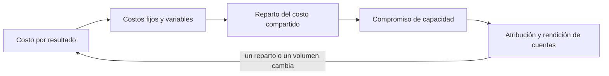
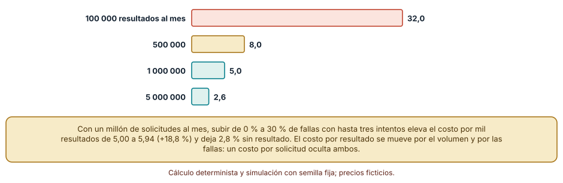
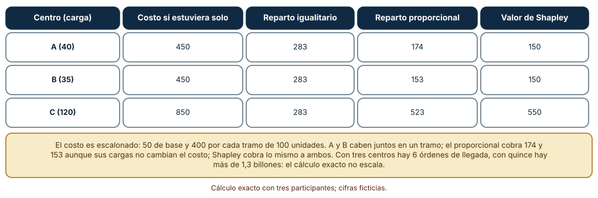
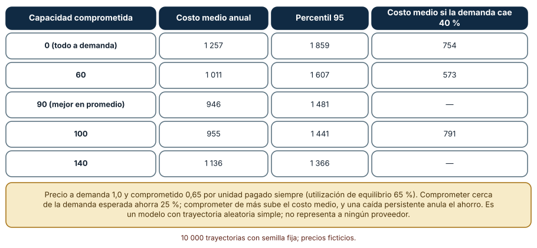

# SE-140 — FinOps de producto y costo por resultado

[← SE-139 — North Star, guardrails y métricas contrarias](../../classes/part-11-economia-metricas-y-decisiones-de-producto/se-139-north-star-guardrails-y-metricas-contrarias/README.md) · [↑ Parte 11](../../classes/part-11-economia-metricas-y-decisiones-de-producto/README.md) · [📚 Índice completo](../../classes/README.md) · [🌐 Portal](../../site/classes/SE-140.html) · [SE-141 — Portafolio, opciones y secuenciación de inversión →](../../classes/part-11-economia-metricas-y-decisiones-de-producto/se-141-portafolio-opciones-y-secuenciacion-de-inversion/README.md)

## Punto profesional y fundamento pedagógico

**Punto profesional.** La clase existe para que el gasto de infraestructura y operación se exprese como costo por resultado útil, se reparta con una regla que se pueda explicar y se comprometa con capacidad solo cuando la demanda lo justifica.

**Por qué aparece aquí.** Se sitúa después de **North Star, guardrails y métricas contrarias** y antes de **Portafolio, opciones y secuenciación de inversión**: `SE-139` dejó una métrica norte con guardas; esta clase pregunta cuánto cuesta producirla y quién debe pagar. Fija el vocabulario (costo por resultado, costo fijo y variable, reparto, compromiso de capacidad) y deja un costo unitario con intervalo que `SE-141` usará para comparar iniciativas.

**Error conceptual que debe corregir.** Medir el costo por solicitud o por servidor en lugar de por resultado útil, y repartir un costo compartido por una regla que parece justa sin comprobar a quién subsidia.

**Secuencia de aprendizaje.** Antes de ejecutar, predices cómo cambia el costo por resultado cuando suben las fallas y cuando sube el volumen; después simulas, repartes un costo escalonado entre tres centros con tres reglas y evalúas un compromiso de capacidad con demanda incierta y con una caída. La secuencia usa predicción, explicación propia, contraste y recuperación. [ICAP](https://icap.education.asu.edu/research) distingue participación de construcción de conocimiento; [How People Learn II](https://nap.nationalacademies.org/catalog/24783/how-people-learn-ii-learners-contexts-and-cultures) exige conectar conocimiento previo, contexto y transferencia; la [práctica de recuperación](https://pubmed.ncbi.nlm.nih.gov/16507066/) respalda producir de nuevo la explicación tras una demora; y [Education for Life and Work](https://nap.nationalacademies.org/resource/13398/dbasse_084153.pdf) exige devolución que explique la causa del error.

**Evidencia de aprendizaje.** `unit-cost.md` con el costo por resultado en función del volumen y de las fallas, el reparto de un costo compartido con tres reglas y su comparación con el costo de cada centro solo, y la evaluación de un compromiso de capacidad con percentil 95 y caída de demanda.

**Límite de la conclusión.** Los precios, la estructura de costos escalonada y la dinámica de demanda son supuestos del autor en unidades ficticias; no representan a ningún proveedor ni a ninguna factura. Los experimentos muestran la forma de las decisiones, no sus cifras.

### Trazabilidad fuente → afirmación

| Fuente primaria u oficial | Afirmación que respalda | Lo que no prueba |
|---|---|---|
| [GOV.UK Service Manual: Measuring cost per transaction](https://www.gov.uk/service-manual/measuring-success/measuring-cost-per-transaction) | El costo por transacción se calcula sobre el costo total de operar el servicio dividido por las transacciones completadas, y permite comparar canales y evolución. | No dice qué costo por transacción es aceptable. |
| [FinOps Foundation: Allocation](https://www.finops.org/framework/capabilities/allocation/) | La asignación de costos a quien los genera (por etiquetas, cuentas o reglas de reparto) es una capacidad de gestión que sostiene la rendición de cuentas. | No prescribe la regla de reparto. |
| [AWS Well-Architected: Cost Optimization Pillar](https://docs.aws.amazon.com/wellarchitected/latest/cost-optimization-pillar/welcome.html) | La gestión del gasto exige medir, atribuir y ajustar la capacidad a la demanda; los compromisos de capacidad son una decisión con riesgo. | No es neutral respecto de ese proveedor ni fija precios. |

## Antes de empezar

Recupera lo aprendido en `SE-139`: una métrica norte con guardas. La pregunta activa es: **¿cuánto cuesta cada resultado útil, quién lo paga y qué parte de ese costo depende de decisiones que ya se tomaron?**

## Prerrequisitos

- Haber completado `SE-139` o poder explicar una métrica norte con sus guardas.
- Python 3.11 o posterior y un terminal.
- Trabajar solo con costos ficticios; ninguna observación necesita datos de una factura real.

## Problema auténtico

La plataforma recibe una factura mensual de infraestructura y el equipo la divide por el número de solicitudes: «cinco por mil». Un centro grande reclama que paga más que los demás por servicios que no usa, y finanzas propone comprometer capacidad por doce meses para obtener una tarifa menor. Nadie ha calculado cuánto cuesta una entrega aceptada, qué parte del costo es fija ni qué ocurre si la demanda cae.

## Objetivos observables

Al terminar podrás:

1. calcular el costo por resultado útil y explicar por qué difiere del costo por solicitud;
2. separar costos fijos y variables y predecir cómo cambia el costo unitario con el volumen;
3. repartir un costo compartido con tres reglas y comprobar a quién subsidia cada una;
4. evaluar un compromiso de capacidad con demanda incierta, percentil 95 y una caída;
5. declarar qué costos quedaron sin atribuir.

## Mapa conceptual



El mapa se lee como una cadena de razonamiento, no como fases obligatorias. La flecha de retorno indica que un cambio de volumen o de reparto obliga a recalcular el costo unitario; no autoriza a corregir solo la factura.

## Temas y por qué importan

| Tema | Por qué cambia una decisión profesional | Evidencia mínima |
|---|---|---|
| Costo por resultado | Une el gasto con el valor entregado; el costo por solicitud mezcla fallas y reintentos. | Costo por resultado y por solicitud en `unit-cost.md` |
| Costos fijos y variables | Los fijos se diluyen con el volumen y los variables no; confundirlos produce metas imposibles. | Descomposición del costo por volumen |
| Reparto del costo compartido | La regla de reparto decide quién subsidia a quién y qué incentivo crea. | Reparto con tres reglas y costo de cada centro solo |
| Compromiso de capacidad | Comprometer ahorra con demanda estable y cuesta con demanda que cae. | Costo medio, percentil 95 y escenario de caída |
| Atribución y rendición de cuentas | Un costo sin dueño no se gestiona; la atribución define quién decide. | Lista de costos sin atribuir y su responsable |

## Conceptos y decisiones

### 1. Costo por resultado

El costo por resultado útil es el costo total de operar el servicio dividido por los resultados logrados (entregas aceptadas), no por las solicitudes. La diferencia importa cuando hay fallas y reintentos: cada intento cuesta y solo uno produce resultado. Medirlo por resultado hace visible el costo de la falla, lo que enlaza con la tasa de aceptación de `SE-139`.

### 2. Costos fijos y variables

Los costos fijos (el equipo, una base de datos mínima, licencias) no cambian con el uso en el rango de operación; los variables (cómputo, almacenamiento, transferencia) crecen con él. El costo unitario baja con el volumen porque el fijo se reparte entre más resultados, hasta acercarse al variable. Una meta de reducción de costo unitario sin volumen creciente exige reducir el fijo o el variable, y son esfuerzos distintos.

### 3. Reparto del costo compartido

Cuando varios centros comparten capacidad, el costo se reparte con una regla: por partes iguales, proporcional al uso, o por contribución marginal (valor de Shapley, que promedia lo que cada uno añade en todos los órdenes de llegada). Cada regla incentiva algo distinto: el reparto igual desincentiva el ahorro, el proporcional ignora la economía de compartir, y la de Shapley es más difícil de explicar y de calcular. Una regla razonable no cobra a nadie más de lo que pagaría solo.

### 4. Compromiso de capacidad

Comprometer una cantidad de capacidad por un periodo da un precio unitario menor y se paga haya o no uso. Es una opción vendida al proveedor: ahorra si la demanda se mantiene por encima de lo comprometido y cuesta si cae. El nivel óptimo está cerca de la demanda esperada, y el riesgo se mide con el percentil alto del costo y con escenarios de caída persistente.

### 5. Atribución y rendición de cuentas

Atribuir es asignar cada gasto a un producto, equipo o cliente con etiquetas o reglas. Todo lo que no se atribuye queda sin dueño y sin presión de mejora. La práctica de FinOps combina medición, atribución y decisiones compartidas entre ingeniería, producto y finanzas; la atribución no es un fin, sino la condición para que alguien decida sobre cada costo.

### El costo por resultado depende del volumen y de las fallas

Se modelan un millón de solicitudes al mes, un costo fijo de 3 000 y un costo de 0,002 por intento. Cada solicitud tiene hasta tres intentos con una probabilidad de falla por intento; el costo se reparte entre los resultados logrados. Predicción: ¿cuánto sube el costo por resultado cuando 30 % de los intentos fallan?

```python
rng = random.Random(1401)
for _ in range(100000):
    for intento in range(3):
        intentos += 1
        if rng.random() > p_falla:
            exitos += 1
            break
costo = fijo + intentos * escala * 0.002
```

Resultado, idéntico en Windows (CPython 3.12.9) y Ubuntu bajo WSL2 (3.12.3): sin fallas el costo por mil resultados es 5,000; con 5 % de fallas, 5,102; con 15 %, 5,359; con 30 %, 5,942 (+18,8 %), con 1,389 intentos por solicitud y 2,8 % de solicitudes sin resultado tras los tres intentos. El volumen pesa mucho más: con 100 000 resultados al mes, el costo por mil es 32,0; con 500 000, 8,0; con un millón, 5,0; con cinco millones, 2,6. Un costo por solicitud (5,78 con 30 % de fallas) oculta tanto las solicitudes perdidas como el efecto del volumen.



**Cómo leer la figura.** Cada barra es el costo por mil resultados con el mismo costo fijo; la coral es el volumen más bajo, donde el fijo domina. **Dónde deja de valer:** el costo fijo se supone constante para todos los volúmenes; en realidad escala a saltos (otro servidor, otra persona de guardia). Los precios son ficticios y la tasa de reintentos es un supuesto: la figura muestra la forma de la relación, no tu factura.

### Tres reglas para repartir un costo compartido

Tres centros comparten una capacidad que cuesta 50 de base más 400 por cada tramo de 100 unidades de carga. Las cargas son A = 40, B = 35 y C = 120, con un costo conjunto de 850 (195 unidades, dos tramos). Solo, A costaría 450, B 450 y C 850. Predicción: ¿qué reparto cobra más a quién?

```python
def costo(carga):
    return 0 if carga == 0 else 50 + 400 * math.ceil(carga / 100)

for orden in itertools.permutations("ABC"):
    acumulado = []
    for k in orden:
        antes = costo(sum(acumulado)); acumulado.append(carga[k])
        shapley[k] += (costo(sum(acumulado)) - antes) / 6
```

Con partes iguales, cada centro paga 283; proporcional a la carga, A paga 174, B 153 y C 523; con Shapley, A 150, B 150 y C 550. Ninguna regla cobra a un centro más de lo que pagaría solo y ningún par de centros pagaría menos separándose, así que ninguna es «injusta» en ese sentido. Pero difieren: el proporcional cobra a A 24 más que a Shapley aunque A y B caben juntos en un tramo y para el costo son equivalentes; Shapley les cobra lo mismo. Con tres centros hay 6 órdenes de llegada; con quince, más de 1,3 billones: el cálculo exacto no escala y se aproxima con muestreo.



**Cómo leer la figura.** Cada fila es un centro; las columnas son su costo si estuviera solo y lo que paga con cada regla. **Dónde deja de valer:** el costo escalonado es un modelo simple; los costos reales tienen más estructura (mínimos, descuentos por volumen, costos de red). Shapley es una de varias reglas con base axiomática; elegir una es una decisión de gobierno que se explica a los afectados, no un resultado matemático.

### Comprometer capacidad: ahorro medio, riesgo y caída de demanda

Se simulan 10 000 trayectorias de doce meses con una demanda inicial de 100 unidades y un cambio mensual lognormal de 12 %. A demanda cuesta 1,0 por unidad; comprometida, 0,65 por unidad, pagada siempre. Predicción: ¿dónde está el mejor compromiso y qué ocurre si la demanda cae?

```python
def costo_total(compromiso, trayectoria, a_demanda=1.0, comprometido=0.65):
    return sum(compromiso * comprometido + max(0.0, x - compromiso) * a_demanda for x in trayectoria)
```

Sin compromiso el costo anual medio es 1 257 y el percentil 95, 1 859. Con 60 unidades, 1 011 y 1 607; con 90, 946 y 1 481 (el mejor en promedio, 24,7 % menos que sin compromiso); con 100, 955 y 1 441; con 140, 1 136 y 1 366. Si la demanda cae 40 %, comprometer 100 cuesta 791 por año, más que no comprometer (754), mientras comprometer 60 todavía cuesta menos (573). El mínimo de costo medio queda en 90 y no en 100 (la demanda inicial) por la lógica del vendedor de periódicos: cada unidad comprometida ahorra 0,35 si se usa y pierde 0,65 si no, de modo que el mejor nivel es aquel que la demanda supera el 65 % del tiempo, es decir, un percentil bajo de la distribución y no su centro.



**Cómo leer la figura.** Cada fila es un nivel de compromiso; la última columna muestra el costo medio si la demanda cae 40 % y no recupera. **Dónde deja de valer:** la trayectoria es un paseo aleatorio sin tendencia; las demandas reales tienen estacionalidad, saltos y tendencias. Precios y descuentos son ficticios; la utilización de equilibrio (65 %) viene de la relación 0,65/1,0 y cambia con cada oferta real.

## Definiciones de trabajo

- **costo por resultado:** costo total de operar el servicio dividido por los resultados útiles logrados.
- **costo fijo y variable:** el primero no cambia con el uso en el rango de operación; el segundo crece con él.
- **reparto de costo compartido:** regla que asigna entre usuarios un costo común (igual, proporcional, marginal).
- **valor de Shapley:** promedio de la contribución marginal de cada participante sobre todos los órdenes de llegada.
- **compromiso de capacidad:** acuerdo de pagar por una cantidad de capacidad durante un periodo, se use o no.

Las definiciones son operativas para la plataforma de entregas y deben contrastarse con las fuentes enlazadas al final.

## Ejemplo mínimo

Predice el costo por mil resultados con un costo fijo de 1 000, un costo variable de 0,001 por resultado y 200 000 resultados.

```python
fijo, var, n = 1000, 0.001, 200_000
print(round((fijo + var * n) / n * 1000, 2))
```

El resultado es 6,00: 5,00 del fijo y 1,00 del variable. Con 2 000 000 de resultados sería 1,50. Registra versión del intérprete, comando y salida; el ejemplo muestra por qué el volumen domina mientras el fijo pesa.

## Ejemplo profesional

En la plataforma, `unit-cost.md` registra cada rubro de gasto con su tipo (fijo o variable), su atribución (producto, equipo o centro), la regla de reparto de lo compartido y el resultado al que se divide. El contrato es que todo gasto sin atribución figura en una lista con responsable y fecha, y que ninguna regla de reparto se adopta sin comprobar que ningún centro paga más que su costo solo. Esa estructura permite que un centro que reclama pueda ver cómo se calculó su cuota.

Compara el caso normal con un centro que sube su uso de golpe, con un servicio compartido con otro producto, con un costo que depende del precio de un proveedor y con un gasto de un experimento que se prolonga. El registro es adecuado cuando esas excepciones tienen regla escrita; es peligroso cuando se absorben en un «otros» que crece.

## Práctica guiada

1. Copia el contrato de rubros (tipo, atribución, regla, resultado) antes de calcular.
2. Predice cuánto sube el costo por resultado con 30 % de fallas y cuánto con volumen 10 veces menor.
3. Simula el costo por resultado con cuatro tasas de falla y cuatro volúmenes con semilla fija.
4. Reparte el costo de tres centros con las tres reglas y compáralo con el costo de cada uno solo.
5. Simula 10 000 trayectorias de demanda y calcula costo medio y percentil 95 con seis niveles de compromiso.
6. Repite con una caída de demanda de 40 % y anota qué compromiso deja de convenir.
7. Pide a otra persona que reconstruya el costo por resultado, el reparto y el compromiso solo con `unit-cost.md`.

## Ejercicios

1. **Reintentos:** cambia el máximo de intentos a cinco y calcula el costo por resultado con 30 % de fallas; explica quién paga los reintentos.
2. **Reparto:** agrega un cuarto centro D con carga 30 y recalcula las tres reglas; indica cuál cambia más y por qué.
3. **Compromiso:** repite la simulación con un precio comprometido de 0,8 y describe cuánto se desplaza el mejor nivel.
4. **Atribución:** lista cinco gastos de la plataforma que no pueden atribuirse a un centro y propone una regla para cada uno.

## Reto verificable

Entrega `unit-cost.md` con el costo por resultado a cuatro volúmenes y cuatro tasas de falla, el reparto de un costo compartido con tres reglas y su comparación con el costo solo, y la evaluación de seis niveles de compromiso con media, percentil 95 y caída. Se aprueba si otra persona ejecuta el código desde un checkout limpio, obtiene los mismos números con la semilla indicada y puede decir qué centro subsidia a cuál con cada regla. No se aprueba por la cantidad de escenarios.

## Caso conductor

La plataforma de entregas continúa como caso. Esta clase deja el costo por resultado, el reparto del costo compartido y una evaluación de compromiso. `SE-141` usará esos costos para comparar iniciativas y `SE-144` los integrará en el caso de viabilidad. Cambia después una sola regla de reparto y revisa qué centro cambia de cuota.

## Preguntas frecuentes

### ¿Por qué no basta con el costo por solicitud?

Porque no distingue las solicitudes que no logran resultado. En el experimento, con 30 % de fallas el costo por solicitud es 5,78 y el costo por resultado, 5,94, con 2,8 % de solicitudes perdidas. La brecha crece con las fallas y con los reintentos.

### ¿Qué regla de reparto es la justa?

Ninguna lo es en abstracto. Una regla razonable no cobra a nadie más de lo que pagaría solo y se puede explicar a quien paga. El proporcional es simple y ampliamente aceptado; Shapley refleja la contribución marginal a costa de explicación y cálculo. Lo que no se puede hacer es elegirla sin mirar quién subsidia a quién.

### ¿Cuándo conviene comprometer capacidad?

Cuando la demanda mínima esperada supera lo comprometido con suficiente confianza. En el experimento, comprometer 60 de 100 ahorra incluso con una caída de 40 %, y comprometer 100 deja de convenir. La decisión es una opción: se compara el ahorro con el costo si la demanda cae.

### ¿Puede un modelo de lenguaje optimizar los costos?

Puede proponer ajustes y detectar recursos sin uso, pero no conoce tus compromisos, tu demanda ni las reglas de reparto. Exige que cada propuesta indique el ahorro esperado, el riesgo y quién lo aprueba, y no apliques cambios de infraestructura sin revisión.

## Fallo controlado y diagnóstico

Reproduce el fallo clásico de la clase: **repartir el costo por una regla que parece justa sin comprobar a quién subsidia**. Divide el costo de 850 en partes iguales y compara con el costo de cada centro solo.

Registra síntoma, entrada mínima, hipótesis, observación que descarta cada hipótesis, causa, corrección y prueba de regresión. **Síntoma:** el centro C paga 283 y reclama que usa más de la mitad de la capacidad; A paga 283 y reclama que sus 40 unidades caben en un tramo. **Hipótesis rivales:** (a) el reparto es justo por ser igual; (b) el proporcional corrige el problema; (c) ninguna regla es estable. **Prueba:** calcula igual, proporcional y Shapley y compara con el costo solo; C paga 283, 523 y 550, y A paga 283, 174 y 150. **Conclusión:** el reparto igual hace que C subsidie a A y B. **Regresión:** añade al contrato una prueba que falle si una regla cobra a un centro más de su costo solo o si el reparto no suma el costo total. No cambies a la vez la regla y la estructura de costos.

## Errores comunes y cómo corregirlos

| Síntoma | Causa probable | Corrección |
|---|---|---|
| El costo por resultado sube sin que cambie la infraestructura | Subieron las fallas y los reintentos | Medir la tasa de aceptación junto con el costo |
| La meta de costo unitario no se cumple con más volumen | El costo es mayormente variable | Separar fijo y variable antes de fijar la meta |
| Un centro se siente subsidiando a otros | Reparto por partes iguales | Comparar con el costo solo y elegir una regla explicable |
| El compromiso de capacidad cuesta más que no comprometer | La demanda cayó por debajo de lo comprometido | Comprometer por debajo del mínimo esperado y revisar cada trimestre |
| Hay un «otros» que crece | Gastos sin atribución | Listar cada gasto sin dueño con responsable y fecha |

## Entorno y archivos clave

```text
work/SE-140/
├── README.md
├── costos/
│   ├── unitario.py
│   ├── reparto.py
│   └── compromiso.py
├── fixtures/rubros.csv
├── tests/test_reparto.py
└── evidence/unit-cost.md
```

El `README` declara plataforma, versión de Python, semillas (1401, 1403) y comandos. Los experimentos usan solo la biblioteca estándar (`random`, `math`, `itertools`, `statistics`) y se ejecutaron con CPython 3.12.9 en Windows 11 y 3.12.3 en Ubuntu bajo WSL2 con salidas idénticas. Si añades una dependencia, fija procedencia y versión.

## Seguridad, ética y accesibilidad

- las facturas, las cuentas y los identificadores de recursos son sensibles: trabaja con cifras ficticias o con una copia sin identificadores;
- un reparto de costos afecta a centros con distinta capacidad de pago: considera efectos sobre los más pequeños antes de elegir una regla;
- reducir costos puede degradar la accesibilidad o el soporte: añade guardas de calidad (`SE-139`);
- ofrece una alternativa textual a cada gráfico y describe los repartos con palabras;
- no pegues facturas reales en un modelo de lenguaje sin política de datos;
- atribuye las fuentes usadas.

## Puente hacia el trabajo con agentes

Un agente al que se le pide «reduce el costo de la nube» propondrá apagar recursos y comprometer capacidad, con ahorros calculados sobre la demanda actual. Pídele que calcule el costo por resultado y no por recurso, que muestre el ahorro con el percentil 95 y con una caída de demanda, que indique qué centros pagan más con cada regla y que no aplique cambios sin una persona que los apruebe. Revisa especialmente si el ahorro supone demanda constante: es el mismo error de la cifra única con aspecto de optimización.

## Transferencia

Traslada el experimento a otro dominio persistente (por ejemplo, un servicio de reparto con comercios): cambia las solicitudes por pedidos y los centros por comercios; conserva el contrato de rubros y comprueba si el reparto por partes iguales vuelve a hacer que el mayor comercio subsidie a los demás. La transferencia está lograda cuando puedes explicar qué dependía del dominio y qué no.

## Evaluación y evidencia

| Criterio | Evidencia para aprobar |
|---|---|
| comprensión | explicación de costo por resultado, fijo y variable, y reparto |
| corrección | costos, repartos y compromisos reproducibles con la misma semilla |
| diseño | contrato de rubros con atribución y regla |
| diagnóstico | reproducción del fallo «reparto igual» con regresión |
| incertidumbre | percentil 95 y escenario de caída del compromiso |
| reproducibilidad | versiones, comandos, salida y límites declarados |

## Fuentes

- [GOV.UK Service Manual: Measuring cost per transaction](https://www.gov.uk/service-manual/measuring-success/measuring-cost-per-transaction) — cálculo del costo por transacción completada; autoridad: Government Digital Service (Reino Unido).
- [FinOps Foundation: What is FinOps](https://www.finops.org/introduction/what-is-finops/) — práctica de gestión financiera de la nube con responsabilidad compartida; autoridad: FinOps Foundation (Linux Foundation).
- [FinOps Foundation: Allocation](https://www.finops.org/framework/capabilities/allocation/) — atribución de costos a quien los genera; autoridad: FinOps Foundation.
- [AWS Well-Architected: Cost Optimization Pillar](https://docs.aws.amazon.com/wellarchitected/latest/cost-optimization-pillar/welcome.html) — medición, atribución y ajuste de capacidad a la demanda; autoridad: Amazon Web Services (documentación de un proveedor).
- [SWEBOK Guide v4.0a](https://www.computer.org/education/bodies-of-knowledge/software-engineering) — economía de la ingeniería de software; autoridad: IEEE Computer Society.

Cada fuente respalda el mecanismo indicado; ninguna demuestra que el reparto o el compromiso de la plataforma sean los adecuados. Esa afirmación depende de la factura real, de la demanda y de la revisión de otra persona.

- [Python: `itertools.permutations`](https://docs.python.org/3/library/itertools.html#itertools.permutations) — órdenes de llegada del valor de Shapley.
- [Python: `math.ceil`](https://docs.python.org/3/library/math.html#math.ceil) — tramos del costo escalonado.

## Límites y siguiente paso

Se ejecutaron tres experimentos con datos sintéticos en Windows y Ubuntu (WSL2) con resultados idénticos. No se usó ninguna factura ni precio real; la estructura de costos, la tasa de reintentos y la trayectoria de demanda son supuestos del autor en unidades ficticias. La siguiente clase pasa de cuánto cuesta cada iniciativa a cómo elegir un conjunto de ellas.

## Glosario

- **costo por resultado:** costo total de operar el servicio dividido por los resultados útiles logrados.
- **costo fijo y variable:** el primero no cambia con el uso en el rango de operación; el segundo crece con él.
- **reparto de costo compartido:** regla que asigna entre usuarios un costo común (igual, proporcional, marginal).
- **valor de Shapley:** promedio de la contribución marginal de cada participante sobre todos los órdenes de llegada.
- **compromiso de capacidad:** acuerdo de pagar por una cantidad de capacidad durante un periodo, se use o no.

---

[← SE-139 — North Star, guardrails y métricas contrarias](../../classes/part-11-economia-metricas-y-decisiones-de-producto/se-139-north-star-guardrails-y-metricas-contrarias/README.md) · [↑ Parte 11](../../classes/part-11-economia-metricas-y-decisiones-de-producto/README.md) · [📚 Índice completo](../../classes/README.md) · [🌐 Portal](../../site/classes/SE-140.html) · [SE-141 — Portafolio, opciones y secuenciación de inversión →](../../classes/part-11-economia-metricas-y-decisiones-de-producto/se-141-portafolio-opciones-y-secuenciacion-de-inversion/README.md)
